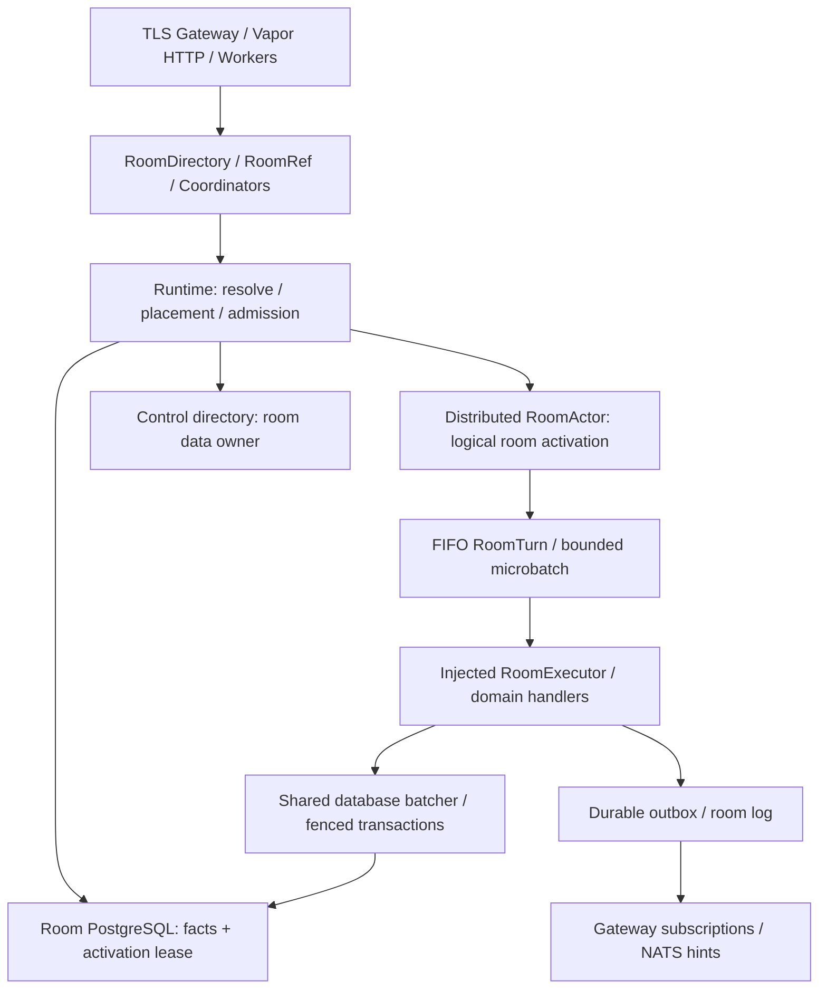

# Room Virtual Actor 并行实施方案

状态：**待实施方案**。本文不代表运行时已经实现、兼容性已经通过或生产容量已经批准。

基线：`origin/main@f1cdd78d6a21bf0ae23da627c0710c65115236aa`，即 `feat: migrate server to Vapor 5 beta.2`。只使用该提交的干净代码；不引入原工作目录中未提交的 Distributed Actor 改动。已确认 Swift tools 6.4、Vapor 5.0.0-beta.2 和 FluentKit 1.57.0；DistributedCluster 的可用版本由 P0 实测后固定。

配套文件：[公共契约](virtual-actor-contracts.md)、[工作包与派工卡](virtual-actor-task-cards.md)。当前实现仍以[当前架构](../../../docs/current-system-map.md)、[实施状态](../implementation-status.md)和[既有业务合同索引](../../../docs/reviews/README.md)为准；本组文档只规定下一步改造。

## 1. 交付目标

业务调用方只提供房间 ID 和业务请求，例如 `rooms.room(roomID).send(request)`。运行时负责找到当前实例、首次激活、恢复状态、失败后重新定位、空闲回收和停机排空。新增业务方法不再复制 shard 查询、store 选择、节点寻址或 Actor 引用刷新。

这是完整的**房间实体 Virtual Actor**：每个活跃房间有明确的生命周期与命令队列；所有房间事实写入都受当前 activation 的事务资格约束。Distributed Actor 提供跨进程调用，项目自己的运行时提供逻辑身份和实体生命周期。

首期范围包括私聊和群聊的命令、查询、创建协调、转发协调及后台房间写者。保留 PostgreSQL 权威状态、业务幂等、outbox、客户端 cursor/snapshot 恢复、NATS 提示和已有批处理。房间从现有表及必要日志恢复，不要求全量 Event Sourcing。

首期不把 User、Account、Media 等全部实体改为 Actor，也不恢复已经取消的数据 owner 在线搬迁工程。**Actor 换节点不等于房间换数据库。** 创建尚不存在的房间与激活已存在的房间是不同操作，前者由持久创建协调器完成。

## 2. 目标结构与来源取舍

代码依赖按“调用模块 → 被依赖模块”冻结：

| 模块 | 允许依赖 | 责任 |
| --- | --- | --- |
| 拟新增 `IMV2ActorContracts` | IMV2Core | Codable DTO、身份、错误、业务能力协议与运行时端口 |
| 拟新增 `IMV2ActorRuntime` | ActorContracts | 激活状态机、FIFO lane、逻辑引用、重试分类、容量与 reservation |
| 拟新增 `IMV2ActorCluster` | ActorRuntime、ActorContracts、固定版本 DistributedCluster | Host 发现、物理 Actor 引用、distributed 调用、可信节点通信 |
| 现有 `IMV2Server` | ActorContracts，及必要的 ActorRuntime 端口 | PostgreSQL lease、恢复与业务执行适配器；不得依赖 ActorCluster |
| 现有 Apps | IMV2Server、ActorCluster、原有 HTTP/Gateway 模块 | 注入、配置、资源启动和排空 |

具体 `distributed actor RoomActor` 放在 ActorCluster，通过注入的执行接口使用现有服务。Runtime 的底层 RoomRef 只使用 Contracts DTO；保留现有业务请求/结果类型的 typed façade 和 mapper 放在 IMV2Server，由领域包实现。避免 `IMV2Server ↔ RoomActor` 循环依赖；不跨 RPC 传数据库对象、Fluent 模型或 closure。现有 Sendable DTO 不自动具有序列化能力，映射必须显式完成。

首版复用 ServerApp 进程承载 RoomHost，多个 ServerApp 可以互相调用；AccountServerApp / OperatorServerApp 作为逻辑房间客户端，不自动承载房间。Host discovery 明确发布可承载身份与数据 owner 访问能力。独立生产 ActorHost 进程不作为必需前置，P0/V1 的 probe/harness 只承担验证。

参考 [swift-chat](https://github.com/akbashev/swift-chat/tree/c23f5f0bb272c048d2246f70f5cbc1b70f0e80d1) 的房间 Actor、[VirtualNodeRouter](https://github.com/akbashev/cluster-virtual-actors/blob/99c1eba0c65f77de827b141760c0f41fc6719df7/Sources/VirtualActors/VirtualNodeRouter.swift) 的发现与按 ID 定位，以及 [Journal](https://github.com/akbashev/cluster-event-sourcing/blob/4820b5553b78e87a69d63e13a411ac12ba735995/Sources/EventSourcing/ClusterJournalPlugin.swift) 的有序持久化思路。其内存 registry、hash ring、具体 Actor 引用和弱引用回收不能直接承担本项目的持久写入资格、自动重定位和可靠排空。

## 3. 必须先统一的决定

1. RoomID、数据 ownerEpoch、activationEpoch 分离。租约和单调 activationEpoch 保存在房间实际数据库；控制面 owner 目录与集群成员列表都不能替代租约。
2. 所有房间写事务在事务内验证 activation token，并持房间锁至提交。保证“新 epoch 授予提交后，旧 epoch 不能再提交”；不能声称租约时钟过期就能撤销已经持锁的事务。
3. 每房间一个 FIFO lane、一个未决 RoomTurn。连续兼容 send 可组成有界微批；权限、成员、维护、reservation 等屏障不能跨越。保留 [ADR-018](ADR-018-ordered-direct-room-log-microbatch.md) 已有的同房间合批和跨房间集合 SQL。
4. 逻辑 RoomRef 不暴露物理 ActorID。失效且明确未接受的请求可重新定位；回复丢失属于结果未知，只有持久幂等命令才能以原 operation ID 重发。
5. 同库转发保留**逐 source-target 的源授权与目标接受原子性**，不是把整个多目标请求改成全有或全无。使用独立协调器取得两个房间的执行 reservation；不允许两个普通 room turn 占着各自队列互等。
6. Actor 初期只保留小型状态和版本；不缓存全量历史、成员、永久操作回执或长期媒体授权。账户禁用、block、偏好等 control 变化仍参与请求授权。
7. HTTP、Gateway、后台恢复与维护使用相同房间能力。只把普通发送接上 Actor，不构成迁移完成。
8. 先验证 Swift 6.4 + Vapor 5 + DistributedCluster 的真实 Linux Release 双进程调用与退出，再启动依赖该 transport API 的全面实现。

详细边界与失败语义见[公共契约](virtual-actor-contracts.md)。这些决定在 C0 转成可编译的契约提交，其他代理从该提交开发。

## 4. 13 个工作包与依赖

| ID | 交付 | 前置条件 | 主要独占范围 |
| --- | --- | --- | --- |
| P0 | DistributedCluster 兼容性实证 | 固定 main | 独立双进程 probe；依赖变更交 C0 合入 |
| C0 | 编译契约、目标模块、文件归属、基线冻结 | P0 后完成依赖/API冻结；清点可提前 | manifests、wire DTO 总入口、公共配置、共享文件抽取 |
| R1 | PostgreSQL 激活租约与事务 fence | C0 | lease store、fence helper、canonical schema 全套 |
| R2 | 激活、恢复、队列、微批、回收、reservation | C0；先用 fake lease/executor | ActorRuntime 的 Hosting/Scheduling/Lifecycle/Coordination |
| R3 | 逻辑 RoomRef、解析与集群 transport | P0、C0；先用 fake host | ActorRuntime 的 Client、ActorCluster |
| D1 | 发送、编辑、撤回、reaction、发送合批 | C0；真实集成依赖 R1–R3 | RoomDomain/Messaging、对应 service/store/batcher |
| D2 | 成员、群管理、moderation、群昵称 | C0；真实集成依赖 R1–R3 | RoomDomain/Administration、对应 service/store |
| D3 | 已读、查询、批量恢复、订阅 | C0；真实集成依赖 R1–R3 | RoomDomain/Queries、Receipts、Subscriptions |
| D4 | 私聊/群创建、邀请、配额与恢复协调 | C0；集成依赖 D1/D2 | RoomCoordination/Creation、Invitations |
| D5 | 同库/跨库转发、媒体房间授权 | C0；集成依赖 R2 reservation、D1/D2 | RoomCoordination/Forwarding、MediaAuthorization |
| D6 | 维护写者、可信后台入口与用户投影衔接 | C0 可先清点；集成依赖 D1–D5 | RoomMaintenance、指定 worker adapter |
| V1 | 测试拓扑、故障矩阵、相对性能证据 | 基线先做；真实验收依赖集成候选 | 测试 harness、Compose、CI、证据目录 |
| I1 | Apps 接线、旧入口移除、最终交付 | 按上述依赖逐批合入 | 三个 App main、Gateway handler、共享 routed 文件、文档索引 |

工作包不是同时启动的 13 个代理。使用 **1 个主代理 + 3 个子代理**，按依赖复用槽位：

按用户指定，实施子代理统一使用 **GPT-6 Sol / High**（`model: gpt-6-sol`、`reasoning_effort: high`）。该设置适用于实现、验证和审查子代理；主代理模型不在本方案中改动。

| 波次 | 主代理 | 子代理槽位 1 | 子代理槽位 2 | 子代理槽位 3 | 离开条件 |
| --- | --- | --- | --- | --- | --- |
| W0 | C0 契约/文件清单 | P0 兼容性 | V1 基线与 harness 设计 | 业务 writer 台账与 C0 接口审查 | G0：兼容性通过；G1：契约可编译、所有权冻结 |
| W1 | 合入 R1–R3、消费端编译检查 | R1 持久化 | R2 本地运行时 | R3 逻辑引用/集群 | G2：真实两 host + PG 激活/接管/排空冒烟 |
| W2 | 接通最小远端 send + read，集成领域包 | D1 消息 | D2 管理 | D3 已读/查询/订阅 | G3：最小纵向链路和领域回归通过 |
| W3 | I1 App/worker 接线，持续 writer 审计 | D4 创建/邀请 | D5 转发/媒体 | D6 维护/后台 | G4：全部房间能力覆盖，无生产写入旁路 |
| W4 | I1 收口、广覆盖 Linux gate | V1 故障矩阵 | V1 性能场景（独立证据文件） | 独立合同/写者审查（只读） | G5：最终完成清单逐项有证据 |

有空余槽位时，D4/D5 可提前基于 fake RoomRef 实现纯协调逻辑；不得越过 G0/G1 先自行定义真实 transport 或领域签名。V1 的 harness 骨架可提前提交，真实故障结论只能来自真实进程和数据库。

W4 的性能代理可以并行准备脚本和分析，但采样窗口独占测试主机。同宿主的重型构建和故障实验排队；独立 Compose project 不隔离 CPU、内存和 I/O，容量不足时不同时启动多个完整栈。

主代理每次只合入一个依赖批次，编译并运行对应测试后发出新的集成 SHA。子代理消费该 SHA，而不是互相依赖未提交工作区。若 C0 接口变化，先更新契约和所有消费方，再继续实现。

## 5. 文件所有权与并行规则

| 文件/范围 | 唯一写入 owner | 其他包如何协作 |
| --- | --- | --- |
| `IMV2Server/Package.swift`、`Package.resolved`、共享 wire/error/config 定义 | C0 / 主代理 | 提交目标、依赖、DTO 变更请求，由 owner 合入 |
| `V2RoutedRoomStores.swift`、`V2RoutedRoomMutationStores.swift`、`V2GatewayDomainCommandHandler.swift` | I1 / 主代理 | C0 先做不改行为的抽取；领域包只改抽出后的独立文件 |
| ServerApp / AccountServerApp / OperatorServerApp 的 `main.swift`、跨领域 HTTP 路由接线 | I1 / 主代理 | 领域包提供 adapter、初始化参数和接线说明 |
| `schema.sql`、`V2SchemaReadiness.swift`、schema contract、bootstrap 断言、共享 fence helper | R1 | 领域包在自己的 store 调用冻结 helper；不复制或改写租约 SQL |
| ActorRuntime 的 Client 子目录 | R3 | R2 只拥有 Hosting/Scheduling/Lifecycle/Coordination；禁止双方改同一个 runtime 总文件 |
| 发送 batcher、房间写 SQL、room/shard admission credit pools | D1 | R1 提供 fence SQL 合同；共同冻结 credit 预留与业务事务锁边界；D3 独占 read-receipt batcher |
| 群昵称/联系人备注混合 store、media 混合文件、housekeeping 混合文件 | C0 先抽取；之后依任务卡归属 | 未抽取前只由主代理编辑，禁止按函数划分同一文件给两个代理 |
| CI / Compose / 故障 harness | V1 | 其他包提交场景和测试入口；P0 只写独立 probe 子目录 |
| 文档入口、正式合同索引、共享状态文档 | I1 | 各包交自己的证据与合同修订建议 |

每包使用独立 worktree、分支、`.build`、Compose project、数据库和 artifact 路径。C0 产出精确到文件的 `ownership` 清单；目录建议不替代清单。发现所有权冲突先交主代理重新分配，不能让后合入者随意解决业务冲突。

每次交付必须包含：commit SHA、基线/契约 SHA、修改文件、实现了哪些接口、实际测试命令和退出码、未满足的依赖、需要主代理修改的共享文件。接口请求写明“原因、受影响包、签名/语义变化、测试变化”。不把测试未执行写成通过。

## 6. 验证与阶段门禁

| Gate | 必须证明 | 不能代替它的证据 |
| --- | --- | --- |
| G0 | 固定依赖，Linux Release 两个 OS 进程远程调用、错误编解码、节点重启、Vapor/DB 同进程生命周期 | 单进程两个 ClusterSystem、Debug-only build、旧本地 DA 改动 |
| G1 | 模块无环、公共契约可编译、wire round trip、fakes 可用、文件归属与预算冻结 | 只有 Markdown 或每代理自己的接口草稿 |
| G2 | 两 host 抢同一实体、恢复前不可 ready、租约 fencing 两种提交顺序、正常排空 | mock lease、只检查 ownerEpoch、只测顺利路径 |
| G3 | Gateway 不在 Actor 节点时 send/read 成功，持久幂等/权限/序号不变，微批不退化 | 同机本地直接调用、只测新 Actor API |
| G4 | 所有前台/后台写者有 lane + transaction fence，批量查询/同库转发/跨库恢复保持原合同 | `rg V2Routed` 为零、仅删除旧类、仅普通发送成功 |
| G5 | [故障矩阵](virtual-actor-task-cards.md#v1-验证与证据)、既有 required checks、schema 漂移拒绝、Release 产品构建、相对性能与资源预算通过 | 合并完成、测试跳过、声称生产 SLO 已验收 |

正确性零容忍：确认后丢失、重复业务效果、新 epoch 生效后的旧写、无限队列均不允许。性能预算在看到候选结果前，由 C0/V1 根据 main 的稳定测量冻结；吞吐、p95/p99、SQL/命令、CPU/命令、RSS 分别记录阈值。未冻结不能宣称性能通过，不能为候选结果临时放宽。

同房间热写、多房间同库合批、读写混合/批量查询、冷实体激活回收、故障恢复峰值至少各有可复现负载。main 与候选相同机器、连接预算、数据集、seed、预热和时长，至少三轮交错运行。此处是工程回归验收，不是生产容量、RPO/RTO 或 PITR 批准。

现有及拟新增命令、可复用测试和故障断言见[任务卡](virtual-actor-task-cards.md)。本方案交付仅运行文档检查；实现阶段才能产生上述运行证据。

## 7. 上线前收口与完成定义

当前未上线，沿用全新 canonical schema 合同；不为本改造重建历史 migration 链。开发测试数据库可在明确为可丢弃环境时重建，已有需保留数据的环境必须另定迁移步骤，不能自动删除。

最终开发切换顺序：排空旧入口 → 部署更新后的 schema/服务到隔离验证环境 → 启用所有房间能力 → 执行 G5。不要保留两个生产房间 writer 同时生效。回退仅针对代码与明确可丢弃的测试环境；生产发布不属于本计划的自动执行动作。

完成时必须同时满足：

- 业务 service/HTTP/Gateway/worker 调用只依赖逻辑房间能力，物理 shard、host、epoch 处理集中在基础设施。
- 不存在可被生产入口调用的无 activation context 房间事实写接口；创建 bootstrap 等例外有封闭入口和独立幂等合同。
- 所有 writer 台账行均有负责人、真实调用路径、事务 fence 位置和测试证据；用户/control/projection 例外说明写哪张表、为何不改变房间权威状态。
- 节点故障、分区、旧实例恢复、回复丢失、回收竞态、取消、过载和有界恢复均有真实环境证据。
- 发送微批、转发原子范围、批量读取、隐私授权、outbox 和客户端恢复合同保持成立。
- Apps 启停、schema readiness、CI、指标、运行文档一起收口；正式合同进入现有 reviews 索引，当前状态只更新既有状态入口。

下一轮实施可以直接按任务卡启动 W0；本方案不要求一次性创建全部工作包代理。
