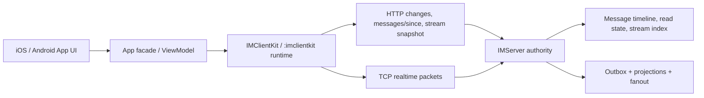

# Core Implementation Guide

This guide explains how the major IM implementation pieces fit together. It is
for maintainers who need to change behavior without crossing the architecture
boundaries in `docs/domain-boundaries.md`.

## System Shape

- `IMServer` is authoritative for timeline order, session validity, read state,
  AI stream terminal state, and routing.
- Client core libraries own connection, sync, cache restore, state merging, and
  local outgoing state.
- App layers own UI, view state, navigation, and dependency assembly only.

## Server Core

### Message Timeline And Outbox

- Message writes allocate the server sequence and persist the canonical message.
- Domain events are enqueued into the conversation outbox in the same write path.
- `ConversationOutboxProcessor` claims pending/failed events, dispatches
  consumers, and updates retry/dead-letter state. It is the asynchronous bridge
  from timeline writes to projections and realtime fanout.
- `IMConversationSummaryProjectionWriter` updates per-user summaries, unread
  counts, and change logs. It is a read-model projection, not a command handler.

### Realtime Routing

- TCP is a realtime accelerator. It does not replace HTTP convergence.
- Ack means the server accepted and persisted the message. Canonical `message`
  packets carry the display truth: `messageID`, `serverSequence`, timestamps,
  and content.
- Clients must merge canonical echo with local outgoing messages by
  `clientMessageID`.

### AI Stream

- `IMMessageStreamingService` orchestrates prompt validation, policy guardrails,
  lease reservation, provider runner startup, and event publishing.
- `AIMessageStreamStateStore` is the only facade for reading or mutating stream
  state.
- `AIMessageStreamWriteStore` is the only component that dual-writes message
  `derivedState`/content and `im_ai_message_streams`.
- `AIMessageStreamRepairStore` handles legacy backfill, stale repair, and
  consistency audit.
- Providers, content safety, rate limiting, model routing, and cost ledger code
  must never write message/index state directly.

## iOS Core

- `IMConversationStore` is the main-actor client read model. It merges summaries,
  messages, read state, outgoing queue state, AI stream state, and cached
  snapshots into one observable state.
- `ConversationRuntimeController` is the App-level IM facade. It delegates TCP,
  gap sync, read reporting, queued flush, media transfer, and AI stream recovery
  to coordinators.
- SwiftUI views call `AuthManager` / runtime facade methods and observe derived
  state. Views must not parse packets, run HTTP sync, write cache snapshots, or
  manage stream recovery queues.

## Android Core

- `IMRuntimeController` is the lifecycle coordinator. Start order is cache
  restore, active stream snapshot recovery, summary refresh, pending read retry,
  then TCP connection.
- `IMConversationStore` is the StateFlow read model. It owns local merge rules
  for summaries, messages, read state, outgoing delivery state, AI stream state,
  and pending snapshot targets.
- The Android `app` module talks through gateways and ViewModels. It must not
  call Ktor, Room, raw TCP transports, or cache implementations directly.

## Change Rules

- Prefer adding a helper/coordinator behind an existing facade over expanding a
  large core file.
- When changing message merge, read state, gap sync, AI stream, cache restore, or
  outbox behavior, update or add targeted regression tests in the same domain.
- Any file above the governance threshold must be listed in
  `docs/complexity-budgets.tsv`; budget increases are separate architecture
  commits.
