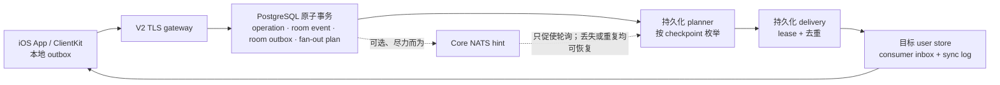

# 当前 V2 架构

本文描述仓库当前的 V2 实现。实现存在不等于生产发布批准；验证等级和缺口见
[implementation status](../IMV2/docs/implementation-status.md)。

## 组件边界

| 组件 | 职责 | 不承担的职责 |
| --- | --- | --- |
| `IMV2Core` | 领域 ID、帧/命令、准入、fan-out 和同步规则 | 网络、数据库、UI、密钥存储 |
| `IMV2Server` | V2 TLS gateway、PostgreSQL store、持久化 outbox/fan-out、账户/设备服务、operator 控制面 | 将 broker 作为业务真相 |
| `IMV2ClientKit` | Keychain 会话、独立 SQLite 同步投影、持久化命令 outbox、TLS/HTTPS 适配器 | SwiftUI 展示、直接访问服务端数据库 |
| `IMApp` | SwiftUI 状态与用户交互、依赖注入、iOS Push/文件导入边界 | 直接持有 bearer token、直接操作协议或数据库 |
| `IMV2` | 编号 SQL migration、隔离测试 Compose、本机账户栈、Prometheus 规则与运行文档 | 生产编排或容量批准 |

## 消息与同步事实链

客户端先把用户命令写入本机 SQLite outbox；gateway 只在 PostgreSQL 原子事务成功后接受命令。房间事件、room outbox、冻结的受众或 fan-out plan 同事务落库。planner 与 delivery worker 使用可恢复的 lease、checkpoint、唯一 inbox key 和有界重试推进投影。任何实时提示只是提示：用户可见状态只从已持久化的 sync log 拉取并 ACK。

达到重试预算的 room outbox 或 delivery 进入 `paused`，而不是跳过。单条 paused work 只能由独立、loopback-only 的 operator 服务在修复根因后受控 replay。

## 群聊、私聊与接收策略

- 群创建将初始成员、房间和操作结果作为一项幂等写入；成员变更由 owner 授权，移除允许 owner/admin（不得移除 owner），均携带 membership revision。
- 每条需 fan-out 的事件在提交时固定受众规则：普通群事件按提交时成员资格枚举；成员移除等需要精确历史受众的事件保存冻结目标。随后成员变化不能扩大已经提交事件的可见范围。
- 群成员目录不是 fan-out payload；客户端只在打开成员管理时做认证后的 seek-pagination 查询。
- 每个群成员目录条目都只携带公开 `@handle` 与显示名，并由 active-member 授权；App
  不显示内部 `user_id`。该资料随单个有界页面读取，不进入群 roster 的 fan-out 或 sync
  投影。通过 `@handle` 显式打开私聊时，客户端把该次已授权解析的资料和 direct room
  绑定到本机 SQLite，用于会话列表与详情标题；未知资料只显示“会话”。仅对 active direct
  room，snapshot v11 会重建权威的对方公开资料；打开私聊时也会写入双方各一条有界资料
  投影。显示名变更与来源事件在同一 PostgreSQL 事务内写入控制面 outbox，gateway 按接收者
  预算投递、按 checkpoint 恢复，并在迁移 forwarding 期间镜像到目标 user shard。ClientKit
  始终优先使用该服务端同步资料，而非设备本地的显式查询缓存。群 roster 仍保持按需读取，
  不做资料 fan-out。
- 非好友可以发起私聊，但陌生人消息在服务端持久化事务中按接收方设置和窗口限额准入。默认基线为每个发送者 24 小时 3 条；接收方可关闭此类消息。
- 撤回、编辑、reaction、read receipt、mute/freeze 与 moderation 都通过独立、幂等、可同步的命令/投影处理；UI 不以网络响应直接覆盖同步投影。

## 可选 NATS 提示层

默认不需要 Redis 或 NATS。gateway 始终轮询 PostgreSQL 的 durable work；只有同时提供 `IM_V2_NATS_URL` 与 `IM_V2_NATS_SUBJECT` 时，才在持久化 plan 已发布后额外发出一个 Core NATS `CONNECT`/`PUB` JSON hint。可选 `IM_V2_NATS_TOKEN` 仅作为 CONNECT token。

当前实现为刻意受限的最佳努力优化：每个 hint 新建连接，写入失败被抑制，且没有订阅端、连接复用/重连、NATS TLS/NKey、broker ACK 或 broker 健康指标。它不能确认 broker 已接收消息，也不参与完成、授权、去重或重试决定。NATS 不可用、提示丢失或重复时，durable polling 仍会处理同一 PostgreSQL 工作；代价只是额外延迟。把它用于高频群之前，必须补齐真实 broker 集成、认证/TLS、消费唤醒、可观测性和负载/故障证据。

## 文档使用方式

- 想了解设计决定：查看 [ADR register](../IMV2/docs/ADR-REGISTER.md)。
- 想判断能力和证据等级：查看 [implementation status](../IMV2/docs/implementation-status.md)。
- 想运行本机账户栈：查看 [IMApp README](../IMApp/README.md) 或 [IMV2Server README](../IMV2Server/README.md)。
- 想处理 paused durable work、观察指标或迁移用户分片：从 [V2 文档入口](../IMV2/docs/README.md) 进入对应 runbook。
