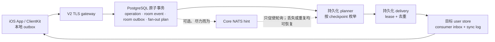

# 当前 V2 架构

本文描述仓库当前的 V2 实现。实现存在不等于生产发布批准；验证等级和缺口见
[implementation status](../IMV2/docs/implementation-status.md)。

## 组件边界

| 组件 | 职责 | 不承担的职责 |
| --- | --- | --- |
| `IMV2Core` | 领域 ID、帧/命令、准入、fan-out 和同步规则 | 网络、数据库、UI、密钥存储 |
| `IMV2Server` | V2 TLS gateway、PostgreSQL store、持久化 outbox/fan-out、账户/设备服务、operator 控制面 | 将 broker 作为业务真相 |
| `IMV2ClientKit` | Keychain 会话、独立 SQLite 同步投影、持久化命令 outbox、TLS/HTTPS 适配器 | SwiftUI 展示、直接访问服务端数据库 |
| `IMApp` | SwiftUI 状态与用户交互、依赖注入、iOS Push/文件导入边界 | 直接持有 bearer token、直接操作协议或数据库 |
| `IMV2` | PostgreSQL 当前 canonical schema、隔离测试 Compose、本机账户栈、Prometheus 规则与运行文档 | 生产编排或容量批准 |

## 消息与同步事实链

客户端先把用户命令写入本机 SQLite outbox；gateway 只在 PostgreSQL 原子事务成功后接受命令。房间事件、room outbox、冻结的受众或 fan-out plan 同事务落库。planner 与 delivery worker 使用可恢复的 lease、checkpoint、唯一 inbox key 和有界重试推进投影。任何实时提示只是提示：用户可见状态只从已持久化的 sync log 拉取并 ACK。

消息 Snapshot 投影把同一 message revision 的完整正文保存在物理 user store 的
`message_projection_states` 一次；`user_projection_versions` 只保留用户授权/MVCC 事实和
稳定 state reference。跨 store fan-out 与用户 shard migration 都先复制 immutable
state 再写引用。Snapshot 和媒体授权通过用户引用 join state，shared state 本身不授予
可见性。current-2 仍保留 dual/prefer-shared 灰度模式，生产 contract 尚需按
[runbook](../IMV2/docs/10-operations/message-projection-sharing-runbook.md) 完成。

达到重试预算的 room outbox 或 delivery 进入 `paused`，而不是跳过。单条 paused work 只能由独立、loopback-only 的 operator 服务在修复根因后受控 replay。

## 群聊、私聊与接收策略

- 群创建将初始成员、房间和操作结果作为一项幂等写入；成员变更由 owner 授权，移除允许 owner/admin（不得移除 owner），均携带 membership revision。
- 每条需 fan-out 的事件在提交时固定受众规则：普通群事件按提交时成员资格枚举；成员移除等需要精确历史受众的事件保存冻结目标。随后成员变化不能扩大已经提交事件的可见范围。
- 私聊 `message.accepted` 可从锁定的 direct pair 与提交 revision 上有效的两条 membership
  直接创建一个 completion unit 和两个 durable delivery，不再等待 Planner 枚举。受众不是
  客户端参数；目标数不等于 2 时整笔回滚，route 配置暂不可用时互斥回退原
  `room_outbox -> Planner` 路径。两种路径共用 Inbox、同步、重试与 admission release；
  灰度与审计见 [direct fan-out runbook](../IMV2/docs/10-operations/direct-preplanned-fanout-runbook.md)。
- 群成员目录不是 fan-out payload；客户端只在打开成员管理时做认证后的 seek-pagination 查询。
- 每个群成员目录条目都只携带公开 `@handle` 与显示名，并由 active-member 授权；App
  不显示内部 `user_id`。该资料随单个有界页面读取，不进入群 roster 的 fan-out 或 sync
  投影。通过 `@handle` 显式打开私聊时，客户端把该次已授权解析的资料和 direct room
  绑定到本机 SQLite，用于会话列表与详情标题；未知资料只显示“会话”。仅对 active direct
  room，Snapshot V3（projection schema 31）会重建权威的对方公开资料；打开私聊时也会写入双方各一条有界资料
  投影。显示名变更与来源事件在同一 PostgreSQL 事务内写入控制面 outbox，gateway 按接收者
  预算投递、按 checkpoint 恢复，并在迁移 forwarding 期间镜像到目标 user shard。ClientKit
  始终优先使用该服务端同步资料，而非设备本地的显式查询缓存。群 roster 仍保持按需读取，
  不做资料 fan-out。
- 非好友可以发起私聊，但陌生人消息在服务端持久化事务中按接收方设置和窗口限额准入。默认基线为每个发送者 24 小时 3 条；接收方可关闭此类消息。
- 联系人页只展示 pending/accepted 关系的公开资料：关系本身来自本地 user-sync 投影，
  accepted/incoming/outgoing 各自以稳定 keyset 每页最多读取 50 条，资料 hydration 不越过当前页；
  名称与 handle 的包含搜索通过 trigger 维护的单字/双字 character-gram FTS5 索引执行，不扫描
  全量 profile；
  资料网络读取带 `relationship` 授权上下文并以 100 条为上限。添加、接受、拒绝、撤销、删除
  与屏蔽先进入 durable social outbox；服务端 ACK 不会乐观修改联系人列表，下一次同步投影
  才是最终可见状态。好友资料可通过幂等 direct-room 打开操作跳转到会话页。
- 撤回、编辑、reaction、read receipt、mute/freeze 与 moderation 都通过独立、幂等、可同步的命令/投影处理；UI 不以网络响应直接覆盖同步投影。

## Snapshot V3 reset

服务端以连续 checkpoint 驱动每用户 application-MVCC projection。reset 在固定 base sequence
上按稳定 keyset 生成持久化小页，不再重放完整 `user_sync_log` 或在进程内保留完整快照对象。
客户端逐页写入 SQLite shadow tables；服务端 ACK 成功后才原子替换 live projection。ACK 前崩溃
会重用本地 manifest/shadow，过期拒绝则恢复 reset 前游标，因此 generation 与 UI 投影不会分叉。
`user_sync_log` 只保留 checkpoint 之上的增量尾部与最小 replay window。有界 compactor 在
token/receipt、迁移 fence、consumer inbox 稳定结果和 shared payload 引用均安全后推进
retained floor 并分批删除前缀，不扫描历史设备。新设备或低于 floor 的 cursor 在实际 pull 时
才进入 Snapshot V3；同一用户/profile/schema 可复用仍在 floor 之上的最新 artifact，再通过
增量同步追上，generation/token/receipt 仍逐设备隔离。已撤销设备的 cursor 与 capability 由
housekeeping 分批删除。控制投影的稳定
幂等结果单独保存在 `user_projection_effects`，不再依赖可裁剪日志。

## 可选 NATS 提示层

默认不需要 Redis 或 NATS。gateway 始终轮询 PostgreSQL durable work；启用 NATS 后，fan-out plan hint 仍是持久化完成后的可丢失优化。Hybrid 房间和 presence/typing 使用每个 gateway 一条复用 Core NATS 连接，只订阅本机当前观看/观察的作用域；所有命令以 `PING`/`PONG` 确认，连接失败或 broker 重启后按当前本机兴趣重放订阅。

当前实现仍不参与完成、授权、去重或重试决定。前台 room hint mailbox、broker payload mailbox 和 pending ACK 均有硬上限；NATS 不可用、提示丢失或重复时，durable polling/cursor pull 会恢复。尚缺 NATS TLS/NKey、broker/reconnect/consumer-lag 指标与代表性负载/故障证据，因此生产热点群仍不能只依赖该提示层。

## 文档使用方式

- 想了解设计决定：查看 [ADR register](../IMV2/docs/ADR-REGISTER.md)。
- 想判断能力和证据等级：查看 [implementation status](../IMV2/docs/implementation-status.md)。
- 想运行本机账户栈：查看 [IMApp README](../IMApp/README.md) 或 [IMV2Server README](../IMV2Server/README.md)。
- 想处理 paused durable work、观察指标或迁移用户分片：从 [V2 文档入口](../IMV2/docs/README.md) 进入对应 runbook。
