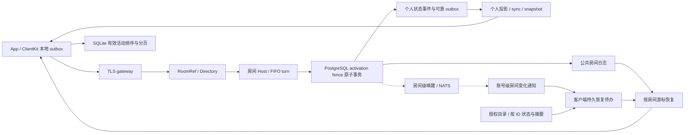

# 当前 V2 架构

本文描述仓库当前的 V2 实现。实现存在不等于生产发布批准；验证等级和缺口见
[implementation status](../IMV2/docs/implementation-status.md)。

## 组件边界

| 组件 | 职责 | 不承担的职责 |
| --- | --- | --- |
| `IMV2Core` | 领域 ID、帧/命令、准入与同步规则 | 网络、数据库、UI、密钥存储 |
| `IMV2Server` | V2 TLS gateway、PostgreSQL store、房间日志与个人事件 outbox、账户/设备服务、operator 控制面 | 将 broker 作为业务真相 |
| `IMV2ActorContracts/Runtime/Cluster/Application` | 房间逻辑引用、租约激活、FIFO/回收、认证集群调用与应用生命周期 | 把内存 Actor 或 membership 当持久完成事实 |
| `IMV2ClientKit` | Keychain 会话、独立 SQLite 同步投影、持久化命令 outbox、TLS/HTTPS 适配器 | SwiftUI 展示、直接访问服务端数据库 |
| `IMApp` | SwiftUI 状态与用户交互、依赖注入、iOS Push/文件导入边界 | 直接持有 bearer token、直接操作协议或数据库 |
| `IMV2` | PostgreSQL 当前 canonical schema、隔离测试 Compose、本机账户栈、Prometheus 规则与运行文档 | 生产编排或容量批准 |

## 消息与同步事实链

客户端先将命令写入本地 outbox；Gateway 经 RoomRef 调用房间 Host，在 PostgreSQL 原子事务成功后确认接受。
Gateway 可托管房间或仅调用远端 Host；Account 的房间能力使用 caller-only 节点。寻址、租约、完整 token fence 和回收边界见[房间 Virtual Actor 合同](reviews/room-virtual-actor-contract.md)。
私聊和群聊公共内容统一保存在房间日志，普通接受消息可由 message_row 承载，读取时与 room_events 合并。
个人事件流保存成员变化、已读、偏好和单侧提示；公共消息不再按成员写入个人同步副本。
账号级通知只提示变化，丢失或覆盖失效时从目录、状态和持久游标恢复；不能把通知写出当作正文落库。
会话列表由客户端按有效活动事实维护本地排序，服务端没有活动排行恢复入口。
设计与验收边界见[会话同步实施方案](reviews/client-owned-conversation-sync-plan.md)及[当前验收](reviews/client-owned-conversation-sync-acceptance.md)。

个人 Snapshot 直接读取个人投影版本的载荷，公共消息和群公共事件由房间日志恢复。
成员撤销、个人会话、单侧提示和收藏等个人状态保留可靠个人事件及独立检查点。
消息媒体授权使用当前成员关系与接受、编辑时的权限事实；消息状态本身不授予可见性。
旧消息副本的双写、读取模式与回填任务已删除，运维见
[个人快照说明](../IMV2/docs/10-operations/personal-snapshot-runbook.md)。

个人事件来源队列的暂时失败继续重试，确定性失败暂停。修复后由独立 operator 服务按
来源分片、用户和事件类型进行审计重放，不跳过事件或手工推进用户序号。

## 群聊、私聊与接收策略

- 群创建将初始成员、房间和操作结果作为一项幂等写入；成员变更由 owner 授权，移除允许 owner/admin（不得移除 owner），均携带 membership revision。
- 公共事件的读取资格以当前授权及提交时成员事实为准，成员变化不能扩大历史事件的可见范围。
- 私聊和群聊公共内容统一按房间游标恢复，不提供 planner/preplanned/fanout 兼容部署模式。私聊仍执行 pair/block/陌生人策略、成员授权、冻结、容量和幂等检查；单侧受限提示进入个人事件流。
- 群成员目录不是 fan-out payload；客户端只在打开成员管理时做认证后的 seek-pagination 查询。
- 每个群成员目录条目都只携带公开 `@handle` 与显示名，并由 active-member 授权；App
  不显示内部 `user_id`。该资料随单个有界页面读取，不进入群 roster 的 fan-out 或 sync
  投影。通过 `@handle` 显式打开私聊时，客户端把该次已授权解析的资料和 direct room
  绑定到本机 SQLite，用于会话列表与详情标题；未知资料只显示“会话”。仅对 active direct
  room，Snapshot V3（projection schema 31）会重建权威的对方公开资料；打开私聊时也会写入双方各一条有界资料
  投影。显示名变更与来源事件在同一 PostgreSQL 事务内写入控制面 outbox，gateway 按接收者
  预算投递、按 checkpoint 恢复，并将控制面资料事件投递到用户当前所属分片。ClientKit
  始终优先使用该服务端同步资料，而非设备本地的显式查询缓存。群 roster 仍保持按需读取，
  不做资料 fan-out。
- 非好友可以发起私聊，但陌生人消息在服务端持久化事务中按接收方设置和窗口限额准入。默认基线为每个发送者 24 小时 3 条；接收方可关闭此类消息。
- 联系人页只展示 pending/accepted 关系的公开资料：关系本身来自本地 user-sync 投影，
  accepted/incoming/outgoing 各自以稳定 keyset 每页最多读取 50 条，资料 hydration 不越过当前页；
  名称与 handle 的包含搜索通过 trigger 维护的单字/双字 character-gram FTS5 索引执行，不扫描
  全量 profile；
  资料网络读取带 `relationship` 授权上下文并以 100 条为上限。添加、接受、拒绝、撤销、删除
  与屏蔽先进入 durable social outbox；服务端 ACK 不会乐观修改联系人列表，下一次同步投影
  才是最终可见状态。好友资料可通过幂等 direct-room 打开操作跳转到会话页。
- 撤回、编辑、reaction、read receipt、mute/freeze 与 moderation 都通过独立、幂等、可同步的命令/投影处理；UI 不以网络响应直接覆盖同步投影。

## Snapshot V3 reset

服务端以连续 checkpoint 驱动每用户 application-MVCC projection。reset 在固定 base sequence
上按稳定 keyset 生成持久化小页，不再重放完整 `user_sync_log` 或在进程内保留完整快照对象。
客户端逐页写入 SQLite shadow tables；服务端 ACK 成功后才原子替换 live projection。ACK 前崩溃
会重用本地 manifest/shadow，过期拒绝则恢复 reset 前游标，因此 generation 与 UI 投影不会分叉。
`user_sync_log` 只保留 checkpoint 之上的增量尾部与最小 replay window。有界 compactor 在
有效 token/receipt 与最小重放窗口均安全后推进
retained floor 并分批删除前缀，不扫描历史设备。新设备或低于 floor 的 cursor 在实际 pull 时
才进入 Snapshot V3；同一用户/profile/schema 可复用仍在 floor 之上的最新 artifact，再通过
增量同步追上，generation/token/receipt 仍逐设备隔离。已撤销设备的 cursor 与 capability 由
housekeeping 分批删除。控制投影的稳定
幂等结果单独保存在 `user_projection_effects`，不再依赖可裁剪日志。

## 资源系统演进

当前工作分支已接入用途/逻辑 home 路由的资源上传与恢复、不可变对象 placement、基础跨 home 导入、短期资料展示 lease，以及客户端持久上传任务和发送意图。存储、上传传输、分发、扫描和衍生处理分别通过可替换协议注入；本地文件和本地分发是参考适配器，业务消息不携带物理地址。

个人资料及头像新增按上下文批量读取的路径，由 control/profile 权威和 room Actor 共同核验。旧的同步资料与部分查询入口仍存在，迁移尚未完成。小图分发具有鉴权后的共享缓存与请求合并，但作者资料补充、跨接收者授权合批、真实 CDN 与万人突发验收仍未完成。

最新实现边界、实测记录和未完成要求见[资源系统实施记录](proposals/resource-system-implementation.md)，完整设计见[资源系统方案](proposals/resource-system-design.md)。这些改动尚不构成完整资源系统或生产容量批准。

## 可选 NATS 提示层

默认不需要 Redis 或 NATS。gateway 始终轮询 PostgreSQL durable work；启用 NATS 后，房间变化与实时活动提示仍是持久化完成后的可丢失优化。当前群房间和 presence/typing 使用每个 gateway 一条复用 Core NATS 连接，只订阅本机当前观看/观察的作用域；所有命令以 `PING`/`PONG` 确认，连接失败或 broker 重启后按当前本机兴趣重放订阅。

当前实现仍不参与完成、授权、去重或重试决定。前台 room hint mailbox、broker payload mailbox 和 pending ACK 均有硬上限；NATS 不可用、提示丢失或重复时，durable polling/cursor pull 会恢复。尚缺 NATS TLS/NKey、broker/reconnect/consumer-lag 指标与代表性负载/故障证据，因此生产热点群仍不能只依赖该提示层。

## 文档使用方式

- 想找某个主题当前生效的合同：查看 [合同索引](reviews/README.md)。
- 想了解设计决定：查看 [ADR register](../IMV2/docs/ADR-REGISTER.md)。
- 想判断能力和证据等级：查看 [implementation status](../IMV2/docs/implementation-status.md)。
- 想知道 47 项问题哪些还开着：查看 [问题状态表](reviews/status.md)；整改过程的逐批记录在
  [历史时间线](reviews/archive/2026-09-05-remediation-timeline.md)，不代表当前状态。
- 想运行本机账户栈：查看 [IMApp README](../IMApp/README.md) 或 [IMV2Server README](../IMV2Server/README.md)。
- 想处理 paused durable work、观察指标或配置静态用户分片：从 [V2 文档入口](../IMV2/docs/README.md) 进入对应 runbook。
