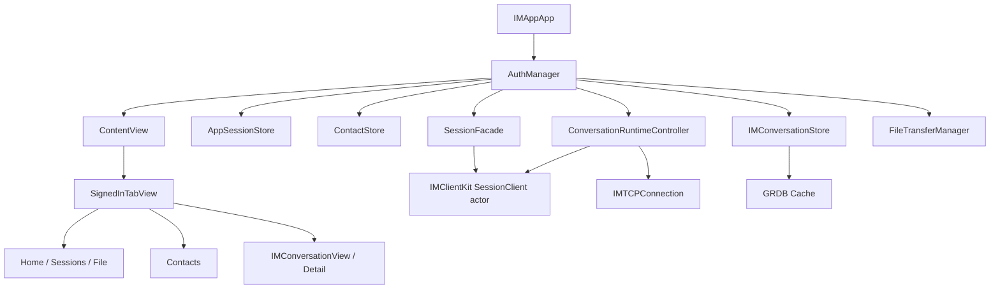
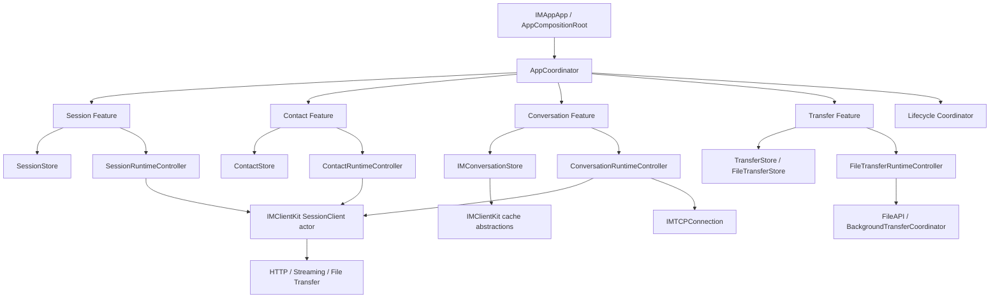

# IMApp 客户端架构优化方案

本文档定义 `IMApp` iOS 客户端下一阶段的架构优化方向。目标不是重写客户端，而是在保留当前可运行链路的前提下，逐步收紧 UI、状态、副作用、网络、缓存和实时同步之间的边界。

当前日期：2026-05-21

## 背景

`IMApp` 已经具备真实 IM 客户端的核心链路：

- 登录、注册、恢复登录和设备会话管理。
- 会话列表、会话详情、历史消息、实时消息、已读上报和未读校正。
- TCP 实时连接、断线重连、gap sync、离线队列 flush。
- 联系人、好友申请、拉黑、直接会话关系展示。
- 文件上传下载、后台传输恢复。
- 本地 GRDB 缓存、Keychain token、UserDefaults 用户缓存。

当前架构方向基本正确：SwiftUI view 不直接处理 TCP 包、HTTP 同步或 GRDB 读写，复杂 IM 同步逻辑已经下沉到 `ConversationRuntimeController` 和 `IMClientKit`。主要问题是 `AuthManager` 仍然承担过多应用级职责，长期继续扩展会降低可维护性和测试聚焦度。

## 当前结构



### 主要路径

- App 组合根：`IMApp/IMApp/IMAppApp.swift`
- App 配置：`IMApp/IMApp/App/AppNetworkConfiguration.swift`
- 全局协调：`IMApp/IMApp/Auth/AuthManager.swift`
- App 状态：`IMApp/IMApp/Auth/AppStores.swift`
- IM 运行时：`IMApp/IMApp/Auth/IMController.swift`
- IM 读模型：`IMClientKit/Sources/IMClientKit/Features/IM/IMConversationStore.swift`
- 网络 facade：`IMClientKit/Sources/IMClientKit/Networking/SessionClient.swift`
- 本地缓存：`IMClientKit/Sources/IMClientKit/Features/GRDBClientPersistence.swift`

## 设计目标

1. 保留当前已跑通的业务链路，不做大面积重写。
2. 让 view 只负责渲染和用户意图入口。
3. 让 store 只负责 UI 状态、读模型、派生状态和加载生命周期。
4. 让 runtime/controller 负责副作用编排，包括网络、缓存、TCP、后台任务和跨 store 协调。
5. 让 `IMClientKit` 持续作为协议、网络、缓存、读模型和客户端领域能力的核心包。
6. 逐步把 `AuthManager` 从“全局能力总线”收敛为组合根和生命周期协调器。
7. 优先通过小 PR 渐进迁移，每一步都保持可测试、可回滚。

## 目标架构



### 分层职责

| 层 | 职责 | 不应承担 |
| --- | --- | --- |
| `View` | 渲染、用户输入、触发 action、导航入口 | 网络请求、缓存写入、TCP 事件处理、复杂状态合并 |
| `Store` | UI 状态、读模型、派生状态、加载状态、选择态 | 发请求、打开连接、直接访问 GRDB、跨 feature 编排 |
| `RuntimeController` | 副作用编排、任务生命周期、错误策略调用、cache flush/restore | 视图布局、展示细节、直接构造复杂 UI |
| `Facade` | 为 feature 提供稳定 API，隐藏 controller 组合 | 长期堆积业务细节 |
| `IMClientKit` | 协议适配、网络、缓存抽象、客户端读模型、领域合并规则 | SwiftUI navigation、页面展示状态、app 生命周期 |

## AuthManager 收敛方向

当前 `AuthManager` 负责：

- 登录态与 session 恢复。
- 联系人和好友申请。
- IM 连接、会话列表、消息详情、媒体消息。
- 文件传输和后台恢复。
- app 前后台生命周期。
- token/session 失效后的错误处理。
- GRDB cache restore/flush 调度。

目标不是删除 `AuthManager`，而是把它降级为组合与协调边界：

```swift
@MainActor
final class AppCoordinator: ObservableObject {
    let session: SessionFeature
    let contacts: ContactFeature
    let conversations: ConversationFeature
    let transfers: TransferFeature

    func appDidBecomeActive() async
    func appDidEnterBackground() async
    func clearSession(message: String?) async
}
```

迁移期间可以继续保留 `AuthManager` 名称，避免一次性改动大量 view。内部先抽 feature 组件，外部 API 稳定后再决定是否重命名。

## Feature 边界

### Session Feature

建议拥有：

- `AppSessionStore`
- `SessionRuntimeController`
- `SessionFacade`
- `AuthSessionController`

职责：

- 登录、注册、恢复登录、退出。
- 当前用户资料和设备会话。
- session 失效策略入口。
- 登录态变化时发出 feature 级事件。

不负责：

- 联系人列表刷新。
- IM TCP 连接细节。
- 文件传输取消细节。

### Contact Feature

建议拥有：

- `ContactStore`
- `ContactRuntimeController`
- `ContactsController`

职责：

- 联系人、好友申请、拉黑列表。
- TCP contact event 应用。
- 联系人缓存 restore/flush。
- 好友申请未读计数和展示状态。

不负责：

- 直接会话的消息同步。
- 全局 session 清理。

### Conversation Feature

建议拥有：

- `IMConversationStore`
- `IMConversationPresentationStore`
- `IMConversationRuntimeStore`
- `ConversationRuntimeController`
- `IMConnectionCoordinator`
- `IMGapSyncCoordinator`
- `IMReadReportCoordinator`
- `QueuedMessageFlushCoordinator`
- `MessageStreamSnapshotRecoveryQueue`

职责：

- 会话摘要、会话详情、消息时间线。
- TCP 连接和实时事件处理。
- gap sync、已读上报、离线消息 flush。
- IM 媒体消息上传下载状态投影。
- 会话 cache restore/flush。

不负责：

- 登录 UI。
- 联系人申请列表 UI。
- 普通文件传输演示页。

### Transfer Feature

建议拥有：

- `FileTransferManager` 或拆分后的 `FileTransferStore`
- `FileTransferRuntimeController`
- `BackgroundTransferCoordinator` 集成点

职责：

- 文件上传下载演示链路。
- 后台传输恢复。
- 传输进度、失败和恢复状态。

不负责：

- IM 媒体消息业务语义。IM 媒体可复用传输基础设施，但状态投影应归 `Conversation Feature`。

## 状态建模优化

现有代码已经大量使用 `@MainActor ObservableObject` 和 `@Published`。下一步建议收敛 `isLoading + message + optional data` 组合，优先在复杂页面采用明确状态模型。

推荐模型：

```swift
enum LoadState<Value: Equatable>: Equatable {
    case idle
    case loading
    case loaded(Value)
    case failed(message: String)
}
```

优先迁移对象：

1. 联系人申请加载状态。
2. 会话成员分页状态。
3. 消息搜索状态。
4. 文件上传下载状态。
5. session 恢复状态。

不建议一次性替换所有状态字段。先在新代码和高复杂度页面引入，旧字段可以逐步过渡。

## 错误处理优化

当前 session 保留、服务器离线、清空登录态、普通业务错误的处理分散在多个 extension。建议抽出统一策略对象：

```swift
@MainActor
struct AppRuntimeErrorPolicy {
    func classify(_ error: Error) async -> AppRuntimeErrorAction
}

enum AppRuntimeErrorAction: Equatable {
    case showMessage(String)
    case markServerOffline(String)
    case clearSession(String?)
    case ignoreCancellation
}
```

迁移收益：

- 避免每个 feature 重复判断 `shouldPreserveSession` 和 `shouldMarkServerOffline`。
- 测试可以直接覆盖错误分类，不必启动完整 `AuthManager`。
- UI 文案和 runtime 行为可以分别演进。

## 导航优化

当前 `SignedInTabView` 使用 `NavigationStack(path:)`，消息详情路由为 `IMNavigationRoute`。后续联系人详情、文件详情、设置页增加后，建议定义 app 级 route：

```swift
enum AppRoute: Hashable {
    case conversation(String)
    case contact(UUID)
    case contactRequests
    case session(UUID)
    case fileTransferDetail(String)
}
```

原则：

- tab 只决定一级功能区。
- 跨页面跳转统一经过 route。
- feature 内部可以有自己的子 route，但跨 feature route 应在 app 层显式建模。

## 依赖注入优化

当前主要通过 `EnvironmentObject AuthManager` 暴露能力。短期可接受，但新页面应避免直接拿全量 `AuthManager`。

推荐：

- App 入口只创建一次依赖图。
- Feature view 显式接收自己需要的 `store` 和 `runtimeStore`。
- 必须注入的依赖使用显式失败的默认值，不提供静默伪实现。
- 测试构造使用 `AuthManagerDependencies` 或更小的 feature dependencies。

迁移顺序：

1. 新 view 不再新增 `@EnvironmentObject AuthManager`。
2. 现有 view 中只需要少量能力的，改成显式参数。
3. `AuthManager` 内部 feature 组件稳定后，再替换外层注入形态。

## 测试策略

每次架构迁移 PR 至少覆盖对应 feature 的核心行为。

| 改动范围 | 最小验证 |
| --- | --- |
| Session runtime | 登录、恢复登录、退出、session 失效测试 |
| Contact runtime | 联系人刷新、好友申请事件、缓存 restore/flush 测试 |
| Conversation runtime | 会话刷新、TCP 事件、gap sync、离线队列、已读上报测试 |
| Transfer runtime | 上传、下载、后台恢复、取消和失败测试 |
| View 参数注入 | 相关 SwiftUI view 编译和现有 UI test 不破坏 |

建议命令：

```bash
xcodebuild test \
  -project IMApp/IMApp.xcodeproj \
  -scheme IMApp \
  -destination 'platform=iOS Simulator,name=iPhone 17'
```

如果只改 `IMClientKit`：

```bash
swift test --package-path IMClientKit
```

## 修复计划与进度跟踪

本节是后续架构优化的执行台账。每完成一轮修复，必须同步更新：

- `总进度` 中对应阶段的状态。
- `修复记录` 中本轮解决的问题、改动范围、验证结果和残留风险。
- 如果修复过程中发现新问题，追加到 `待处理问题清单`，不要只在 PR 或对话里记录。

状态说明：

- `未开始`：尚未进入实现。
- `进行中`：已有代码或文档改动，尚未完成验收。
- `部分完成`：本阶段已有可验证代码落地，但仍有明确剩余范围。
- `已完成`：代码、文档和对应验证均完成。
- `阻塞`：需要外部决策、环境或前置工作。

### 总进度

| 阶段 | 状态 | 当前结论 | 验收标记 |
| --- | --- | --- | --- |
| 阶段 1：文档与边界确认 | 已完成 | 已形成客户端优化方案，明确 feature 边界、目标架构和迁移路线 | 本文档已新增 |
| 阶段 2：抽 Session runtime | 已完成 | `SessionRuntimeController` 已承接登录、注册、恢复、退出、profile、设备 session 和 session 失效处理，`AuthManager` 保留外部 API 并转发 | `xcodebuild test` 通过 |
| 阶段 3：抽 Contact runtime | 已完成 | `ContactRuntimeController` 已承接联系人刷新、好友申请、备注、删除、拉黑、contact TCP event、联系人缓存 restore/flush | `xcodebuild test` 通过 |
| 阶段 4：收紧 Conversation runtime 对外接口 | 已完成 | `IMConversationRuntimeStore` 和 `IMConversationPresentationStore` 已依赖明确 provider 协议，不再弱引用整个 `AuthManager` | `xcodebuild test` 通过 |
| 阶段 5：文件传输和 IM 媒体传输分界 | 已完成 | 普通文件传输副作用已迁入 `FileTransferRuntimeController`，`FileTransferManager` 保持 view-facing facade；IM 媒体传输仍归 IM runtime | `FileTransferManagerTests` 与完整 `xcodebuild test` 通过 |
| 阶段 6：导航与依赖注入收口 | 部分完成 | 已引入 `AppRoute`，SwiftUI 旧 `EnvironmentObject`/`ObservedObject`/`StateObject` 观察链路已迁移到 Observation；联系人和 IM sheet 已改显式 store/runtime/action 依赖；复杂页面状态枚举化仍需继续推进 | `xcodebuild test` 通过 |

### 待处理问题清单

| 编号 | 问题 | 影响 | 目标修复阶段 | 状态 |
| --- | --- | --- | --- | --- |
| IMAPP-ARCH-001 | `AuthManager` 同时承担登录态、联系人、IM、文件、缓存、生命周期和错误处理 | 全局协调器膨胀，新功能容易继续堆到同一对象 | 阶段 2-6 | 部分完成：Session、Contact、Conversation provider、FileTransfer runtime 已拆出；SwiftUI 旧全局环境注入已移除；剩余主要是组合根命名和少量跨 feature 协调职责 |
| IMAPP-ARCH-002 | Session 相关行为分散在多个 `AuthManager` extension | 登录、恢复、退出和 session 失效测试难以聚焦 | 阶段 2 | 已完成 |
| IMAPP-ARCH-003 | Contact runtime 与 app 全局状态耦合较强 | 好友申请、联系人缓存和 TCP contact event 难以独立演进 | 阶段 3 | 已完成 |
| IMAPP-ARCH-004 | IM UI 仍通过 runtime store 间接依赖 `AuthManager` 大量能力 | 后续新增 IM UI 功能可能继续扩展全局 manager | 阶段 4 | 已完成 |
| IMAPP-ARCH-005 | 普通文件传输和 IM 媒体传输共享基础设施但业务归属需要更清楚 | 后台恢复、登出清理和失败状态容易互相影响 | 阶段 5 | 已完成 |
| IMAPP-ARCH-006 | `EnvironmentObject AuthManager` 暴露能力过宽 | View 容易获得不需要的全局权限，测试构造变重 | 阶段 6 | 已完成：`ContentView`、tab、登录、联系人、IM sheets、文件和设备页面均改为显式 store/runtime/action 依赖；静态扫描无 `@EnvironmentObject` 命中 |
| IMAPP-ARCH-007 | 多处加载、错误、空态仍使用多个字段组合 | 互斥状态不够明确，页面状态容易出现非法组合 | 阶段 2-6 渐进处理 | 部分完成：session/contact/file runtime 边界已收敛任务和副作用状态；登录认证已引入 `AuthRouteState`、`AuthOperationState`、`AuthNotice` 和表单输入模型；复杂页面状态枚举化仍需逐页推进 |
| IMAPP-ARCH-008 | 旧 `ObservableObject` / Combine 观察链路未收口 | 新旧观察模型混用，SwiftUI 依赖边界和状态刷新语义不统一 | Observation 迁移 | 已完成：`IMApp` 与 `IMClientKit` 的客户端可观察对象已迁移到 `@Observable`，旧 `@Published`/`@ObservedObject`/`@StateObject`/`@EnvironmentObject`/`objectWillChange` 已清理 |

### 修复记录

| 日期 | 记录 | 解决的问题 | 改动范围 | 验证 | 残留风险 |
| --- | --- | --- | --- | --- | --- |
| 2026-05-21 | 新增 IMApp 客户端架构优化方案，并建立执行台账 | 明确优化目标、目标架构、feature 边界、迁移路线和后续记录规则 | `docs/imapp-client-architecture-optimization.md` | 文档变更，未运行代码测试 | 后续仍需按阶段落实代码拆分 |
| 2026-05-21 | 阶段 2：抽出 Session runtime | IMAPP-ARCH-001、IMAPP-ARCH-002 | 新增 `SessionRuntimeController`、`SessionRuntimeFactory`；`AuthManager` session API 保持不变并转发；恢复登录任务、登录/注册/退出/profile/设备 session/session revoked 处理迁入 runtime | `xcodebuild test -project IMApp/IMApp.xcodeproj -scheme IMApp -destination 'platform=iOS Simulator,id=3F4AA355-F7F0-473E-9048-C2CE9C97E807'`，结果 `TEST SUCCEEDED` | `AuthManager` 仍保留组合根和跨 feature 事件协调职责 |
| 2026-05-21 | 阶段 3：抽出 Contact runtime | IMAPP-ARCH-001、IMAPP-ARCH-003 | 新增 `ContactRuntimeController`、`ContactRuntimeFactory`；联系人刷新、好友申请、备注、删除、拉黑、contact TCP event、联系人缓存 restore/flush 迁入 runtime | `xcodebuild test -project IMApp/IMApp.xcodeproj -scheme IMApp -destination 'platform=iOS Simulator,id=3F4AA355-F7F0-473E-9048-C2CE9C97E807'`，结果 `TEST SUCCEEDED` | SwiftUI 联系人页面仍有部分旧 `EnvironmentObject AuthManager` 注入，后续阶段 6 继续收敛 |
| 2026-05-21 | 阶段 4：收紧 Conversation runtime provider | IMAPP-ARCH-001、IMAPP-ARCH-004 | `IMConversationRuntimeStore`、`IMConversationPresentationStore` 改为依赖明确 runtime/presentation provider；保留现有 `ConversationRuntimeController` 同步链路 | `xcodebuild test -project IMApp/IMApp.xcodeproj -scheme IMApp -destination 'platform=iOS Simulator,id=3F4AA355-F7F0-473E-9048-C2CE9C97E807'`，结果 `TEST SUCCEEDED` | 部分 IM sheet 仍直接通过环境读取 `AuthManager`，需要后续按页面继续改显式依赖 |
| 2026-05-21 | 阶段 5：拆出普通文件传输 runtime | IMAPP-ARCH-001、IMAPP-ARCH-005 | 新增 `FileTransferRuntimeController`；上传、下载、取消、后台恢复监听、后台 snapshot 投影和 runtime task/operation 状态迁入 controller；`FileTransferManager` 保持 view-facing facade | `xcodebuild test -project IMApp/IMApp.xcodeproj -scheme IMApp -destination 'platform=iOS Simulator,id=3F4AA355-F7F0-473E-9048-C2CE9C97E807' -only-testing:IMAppTests/FileTransferManagerTests` 和完整 `xcodebuild test`，结果均 `TEST SUCCEEDED` | 普通文件传输状态已与 IM 媒体 runtime 分开；底层传输能力仍按现状复用 |
| 2026-05-21 | 阶段 6：导航与显式依赖首轮收口 | IMAPP-ARCH-001、IMAPP-ARCH-006、IMAPP-ARCH-007 | 新增 `AppRoute`，覆盖 conversation、contact requests、session management、file transfer detail；`SignedInTabView`、`HomeView`、`SessionManagementView` 改为显式接收 store/runtime/facade 和 action closure | `xcodebuild test -project IMApp/IMApp.xcodeproj -scheme IMApp -destination 'platform=iOS Simulator,id=3F4AA355-F7F0-473E-9048-C2CE9C97E807'`，结果 `TEST SUCCEEDED` | 阶段 6 尚未完全关闭：联系人 action sheets、联系人申请页和部分 IM sheet 仍需继续移除宽泛 `AuthManager` 环境依赖；复杂页面状态枚举化仍需后续逐页处理 |
| 2026-05-21 | 登录认证首轮：登录页显式依赖和表单模型 | IMAPP-ARCH-006、IMAPP-ARCH-007 | 新增 `LoginFormMode`、`LoginFormInput`；`LoginView` 改为显式接收 `AppSessionStore`、登录和注册动作，不再直接读取 `AuthManager`；邮箱规范化、邮箱格式、密码长度、注册确认密码校验集中到表单模型 | `xcodebuild test -project IMApp/IMApp.xcodeproj -scheme IMApp -destination 'platform=iOS Simulator,id=3F4AA355-F7F0-473E-9048-C2CE9C97E807' -only-testing:IMAppTests/LoginFormModelTests -only-testing:IMAppTests/AuthManagerTests/loginMarksServerOfflineWhenConnectivityFails -only-testing:IMAppTests/AuthManagerTests/registerMarksServerOfflineWhenConnectivityFails -only-testing:IMAppUITests/testExample`，结果 `TEST SUCCEEDED` | 认证页仍是登录/注册基础形态；后续可继续补 MFA、验证码、忘记密码、错误类型映射和认证状态枚举 |
| 2026-05-21 | 登录认证第二轮：认证状态模型、错误映射和 facade | IMAPP-ARCH-006、IMAPP-ARCH-007 | 新增 `AuthRouteState`、`AuthAvailability`、`AuthOperationState`、`AuthNotice`、`AuthClientErrorMapper`；`AppSessionStore.authRouteState` 成为认证事实来源；`SessionRuntimeController` 统一写入 operation/notice/availability；新增 `AuthenticationFacade`，`LoginView` 改为只调用 facade；补充认证错误映射与恢复登录离线状态测试 | `xcodebuild test -project IMApp/IMApp.xcodeproj -scheme IMApp -destination 'platform=iOS Simulator,id=3F4AA355-F7F0-473E-9048-C2CE9C97E807' -only-testing:IMAppTests/LoginFormModelTests -only-testing:IMAppTests/AuthClientErrorMapperTests -only-testing:IMAppTests/AuthManagerTests`，结果 `TEST SUCCEEDED` | 本轮不改服务端 wire shape/schema；`serverStatus` 仍作为过渡状态保留，后续可继续迁移旧页面直接读取 `AuthAvailability` |
| 2026-05-21 | 登录认证第三轮：移除旧 `phase` 兼容层 | IMAPP-ARCH-006、IMAPP-ARCH-007 | 按“不考虑历史兼容性”要求删除 `AuthManager.Phase` 和 `AppSessionStore.phase` adapter；`ContentView`、IM runtime guard、认证和 IM 相关测试全部改为读取 `authRouteState` 或 `currentUser` | `xcodebuild test -project IMApp/IMApp.xcodeproj -scheme IMApp -destination 'platform=iOS Simulator,id=3F4AA355-F7F0-473E-9048-C2CE9C97E807' -only-testing:IMAppTests/LoginFormModelTests -only-testing:IMAppTests/AuthClientErrorMapperTests -only-testing:IMAppTests/AuthManagerTests`，结果 `TEST SUCCEEDED` | 不再保留旧 `phase` 调用点；仍保留 `AuthManager` 作为组合根名称，后续可继续直接迁移旧 view/API |
| 2026-05-22 | 登录注册 UI 优化 | IMAPP-ARCH-006、IMAPP-ARCH-007 | `LoginView` 重构为品牌头部、认证面板、带图标输入组、密码显示切换、按 severity 展示的 `AuthNoticeBanner`、测试账号快速入口和稳定 accessibility identifier；保持 `AuthenticationFacade` 边界不变；按 Apple 语义字体、`imageScale` 和 `controlSize` 收口控件表达，移除登录页硬编码字体尺寸与固定控件高度 | `xcodebuild test -project IMApp/IMApp.xcodeproj -scheme IMApp -destination 'platform=iOS Simulator,id=3F4AA355-F7F0-473E-9048-C2CE9C97E807' -only-testing:IMAppTests/LoginFormModelTests`，结果 `TEST SUCCEEDED` | 本轮只优化登录/注册 UI，不新增 MFA、邮箱验证、忘记密码；仍需后续做真机/多尺寸视觉验收 |
| 2026-05-22 | 全仓 Swift Observation 宏迁移 | IMAPP-ARCH-006、IMAPP-ARCH-008 | `AppSessionStore`、`ContactStore`、`AuthManager`、`ProbeManager`、`FileTransferManager`、`IMAsyncSubmitter`、`IMConversationStore` 及 IM facade store 迁移到 `@Observable`；`IMAppApp` 改用 `@State` 持有 root coordinator；SwiftUI 页面改为普通属性或 `@Bindable`；联系人和 IM sheets 移除 `AuthManager` 环境对象并改显式 action/runtime 依赖；清理 Combine 观察桥接 | `rg "ObservableObject\|@Published\|@ObservedObject\|@StateObject\|@EnvironmentObject\|objectWillChange\|ObservableObjectPublisher\|AnyCancellable\|import Combine" IMApp IMClientKit --glob '*.swift'`，无命中；`swift test --package-path IMClientKit`，结果通过 126 tests；目标 `xcodebuild test ... -only-testing:IMAppTests/LoginFormModelTests -only-testing:IMAppTests/AuthClientErrorMapperTests -only-testing:IMAppTests/AuthManagerTests` 与完整 `xcodebuild test -project IMApp/IMApp.xcodeproj -scheme IMApp -destination 'platform=iOS Simulator,id=3F4AA355-F7F0-473E-9048-C2CE9C97E807'` 均 `TEST SUCCEEDED` | 仍需后续人工走查登录、联系人、IM、文件页的真实交互刷新表现 |

## 迁移路线

### 阶段 1：文档与边界确认

目标：

- 明确当前 `IMApp` 的 feature 边界。
- 明确 `AuthManager` 收敛方向。
- 不改运行行为。

产出：

- 本文档。
- 可选：更新 `docs/architecture-boundaries.md` 中 iOS app runtime 的边界描述。

### 阶段 2：抽 Session runtime

目标：

- 将登录、恢复、退出、profile、设备会话从 `AuthManager` extension 中收束到 `SessionRuntimeController`。
- `AuthManager` 只转发 app 级 API 和处理跨 feature 事件。

验收：

- 登录、注册、恢复登录、退出行为不变。
- `AuthManagerTests` 中 session 相关测试仍通过或迁移到更小的 session runtime tests。

### 阶段 3：抽 Contact runtime

目标：

- 将联系人刷新、好友申请、拉黑、contact event 应用、contact cache restore/flush 放入 `ContactRuntimeController`。
- 保持 `ContactStore` 只负责状态和派生状态。

验收：

- 联系人列表、好友申请 badge、contact TCP event 行为不变。
- 缓存恢复和持久化测试覆盖 owner user 隔离。

### 阶段 4：收紧 Conversation runtime 对外接口

目标：

- 保留当前 `ConversationRuntimeController` 内部 coordinator 划分。
- 进一步把 UI-facing API 稳定在 `IMConversationRuntimeStore` 或明确 facade 上。
- 避免 view 直接依赖 `AuthManager` 的 IM extension。

验收：

- 会话列表、详情、发送、重试、撤回、已读、gap sync、媒体消息测试通过。
- 新增 IM UI 功能不再直接扩展 `AuthManager`。

### 阶段 5：文件传输和 IM 媒体传输分界

目标：

- 普通文件传输演示页和 IM 媒体消息共享底层传输能力，但保持业务状态分开。
- 后台传输恢复入口保留在 app delegate/lifecycle 层，业务投影交给对应 feature。

验收：

- 普通文件上传下载不影响 IM 媒体消息状态。
- 登出、session 失效、后台恢复时传输状态清理一致。

### 阶段 6：导航与依赖注入收口

目标：

- 引入 `AppRoute` 或 feature route 聚合。
- 减少 `EnvironmentObject AuthManager` 的直接使用。

验收：

- Tab 结构稳定。
- 消息、联系人、设备、文件详情可通过明确 route 跳转。
- UI test 的 accessibility identifier 不被破坏。

## 首个实现 PR 建议

建议第一个代码 PR 只做低风险拆分：

1. 新增 `SessionRuntimeController`。
2. 将 `AuthManager+SessionLifecycle.swift` 和 `AuthManager+AuthenticationCore.swift` 中可独立的 session 操作迁入 controller。
3. `AuthManager` 可继续作为组合根，但新认证 UI 和 runtime 不再依赖旧 `phase` 兼容层。
4. 不改 view、不改网络模型、不改缓存 schema。
5. 调整或新增 session runtime 单元测试。

不建议首个 PR 同时做：

- 重命名 `AuthManager`。
- 大量修改 SwiftUI view 注入方式。
- 改 IM TCP 或 gap sync 行为。
- 改 GRDB schema。
- 改 Android 客户端。

## 风险与约束

- `AuthManager` 是当前 app 的组合中心，拆分时必须保持外部 API 稳定。
- IM 链路涉及 TCP、HTTP convergence、cache restore、read report 和 outgoing queue，任何改动都需要针对性回归。
- `IMClientKit` 同时服务 iOS app 和测试支撑，移动代码时要避免把 SwiftUI 依赖带入核心包。
- 本地 cache 与 owner user 绑定，session 切换、退出和 token 失效路径必须保持清理语义。
- 后台传输依赖系统回调和 shared coordinator，不能只用前台手动流程验证。

## 完成态

优化完成后，客户端应满足：

- `AuthManager` 或后续 `AppCoordinator` 只负责 app 生命周期、依赖组合和跨 feature 事件。
- 每个 feature 都有清晰的 store/runtime 边界。
- View 无需知道 TCP、HTTP sync、GRDB cache 和 session refresh 细节。
- 新增 IM 功能优先进入 `ConversationRuntimeController` 或 `IMClientKit` 对应组件，而不是继续扩展全局 manager。
- 架构迁移可以通过小 PR 持续推进，不阻断当前功能开发。
