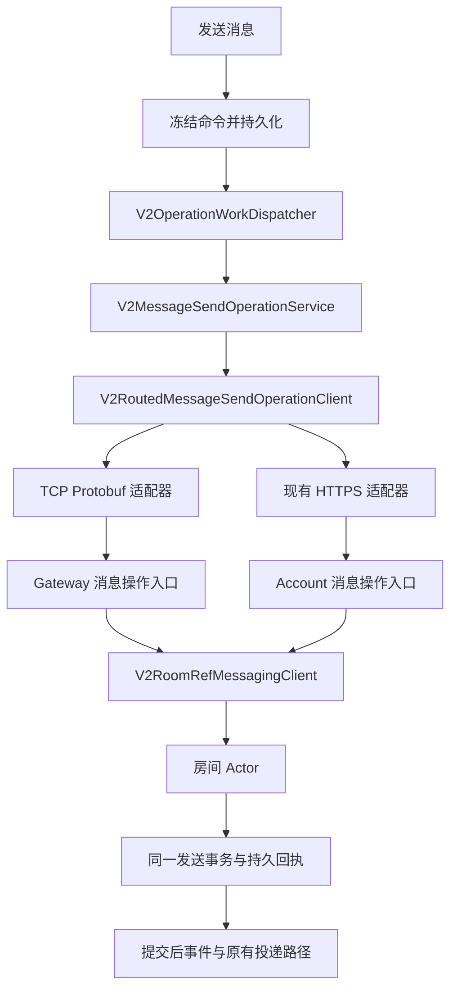

# 消息发送双通道落地方案

日期：2026-09-28。状态：本地实现完成；实际证据及外部验收边界见 [实施记录](../reviews/message-send-dual-transport.md)。最新用户约束：不考虑历史兼容性，仅支持当前新版协议；两种发送通道仍完整支持。范围：普通消息发送及其结果恢复，包括已准备完成的媒体引用消息；实时接收继续使用现有 Gateway。编辑、撤回、回应、转发等操作保持各自合同，可在本方案完成后独立扩展。

## 1. 目标和决策

1. 客户端正常情况下通过已经认证的 TLS/TCP 长连接发送消息。
2. HTTPS 保留完整的提交与恢复能力；连接不可用、服务端关闭发送能力或显式选择 HTTP 时可用。
3. 一条消息只有一份持久任务、一个业务操作身份、一份冻结内容和一份终态回执。切换通道不得新建消息 ID、刷新首次提交期限或改变指纹。
4. TCP 与 HTTP 汇聚到同一个房间 Actor 发送操作及 PostgreSQL 事务实现。
5. 服务端持久接受、对方收到、对方已读分别表达；写入 socket、收到传输 ACK、HTTP 200 都不单独构成持久接受证据。
6. 扩展现有持久任务、TLS、Protobuf 和 HTTP 基础设施，不引入第二套发送队列或 MTProto 加密协议。

默认策略命名建议为 `automatic`，另外提供 `httpOnly`、`realtimeOnly` 用于部署配置、诊断和测试。两种强制模式都支持 submit/recover；模式控制通道，不改变业务状态机。生产默认 automatic，不要求用户选择协议。

## 2. Telegram/TDLib 的参考结论

### 2.1 可直接借鉴的机制

- Telegram 将同一 MTProto 载荷放在 TCP、WebSocket 或 HTTP/HTTPS 传输上；HTTP 传输也复用连接。这里的 HTTP 是 MTProto 的承载方式，不能等同于 Telegram Bot API，也不等同于本项目的 REST/JSON 接口。[官方传输文档](https://core.telegram.org/mtproto/transports)
- `messages.sendMessage` 使用客户端生成的 `random_id` 防止重复发送。[方法定义](https://core.telegram.org/method/messages.sendMessage)
- `updateMessageID` 将客户端随机 ID 对应到正式消息 ID，可经更新恢复找回丢失的发送结果；官方说明同账号、同目标下的重复随机 ID 会去重，在途重复可能返回重复错误。[更新与去重语义](https://core.telegram.org/api/updates#updatemessageid-updates)
- TDLib 将连接建立、会话请求管理分开。`Session::on_closed` 将部分未确认请求标为 unknown；请求结果到达后再清除未知状态。[Session.cpp](https://github.com/tdlib/td/blob/master/td/telegram/net/Session.cpp)
- Telegram 文档区分 quick ACK 和实际方法结果，且指出批量调用的执行顺序需要显式依赖；本项目应保留自己的持久回执及房间顺序约束。[客户端优化](https://core.telegram.org/api/optimisation)

### 2.2 对“默认 TCP，HTTP 降级”的准确限定

检索时的 TDLib master 中，`ConnectionCreator::get_transport_type` 根据选项创建 Http 或 ObfuscatedTcp；`find_connection` 的 only_http 受 HTTP caching proxy 和 watchOS 条件影响。`DcOptionsSet::find_all_connections` 在 only_http 分支才加入所见 HTTP 候选。不能仅凭存在两种实现，就声称 Telegram 所有客户端都会在 TCP 超时后自动改走 HTTP。

依据：[ConnectionCreator.cpp](https://github.com/tdlib/td/blob/master/td/telegram/net/ConnectionCreator.cpp)、[DcOptionsSet.cpp](https://github.com/tdlib/td/blob/master/td/telegram/net/DcOptionsSet.cpp)。这些是检索日期所见的 master 内容，后续复核时应记录具体 commit。

本项目的 automatic 路由规则是根据用户目标及现有合同制定的设计，不把下面的阈值或切换规则归因于 Telegram。

## 3. 实施前的项目基础

本节记录改动前的基线；最终实现和验证见 [实施记录](../reviews/message-send-dual-transport.md)。以下路径均相对于仓库根目录。

| 位置 | 已确认的当前行为 | 本次处理 |
| --- | --- | --- |
| `IMV2Core/Sources/IMV2Core/MessageSendOperation.swift` | 定义发送命令、身份、指纹、首次提交期限、回执和恢复结果 | 作为两通道共同领域合同 |
| `IMV2ClientKit/Sources/IMV2ClientKit/V2MessageSendWork.swift` | GRDB 保存冻结命令；服务执行 submit/recover；终态验证身份和指纹 | 扩展错误分类与路由，不新建 outbox |
| `IMV2ClientKit/Sources/IMV2ClientKit/V2OperationWorkDispatcher.swift` | 账户级持久任务所有者，默认 6 个并发槽，claim 先于 I/O | 继续唯一拥有重试调度 |
| `IMV2ClientKit/Sources/IMV2ClientKit/GRDBV2OperationWorkStore.swift` | 持久 claim/action、重启恢复；同 orderingKey 的未完成前驱阻止后继 | 保持跨通道顺序 |
| `IMV2ClientKit/Sources/IMV2ClientKit/V2HTTPMessageSendOperationClient.swift` | HTTPS JSON submit/recover，校验回执及重试提示 | 保留并归一化错误 |
| `IMApp/IMApp/V2/V2AppRealtimeRuntime.swift` | 给发送服务直接注入 HTTP client | 改为注入双通道路由器 |
| `IMV2ClientKit/Sources/IMV2ClientKit/V2TLSFrameConnection.swift` | 请求号关联、连接代际隔离、在途上限；默认单请求 20 秒；超时关闭该代连接 | 增加协商状态快照、发送能力与错误提交证据 |
| `IMV2ClientKit/Sources/IMV2ClientKit/V2ProtobufSyncTransport.swift` | requestEnvelope 分配请求号，目前使用固定协议版本 | 扩展发送适配及协商版本来源 |
| `IMV2Server/Sources/IMV2ServerHTTP/V2VaporMessageSendOperationRoutes.swift` | HTTP 鉴权后调用 RoomRef sendOperation/recoverSendOperation | 与 TCP 共享相同领域入口 |
| `IMV2Server/Sources/IMV2Server/RoomClients/V2RoomRefMessagingClient.swift` | 已有完整 sendOperation/recoverSendOperation | Gateway 复用它 |
| `IMV2Server/Sources/IMV2Server/PostgresV2MessageSendOperationStore.swift` | 操作级事务锁；先查回执；发送与回执同事务；closeIfAbsent 共用锁 | 保持跨通道唯一执行依据 |

重要限制：

- 改动前协议版本为 44；`im_v2.proto` 已 reserved 旧 `send_message` 名称及字段号，不能解除 reserved 来复活旧合同。
- 客户端 Hello 和服务端继续只接受 current；按用户最新要求不增加历史版本兼容。发送能力位仍用于当前版本的显式功能协商。
- App 目前将 TCP payload 限制设为 65,536 字节；持久命令允许最多 1 MiB JSON，文字本身可达 65,536 UTF-8 字节。直接新增帧会造成 HTTP 能发、TCP 编码超限。
- `V2GatewayByteStream.receiveFrames` 当前逐帧 await session.receive；慢发送可能阻挡后续控制帧。
- 现有 `V2ReadReceiptOperationAdapter` 已演示 TCP 提交、HTTP 恢复，但发送操作还需要 HTTP 提交、未知结果及更完整的路由策略，不能直接复制其全部行为。
- 当前客户端发送错误处理偏向 `V2HTTPFailure`；若直接接 TCP 错误，会缺少明确的退避、拒绝和未知结果区分。

## 4. 目标调用关系

建议新增的路由器继续实现现有 `V2MessageSendOperationClient`，不让 UI 了解物理通道。TCP 适配器可通过 `V2ProtobufSyncTransport` 的 extension 实现；请求号仍由同一个 transport 分配，不能每个新适配器各自从 1 计数。

## 5. 发送、切换与恢复规则

### 5.1 automatic 模式决策表

| 状态或结果 | 动作 |
| --- | --- |
| 当前账户、当前连接代际已经认证，协商支持发送，通道健康 | TCP 提交 |
| 正在短暂重连 | 最多等待 300 ms 的就绪检查；仍不就绪则选择 HTTP。该值是待压测的初始参数 |
| 离线、认证尚未完成、服务端未声明发送能力、TCP 通道冷却 | 不等待完整 TCP 请求超时；有可用 HTTP 授权时走 HTTP，否则持久等待 |
| 检查时可用，实际写入前连接换代或断开，且确认请求未进入发送流程 | 转为一次 HTTP 尝试，仍使用原命令；每次物理请求计入同一预算 |
| TCP 写入开始后断开、写失败、超时，或无法证明未提交 | 标记 awaitingConfirmation，持久 nextAction=reconcile；下一步优先通过 HTTP 查询原操作 |
| 恢复返回原回执 | 校验后完成原任务 |
| 恢复返回 unresolved，首次提交期限未到 | 下一次受调度的提交复用原命令；依据当前健康状况选通道 |
| 期限已到且之前尝试过 | 执行原身份的 closeIfAbsent，不能新建身份或续期 |
| 服务端 deferred / 限流 / 准入不足 | 遵守重试提示和账户/房间冷却，不通过换通道规避 |
| 权限拒绝、指纹冲突、非法内容、无效回执 | 按原业务终态或人工处理状态收敛，不降级再发 |
| 用户退出账户、任务取消、应用生命周期停止 | 取消本次尝试并保留原任务，禁止取消处理里偷偷发 HTTP |

对外的“离线”不能只凭网络路径监视器判断。连接代际、实际认证状态和请求结果才是路由证据；路径变化只触发重新评估。

### 5.2 未知结果必须单独表达

建议在 ClientKit 定义面向消息操作的错误分类，HTTP/TCP 在边界映射：

- `unavailableBeforeSubmission(reason)`：确定未交给发送流程。
- `outcomeUnknown(reason)`：请求可能已到达服务端。
- `retryAfter(instant, scope)`：明确延后且需要跨通道遵守。
- `authenticationRequired`：交给现有账户认证协调者处理。
- `invalidResponse` / `unsupportedCapability`：区分异常响应与明确的能力缺失。
- CancellationError 保持取消语义。

有效的 deferred、receipt、unresolved、fingerprintConflict 仍使用现有领域 result，不再包装成一般网络错误。

不在路由器里堆叠“TCP 重试三次、HTTP 再重试三次”。持久 dispatcher 继续掌握整体尝试上限、退避和截止时间；每次真正的 submit/recover 都计数。最简单的实现是一次 claim 只发一次物理请求：写前失败后持久转交下一次 HTTP attempt，避免绕过现有默认每轮 5 次限制。路由器负责选路和分类，service 负责持久状态变化。

### 5.3 防止通道来回切换

只将断连、建连失败等传输故障计入 TCP 健康度；业务限流不计入。初始建议：30 秒内两个不同连接代际发生传输故障后进入 30 秒 HTTP 优先窗口。期间沿用现有重连器；冷却结束后按当前认证能力重新选择 TCP。未知发送本身不充当探测包。

模式、连接代际和健康状态属于账户运行时。进程重启后可重建；业务身份、首次期限、未知结果和 nextAction 必须持久化。旧代状态更新不能改变新代连接健康度。

### 5.4 两种强制模式

- `httpOnly`：submit/recover 都走现有 HTTPS，不等待实时连接；接收仍可用 Gateway。
- `realtimeOnly`：submit/recover 都使用 TCP；不可用时持久等待，明确不自动转 HTTP；未知结果在后续可用连接上恢复。
- `automatic`：健康时 TCP submit/recover；TCP 结果未知时优先 HTTP recover，获得 unresolved 后再由调度器决定同身份提交。

## 6. 领域可靠性与顺序

### 6.1 必须保持的不变量

`requestID` 只关联一次线上请求，可以重建；`clientMessageID` / operation identity、domain fingerprint、execution fingerprint、首次提交期限在所有通道和重启之间保持不变。

服务端沿用现有键 `(roomID, actorUserID, operationID)` 的事务锁及回执查找。TCP 和 HTTP 都不能绕过 `sendOperation` 直接调用底层 accept。认证身份必须与 command.senderUserID / identity.accountID 一致；房间范围、指纹和 deadline 都经过已有领域构造器验证。

TCP 响应丢失后 HTTP 查询得到 unresolved，只能表示当次查询未看到终态，不能证明旧 TCP 操作永远不会执行。同身份重提仍须依赖共同事务锁去重。closeIfAbsent 与迟到提交竞争时，由相同锁决定唯一终态，测试必须覆盖两个先后顺序。

### 6.2 顺序和 UI

- 延续 `orderingKey = send:<roomID>` 和持久前驱屏障。A 结果未知时，B 不因选择 HTTP 越过 A。
- 不声称 TCP 自身能保证跨服务业务执行顺序；不要同时发送两份副作用请求“抢最快结果”。
- 已有本地乐观消息继续显示；网络通道改变不创建第二个气泡。
- receipt 先到、房间事件先到、快照先到均通过已有 accepted presentation 收敛逻辑处理。
- `.accepted` 仅表示服务端持久接受，不表示接收方已读或审核通过。
- 附件先按现有资源流程达到 Ready，发送两通道只携带冻结资源引用。文件字节继续使用独立资源传输。

## 7. 当前协议升级

### 7.1 新协议合同

本次协议升级为 v45，仅接受该版本。新增三种 body/帧命令，名称可按项目规范调整：

- `message_send_operation`：完整发送操作。
- `message_send_operation_recover`：完整恢复请求，明确 query / closeIfAbsent。
- `message_send_operation_result`：完整领域结果，含 identity、fingerprint 和 terminal/deferred 等分支。

新增未占用的 envelope tag 和 frame opcode，不能复用 reserved 旧编号。使用有类型的 Protobuf 字段与 oneof，映射到 IMV2Core 构造器；不把旧 SendMessage 加一个 HTTP fallback 就当作完成，也不直接复用缺少完整操作证据的旧 MessageAccepted。

JSON 与 Protobuf 编码的字节无需相同，但解码后的领域 identity/fingerprint 必须相同。补充 Unicode、mentions、entities、reply、media、整数边界及 deadline 的交叉编码向量。指纹根据规范化领域字段计算，不对不同 wire bytes 分别散列。

Hello/Authenticated 增加显式发送能力及发送帧大小协商。客户端只在当前认证连接确认该能力后发送；能力缺省为不可用。recover 中的 closeIfAbsent 是写操作，准入和帧策略必须按 mutation 处理，不能因为名字叫 recover 就纳入廉价 read。

### 7.2 当前版本与能力控制

按用户最新要求，只支持当前 v45，客户端和服务端一起更新；不增加 v44 解析、降级或兼容测试。已有 reserved 字段保持不复用，因为新操作合同应使用独立编号。

Hello/Authenticated 中的能力和大小仍绑定当前连接 generation。服务端关闭 TCP 发送能力时，automatic 客户端走 HTTP；客户端也可配置 httpOnly。两者都不能重建已经尝试过的消息身份。协议版本不匹配明确拒绝建立实时会话。

`V2ProtobufFrameCodec` 两端、`V2FrameCodec`、`V2TCPFramePolicy`、session 状态机、命令分类/成本、network entry registry、生成文件与协议文档必须同步更新。生成文件使用 `scripts/generate_v2_protobuf.sh`，禁止手改。

## 8. 大小、超时与背压

### 8.1 解决 64 KiB 与 1 MiB 的差异

目标是领域合同一致，不能靠压缩“碰巧能塞入帧”。保持现有业务输入限制；新增发送操作的有界大帧能力，初始发送 payload 上限建议 1 MiB + 4 KiB envelope 预算，并对允许的最大领域对象做实际编码证明。若实际编码超出该预算，应调整明确上限或在双方统一拒绝，不能静默截断。

普通帧继续执行原有大小限制；只有协商成功的发送操作可使用新上限。帧头阶段基于 opcode/version 做上界校验，认证前仍限制小帧；压缩后和解压后分别设限。新增按字节统计的在途/入站/出站预算，数量上限不能代替字节上限。较小部署上限可在 automatic 中写前选择 HTTP，诊断中标记 size/capability 原因；realtimeOnly 明确返回该会话不能承载，而非反复重试。

修改范围包含 App frameLimits、Gateway runtime config、两端 codec、握手能力、NIO 入站队列和客户端 pending 预算。初始建议每连接最多 4 个发送操作、发送在途累计 4 MiB；最终值由弱网和慢消费者测试确定。进程级额度按实例内存预算配置，超过额度时受控拒绝。

### 8.2 超时必须分层

- 通道就绪等待：建议初始 300 ms，仅用于选择通道。
- 请求等待：沿用可配置上限，先保持现有 20 秒级预算作为基线，再基于压测调整；不能将选路等待当成业务失败期限。
- 未知结果：进入持久 reconcile，不以超时认定发送失败。
- 首次提交期限：沿用冻结的 24 小时窗口，不因 TCP→HTTP 重置。
- 现有取消等待者仍保留线上槽位的行为必须保留或等价实现；禁止直接释放 requestID 使迟到响应误配。
- TCP 请求超时关闭整个代际会影响其他请求，必须对该扇出失败做一次性连接健康统计和持久恢复，避免每个请求再启动独立重连。

## 9. 服务端接入及连接内调度

`GatewayCommandAssembly` 给 `V2GatewayDomainCommandHandler` 注入 room messaging 入口；handler 对新命令做身份、字段、能力、大小检查，再调用 `V2RoomRefMessagingClient.sendOperation/recoverSendOperation`。HTTP route 保留相同领域服务和结果映射，差异仅是边界解码及响应编码。

复用现有房间宿主写入准入，检查 gateway 的 databaseWorkAdmission 分类以免双重占用形成等待。每连接限流与全账户/房间业务限制分层；业务级限制应在两入口共有的 Actor/存储边界执行，不能用换入口绕过。TCP ACK 不另行产生提交后事件，沿用 store 的单次 committedMessageObserver。

当前 `receiveFrames` 的串行等待需要在本功能上线前解决：

1. 帧读取、认证状态推进和连接状态修改保持单一所有者；握手阶段继续串行。
2. 仅将已经验证、已经认证的新发送/恢复命令交给有界任务集合，不对所有现有命令盲目并行化。
3. 通过 requestID 返回结果，允许无依赖请求完成顺序不同；客户端持久房间顺序和服务端操作锁仍然生效。
4. 心跳、必要 ACK、撤销等控制工作保留独立容量，不能排在慢发送 SQL 后等待。
5. 异步任务响应再次验证连接代际与撤销状态；单一出站 writer 保持帧原子性。
6. NIO driver/byte stream 的任务所有权纳入连接 close/drain；停止接收新工作、取消/等待在途任务后才能释放 Actor/数据库。
7. 对相同连接重复在途 requestID、超量任务、慢写出给出确定行为和测试。不能用无限 Task 替代当前串行循环。

这部分是性能与生命周期改动，应独立提交并做故障测试；其完成属于双通道上线门槛。

## 10. 客户端接入与生命周期

新增或修改：

- `V2ProtobufSyncTransport+MessageSendOperations.swift`：TCP submit/recover 的领域映射。
- `V2RoutedMessageSendOperationClient.swift`：模式、选路、连接状态/健康快照及错误分类。
- `V2TLSFrameConnection.swift` / `V2RealtimeSessionCoordinator.swift`：公开最小认证会话快照，带 account/device、generation、version、capabilities、limits；实际发起请求时再验证 generation。
- `V2MessageSendWork.swift`：处理 outcomeUnknown、持久转 reconcile、共享重试期限，不再依赖 HTTP 错误类型决定所有行为。
- `Networking/V2NetworkEntryRegistry.swift`：sendMessage 声明 tcp/accountHTTP；新源文件声明边界。
- `Networking/V2TCPFramePolicy.swift`：submit/recover mutation，result serverOnly；保持不自动重放。
- `V2AppRealtimeRuntime.swift`：装配 router，继续复用 accountRuntime.scheduler、authSession/epoch 和已有 dispatcher。

TCP leaf 和 HTTP leaf 各自获取网络 permit；父级等待认证、重连或选择时不占用第二份 permit。跨通道共享业务 Retry-After 冷却，保留 interactive/recovery 分类以及每轮总预算。

路由器的选择快照不能代替真实写入前校验；Task 取消、登出和账户切换应停止旧任务并等待释放所有权。普通 URLSession HTTP 请求不等于系统允许后台持续执行；App 挂起后依赖已有持久任务在合法运行机会恢复，不能承诺“切 HTTP 就能一直后台发消息”。

默认不新增发送业务表：当前 identity、command、action、期限足够。本次不新增 route preference 持久字段；进程中断后依据现有 nextAction 恢复，不能把模式写入业务指纹。

## 11. 验证矩阵

### 11.1 协议、单元和模型测试

- JSON/Protobuf 转换的完整领域等价、错误 enum/缺字段/超大整数拒绝、指纹相等。
- 健康 TCP 被优先选择；断线、握手中、能力缺失选择 HTTP；强制模式不越界。
- 写前失败与写后未知分支不同；取消不触发 fallback。
- 有效 deferred、认证失败、指纹冲突、拒绝、无效回执均不被宽泛 catch 当作 TCP 故障重发。
- 一次 claim 对应一次物理请求；共享尝试上限、deadline、Retry-After 均不能被换通道重置。
- 相同房间顺序、不同房间公平、旧代回调、迟到响应、取消在线占位、在途字节上限。
- 最大合法正文、附件引用和富文本，压缩不可压缩输入、大小协商和小上限部署。

### 11.2 真实 PostgreSQL + TCP + HTTP 集成

两入口指向同一房间，必须断言唯一消息、唯一 roomSequence、相同业务回执、首次提交后观察者没有因重放再次触发：

1. TCP 提交成功；HTTP 查询获得同一回执。
2. HTTP 提交成功；TCP 恢复获得同一回执。
3. TCP 提交已落库但响应丢失，客户端改走 HTTP 恢复。
4. 同身份 TCP/HTTP 受控并发提交，只持久化一次；不同指纹并发冲突。
5. 旧 TCP 请求被延迟，HTTP query 返回 unresolved，再同身份提交，仍只产生一次效果。
6. closeIfAbsent 与迟到提交分别先取得锁，两种顺序都保持唯一终态。
7. Gateway/Account/Actor 重启，房间归属迁移时恢复；不能依赖 Gateway 内存去重。
8. SQL 慢请求期间同连接心跳仍可处理；登出、撤销、关闭和停机排空不泄漏任务。
9. 重复 submit 不造成新的逻辑事件；通知通道本身仍允许原设计的至少一次传递及客户端去重。

扩展现有 `PostgresV2MessageSendOperationTests`、`V2MessageSendWorkTests`、`V2TCPFramePolicyTests`、两端 codec tests，并增加路由测试和真实双入口组合测试。

### 11.3 App 与生命周期

- 当前客户端和服务端、未协商能力拒绝、关闭能力后的 HTTP 路由、协议版本不匹配拒绝。
- 两设备：A 默认 TCP 发送，B 实时接收；断开 A 的实时连接后 A HTTP 发送，恢复后同步收敛。
- 杀进程时提交结果未知，再启动不换 clientMessageID；事件先于回执不出现双气泡。
- 同房间 A 超时切 HTTP，B 保持队列顺序。
- 进入后台、系统挂起后恢复、账户切换、凭证刷新、设备撤销；实际设备验收单独记录，不能拿 loopback 测试代替。

### 11.4 性能与上线门槛

同机器、相同房间业务和数据库配置比较当前 HTTP 基线、httpOnly、realtimeOnly、automatic。覆盖稳定连接、冷连接、弱网丢包/延迟、跨节点、大消息、慢接收端和大批待恢复任务。

测量：入队到持久 receipt 的 P50/P95/P99、发送到另一设备可见的 P95/P99、吞吐、CPU、每消息字节、数据库事务/锁等待、Actor 排队、心跳延迟、连接重建数、fallback 原因、恢复次数及在途内存。设备能耗用设备测量，不能从协议头大小直接推断。

正确性门槛：重复持久化与错误终态为 0；队列和内存不超过预算；无无限重试；降级/恢复后最终收敛。性能初始门槛建议同负载下 automatic 稳态发送 P95/P99 不劣于 HTTP 基线超过 5%，心跳与实时接收不超过团队现有 SLO；尚无 SLO 的项目先由基线确定并冻结。门槛是实施验收目标，不是当前测量结论。

指标采用低基数标签 `transport=tcp|http`、`action=submit|recover`、`fallback_reason`、`result`；业务操作只计一次，物理尝试独立计数。不要把用户/房间/操作 ID 用作指标标签或记录消息正文。

## 12. 分阶段交付与验收

| 阶段 | 交付 | 进入下一阶段的证据 |
| --- | --- | --- |
| P1 合同与协议 | 新 body/opcode、当前版本能力与大小限制、双编码模型 | 生成检查、协议测试、当前版本能力和旧版本拒绝测试通过 |
| P2 服务端 | Gateway send/recover、共同 Actor 合同、有界发送并发与 drain | 两入口事务竞争、慢命令/心跳、撤销与停机测试通过 |
| P3 客户端 | TCP adapter、automatic/router、错误分类、单队列重试与运行时注入 | 路由/未知结果/取消/重启/顺序测试通过 |
| P4 联调和压测 | 两设备真实链路、断网/挂起、容量与延迟报告 | 正确性门槛、内存预算和性能门槛满足 |
| P5 灰度 | 客户端与服务端发布当前版本，测试账户→1%→10%→50%→100% | 每步观察完整高峰窗口及故障恢复；异常可切 httpOnly |

实现时运行各包受影响测试、服务端产品构建、App simulator 构建和相关单元测试；执行 protobuf 生成一致性、`scripts/check_v2_protocol_documentation.py`、网络边界测试、真实 PostgreSQL 集成与既有 CI 必需检查。实际执行结果见实施记录；P4 真机/压测与 P5 生产发布不计作本地完成项。

需要同步的文档：`IMV2/docs/implementation-status.md` 的协议版本和能力表、当前网络边界合同、发送恢复合同、部署参数及压测记录；`docs/reviews/durable-retry-network-contract.md` 中“发送仅 HTTPS”的当前状态说明应更新，历史验证记录保留历史语义。

最终验收：正常客户端明确走 TCP；HTTP 能独立提交和恢复；两种通道的未知结果、重试、切换、乱序、能力切换和进程重启都维持同一个业务身份和唯一终态。不能以“两个接口都能单独发一条消息”替代完成。
