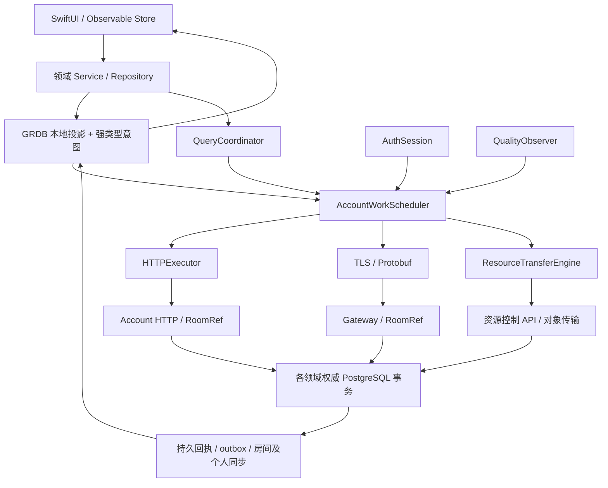

# 应用级弱网架构与实施设计

日期：2026-09-27。代码审阅基线：`c0e73416` 加当前未提交工作区。状态：重新规划的目标设计；已有部分实施，但未完成全 App 验收。

本文结合实际源代码重新规划整个 App 的弱网行为。实施拆分见[任务与验收计划](application-weak-network-implementation-plan.md)。当前系统能力仍以[系统地图](../current-system-map.md)、[实现状态](../../IMV2/docs/implementation-status.md)及对应源码为准；本文描述其目标差异。

本文交付目标设计与实施计划，不重置数据库，也不把基础组件测试记录当成整套方案已经通过的证据。第 2 节区分改造依据与当前实施起点；其余章节默认描述目标合同，具体数值未完成容量测量前均为待验证初值。完整完成度按 W0–W6 的验收条件判断。

## 1. 决策摘要与范围

采用「保留领域事实链，统一网络准入、操作恢复与观测」的方案：

1. 保留 SwiftUI → Store/Service → ClientKit → Core 的依赖方向，保留 GRDB/SQLite、TLS/protobuf、HTTPS、RoomRef/Actor 和 PostgreSQL。
2. 在 ClientKit 建立账户运行时，统一调度 HTTP、实时命令、同步与资源控制请求。各传输独立恢复，TCP 不通不能阻塞可用的 HTTPS。
3. 保留各领域强类型命令及 payload 表；抽取一份公共持久化执行元数据和唯一调度所有者，移除多处重复的重试循环与状态字段。
4. 将消息及群头像已有的查询/关闭机制推广为领域操作恢复合同。已发送结果未知不能当成失败；新 ID 替代必须有明确终结依据。
5. 读取按「本地持久投影、允许保留的业务快照、短期展示授权、必须在线」分开。保留现有资料/头像 lease 的隐私边界。
6. 资源复用现有 journal、home/placement、SendIntent 和适配器体系，补齐真实分片/Range 恢复和可选后台传输。
7. 优先补个人资料保存、命令结果未知、调度阻塞和错误信息丢失，再扩展全量端点。

实际产品范围：会话列表/时间线/搜索、消息及附件、收藏/会话偏好、联系人/关系/拉黑、个人资料与头像、群管理/群头像/群昵称/入群邀请与审批、登录/设备/安全设置、Push。当前方案不建设不存在的支付、订单、动态和评论模块；未来业务按同一合同接入。

### 1.1 无历史兼容的含义

遵循已有 [ADR-000](../../IMV2/docs/00-foundation/ADR-000-greenfield-cutover.md)：一次定义当前目标协议与 schema，不建设旧版 DTO 解析、双写、历史回填或旧客户端混跑。

- PostgreSQL 直接修改 `IMV2/sql/schema.sql`，同步 readiness、规范化 schema 检查与测试夹具。
- SQLite 直接修改当前建库定义，删除本次替换的旧执行字段和旧循环，不保留两套可选运行模式。
- protobuf/Core、Server、ClientKit、App 及测试在同一纵向交付中调整。帧协商仍需要识别不匹配版本并明确拒绝，不做旧协议回退。
- 实施前对开发数据给出明确重建说明；脚本不能擅自删除开发者数据库、文件或 Keychain。
- 同版本崩溃、设备锁定、断网、退出再登录、服务重启及 owner 切换仍须恢复。这些属于新系统可靠性，不是历史兼容。

App 基线为 iOS 26；ClientKit 当前为 Swift tools 6.2、iOS 26/macOS 15，Core 为 tools 6.0、iOS 17/macOS 15，Server 为 tools 6.4、Vapor 5 beta 与 SwiftNIO。只按各 target 实际需要调整，不为了统一文档而无关升级 toolchain 或 Core 最低平台。

## 2. 源码核对结果与改造依据

以下是本次源代码核对的落点，不是运行性能测量。目标改造与已接入能力必须结合第 2.1 节阅读。

| 领域 | 已有实现 | 本方案处理 |
| --- | --- | --- |
| HTTP 会话 | [V2SecureURLSession](../../IMV2ClientKit/Sources/IMV2ClientKit/V2SecureURLSession.swift) 共享 account/media 池，禁 Cookie、凭据存储、URLCache 与自动重定向 | 保留安全默认值，在其上加执行预算、结构化错误、metrics；不全局开启 URLCache |
| HTTP 鉴权 | [V2SessionHTTPAuthorization](../../IMV2ClientKit/Sources/IMV2ClientKit/V2SessionHTTPAuthorization.swift) 绑定 epoch；401 可共享刷新，但返回原 401，不自动重放业务请求 | 保留 epoch/token 栅栏，让上层按语义重建请求；刷新本身不进入递归鉴权路径 |
| 认证恢复 | [V2AuthSession](../../IMV2ClientKit/Sources/IMV2ClientKit/V2AuthSession.swift) 已持久化 refresh operation、单飞、串行凭据 I/O；另有签发/撤销恢复 store | 复用当前设备凭据协议，不另建通用 OAuth 体系，不把凭据写入业务 operation 表 |
| 账户存储 | [V2AccountLocalStoreOwner](../../IMV2ClientKit/Sources/IMV2ClientKit/V2AccountLocalStoreOwner.swift) 按账号散列和 incarnation 定位目录；普通 close 保留数据库与 outbox | 复用同账号恢复和具体 store 对象关闭；显式擦除与普通退出分开 |
| 实时连接 | [V2TLSFrameConnection](../../IMV2ClientKit/Sources/IMV2ClientKit/V2TLSFrameConnection.swift) 有 generation/waiter 栅栏、请求硬截止、在途上限与帧上限 | 保留；增加每类请求 deadline、调度许可与细分连接观测 |
| 命令调度 | [V2OperationWorkDispatcher](../../IMV2ClientKit/Sources/IMV2ClientKit/V2OperationWorkDispatcher.swift) 从持久队首认领有界领域步骤；[App 装配](../../IMApp/IMApp/V2/V2AppStore.swift) 注册领域 handler；叶子请求由 [V2AccountWorkScheduler](../../IMV2ClientKit/Sources/IMV2ClientKit/Networking/V2AccountWorkScheduler.swift) 分配网络许可 | 验证同 orderingKey 串行、不同实体并发、取消排空与全 App 故障链路 |
| 重试唤醒 | [V2CommandRetryScheduler](../../IMV2ClientKit/Sources/IMV2ClientKit/V2CommandRetryScheduler.swift) 先订阅后查询、按持久时间唤醒 | 保留此可靠唤醒模式，扩展到 HTTP 操作、资源和查询，不增加固定轮询 |
| 消息执行 | [V2MessageSendWork](../../IMV2ClientKit/Sources/IMV2ClientKit/V2MessageSendWork.swift) 复用稳定 clientMessageID；SendIntent 原子移交公共 work | 最新生命周期/容量测试与全量 App 验收；不保留旧发送执行引擎 |
| 操作恢复 | [消息变更恢复](../../IMV2ClientKit/Sources/IMV2ClientKit/V2MessageMutationWork.swift) 与发送已接公共执行事实；群头像保留专属恢复 | 验证原身份、首次期限、原回执与关闭竞争；未知不得写成拒绝 |
| 过期处理 | [GRDB 操作存储](../../IMV2ClientKit/Sources/IMV2ClientKit/GRDBV2OperationWorkStore.swift) 在 claim 时区分未发送过期与已提交后的原身份核对；[策略](../../IMV2Core/Sources/IMV2Core/V2IdempotencyPolicy.swift) 为客户端 30 天/服务端最少 35 天 | 验证首次受理期限、重放窗口和结果查询在各领域的一致性；未知结果不能写成拒绝 |
| 个人资料 | [资料页](../../IMApp/IMApp/V2/V2PublicIdentitySettingsUI.swift) 已有持久 ProfileIntent 与冲突处理；[HTTP client](../../IMV2ClientKit/Sources/IMV2ClientKit/V2HTTPOwnProfileClient.swift) 已支持 operationID/revision | 保留意图、原操作恢复及上传依赖；补完整故障链路验收 |
| 资料服务端 | [PostgresV2ProfileUpdateStore](../../IMV2Server/Sources/IMV2ServerInfrastructure/PostgresV2ProfileUpdateStore.swift) 事务写资料、不可变操作回执和资料传播 outbox；支持 query/close | 保留原操作回执与当前实体快照的区分，验证提交与关闭竞争 |
| 资料/头像展示 | [V2ProfilePresentationRepository](../../IMV2ClientKit/Sources/IMV2ClientKit/V2ProfilePresentationRepository.swift) 已有可见兴趣、请求合并、lease、并发/容量限制 | 复用，不绕过；统一调度只提供资源许可，展示授权仍归领域 Repository |
| 上传恢复 | [V2ResourceTransferEngine](../../IMV2ClientKit/Sources/IMV2ClientKit/V2ResourceTransferEngine.swift) 持久 journal、短步骤调度、状态核对；支持 whole PUT 与本地 multipart | 持久化 part 级进度，按服务能力选择模式；Ready 之前不得绑定业务成功 |
| 下载 | [V2MediaTransfer](../../IMV2ClientKit/Sources/IMV2ClientKit/V2MediaTransfer.swift) 已有 Range journal、完整 GET 回退、长度与 SHA-256 核验 | 验证真实 provider 与重启恢复；不把「文件任务可重新发起」称为字节续传 |
| App 资源循环 | [V2DurableConversationSendService](../../IMApp/IMApp/V2/V2DurableConversationSendService.swift) 已改持久到期与订阅唤醒；资源上传有独立账户 activity | 验证空闲无扫描、依赖就绪唤醒、预算与冷却跨重启、唯一所有者 |
| 重连/启动 | [V2AppStore](../../IMApp/IMApp/V2/V2AppStore.swift) 已有账户运行时与离线只读入口；[V2ClientRuntime](../../IMV2ClientKit/Sources/IMV2ClientKit/V2ClientRuntime.swift) 已分开连接就绪与追赶，仍须全入口生命周期验收 | 重连归账户运行时；认证连接就绪与历史追赶分开，循环及时启动 |

额外核对：当前默认不依赖 Redis 或 NATS；NATS 只作可丢失提示。服务端已经有 RoomRef/activation fence、按工作类型隔离的数据库预算，不应再引入一套绕过 owner 的全局写服务。

### 2.1 本次重新规划的实际起点

上表描述改造依据，不能作为最新源码完成度表。以下按本次读取的未提交工作区更新；代码存在、专项通过、全量发布验收是三种不同状态。

| 工作区能力 | 已有实现落点 | 剩余工作 |
| --- | --- | --- |
| 网络准入与 HTTP | `V2AccountWorkScheduler`、`V2HTTPExecutor`、`V2AccountRuntime` 已有 App 注入；SessionHTTPAuthorization 绑定 epoch 与请求截止；AuthSession 直接 HTTP provider 已移除 | 穷尽生产入口、取消排空、服务隔离、质量策略和真实平台验证 |
| 公共业务执行 | `V2OperationWorkDispatcher` 已装配资料、会话偏好、收藏、联系人备注、本人群昵称、已读、发送/编辑/撤回、reaction 与转发 | AppRuntime 仍装配 4 条旧命令 lane；公共框架不等于全业务完成 |
| 名字编辑与展示 | Core 强类型合同、RoomRef/HTTP、永久回执、ClientKit journal、联系人/群设置 UI 已接线；备注独立 revision 下限及 recipient-bound 展示 | 最新组合回归、真实双设备断网/重启故障链路；不得用编辑快照代替展示授权 |
| 本地只读启动 | AppStore/RootView、readonly projection、Bootstrapper/LocalStoreOwner 已接线 | 独立只读界面仅显示允许的文本及本人快照；不提供命令或他人资料授权，需真机生命周期验证 |
| 上传与下载 | ResourceTransferEngine 单步恢复已接账户 activity；本地 provider 有真实 multipart；下载有 Range journal；消费者固定扫描已改为持久到期与订阅唤醒 | 最新消费者调度验证、云 provider 能力适配、后台 coordinator 的系统对账与平台验收、磁盘/带宽上限的全链路证明 |
| 当前协议与库 | 当前协议 38、PostgreSQL `im-v2-current-60`；SQLite 直接当前建库 | 群管理尚在改动；最后一次 schema 变更后更新快照并全量验证，不引用旧对象数/哈希证明最新版本通过 |

当前 App 装配的 4 条旧 lane 是 membership、groupCapabilities、social、groupCreation。存储枚举另有 redactions；必须单独核实其生产可达性与删除/接入合同，不能只按已装配 lane 数量宣称端点穷尽。发送、编辑、撤回、reaction 与转发旧执行入口已替换。

本次规划不另建竞争的框架。先形成当前工作区的可构建检查点，再完成领域接入和旧路径删除。专项测试记录见[实施状态](application-weak-network-progress.md)，历史通过不等于最新全量通过。

### 2.2 对附件方案的具体取舍

- 产品范围限定为仓库实际存在的 IM、联系人、群、资料、设备与资源；支付、订单、评论作为未来接入类别，不纳入本次实现。
- App 按实际 iOS 26 目标设计；附件的 iOS 17 描述不作为 App 平台基线，也不强制提高共享 Core 的最低平台。
- 沿用 GRDB 同步投影、RoomRef/owner、既有身份与资源授权；不加全局响应缓存，不引入新的 Redis 幂等中心。
- 统一持久执行元数据和网络准入，保留强类型领域 payload、原有事务和资源状态机。既有恢复能力通过 adapter 接入，不重复建设第二份权威回执。
- 无兼容要求意味着直接替换旧协议/schema/入口；分批完成纵向验收仍然必要。任何中间未构建版本不能作为可发布检查点。

### 2.3 本轮必须冻结的产品决策

1. **localReadOnly 第一版只读。** 可显示允许保留的会话、文本与本人快照，不构造命令提交依赖。普通离线排队指已建立账户上下文后的网络中断；过期凭据冷启动下的新动作先保留 UI 草稿，待在线升级后明确入队。若后续允许该模式落业务意图，必须另补可写授权和产品验收，不借只读 store 偷写。
2. **普通字段冲突保留用户输入。** 资料、备注、昵称由用户选择重新应用或放弃；重新应用要读取当前 revision 并产生新 operation，原未知操作先核对/关闭。收藏等可自动重基线的范围仅按第 8.2 节登记。
3. **安全/管理动作在线确认。** 权限、角色、审批、设备撤销不能因缓存按钮可见就自动积压执行；网络丢失后可恢复已发操作的结果。短期 admission context 是目标合同，尚未接入的领域不能宣称具备该保证。
4. **全 App 完成包含真实资源恢复。** 小对象可使用明确广告的 whole-file PUT；大文件分片必须同时具备 provider、控制 API、part journal 和 App 接线。后台是单独能力门槛，不把普通 Task 循环当后台能力。
5. **恢复不会静默无限重试。** 自动预算耗尽后显示需要处理；“继续确认”核对原身份，“重新应用”要求终态证明，“停止等待”只解除观察。界面必须区分三者。

### 2.4 最新工作区复核与最终收敛决策

本节更新第 2 节的检查点描述。工作区处于实施中间态：App 当前剩余 4 个旧 lane（membership、groupCapabilities、social、groupCreation）；forward 已切到新客户端入口，账户 HTTP/worker 与 owner-aware 恢复已通过真实 PostgreSQL/HTTP 专项验证。protocol38/current60 是当前协议和建库合同；跨进程部署及真实设备端到端仍需独立验收。

本次重新规划确定以下实现选择：

1. **不再新增通用框架。** 以现有 `V2AccountRuntime`、`V2OperationWorkDispatcher`、Networking 和各领域 store 为最终骨架。公共 work 只拥有执行、claim、重试和依赖；业务 payload、版本与结果校验归领域。资源和认证的专用 journal 保留自身状态机，但必须共享网络准入，不能复制另一份普通 work 执行状态。
2. **普通持久业务写入以账户 HTTP 为统一提交/恢复入口。** 消息发送、变更、reaction、转发沿当前已接入方向完成。已读、偏好等已有实时入口可作为同一领域合同的适配器，必须访问同一权威与身份；不建设 HTTP 失败后换新身份走 TCP 的兜底。实时连接继续承载同步、推送和瞬时信号。
3. **转发固定为服务端父计划。** 保持实际产品上限 100 条来源、10 个目标，每 20 条来源形成子块；冻结完整 manifest，子操作身份确定生成。客户端公共 work 保存父执行状态，领域表保存有界进度；服务器负责逐子恢复，不能让客户端对部分失败做笛卡尔积重发。最终回执不超过 64 KiB，详细进度不超过 1 MiB；最终结果摘要可验证。`closeIfUnstarted` 与 `cancelRemaining` 分开，处理中子项必须核对。
4. **转发路由必须闭环后才算接入。** 当前 `V2AppRealtimeRuntime` 将转发发往 accountBaseURL，而 `GatewayRoomServicesAssembly` 才拥有转发协调器。最终在账户 HTTP composition root 注入 owner-aware forwarding port，复用 RoomRef/既有协调器能力，注册 submit/recover 并启动持久 worker；跨进程调用须显式实现 port。不得让账户 control store 直接修改房间事实。部署环境必须验证真实 accountBaseURL 可达这两个端点；只加 URL 常量不算完成。
5. **资源准入合并计数。** 上传与导入共享每账号 32 个活跃 job；paused、processing、needsAttention 和未知结果均占额度。仅权威终态释放活跃额度，同身份重放不重复占额。新建、消息附件准备、关闭后替换、群头像替换入口已收敛到同一 SQLite 事务 helper，多附件超限整批回滚，并有专项证据。512 MiB 暂存限制另计，终态不自动意味着文件可删除；真实平台峰值仍须测量。
6. **端点注册必须成为可执行门禁。** `Networking/V2HTTPRouteRegistry.swift` 作为 HTTP 方法、路由、语义和作用域的当前注册；未知路由拒绝。普通账户边界拒绝认证专属、运维与对象字节端点；允许 origin、account/activation 必须明确。HTTP 注册、Vapor 路由、Gateway 分派和 App 构造交叉检查，静态清单不能替代真实装配测试。
7. **敏感操作先确认，再保存已授权身份。** 群管理、审批、放宽隐私和设备安全动作使用服务端短期 admission context，绑定 actor、目标、动作指纹、期限及必要版本。提交时再次检查当前权限；凭证不是锁定权限的承诺。首次期限到达后禁止新执行，已发操作继续核对最小回执。普通 403/404 不能当作原操作未执行证明。

补充入口验收：HTTP adapters 不得将 Retry-After、授权终止、协议损坏或响应确定性全部压成 `networkFailure`；传输错误保留结构化信息，领域是否终态仍须独立证明。TCP 清单必须包括握手、控制帧、瞬时信号与命令，不能仅穷尽业务 kind 就宣布所有入口覆盖。

不做历史迁移、双写、旧协议 fallback，也不删除仍承担同步事实、领域授权或文件引用的旧表。删除范围按“执行职责已被替代”界定；同版本重启恢复是必需能力。

### 2.5 群管理的可执行合同

这组正在联合验收。Core 的 `V2MemberAdministrationIntent/Admission/Command/Receipt`、owner store/RoomRef/HTTP、ClientKit draft/store/service 和 App 已接线，旧两条 lane、待发表及 TLS 请求已删除。真实 PostgreSQL 与 App 已有专项证据；权限竞争、历史夹具和完整生命周期仍需继续验证。

1. 用户点击时保存目标成员、动作、已观察的 `expectedMembershipRevision`、稳定 operationID 和原确认期限。意图先写 SQLite，并计入公共数量与字节额度。
2. 在线向房间权威申请 admission。服务端验证当前权限及观察版本，签发最长 120 秒且不晚于原确认截止的上下文，绑定 `targetJoinedRevision`，避免离群再加入后误作用于新成员身份。
3. admission 与命令冻结后不可替换。正式提交再次核验权限、版本、目标成员代次和有效期；原操作已有回执则优先返回原事实。房间变更、回执和同步事件必须处于同一权威事务。
4. 未冻结草稿跨账户 activation 或重启，不自动重新申请资格；需要再次确认。已冻结但未发送的命令保留原资格，在原期限内才允许提交，不因重启自动续期或改为失败。
5. 已发出的未知操作始终核对原身份。资格过期或管理员撤权不证明此前未执行；通过受授权的最小原回执恢复。submit 与 close 共享操作锁，只有确定关闭后才能把旧意图作为未执行处理。
6. UI 分开准备中、待提交、确认中、需重新确认、确定拒绝和已完成。陈旧目录可以提供上下文，但禁用新的管理提交；读取原操作结果与获取新的管理权限分开。

120 秒为当前设计上限，不是设备时钟的权威承诺。客户端同 activation 使用单调时钟限制等待，服务端独立检查截止；时钟异常不能扩大受理窗口。服务端成员版本采用严格 CAS，目录无关变更也可能要求重新确认，这是第一版明确接受的保守取舍。

### 2.6 当前证据与下一交付边界

以[实施状态](application-weak-network-progress.md)记录的当前源码和对应检查点为依据，不将历史分批结果累计为当前全量通过。当前源码为 protocol44/current63；App 已移除旧命令 lane，32个持久kind对应30个公共handler和2个资源专属引擎。

- 转发账户 HTTP、worker 与独立源/目标 PostgreSQL 已有专项证据；最新跨进程部署链路仍待统一验证。
- 上传/导入共享额度、已读控制预留和账号关闭围栏已有实现及分批验证；云供应商与真实设备后台仍待验证。
- HTTP diagnostics和操作步骤指标已接生产装配。handler耗时不等于数据库提交耗时，返回也不代表业务成功；最近增量仍须纳入集中回归。
- 按用户要求，先收口实际业务实现及旧入口删除，之后集中处理验证问题。当前Server回归已中断，不据此宣称整包通过；具体待办及日志见实施状态。无须为了保留历史调用而恢复已退役入口。

## 3. 目标结构与所有权



### 3.1 模块职责

| 模块 | 目标职责 | 约束 |
| --- | --- | --- |
| IMV2Core | CommandIdentity、指纹编码、OperationOutcome、领域策略与恢复 DTO | 不依赖 URLSession、GRDB、SwiftUI；不存 token |
| IMV2ClientKit/Networking | HTTPExecutor、工作准入、错误映射、质量/metrics、读请求合并 | 不决定收藏/退群/头像的业务成功 |
| IMV2ClientKit/Operations | 执行 journal、claim、调度、领域执行适配 | 不抹平强类型 payload，不维护第二份业务实体 |
| 现有领域引擎/Repository | 内容校验、冲突、依赖、投影读写、lease、执行/核对单步 | 不各自拥有长期 retry loop，不自行绕过工作准入 |
| V2AccountRuntime（新增） | 一个已激活账户的 HTTP、TCP、资源、同步、操作观察与生命周期 | 不是一个串行处理所有 I/O 的巨型 actor |
| V2AppStore | 账户路由、scene 状态、运行时建立和终止 | 移出重连算法和资源轮询细节 |
| Server 现有领域服务/Actor | 当前授权、版本约束、受理/关闭互斥、领域变更与回执原子提交 | HTTP/TCP 必须落到同一 owner 与同一操作权威 |

`V2AccountRuntime` 是任务所有者，不是调度线程。HTTP、IM、资源各有生命周期任务；调度 actor 只短暂修改准入状态，I/O 在其隔离之外等待。Swift 并发沿用 async/await、Sendable、明确取消和 await 后复核。

每个已激活账户绑定 `V2AccountStorageScope + V2AuthSessionEpoch + runtimeOwnerID`。业务操作持久归属 account/installation/必要时 device；进程 epoch 只作为本次执行栅栏，不成为跨重启永久拒绝该操作的依据。

### 3.2 生命周期

激活顺序：恢复退出/凭据检查点 → 打开该账号当前 schema → 发布允许显示的本地投影 → 建立运行时 → 并行恢复可运行的 HTTPS、TCP 和资源工作。

增加明确的 `AccountAccessMode = localReadOnly | authenticated | blocked`。冷启动时，若 Keychain/安装绑定可读、没有本地退出/撤销标记，且已有该账号允许离线保留的投影，可先进入 localReadOnly；access token 过期而刷新暂时失败不能阻塞这类本地内容。只有本地存储边界可构造 OfflineReadPermit，它不授予 HTTP/TCP 提交或任何新的敏感动作。已知撤权、账户终止或 Keychain 锁定进入 blocked；重启不能复活旧 presentation lease。允许离线的低风险动作可以保存为待确认草稿/意图，网络提交仍等 AuthSession 提供当前有效身份。

TCP 握手完成后立即启动 reader/heartbeat 与必要控制循环，历史追赶和命令恢复受调度器限制；不得等 256 条慢命令完成才对外标记连接可用。

退出顺序：持久化退出意图并封住旧代新准入 → 取消/排空旧代传输与观察 → 按现有 capability 流程持久化远端撤销 → 关闭对应数据库 owner。已发出操作的结果保留在旧账号；不使用下一账户凭据查询或提交。后台任务的取消只是客户端行为，未知业务仍需核对。

## 4. 全量业务策略

以下是目标默认值；敏感命令的服务端权限、版本与有效期检查不可由客户端策略替代。

| 当前业务 | 读取来源/离线展示 | 写入与恢复 | 顺序/冲突 |
| --- | --- | --- | --- |
| 会话列表、消息、搜索 | 本地已授权同步投影；刷新不清空；撤权/tombstone 更新后立即隐藏 | 不额外建设通用列表 HTTP 缓存 | room cursor / user checkpoint / queryGeneration |
| 普通发送、附件发送 | 本地待发占位与已确认投影分开 | 点击发送先持久化；同 clientMessageID 重放/核对；默认首次自动提交窗口 24 小时 | 同 room 发送顺序；附件就绪依赖；不合并独立消息 |
| 编辑、撤回 | 保存编辑草稿/待执行状态，不伪造服务端投影 | 默认 10 分钟首次自动提交；服务端自身编辑/撤回窗口优先；发出后保留核对 | 同 message mutation key；expectedRevision；冲突要求处理 |
| reaction | 投影 + 自己待处理提示 | 目标 set/unset，默认 24 小时；未冻结可合并 | 同 message/user/reaction key；服务端版本/成员授权 |
| 已读回执 | 本地已读可先更新，远端同步另列 | 单 room 合并为最高已读水位；最多保留一项未冻结后继，不设普通消息式到期丢弃 | 单调 max，仅确认自己可读的水位；隐私设置独立生效 |
| 收藏、置顶、归档、静音 | 本地个人投影；允许 pending badge | 目标状态持久化，默认 7 天首次提交；明确目标可按下述规则重基线 | 同 user/entity/field key；增加缺失的权威 revision |
| 联系人、好友请求/接受/拒绝/删除、拉黑 | 关系本地投影；名称头像仍走对应展示资格 | 普通请求/接受默认 10 分钟首次提交；删除/拉黑等需要当前权限且不隔天静默执行；永久未知核对 | user-pair key；关系状态机；不把 ACK 直接当同步投影 |
| 陌生消息、加好友、回执、在线/输入隐私设置 | 本地已确认配置 + 明确待保存状态 | 收紧隐私本机立即停止相关发布；服务端保存仍展示待确认。放宽配置须在线确认，首次窗口 2 分钟 | 字段 revision；冲突不自动放宽隐私 |
| 在线、输入中 | 当前会话瞬时状态 | 短 TTL、可丢弃；不进入 durable outbox | 同作用域覆盖过期信号 |
| 本人昵称/头像 | 自己资料本地 confirmed base + 编辑草稿；展示 lease 不由草稿替代 | durable ProfileIntent；头像依赖 resource Ready；默认 24 小时，上传绑定窗口更短时以其为准 | profile revision；完整文档改为显式字段 patch，避免昵称修改携带旧头像覆盖 |
| 联系人备注、群昵称 | 按用途允许的本地快照与上下文授权 | 持久目标状态，默认 24 小时 | owner/target 或 room/user key；明确修改字段 |
| 群公告、置顶、角色/成员/权限、群头像 | 本地投影与当前管理资格分开 | 管理资格在线核验；首次自动提交 2 分钟；未知操作允许恢复查询；群头像沿用上传绑定约束 | room 领域 revision / activation fence；不自动重算高风险命令 |
| 建群、邀请、入群申请、审批 | 草稿/待处理项持久保存；敏感目录在线读 | 已确认意图持久化；建群/申请默认 10 分钟；审批 2 分钟；服务端 invitation 有效期优先 | 保留现有阶段/取消/仲裁，统一调度外壳 |
| 批量转发 | 本地持久计划及逐项结果 | 计划/子项稳定身份；默认 24 小时首次启动；已启动子项核对；部分失败独立处理 | 目标 room 顺序；来源导出与目标导入依赖沿用现合同 |
| 账号发现/群成员/设备目录/安全设置 | 账号发现短期内存；成员/设备目录可保留当前页但失效时禁用动作；权限、安全信息不作为离线授权 | 设备撤销/退出使用专用 capability journal；口令/一次性凭据不入普通离线队列 | 复用认证专属原 operation 与恢复流程 |
| 资料、群头像、消息作者展示 | 可见 activation + 未过期 lease + 字节缓存；资格过期用占位 | 只读合并，不自动扩大 lease | account/device/context/visibilityRevision/activation |
| Push 开关/endpoint | 现有 durable push intent | 合并最新合法意图、专用凭据边界；注销不借新账号 token | 现有 intentRevision/claim/session fence |

时间均为本方案首版产品默认值，需写入类型化策略与测试。用户可见的「已保存，稍后发送」对应上述期限；超过首次提交期限且从未发出则转为草稿/待重新确认，不能显示业务失败或静默删除。

## 5. 类型化策略与 HTTP 执行

### 5.1 不做一个任意组合的 EndpointPolicy 字典

采用分类型 policy：

```swift
// 形状示意，具体类型放在 Core/ClientKit 的正确依赖层。
struct QueryPolicy: Sendable { /* cache, freshness, consistency, limits */ }
struct CommandPolicy: Sendable { /* admission, recovery, ordering, budgets */ }
struct TransferPolicy: Sendable { /* modes, byte limits, network access */ }
enum ReadConsistency: Sendable { case cached, refresh, authority(minRevision: UInt64?) }
enum ReplayCapability: Sendable { case forbidden, sameIdentity, monotonicTarget }
```

认证端点使用独立 auth policy；不能把带一次性 proof 的请求注册成普通可重放 command。

策略登记键为稳定 `kind/endpointID`，不按页面名字或 URL 字符串猜测语义。HTTP 路由和 protobuf command 映射到同一领域种类；每个公开操作必须登记 owner、权限、payload 上限、返回上限、可排队性、首次窗口、恢复入口、顺序键及终态证明。

### 5.2 V2HTTPExecutor

承担一次尝试：获得正确账户凭据 → 根据冻结语义重新构造 URLRequest → URLSession 执行 → 限制响应字节 → 验证 HTTP/Content-Type/DTO → 返回分类结果。指纹不包含 token、签名 URL、attemptID 或 traceID。

- 保留 HTTPS、禁 Cookie、禁自动重定向。对象能力只交给匹配的资源适配器，不复制业务 bearer。
- deadline 覆盖排队、凭据等待与请求；实际传输有独立预算。读页面取消可停止无订阅工作；已持久命令的页面等待取消不取消运行时拥有的业务操作。
- 小 JSON 使用有界流式收集，在超限时取消。不能只在 `data(for:)` 已完整分配后检查大小来声称控制了内存。
- 401 触发既有单飞刷新；释放普通请求名额后等待独立 auth 名额。仅 query/同 ID 可重放 command 重新构造一次请求；一次性凭据、capability 或不支持重放的端点交回专属恢复流程。
- 刷新后再次 401 不无限循环。业务 403 不直接登出；会话是否终止仍由 V2AuthSession 的权威认证结果决定。
- `Retry-After` 同时解析秒数和 HTTP-date，拒绝溢出/非有限数；服务端日期与本地单调计时结合。等待超 UI deadline 则结束页面等待，不能缩短服务端要求的冷却。

错误保留 `origin(service/path/local)`、`code`、`retryNotBefore`、`outcomeCertainty`、`authDisposition`、`currentRevision`。区分本地存储失败、用户取消、结果未知、确定拒绝、版本冲突、限流、路径暂不可用和协议错误；避免统一折叠成 networkFailure。

`timeoutIntervalForRequest` 是等新数据的间隔，收到数据会重置；整项操作 deadline 由调度层维护。后台传输有系统自动重试行为，须单独计入观测。[Apple timeout 文档](https://developer.apple.com/documentation/foundation/urlsessionconfiguration/timeoutintervalforrequest)

## 6. 操作身份、本地模型与状态机

### 6.1 三层身份

| 身份 | 含义 | 可否变化 |
| --- | --- | --- |
| intentID | 用户希望达到的结果及草稿/后继意图关联 | 用户改意图则产生新 intent 或明确修订未冻结草稿 |
| operationID | 一次不可变提交；消息继续使用 clientMessageID，不再额外生成第二个提交 ID | 已冻结后 payload、expectedRevision、首次截止均不变 |
| attemptID/claimID | 这次发送/核对尝试及本地排他领取 | 每次尝试变化 |

服务端完整身份包含 actor、kind 和领域 scope（例如 room），保持现有各领域身份约束。device 只在设备级命令中参与权威 key；不能把所有操作都绑死于一次登录 token。

指纹采用 Core 定义的确定性字段编码：固定字段顺序、显式 optional 标签、UTF-8 长度前缀、固定整数编码、约定的有序/无序集合规则，然后 SHA-256；不能直接 hash 未规范化的 JSON 字节。必须覆盖 kind、scope、actor、业务 payload、expectedRevision 和冻结的受理截止。算法标识只接受当前合同值，无旧算法 fallback；两端 golden vectors 验证完全一致。

### 6.2 本地存储目标

在账号隔离的主 SQLite 中新增公共 `v2_operation_work`，领域 payload 留在各强类型表，二者同事务创建/更新。最终普通业务操作只有公共表拥有执行状态、claim、重试时间与计数；领域表保存内容、依赖和领域结果，不再保留冲突的第二份调度状态。资源和认证专属恢复按下述例外保留唯一所有者。

```text
v2_operation_work
  work_id PK, intent_id, operation_kind, operation_id, scope_key
  payload_reference, payload_fingerprint
  execution_state, scheduling_state, priority, service_id, ordering_key, local_sequence
  submission_started, first_admission_deadline
  attempt_count, retry_budget_used, next_action_at, last_error_code
  claim_id, claim_owner_id, claim_until, work_revision
  outcome_reference, created_at, completed_at
  UNIQUE(operation_kind, scope_key, operation_id)

v2_operation_dependencies
  child_work_id, parent_work_id, required_outcome

领域表
  保留现有消息/社交/成员/头像/转发等强类型内容
  新增 profile_intents、profile_command_payloads
resource job 保留自己的上传状态；调度状态由资源 journal 唯一拥有
```

以上列名是目标逻辑模型，不是当前 SQL 的逐字清单；实施须复用现有 GRDBV2OperationWorkStore 字段，缺项才修改 schema，不能按示意图另建一套表。公共表不是自由 JSON 命令总线。`kind → payload table → decoder/executor` 为穷尽注册；弱类型输入在入队边界校验。domain row 外键关联 work，入队事务保证一项 work 有且只有一个匹配 payload。SQLite 约束、注册完整性测试和事务 API 共同保证一致性。

资源字节任务是明确例外：`resource journal + ResourceTransferEngine` 唯一拥有 part/session 的 nextAction、claim 和预算，不在公共 operation 表再复制同一上传步骤。两者共享账户生命周期、网络准入与错误分类；业务 intent 以稳定 job ID 引用资源，观察 Ready 后才冻结提交。账户 work 的依赖边只关联业务 work；外部资源依赖由领域 preparation 检查并在冻结事务中核对版本与引用。这样保留资源专业状态机，也避免两名调度者重复上传。既有 `mediaUpload` kind 不表示可以再为同一个 job 启动一条通用执行 lane。

索引至少包括 `(scheduling_state,next_action_at,priority)`、`(ordering_key,local_sequence)`、`intent_id`；查询只取有界候选，不加载全量队列排序。依赖拒绝环和自引用；单意图最多 32 个直接依赖，批量转发用现有有界子计划。

### 6.3 执行事实与暂停原因分开

```text
prepared（从未发送）
  ├─ claim + 持久 submission_started → submitting
  ├─ 用户撤销 → cancelledLocally
  └─ 首次窗口耗尽 → expiredUnsubmitted

submitting
  ├─ 完整提交回执 → committed
  ├─ 持久受理回执 → processing
  ├─ 超时/断流/取消运行时/重启 → awaitingConfirmation
  └─ 完整终结回执 → rejected / conflicted / closed

processing / awaitingConfirmation
  ├─ 查询/同身份恢复 → committed / processing / 已证明的终态
  └─ 暂时无法继续 → 保持执行事实，修改 scheduling_state

scheduling_state
  runnable / waitingRetry / waitingDependency / blockedAuth /
  blockedStorage / needsAttention / suspended
```

`needsAttention` 不是未执行证明；`processing` 不是业务成功。操作 committed 与 UI 同步投影已追到结果也是两种事实：记录 result revision/room sequence，投影未到时显示「已提交，正在同步」，不能无限遮盖已提交回执。

### 6.4 崩溃与竞争规则

1. 用户动作先在事务内保存 intent、operation、依赖和本地展示占位；提交成功才显示已保存。
2. 有界 dispatcher 取得领域步骤名额后，在事务内领取 claim、增加尝试次数、标记 submission_started，随后才允许网络 I/O。叶子传输再取得 RequestPermit，外层不持有网络许可。崩溃发生在 claim 后、排队中或发送前均保守当作未知；排队不重置持久轮次预算。
3. 同进程 claim 超时只触发核对/取消，不立刻启动另一个改变语义的操作；旧底层任务结束前仍占用物理并发名额。跨重启以 runtimeOwnerID 识别上代 claim，转核对。
4. 失败、超时和暂停更新须匹配 claimID/workRevision；迟到旧失败不得覆盖新状态。匹配原 identity+fingerprint 的权威成功回执可提交，即使旧 attempt 的 claim 已过期，但仍须写回正确账户。
5. 本地已收成功但事务失败时，不向 UI 报「业务失败」；保留未知，恢复后查同一操作。
6. 账户切换封住旧实例。重新登录同一账号时由新 runtime 重新领取业务任务，重新验证 device 约束与授权；不继承旧进程 epoch。
7. Snapshot reset 只替换同步投影，不能删除 work、payload、草稿、未完成上传或它们保护的文件。

## 7. 服务端提交与恢复协议

### 7.1 以领域数据库为权威，不设跨库 operation 中心

房间写入继续进入 RoomRef/owner，在当前 activation fence 下执行。控制域、个人域与资源 home 的操作结果留在实际完成该副作用的数据库。跨域工作流沿用持久意图/outbox，不伪造跨 PostgreSQL 原子事务。

普通同步命令的公共回执头可统一为同一 SQL 定义，在所属权威库使用：

```text
operation_receipts
  actor_id, scope_kind, scope_id, operation_kind, operation_id  -- 唯一键
  fingerprint, outcome_kind
  result_identity, result_revision, committed_at, terminal_code
  typed_result_reference                                    -- 仅需要时使用
```

这是目标逻辑结构，不要求一个物理全局表。已有 `message_send_completions`、`message_operation_closures`、群头像回执/关闭表保留其证明能力，按同一接口适配；其他领域可在同次 schema 改造中收敛回执头。每种 kind 只能登记一个权威读取入口，不能双写两份独立成功事实。认证凭据轮换/注册/撤销不强行迁入此表。

成功、关闭和确定终结的最小回执长期保留，不按 35 天统一删除；内容正文可按领域保留策略清理。回执只含摘要/身份/结果版本，避免永远保存内容。删除账号时须一并永久失效对应身份命名空间，不能清回执后让同一旧身份再次提交。

永久最小记录不是无界内存队列：使用持久分区/索引、准入限流和存储容量规划。若未来要裁剪最小回执，必须先设计服务端可验证的命令时代号/受理截止屏障，本期不实现一个不安全的 TTL 捷径。

### 7.2 写事务顺序

```text
认证当前调用者（不等于检查原对象仍存在）
路由实际 owner
BEGIN
  获取该领域固定顺序的 operation/entity/activation 锁
  若已有匹配回执：返回原结果；不重新应用业务
  若 fingerprint 不同：返回 idempotencyConflict
  若已有 closed/rejected：返回该终态
  若为新操作：
    以服务端时间检查首次受理截止
    校验当前权限、expectedRevision、资源绑定和业务约束
    明确业务拒绝：写终结回执并提交
    否则修改实体 + 写不可变回执 + 写必要日志/outbox
COMMIT
```

锁顺序必须沿用领域既有约定并在 execute/query/close 中一致，不能为通用 helper 颠倒消息现有 operation→room→activation 锁序。

过载/入口 429、解析失败、无效凭据等准入前错误不消耗操作身份；它们也不证明另一在途请求未成功。完整授权之后的版本冲突、过期和业务拒绝，若要作为终态交付，须在同一操作锁下写回执。HTTP status 和普通 `retryable=false` 不能代替终态证明。

### 7.3 恢复接口

保留领域路由，复用统一结果形状：

```text
RecoveryRequest
  原领域 scope + operationID + fingerprint
  action = query | closeIfAbsent

RecoveryResult
  committed(receipt)
  processing(receipt, nextQueryAfter)
  rejected(receipt) | conflicted(receipt)
  closed(receipt)
  unresolved
  fingerprintConflict
```

- `query` 查不到返回 unresolved，不能标 cancelled 或生成新 ID。
- `closeIfAbsent` 是写操作：和提交获取相同操作锁；已经提交则返回原回执，否则持久写 closed，拒绝之后迟到的原提交。
- 若异步工作已 accepted/processing，不得关闭成「从未发生」。返回 processing，业务取消交给该工作流独立状态机。
- 恢复调用者须仍通过账户/设备认证并拥有原操作。可在退群后核对自己的原操作，但仅返回最小回执，不泄露如今不可见的消息正文或成员资料。
- HTTP 返回 410/404/403 本身不构成关闭证明；ClientKit 校验 kind、scope、operationID、fingerprint、outcome 和结果版本。
- query 与 close 均受认证、独立限流和响应大小预算；不能使随机 ID 查询变成存在性探测或无限墓碑写入。

现行消息发送恢复入口为 `POST /v2/rooms/{roomID}/message-operations/recover`；群头像使用独立 recovery，本人资料使用 `POST /v2/profile/me/operations/recover`。其他类别采用按房间/个人领域分组的 recovery 路由及对应 protobuf 能力。无需给每一条读接口建设 operation 查询。

### 7.4 原回执与最新实体分离

资料操作 A 把 revision 10 改成 11，随后 B 改成 12。重放 A 必须返回「A 已在 revision 11 提交」，可以附带独立 `currentSnapshot(revision:12)`，不能让调用者误认 A 提交了 B 的内容。

当前资料操作合同已分离原回执与当前快照；其余领域按相同不变量收敛。UI 只按更高实体版本更新 base。消息回执继续区分服务端接受、送达、已读和审核，不把这些状态压成一个 success。

## 8. 有效期、冲突与用户意图

### 8.1 三类期限

1. UI 等待期限：例如 10 秒后停止转圈；持久操作继续存在。
2. 首次受理期限：控制尚未受理的原命令何时仍允许首次执行。
3. 重放/查询期限：重放由幂等合同决定；查询既有提交事实不受首次截止阻断。

普通命令冻结不可变 `admitBefore` 并纳入指纹。服务端在锁内先查原回执，再对不存在的新操作检查截止；要求不超过该 kind 的最大未来窗口。客户端时间不具备授权效力：错误时钟可能导致明确过期/需校时，不能扩大管理权限或资源授权。

需要严格「确认后 2 分钟内受理」的管理/安全动作，当前在线授权读取返回服务端签发的短期 admission context（绑定 actor、scope、revision、截止）；提交必须匹配。离线不签发新资格。普通低风险离线意图记录用户确认时刻及当时可信服务端时间的单调时钟锚点，冻结截止时扣除已经过去的时间，不能恢复网络后从零再给完整窗口。跨重启且无法可靠判断剩余时间时，未发送意图要求用户重新确认；已发出操作只查询/恢复原身份，不改原截止。此降级须明确显示，不能把墙钟估计当授权证据。

已读水位属于独立单调协议，不套普通命令首次截止；服务端每次核验当前权限与合法可读水位，以 max 合并，并通过其 watermark 回执判定结果。它不能借该例外执行其他无期限命令。

当前已读恢复合同见 [ReadReceiptRecovery](../../IMV2Core/Sources/IMV2Core/ReadReceiptRecovery.swift)。POST `/v2/rooms/:room/read-receipts/operations/recover` 接受完整冻结 `V2ReadReceiptRecoveryRequest.command`，由 RoomRef owner 重验 activation、当前 active 成员和 requested 不超过房间权威 head；请求体限 4 KiB、结果 no-store，并沿用账号持久限流。扫描 frontier 可以跨过不可见事件，加入也会初始化水位到房间 head，因此 watermark 只证明自己的同步进度，不授权读取消息正文。稳定操作 ID 和规范 fingerprint 始终绑定原 room/actor/requested sequence。

**已实现的恢复顺序：** 在认证 actor 与 RoomRef owner fence 内先查本人原记录，核对 room、operationID 和 requested，仅返回历史 resultingSequence/recordedAt；不以当前成员资格或当前 head 否定历史证明。仅当原记录不存在、需要生成当前 watermarkProof 时，才要求 active membership 和合法 head。新提交仍检查当前权限。原记录沿用有限保留窗口，不能宣称永久存在；已清理且权限失效时保留 unknown 并暂停核对。

`originalReceipt` 表示同一操作与请求的原始结果；`watermarkProof` 仅表示合法当前 max 已覆盖冻结目标，即使原 ID 未执行或保留窗口后的原 ledger 已清理，也可按单调目标逻辑完成。二者在领域与 UI 中必须区别，后者不能显示成“原操作已执行”。`unresolved` 与 `fingerprintConflict` 不形成成功结果；`currentUnavailable`（房间不存在、当前非成员或越过 head）也不能证明原 ID 未执行，尤其原提交后退群的情况仍须保留未知身份并暂停核对。此领域不引入普通首次期限或 close 墓碑，重复提交与恢复均按当前权限处理。

已读原 ledger 当前仍参与期限清理，不能将它称为永久回执。目标保留这个单调协议的例外：原记录消失且无法取得合法当前证明时，保持 unknown；用户可显式归档跟踪，但不能显示失败、关闭成功或伪造原提交证明。归档释放活跃调度配额，保留有界最小身份记录，不自动新建替代操作。当前客户端仅允许将已提交、暂停且服务器返回 currentUnavailable 的已读操作移入独立归档；每账号最多 256 条、命令合计最多 1 MiB、单条最多 4 KiB，满额拒绝归档且保留原工作，不自动淘汰未知记录。归档命令参与本地入队高水位去重和本设备未读展示，保留本地阅读位置，但不更新权威已读水位。活跃work和归档列表通过同一个SQLite观察快照交给页面。会话页面展示结果未知与原 ID；用户恢复时同事务转回原 ID、原命令，使用第9.2节独立控制额度且先 query；控制额度不足则归档不变。每个控制记录预留编码命令、64KiB终态证明上界与2KiB固定元数据，字节上限可先于条数上限达到。若权威结果为 unresolved，需要再次提交原命令，必须先原子取得普通活跃额度并释放控制预留；普通额度不足时保留原 ID、原命令和控制记录并暂停，用户继续时仍先 query，也可将该暂停控制记录重新归档释放控制额度，不以控制额度执行写入。归档不进入终态 TTL 清理，恢复核对才释放归档额度。普通内容/管理命令仍遵循第 7 节的长期最小终态合同，不套用此例外。


传输已发出后期限过去，进入核对。不得因本地创建时间超过固定 30 天就把可能成功的操作标 rejected，也不能因此自动生成新 identity。

### 8.2 顺序与合并

- orderingKey 在领域内定义：send(room)、mutation(message)、favorite(user/message)、profile(user)、membership(room/target)、privacy(user/field)。控制操作不无条件排在某房间大批普通发送之后。
- 一条 key 的后继提交等待前序已确定终结，或服务端明确提供了可跨越的单调语义。未知前序只阻塞同 key。
- 同 key 待发候选选择必须排除尚未结束的更早序号，不能仅按 `nextAttemptAt` 选下一条，否则退避中的 A 会被 B 越过。
- 仅策略登记为可合并的未冻结目标意图可合并；冻结 operation 永远不修改。同一 key 最多保留一个可变后继，用户连点不产生无限队列。备注/群昵称在保存时按编辑器明确观察的 revision 立即冻结，同 key 串行，冲突必须显式刷新和重新应用，不在队首偷偷替换用户基线。资料需等待头像 Ready 时保留 preparation，但不得借此自动重基线。
- 收藏/归档等明确目标在**前操作明确冲突终结**后可重新读取并创建新 operation，最多自动重基线 1 次，沿用 intent 关联；此规则不扩展到消息文本、管理员操作、审批和放宽隐私。
- expectedRevision 纳入指纹。修改 expectedRevision 就是新 operation；未查清旧操作时禁止这样重试。
- 不采用客户端墙钟决定跨设备最后写入。字段级 revision/服务端状态机决定冲突；本地序号只决定本设备顺序。

### 8.3 展示与乐观变更

消息仍是本地待发占位 + confirmed message。联系人/群成员保持当前「同步投影为业务事实」原则；可以增加待处理 badge，不在收到 ACK 时凭空改关系投影。

收藏、个人资料等可使用 `confirmedBase + pendingIntentOverlay`；失败只移除对应 intent 后重算，不恢复整份旧对象。确认的 result revision 尚未出现在同步中时，保留提交事实并请求有界追赶；超预算提示同步延迟。

## 9. 调度、质量与重试预算

### 9.1 一套准入，多条独立运行通道

`V2AccountWorkScheduler` 覆盖 UI 显式查询、HTTP 操作、TCP 命令、同步、上传控制、字节传输、资源状态查询。auth/revocation 有保留通道；新操作和核对分别有配额，不能把所有未知历史操作一律放 P0。

| 优先级 | 工作 | 初始权重 |
| --- | --- | --- |
| P0 | 当前必要认证、会话终止控制、用户正在确认的关键未知结果 | 4 |
| P1 | 当前页面读取、当前发送/编辑、显式资源操作的控制请求 | 4 |
| P2 | 普通待发恢复、当前会话/联系人增量、历史未知结果查询 | 2 |
| P3 | 非可见历史、预取、资源清理、诊断上传 | 1 |

使用加权轮转和按 key 公平：正常逻辑在途 6、差网 3；保留一个可调度 auth/control 名额。单服务普通操作上限 4，单 orderingKey 1。字节传输独立上限正常 2、差网 1；所有数值均是可配置实验起点。

调度器只派发一步：读取回执、发送命令、上传一个 part、拉一页、查询一次状态。等待 retryAfter、等待资源扫描、等待依赖时释放逻辑槽；底层 I/O 尚未停止时不虚假释放物理槽。priority 不能抢占已经塞入 TCP 的大帧，因此历史分页和发送缓冲仍需字节界限。

许可在叶子网络尝试处只领取一次：工作 claim 是持久所有权，RequestPermit 是短期资源所有权，不能混为一物。HTTPExecutor/领域 adapter 接收本次 permit，不在已占名额的外层调用内再次排队获取同一个全局槽；依赖子步骤先释放旧 permit。认证刷新走保留通道，刷新后原操作重新获得普通 permit 并重建请求。用类型化 WorkContext 与幂等释放避免双扣、泄漏和嵌套死锁。

每轮从 DB 最多领取 32 个候选且不超过空闲槽；前台调度批次主动 yield，不用一个 256 条串行网络循环充当启动过程。查询/等待者有上限，额外页面请求合并或明确取消/过载，不创建无限 Task。

### 9.2 持久容量初值

| 资源 | 初始硬上限与达到后行为 |
| --- | --- |
| 活跃业务 operation | 每账号 2,000 项且序列化载荷累计 32 MiB；同 room 未完成普通消息 200 项。消息已受理但本地展示尚未收敛时，继续保留原载荷额度；执行仍为终态，不重新调度 |
| 必要控制元数据 | 普通额度之外最多64项且累计1 MiB；现用于已读归档的原身份恢复，同一work记录按准入类别计额，不另建执行队列。控制额度只允许核对；再次提交须原子取得普通额度。既有活跃操作的核对、关闭和清理仍原地更新，不额外占槽 |
| 资源 job | 每账号 32 个活跃任务，所有受保护暂存文件和 part 副本累计 512 MiB；先计算后准入 |
| 可重建下载缓存 | 沿用现有独立缓存上限；不得为清缓存删除仍被分享/播放器借用或 operation 引用的文件 |
| 内存排队/等待者 | scheduler 普通等待 256 项，认证/控制另保留 64 项；两者不能互借。各 Repository 保留现有更严格界限；无订阅读任务优先移除 |

用 SQLite 事务检查容量并在启动时核对。未冻结意图预留最终序列化载荷的上界：偏好包含原 operation ID、截止及最大 revision 编码；资料包含 work ID 和允许的最大头像媒体引用。冻结时在同一事务转移预留，不让已准入草稿在满额时因编码增长卡住。达到上限拒绝新增、保留编辑内容并提示清理/处理；已经承诺持久化的任务不因年龄或容量被静默抛弃。终态记录压缩/保留 7 天供 UI 检查，未知及有文件依赖项不走普通清理。

公共 work 已新增基于 completed_at 索引的分批清理入口，由原 dispatcher 唤醒驱动，每批 32 条。当前清理已接入资料、偏好、名字、已读、消息变更、reaction 及转发的 committed 历史；发送清理要求已持久确认本地展示收敛、没有 replacement 引用，上传依赖均 Ready、源文件已确认释放且无活动后台映射，导入依赖均 Ready；同一事务解除发送依赖并删除发送历史，独立资源 job/墓碑继续保留；确认投影独立保留。资料源文件必须已释放，仍被依赖的父 work 保留，已完成子项删除时才移除它的依赖边。每账号最新成功资料、每个名字目标的最新成功记录继续作为恢复边界保留，防止旧失败输入在清理后重新出现。拒绝/冲突草稿、未知结果以及资源释放条件未满足的发送不自动删除。发送已有显式处置入口：匹配原身份的closed/rejected负回执，或finished且从未开始提交的本地过期记录，才允许丢弃或以新身份重新发送；原proof保留，未知结果禁止借重发绕开核对。资源释放仍遵守共享引用与实际传输排空条件。

### 9.3 重试

```text
backoff = random(0, min(30s, 0.5s * 2^n))
next = max(now + backoff, serverRetryNotBefore)
```

正常 read：同一交互最多额外 1 次，包含在 10 秒总预算。普通 command：单次传输 15 秒；一轮恢复最多 5 次、总执行等待预算 60 秒，预算与计数持久化。耗尽转 needsAttention，保留原身份和核对入口，不每次重启重置。

区分累计 attemptCount 与本轮 roundAttemptCount/roundBudget。用户明确继续时，在事务中开启新一轮有限预算，累计计数不清零；网络恢复、重启和普通页面刷新不能自动开启新一轮。结果未知仍先核对原身份，手动重试不能修改原 payload 或绕过首次受理截止。查询预算与首次提交预算分别记录，避免发送预算耗尽后失去查明结果的机会。

已受理长工作采用服务端 nextQueryAfter；无建议则 2/5/10/30 秒递增。失败后的额外尝试在叶子准入共享重试令牌桶：每服务容量 5、每 2 秒补 1；初次交互仍受普通准入保护。当前 scheduler 已接入额度，HTTP/TLS 继承持久 work 的 retry 标记，资源控制与字节入口同样传递。服务状态最多 64 组，认证保留通道独立治理。额度按账户运行时共享，跨重启尝试计数与冷却下限仍以各 journal 为准。HTTP 在 429/503 响应头到达时安装服务冷却，即使错误正文超限也不丢失；服务端更长冷却优先。

前台重连采用抖动指数退避；连接稳定至少 15 秒才重置阶段。首次明确路径恢复可唤醒一次探测，其余工作随机散开。后台不保留循环定时器。

重试决策只有领域执行步骤 + policy/scheduler 一处；HTTP wrapper 不暗中重试。URLSession/供应商 SDK 的透明尝试单独观测并纳入资源消耗，不能假定每次应用 attempt 对应一次网络发送。

### 9.4 质量观测

分开 `path`、`accountAPI`、`realtimeGateway`、`resourceControl`、各字节 origin。NWPathMonitor 只提供提示，不以 `satisfied` 判业务成功，也不因 TCP 失败停掉 HTTPS。

每服务滚动最近 20 个成功/超时样本；每个 10 秒窗口新增有效样本少于 5 个时不自动升降级，长间隔清除旧样本。连接失败不当作健康样本，非法或倒退的单调时钟不参与判定。连续两个 10 秒窗口出现高超时率（初值 30%）进入 degraded，连续三个健康窗口且超时率低于 10% 再退出。显式路径断开可立即暂停非必要尝试，用户操作可请求一次有界探测。

服务端 429/503 归服务冷却，不能据此断言无线网络差；本地 DB/解码慢单独计量。质量状态只调并发、分页、预取和退避，不更改权限或幂等保证。

## 10. 读取、缓存与同步

### 10.1 四类读模型

| 类别 | 实施方式 |
| --- | --- |
| 已有可靠同步投影 | 会话、消息、关系、收藏等沿用 GRDB、room/user cursor；UI 只观察完整本地快照 |
| 明确允许离线保存的业务快照 | 本人资料/非敏感配置新增 typed snapshot + revision/lastVerifiedAt；服务端合同明确允许保存，原始 HTTP 响应仍 no-store |
| 需短期授权的展示 | 名称/头像/群昵称等复用现有 presentation Repository；lease 过期隐藏受限内容，字节缓存不能延长资格 |
| 在线权威查询 | 设备、安全、当前管理授权、一次性凭据；旧值可做上下文，不启用敏感动作 |

不能只为了弱网更改 `V2SecureURLSession` 的全局缓存开关。HTTP no-store/no-cache/Vary 等按协议执行，业务离线副本要另有明确的保存合同。[RFC 9111](https://www.rfc-editor.org/rfc/rfc9111.html)

### 10.2 QueryCoordinator

用于尚无领域合并器的 HTTP 查询；现有 presentation Repository 保留自己的授权合并逻辑，只共享 transport permit。

查询键：账号 + device（有设备权限时）+ endpointID + 规范参数 + 授权上下文/版本 + representation + consistency + minRevision。页面 activation 绑定的资格按原领域规则处理，不能跨 activation 借用旧许可。

共享底层请求、独立 waiter。最后一个 waiter 离开时可取消普通读取；权威回包写库前核对账号代次和 query generation。较低 entity revision 不覆盖 confirmed base；较旧列表 generation 不替换新结果。

页面状态使用枚举：initial/loading、content(data,freshness,refreshState,pending)、unavailable。已有 content 的刷新失败只修改 refreshState，不清数组；空列表必须来自明确成功结果。草稿字段与当前资料快照分离，后台刷新不能覆盖正在编辑的表单。

### 10.3 数据恢复与请求减少

保留 room log + personal projection + Snapshot V3。数据应用与 cursor 提交同一事务；可丢的是提示和已被更完整快照覆盖的 UI 更新，不是未落库增量。

优先级为当前可见 room/page → 未决命令要求的最小版本 → 最近会话 → 其他历史。连接就绪不等待所有历史；每轮最多读取一页再交还调度权。room 64 KiB 帧上限是包含封装的传输约束，分页应留出 envelope/压缩边界余量。

作者资料现有 batch/主动补充继续复用；不恢复成每消息一个 HTTP 请求。列表已有 keyset/FTS 搜索继续保留。只有新网络搜索使用 300ms 去抖，不给纯本地搜索额外增加网络等待。

## 11. 资源传输设计

与[资源系统方案](resource-system-design.md)及[供应商适配器合同](resource-provider-adapter-contract.md)衔接，弱网层不重定义 home、placement、导入 hold、扫描和绑定/GC 权威。

### 11.1 上传：从任务恢复扩展到字节恢复

当前 ClientKit 与本地 provider 已支持整文件 PUT 和真实 multipart，后者目前使用 8 MiB part、最多 32 个 part。该限制属于当前适配器；其他 provider 必须通过 capability 声明自身边界，不能因为 Core 存在 httpPartPut 就认定供应商已支持。

目标流程：持久 intent/job/文件摘要 → create/recover 原 uploadSession → 查询权威 part 状态 → 只签发缺失 part 的短期计划 → 上传 → 保存已确认 receipt → 幂等 finalize → 扫描/处理 → Ready → 同事务把依赖交接为领域 command。

目标 part 元数据逻辑如下；可归入现有 journal 的强类型 session/receipt，不强制再建重复权威表。只有独立查询和调度确有需要时才物理拆表：

```text
v2_resource_transfer_parts
  job_id, generation, part_number, offset, length, checksum
  status, confirmed_receipt, attempt_count, next_action_at
  UNIQUE(job_id, generation, part_number)
```

- part 大小/数量来自服务端能力与 provider 约束；不把一个自定固定尺寸强加所有供应商。
- 本地完成不代表服务端确认。响应丢失先查询/list parts；不存在才重传同 part。finalize 响应丢失先查询原会话，不重新创建资源身份。
- 过期签名重新鉴权获取，保留 locator/generation/part 信息；原 session 过期只允许显式新资源与新业务意图，不能在结果未知时替换 mediaID。
- checksum 及文件读取移出主线程和全局调度 actor；分块读取，不能每次重试把大文件全量加载到内存。
- 单步 polling 不在 engine 内占槽 sleep 60 次；把 processing 和 nextActionAt 持久化，归还槽位。

### 11.2 下载

新增 download journal：资源/placement generation、预期长度与 SHA-256、强验证器、连续已确认范围、临时路径、授权 scope、下一步时间。最先实现单文件串行 Range，跨文件有界并发，避免一次引入多段随机写复杂性。

规则：206 校验 Content-Range 起止/总长；200 作为完整实体重建，不能追加；416 重新核验总长与完整摘要，不能直接成功；弱 ETag 不作 If-Range 强验证器。传输内容编码固定可校验的字节表示。若 provider 不支持 Range/强稳定身份，则降为完整重传并在能力中明确，不虚报续传。

写入临时文件并使已写范围可靠落盘后再推进 journal；崩溃留下超出确认 offset 的尾部可截断/核验后重取。最终全文摘要通过后原子替换缓存；每次借给 UI/播放器/分享仍执行原权限和文件 lease 规则。[HTTP Range 语义](https://www.rfc-editor.org/rfc/rfc9110.html#name-range-requests)

### 11.3 后台传输

新增独立 `V2BackgroundTransferCoordinator`，只处理已经授权且服务器确认支持的字节计划。普通命令、HTTP 控制请求和 TCP 不承诺永久后台执行。

- 使用稳定 opaque background session identifier；persist job/part/taskIdentifier/runtime generation 映射，不把 token 或账号明文放进 session 名称。
- 建立 task 后、resume 前记录映射；重启 `getAllTasks` 对账，识别「已创建未映射」「已完成未落库」和孤儿任务。完成事件先可靠入库再调用系统 completion handler。
- 上传使用文件来源，提供 URLSession delegate 和 AppDelegate 后台事件桥接。[Apple 后台文件传输](https://developer.apple.com/documentation/foundation/downloading-files-in-the-background)
- 业务 journal 不保存签名 URL。系统为执行 background task 会持久保存短期请求，这个系统管理的例外必须明确：只允许狭义对象能力，不含业务 token；超期只能暂停到 App 获得执行窗口重新授权。
- 短期展示下载 lease（当前最长约 120 秒）不擅自延长以满足后台需求。只有 server capability 明确支持 background 的对象传输才启用；其余以前台 Range 恢复交付。
- 用户从多任务界面强退会取消系统后台传输，系统不会自动重启该 App；产品必须显示“任务已保存，重新打开后恢复”，不能承诺强退后继续。[Apple background configuration](https://developer.apple.com/documentation/foundation/urlsessionconfiguration/background(withidentifier:))
- 当前文件是 Complete 保护，不能假设锁屏可用。独立后台暂存区仅对合适附件使用 `completeUntilFirstUserAuthentication`，不降低 Keychain/敏感资料保护。首次解锁前等待；锁屏/强退/磁盘满是独立验收项。
- 登出取消对应账户系统任务并记录未决映射，允许晚回调仅更新隔离旧账号 journal；不能启动下一业务提交。取消不能撤回已上传字节，资源回收沿用未绑定生命周期。

具体落地拆成四个互相约束的合同：

1. **服务端授权。** 当前 `V2ResourceService` 广告 `backgroundTransfer=false`，targets 的截止同时受 session、device/owner activation 和 120 秒上限约束。新增按对象/计划签发的后台资格，仅允许已受理附件上传会话的指定 part；绑定对象 generation、字节上限、方法、期限和撤销条件。签发前后重验权限。不能只删除 120 秒上限，也不能把短期 activation proof 当作长期授权；provider 无法执行所需限制时不得广告该能力。
2. **唯一执行所有者。** resource journal 新增等待系统任务阶段。`create task → 持久映射 → resume`；进程启动时先对账系统已有任务，再派发前台步骤。同一 part 不得同时被前台引擎和后台会话执行。系统任务消失且无可靠完成结果时，查询同一上传 session 的 status，不新建资源身份。
3. **预算继承。** scheduler 接纳已有系统字节任务并计入在途量，不再为接管行为扣重试令牌。若系统已运行任务超过当前限额，先停止新增并等待排空，不伪造空闲名额。暂存预算包含源文件、part 文件和系统复制带来的可测峰值；系统占用无法精确记账时使用保守预留并测量。
4. **锁屏与完成回调。** Complete 保护的业务库不可用时，使用仅保存 opaque task/result 标识的独立受保护结果收件箱，或保留 durable awaiting 映射供解锁后 status 核对。不得把 token、签名 URL、正文写入收件箱。系统 completion handler 不无限等待解锁；回调交接、重复交付和磁盘满都要有恢复测试。

系统任务对账使用 [Apple URLSession getAllTasks](https://developer.apple.com/documentation/foundation/urlsession/getalltasks(completionhandler:))。这些平台能力不替代服务端会话状态与资源 Ready 的权威判定。

### 11.4 带宽让路

正文/命令不等待头像。差网暂停预取、降低文件并发与 part 派发；P1 到达后停止派发新的 bulk part。`URLSessionTask.priority` 只是提示，不声称精确带宽保障。实际收益以命令延迟和重传字节测量；需要更严格限速时在具体传输适配器实现。

## 12. 认证、安全和错误隔离

直接复用现有 AuthSession、Keychain credential store、issued-credential recovery、registration cancellation、device revocation 和 durable sign-out。

本项目已有自有设备凭据 refresh operation 与回放/撤销语义，继续沿用。需要补齐的是统一 HTTP 调用方的错误保真、冷却、总期限和刷新后安全重建；不是再建立一套竞争的 AuthCoordinator。

认证 I/O 与业务队列隔离：Keychain 不可读进入 blockedAuth/protectedDataUnavailable；网络错误不清凭据；明确终止按既有会话协议处理。所有依赖账号的请求在开始与提交响应时核对归属。公共内容（如未来接入）可独立运行。

敏感 URL、正文、token、验证码、签名 plan 不写日志。新 operation 表只存允许持久化的语义；改密码/恢复码不把明文凭据放进业务 SQLite。安全操作若需要未知结果恢复，由认证专属 proof/capability store 承担。

### 12.1 远程设备撤销的专属恢复

远程撤销与当前设备退出使用不同合同。现有当前设备 capability/journal 继续负责退出；远程操作不能借用它的授权，也不进入普通消息/资料 operation journal。

页面通过 `GET /v2/devices/revocation-baseline` 取得服务端冻结的完整目标集合。baseline 绑定账号、当前设备、排序且唯一的目标设备 ID 和最多120秒有效期；最多256个目标，超限整个读取失败，不能把第一页当成全部。用户确认单个设备时目标必须属于该集合，确认“其他设备”时只使用已观察集合。之后新登录设备不在原命令中。

命令固定 operationID、完整baseline、选择和原首次截止。`POST /v2/devices/remote-revocations/submit` 与同前缀 `operations/recover` 的请求上限32KiB；匹配原身份、指纹和完整目标集合的最小回执上限64KiB。服务端在同一个账号事务锁下优先返回永久原proof，再检查新提交的baseline/期限/当前权限；撤销设备、refresh/access token、Push和撤销事件与新proof同事务。查询缺失返回unresolved；close与submit共锁，close胜出后同ID不能执行。

客户端先保存专属受保护metadata journal，再允许第一次提交。metadata不包含任何访问、刷新或自撤销credential，并绑定账号与本地安装；必须有数量和编码字节上限。页面离开不取消已保存原操作。重启或授权窗口失效后只能按原命令query/close，不能通过刷新baseline或新operationID自动重新授权；用户查看新目标并重新确认属于新操作。已有未知操作不能被按钮点击替换。

短期baseline独立过期清理：账号锁内每次最多清理256条过期记录，同账号活跃baseline硬限32；独立housekeeping继续有界回收。永久receipt不加入35天自撤销台账TTL。现有 `device_session_operations` 仅保留仍被当前设备退出使用的语义，已替换的远程写入口直接退役。设备列表明确403收回旧内容与管理资格，普通网络失败保留已有内容，重新成功读取才能恢复管理资格。

本节是最终合同及正在收口的生产实现范围，尚不代表跨进程、崩溃或竞争验证通过。

## 13. 服务端隔离与容量

沿用现有 foreground、sync、delivery、projection、maintenance 数据库资源边界，补充 operation 查询/关闭与资源控制预算，均包含在明确总连接上限内。鉴权、回执核对不能被预取/扫描作业耗尽。

- HTTP 在收集 body 前配置 endpoint 最大值；JSON 查询响应按 kind 约束。protobuf 保留 frame/depth/inflight/queued-byte 上限。
- 429 表达准入冷却，附明确错误码及 Retry-After；不能与陌生消息额度用尽等「要求用户重新发送」业务拒绝共用一个模糊 RATE_LIMITED。
- 批量 recovery 初值最多 20 项/64 KiB，逐项结果；响应分页/限额不让前面成功项被重新执行。批量只合并读取，不跨 owner 包成大事务。
- 资源处理、复制、通知维持 outbox/claim/fence，失败在自己的队列退避。NATS 继续只唤醒，不承担去重、成功确认或最终恢复。
- 恢复洪峰从首个可恢复命令上线时就测试；client 和 server 的退避及准入同时生效。
- 数据库提交、WAL/复制级别沿用现部署合同并明确记录；客户端优化不改变「ACK 到底证明什么」。

## 14. 可观测性与验收目标

每项逻辑操作记录：kind、service、priority、attempt、queuedAt、admittedAt、transportStart/End、decode、localCommit、visibleAt、outcome certainty。日志可关联 operationID，指标标签不可带 operationID/userID/完整 URL。

HTTP 用 URLSessionTaskMetrics 区分 DNS/connect/TLS/request/response、复用和协议；TCP 用自己的连接/握手/排队/写出/ACK 时点。单一总耗时不能判断无线丢包、server queue 或 SQLite 卡顿。

必须看业务指标：

- 保存成功后静默丢意图、重复副作用、跨账号污染、已确认版本倒退：故障矩阵中均为 0。
- 未知结果数量/最老年龄、needsAttention 数量、核对收敛时长。
- 命令排队与确认延迟、当前页面可用时间、正文被历史/资源阻塞的时间。
- 每操作尝试数、重试放大、按服务冷却、文件多余重传字节。
- 活跃 work/暂存字节硬上限、内存等待者峰值、任务取消后实际占槽时间。

指标口径必须区分观测与推算：持久队列按同一数据库快照读取，预留字节与实际磁盘字节分开；只保留创建时间时，年龄标为“未决原操作年龄”，不标为“进入未知状态时长”。暂存统计复用既有准入扫描，后台系统副本按预算权重计算；已观察加权峰值、准入预留峰值和真实磁盘峰值是不同数值。取消耗时以本进程单调时钟记录实际排空至释放许可；缺少起点保持未知。重试标记及传输body计数不能自动推导多余重传，必须与同一版本、已确认区间和最终完整性证据关联。

组件性能初始门槛（需固定载荷与环境，不是线上承诺）：

| 场景 | 门槛 |
| --- | --- |
| 已有本地列表、10k 会话夹具、模拟器 Release | 本地首屏可用 p95 ≤ 300ms；不等待网络 |
| healthy TCP / 单个其他 key 15 秒黑洞 | 有空闲许可时新交互在 250ms 内被调度；不等待黑洞结束 |
| 离线稳定 60 秒 | 无业务请求紧循环；只允许受预算约束的探测，无每秒全队列扫描 |
| 重试令牌耗尽/2000 项积压 | 并发、内存、SQL 候选数均不超上限，当前交互仍有机会 |
| 分片已确认 90% 后中断 | 恢复不重传已确认 part；允许重传一个未确认 part |
| 断在下载 offset | 只重取未确认尾部/缺失范围；版本改变则明确重建 |
| 服务稳定恢复 | 在 retryAfter/预算允许的下一调度周期推进；耗尽预算者显示需处理，不伪称保证自动成功 |

网况至少包含：RTT 100/600/1500ms、上下行分别限速、随机/突发丢包、DNS 错误、TLS 拒绝、单向断流、静默黑洞、API 可用但 TCP 不可用。组件测试使用可控时钟/传输；平台后台/真实网络与容量是独立证据，不能互相替代。

## 15. 实施路径与完成定义

按纵向链路交付，每步同时改 Core/协议、Server、ClientKit、App 和受影响测试；不存在长期保留旧路径的兼容阶段。

1. **W0：冻结合同与基线。** 完成当前操作 inventory、策略登记、指纹/回执/claim 状态、schema 设计及性能基线夹具。
2. **W1：HTTP 与运行时基础。** 结构化错误、请求 deadline、Retry-After、安全刷新重建、账户工作准入、metrics。
3. **W2：个人资料纵向完成。** 持久 profile intent、头像依赖、原回执/恢复/关闭、冲突 UI，验证丢响应与重启。
4. **W3：普通命令恢复与顺序。** 消息/收藏/社交/管理所有现有 lane 接公共执行元数据；补全领域恢复、首次窗口、终态与合并规则。
5. **W4：读取与启动恢复。** 本地页面状态、查询合并、授权展示复用、连接就绪与同步分离、可见域优先。
6. **W5：资源传输。** 分片上传、Range 下载、独立短步调度，再接 capability 允许的后台任务。
7. **W6：全量装配、删除替代路径与验收。** 删除旧固定循环和重复状态；本地故障矩阵、构建、schema/协议门禁、部署说明。

完整方案完成必须包含 W0–W6，不能把前三步试点当作整个 App 已完成。生产 provider、真实平台后台和大规模链路结果独立报告；本轮设计工作没有执行这些验证。

新功能落地后更新原主题当前合同与系统状态；本文不成为与当前合同并行维护的第二份事实清单。具体文件、任务依赖及逐项验收见[实施计划](application-weak-network-implementation-plan.md)。

## 16. 本轮设计的核验边界

本次规划的验证范围：源文件/装配/协议及 schema 入口阅读，现有恢复、资源准入和资料保存路径交叉核对，文档结构与链接检查。本轮没有重新执行平台资料查阅或实现测试；实现期间已有专项测试记录单独保留，不作为本次规划重新执行的测试。

未完成：全业务生产接线、新方案端到端故障矩阵、用户真实弱网测量及部署容量验证。当前部分新增基础类型已有实现；其余表、端点和业务适配仍是目标，不能仅凭类型存在推断整个 App 已具备相应能力。
