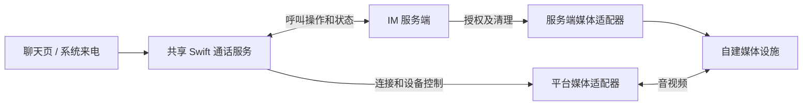

# 支持更换媒体引擎的一对一音视频通话方案

首版建议在 iOS 和 Android 上支持私聊语音、视频和系统来电。IM 决定谁可以呼叫、哪台设备接听以及通话结果。首个媒体实现选用自托管 LiveKit，双方媒体均经过自有节点。用原生 WebRTC 加自建 coturn 作为第二种实现，验证今后能否在同一套 IM 和通话界面下换引擎。群通话、录制和桌面通话产品留待单独选型。

替换有实际成本。团队需要交付新引擎的客户端适配器、服务端接入、媒体部署和真机回归。设计目标是把工作限制在这些位置，让呼叫协议、聊天记录、系统来电和业务页面继续使用同一套接口。

## 1. 模块和依赖

| 位置 | 负责什么 | 交给哪一层 |
| --- | --- | --- |
| `IMV2Core` 和 IM 协议 | 定义项目自己的通话 ID、类型、参与角色、状态、结束原因和回执 | 公开业务类型只引用 IM 类型 |
| `IMV2SharedRuntime` | 由账号会话持有拟新增的 `V2CallService`，处理拨号、接听、状态订阅、重连恢复和退出清理 | 通过注入的媒体能力执行连接，向页面提供业务快照 |
| Apple / Android 平台适配与宿主 | 组合媒体 SDK，接入系统通话、权限、音频路由和视频渲染。iOS 直接使用共享 Swift 服务，Android 通过现有 C ABI / JNI 绑定 | Kotlin 负责 Android 媒体与系统 API，通话规则只写在共享 Swift |
| IM 服务端 | 私聊 Room Owner 校验权限、串行裁决呼叫，PostgreSQL 保存通话和回执。Gateway 向目标账号设备送达状态提示 | 独立的媒体适配器为获准设备签发入场材料并清理媒体会话 |
| 自建媒体设施 | LiveKit SFU 转发媒体，内置 TURN 提供受限网络接入。替换方案以自建 coturn 中继两端 WebRTC 媒体 | 媒体数据由客户端媒体 SDK 直接收发，IM Gateway 只传控制消息 |

沿用仓库的会话所有权和平台注入方向。具体引擎依赖放在可选的平台模块和服务端基础设施模块，按构建目标链接。Android 通过 JNI 传递命令、事件和句柄，视频帧留在原生渲染层。macOS 可复用 Apple 适配，Windows 仍需独立解决共享 SDK、媒体设备、UI 和分发验证。[共享运行时与平台边界](../../IMV2ClientKit/README.md) · [账号会话实现](../../IMV2ClientKit/Sources/IMV2SharedRuntime/V2SharedSession.swift) · [房间权限与投递](../current-system-map.md)

## 2. 哪些接口要稳定

下面是拟新增的能力及语义，类型和方法名供实现时对照。

| 调用方 | 接口 | 最小能力 |
| --- | --- | --- |
| 页面、系统来电适配器 → `V2CallService` | 业务 API | 发起语音或视频、接听、拒接、挂断，设置静音和摄像头，切换摄像头，订阅 `CallSnapshot`。系统和页面可以对同一来电发出重复操作 |
| 共享 Swift → 平台媒体适配器 | `CallMediaSession`，每个本地通话实例持有一个 | 使用入场材料连接、设置麦克风和摄像头、离开，报告连接中、已就绪、重连中、轨道变化和失败。归一化错误，例如权限不足、网络中断、媒体服务不可用 |
| 平台页面 → 平台渲染适配器 | 本地预览、远端画面的挂接与解除 | 页面传入本地通话句柄和画面角色，适配器在平台 UI 线程绑定具体轨道。页面销毁时解绑画面，账号会话拥有通话生命周期 |
| IM 服务端 → 媒体服务适配器 | `CallMediaBackend` | 按已裁定的通话和设备准备接入，签发或更新短期入场材料，按该通话的唯一映射结束媒体会话。创建和清理均可用同一操作键重试 |

引擎名称只出现在装配、能力协商、媒体接入和技术指标中。共享设置与 UI 使用业务含义，例如“麦克风静音”和“正在重连”。挂断与取消连接可重复执行，适配器以“账号会话代次、通话 ID、连接代次”隔离回调，释放采集设备后才完成关闭。LiveKit 的 `Room`、`Participant`、轨道对象和 JWT 留在适配器内。原生 WebRTC 的 SDP、ICE 候选地址和 TURN 凭据同样由对应适配器解释。

每次通话应区分三个标识。IM 的 `roomID` 标识长期私聊，IM 生成的 `callID` 标识一次呼叫，引擎内部的媒体房间或信令会话使用独立映射。同一私聊第二次拨号产生新的 `callID` 和媒体会话。通话摘要、系统来电标识和恢复请求均关联 `callID`。

## 3. 一通电话如何建立和结束

1. 主叫通过已认证的 IM 连接提交 `StartCall(roomID, kind, operationID, deadline)`。服务端核对当前设备、私聊成员、屏蔽关系、呼叫权限和限频，给出 `callID`、服务端响铃截止时间及版本。陌生人能否呼叫由产品的来电策略决定，打开私聊本身不授予响铃权限。[私聊接收策略](../current-system-map.md)
2. 服务端保存邀请及要通知的设备，提交后再经 Gateway 通知在线设备。后台来电走独立的系统推送路径。设备按 `callID` 合并重复提醒，读取权威状态。一台设备打开聊天详情与否不影响来电投递。
3. 被叫设备提交 `AcceptCall`。Room Owner 在同一事务检查版本、截止时间、目标设备和当前权限，记录第一个接听设备并通知其他设备停止响铃。主叫取消、被叫拒接和响铃超时也由同一处裁决。建议明确“拒接”代表账号拒接，“静音铃声”仅影响本机。
4. 主叫设备和胜出的被叫设备分别请求 `GetMediaAccess(callID)`。IM 再次授权后，返回本次选定实现的版本化接入材料。两个适配器建立媒体连接，报告本端就绪。权限或设备不可用时返回可识别错误，视频通话允许用户选择仅开启麦克风。连接中可挂断，挂断后迟到的连接成功回调由本地会话代次丢弃。
5. 任一参与方提交 `EndCall`，服务端保存唯一终态，并在同一事务登记媒体清理、设备通知和历史投影待办。后台任务重试按 `callID` 去重。终态摘要通过现有房间顺序和同步路径进入聊天记录。主叫设备和已接听的被叫设备分别向 IM 续报存活。任一方失联超过恢复期限时，服务端结清通话。媒体故障通知用于加速核对，先按通话映射和设备代次去重，再决定是否结束。

业务状态取 `ringing → accepted → ended(reason)`，未接通时允许从 `ringing` 直接结束。结束原因区分未接、拒接、取消、正常挂断和连接失败。接受与实际媒体接通各有时间戳。建议在获准两端均报告媒体就绪时记录首次接通时间，展示时长从该时刻计算。接听后始终连不上时显示连接失败。媒体重连只更新本端连接状态，恢复过程不新建一通电话。

修改命令携带操作 ID，服务端在已认证主体范围内校验操作指纹并返回原回执。账号设备只接受更高版本的通话快照，重连、乱序和响应丢失时，以 `GetCall(callID)` 或按账号查询仍有效的呼叫进行恢复。拨号和接听设置短截止时间，过期后只查询结果，重连恢复时不会再次拨号或响铃。系统推送只触发来电处理，入场授权始终由认证连接取得。[现有命令回执语义](../reviews/message-send-contract.md) · [移动生命周期与推送边界](../../IMV2/docs/00-foundation/ADR-008-mobile-lifecycle-and-push.md)

## 4. 数据与引擎路由

| 数据 | 保存位置及用途 |
| --- | --- |
| 通话事实 | PostgreSQL 保存 `callID`、私聊 ID、参与账号、发起和接听设备、语音或视频、状态与版本、各阶段服务器时间、结束原因、操作回执。终态和对应待办原子提交 |
| 引擎路由 | 服务端另存每通电话选定的接入方案、协议版本、媒体会话映射和清理进度。进程重启后按此映射恢复，在途呼叫和清理任务始终找回原引擎 |
| 用户可见历史 | SQLite 从 IM 同步投影 `callID`、方向、类型、结果和时长，按账号及房间可见性读取。历史展示只需要 IM 数据 |
| 设备能力和临时材料 | 已认证设备上报支持的媒体方案版本及音视频能力，服务端按安装登记、刷新和过期。接入响应只携带 `callID`、方案标识、格式版本、过期时间和有大小上限的不透明载荷。客户端只在内存中将其交给匹配的适配器 |

创建呼叫时，服务端从已启用的自托管方案中，选择主叫与至少一台可接听被叫设备都支持的版本，并将路由固定到本次呼叫。迁移期优先覆盖更多可响铃设备，覆盖相同时按灰度配置选引擎。只有兼容的设备会响铃，接听时再次校验。双方没有共同方案时返回可识别的“不支持此次通话”，可以提示升级。设备离线时可使用其尚有效的登记。能力缺失或过期时等待设备刷新。

接入材料是短期、按设备授权的引擎协议。LiveKit 适配器解析服务端地址、参与者身份和只限本次房间的令牌。原生 WebRTC 适配器解析自建信令入口和临时 TURN 配置。地址使用部署侧配置的可信域名。令牌、SDP、候选地址和原始凭据只在对应适配器和获准设备之间传递。推送、聊天历史和普通日志仅记录各自必要的业务字段。每个适配器严格解码自己的载荷并拒绝未知版本，重取材料时重新校验账号、设备及通话状态。将来增加另一种引擎时增加接入格式，共享业务协议只需能传送已协商的不透明载荷。

## 5. 两种引擎如何接入

| 接入工作 | 自托管 LiveKit | 原生 WebRTC + 自建 coturn |
| --- | --- | --- |
| 媒体路径 | 手机连接自建 SFU，受限网络用自建 TURN/TLS 接入 | 客户端只配置自建 TURN，采用仅中继策略。用选中的 ICE 路径和中继字节数核验每一通的实际去向 |
| 媒体协商 | LiveKit 客户端 SDK 与自建服务完成连接协商、发布和订阅 | 为该适配器部署已认证的临时信令服务，转发两台获准设备的 offer、answer 和 ICE 消息，处理并发协商与切网重连。SDP 不写入 IM 消息协议或聊天日志 |
| 会话和权限 | IM 在接听成功后按设备签发限定房间、短时有效的入场令牌，结束时停止签发并关闭房间 | 信令只接收当前设备与有效会话代次的消息，显式结束信令会话、释放中继分配，验证撤销和过期行为 |
| 客户端隔离 | Apple 使用 Swift SDK，Android 使用原生 SDK，各自包装连接和渲染 | Apple / Android 各自封装 PeerConnection、采集、渲染和统计，继续调用相同的 IM 业务 API |

两个实现都要验证撤销的有效边界。自托管 LiveKit 下，移出参与者或修改权限后，先前签发的令牌在有效期内仍可能用于重新加入。除短有效期、停止续签和主动关闭外，若产品要求挂断或拉黑后立即禁止重入，就在唯一可达的媒体信令入口复核通话和设备授权，覆盖首次入场和重连并封闭旁路。原生方案同样需验证已建立的 TURN 分配何时停止转发。验收记录实际断流时间和剩余凭据重用结果。[LiveKit 授权与撤销](https://docs.livekit.io/frontends/reference/tokens-grants/) · [WebRTC 协商](https://webrtc.org/getting-started/peer-connections) · [ICE 仅中继策略](https://www.w3.org/TR/webrtc/#dom-rtcicetransportpolicy-relay)

## 6. 真机、部署与运行

- **移动端来电。** iOS 对真实 VoIP 推送及时上报 CallKit，同时恢复 IM 状态，已过期或已结束则结束系统来电。Android 接入目标发行渠道可用的推送和系统通话能力，验证锁屏接听、麦克风权限和后台通话。推送仅含必要标识和展示字段。推送平台承载提醒，音视频始终走自建节点。[Apple 来电处理](https://developer.apple.com/documentation/pushkit/responding-to-voip-notifications-from-pushkit) · [Android Core-Telecom](https://developer.android.com/develop/connectivity/telecom/voip-app/telecom) · [仓库 Android 接入范围](../../IMAndroid/README.md)
- **设备与账号生命周期。** 登录会话持有通话，关闭聊天页只解绑画面。切网给媒体适配器有界恢复时间。重连前向 IM 确认通话仍有效。锁屏、电话打断、蓝牙耳机切换、摄像头拒权分别验收。退出登录立即释放本地麦克风、摄像头和媒体连接。设备凭据撤销及通话中拉黑触发服务端终止与清理。
- **自托管拓扑。** 原型采用一套自有公网 SFU 和 TURN/TLS、受信证书及独立于 IM 的媒体端口。生产按目标地区、接通率和带宽测量扩容。LiveKit 多节点模式需要 Redis，每个媒体房间落在一个节点。维护时先停止为该节点分配新通话，再排空已有房间。固定服务端及 SDK 版本，保留配套镜像、依赖、许可证和可回滚配置。[自托管部署](https://docs.livekit.io/transport/self-hosting/deployment/) · [多节点与排空](https://docs.livekit.io/transport/self-hosting/distributed/)
- **容量与质量。** 同时有 N 路一对一视频、每台设备平均上传 b Mbps 时，SFU 媒体出口的粗估是 2 × N × b Mbps，另外预算音频、协议、重传和 TURN 网络开销。分平台、网络和引擎记录接通率、接听到首个远端音频/视频的 P50/P95、切网恢复耗时、异常结束率、TURN 使用率和出口带宽。以用户同意接听的有效样本计算媒体接通率，将拒接、无人接听与连接故障分开。上线指标阈值由目标地区真机基线和产品要求确定。

## 7. 如何切换与回滚

1. **先发布通用通话协议。** 首次新增 IM 命令、事件和历史投影时，按仓库现行协议升级和数据库部署规则配套发布。涉及真实用户数据迁移或多版本 IM 协议共存时，依 ADR-000 重新确定升级合同。系统先识别版本化媒体能力，再启用首个引擎。后续的媒体灰度只在已满足同一 IM 协议要求的版本之间进行。[实时协议](../../Protocol/im_realtime/v2/im_v2.proto) · [部署与版本合同](../../IMV2/docs/00-foundation/ADR-000-greenfield-cutover.md)
2. **增加替换实现。** 用同一套验收用例接入 B（原生 WebRTC）并保留 A（LiveKit）。能同时链接时，发布支持 A+B 的客户端。先验证两套原生媒体库在 iOS 的符号和 Android 的 JNI/动态库、包体与发布构建能共存。若确实冲突，可用独立测试构建验证 B，生产按双方都已升级的设备群发布。仅 A 对仅 B 返回不可用。全用户互通若为发布要求，则须先解决共存或设计服务端媒体互通。
3. **只迁移新呼叫。** A 对 A+B 继续选 A，支持 B 的双方按灰度选择 B。每通电话只使用一个引擎。已建立的 A 通话、入场续期和待清理记录继续走 A，直至结束。可以按 `callID` 对照路由、媒体质量与唯一聊天摘要。
4. **回滚和下线。** 关闭 B 的新通话分配，仍兼容 A 的设备恢复使用 A，既有 B 通话按 B 排空。只支持 B 的设备在 B 停用期间明确显示不可用。待旧客户端覆盖符合产品要求、旧通话和清理任务归零、旧凭据失效后，再下线 A 的媒体节点、密钥和客户端依赖。旧通话历史继续通过 IM 投影读取。

## 8. 实施顺序与验收证据

| 里程碑 | 交付物 | 完成条件 |
| --- | --- | --- |
| 1. 固定业务边界 | 领域值类型、IM 命令与状态、账号级共享服务、服务端权威状态和测试媒体适配器 | 不链接 LiveKit 即可编译共享业务并跑通邀请、两设备抢接、接听与挂断竞争、超时、重复回执、终态重放和唯一历史。账号切换后无前账号事件 |
| 2. 跑通首个媒体实现 | 独立部署的 LiveKit、签发和清理适配器、iOS/Android 前台语音和视频 | 两台真机分别用 Wi‑Fi 与蜂窝网络互拨。覆盖双向声音与画面、切摄像头、静音、弱网重连、限制 UDP 后走自建 TURN/TLS。连接统计与服务端流量都能验证自托管路径 |
| 3. 证明能够替换 | 第二套真实适配器的最小原型，以及两种引擎共用的呼叫测试 | 相同业务页面和控制协议在 B 上完成一次跨平台语音和一次视频，确认仅走自建 TURN。演练 A 通话中启用 B、新 B 通话中回滚、无共同引擎、迟到回调和读取 A 的旧记录。记录实际修改的模块，核对共享业务、IM 历史和页面的差异 |
| 4. 完成移动端交付 | 系统来电、历史恢复、监控告警、容量与撤销验证 | 实测锁屏/后台、多端接听后停铃、过期推送、媒体服务宕机、退出或撤销后断流。验证数据库提交成功但应答丢失、后台任务重启后的结清，记录目标区域质量和成本 |

代码审查时从替换补丁反查依赖。更换引擎应只涉及平台媒体和渲染适配、服务端媒体接入和部署、依赖装配、能力登记与验收。如果还要迁移历史表里的厂商房间 ID、改聊天消息格式、重写接听规则，或让页面判断具体引擎，该边界仍需返工。
