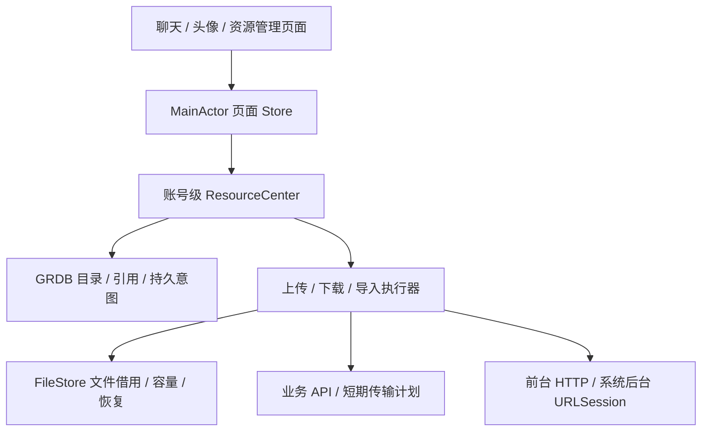

# 客户端资源管理系统落地蓝图

更新日期：2026-10-27。本文是结合当前工作区与官方资料的设计决策和交付清单，现已进入实施及验收。新版测试环境已切换，10 个新账号已创建，配对客户端已安装到手机；完整交付仍须完成剩余审查和真机行为/性能验证。当前进展与限制见验证台账和交付路线图第 61 节以后。代码核对基线为 `63968959` 加当前未提交工作区；下文的阶段是交付顺序，不是完成声明。

## 1. 交付目标与范围

统一聊天图片、视频、音频、文件、个人头像和群头像的导入、传输、使用、保留与清理。启动、页面切换和网络恢复始终先展示本地可信状态；发送立即生成本地消息，网络操作在账号生命周期内继续。

入口使用“我的 → 文件与存储”和“会话详情 → 聊天文件”，不增加主 Tab。资源中心承担附件管理；跨设备个人网盘、任意文件夹同步、生产视频转码和内容扫描服务不列入首版。

允许同步修改客户端、Core、服务端合同和数据库 schema。目标结构只保留一套写入和恢复逻辑，不做旧字段 fallback、双写或兼容适配。已有正确机制继续使用；不兼容旧客户端明确拒绝。测试数据是否清空另行按明确环境执行，不把不兼容当作任意删除数据的授权。

## 2. 项目事实与处理决定

| 当前代码证据 | 设计决定 | 尚需验收 |
| --- | --- | --- |
| ClientKit `Resources/V2ResourceCenter.swift` 已有账号级 actor、查询快照、上传下载接入 | 收敛为命令与只读快照入口；执行器继续拥有各自状态迁移 | 页面/账号关闭、取消和迟到事件的完整边界 |
| `V2AccountStorageScope` 已按账号与 incarnation 隔离 | 所有目录、任务和系统回调均绑定同一作用域 | 切换账号和旧系统回调不能串号 |
| `V2ResourceFileStore`、下载缓存、上传/下载 journal 已存在 | 统一文件所有权、容量和恢复；不再另建文件管理器 | 崩溃点、使用中清理、真实磁盘不足 |
| `V2PhotoLibraryPicker` 已使用文件表示、有界 ImageIO 解码及规范化 | 接入统一导入意图；不把选择器临时 URL 当持久源 | iCloud 取回、取消、大图和批量导入 |
| App `Resources/` 已有目录、详情、任务和存储页面 | 优化并验证已有页面，删除重复入口和独立队列 | 原生导航、深色、大字体、VoiceOver |
| `V2OSSUploadTransport` 声明 `httpPut`、上限 256 MiB | 首版整文件上传；暂停保留原件，继续可能从零重传 | 真实 OSS、过期计划、超时与幂等确认 |
| `V2VaporRoomResourceDirectoryRoutes` 已有会话资源查询路由 | 复用并核验服务端可见范围与稳定分页 | 退群/撤回/撤权、旧游标与迟到响应 |

以上仅证明代码存在。已有测试记录以 [验证台账](../verification/client-resource-center-20261025.json) 为证据，不能用文件数量或局部测试通过替代完整交付。

## 3. 页面设计

| 页面 | 内容 | 关键交互 |
| --- | --- | --- |
| 文件与存储 | 浏览资源、传输任务、存储管理三行入口及占用概览 | 小标题、统一登录后导航、同组连续行 |
| 资源目录 | 全部/图片/视频/音频/文件、名称搜索、已保留筛选 | 图片视频网格；音频文件 List；批量选择 |
| 聊天文件 | 与资源目录共用组件，只增加会话范围 | 本地首屏，联网分页补齐；来源定位原消息 |
| 资源详情 | 名称、大小、类型、本机状态、多个引用来源 | 预览、下载、分享、保留本机、清理本机副本 |
| 传输任务 | 进行中、需处理、最近完成 | 按阶段展示合法的暂停/继续/重试/取消 |
| 存储管理 | 缓存、保留文件、待发送原件、临时传输、索引及其他 | 清理预览、实际释放量、跳过原因与网络偏好 |

全局目录明确标注“本机已索引”，不是完整云端文件清单。会话查询显示覆盖范围；离线无本地记录时显示“本机暂无记录，联网后同步”。若未来需要全账号云端完整搜索，单独建设服务端用户资源索引。

进度不影响消息或目录排序。失败原消息仍位于原发生时间，不集中追加到末尾。已有内容刷新失败时保留内容并给出重试入口，不整页换成占位。任务状态使用对应颜色图标和短文字，详情按需展开；不在聊天输入框下重复显示账号连接或发送状态。Sheet 完成按钮在右上角。

资源详情遇到临时读取失败时保留上次元数据，明确标注未更新并禁用文件操作，提供受页面命令生命周期管理的“重新读取”。明确撤权、不可访问或账号关闭时清空元数据和呈现入口；本地旧快照不构成访问资格。附件已被拒绝时，拒绝原因优先于随后发生的期限过期，不能提示可以重新准备却不给出对应操作。

传输列表同样保留临时读取失败前的记录，并通过新的观察代次执行页内重试，旧代次不能覆盖新结果。账号中心关闭后清空记录和未确认计划。相关更改列表必须等当前页读取成功后才可消耗下一页游标；传输页返回已保存的历史游标仍可取消正在加载的新页。

## 4. 架构与唯一事实来源

- Core：资源身份、不可变版本、分页合同与校验约束。
- ClientKit：GRDB、受管文件、授权、调度、恢复和不可变快照。
- App：Photos/Files、QuickLook、分享、媒体预览和页面交互桥接。
- Server：访问权限、资源 ready 判定、业务绑定、可见目录、短期计划和对象生命周期。

沿用 GRDB 和现有 package，不引入 SwiftData 或新 DI 框架。页面不能直接写数据库、删除文件或持有传输任务。ResourceCenter 不吞并所有领域：上传、下载、导入各自只有一个 canonical journal；统一传输页从它们派生只读快照，不另建第二套可写任务状态。

## 5. 身份与数据模型

| 身份 | 职责 |
| --- | --- |
| LocalAssetID | 本机导入原件，供草稿和发送意图稳定引用 |
| ResourceKey(home, mediaID) | 服务端逻辑资源，不使用 OSS URL 当 ID |
| VariantKey(resource, original / derived(id, version)) | 原件与不可变衍生版本；名称修改不产生新原件 |
| LocalBlobKey(accountIncarnation, sha256, size) | 校验后的账号内字节复用，不授予访问权限 |

数据库事实分为资源描述、版本、业务引用、物理文件、逻辑保留意图、各类任务 journal、持久消费者依赖、文件操作 journal、偏好和查询检查点。消息引用索引随接受/编辑/撤回事务更新；全量快照通过可恢复分批索引队列补齐，不能仅在打开聊天时临时扫描。

同一资源多个消息引用可聚合展示；不同 home 的相同摘要不合并服务端身份。保留本机绑定逻辑版本，文件缺失不删除保留意图。权限撤销后不能借用本地文件绕过授权；清除保留偏好仍应可执行。

资源状态、文件状态、任务状态和消息提交状态分别建模。上传成功不等于资源 ready，也不等于消息成功。

消息入队时同时验证已有任务的目标会话，并冻结依赖是上传还是服务端导入。裸 ID 同时对应两类任务时拒绝新入队；已冻结的消息按原依赖类型交接和重试，不能根据后来哪个 journal 恰好存在来重新推断。只有明确未发送的终态才允许创建替代消息，结果未知继续确认原操作。

## 6. 必须打通的链路

### 6.1 导入与发送

1. 选择 → 预留峰值空间 → 有界复制/规范化 → 校验 → 发布 LocalAsset；外部临时文件只在导入期间持有访问资格。
2. 点击发送，同库事务写本地气泡、稳定 clientMessageID、冻结载荷和文件依赖，并恢复归档会话的可见性。
3. 账号调度器执行上传/跨 home 导入，资源 ready 后提交原 SendIntent。
4. ACK 丢失查询原操作，不能生成新 ID 重复发消息；结果未知继续保护原件。
5. 只有所有持久消费者已闭合，才能释放原件。切 Tab、离开页面或进入后台不取消发送。

### 6.2 下载、预览与分享

先读取本地元数据，再按当前消息或头像上下文核验授权。命中已验证文件则返回独立 lease；缺失则调度下载。预览、缩略图、分享各自持有 lease，结束显式归还，不能长期保存裸路径。

Range 下载核验 Content-Range、版本、长度和最终 SHA-256。200 不能追加旧 partial；412 重新核验版本与授权；416 不直接当成功。ETag 用于服务端版本条件，不一概视作内容 MD5。签名 URL 过期只刷新计划，不清空目录或消息。

### 6.3 任务控制与清理

动作由当前阶段派生，执行时再次检查。整文件 PUT 不承诺字节续传；冻结消息依赖的取消由消息所有者处理，不能只删一个附件改变冻结载荷。已提交或结果未知时先确认原结果。

清理采用“生成计划 → 用户确认 → 重验执行”，跳过借用中、保留、待发送、结果未知及活跃写入的文件。只删除本机可重建字节，不删除消息或正式 OSS 对象。多文件部分成功返回实际释放量及跳过原因。

### 6.4 状态对应的操作与业务责任

下表是命令合同；页面只显示执行器当前允许的动作，执行器在命令到达时再次验证，避免快照过期导致错误操作。

| 当前事实 | 允许的动作 | 必须保护的内容 / 责任边界 |
| --- | --- | --- |
| 导入中 | 取消当前导入 | 文件发布前不允许生成可发送原件；导入器排空写入后释放预留 |
| 等待网络 / 上传中 | 暂停、继续；取消交给业务所有者 | 同一原件可能由多个消息或头像意图引用，不能随一个任务取消而删除 |
| 字节已上传，等待 ready | 查询原上传 / finalize 结果 | 不显示消息发送成功；不因回包丢失创建新上传身份 |
| 资源 ready，业务尚未提交 | 提交冻结的原业务意图 | 提交前验证可绑定期限；资格失效需重新准备，不循环使用已过期资格 |
| 消息 / 头像提交结果未知 | 继续确认原操作 | 不能作为普通失败重新生成业务 ID；结果闭合前保留恢复依赖 |
| 已确认未提交且资格失效 | 明确重试 / 重新应用 | 保留本地原件；需要时更新传输身份，新消费者绑定成功后才释放旧消费者 |
| 下载中 / 暂停 | 暂停、继续、取消下载 | 下载取消不撤回消息；临时文件是否保留由可恢复性和预算决定 |
| 已校验的本机副本 | 预览、分享、保留、清理 | 预览和分享持有 lease；清理重验权限、保留意图和活跃消费者 |

过期规则分别属于：短期 URL、上传会话、ready 后可绑定期限、业务确认期限、访问资格和本地缓存淘汰策略。进入后台不是其中任何一种过期事件。UI 必须能解释具体失效对象，不能用一个“资源已过期”覆盖全部情况。

消息仍处于 preparing 且没有交接 work 时，本地事务可以证明业务尚未提交。此时准备资格或首次提交期限过期，提供“重新准备”：创建唯一替代意图及新的资源身份、沿用原件和原列表时间，并原子转移容量额度；重复点击和重启返回同一替代意图。已经交接的消息不能走这个入口，必须先由原操作确认结果。重新准备失败时原意图、资源依赖和额度完整回滚。

## 7. 文件、后台与安全

Application Support 存账号库、唯一待发送原件及保留文件；Library/Caches 存可重建下载和缩略图。后台最小交接文件使用独立的首次解锁后可访问范围，不整体降低账号数据库和正式文件保护等级。文件发布/移动/删除通过 journal 对账恢复，SQL 回滚不能替代文件系统恢复。

后台 URLSession 使用稳定少量标识与持久任务映射；delegate 及时接管临时下载文件，再由账号协调器处理。系统终止和用户手动强退分别验收，不能承诺用户强退后任务必定继续。后台上传必须来自受管文件。

当前交付状态：OSS adapter 的整文件 `httpPut` 已加入明确后台授权 scope 和 `backgroundPlans`；iOS 模拟器实际系统 URLSession 已完成图片与 9 MiB 文件的真实 OSS 上传、原会话 finalize、消息提交和独立接收字节验证。真实回归发现并修复了“成功后再次 PUT 导致 409”的状态流转问题。验收原脚本清理返回权限错误，随后独立核实其进程/进程组均已退出，原记录保留；完整台账见 `wholePutNativeAcceptance`。当前 Linux 镜像及真实 OSS 验收、新库切换和公网两账号图片/文件收发已通过；R19 签名客户端已安装到手机。真机后台/锁屏/系统终止及性能仍需完成。整文件后台执行仍可在中断后重传，不等于分片续传；不能用模拟分片通过来替代首版 OSS 的后台上传交付。

OSS Bucket 私有；客户端只取得短期传输资格，不存 AccessKey。签名 URL、认证头和私有路径不进入日志。账号退出关闭准入、取消并排空实际工作，再退役目录；旧 incarnation 的回调只能被隔离或丢弃。

## 8. 可配置初值

以下为工程起点，须用真机测量调整，不是平台限制或性能结论。

| 参数 | 初值 |
| --- | --- |
| 普通缓存 | 512 MiB，LRU 仅淘汰可重建且未借用字节 |
| 待发送原件 / 临时预算 | 2 GiB / 512 MiB，按实际同时存在的副本计峰值 |
| 保留文件提醒 | 2 GiB，不自动删除用户保留 |
| 并发 | 总字节任务 4，上传最多 2、下载最多 2，交互优先并兼顾公平性 |
| 自动下载 | 默认非昂贵、非受限 Wi-Fi 图片 ≤10 MiB，其他类型用户开启 |
| UI 进度 | 合批至约 4 Hz；未知总量显示不确定进度 |
| 自动重试 | 瞬时错误最多 5 次退避，尊重 Retry-After；权限/校验/空间错误转待处理 |
| 完成展示历史 | 最多 500 条或 30 天；不删除业务恢复依赖 |

当前策略的 16 MiB 可用空间初值不能直接当发布安全线；应结合导入、解码和发布峰值测量，提高到与任务需求相匹配的安全余量，并处理真实 ENOSPC。

## 9. 实施拆解及退出条件

| 阶段 | 代码落点与交付 | 退出条件 |
| --- | --- | --- |
| R0 合同定稿 | Core、客户端/服务端 schema、capabilities、合法动作表；审计在途 diff | 配对构建通过，唯一状态所有者明确，无兼容分支 |
| R1 发送纵向闭环 | 选择器、LocalAsset、SendIntent、上传/导入、对端读取 | 两账号图片/文件收发；离线气泡；断网/ACK 丢失重启不重复 |
| R2 文件生命周期 | FileStore、双根目录、lease、预算和文件 journal | 每个崩溃点恢复；预览中清理；磁盘满；切账号无串号 |
| R3 目录与媒体 | 增量/快照引用索引、会话分页、可信元数据、缩略图和来源定位 | 分页不重复；撤权页不复活；增量与全量一致；归档来源可定位 |
| R4 传输控制 | 统一读模型、领域取消、暂停恢复、真实进度和公平调度 | 按钮实际生效；取消/提交竞争正确；真实 I/O 排空后释放名额 |
| R5 页面与偏好 | 资源/任务/存储、批量、清理预览和网络设置 | 本地立即显示；设置持久化且执行端遵守；滚动稳定 |
| R6 配对交付 | Linux、真实 OSS、Release、真机后台/锁屏/重启、无障碍 | 验收证据完整；部署服务健康、配对客户端安装后完成双账号验证 |

按退出条件推进，而非把已有文件重新开发一遍。每阶段提交应能独立审查；协议/schema 破坏性变更作为配对版本发布。先审计与收敛当前在途实现，再补缺口。详细技术条目见 [实施方案](client-resource-center-plan.md)；执行追踪见 [交付路线图](client-resource-center-delivery-roadmap.md)。

## 10. 验证与发布门槛

- 单元：身份、版本、阶段动作、权限、取消、稳定排序、预算与退避。
- 真实 GRDB + 临时目录：SQL/文件中断点、共享 lease、清理竞争、来源撤权、账号关闭。
- HTTP/OSS：真实 PUT/GET、Range 返回差异、签名过期、版本变化、超时和校验失败；mock 通过不能替代真实云端证据。
- UI：离线首屏、筛选分页、任务控制、来源定位、分享清理；深浅色、超大字体和 VoiceOver。
- 真机：锁屏、系统终止回接、用户强退再启动、蜂窝/低数据模式、账号切换；后台事件到达时不得要求受保护正式库必须已解锁。
- Release 性能目标：指定设备、1 万条目录；本地首个可用快照 p95 ≤200 ms。50 条首屏无主线程文件/数据库 I/O 或原图解码；反复打开关闭无持续任务、内存或磁盘增长。这些是待测目标。

不把 unsigned 构建、容器 healthy、跳过的数据库测试或模拟器后台测试等同于已部署可用。发布保留配对构建、配置和必要环境快照；破坏性 schema 变更的恢复不能只回退二进制。

## 11. 官方资料与决策对应

1. [Apple：后台文件传输](https://developer.apple.com/documentation/foundation/downloading-files-in-the-background)：据此设计稳定 session、文件上传源、临时文件接管和系统回接。
2. [Apple：后台 session](https://developer.apple.com/documentation/foundation/urlsessionconfiguration/background(withidentifier:))：据此区分系统终止与用户强退，恢复依赖持久映射而非页面任务。
3. [Apple：存储与 iCloud Backup](https://developer.apple.com/documentation/foundation/optimizing-your-app-s-data-for-icloud-backup)：据此区分可重建缓存和唯一原件，不将所有文件塞入 Caches。
4. [Apple：Photos picker](https://developer.apple.com/videos/play/wwdc2022/10023/)：据此将选择与异步取回/受管导入分开，支持取消和等待。
5. [阿里云：GetObject](https://help.aliyun.com/zh/oss/developer-reference/getobject)：据此核验 Range、版本条件和响应，不盲目拼接下载文件。
6. [SQLite：WAL](https://www.sqlite.org/wal.html)：据此使用短事务和进度合批，依赖同库事务，不假定 WAL 支持多个同时写入者。

## 12. 从现有代码到可交付版本的具体任务

### 12.1 固定代码边界

| 代码落点 | 承担任务 | 禁止产生的重复机制 |
| --- | --- | --- |
| `IMV2Core` 的资源 descriptor、版本和 query 合同 | 明确必填字段、不可变字节身份、合法枚举、分页边界和能力协商 | 旧字段 fallback、把对象 URL 当资源身份 |
| `IMV2ClientKit/Resources/GRDBV2ResourceDirectory.swift`、`GRDBV2MessageResourceIndex.swift` | 引用索引与消息写入同事务；撤回和快照替换时同步更新 | 只在进入页面时扫描消息补目录 |
| `V2ResourceCenter`、上传/下载 journal 和执行器 | 账号级任务、统一控制入口、派生只读传输快照 | View 自建上传 Task；额外可写“总任务表” |
| `V2ResourceFileStore`、catalog、LocalAsset | 导入、临时预算、文件发布/借用/清理和崩溃恢复 | 各页面自行拼路径、复制原件和删除文件 |
| App 的 `V2PhotoLibraryPicker`、附件/头像 service | 系统选择器桥接、及时接管临时文件、冻结业务意图 | 选择器 URL 跨进程持久化，后台上传只持有 Data |
| App 的 `V2/Resources/` 页面及 Store | 目录、详情、任务、存储、预览、分享和来源导航 | 页面成为数据库或网络状态所有者 |
| Server 的 `V2VaporResourceRoutes`、会话目录和 OSS adapter | 权限、上传状态闭合、ready、绑定和目录可见性 | 客户端上传成功即自行宣布 ready |

当前照片导入实现已有 50 MiB 输入、4096 像素输出边长和 8000 万输入像素约束；透明图片输出 PNG，其他静态图片规范化为 JPEG，并去除源元数据。先保留这条明确的“发送图片”路径；“以文件发送”是另一种不改字节的导入方式，界面须区分，不能把压缩结果标作原图。视频、音频先支持文件导入、类型识别、元数据和系统可支持格式的播放，不把拍摄、录音编辑和完整转码纳入同一交付。

### 12.2 直接复用并收敛服务端合同

| 操作 | 当前入口 / 目标约束 |
| --- | --- |
| 获取能力 | `GET /v2/resource-capabilities`；服务端返回模式、大小限制，客户端必须遵守，页面不硬编码假定分片可用 |
| 创建上传 | `POST /v2/resource-uploads`；记录可恢复 locator 与幂等身份，包含受控名称、类型、长度和摘要 |
| 查状态 / 取目标 | `POST /v2/resource-uploads/status`、`/targets`；目标 URL 短期有效，刷新不能新建业务发送 |
| 完成 / 取消 | `POST /v2/resource-uploads/finalize`、`/cancel`；服务端校验实际对象并闭合原操作，取消竞争返回真实结果 |
| 查询会话资源 | `POST /v2/rooms/:roomID/resources/query`；复用现有路由，按用户可见消息范围分页，不直接列 Bucket |
| 获取字节 | 沿用现有资源访问/字节路由与授权上下文；先授权，再发放短期计划，按版本验收字节 |
| 业务绑定 | 消息或头像提交使用已 ready 的 descriptor；验证 home、所有权和版本，提交幂等且原子 |

统一错误的用户含义：认证失效进入重新认证；无权或已撤回显示不可访问；限流和瞬时服务错误延迟重试；摘要不符丢弃本次未发布字节；磁盘不足保留任务和原件并提供清理入口。认证刷新是有界流程，不能把所有 403 当作 URL 过期反复续签。

### 12.3 故障恢复必须有明确责任人

| 中断点 | 恢复责任与结果 |
| --- | --- |
| 导入复制一半 | FileStore 操作记录识别未发布文件，恢复或清理；不生成可发送的有效 LocalAsset |
| SQL 已记意图、文件尚未发布 | 启动对账按操作阶段继续；不因路径存在就判定完成 |
| PUT 完成、finalize 回包丢失 | 使用原上传 locator 查状态；不创建第二个上传资源 |
| 消息提交回包丢失 | 同一 clientMessageID 查询/重试原提交；不重复气泡、不重复消息 |
| 下载完成、App 尚未消费 | 系统 delegate 在返回前接管临时文件，持久收件映射交给账号恢复流程 |
| 预览/分享时清理 | lease 阻止删除当前消费文件；清理结果说明跳过，退出消费后再可淘汰 |
| 页面销毁、切 Tab、普通后台 | 账号任务继续，UI 重新订阅快照；连接/传输状态变化不使本地目录失效 |
| 切换账号后旧回调到达 | 使用 incarnation 与任务映射验证归属，不能写入当前账号 |

“首次启动本地为空”和“已有本地数据正在同步”是两种页面状态：前者给真实空态和同步说明，后者保留内容。进度更新只改变进度字段，不修改稳定排序键、消息 ID 或列表身份。

### 12.4 工作包、依赖和验收产物

按 R0 → R1 → R2 → R3 → R4 → R5 → R6 推进；R1 需要先具备 R2 的最小持久原件/借用能力，其余 R2 故障测试随后扩展。不要等所有页面完成才首次联调。

每个工作包交付四项：可审查的代码 diff、对应自动化用例、实际执行结果及尚未覆盖环境。先清点工作区在途实现和状态所有者，再按缺口补齐；不按目录文件数量估算剩余工时。

第一条验收主线固定为：账号 01 在离线时选择图片并发送 → 本地立即出现气泡 → 重启后意图保留 → 联网完成 OSS 上传及消息提交 → 账号 02 在当前聊天实时收到 → 在聊天文件中找到 → 预览/分享 → 清理本机副本 → 再次授权下载。然后用普通文件重复该链路，加入头像引用及故障矩阵。

指定真机与 Release 构建后记录：本地首屏耗时、滚动卡顿、峰值内存、实际磁盘占用、重试次数和传输吞吐。目录分页使用稳定复合游标，每页默认 50、上限 100；页面不得一次加载或解码全部原图。性能数字没有设备、数据量和构建信息时不作为验收结论。

### 12.5 不考虑历史兼容性的发布方案

新版本客户端、Core、服务端、数据库 schema 与消息资源载荷作为一个配对版本交付。能力不匹配时明确提示升级，不保留旧 decoder、旧表双写或静默修复。数据库结构正确不代表持久消息载荷符合新合同，发布准入要分别检查两者。

推荐先建立隔离的新测试环境，用新 schema、新任务命名空间和新测试数据完成验收；旧环境保留可恢复快照。此建议不等于本次已经执行环境重置。若需要沿用旧账号或聊天，那是明确的数据转换工作，应另列转换范围与验证，不能用隐式兼容层混入主链路。

发布顺序：冻结配对版本与配置 → 备份并验证恢复路径 → 新环境部署服务端、执行合同准入 → 真实 OSS 双账号收发 → 安装对应 Release 客户端 → 真机后台/锁屏/重启及管理操作验收 → 切换测试入口。旧版本不能继续向新协议环境写入。不兼容数据库变更后，恢复必须连同匹配数据和配置处理，不能只换回旧二进制。

交付完成的判定是上述用户主线、故障矩阵、真实 OSS 和真机验证全部有证据；本方案编写、构建成功或容器健康均不是完成条件。

## 13. 本次检索补充（2026-10-26）

- [Apple：文件系统使用](https://developer.apple.com/documentation/foundation/using-the-file-system-effectively)：可重建内容放 Caches；唯一原件和保留内容由持久目录管理，并按是否可重建分别决定备份属性。
- [Apple：后台传输](https://developer.apple.com/documentation/foundation/downloading-files-in-the-background)：后台上传使用文件；下载临时文件须在 delegate 返回前接管；稳定 session 支持系统回接。
- [Apple：后台 session 生命周期](https://developer.apple.com/documentation/foundation/urlsessionconfiguration/background(withidentifier:))：用户强退后系统不会自动重启 App，产品承诺应为再次启动后恢复，不能保证强退后继续运行。
- [阿里云：GetObject](https://help.aliyun.com/zh/oss/developer-reference/getobject)：支持 Range 和 If-Match，版本条件失败返回 412，据此实施有条件续传。
- [阿里云：数据一致性校验](https://help.aliyun.com/zh/oss/user-guide/data-verification)：ETag 的生成方式依上传方式而异，不能作为统一全文摘要；采用受信任 descriptor 的长度与 SHA-256 完成验收。
- [SQLite：事务隔离](https://www.sqlite.org/isolation.html)：WAL 支持读写并发但不提供任意多并行写事务，因此任务进度合批、业务事务短小，文件 I/O 在 SQL 事务外执行。

上述平台行为来自官方资料；512 MiB 缓存、并发数、重试上限和首屏性能门槛是本项目的设计初值与验收目标，不是官方规定。

## 14. 产品边界与执行清单补充

### 14.1 离线可见、离线读取与撤权分别处理

“本地优先”首先承诺本地目录、消息、缩略图状态和发送意图不因刷新而消失，不代表持有字节就获得永久访问权。当前 `V2ResourceDownloadCache.performDownloadAttempt` 在命中本机文件之前调用 `authorizedTarget`；因此当前实现不能被描述为已支持断网打开所有已下载原件。

首版明确采用以下行为：本地目录可离线浏览；新打开附件需要有效授权，无法验证时保留条目并提示“联网后验证访问权限”；本机保留只阻止自动清理，不绕过授权。已知撤回、退群或撤权立即使相应上下文失效；同一字节有其他有效引用时，不误伤其他上下文。已导出到系统 Files 或分享给其他应用的副本无法远程收回，UI 不能承诺能撤销它们。

若以后需要长期离线打开，必须单独定义可持久化的离线阅读资格、有效期和撤权延迟；不能同时承诺完全离线访问和未知远端撤权立即生效。这个扩展不作为首版默认能力。

### 14.2 云端存活与本机清理使用不同责任链

- 本机：资源目录聚合逻辑身份，容量统计按物理文件去重；“清理副本”不删除消息、保留偏好或 OSS 正式对象。
- 云端：业务绑定决定资源是否仍有引用；无绑定资源、上传暂存和衍生产物由服务端登记回收任务。执行前重新检查绑定和对象精确身份，保留可重试记录及 tombstone，迟到 finalize/worker 不得使已退役资源复活。
- OSS lifecycle 只兜底明确隔离的暂存前缀及未来的未完成分片，不按正式对象年龄直接删除聊天附件。现有 PUT 模式无需虚构分片清理能力；以后增加 multipart 时，必须同时实现 uploadID、part receipts、complete、abort 和过期回收。
- 运维指标至少覆盖：未绑定资源字节、暂存最老年龄、回收失败数量、处理队列年龄、上传/ready/消息提交各阶段耗时。日志关联 operationID 和 mediaID，禁止输出签名 URL 或凭据。

参考：[阿里云客户端直传](https://www.alibabacloud.com/help/en/oss/user-guide/uploading-objects-to-oss-directly-from-clients/)说明直传可避免业务服务器转发流量，也区分整文件签名 PUT 与分片方案；[OSS 分片上传](https://help.aliyun.com/zh/oss/user-guide/multipart-upload)列出分片操作及权限。当前 256 MiB 是项目 adapter 上限，不是 OSS 的平台最大值；图片限制还应服从服务端 `maximumImageBytes`。

### 14.3 分阶段提交与验收矩阵

| 工作包 | 主要责任边界 | 必须留下的交付物 |
| --- | --- | --- |
| 合同与在途代码清点 | Core + ClientKit + Server | 类型/表/接口对照表、唯一写入者清单、删除的旧路径清单、配对协议标识 |
| 图片与文件发送闭环 | App 选择器 + ClientKit 发送执行器 | 两账号真实 OSS 收发记录；离线重启、ACK 丢失、重复点击不产生重复消息 |
| 文件安全与恢复 | FileStore + GRDB | 发布/搬迁/清理各中断点用例，使用中清理与真实空间不足记录，账号隔离证明 |
| 目录与任务页面 | 索引服务 + 页面 Store | 统一列表、稳定分页、来源跳转、真实合法动作，以及本地已有内容不闪占位的 UI 验证 |
| 后台与发布 | 系统传输桥接 + 部署脚本 | 真机锁屏/系统终止/用户强退分别记录；同版本 Linux、配置、数据库与签名客户端清单 |

每个包先写能观察结果的验收脚本或明确手动步骤，再补缺口。既有测试只在输入源码及环境仍匹配时复用，不能把旧结果自动算成当前版本通过；也不要求为了改方案文档重跑全部工程测试。

首版可交付的硬条件：图片和普通文件两条纵向链路均成功；重启不丢待发原件或重复发送；本地已有数据不被刷新占位替换；清理不破坏活跃消费者；撤权与账号切换不能串权限；服务端与真机客户端配对验证完成。全账号云端网盘、拍摄录音编辑、完整视频转码、multipart 续传及长期离线阅读分别列为后续扩展，不混入首版完成声明。

## 15. 本轮核对后的执行合同（2026-10-26）

本轮按用户要求检索官方资料并核对当前工作区，产物是可执行方案，不新增实现或宣称在途实现已验收。不考虑历史兼容性：以下是唯一目标合同，不设置旧 decoder、双写或旧页面旁路。

### 15.1 持久模型和约束

以下为逻辑实体，映射到已有 GRDB schema 和 journal，不要求机械新增同名表。

| 实体 | 核心键与数据 | 强制约束 |
| --- | --- | --- |
| Resource | `(home, mediaID)`；类型、可信名称、大小、摘要、可用状态 | URL 不入身份；跨 home 不合并 |
| Variant | `(resource, variantID, version)`；摘要、长度、尺寸/时长 | 已发布字节不可变；元数据来自校验/媒体探测 |
| Reference | `(businessType, businessID, slot)` → Variant | 消息接受/编辑/撤回同事务维护；引用决定访问上下文 |
| LocalAsset | 本地 UUID；原件路径、摘要、大小、发布阶段 | 发布完成才可发送；消费者未闭合不能回收 |
| LocalBlob | `(accountIncarnation, sha256, size)`；相对路径、分配字节、校验状态 | 物理去重只限账号；存在文件不等于可授权读取 |
| Retention | `(resource, variant)`；保留意图 | 与物理副本分离；文件缺失时仍保留意图 |
| Intent / Job | UUID、幂等业务 ID、冻结依赖、阶段、重试时间、最后错误 | 各领域 journal 唯一写入；总任务列表只读派生 |
| FileOperation / Lease | 操作 ID、阶段、文件身份、消费方和存活代次 | 发布和删除可对账；活跃消费者阻止清理 |
| QueryCheckpoint | 账号/会话/筛选范围、稳定游标、同步代次 | 旧代次响应不得覆盖新查询或复活撤权记录 |

目录按稳定复合键分页，任务进度不改排序键。按会话/类型/时间、业务引用反查、待执行时间及文件摘要建立索引；名称搜索先用受限查询并实测，一万条规模不通过再引入 FTS，不能在主线程扫描完整目录。

### 15.2 实施依赖与第一批可审查任务

1. **合同与所有者清点**：核对当前 diff；列明每个 journal、文件和业务意图唯一写入者。冻结 descriptor、能力版本、错误码和合法动作；客户端与服务端同时拒绝不匹配版本。
2. **最小基础与发送闭环一起交付**：先固定原件持久化、lease 和预算，再接离线 SendIntent、原身份上传/确认以及对端实时显示。不要先完成全部管理页面才验证发送。
3. **后台整文件 PUT 专项**：计划必须绑定 session/generation/media/长度/摘要；客户端根据实际 `httpPut` 能力选择后台执行，不以支持分片为前提。测试超过 8 MiB 的整文件，证明未错误套用分片上限；持久任务映射完成后才能 resume。取消必须排空实际系统任务，再释放源文件与并发名额。
4. **文件与索引故障闭环**：补齐 ENOSPC、进程中断、下载源版本变化、重复回调、退出账号、撤权和清理竞争；修复后再开放批量控制。
5. **统一管理界面**：复用现有 `V2ResourceLibraryStore`、详情/传输/存储 Store；只订阅快照与发送命令。联调默认缓存、网络偏好、保留和清理计划，确认设置影响真实执行器。
6. **配对发布**：本机构建 Linux 目标需使用对应 Linux 构建环境，不把 macOS 二进制直接上传运行。固定源码、依赖、配置、镜像和客户端构建标识；隔离测试环境通过后再切换入口。

步骤 2 依赖步骤 1 和最小文件能力；步骤 3、4 完成后才能关闭传输交付门槛；步骤 5 不阻塞首条纵向联调。按验收结果拆提交，不因现有代码多而估算已经完成的比例。

### 15.3 用户可以直接复现的验收

| 操作 | 可见结果 | 数据/系统证据 |
| --- | --- | --- |
| 离线冷启动、切 Tab、后台返回 | 已有会话/资源立即展示，不闪占位 | 本地快照先于网络；无全局失效清空 |
| 联系人点发消息、离线选图发送 | 立即进入本地聊天并出现原位气泡 | 会话、意图和依赖事务落库，重启仍在 |
| 联网发送图片和普通文件 | 对端正在打开的聊天及时出现一次 | 真实 OSS 字节校验；资源 ready；业务 ACK 闭合 |
| PUT/finalize/业务 ACK 任意一次丢包 | 正在确认原结果，可恢复 | 原上传和业务 ID 未更换，无重复绑定 |
| 传输中切页、锁屏、系统终止 | 页面不拥有任务，重启可回接 | 系统任务与持久映射一致，源文件可访问 |
| 用户强退后重新打开 | 读取持久意图并恢复或解释失败 | 不承诺强退期间系统继续执行 |
| 分享/预览期间清理 | 当前文件不被破坏，显示跳过原因 | lease、保留及持久消费者均重验 |
| 撤回/退群/换账号后收到迟到响应 | 不复活资源、不串号 | 上下文授权及 incarnation 校验 |
| 签名 URL 过期 | 刷新传输计划，原列表仍在 | 不重建业务发送，不清空本地目录 |
| 磁盘不足 | 明确提示清理，原待发文件不丢 | 实际 ENOSPC 与峰值预留验证 |

首屏性能目标和容量初值见 §8、§10；均为待验证指标。最终记录源码标识、设备/OS、环境、测试数据规模、结果和未覆盖项。源码变化后只复用输入仍匹配的证据。

### 15.4 本轮检索对应的具体决定

- [Apple 后台传输](https://developer.apple.com/documentation/foundation/downloading-files-in-the-background)：后台上传使用文件；任务映射、后台文件和系统回接一起设计。
- [Apple Photos picker](https://developer.apple.com/videos/play/wwdc2022/10023/)：大资源采用文件表示，选择器返回不等于本地持久导入完成。
- [Apple 文件系统性能](https://developer.apple.com/documentation/foundation/improving-performance-and-stability-when-accessing-the-file-system)：文件操作与外部/iCloud 取回不占主线程，导入必须可取消并展示真实阶段。
- [OSS 签名上传](https://www.alibabacloud.com/help/en/oss/user-guide/upload-files-using-presigned-urls)：客户端不持长期密钥，上传使用短期签名计划；整文件 PUT 和 multipart 是不同能力，暂停恢复不能虚报为字节续传。
- [OSS GetObject](https://help.aliyun.com/zh/oss/developer-reference/getobject)：恢复下载验证范围及版本条件；错误响应不得追加至已存字节。
- [SQLite WAL](https://www.sqlite.org/wal.html)：沿用 GRDB，进度批量更新并使用短事务；不把 WAL 当作允许多个并行写入者。

### 图片参数的来源与发布

客户端在最终归一化文件生成时提取方向修正后的宽高，本地持久保存，并以 `clientImageDimensions` 随上传请求提交。该声明用于本地预布局；上传重试和授权更换不得丢失。服务端复用预览解码结果核验声明，匹配后只发布实际解码尺寸，错误声明拒绝发布。没有声明时由服务端正常解码生成尺寸。流程不增加元数据查询或重复解码；最终实现和验证见交付路线 §66。
