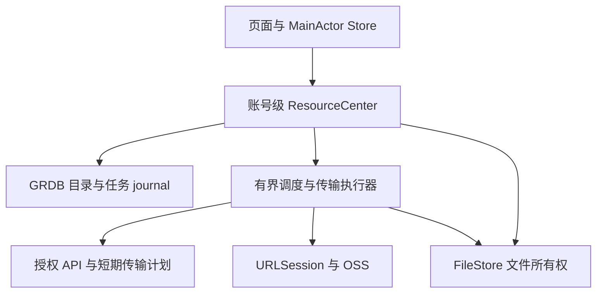

# 客户端资源管理系统交付方案

日期：2026-10-26。依据：当前工作区代码、Apple 与阿里云官方资料。此文是收敛后的实施规划，不是完成报告。现有长篇实施记录见 [原方案](client-resource-center-plan.md)，运行证据见 [验证台账](../verification/client-resource-center-20261025.json)。

## 1. 交付目标与边界

统一管理消息附件、图片、视频、音频、文件、个人头像与群头像的导入、传输、本机保存、预览和清理。继续使用 Swift 6、SwiftUI、Observation、GRDB 和现有 OSS 服务；不新增另一套数据库、任务真相或依赖注入框架。

采用一套目标 schema 和客户端/服务端合同，不保留旧格式解析、双写、兼容页面或旧任务适配。实施前固定切换版本；测试环境只重建明确限定的测试数据。没有历史兼容要求不等于可以直接删除手机草稿、整个账号数据库或服务器对象。

首版必须包括：

- “我的 → 文件与存储”：资源、传输任务、存储与下载设置。
- “会话详情 → 聊天文件”：图片/视频网格，音频/文件列表，来源定位。
- 消息与头像全部接入相同文件所有者和容量规则。
- 账号隔离、持久任务恢复、可解释失败、安全清理、无障碍。

首版全局资源页展示“本机已索引”的资源；单会话支持云端分页补齐。完整跨会话云端搜索需要额外的用户资源索引，列为后续独立能力。首版不增加文件夹网盘、视频转码或流媒体服务。

## 2. 项目现状与实现取舍

| 已核对的代码 | 现有职责 | 实施要求 |
| --- | --- | --- |
| `IMV2ClientKit/Sources/IMV2ClientKit/Resources/V2ResourceCenter.swift` | 账号级命令入口、目录/任务快照、恢复协调 | 保留入口，审查重复任务来源和关闭顺序 |
| `GRDBV2ResourceSchema.swift` 及目录/下载/引用相关文件 | 当前 schema、任务 journal、资源与引用索引 | 固定一套 DDL 和合法迁移规则；不新增可写总任务表 |
| `V2ResourceFileStore.swift`、`V2ResourceDownloadCache.swift` | 文件发布、借用、下载合并、容量与清理 | 所有文件消费者统一接入，禁止页面直接删路径 |
| `IMApp/IMApp/V2/Resources/` 中各 Store/View | 资源目录、详情、任务、存储等在途页面 | 以实际链路与验收为准，不能按文件存在认定完成 |
| `V2AppStore.swift` | 账号激活与资源服务装配 | 每个账号 incarnation 一套运行时；页面离开不销毁任务 |
| `V2PhotoLibraryPicker.swift` | 系统照片选择和导入 | 保持文件型导入、有界解码、取消和原件所有权 |
| 服务端 `IMV2Server/Sources/IMV2ServerInfrastructure/Resources/Adapters/OSS/V2OSSUploadTransport.swift` | 私有对象整文件 PUT | 当前只声明 `httpPut`，上限 **256 MiB**；首版如实展示限制 |
| `V2HTTPRoomResourceDirectoryClient.swift` | 已授权会话资源查询 | 延续既有合同，补分页一致性、撤权和重连验收 |

以上均属于代码核对，不代表本轮重新构建或端到端验证通过。现有验证台账记录了局部测试与模拟器无障碍通过证据；全量语义审查、真机验证、配套版本发布和实际部署链路仍未完成。

## 3. 页面与交互

沿用登录后统一导航栈，不新增底部 Tab。页面使用小标题；设置组内连续行与分隔线，组间留白；sheet 的完成操作在右上角。

| 页面 | 内容与主要动作 |
| --- | --- |
| 文件与存储 | 本机占用摘要；资源、传输、存储三个入口；进行中任务数量 |
| 资源 | 全部/图片/视频/音频/文件筛选、名称搜索、仅本机保留；多选、分享、保留、清理 |
| 资源详情 | 名称、类型、大小、来源、时间、本机与云端状态；预览、下载、定位原消息 |
| 传输任务 | 进行中、需处理、最近完成；仅显示当前任务真正支持的暂停/继续/重试/取消 |
| 存储管理 | 普通缓存、已保留、待发送原件、临时传输、索引；按类型/会话预览清理 |
| 下载设置 | 蜂窝网络、低数据模式、自动下载类型与大小、缓存额度 |
| 聊天文件 | 与全局资源共用组件，限定会话；先本地、后云端分页 |

头像占用参与统计，但不混入普通聊天文件浏览。收藏消息、本机保留和下载缓存是三个独立概念。

本地已有内容立即展示；后台刷新失败保留上一份真实快照。启动、切 Tab、后台返回不先清空为占位。任务进度不改变资源排序，排序使用稳定业务时间与 ID。状态图标使用对应主题色，同时提供文字和 VoiceOver 语义。

首版名称搜索只承诺已索引元数据搜索；空态区分“本机无记录”和“服务器查询无结果”。定位来源失败说明原因，不能自动创建聊天、改变归档或跳回中间页面。

## 4. 架构、身份与数据

View 只渲染与触发动作；Store 持有不可变展示快照、选择和导航状态；Center 编排账号级操作；上传、导入、下载执行器各自拥有合法任务状态迁移；FileStore 唯一负责发布、借用、退役和删除。

账号身份采用既有 `V2AccountStorageScope`。退出时先关闭准入，再排空/取消所属操作并关闭存储；迟到回调须核对 scope、generation 与任务 attempt，不能落入新账号。

四类 ID 必须分开：

| 身份 | 规则 |
| --- | --- |
| LocalAssetID | 未上传原件的稳定本地身份，草稿和发送意图引用它 |
| ResourceKey(home, mediaID) | 服务端逻辑资源身份，不能使用 URL 作为 ID |
| VariantKey | 原件或衍生版本的不可变身份 |
| LocalBlobKey(scope, sha256, size) | 账号内经校验的物理字节身份，不携带阅读权限 |

数据库存资源描述、variant、消息/头像引用、物理文件、保留意图、持久消费者、上传/导入/下载 journal、系统任务映射、文件操作 journal、偏好和查询 checkpoint。沿用已有表名与强类型字段。

同一文件的多个业务引用可共享字节，分别检查权限；存储统计按唯一物理文件计费。保留意图绑定逻辑 variant，不能随缓存文件消失而丢失。文件存在、相同 hash 或被标记保留都不是授权凭据。

## 5. 四条必须闭合的业务链路

### 5.1 导入与发送

选择照片/文件 → 接管到账号受管原件 → 有界生成预览 → 同事务写入 SendIntent 与附件依赖 → 本地消息立即入列表 → 调度上传 → 资源 ready → 提交原消息 → 收敛服务端 ACK。

保持同一 clientMessageID、附件顺序和冻结正文。ACK 丢失时查询原提交，不能生成新消息重发。页面离开不取消已接受的发送；上传完成不等于消息发送成功。结果未知期间继续保护原件。

采用系统 picker 的文件表示，避免整批原图读入内存。Apple 官方建议通过 FileTransferRepresentation 降低媒体加载内存；这是文件型导入的依据。[Apple Photos picker](https://developer.apple.com/videos/play/wwdc2022/10023/)

### 5.2 下载、预览与分享

先读本地元数据 → 按来源上下文校验访问资格 → 命中已验证文件则借用，否则创建/复用下载 → 校验完整长度与 SHA-256 → 发布 → 消费者取得 lease。

每个消费者分别授权；一个消费者取消只撤销自己的需求。预览、播放器、缩略图和分享持有 lease，结束时显式释放。跨页面不缓存可永久使用的裸 URL。

前台 Range 续传绑定不可变版本：校验 206/Content-Range；200 不能追加到旧片段；412 重新取版本；416 不直接判成功。ETag 用于版本条件，不当作通用 SHA-256。OSS 官方支持 Range/If-Match，但其 iOS SDK 的续传示例明确不是生产实现，继续完善项目自己的适配层。[OSS 续传说明](https://www.alibabacloud.com/help/en/oss/developer-reference/resumable-download)

离线可展示本地目录和任务；能否打开内容取决于有效访问资格。首版不额外承诺永久离线阅读授权。

### 5.3 后台恢复

少量稳定后台 session，按安装与账号作用域映射系统 task；登记持久映射后再 resume，重启时用 taskDescription 与 getAllTasks 对账。

后台上传从文件发起；下载临时文件必须在 delegate 返回前接管。原生后台整文件下载与前台 Range 分别验收，不把后者断点能力套到所有后台任务。Apple 明确后台文件上传、临时文件接管及会话重连约束。[Apple 后台传输](https://developer.apple.com/documentation/foundation/downloading-files-in-the-background)

普通切后台不取消账号任务。用户从多任务界面强制退出时，系统会取消后台传输且不会自动重新启动 App；下次打开依据 journal 恢复，不能承诺强退后持续发送。[Apple 后台会话边界](https://developer.apple.com/documentation/foundation/urlsessionconfiguration/background(withidentifier:))

正式数据库与敏感原件维持项目保护策略；确需锁屏收件的最小目录和恢复元数据单独设计文件保护等级，不能放宽整个账号目录。锁屏、重启后首次解锁前后必须真机验证。

### 5.4 清理与崩溃恢复

清理预览 → 生成带 generation 的计划 → 执行前重新核验 → 标记 retiring 禁止新借用 → 跳过活动消费者/保留/发送依赖 → 删除 → 提交实际释放结果。

清理缓存不删除消息、收藏、服务器对象或待发送原件。云端回收由服务端依据业务引用、终态上传和宽限期独立执行，不受客户端清理按钮控制。

文件系统与 SQLite 不能共享一个原子事务：发布、迁移和删除必须写操作 journal，通过 partial、校验、同步、同卷 rename、SQL 提交及启动对账闭合中断窗口。

普通缓存放 Caches；受保护原件、本机保留放持久目录。可重下载但需要持久保留的内容明确排除备份；不能把唯一原件当可重建缓存。Apple 将 tmp/Caches 视为系统可清除目录，这是分根存储的依据。[Apple 备份与存储指南](https://developer.apple.com/documentation/foundation/optimizing-your-app-s-data-for-icloud-backup)

## 6. 服务端与 OSS 合同

沿用既有 ResourceHome、上传会话、会话目录及消息绑定合同。实施前固化以下语义并补合同测试：

| 操作 | 必须保证 |
| --- | --- |
| 创建上传/刷新传输计划 | 检查类型、大小、配额和所有权；幂等键稳定；返回当前 provider 能力 |
| 完成上传/查询结果 | 校验服务端实际对象与预期字节；处理状态可查；不能信任客户端“上传成功” |
| 资源绑定到消息/头像 | 当前授权、资源 ready、版本与业务引用同事务检查 |
| 授权下载 | 上下文鉴权后签发短期计划；权限撤销不是无限续签 |
| 查询会话资源 | 稳定复合排序、快照上界、opaque cursor、成员可见性、撤回过滤 |
| 未绑定对象回收 | 对终态/过期会话幂等回收，保护已绑定与仍在确认的对象 |

客户端不持有长期 OSS AccessKey；签名 URL 不作为资源身份，不写入诊断日志或普通持久记录。私有 bucket 的读取、列举和回收权限分别限制。

首版保持当前 PUT、256 MiB 上限；中断上传可恢复任务，但可能重新发送整文件。真正按分片续传需要补全 OSS initiate/uploadPart/listParts/complete/abort、持久 checkpoint、签名刷新及清理测试，作为下一阶段独立交付。OSS 提供 multipart 能力不代表项目适配器已经实现。[OSS 上传方式](https://www.alibabacloud.com/help/en/oss/user-guide/upload-objects-to-oss/)

完成确认以应用服务端状态为准；OSS callback 可以辅助，但不能作为唯一恢复依据。官方说明 callback 失败不影响对象上传，且不自动重试，因此必须支持客户端重查和服务端对账。[OSS callback](https://www.alibabacloud.com/help/en/oss/developer-reference/callback)

## 7. 容量、调度与可观测性

以下为首轮配置建议，不是测量结果：

| 项目 | 首轮值/策略 |
| --- | --- |
| 普通文件缓存 | 512 MiB，用户可调，LRU 淘汰 |
| 待发送原件/临时额度 | 沿用当前 2 GiB/512 MiB，耗尽时拒绝新准入，不删除受保护文件 |
| 用户保留 | 不自动淘汰，2 GiB 起提示；没有空间时明确反馈 |
| 网络执行 | 上传 2、下载 2，总计不超过 4；交互优先并防止后台饥饿 |
| 图片处理 | 同时最多 2 个；按显示尺寸下采样，主线程不解码大图 |
| 目录分页 | 默认 50、最多 100；不一次读取整个账号 |
| 进度快照 | 合并高频事件，终态立即推送；相同事实不重复刷新整个页面 |

预留同时覆盖原件、切片、下载 partial、发布和分享临时副本；空间准入后仍须处理真实 ENOSPC。当前 16 MiB 最低空闲参数只是代码默认，交付前按导入峰值和真机测试重新确定，不能当作安全余量结论。

记录任务耗时、重试原因、授权失败、完整性失败、恢复数量、孤儿文件、清理跳过原因、唯一物理占用；通过 taskID/attemptID/operationID 关联，日志不包含签名、凭证或聊天内容。

## 8. 实施任务与退出条件

按依赖顺序执行，每一阶段交付可验证的完整链路；已有代码先审查和补缺，不整体重写。

| 阶段 | 主要代码落点 | 退出条件 |
| --- | --- | --- |
| P0 固定基线与合同 | 当前改动清单、Core 类型、schema、服务端合同、验证台账 | 明确每份状态唯一所有者，当前 DDL 与 API 一致，清除重复写入入口 |
| P1 文件与目录 | ClientKit `Resources/`、GRDB、FileStore | 双根存储、原件保护、引用索引、容量预留和故障恢复测试通过 |
| P2 业务接入 | AppStore、照片选择、发送、消息预览、个人/群头像 | 所有生产消费者使用统一文件 lease；本地消息立即出现；重试不重复消息 |
| P3 传输恢复 | TransferEngine、DownloadCache、后台桥接、OSS 合同 | 离线/过期/断网/后台/重启恢复；当前能力限制在 UI 可见；取消与未知结果闭合 |
| P4 管理页面 | `IMApp/IMApp/V2/Resources/`、统一 Router | 资源/任务/详情/清理/设置完整可用；状态不闪占位，操作与事实一致 |
| P5 联调交付 | 当前客户端与全部服务端产品、真实 OSS、真机 | 配套版本部署、完整 E2E、无障碍、锁屏与性能验收，并形成可复现记录 |

不预先按文件数估算完成度。P0 完成后，以剩余合同与失败用例估算工作量；不把构建成功或少量模拟器测试当作整体完成。

## 9. 验收矩阵

| 场景 | 必须观察到的结果 |
| --- | --- |
| 离线启动、切 Tab、后台返回 | 已有目录/联系人/资源持续显示，不短暂替换为占位 |
| 连续选择大图、iCloud 照片、取消导入 | 有界内存，取消停止后续副作用；草稿与原件归属明确 |
| 上传中退出页面、断网、重启 | 同一任务恢复，不新建重复消息；原件仍在 |
| 服务端已接收但 ACK 丢失 | 查询并收敛原消息，结果未知时不释放依赖 |
| URL 过期与权限撤销 | 前者重新授权恢复；后者停止受保护内容访问 |
| Range 返回 200/206/412/416、摘要错误 | 不拼接不同版本，不发布未验证文件 |
| 预览/分享/上传期间清理 | 跳过活动文件，统计实际唯一释放量，消息与保留文件不丢失 |
| 发布/删除各阶段故障注入 | journal 恢复后 SQL 与文件事实一致，无永久占用和假可用 |
| 切换账号与迟到系统回调 | 无跨账号文件、状态、通知或授权泄漏 |
| 会话分页、撤回、头像替换 | 索引与可见性一致，重复引用不重复计占用 |
| 最大字体、深色模式、VoiceOver | 文字可读、控件可操作，完整审计问题关闭而非过滤 |
| 真机锁屏、后台、系统终止、用户强退 | 按平台边界恢复，不承诺系统不支持的持续执行 |
| 真实 OSS 与配套部署 | 两个测试账号完整发送、接收、重开、清理、重新下载与撤权链路通过 |

测试层次：领域与 GRDB 故障注入测试 → 传输合同测试 → 模拟器 UI/系统字号/VoiceOver → 真实 OSS E2E → 真机后台、锁屏和性能。实际执行命令和结果记录在验证台账，不能用计划中的检查替代证据。

## 10. 完成交付的定义

代码审查、当前版本构建与相关测试通过；客户端与服务端合同配套；真实 OSS 链路闭合；完整无障碍和真机关键场景通过；当前实现、操作文案、容量统计和恢复日志一致。交付说明列出版本、构建产物、配置项、实际证据及仍有限制。

本次规划核对并更新此方案；不将工作区在途实现、既有局部测试或产物视为整套功能已完成、已部署或已安装到手机的证据。

## 11. 可直接拆任务的数据与接口清单

以下是现有目标结构的核对落点，不要求重新创建同名表；P0 先固定当前 DDL，再删除重复入口。数据库变更使用明确版本，不在运行时猜测字段后补修。

| 当前表/机制 | 负责的事实 | 完成标准 |
| --- | --- | --- |
| `v2_resource_entries` / `v2_resource_references` | 资源目录及消息来源 | 消息接受、编辑、撤回与索引变更保持同一事务；重放不重复计数 |
| `v2_resource_variants` / `v2_resource_retention_intents` | 不可变字节版本及本机保留意图 | 文件被系统清除后仍保留用户意图；重新下载绑定同一逻辑版本 |
| `v2_resource_files` / `v2_resource_file_consumers` / `v2_resource_file_pins` | 文件事实、消费者与保护依赖 | 所有预览、分享、发送统一借用；不靠页面是否存在判断可删 |
| `v2_resource_local_assets` | 导入原件与选择归属 | 导入取消、草稿撤销、发送接受分别交接所有权 |
| `v2_resource_file_operations` / `v2_resource_transfer_staging` | 文件系统操作与峰值预留 | 每个中断窗口可恢复；取消后等待实际 I/O 停止再释放额度 |
| 现有上传、导入、下载 journal | 任务阶段及恢复检查点 | 每类执行器单独写入；资源中心传输页只读聚合 |
| `v2_resource_query_checkpoints` / access generation | 分页覆盖与授权代次 | 退出会话、撤权、账号切换后迟到页不能重新填回不可见内容 |

已确认的服务端目录接口是 `POST /v2/rooms/:roomID/resources/query`，沿用 `V2RoomResourceQuery` 与 `V2RoomResourcePage` 合同。客户端落点为 `Resources/V2HTTPRoomResourceDirectoryClient.swift`；服务端落点为 `V2VaporRoomResourceDirectoryRoutes.swift`、`V2RoomResourceDirectoryService.swift` 和 `PostgresV2RoomResourceDirectory.swift`。不另造一条含义重复的 GET 接口。

其他上传、授权和消息提交接口继续复用现有强类型合同，P0 输出请求/响应样例与错误码表：至少覆盖超限、无权限、资源未就绪、授权过期、容量不足、版本冲突、结果未知。只有合同确实缺失时才增加端点。列表不返回永久下载 URL；用户需要字节时再取短期传输资格。

## 12. 状态与用户操作约束

状态必须分维度，不能让一个 `isDownloaded` 或 `isSending` 决定全部行为。

| 维度 | 状态含义 | 页面规则 |
| --- | --- | --- |
| 目录 | 本地有记录 / 正在补齐 / 暂不可查询 | 保留已有真实内容；显示查询范围和失败原因 |
| 本机文件 | 缺失 / 写入中 / 已验证发布 / 退役中 | 只有已发布且授权有效的文件可借用 |
| 传输 | 排队 / 等网络 / 传输 / 校验或确认 / 暂停 / 需处理 / 终态 | 动作由当前执行器阶段派生，命令执行前重验 |
| 消息 | 本地接受 / 等附件 / 提交中 / 结果未知 / 已确认 / 已拒绝 | 结果未知先查原消息；不通过重新上传或生成新 ID 隐式重发 |
| 本机保留 | 未保留 / 已请求 / 已落盘 / 暂不可用 | 保留意图与字节是否存在分别展示 |

“取消传输”不是撤回已成功消息；“清除缓存”不是删除聊天；“移除本机保留”不自动删除还在使用的文件。整文件 PUT 的暂停只承诺停止当前工作并保留恢复意图，继续可能从零开始；后台任务按钮必须匹配系统真正支持的操作。

最近完成记录沿用现有 30 天或最近 500 条展示上限，失败与结果未知不能被这个展示规则擅自退休。隐藏终态历史与删除业务依赖是两个动作，后者由所属业务和文件回收规则决定。

## 13. 无历史兼容的版本切换与实际交付顺序

1. **固定候选版本**：列出当前工作区源代码、依赖、DDL、API、运行配置与测试数据范围，形成单一候选提交。审查在途代码，不把几百个文件一次性视为已验收。
2. **准备独立验证环境**：使用目标 schema 创建测试数据库与私有 OSS 前缀；避免为验证而直接清空现有测试账号。所有服务启动时检查 schema 合同，不满足则拒绝启动。
3. **本机产出配套产品**：按用户此前偏好，本机编译客户端和 Linux 服务端产物，记录源码版本、平台架构与摘要；服务器接收产物后校验摘要。签名、架构和运行库单独验证。
4. **配套切换**：部署所需服务端产品和目标 schema，再安装对应客户端；不允许旧服务端配新客户端的混合能力被当成已通过。不兼容客户端明确要求升级，无旧格式 fallback。
5. **真实链路验收**：两个测试账号完成图片、文件、头像上传及接收；在会话内实时出现，退出重开仍有本地记录；清理后可授权重下；撤回、退群或撤权后不能利用本地缓存绕过权限。
6. **发布与恢复准备**：保留切换前产物、配置、数据库备份和对象清单。需要恢复时恢复整套匹配版本及数据快照，不让旧二进制连接不匹配的新 schema。确认候选通过后再整理提交、发布与安装证据。

没有历史兼容要求允许重新设计 schema 和 API；它不允许清空未指定数据，也不等于必须做一次破坏性重置。涉及重置时，执行对象、备份和丢失范围必须先明确。

## 14. 可测量的首轮验收预算

以下是建议目标，P0 记录基准设备与测量方法，P5 用真机实测决定是否通过，不能当成已获得的性能数据。

- 以至少 10,000 条目录引用、1,000 个资源、重复引用和混合任务构造固定数据集；验证分页无重复/漏项、清理统计按物理字节去重。
- 有本地目录时，打开资源页到首批可交互内容目标 P95 不超过 200 ms；计时包含本地查询与首帧，不能只量 SQL。
- 点击发送到本地气泡出现目标 P95 不超过 100 ms；不等待上传、目录刷新或服务端创建会话。
- 持续传输时列表不因每个字节回调全量重建；初始进度发布上限建议 4 次/秒，终态立即发布，滚动位置不变。
- 对 1 MiB、20 MiB、100 MiB 与接近 256 MiB 文件分别测试中断、恢复、校验与峰值磁盘占用；超限文件选择后尽早拒绝，不能上传一半才发现。
- 图片以尺寸而非只按压缩文件大小建立解码预算；批量 iCloud 导入、超大像素图和分享副本必须纳入内存/磁盘峰值测量，再据实固定内存上限。
- 真机矩阵覆盖低电量、低数据模式、Wi-Fi/蜂窝切换、普通后台、锁屏、系统终止、用户强退及账号退出。平台允许的恢复与用户强退后的限制分别记录。

## 15. 官方资料及设计依据

检索日期：2026-10-26。下列是平台依据；上面的模块划分、容量、并发和性能预算是结合项目作出的工程决定。

- [Apple：后台文件传输](https://developer.apple.com/documentation/foundation/downloading-files-in-the-background)：后台文件上传、临时下载接管、重建稳定 session 与系统调度约束。
- [Apple：Photos picker](https://developer.apple.com/videos/play/wwdc2022/10023/)：文件表示导入和选择器平台行为。
- [Apple：备份与文件目录](https://developer.apple.com/documentation/foundation/optimizing-your-app-s-data-for-icloud-backup)：可清除缓存与不可丢失原件的目录、备份处理。
- [OSS：上传方式](https://www.alibabacloud.com/help/en/oss/user-guide/upload-objects-to-oss/)：整文件和 multipart 是不同能力；256 MiB 是本项目当前限制，不是 OSS 平台上限。
- [OSS：iOS 续传下载](https://www.alibabacloud.com/help/en/oss/developer-reference/resumable-download)：Range/If-Match 及示例不能直接作为生产实现的说明。
- [OSS：上传回调](https://www.alibabacloud.com/help/en/oss/developer-reference/callback)：回调失败不影响上传且不自动重试，必须保留结果查询与服务端对账。

## 16. 实际验证工具

仓库已提供并实际运行 `python3 scripts/verify_v2_resource_storage.py --output-directory /tmp/im-resource-storage-NEW`，在macOS独立64MiB卷验证真实ENOSPC恢复，并显式启用10000条目录完整分页测试。输出目录必须不存在；保留映像、日志、输入摘要与结果，完成后按映像身份卸载。它不覆盖手机后台、锁屏、APFS或Release性能；实际运行证据见[台账](../verification/client-resource-center-20261025.json)的crossLayerResourceVerification，完整记录见原方案第109节。

## 17. 直接真机测试与分发渠道

直接安装的优化Release使用`IMAPP_RELEASE_NETWORK_MODE=device-test IM_V2_PUSH_ENVIRONMENT=development APS_ENVIRONMENT=development`，同时明确设置公网HTTPS账号源、网关主机与端口。这个模式仍强制公网HTTPS443，不允许用HTTP/私网/占位地址绕过校验。生产及TestFlight构建继续使用其原渠道并要求生产推送环境。

构建或导出后执行`python3 scripts/verify_v2_apple_signed_app.py --app <已签名App路径> --expected-push-environment development`；TestFlight/生产导出将期望值改为production。脚本检查实际签名而非只看构建设置。Apple说明APS环境由描述文件决定，见[官方entitlement文档](https://developer.apple.com/documentation/bundleresources/entitlements/aps-environment)。签名通过不等于已安装、实际推送通过或已上传，实际证据见台账deviceReleaseEnvironmentVerification。
