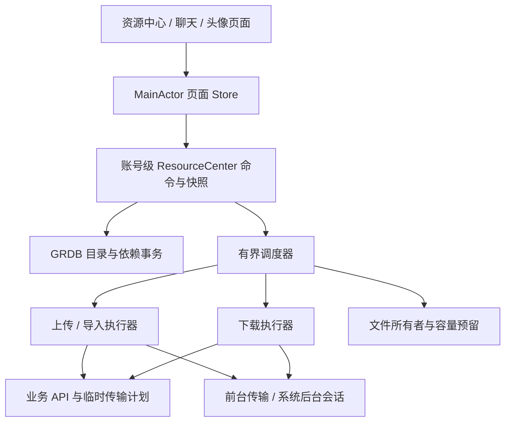

# 客户端资源管理中心实施方案

最新执行证据见第116节及[验证台账](../verification/client-resource-center-20261025.json)。当前完整目标仍未完成；早期章节的构建和测试状态按各自日期阅读。

状态：目标设计与实施拆解，已核对当前工作区；部分基础代码已存在，完整能力尚未交付。日期：2026-10-24。

代码基线：`63968959e7392cefca7dcb345a9b7f92096d193f` 加当前未提交工作区，包含照片选择及资源中心基础、真实上传源接入等在途改动。代码存在不代表已构建、真机验收或发布；本轮只做资料检索、代码核对与方案修订，未重新执行运行测试。实施记录可能滞后于在途代码，以代码和可复现验证结果为准。

## 1. 目标与交付范围

建立一个账号隔离、以本地状态展示、可恢复传输、可安全清理的资源中心，统一消息附件、照片、个人头像和群头像的文件生命周期。用户不必理解上传会话、对象存储和服务器内部状态。

本次允许调整客户端数据库、内部 API 和服务端合同，直接采用目标结构，不保留双写、旧页面或兼容适配层。保留已经正确工作的机制，通过重构接入同一入口。设计不要求现在删除手机数据或服务器资源；测试环境的数据重置需要单独限定范围。

首版完整范围：

- “我的 → 文件与存储”：资源目录、传输任务、存储管理。
- 会话详情 → 聊天文件：按图片、视频、文件、音频筛选，定位原消息。
- 消息选择照片/文件、预览、发送、接收下载、分享、保留本机、清理缓存，全链路统一。
- 头像沿用同一存储和下载机制，但不混入普通聊天文件列表；在存储统计中单独计入。
- 视频和音频可作为资源管理；本轮不包含新增生产转码、流媒体、波形或内容扫描服务。

资源中心不是独立网盘。首版全局目录覆盖本机已经同步或使用过的资源，明确标注“本机已索引”；单个会话可向服务器分页查询其可见聊天文件。跨所有会话的完整云端资源搜索需要额外的服务端用户索引，不在首版隐式承诺。

## 2. 已有实现与实际缺口

以下判断来自代码，而不是旧文档的待办状态。[原资源系统设计](resource-system-design.md)、[实施记录](resource-system-implementation.md)和[供应商合同](resource-provider-adapter-contract.md)继续提供服务端上下文；其中的阶段描述不能代替当前代码证据。

| 领域 | 当前证据 | 本轮处理 |
| --- | --- | --- |
| 账号隔离 | [V2AccountStorageScope](../../IMV2ClientKit/Sources/IMV2ClientKit/V2AccountStorageScope.swift) 包含账号及 incarnation，已有关闭与退役边界 | 保留并作为所有任务、文件、回调的根边界 |
| 上传恢复 | [GRDBV2ResourceJournal](../../IMV2ClientKit/Sources/IMV2ClientKit/GRDBV2ResourceJournal.swift)、[TransferEngine](../../IMV2ClientKit/Sources/IMV2ClientKit/V2ResourceTransferEngine.swift) 已有任务、发送意图及依赖；工作区已改为 LocalAssetID 和受管原件借用 | 补完整恢复/取消验收，统一展示既有任务事实，保持原消息确认语义 |
| 上传能力 | [OSSUploadTransport](../../IMV2Server/Sources/IMV2ServerInfrastructure/Resources/Adapters/OSS/V2OSSUploadTransport.swift) 当前仅声明 `httpPut` | 首版按整文件 PUT 恢复；不把本地 provider 的分片能力当成 OSS 已实现 |
| 下载与使用保护 | [下载服务](../../IMApp/IMApp/V2/V2ConversationMediaDownloadService.swift) 已作为展示桥接；[FileStore](../../IMV2ClientKit/Sources/IMV2ClientKit/Resources/V2ResourceFileStore.swift)、[DownloadCache](../../IMV2ClientKit/Sources/IMV2ClientKit/Resources/V2ResourceDownloadCache.swift) 已承担授权缓存、借用、发布、退役与清理 | 补双根目录、逻辑保留策略、所有临时副本预算及真实消费端验收 |
| Range 与上传切片 | [RangeDownloadTransport](../../IMV2ClientKit/Sources/IMV2ClientKit/V2RangeDownloadTransport.swift) 已有基础；上传切片已转入 FileStore，旧 V2ResourcePartFile 正在删除 | 纳入统一调度，补版本变化、中断和真实 OSS 验收 |
| 系统后台 | [AppStore](../../IMApp/IMApp/V2/V2AppStore.swift) 已装配上传、下载协调器；[NativeBackgroundSession](../../IMV2ClientKit/Sources/IMV2ClientKit/V2NativeBackgroundSession.swift) 已接收系统文件 | 不是从零开发；重点统一任务映射、锁屏保护和恢复验收 |
| 后台文件保护 | 下载收件已接入 FileStore 最小 AFU permit 与统一容量交接，完成回调仅接受 HTTP 200；仍待真机验收 | 锁屏交付单独设计；原生后台整文件下载与前台 Range 不混为一条已验证能力 |
| 图片导入 | 工作区 [PhotoLibraryPicker](../../IMApp/IMApp/V2/V2PhotoLibraryPicker.swift) 已实现选择及规范化 | 接入统一导入命令，保留有界解码、取消及暂存所有权 |
| 目录和管理能力 | 工作区已有描述/引用目录、清理计划及会话资源 query；消息接受/编辑/撤回已同事务索引，快照已接入持久分批队列；已有文件与存储入口、目录、详情与清理页面的在途代码，尚未完成本轮运行验收 | 补齐索引覆盖、统一任务读模型、页面验证和偏好策略；不能把已有基础当作产品完成 |

## 3. 用户界面与交互

### 3.1 文件与存储

使用现有登录后的统一导航栈，小标题“文件与存储”，不增加主 Tab。页面按三组排列，组内连续行和分隔线，避免同组拆成多个孤立卡片。

| 页面 | 默认内容 | 操作 |
| --- | --- | --- |
| 资源 | 最近使用、类型筛选、本机保留标记；图片网格，文件为统一 List | 查看、下载/取消、保留本机、定位消息、分享、选择清理 |
| 传输 | 进行中、需处理、最近完成；上传下载共用一份任务列表 | 暂停、继续、重试、取消；动作由任务能力决定 |
| 存储 | 可清理缓存、已保留文件、待发送原件、临时传输、索引及其他占用 | 按类型/会话预览清理，修改自动下载与缓存额度 |

文件详情展示名称、类型、大小、来源会话、发送时间、本机状态和可用动作；“来源”点击定位原消息。资源被多条消息使用时展开来源列表。不能定位时说明“原消息当前不可访问”，不自动创建新聊天或改变归档状态。

资源缩略图在有权且有可用本地文件时立即显示。任务进度使用图标、对应状态颜色及短文案：进行中使用主题色、等待使用次要色、失败使用红色；图标不能作为唯一无障碍提示。点击可看具体原因和处理动作。完成按钮统一在 sheet 右上角。

### 3.2 聊天文件

会话详情中增加入口，沿用同一资源列表组件，只加 room 过滤。首次先显示本地数据，再分页补齐服务端可见记录；顶部显示索引覆盖范围及加载失败后的重试入口，不用占位记录替换真实缓存。

按消息发生顺序排序，进度和下载完成不改变位置。重复消息引用可折叠展示为“同一文件，N 个来源”；跨 home 的资源仍具有各自权限和身份，不能直接合并成同一服务器资源。

### 3.3 空态、错误与恢复

- 本地无记录、离线：显示“本机暂无记录，联网后同步”，不能断言云端没有资源。
- 没有可清理内容：展示实际占用分类，不用无效的清理按钮。
- 服务端处理中：展示处理状态，不伪造 99% 上传进度。
- 权限已失效：保留必要的状态提示，停止展示受保护内容；不通过本地文件绕过。
- 网络恢复后保留页面、筛选及滚动位置，不能整页闪回 loading。
- 开启大字体、VoiceOver、深色模式后，任务名称与操作仍完整可用。

## 4. 架构与状态所有权



`V2ResourceCenter` 是账号生命周期内的协调入口，不把数据库、HTTP、解码和业务发送全部塞进一个大 actor。内部继续分开目录事务、文件所有权、调度、上传、下载和授权。协调器不在持锁期间执行长时间 I/O。

- Repository：数据库事实、事务、查询与恢复记录。
- FileStore actor：唯一负责受管文件发布、借用、退休、删除及容量预留。
- Scheduler actor：并发额度、优先级、公平性及任务取消；执行器返回事实，不能自行另建重试队列。
- Access service：按消息/头像上下文验证访问，返回短期访问资格；文件存在不构成授权。
- `@MainActor @Observable` Store：持有不可变 `Sendable` 页面快照、选择和路由状态。
- 系统 delegate：只桥接事件、接管临时文件和写入有界收件箱，业务恢复交给账号协调器。

沿用 GRDB，不为此引入 SwiftData、第二个持久化框架或新 DI 框架。先放在现有 ClientKit 的 `Resources/` 子目录；只有确有跨模块使用需求时才拆 package。

建议核心入口如下，类型和方法名是目标 API：

```swift
func importLocal(_ source: ImportSource, usage: ResourceUsage) async throws -> LocalAssetID
func enqueue(_ request: TransferRequest) async throws -> ResourceJobID
func snapshots(for query: ResourceQuery) async -> AsyncStream<ResourceListSnapshot>
func borrow(_ resource: ResourceKey, context: AccessContext) async throws -> ResourceFileLease
func planCleanup(_ selection: CleanupSelection) async throws -> CleanupPlan
func commitCleanup(_ plan: CleanupPlan) async throws -> CleanupResult
func close() async
```

公开接口不返回可长期保存的裸文件路径；预览、分享等持有独立 lease，结束时显式归还，析构只作兜底。`close()` 必须关闭准入并等待本账号实际文件任务结束，旧账号迟到回调不能写入新账号。

## 5. 身份、索引与数据库

### 5.1 四种身份分别建模

| 身份 | 含义 | 约束 |
| --- | --- | --- |
| `LocalAssetID` | 尚未绑定服务器资源的导入原件 | 本地稳定，草稿和发送意图引用它 |
| `ResourceKey(home, mediaID)` | 服务器逻辑资源 | 沿用现有 ResourceHome 和 MediaID，不采用对象 URL |
| `VariantKey(resource, original / derived(variantID, version))` | 原件或衍生版本 | 原件随 resource 身份保持不变；元数据 revision 不产生新原件；衍生版本显式编号 |
| `LocalBlobKey(accountIncarnation, sha256, size)` | 验证过的本地字节 | 仅账号内复用，不授予任何上下文权限 |

摘要只能做完整性和本机字节复用，不能拿相同 hash 绕过服务器导入/授权。跨 home 复用仍走现有显式 import 合同，目标 home 获得独立对象和业务绑定。

“保留本机”记录到逻辑 variant 的持久意图，不绑定文件路径。物理文件缺失时继续显示已请求保留、需下载；重新获得授权并验证字节后，原意图绑定新文件并进入持久根。不同资源或不同版本即使共享字节，也分别保存意图；只有最后一个保留和原件依赖都解除，才恢复为普通缓存。保留不生成访问资格。

### 5.2 目标表

以下为逻辑 schema；实际实现按强类型列和外键展开，避免把整个对象图编码为 JSON。

| 表 | 主要事实与索引 |
| --- | --- |
| `resource_entries` | home、mediaID、类型、受控显示名、大小、资源状态、descriptorRevision、创建/更新时间；唯一 `(home, mediaID)` |
| `resource_variants` | resource、variant、revision、可信摘要、尺寸/时长、处理状态；唯一不可变版本键 |
| `resource_retention_intents` | 精确 variant 的保留意图及时间，引用 variant 而非 file；文件删除不能连带删除意图 |
| `resource_references` | 消息/个人头像/群头像的具体引用，room、message、ordinal、业务版本与可见性；按会话、时间、资源反查 |
| `resource_files` | localAsset/blob/variant 关联、相对路径、verifiedBytes、发布/退休状态、allocatedBytes、lastAccessAt、retentionClass |
| 上传、导入、下载 canonical journal | 沿用 `v2_resource_transfer_jobs`、`v2_resource_import_jobs`、`v2_resource_download_jobs`，分别拥有合法状态迁移；统一查询派生 TransferSnapshot，不额外建 `resource_jobs` 可写总表 |
| 各类 job detail / 系统映射 | upload locator、import source、download version/已验证区间、系统 task mapping；必须依附各自 canonical job，不能另存一份独立状态机 |
| `resource_consumers` | 草稿、SendIntent、头像操作等对文件/任务的持久依赖；与同库发送意图保持事务一致 |
| `resource_file_operations` | publish/promote/delete 的操作 ID、阶段、源/目标相对路径及预算，用于文件系统与 SQL 间的恢复 |
| `resource_preferences` | 自动下载、蜂窝策略、普通缓存额度、用户保留策略 |
| `resource_query_checkpoints` | 每个会话/筛选的云端查询游标、快照上界、覆盖区间和同步时间 |

本机目录与任务存在账号 `V2.sqlite`，与消息发送依赖共用事务边界。名称搜索可放既有派生搜索库，不将其作为恢复真相。文件名先去除路径成分、控制字符并限制长度；磁盘文件名采用内部 ID，不使用用户文件名拼路径。

上传、导入分别保留自己的 canonical journal，前台和系统后台下载共用 `v2_resource_download_jobs`。统一的是身份、命令、预算、调度与只读快照，不强行把不同执行协议压成同一张状态表；不能保留“引擎状态”“资源中心状态”两份可写真相。

### 5.3 三种状态不能混为一谈

- 资源：`pending → verifying/scanning/processing → ready`，或 rejected/deleted。
- 本机文件：`absent → partial → verified → published → retiring → absent`。
- 任务：用 upload/download/import 各自的关联值枚举表达合法阶段，统一派生排队、等待、执行、需处理、结束等展示分组。

消息提交另有自己的状态。上传完成不等于资源 ready，更不等于消息已被接受。暂停时保留明确的继续位置；无法暂停的阶段不显示暂停按钮。业务结果未知时显示“正在确认发送结果”，不能伪装成可随意重新发送的失败。

## 6. 关键链路

### 6.1 导入与发送

1. 照片/文件选择后，在账号作用域内预留空间，复制/规范化到 staging；记录 LocalAssetID、摘要和 MIME。iCloud 尚未取回时展示“正在导入”，支持取消。
2. 草稿持有原件依赖；点击发送立即以稳定 clientMessageID 写入本地消息和 SendIntent，UI 立刻出现气泡。
3. 同一事务冻结正文、附件顺序、mentions、reply 和资源依赖，并恢复需要重新出现的归档会话。
4. 调度上传，取得资源 ready 后绑定原 SendIntent 提交；服务端仍在绑定事务中验证所有权和资源状态。
5. ACK 丢失先查询/闭合原提交，保持同一 clientMessageID；不能通过新建消息绕开未知结果。
6. 所有依赖已明确结束后，原件才可释放。消息未提交且用户取消时可释放；提交结果未知时继续保护文件与恢复信息。

发送页面离开、切换 Tab、进入后台不取消账号级发送任务，不重置目录。头像更新也先生成本地预览和操作意图，成功后更新正式绑定；失败保留明确重试入口，不污染当前正式头像。

### 6.2 下载与授权缓存

先显示本地元数据，再按当前访问上下文取得有效授权；命中已验证本地文件即可借用，否则下载并发布。账号内相同版本的网络传输可以合并，但每位消费者分别授权。一个引用失效不能剥夺另一个合法引用，也不能让失效者借用后者的资格。

“保留本机”只阻止自动淘汰，不授予永久离线阅读权。离线时目录和任务可以显示；内容须符合现有有效访问资格，资格不足显示“联网后查看”。首版不引入新的长期离线授权合同。

Range 续传绑定同一不可变版本、总长度和校验值；206 校验 Content-Range，200 则重新下载，412 重新取得版本，416 只有在已完整验证时才可判成功。最终全文 SHA-256 和长度都通过才发布。阿里云提供 Range/If-Match 条件下载；其 iOS SDK 文档并不提供可直接依赖的生产断点下载实现，本项目继续使用已有原生传输适配。[阿里云 Range 下载说明](https://help.aliyun.com/zh/oss/developer-reference/resumable-download)

目标 URL 过期只更新本任务的临时传输计划，不使目录、资源或消息失效。凭证刷新受资源当前授权限制；403 不能一律循环续签。签名 URL、请求凭证和可能包含它们的 opaque resumeData 不写入应用数据库、诊断日志或导出文件；系统后台网络服务为执行请求保存的系统内部状态另行受平台保护。[阿里云 URL 签名合同](https://help.aliyun.com/zh/oss/developer-reference/add-signatures-to-urls)

### 6.3 文件发布与崩溃恢复

文件系统 rename 与 SQL 不是一个原子事务，明确采用操作 journal：预留预算 → 持久记录计划 → 写 partial → 校验并同步文件 → 同卷原子 rename → SQL 发布版本。UI 只能借用已发布条目。

恢复按操作 ID 对账：已落盘未发布则验证后补提交；SQL 已发布但文件丢失则改为可重新下载，不能保留可打开假状态；无法归属的文件先隔离并延迟回收。原件只有这一份时不能按可重下载缓存处理。删除同样记录计划、标记 retiring、阻止新借用、等待已有借用归还，再删除和提交结果。

### 6.4 后台与锁屏

沿用少量稳定的系统后台 session，每个账号安装作用域复用 upload/download 标识；新任务不新建 session。系统任务创建后先持久映射，再 resume；崩溃窗口通过 taskDescription、getAllTasks、scope 和 generation 对账，取消重复或过期任务。

系统临时下载文件须在 delegate 返回前移到自有收件目录，随后才做业务恢复。后台上传使用文件型任务；系统终止后的会话重连和任务回调不能依赖页面存活。[Apple 后台文件传输](https://developer.apple.com/documentation/foundation/downloading-files-in-the-background)

保护策略是本轮必须验证的改动：

- 正式账号 DB、原件和展示文件继续 `.complete`；锁屏期间不强行打开这些文件。
- 明确允许后台继续的传输副本、最小 task mapping 和 inbox 使用 `.completeUntilFirstUserAuthentication`，只存必要定位及字节，不存业务正文/长期令牌。重启后首次解锁之前仍不可用。
- 系统回调在锁屏时只交付到 inbox；解锁后校验 scope、generation、权限、长度和摘要，再发布为 `.complete` 正式文件。不能整库降低文件保护。
- 有界 inbox 满时停止新增后台任务，并记录可恢复错误；不能静默丢掉完成事实或无限写盘。
- 后台 session 自动跟随重定向且不调用普通重定向控制回调，因此只能使用受约束的专用传输凭证，检查最终来源；不能向后台字节请求附带业务 Bearer。失败后不发布文件。

AFU 文件在首次解锁后再次锁屏仍可访问，`.complete` 文件则不具备相同行为，必须分别验收。[Apple AFU 保护](https://developer.apple.com/documentation/foundation/fileprotectiontype/completeuntilfirstuserauthentication)、[Apple complete 保护](https://developer.apple.com/documentation/foundation/fileprotectiontype/complete)

用户强制退出 App 时不承诺继续传输；再次打开后由 journal 恢复。进入后台本身不等于退出账号或清空缓存。[Apple background session 生命周期](https://developer.apple.com/documentation/foundation/urlsessionconfiguration/background(withidentifier:))

单次 PUT 的暂停是停止当前字节传输并保留意图；继续时先确认服务器结果，再决定完成核验或整文件重传。只有 OSS multipart 适配、服务端确认分片和真机验收均补齐后，才能提供上传字节断点恢复。

## 7. 服务端增量合同

客户端无需 OSS SDK、Bucket 管理权限或阿里云密钥。继续调用业务 API 获取供应商无关的临时计划，服务端负责角色凭证、对象核验和绑定。

### 7.1 会话资源目录

新增 `POST /v2/rooms/{roomID}/resources/query`，建议请求：

```json
{"category":"image","limit":50,"cursor":null,"before":null,"after":null}
```

响应包含 items、nextCursor、snapshotUpperRoomSeq；item 返回 messageID、roomSeq、ordinal、resourceKey、descriptorRevision、允许展示的名称/大小/类型/尺寸/时长，以及该引用的可用状态，不返回对象 URL。

- 账号由认证取得，不接受客户端传入“要查询的用户”；按当前成员关系和历史可见边界授权。
- 通过现有 room owner 路由，查询 `message_media_references` 等权威绑定，不遍历 OSS，也不跨所有 owner 做无界扫描。
- 在现有外键和实际列名上补 `(roomID, roomSeq, ordinal, mediaID)` 等查询索引；分类过滤所需元数据建立可索引关联，SQL 执行计划作为验收项。
- cursor 为有界、不可篡改的查询上下文，绑定 room、筛选和快照上界；后续请求重新鉴权。采用稳定倒序键，不能用 offset 漂移分页。
- 撤回/删除/权限变化返回或同步引用失效事实；快照只固定翻页范围，不能固定旧权限。
- 默认 50、最多 100 条。页请求合并及取消随页面生命周期；已持久化结果不因离页丢弃。

### 7.2 元数据、能力和同步

补齐可持久资源描述：显示名、可信内容类型、字节数、checksum、variant、尺寸/时长和版本。名称属于展示元数据，不进入对象 key。MIME、尺寸及摘要不能只信任上传者声明；服务端验证前不得标记为可信。

扩展现有 capabilities，明确整文件 PUT/分片、允许用途、大小上限、后台上传/下载和 Range 能力；无法满足的组合直接不开放。动态能力只控制新准入，已有任务根据其持久合同恢复或给出明确不支持原因。

本地目录在消息同步事务内写入引用；资料/群头像变更更新相应引用。访问撤销取消相关消费者并使展示失效，文件有其他合法引用时不重复删除。重连时通过现有同步游标补齐失效事实，不另建完全独立的实时连接。

云端删除资源仍由消息、头像、保留规则等业务合同决定；资源中心首版“清理”只处理本机占用。不新增客户端直接删除 OSS 对象的能力。

## 8. 磁盘布局、容量与清理

### 8.1 目录

```text
Application Support/<account-incarnation>/
  V2.sqlite / V2Search.sqlite
  resources/files/           # 原件及用户保留内容的共享、不可变字节池
  resources/partials/        # 这些字节发布前的受控暂存
Application Support/<account-incarnation>.background/
  <upload-session>/sources/  # 最小 AFU 上传分片，FileStore 所有
  <upload-session>/*.result  # 最小 AFU 结果，无请求/凭证/正文
  downloads/<session>/      # 下载最小 AFU permit、原始收件及完成事实；FileStore 所有
Library/Caches/<account-incarnation>/
  resources/files/           # 可重新取得的已验证字节
  resources/thumbnails/      # 可重建缩略图
  resources/partials/        # 缓存发布前暂存
  resources/transfers/       # 下载断点及当前受管传输切片
Application Support/IMV2BackgroundTransfers/session-routes/
  <local-session>.route      # 最小 AFU session 定位，沙盒相对路径，无业务/凭证
```

Scope 持有 persistent/cache 根，并从同一 incarnation 派生 AFU 同级目录，统一退役三个范围；不能只删除 Application Support 中的账号目录而遗漏缓存或后台字节。AFU 不放在 Complete 账号目录内部，不修改原件/账号 DB 的保护。文件操作 journal 在同一账号 SQLite 内，不另建 operations 文件目录。缓存被系统清除后目录仍可恢复为“需下载”。用户原件和保留文件不能放入可能被系统清除的 Caches。[Apple 存储与备份说明](https://developer.apple.com/documentation/foundation/optimizing-your-app-s-data-for-icloud-backup)

系统重唤醒使用最小 session 定位和作用域内锚点重接实例，不读取账号数据库来寻找目录。定位只接受当前应用沙盒内路径，不限定账号库必须位于 Application Support，以保留项目的合法目录注入。缺失、损坏或已退役定位不得新建旧账号目录，只能隔离并取消/排空对应系统任务。正常关闭撤销本种类登记；旧 callback 和 invalidate 必须绑定实例身份。定位不是读取资格，也不能替代每任务 AFU 容量 permit 或解锁后的授权。

持久字节池中的 original/retained 用依赖和保留事实区分，避免同一 blob 同时用于发送和保留时另存两份。两根都位于 App 数据卷，位置切换采用 journal → 目标硬链接与目录同步 → 目录位置提交 → 等待真实借用结束后移除旧链接；字节仍不可变，硬链接不额外计算一份物理占用。不是把外部导入源硬链接进来，外部源仍必须先复制并验证。系统清理 Caches 不会删除持久根的链接；不能把源路径提前移走而破坏借用者。

沿用当前设备绑定账号数据策略，不声称卸载、换机或退出账号后仍保有未提交原件。可再下载文件排除备份；唯一导入原件在本产品的设备绑定作用域内保护到业务完成，界面在发送前明确它仍是本机草稿。若以后承诺跨设备恢复草稿，必须补独立草稿备份合同，不能仅去掉 noBackup 标记；该标记本身也不保证数据绝不出现在备份中。

系统 URLCache 不承担文件目录、发送原件或保留策略，后台配置默认也没有 URLCache。[Apple URLCache 配置](https://developer.apple.com/documentation/foundation/urlsessionconfiguration/urlcache)

### 8.2 容量与自动淘汰

磁盘预算计算峰值：原件 + 后台副本 + 下载 partial + 规范化磁盘输出（如有）+ 导出临时副本 + 索引开销。当前照片采用有界内存编码，直接发布唯一的账号原件，没有应用规范化磁盘副本；编码大小与像素另有上界，仍须验证真机内存峰值。用实际分配字节统计物理占用；显示值注明可能受文件系统共享块影响。相同 blob 多条引用只计一次本机占用。

预算不足时先回收无借用、未保留的可重建缓存，再拒绝新操作并保留草稿；不能牺牲发送结果未知的原件。使用系统可用容量 API 作准入参考，实际写入仍处理 ENOSPC。[Apple 可用容量 API](https://developer.apple.com/documentation/foundation/urlresourcevalues/volumeavailablecapacityforimportantusage)

自动清理只选普通缓存，按最后使用顺序淘汰，缩略图可优先重建。持久业务依赖与运行时借用是两种保护；进程退出后不保留一个永远无法归零的持久 lease 计数。

### 8.3 清理事务

1. 生成带 generation 的 CleanupPlan，列出预计唯一字节、被使用/保留/待确认的跳过项。
2. 用户确认后重新核验；计划建议有效期 30 秒，过期重算，不直接删除曾经列出的路径。
3. FileStore 标记 retiring，禁止新借用；清理不持有全局锁等待消费者，先处理其他候选。
4. 已有消费者归还且业务依赖解除后删除受管文件，提交实际释放数；失败返回逐类结果。
5. 恢复扫描处理已删除未提交、已标记未删除情况；不做跟随符号链接的全根递归删除。

“清理缓存”不删除消息、收藏、服务器资源、保留文件或待发送原件。用户主动解除保留是独立动作。分享/保存到相册是用户导出，导出后的副本不受 App 后续撤权或清理控制。

## 9. 调度、默认参数和可观测性

以下是首轮可调默认值，不是测量结果或生产容量承诺。

| 参数 | 建议值与边界 |
| --- | --- |
| 普通文件缓存 | 512 MiB，用户可调整；不包含受保护的待发送原件 |
| 用户保留 | 不自动删除；2 GiB 起提示占用，不作为硬删除阈值 |
| 字节任务并发 | 默认上传 2、下载 2，总计 4；预留交互优先级，后台预取不得饿死用户操作 |
| 导入/图片解码 | 各自最多 2；大图使用有界缩略解码，不在 MainActor 处理原图 |
| 内存缩略图 | 初始 32 MiB 解码字节上限；内存警告清可重建部分 |
| 待准入任务 | 上限 128，超限明确反馈并保留草稿；不是无限 Task 数量 |
| 列表 | 每页默认 50、最多 100；文件名搜索 debounce 250ms |
| 进度 | UI 最多每秒 4 次，普通进度持久化最多每秒 1 次；状态跃迁和已验证断点即时记录 |
| 自动重试 | 最多 5 次，指数退避及 jitter，尊重服务端 Retry-After；永久错误、权限和空间不足不盲重试 |
| 完成历史 | 最多 500 条且最多 30 天；业务依赖尚存时不能按历史上限删除恢复事实 |
| 大小 | 取本地导入限制、业务 capabilities、部署策略三者最小值；不能用 provider 理论上限覆盖业务限制 |
| 蜂窝 | 用户明确点开的单项允许下载；自动下载默认仅 Wi-Fi，视频/通用文件默认不自动下载 |

不可变快照由账号协调层合批产生，列表 stable ID 不用数组位置；流可 latest-only 合并“状态快照”，业务提交/取消命令不能因合并丢失。进度变化不重建整页、不重新排序。

数据库更新与消息 outbox 共用资源时需限制批量写入；SQLite WAL 允许读写并行，但仍只有一个 writer，长读事务也会影响 checkpoint，因此不能每个网络回调都写事务。[SQLite WAL](https://www.sqlite.org/wal.html)

指标仅记录 jobID、阶段、字节、耗时、重试原因、命中/淘汰、队列深度、预算与实际占用差值；不记录正文、文件名、签名 URL 或凭证。错误码分网络、授权、目标过期、完整性、空间、系统取消、业务结果未知，UI 文案由类型映射。

## 10. 代码落点与实施顺序

各阶段必须能独立构建和验证；阶段内接入的消费者只能写一个任务真相。后台能力在真机门槛通过前不向用户承诺持续执行。

| 阶段 | 改动范围 | 交付与退出条件 |
| --- | --- | --- |
| P1 合同与本地存储 | Core 增加资源描述/查询/错误类型；ClientKit `Resources/Catalog`、`Resources/Storage` 及 GRDB schema | 资源/文件/引用/任务身份明确；发布和删除崩溃点可恢复；无网络也能展示本机目录 |
| P2 发送垂直链路 | 重构 ResourceTransferEngine、ResourceJournal；接入照片、文件、ConversationDetailStore、个人/群头像操作 | 一张图片从导入到同一消息 ACK，再到接收端可读；未知提交不丢原件、不重复消息；归档发送恢复正常 |
| P3 下载与调度 | 将 App 内 downloader 的文件职责移至 ClientKit `Resources/Access`、`Scheduling`、`Downloads`；适配原 UI 消费者 | 多消费者授权、合并下载、Range、取消和 lease 清理通过；页面离开不破坏其他消费者 |
| P4 后台恢复 | 重构 BackgroundTransfer/DownloadCoordinator、NativeBackgroundSession、ResultInbox 及 app 生命周期接线 | 前后台、锁屏、系统终止、用户强退后重启、账号切换均通过真机验收；保护等级符合第 6.4 节 |
| P5 目录与管理 UI | 新增 `IMApp/V2/Resources/` 下 ResourceCenterView/Store、ChatResourcesView、TransferListView、StorageUsageView；服务端 room query 与索引 | 三个管理页面和会话入口可用；本地先显示、云端分页、定位消息、保留/导出和范围提示完整 |
| P6 清理与交付 | CleanupPlan、配额/自动下载、诊断；删除已替换的重复状态路径 | 清理可预览且只删除允许文件；故障矩阵与真实 OSS 端到端通过；文档与 capabilities 一致 |

主要已有文件处理：

- `V2ConversationAttachmentService` / `V2PhotoLibraryPicker` 保留 UI 导入职责，文件交接只走统一命令。
- `V2ConversationMediaDownloadService` 的文件管理逻辑搬到 ClientKit；App 侧仅保留平台预览适配和展示模型。
- `GRDBV2ResourceJournal`、后台任务映射、SendIntent 依赖逐步归并，不建立 UI 专用平行任务库。
- `V2AppStore` 只装配账号 ResourceCenter、生命周期及必要平台回调，不承担资源页查询和清理循环。
- 本地缩略图 cache 接受账号/版本/访问上下文边界；可见窗口请求停止时只释放自己的消费者。

没有历史兼容层、旧 schema 读取器和旧客户端 API fallback。正式启用要求客户端与服务端合同一起发布，测试环境从目标 schema 建立；既有真实数据是否保留属于部署决策，不由架构重构自行推导为清库。

## 11. 验收矩阵

| 场景 | 必须观察到的结果 |
| --- | --- |
| 图片与文件完整链路 | 选择、立即本地气泡、资源 ready、消息接受、接收端可见与字节摘要一致；不出现输入框下第二套发送状态 |
| 导入与取消 | iCloud 取回中取消、规范化中取消、草稿移除均无孤儿文件；取消一个附件不误删其他依赖 |
| 重复使用 | 同文件多引用统计不重复；跨 home 仍显式导入；一个上下文撤权不泄漏也不误删另一合法引用 |
| 上传未知结果 | PUT 成功但响应丢失、消息 ACK 丢失、超时后重启，均恢复同一操作，不重复发送或提前清原件 |
| 下载异常 | 200/206/412/416、错误长度/摘要、目标过期、跨来源重定向得到明确处理，错误字节不能发布 |
| 每个持久边界崩溃 | 写 partial、rename、SQL 发布、创建系统 task、持久 mapping、inbox 到达、删除提交各处中止后可对账 |
| 后台锁屏 | 重启后未首次解锁、首次解锁后再次锁屏、解锁发布分别符合保护策略；不整库降低保护 |
| 生命周期 | 切 Tab、进后台不闪占位；系统终止可接回任务；用户强退后下次启动恢复；旧账号回调不污染新账号 |
| 使用中清理 | Quick Look、图片预览、分享期间保护文件；释放后可删除；结果未知发送和保留文件始终跳过 |
| 空间不足 | 预算考虑双份文件，实际 ENOSPC 可恢复，已有好文件和草稿完整，无越界路径删除 |
| 会话目录 | 分页无重复漏项，新增消息不打乱旧快照；撤权后不能继续读取旧 cursor 内容；可定位归档会话消息 |
| UI 稳定性 | 下载完成不跳滚动位置，进度不重排；无真实缓存被 placeholder 覆盖；错误和操作具有无障碍标签 |

性能测试使用 Release 真机、1 万条本机资源记录、50 条首屏、并发传输及内存警告，记录指定设备与数据集。初始目标：本地目录首个可用快照 p95 ≤ 200ms；UI 进度提交 ≤ 4Hz；主线程无文件 I/O、数据库查询和原图解码；任务、内存和磁盘占用不随重复打开页面持续增长。未测量前不能标为已达标。

自动化分层：纯类型状态转换与预算单测；GRDB/文件系统联合崩溃恢复测试；HTTP/Range/权限集成测试；资源中心关键 UI 路径；最后使用隔离测试账号与真实 OSS 做图片和文件闭环、锁屏及进程终止测试。模拟器结果不能替代后台/文件保护真机验收。

最终完成标准：照片、文件、头像都使用统一索引和文件所有权；没有第二份可写任务状态；用户可以看到任务、查看资源、定位来源并安全释放空间；服务端授权、发送确认及账号隔离边界不因本地优先而退化。

## 12. 本轮规划验证与实施入口

本轮完成代码链路核对及 Apple、阿里云、SQLite 官方资料检索，未执行新资源系统的运行验收。本文列出的参数、接口、表和性能指标属于实施目标。

当前工作区已包含 P1/P2 的大量基础实现及部分管理页面，不从零重复建设。先按 R0/R1 核验真实图片、文件发送与文件所有权，再补 R2/R3 的剩余索引、统一任务读模型和调度，最后完成后台真机、管理交互与交付门槛。各阶段以实际验证退出。

## 13. 面向当前工作区的可执行任务单

本节把目标设计落到当前已有实现上。顺序表示依赖关系，不表示前面的代码已经验收。每项以可复现的退出条件完成，不以增加了类型或页面作为完成标志。

### R0：先收敛在途上传接入

涉及 `V2ResourceTransferEngine`、`GRDBV2ResourceJournal`、`GRDBV2LocalResourceAssets`、个人/群头像 intent、App stager 和实际调用方测试。

- 冻结消息时以 LocalAssetID 绑定持久原件依赖，同事务转移 selection → upload/profileIntent；不再保存绝对 URL 或根据文件名推导所有权。
- 既有 capabilities cache 的 `validateNewUpload` 目前只读有效缓存，未知/离线直接放行本地冻结。保留此行为，不把获取远端 capabilities 加入点击发送的前置链路；最终分配由服务器校验。离线测试需证明没有请求发生后才出现本地气泡的等待。
- 原件释放取决于各自业务消费者是否闭合；ACK/头像提交完成要唤醒释放调度，不能依赖下一次发送。取消 selection 只释放其自身依赖。
- 消息附件、个人头像已有本地选择恢复路径，需要补实际冷启动验证；群头像在导入后、冻结前退出的选择恢复也要补齐。结果未知的上传/提交继续保护原件。
- 核对真实传输测试与纯数据库元数据 fixture，后者不能证明文件存在、摘要验证或真实借用有效。

退出：图片和通用文件各跑通一次发送及对端读取；ACK 丢失重启仍恢复同一消息；移除草稿不删其他上传源；实际 AppTests 构建与受影响测试通过。

### R1：完成文件所有权和容量闭环

涉及 `V2AccountStorageScope`、FileStore/catalog、后台上传副本、图片规范化和预览导出。

- scope 同时描述 Application Support 和 Caches 根；所有路径通过类型区分存储类别，禁止外部拼目录。发布、保留迁移、取消保留、退役都走文件操作 journal。
- “保留本机”持久意图绑定逻辑资源版本，不只绑定现有 fileID；文件丢失后仍能显示已保留但待下载，新文件继承保留意图。多资源引用同 blob 时，任何有效保留或原件依赖均阻止自动删除该字节。
- 给实际存在的规范化磁盘输出、上传分片、后台副本、inbox、下载 partial、分享副本统一预留与结算。当前照片已改为有界内存输出再直接发布原件，没有规范化磁盘副本。按峰值而非最终大小准入；同一物理文件只计一次，不同副本分别计入。
- 普通缓存额度与受保护原件额度分开；总占用仍受剩余磁盘准入约束。当前分类策略已取代单一预算，包含缓存/原件/临时额度、保留提示及持久偏好，降低额度保留受保护内容并报告超额。下载的源/未来发布副本已持久预留并原子交接；仍需统一其余临时副本及分配/sidecar 开销，不能将逻辑准入测试视为整体物理磁盘峰值闭环。
- 备份策略随数据语义确定。现有设备绑定原件策略须明确告知草稿仅存本机；不能把不可重建原件伪装为普通缓存。

退出：主动清理、系统清 Caches、低磁盘、复制中断和目录切换后，原件/保留意图不丢；预算覆盖各副本；借用未归还时不删文件；两个根均能按 incarnation 精确退役。

### R2：补齐目录索引与版本模型

涉及 Core descriptor/variant、同步事务、快照激活、头像引用和 room query。

- 将接收消息、编辑、撤回、删除、头像更新及 snapshot activation 的引用变更纳入现有 GRDB 事务；历史补索引分批、可恢复，不在首屏同步扫描全部消息。
- 分离 message reference、逻辑 resource、不可变 variant 和 blob；缩略图/原件各自有可信摘要、大小及可用状态。无服务端缩略图时用本机有界解码生成可重建版本，不伪造服务器 variant。
- 同资源多条引用折叠展示，但可展开来源；同摘要不同资源保留独立授权关系。分页覆盖范围、checkpoint 和访问代次一起持久化。
- 全局页仅承诺本机已索引，房间页分页获取其云端可见历史。未加载与为空分开；无权资源不继续暴露名称、缩略图或旧查询页。

退出：普通同步和完整快照得到相同目录；编辑/撤回/撤权后的迟到页不能恢复旧引用；同一资源多来源不重复计算占用；分页期间插入消息无重复漏项。

### R3：统一传输读模型与调度

涉及 upload/download journal、background mapping、账号 runtime 和 ResourceCenter 快照。

- 为既有 canonical 任务定义只读 `TransferSnapshot`：稳定 ID、方向、用途、阶段、已传/总字节、错误、可用动作；不能创建另一套 UI 可写 task state。
- `pause/resume/retry/cancel` 由阶段决定能力。整文件 PUT 的继续先确认原会话，再决定重传；提交结果未知只能继续确认，不暴露无条件重发。
- 统一并发与等待容量；交互请求优先，后台预取采用有界公平队列。账号关闭排空真实 I/O，不能只取消 UI 的 Task 就提前归还磁盘额度。
- 错误至少区分：离线、需认证、权限撤销、计划过期、空间不足、摘要错误、服务端处理、结果未知、用户取消。计划过期不使已验证本地字节失效。

退出：两个上传、两个下载及预取混合运行时额度不超限、交互不饥饿；一个消费者取消不影响其他合法消费者；进度不改列表排序或滚动锚点。

### R4：完成原生后台交接

涉及 NativeBackgroundSession、BackgroundTransferCoordinator、BackgroundDownloadCoordinator、result inbox 与系统回调。

- 保持业务 DB/原件 `.complete`；后台副本与最小收件映射单独采用 AFU 保护。当前 NativeBackgroundSession 下载收件已改为最小 AFU permit 与 FileStore 双阶段交接；仍需真机证明锁屏回调、解锁发布及系统重唤醒，不能仅凭模拟器宣称可用。
- delegate 返回前接管系统临时文件；锁屏只接收字节和最小事实，解锁后再做业务授权、完整性验证和正式发布。mapping/inbox 的写入与任务恢复具备有界失败路径。
- 只有尚未发布的交接结果可重试；回调重复、乱序、旧账号、创建任务时崩溃均保持幂等。取消后等待系统实际停止再回收传输副本。

退出：真机分别验证首次解锁前、再次锁屏、系统终止重连、用户强退再打开和切换账号。Apple 只支持文件型后台上传，系统临时下载文件也只保证在 delegate 返回前有效，因此这两处所有权交接是必需项。[Apple 后台文件传输](https://developer.apple.com/documentation/foundation/downloading-files-in-the-background)

### R5：交付用户管理页面

新增 `IMApp/IMApp/V2/Resources/`，按现有页面 Store 与统一登录后路由装配：

| 页面/组件 | 明确实现内容 |
| --- | --- |
| `ResourceCenterView/Store` | 我的入口；资源、传输、存储三处导航；默认最近资源；搜索/分类与本机覆盖提示 |
| `ChatResourcesView/Store` | 同一列表组件加 room 过滤；本地首屏、服务端续页、定位原消息 |
| `ResourceDetailView` | 名称/大小/本机状态、来源列表、预览/下载/分享/保留，动作按当前授权派生 |
| `TransferListView/Store` | 进行中/需处理/完成；直接观察 R3 快照并发送命令；退出页面不取消账号任务 |
| `StorageUsageView/Store` | 分类占用、缓存额度、自动下载设置、清理预览及实际结果 |
| `ResourcePreviewCoordinator` | Quick Look、图片预览和分享期间持有 lease；关闭/撤权释放；不会把永久 URL 交给 View |

资源列表普通文件统一 List，图片可切网格。分组内部连续排列；导航小标题；sheet 完成在右上角。上传/下载提示放在资源项或统一任务入口，不再出现在聊天输入框下方。状态图标有主题颜色、可点详情及文本语义。

退出：用户从选择到发送，从聊天文件到预览/定位，从传输失败到恢复，从存储页到安全清理均能完成；深色、大字体、VoiceOver 和长文件名可用；不增加主 Tab 或独立登录后导航栈。

### R6：清理策略、真实环境与发布收口

- 清理默认只选可重建缓存；保留、业务依赖、运行时借用、结果未知任务分开显示跳过原因。预览后的 generation 变化要重算，界面以实际释放字节为结果。
- 偏好写入账号主库；自动下载仅 Wi-Fi 默认、视频/文件默认关闭；用户主动点开的项目明确按当前蜂窝设置执行。
- 在隔离数据上建立新 schema，验证规范 SQL、readiness、HTTP 合同及 OSS capabilities 一致。客户端和服务端按同一合同发布，不增加旧 schema 迁移、旧 API fallback 或双写。
- 真实 OSS 验证 PUT、下载、授权/计划过期、失败恢复和权限撤销；multipart 作为额外供应商能力实现及验收，通过之前 UI 不显示上传字节续传承诺。
- 指标记录阶段/耗时/字节/原因；导出诊断不含正文、文件名、凭证、签名 URL。Release 真机完成第 11 节性能和故障矩阵。

退出：实现与完整方案逐项对照，有证据的能力才开放；已替换的路径所有者、重复任务写入口和无人使用 API 删除；未通过真机后台门槛的能力关闭并明确说明。

### 顺序与交付切片

依赖顺序为 **R0 → R1 → R2/R3 → R4 → R5 → R6**；R5 的静态页面可提前编写，但正式交互依赖 R1–R3，不能用页面自己的缓存和模拟任务代替。无需等待所有管理页面，R0 完成即可先验收图片/文件垂直链路；全部 R0–R6 完成才算完整资源中心交付。

不在缺少真机和环境测量时给出精确工期。评估时按上述七个可验收工作包估算，后台锁屏及故障恢复单列缓冲；不能以已有基础类型数量推算只剩页面工作。

## 14. 资料结论与项目取舍

| 官方资料 | 约束与本项目采用方式 |
| --- | --- |
| [Apple 存储与备份](https://developer.apple.com/documentation/foundation/optimizing-your-app-s-data-for-icloud-backup) | Caches/tmp 可由系统清除；原件和用户保留内容放持久目录；可重建字节不参与备份 |
| [Apple 文件保护 AFU](https://developer.apple.com/documentation/foundation/fileprotectiontype/completeuntilfirstuserauthentication) | 首次解锁后再次锁屏仍可访问；仅用于明确允许后台继续的最小副本，不整库放宽 |
| [Apple 后台传输](https://developer.apple.com/documentation/foundation/downloading-files-in-the-background) | 后台任务由系统调度；复用少量 session，文件型上传，及时接管下载临时文件；不承诺任意时刻执行 |
| [OSS V4 签名 URL](https://help.aliyun.com/zh/oss/developer-reference/add-signatures-to-urls) | URL 是有时效的传输资格，不作资源主键；过期按当前授权刷新计划，不能清空目录 |
| [OSS iOS 断点下载说明](https://help.aliyun.com/zh/oss/developer-reference/resumable-download) | Range/If-Match 可用于续传；文档明确其 iOS 示例不建议生产直接使用，因此延续已有原生实现并补验收 |
| [SQLite WAL](https://www.sqlite.org/wal.html) | 仍只有一个 writer；目录/发送依赖用同库事务，进度合批持久化，限制长事务 |

资料描述平台约束；512 MiB、并发 2+2、队列 128、刷新频率和性能目标是本项目设计选择，需用真实设备数据校准。对当前代码的判断来自本工作区静态核对，不把资料或既有实施记录当成本轮测试结果。


## 15. 本次检索后的实施决策与交付清单（2026-10-24）

本节是本次规划的最终决策；未修改业务代码、执行部署或重新验证在途实现。前文 P1–P6 描述目标阶段，R0–R6 描述当前工作区收口任务，两者是同一套交付范围，不是两轮重写。

### 15.1 当前基线需要先收口

规划时发现的后台下载接口断点已在后续实施中收敛：Cache/Coordinator/Native 采用 FileStore 统一暂存与发布容量；native callback 使用最小 AFU permit，不直接访问业务 SQLite、校验大文件或独立删除字节。返回的原始下载结果不包含展示资格，由缓存层给每位调用者重新授权。详细验证与在途限制见[实施记录](client-resource-center-implementation.md)。这些基础能力不代表管理页面、整体物理预算或真机门槛已完成。

当前 OSS 适配声明 `.httpPut`，供应商入口上限 256 MiB。首版客户端大小准入取业务能力、用途限制、本地导入限制的最小值；既有照片导入上限 50 MiB 与供应商上限不是同一个概念。暂不新增 OSS multipart、转码或全局跨房间云端搜索。

### 15.2 用户可见交付

- **我的 → 文件与存储**：入口页展示实际占用、进行中任务数量，进入“资源”“传输”“存储管理”；沿用登录后统一导航，不增加主 Tab。
- **资源**：默认统一 List，图片可切网格；按类型、最近使用、保留本机筛选，搜索名称。明确标注“本机已索引”，不把离线或未同步等同于没有文件。
- **聊天文件**：会话详情进入同一列表组件，本地先显示，服务端游标续页；点击来源定位原消息，定位失败有明确状态。
- **资源详情与预览**：查看描述、来源、本机状态；按权限提供预览、下载、保留、导出。Quick Look/分享持有文件借用，关闭后释放；下载状态只在资源项/任务页展示。
- **传输**：按进行中、需处理、最近完成分组；读取既有上传/下载事实派生动作，不由页面另存一套任务状态。进度更新不改变排序或滚动位置。
- **存储管理**：分别展示缓存、用户保留、待发送原件、临时传输及其他；清理先预览再复核，结果使用实际释放量。组内连续行、组间留白，小标题导航，sheet 完成在右上角。

### 15.3 开发提交顺序和退出条件

| 提交包 | 具体范围 | 完成证据 |
| --- | --- | --- |
| A：在途接口与后台下载交接 | Cache/Coordinator/Native 共用 FileStore 的一次容量预留；创建 task 前写最小许可，安装 task ID 后 resume；callback 不依赖 Complete SQLite | App 与 ClientKit 构建通过；重复/迟到 callback、取消排空、冷启动、配额拒绝测试通过 |
| B：完整目录索引 | 普通接收、编辑/撤回/删除、头像和 snapshot activation 同事务维护引用；补齐类型/尺寸/时长及稳定版本分页 | 普通同步与快照得到同一目录；旧页、旧版本和撤权后的迟到结果不能恢复引用 |
| C：统一任务与偏好 | 从现有 journal 派生只读任务快照；动作能力矩阵、交互优先与有界队列；账号持久化自动下载/蜂窝偏好 | 多消费者、并发公平性、取消、过期授权及结果未知测试通过；无独立 UI 任务库 |
| D：页面与导航 | 文件与存储入口、资源列表、聊天文件、详情、传输、存储；预览/分享统一借用 | 从选择发送到资源定位，再到保留和安全清理的 UI 流程完成；本地快照不闪占位 |
| E：预算与故障收口 | 导出副本、Range sidecar、分配开销及实际 ENOSPC；清理失败恢复；旧重复路径删除 | 清理与传输/预览并发不误删，崩溃后可对账；统计区分物理占用与预留容量 |
| F：真实环境验收与交付 | 同版客户端/服务端合同、隔离 OSS 测试、Release 真机、文件保护与后台生命周期 | 第 11 节全部验收记录；未通过的后台能力保持关闭，不以模拟器测试代替 |

B 与 C 可独立开发，D 可以提前完成静态布局；正式开放依赖 A–C，整体交付还必须完成 E–F。首个可运行验收切片是一张图片与一个普通文件，从本地导入、同一发送意图提交到对端读取，随后再扩展管理操作；不能只完成基础层或页面就宣布资源中心完成。

### 15.4 新合同启用

直接使用目标 schema、强类型 ID 和统一接口，删除被替换路径；不添加旧数据库迁移、旧接口 fallback 或长期双写。部署前从空的隔离库验证规范 SQL、readiness、客户端建库和 API 一致，再安排客户端/服务端配套启用。是否替换真实测试账号的数据必须在部署任务中明确范围；“不兼容历史”不自动授权删除手机或服务器现有数据。

### 15.5 官方资料与工程决定的对应

- Apple 要求后台下载及时接管系统临时文件、重连稳定 session；因此采用最小收件许可和两阶段发布，不依赖 View 存活。[后台文件传输](https://developer.apple.com/documentation/foundation/downloading-files-in-the-background)
- Caches 是可重建内容，不能保存唯一待发送原件；下载缓存排除备份，原件/保留内容采用明确的持久生命周期。[存储与备份](https://developer.apple.com/documentation/foundation/optimizing-your-app-s-data-for-icloud-backup)
- AFU 在首次解锁后可用于锁屏后台访问；正式业务库和内容仍保持 Complete，仅最小传输副本采用 AFU。[文件保护](https://developer.apple.com/documentation/foundation/fileprotectiontype/completeuntilfirstuserauthentication)
- OSS 预签名地址是有时效的访问凭据，不是资源身份；计划过期刷新地址，不抹除目录或重置消息。[V4 签名 URL](https://help.aliyun.com/zh/oss/developer-reference/add-signatures-to-urls)
- OSS 支持 Range/If-Match，但其 iOS SDK 文档明确示例不建议生产使用；沿用已有原生适配，补 200/206/412/416 和摘要验证。[断点下载约束](https://help.aliyun.com/zh/oss/developer-reference/resumable-download)

本方案未新增 OSS SDK、数据库框架、网盘服务或媒体处理集群。容量、并发和性能参数是工程初值，只有指定设备及数据集的测量能证明是否达标。


## 16. 接收与快照索引的实施补充

消息同步与共享快照状态现在要求 `media_presentations[].resource_descriptor`，由服务端接受事务读取已核验资源事实产生。客户端在相同消息/游标事务维护目录；不能以只包含类型/长度的展示包络伪造 ready 描述。本地草稿展示类型允许无描述，网络同步不提供缺失描述的兼容回退。

快照采用“权威描述随消息影子表导入 + messageID 索引队列随银行切换 + 账号持久分批派生目录”，避免最终 activate 扫描全部消息。目录暴露 isIndexing 区分索引未完成与空数据。旧 snapshot 的目录引用只有在新 live 消息精确证明，或当前服务器查询重新验证后才展示；相同业务修订可以刷新 snapshot 验证 stamp。实际完成和回归结果见[实施记录](client-resource-center-implementation.md)。该实现补充不减少头像、派生元数据、管理页面或真实环境验收范围。


## 17. 当前规划结论与启动清单（2026-10-24）

本节面向当前工作区补充执行摘要，不覆盖前述详细合同。本轮仅检索、核对与修订方案，未修改业务代码、运行测试、部署或清除数据。工作区已有大量未提交实现；“存在代码”“测试通过”“已交付”必须分别记录。

### 产品边界与页面结构

```text
我的 → 文件与存储
       ├─ 资源目录 → 资源详情 → 预览 / 分享 / 保留本机 / 定位原消息
       ├─ 传输任务 → 当前阶段、进度、可用动作与错误详情
       └─ 存储管理 → 分类占用、额度、自动下载、清理预览与实际结果
会话详情 → 聊天文件 → 复用资源目录，仅增加会话过滤
```

全局页标注“本机已索引”，首版不承担跨所有会话的完整云端网盘搜索。头像共用字节管理，但不混入聊天附件。首版不新增转码、扫描、流媒体和客户端直接删除云端对象的能力。

### 当前实现与缺口核对

| 代码落点 | 已有基础 | 下一项可验收产物 |
| --- | --- | --- |
| Core 的 ResourceDescriptor / ResourceVariant / RoomResourceQuery | 资源、版本、查询合同 | 衍生尺寸/时长采集及全链路合同测试 |
| ClientKit Resources / GRDB journal | 文件发布、借用、保留、目录、清理、下载缓存及后台收件 | 导出/sidecar/物理分配峰值闭环；所有异常点的恢复证据 |
| TransferEngine / BackgroundTransferCoordinator / BackgroundDownloadCoordinator | 持久上传、系统任务桥接、后台下载交接 | canonical 任务快照、阶段动作、统一并发、公平调度及上传最小 AFU mapping |
| 消息投影、快照索引与 RoomResourceDirectory 服务 | 消息目录事务、快照持久分批索引、会话云端分页 | 头像引用索引、完整撤权/分页/真实 OSS 验收 |
| IMApp/V2/Resources | 文件与存储入口、资源列表/详情、存储清理的在途页面 | 运行与导航验证；传输页面、缩略图、自动下载设置及无障碍验收 |

OSS `V2OSSUploadTransport` 当前声明 `.httpPut`、最大 256 MiB；有效上限还要取业务 capabilities 与本地导入限制的最小值。不能将此数值直接用作所有附件的产品上限，也不能把本地分片实现当作 OSS 分片已可用。

### 第一个实施切片

1. 固定隔离测试账号、目标 schema 与测试 bucket/prefix；记录客户端/服务端版本。新旧合同不并行维护，不擅自清除现有手机或服务器数据。
2. 实测一张图片和一个通用文件：选择 → 本地气泡 → 上传 → ready → 消息 ACK → 另一账号读取 → 摘要一致。离线点击发送也必须先落本地消息。
3. 在同一切片注入断网、ACK 丢失和重启；确认仍是同一发送意图，不重复消息、不丢原件。
4. 收口文件副本与预算后接统一任务快照；现有引擎仍是任务事实所有者，页面只能发命令和读快照。
5. 完成目录、后台、页面与偏好剩余项，再执行第 11 节全量验收矩阵。页面能打开不是结束条件。

### 必须保持的产品行为

- 本地状态先展示，联网只增量补齐；切 Tab、进入后台和签名 URL 到期均不清空目录。
- 排序使用稳定业务时间与身份，传输阶段变化不改变条目位置或聊天滚动锚点。
- 同一逻辑资源折叠多个消息来源；同摘要资源仍分别鉴权。本机物理占用只统计一次。
- 清理只操作受管本机缓存，预览后再次校验；正在预览/分享、待发送、结果未知和已保留的文件不被自动删除。
- 后台系统调度、用户强退和锁屏文件保护分别验证，不承诺应用进程一直运行。
- 本机保留表示防止自动淘汰；它不新增永久离线访问权限，也不等于云端收藏或备份。

### 本轮复核的官方资料

- [Apple 后台文件传输](https://developer.apple.com/documentation/foundation/downloading-files-in-the-background)：少量稳定 session、系统生命周期与下载文件接管边界；保留现有原生适配，不另建页面任务。
- [Apple 存储与备份](https://developer.apple.com/documentation/foundation/optimizing-your-app-s-data-for-icloud-backup)：按数据是否可重建选择持久目录、Caches 和备份策略。
- [OSS GetObject](https://help.aliyun.com/zh/oss/developer-reference/getobject)：Range、Content-Range 与 If-Match/412；项目必须校验响应及最终摘要，不能把所有响应追加到断点文件。
- [SQLite 原子提交](https://www.sqlite.org/atomiccommit.html)：数据库事务的原子性不代表应用文件复制/rename 与 SQL 自动成为一个事务；因此本项目保留独立文件操作 journal 和恢复对账。这一应用设计是据数据库边界作出的工程取舍。


## 18. 管理页面实施状态补充

文件与存储、统一资源列表、聊天文件入口、资源详情、来源分页、保留、Quick Look 及存储清理已有实现和阶段验证，详见[实施记录](client-resource-center-implementation.md)。当前不再是“尚无管理入口”的状态。传输读模型及页面、网格/缩略图、自动下载偏好、完整物理预算、头像索引和真机/OSS 等交付门槛仍保留；页面存在不表示 R0–R6 全部完成。


## 19. 统一传输读模型的实施补充

当前已有直接派生自上传、服务端导入和系统后台下载 canonical journal 的分页快照、阶段能力校验及传输页面；导入执行所有权和迟到结果栅栏已接入真实账号恢复路径。未创建 UI 专用任务表。当前不再是“完全没有传输读模型/页面”的状态。前台下载纳管、下载完成历史和保留、原生字节进度、完整暂停/继续/取消、公平调度与自动下载仍待完成，不能用当前页面覆盖范围替代 R3 的原目标。具体代码与验证见[实施记录](client-resource-center-implementation.md)。


## 20. 下载任务生命周期的实施补充

统一目标表现为 `v2_resource_download_jobs`，同时承载前台（含头像实际字节传输）和原生后台任务事实。已有冷启动接管、同一断点/UUID 恢复、实际发布后完成记录、下载终态 500 条/30 天维护，以及等待中的前台下载取消/清理与冷恢复。没有旧表 fallback 或第二份可写任务状态。活动任务暂停/继续和每消费者取消、实时进度、全局公平调度、上传/导入历史保留及所有其他原门槛仍待完成。当前工作区另有前台下载授权重试及账号恢复执行代码，但本轮未重新验证，不计为已交付；详见[实施记录](client-resource-center-implementation.md)。


## 21. 本次检索后的落地决策与交付拆分

本节为当前工作区的执行摘要；与前文阶段描述有差异时，以本节对“当前状态”的判断为准。2026-10-24 只读核对代码并修订方案，未运行测试、修改业务代码、提交、部署或清理数据。未提交代码属于在途实现，不能等同于 main、已安装客户端或生产服务。

### 21.1 已确定的技术选择

1. **账号级 ResourceCenter + GRDB + FileStore**。继续现有实现，不增加持久化框架；每个账号 incarnation 独立目录和任务。页面只消费快照、提交类型化命令，页面关闭不终止账号级传输。
2. **统一任务展示，执行状态各有唯一所有者**。上传、导入、下载 journal 派生统一列表；新增共享调度准入而非第二份任务状态。`V2ResourceOperationScope(limit: 4)` 只是局部操作上限，不代表全 App 已实现“上传2、下载2、合计4”的公平调度。
3. **本地业务事实先落盘**。离线导入和消息冻结不得等待 capabilities/上传/服务器创建资源完成；服务器结果回来更新原 ID。先恢复本地目录，再补网络差量，避免首屏和切 Tab 闪占位。
4. **业务授权与字节缓存分离**。ResourceKey 和访问上下文决定能否读取；hash + 长度只用于校验和账号内字节复用。签名 URL 更新不更换资源 ID、不清空目录。保留本机不增加永久权限。
5. **整文件 PUT 是当前 OSS 发布合同**。`V2OSSUploadTransport.capabilities` 只有 `.httpPut`，上限 256 MiB；端侧仍须取业务、导入和部署限制的最小值。上传暂停后不承诺从某字节继续；真正 multipart 另以完整供应商合同实现，不能借用本地测试 provider 的分片结果。
6. **系统后台是独立生命周期**。稳定少量 session、文件型上传、最小 AFU 映射和收件箱；正式 DB/可展示文件仍保持 Complete 保护。以真机锁屏及系统终止测试作为发布门槛。[Apple 后台传输](https://developer.apple.com/documentation/foundation/downloading-files-in-the-background)
7. **持久原件与可淘汰缓存分开**。待发送原件和保留内容在持久根，可重建文件在 Caches；系统清缓存只改变本地可用性，不删除资源目录或保留意图。[Apple 存储与备份](https://developer.apple.com/documentation/foundation/optimizing-your-app-s-data-for-icloud-backup)
8. **下载按响应事实处理**。续传时验证状态码、Content-Range、总长度、版本条件和最终摘要；服务器返回整文件不能直接追加到 partial，版本不符先重新授权及准入。[OSS GetObject](https://help.aliyun.com/zh/oss/developer-reference/getobject)

### 21.2 当前代码到最终交付的工作包

以下不是重新从零开发；每包先核验已有实现，再补缺口。已有测试证据保留在实施记录，本轮不重复背书其最新运行状态。

| 工作包 / 依赖 | 具体代码落点与剩余工作 | 可审查交付 / 退出条件 |
| --- | --- | --- |
| A 基线与合同 / 无 | Core ResourceDescriptor/Variant、ClientKit schema、Server capabilities；梳理在途 diff，明确上传/下载/导入状态转移及非法命令 | 合同清单、目标 schema、构建基线；没有旧 schema fallback 或重复可写状态 |
| B 本地发送闭环 / A | AttachmentService、DurableConversationSendService、TransferEngine、profile/group intent；核验真实原件选择→冻结→上传→ready→提交→释放 | 图片和文件各一次双账号闭环；离线先出气泡；ACK 丢失重启不重复；失败原件仍可恢复 |
| C 存储闭环 / A，可与 B 分开推进 | FileStore/catalog、Range sidecar、后台 source/inbox、Quick Look/分享；补全实际分配量和副本峰值预算、ENOSPC、发布/删除恢复 | 每类应用副本都有所有者和预算；正在使用/待发送/未知结果/保留文件不被清理；磁盘账实可解释 |
| D 索引与媒体展示 / B、C | MessageResourceIndex、DirectorySync、个人/群头像变更、ResourceLibraryStore/View；补头像引用、可信尺寸/时长、可重建缩略图网格 | 普通同步与快照一致；撤权迟到页不复活；图片网格与文件 List 复用同一目录；来源可定位 |
| E 统一任务与策略 / B、C | ResourceTransfers、DownloadCache、BackgroundCoordinator、账号 runtime；验证在途前台重试，补阶段化暂停/继续/取消、真实进度、统一调度、上传/导入历史保留 | 每按钮确实可执行；共享下载取消互不误伤；同 job 恢复；2上传+2下载受统一上限约束且交互不饥饿 |
| F 管理交互与偏好 / D、E | 已有 Resources 页面、StorageStore、preferences；补自动下载/蜂窝策略及执行端强制检查，补批量选择与网格体验 | 资源/传输/存储三个入口连通；偏好重启保留并真正影响新任务；同组连续行、标题紧凑、sheet 完成在右侧 |
| G 发布验收 / B–F | NativeBackgroundSession、最小 AFU upload mapping、真机生命周期、真实 OSS、诊断及冗余路径清理 | 第11节矩阵、Release 性能与无障碍通过；记录构建/合同版本；安装验收包后才标完整交付 |

建议首个实施切片：完成 A 的基线核对后，直接完成 B 的“一张图片和一个文件，离线创建到对端读取”闭环。后续 C→D/E→F→G；不要先扩更多管理页面，最后才发现发送与恢复事实不闭合。

### 21.3 自动下载与调度的具体规则

新增持久账号偏好：各媒体类型的自动下载开关、单项大小阈值、蜂窝允许范围、是否允许昂贵/受限网络、普通缓存额度。默认仅 Wi-Fi 自动下载图片；视频、音频和通用文件须主动打开。默认图片阈值建议 10 MiB，属于产品初值，需通过设备和流量验证再调整。

策略只决定能否自动创建/启动字节任务，不能抹去目录。用户主动下载是独立原因；点击时尊重显式蜂窝禁用并提示选择。系统低数据模式或网络条件变化时暂停新的自动准入，保留队列；执行层与原生 URLSession 配置一并限制，不能仅隐藏按钮。已经启动的系统任务是否立即停止按平台能力处理并向用户说明。

交互打开/发送 > 用户明确排队 > 自动下载。按账号总额度4、上传2、下载2准入；同优先级按持久创建顺序，低优先级采用老化避免永久饥饿。系统任务也占名额，回接先对账再放行。共享物理下载占一个字节槽位；取消页面消费者只撤销其请求，最后一个消费者退出才考虑停止字节任务。显式管理页取消任务必须核验所有消费者及业务依赖。

暂停先记录请求，实际 I/O 排空后才显示已暂停及归还预算；重试重新鉴权、核验版本和原结果，保持原 job 身份。网络瞬断有限退避；权限撤销、完整性错误、空间不足转需处理，不无限重试。进度是执行器观察值，完成以字节校验及发布事务为准，不能用100%网络字节替代完成。

### 21.4 错误到操作的映射

| 条件 | 用户看到的状态 | 合法后续动作 |
| --- | --- | --- |
| 离线 / 临时服务异常 | 等待网络 / 稍后重试 | 保持本地记录；有界自动恢复或用户重试 |
| 临时传输地址过期 | 正在重新获取下载/上传许可 | 刷新计划，仍校验同一版本，不清目录 |
| 权限撤销 / 原引用不可访问 | 当前无法访问 | 停止该消费者、撤销预览；其他合法引用独立处理 |
| 摘要 / 长度 / 版本不符 | 文件校验失败 | 隔离 partial；重新授权后重新下载，不发布坏字节 |
| 空间不足 | 空间不足，原任务已保留 | 打开存储管理、清理后重试；不得删除唯一原件 |
| 上传或消息结果未知 | 正在确认结果 | 查询原操作；不提供会导致重复消息的无条件重发 |
| 用户取消 | 已取消或正在取消 | 实际 I/O 排空后清理无依赖暂存，保留合法业务事实 |

### 21.5 不考虑兼容性的具体执行方式

- 直接修改 Core wire contract、客户端建库 schema、服务器规范 schema及调用方，不加旧字段解析、旧任务表读取、双写或旧客户端 fallback。
- 本机可丢弃的测试库按目标 schema 新建；生产/已有测试账号数据处置是独立部署动作，规划本身不执行清库、删除 Bucket 或抹掉手机数据。
- 客户端与服务器作为同一合同版本交付，明确配对构建；不支持的版本返回明确错误，不尝试猜测旧结构。
- 回退以可恢复的代码构建和部署快照为边界；有破坏性 schema 变更时不能只回退旧二进制继续读新库，须预先准备环境恢复办法。

### 21.6 本次核对的资料与项目证据

官方依据为平台和协议边界；默认额度、并发数、分层与任务拆分是结合本项目作出的工程选择，不是官方规定。

- [Apple PhotosPicker](https://developer.apple.com/documentation/photosui/photospicker)：选择结果仍需加载表示，iCloud 取回可能失败。项目对应 `V2PhotoLibraryPicker`，纳入导入阶段而非把选择完成当作原件就绪。
- [Apple 后台传输](https://developer.apple.com/documentation/foundation/downloading-files-in-the-background)：系统文件接管和会话回接。项目对应 `V2NativeBackgroundSession`、两类 BackgroundCoordinator 和 ResultInbox。
- [Apple 文件系统](https://developer.apple.com/documentation/foundation/using-the-file-system-effectively)：按持久性选择目录；项目对应 AccountStorageScope 和 FileStore。
- [OSS GetObject](https://help.aliyun.com/zh/oss/developer-reference/getobject)：Range 和条件请求；项目对应 RangeDownloadTransport、DownloadCache。
- [SQLite 原子提交](https://www.sqlite.org/atomiccommit.html)、[WAL](https://www.sqlite.org/wal.html)：数据库事务边界和单 writer。项目的文件操作 journal、短事务和快照合批是基于这些边界的设计。
- 当前代码入口：[ResourceCenter](../../IMV2ClientKit/Sources/IMV2ClientKit/Resources/V2ResourceCenter.swift)、[任务读模型](../../IMV2ClientKit/Sources/IMV2ClientKit/Resources/V2ResourceTransfers.swift)、[任务查询和命令](../../IMV2ClientKit/Sources/IMV2ClientKit/Resources/GRDBV2ResourceTransfers.swift)、[管理页面](../../IMApp/IMApp/V2/Resources/V2ResourceViews.swift)、[OSS能力](../../IMV2Server/Sources/IMV2ServerInfrastructure/Resources/Adapters/OSS/V2OSSUploadTransport.swift)。


## 22. 前台重试实施状态补充

第20–21节中“前台直接授权重试尚未验证”的状态已被后续实现和验证覆盖：当前可见消息的等待前台下载支持从管理页持久排队，由账号 runtime 重新授权并恢复原 UUID/断点；排队后撤权、版本变化、页面离开、账号关闭排空及崩溃预算均已有验证。最新结果为53项ClientKit、25项App、2项UI通过，详情及日志见[实施记录](client-resource-center-implementation.md)。这只补齐前台等待任务的重试；原生后台重试、活动暂停/继续/每消费者取消、公平调度、实时进度和其余R0–R6门槛仍保留，不以该切片代替完整交付。


## 23. 活动前台下载控制实施补充

可见消息的前台任务现已接入活动暂停、显式继续和整任务取消；运行期间先显示pausing/cancelling，实际写入排空后才暂停或清理。页面等待者取消仍独立，管理页明确控制整条物理任务。用户暂停/取消意图、原UUID及断点可跨冷启动恢复，继续重新鉴权；没有恢复上下文的头像任务不开放暂停/继续假按钮。最新57项ClientKit、25项App及4项UI通过，详见[实施记录](client-resource-center-implementation.md)。原生后台、上传/导入控制以及全局调度、实时进度、自动下载和其他R0–R6门槛继续保留；并非完整资源中心已交付。


## 24. 系统后台下载取消与恢复实施补充

后台下载现已接入按jobID取消、失败后的重新授权重试，以及无原页面时的收件发布；保持同一UUID、冻结字节事实和原生传输合同。创建中尚未安装映射的实际任务也必须排空后才显示取消完成；迟到授权不能复活已取消/已清理历史。后台暂停仍未实现且不展示假按钮。最新66项ClientKit、31项App及阶段4项UI验证见[实施记录](client-resource-center-implementation.md)，其中原生driver为受控测试，真机/OSS门槛仍保留。其余完整R0–R6目标不变。


## 25. 账号字节调度实施补充

既有AccountWorkScheduler现已实现带方向的共享字节准入：默认总4、上传2、下载2、独立128等待队列、用户/恢复额度预留、15秒老化和原加权公平；前台/原生上传下载均已接入，下载意图优先级可持久恢复。最终29项scheduler XCTest、198项相关Swift Testing及36项App验证见[实施记录](client-resource-center-implementation.md)。这还不代表完整R3：canonical任务生产者的串行等待、本地flight上限和共享任务交互优先级提升仍需收口，其余完整目标亦保持有效。


## 26. 有界恢复生产者与运行时唤醒实施补充

上传步骤和下载恢复不再串行等待每个任务，也不采用等待最慢成员结束才处理下一批的批次模型。两者分别以现有实际 operation map 限制最多两个恢复步骤；完成一个即释放一个执行位并通知持久调度器重新查询。任务 journal 仍是唯一恢复事实，运行时容量事件仅为可合并唤醒提示。

- 上传查询排除本引擎实际在执行的任务；观察到期任务身份及时间，避免相同最早时间的新任务遗漏唤醒。每次 activity 创建独立运行时流；取消或基础设施失败均取消并等待实际步骤结束，再允许新一代执行 owner 接管未释放 claim。
- 下载查询排除现有 resumptions，观察可执行身份与优先级而非仅总数。activity 取消不撤销账号拥有的实际下载；重新启动时保留 live job 和未结束的 physical identity，只回收能证明没有实际执行者的同 owner claim。
- 下载恢复遇到四个物理 flight 占满时，有界等待实际释放，不把调度等待持久化为空间不足。关闭账号终止等待，仍等待实际 writer 排空。普通直接下载的局部准入上限未在此节改为完整通用排队。
- 持久 claim 释放失败必须传播到账号 activity；修复数据库后，同一 engine/cache 能重新启动并恢复同一任务，无需重新登录。

本轮验证：ClientKit 相关190项Swift Testing、32个suite及29项调度器XCTest通过；之后追加物理容量边界测试并通过下载缓存20项。App构建及专用模拟器36项、7个suite通过。详见实施记录的日志路径。这些结果不等于真实OSS、真机后台或完整R0–R6完成。

后续仍保留共享flight的交互优先级提升、直接请求的完整排队语义、系统后台暂停/继续、上传/导入管理与历史、实时进度、自动下载与蜂窝执行策略、媒体索引/展示、物理预算/AFU上传映射以及真实OSS、真机、无障碍和Release性能退出条件。


## 27. 系统后台下载的手动暂停与继续实施补充

系统后台下载现已接入管理页既有pause/resume命令。手动暂停是“记录请求、取消并排空原生任务、回收原生暂存，再保留原job等待继续”，不持久化系统resumeData，不承诺字节断点恢复。继续沿用原job ID、冻结的摘要/长度和原消息上下文，重新取得有效后台许可，必要时整文件重下。

- 新增明确的pausing状态，保留原mapping直到实际任务与可能尚未返回的create结束；已停止并完成文件回收后才写paused。暂停过程中只能取消，不能提前继续。
- 正在准备且已冻结字节、正在传输的可见消息资源提供暂停；正在校验/发布阶段不开放暂停。未附加网络协调器时也可保存命令，随后初始化负责完成排空。头像等没有可重新授权的消息来源不提供伪继续按钮。
- 用户手动暂停不会被普通页面重新打开或自动恢复暗中复活；只允许显式继续解除control。继续重新鉴权，撤权或版本变化不创建新的原生任务。
- 成功回调仅能从原transferring状态推进；pausing或paused时的迟到结果不能覆盖手动命令。取消可取代正在暂停的请求，最终进入已取消。
- 冷协调器即使从未接管原预约，也按账号作用域、session与mapping回收FileStore原生暂存；实际writer未排空前保留预算与调度permit。

验证：193项相关Swift Testing、32个suite及29项调度器XCTest通过；iOS构建与36项、7个suite通过。真实URLSession锁屏/系统终止、真实OSS和字节级续传仍未因此获得验收证据。其余完整方案退出条件保持不变，见实施记录。


## 28. 下载网络偏好持久化与真实请求限制实施补充

存储管理现已提供“允许蜂窝网络下载”“允许低数据模式下载”两个真实生效的账号本地设置，默认分别为允许、不允许。独立目标表只保存两个布尔偏好，不保存URL、凭证或网络请求；修改进入资源投影通知，页面失败保留之前确认的值。

前台媒体/头像下载在授权后给临时target附加只可收紧的网络约束，每个Range请求应用对应URLRequest限制。原生后台prepare从账号DB重新读取偏好，实际创建OS请求时也应用同一限制；冷恢复按当前偏好执行。background优先级的自动工作始终禁止蜂窝、昂贵与受限网络，不因恢复而放宽。既有已运行OS任务不能假装被新设置即时重配；设置影响新请求和重试，已有本机字节仍可按业务授权读取。

这是完整自动下载系统的网络执行部分。按媒体分类的自动下载开关、大小阈值、账号自动生产队列与网络恢复触发仍未交付；本节不把后台请求具有网络限制等同于完整自动下载功能完成。

验证：195项ClientKit相关Swift Testing及29项调度器XCTest通过；追加的数据库真实关闭/重开、另一账号隔离测试通过；App构建与37项、7个suite通过；存储页网络开关操作/返回后保留设置的UI测试通过并检查截图。原目录、保留、预览和清理UI用例在首轮通过，新增网络用例首轮因测试点击区域失败，改为命中实际开关后重跑通过，详见实施记录。


## 29. 自动下载分类、大小准入及目录生产者实施补充

存储管理已接入图片/视频/音频/文件四种自动下载分类和单文件大小上限；默认仅图片、10MiB。规则与网络偏好共同保存在账号库，修改网络开关不重置分类，修改分类/阈值不重置网络开关。主动下载和显式继续不受自动分类/大小限制，仍受业务授权及用户网络设置约束。

账号既有download recovery现在从本机已索引、仍可见、ready且具有可信摘要的聊天引用生产自动任务。每次最多准入2项，服从canonical未结束任务16项上限，沿用既有两个恢复worker和统一字节调度。没有另建自动任务状态表，也不依赖页面存活。目录、引用、缓存、任务及偏好变化都进入持久观察范围；设置从不允许改为允许时，新合规资源会唤醒并执行。

本地资源条目保存一次性automatic_download_admitted事实；上传/下载的执行状态仍只存在canonical journal。缓存被清除、完成历史被淘汰后，不因重扫目录而无限重新预取。用户暂停/取消或已存在其他下载任务不会被生产者绕过另建任务。

前台缓存与原生后台prepare在字节准入前重新核对当前描述、分类、大小和冻结字节，规则不允许则不启动字节任务，并提供独立的自动下载受限原因。显式重试会转换为用户操作，重新鉴权；不会把权限或完整性校验降级。

本阶段生产的自动任务以可恢复前台下载执行，账号活动结束不伪造系统后台持续执行。网络恢复后的有界自动重试、被规则拦下的既有任务自动恢复、实际网络可用性触发和真机网络/后台门槛仍待继续；当前不能把整个自动下载系统标为完成。

验证：198项相关Swift Testing、33个suite及29项调度器XCTest通过；iOS构建与37项、7个suite通过。两个资源中心UI用例及追加完整自动设置截图检查通过。详细证据见实施记录。


## 30. 网络变化、自动退避与受限意图恢复实施补充

账号下载恢复活动现在拥有独立NWPathMonitor订阅。未知/离线、蜂窝、昂贵或受限网络不启动新的自动下载；合规网络恢复会唤醒同一持久队列。每轮活动创建新订阅、按generation屏蔽旧回调，活动结束取消监听；请求级网络限制仍保留，路径判断不替代URLSession限制或业务鉴权。

临时网络/超时、408/429/5xx、临时目标过期允许在原job上有限恢复。重试使用持久时间、指数退避与jitter，尊重Retry-After；最多5次，网络变化、恢复活动重新启动、政策改变都不重置累计次数。只有明确用户重试/继续才重置这一轮并提升为用户意图。永久拒绝、摘要/长度/版本错误、空间不足和手动取消不会被网络恢复自动重试。

自动重试资格保存到canonical download的automatic_retry_allowed，不从模糊的“网络错误”文案推断。受限政策重新允许后，只有原消息仍可见、冻结摘要和长度仍匹配的原意图才重新排队；手动pause/cancel始终优先。新生产者和自动字节恢复仍以可恢复前台任务为本阶段合同。已经由系统完成下载的后台收件可继续授权与发布，不因自动新字节的网络门槛而无端阻塞。

验证：203项相关Swift Testing、33个suite及29项调度器XCTest通过；App构建和37项、7个suite通过。包含受限网络不建任务、网络恢复继续同ID、恢复活动重启不重置预算、5次上限、Retry-After禁止提前claim、策略与网络双条件、手动控制不被覆盖、永久失败不重试、监听退出释放。本轮未提供真实蜂窝/低数据模式、进程终止或锁屏证明，完整方案仍未完成。


## 31. 上传、导入、下载统一完成历史与恢复事实保护实施补充

三个canonical journal的已完成/已取消记录现在共用500条、30天的展示保留规则，按首次终态确认时间计算年龄，而不是按任务创建时间。待处理、失败、未知结果和仍持有执行owner/活跃原生映射的记录不按完成历史处理。上传/导入增加finished_at及history_retired事实；目标schema触发器只记录首次ready/cancelled，不因重复状态回包延长保留。

展示退役与物理metadata GC分开：超过规则的历史从列表隐藏，恢复事实仍由原canonical journal保留。存在发送依赖、个人/群头像引用、原生映射/迟到回调墓碑、未释放上传源或原件消费者时不能物理删除。无依赖的退役metadata按每类最多64条回收，不删除任何文件或业务依赖边。账号资源中心启动、实际终态释放、来源释放、下载完成与历史订阅均接入同一维护入口；旧download-only名称不再保留别名。

原生任务尚未排空时，远端已确认取消也继续显示cancelling并留在进行中；原生映射结束后才进入完成历史。手动下载/取消的历史退役前保留目录的一次性准入标记，避免30天后删除历史导致自动生产者重新下载同一资源。

查询计划验证覆盖个人头像、导入发送依赖、原生映射的job反查索引，以及按精确资源主键更新自动准入标记；没有逐条资源目录的相关子查询。维护在SQLite事务中，删除失败时历史隐藏和metadata删除一起回滚。文件发布、借用、权限、服务端对象和消息不受此GC直接修改。

验证：239项相关Swift Testing、37个suite及29项调度器XCTest通过；iOS构建及37项、7个suite通过。包括三个类型共用上限、长期执行任务不因旧创建时间过期、首次终态时间不被回放刷新、消息/头像/原生事实保护、在用文件不删除、手动取消不因历史清理复活和事务回滚。上传/导入的管理操作、失败任务处理及完整R0–R6其他门槛仍保留。

## 32. 共享前台下载的交互优先级提升

每个共享字节flight持有单调提升的需求，用户加入已有自动下载时提升原flight及其前台canonical job，不重置attempt、不更换job或新增字节写入者。调度器在登记等待项时原子订阅需求；排队后提升会重新调度，排队前提升也不会丢失；只作用于该下载等待项，不提高其他自动任务或控制请求。获取permit后取消订阅，等待取消/过期也清理订阅；实际传输仍在排空后归还permit。

提升不放宽冻结请求的网络限制，不新增授权。独立读取方继续各自鉴权、独立取消与借用。前台journal持久优先级更新仅接受原执行owner且control=run，手动暂停/取消不能被提升复活。

验证：198项Swift Testing、31个suite及31项调度器XCTest通过；iOS构建及资源管理/持久发送13项、2个suite通过。新增真实URLSession/URLProtocol Range传输测试、真实GRDB/FileStore共享下载测试与调度器竞争/订阅清理测试。原生后台协调器自己发起的prepare、冷恢复和已运行系统任务的提升仍需另行接通和验收，不能把本轮前台证据外推为原生完整支持；完整方案仍未完成。

## 33. 原生后台下载的需求提升与冷恢复记账

后台协调器现在接收共享flight需求，并通过账号事务先持久化优先级，再提升准备任务的独立需求。准备任务显式绑定自己的需求，不依赖account activity是否继承页面的TaskLocal；入队前/排队后到达的提升都作用于原job。与较早任务快照交错时复用同一token，不重新创建系统任务。准备任务和调用方均结束后移除订阅及闲置需求。

已经运行的系统下载只更新应用准入记账：permit身份、系统mapping、文件预留、attempt与重试时间均保持。首次回接在protected data不可读时仍保守按background计入实际I/O；解锁读取账号库后恢复持久优先级。该提升不承诺改变iOS自身的调度时机，也不放宽已冻结网络限制。手动暂停、取消和终态不能被提升恢复；权限和字节版本校验继续由原读取/执行链路负责。

本轮验证：200项Swift Testing、31个suite及32项调度器XCTest通过；iOS构建及后台桥接/下载生命周期/资源管理16项、3个suite通过。覆盖真实GRDB/FileStore与受控原生driver的排队/已运行任务提升、同job同mapping仅一次create、共享读取方独立取消、锁屏回接保守记账/解锁校正、数据库关闭重开后优先级与attempt不变、不可跨账号/复活pause，以及外部scheduler或upload permit不能借下载提升释放名额。

模拟driver不能替代原生URLSession后台/真机锁屏/真实OSS验收；自动下载原生完整端到端、上传/导入管理、完整请求排队、实时进度、媒体展示、容量与最终R0–R6退出条件继续保留。

## 34. 直接读取的有界排队、重新授权与恢复入口隔离

消息附件与头像的直接读取现在和恢复请求共用物理flight准入队列，不再因四个flight占满就立即报容量失败。用户入口最多16个，恢复工作者独立最多2个，恢复调度activity独立1个；共享四个flight及最多14个物理等待项。超出入口返回busy，未生成磁盘空间错误。交互优先于自动下载，同有效优先级FIFO；等待按15秒单调时钟老化，重复key可以加入已经存在的flight，不能新增同字节写入者。

等待者拿到一个内部容量ticket后重新进入读取边界：消息重新授权及核验当前本地事实，头像重新核验原许可有效性及失效标记。ticket在复核期间计入四个名额，防止新请求抢位；版本变化释放旧key名额并重新排队。取消、复核失败和账号关闭释放ticket，旧头像计划不能借重试重新绑定到更新后的授权代次。关闭仍等待非协作授权和实际字节writer排空。

满载用户请求不会再占用恢复activity或两个恢复操作的入口；恢复任务保持原job在准备状态等待，不误记为资源不可用。这里只补了运行时读取队列；显式长期下载的管理页持久“排队”展示、上传/导入控制、真实进度、媒体网格及R0–R6其他门槛仍未完整交付。

验证：206项Swift Testing、31个suite及32项调度器XCTest通过；iOS构建及资源管理/附件下载/个人头像/群头像25项、4个suite通过。新增直接入口上限、FIFO与取消、用户优先、排队后撤权不启动字节、旧头像计划失效、容量ticket取消与close排空、以及16个用户入口满载时恢复仍可等待并完成的真实GRDB/FileStore测试。没有本轮真实OSS、原生后台真机、AX或Release性能结果。

## 35. 媒体网格、本机缩略图与局部无障碍验证

图片/视频分类使用ScrollView内的LazyVGrid，其他分类沿用List；过滤、分页、来源导航和本地目录同源。普通字体自适应列宽，大字体改为单列，卡片顶部对齐；展示原文件名、大小、保留及本机状态。目录快照新增原件localState，由variant/file真实发布事实派生，缓存清除后可更新为需下载，不另写UI状态表。

网格缩略图不调用普通下载入口。仅当已有原件可用时，通过cached-only读取重新授权、匹配消息原件摘要/长度、借用已验证文件，再生成缩略图；miss、版本不符或权限失败不创建字节任务。读取结束归还lease，使用中清理跳过该文件。授权和字节缓存继续分离；离线或授权失败显示状态图标，不通过本机文件绕过权限。具体原件下载仍由用户进入详情操作。

沿用账号缩略图actor，允许该账号的持久根和独立缓存根，规范化最近存在祖先以处理不存在子路径的符号链接逃逸，非file URL在文件系统解析前拒绝。图片使用ImageIO下采样；视频用AVAssetImageGenerator本地抽帧并限制尺寸。两类缓存键分开，解码最多2个、等待最多16个、已解码像素最多32MiB/256项，账号关闭排空实际解码。网格取最大512px缩略图，不自动播放视频、不读取远端图片URL。

验证：207项相关Swift Testing/31个suite及32项调度器XCTest；App构建和缩略图/资源页/个人及群头像30项、4个suite通过。真实本地视频由测试生成后抽帧并断言尺寸；图片UI检测实际蓝色像素，普通字号及最大无障碍字号+深色模式均完成详情跳转，并通过标签描述/触控区域两项自动审计；原List→详情→保留→真实QuickLook→解除保留→清理的UI回归通过。已查看普通双列和深色大字体单列截图。这不是完整VoiceOver、对比度、所有媒体格式或Release性能验收。

完整目标仍需上传/导入的管理操作、显式长期任务持久排队/进度、可信尺寸/时长及头像引用等目录补齐、自动原生完整闭环、全物理预算/AFU、真实OSS与真机生命周期及最终R0–R6门槛。当前网格切片不等于全资源中心交付。

资料：[Apple AVAssetImageGenerator](https://developer.apple.com/documentation/avfoundation/avassetimagegenerator)、[maximumSize](https://developer.apple.com/documentation/avfoundation/avassetimagegenerator/maximumsize)与[无障碍自动审计](https://developer.apple.com/documentation/accessibility/performing-accessibility-audits-for-your-app)。有界解码、借用与账号边界为项目工程选择；两项审计通过不代表完整无障碍支持。

## 36. 消息附件准备的依赖取消

上传/导入读模型现在只在有合法待发送父消息时提供“取消发送”。先生成绑定当前ResourceCenter实例及incarnation的只读确认计划，展示将影响的消息数量；确认后同库事务重新核验精确父集合及preparing状态，一次撤回全部已审阅消息，再为不再被其他消息/头像使用的子资源写入取消意图。共享的兄弟附件保留给其他父消息，冻结载荷与原操作ID不改。

确认期间新增父消息或任一父已handoff则整批拒绝，不部分撤回；资源刚变ready而消息仍未提交时允许撤回，保留资源已完成事实。已拒绝的资源也可撤回其仍未提交的消息，不伪造新的资源终态。取消完成与服务端先完成均沿用原locator确认，不能重新激活父消息。已请求取消的导入不允许绑定新的发送意图；聊天取消单条消息时也不会误取消仍被其他消息共用的导入。

账号运行时将精确同store/同center的上传执行器附加给ResourceCenter，在线取消会显式停止并排空原上传工作；离线先保存撤回与取消意图，再由恢复活动继续同一操作。确认后的命令由账号拥有，离开页面只退出等待；账号关闭共同排空命令与上传执行器，再关闭文件。已取消的调用者不能启动新命令，外来center/上传owner不能执行计划。最多4条账号取消命令，单计划最多64条父消息；不是无界批处理。

UI提供明确的影响范围、红色“取消N条消息”和可见的“继续保留”；下载仍使用原来的直接取消下载。资源状态未确认终止时显示“正在取消”，不把消息撤回等同于远端资源已删除。

验证：267项Swift Testing/37个suite及32项调度器XCTest；App构建及资源页/持久发送/后台桥接/附件上传21项、4个suite通过。新增12个依赖取消测试方法，覆盖混合上传/导入、共享父/兄弟、确认范围改变、ready与handoff竞争、事务回滚、数据库重开、同操作远端结果竞争、账号隔离和受控上传实际排空。App恢复测试确认取消请求使用原import operation ID且没有提交消息。确认/保留/再次确认的UI路径通过，弹窗及取消后状态截图已查看。

完整管理仍缺上传/导入暂停继续、取消失败后的可见重试、头像和无父资源任务的领域控制、持久排队与真实进度；后续不得把此消息取消切片当成上传/导入控制全部完成。真实OSS/真机与完整R0–R6验收继续保留。

## 37. 取消确认失败后的显式恢复

已接通上传及服务端导入取消确认失败的管理恢复。自动取消预算耗尽或不可自动处理时，在没有实际执行owner/native mapping的条件下派生 `requiresAttention(cancellationUnconfirmed)`，管理页显示红色“取消待确认”和独立“继续确认取消”；不会误显示普通上传重试。预算未耗尽的取消仍显示正在取消，ready/cancelled/failed等服务端终态优先保留真实事实。

`ResourceCenter.retryCancellation`进入账号操作范围，再在同一GRDB事务中重新验证动作能力及更新确认预算。上传只将下一动作设回cancel，导入由原sender沿cancellationRequested恢复；均保留原operation/session/media ID、取消标记和已取消父消息，retryAt使用服务端冷却下界，不改写为立即重传。旧按钮、运行中owner、活跃native mapping和重复恢复请求被拒绝。普通上传重试同时补齐native active guard。

验证：`/tmp/im-cancellation-recovery-final-client.log` 的327项Swift Testing/48个suite通过，覆盖资源、后台、调度、群/个人头像及相关域。新增实际失败取消后原locator重试、服务端完成/取消竞争、真实claim预算耗尽、冷数据库重开、owner及native mapping阻止、Retry-After保留；原件由真实FileStore导入，网络为受控fixture。`/tmp/im-cancellation-recovery-verified-app.log` App构建及16项/2个suite通过，导入失败后原operation再次确认且没有提交消息；1项UI通过，已查看两张导出截图，确认待处理与恢复后的同任务展示。xcresult为`/tmp/IMResourceCenterDerivedData/Logs/Test/Test-IMApp-2026.10.24_09-57-13-+0800.xcresult`。

本节仅完成取消失败恢复；上传/导入暂停继续、头像和无父任务领域控制、持久排队/真实字节进度以及R0–R6其余门槛继续。未部署或安装手机，未把受控网络验证当成真实OSS/锁屏验证。

## 38. 上传持久暂停、实际排空与原会话继续

上传journal新增强类型`Control.run/pause`，对应新schema的`user_control`，不做历史字段fallback。用户暂停只停止本机上传/查询尝试，不等于向服务端取消资源。所有due查询、索引、观察、claim和native mapping安装均检查control；普通失败重试不能解除用户暂停。取消消息/群头像废弃操作会覆盖暂停以便原取消继续收敛。

Center账号拥有有界暂停命令；页面退出仅分离等待者。提交暂停后附加engine停止并等待原共享flight，再通过native coordinator排空系统任务。存在execution owner或active mapping时显示pausing，不能继续；排空后显示paused。无运行时也能离线提交暂停。冷后台初始化发现持久暂停时先adopt名额和受管源，取消并等待系统任务，不恢复其resume；受保护数据不可读时保留原映射，解锁后重试。暂停退役mapping不计为传输失败，保留原会话并有界回收tombstone；AFU副本和名额等待实际drain后释放。

继续命令同事务重验owner/native/终态和pause能力，只开启同job新确认轮：无session使用原request，有session先status，保留服务端冷却下界。不会abort远端、改变冻结消息载荷或释放唯一原件；ready/cancelled等权威终态优先。OSS整文件PUT可能从头重传，暂停并不保证服务器处理也停止。

管理页使用“暂停上传/继续上传”，详情解释重传和服务端处理边界。聊天pending快照/观察纳入用户控制，明确“上传已暂停，可在文件与存储中继续”，不再把它当成普通准备中或提供无效的普通重试。

验证：`/tmp/im-upload-pause-verified-client.log`333项Swift Testing/49个suite及32项调度器XCTest通过；5个新上传暂停测试覆盖预取消调用者、离线重开/冷却、实际非协作writer排空且页面退出、同session继续、取消覆盖及ready竞争；native增加持久暂停冷回接（含受控锁定）和运行中drain副本/名额测试。`/tmp/im-upload-pause-verified-app.log`构建及22项/3个suite通过，上传管理与消息快照使用真实GRDB/FileStore；1项暂停/继续UI通过，已查看两张截图。结果`/tmp/IMResourceCenterDerivedData/Logs/Test/Test-IMApp-2026.10.24_10-08-27-+0800.xcresult`。受控driver不是实际iOS锁屏，仍需真机验收。

导入本机跟进暂停、头像/无父资源领域取消、持久队列与真实进度及R0–R6其他门槛仍未全部完成。本次未部署或安装真机。

## 39. 导入任务的本机跟进暂停与原操作继续

导入journal新增user_control，上传与导入统一使用ClientKit强类型`V2ResourceTransferControl.run/pause`。当前服务端不提供suspend能力，所以产品明确使用“暂停本机跟进/继续跟进”，不声称暂停了服务端复制。暂停阻止后续due/claim及普通retry；已有请求仍拥有execution owner，实际返回并释放后才显示paused且允许继续。暂停不发远端cancel，也不取消其他导入或账号恢复活动。

账号sender在claim后重读当前job再选择原cancel/advance，避免用过期候选状态执行错误动作；首次已计费claim的attempt为1，网络retry context相应使用>1。继续命令同事务验证无owner、非终态和pause意图，只重开原任务的确认预算、保留server retry floor及status/operation/目标资源标识；已有locator走status，未曾创建的请求仍使用原operation ID。取消消息覆盖本机pause，原消息不会复活。服务端权威终态优先，不能用本机pause改写已经到达的ready/cancelled/failed事实；失败/取消资源的未提交父消息仍可单独撤回。

pending消息快照与观察签名纳入导入control，文案统一为附件准备已暂停，普通重试不解除用户暂停。UI状态及详情明确区分“正在暂停本机跟进”“本机跟进已暂停”，并说明服务器仍可能处理。

验证：`/tmp/im-import-pause-verified-client.log`339项Swift Testing/50个suite及32项调度器XCTest通过；6个新测试方法覆盖离线重开/冷却、已claim请求、迟到copying回执、取消覆盖、三种终态竞争、原retry边界和仅control提交也唤醒会话快照。`/tmp/im-import-pause-app.log`App构建及19项/2个suite通过，真实sender恢复活动用受控I/O证明暂停期间不准入后续请求，继续仅查询同一locator且没有新建operation/提交消息；1项UI通过，详情与继续后的同任务截图已查看。结果`/tmp/IMResourceCenterDerivedData/Logs/Test/Test-IMApp-2026.10.24_10-16-13-+0800.xcresult`。测试不是实际OSS或设备锁屏证据。

剩余目标包括头像/无父任务领域取消、持久队列展示与真实进度、可信元数据和完整引用、物理预算/AFU及真实OSS/真机/Release/完整无障碍门槛。本次未部署或安装手机。

## 40. 无依赖任务取消与头像消费者保护

增加不透明的`V2ResourceUnboundCancellationPlan`与独立cancelUnbound能力。受支持对象是非终态、尚未请求取消、没有活跃消息/个人头像/群头像消费者的upload，以及没有消息消费者的messageAttachment import；头像导入尚未有完整业务依赖绑定，不能据缺少消息父就声称其无依赖，因此不提供该直接取消能力。消息任务仍沿原影响范围确认流程，不混用两种计划。

计划保留原request/LocalAsset身份并绑定账号incarnation和Center owner。确认在同一写事务内重查消费者、阶段和原身份；审阅后新增消费者、资源已完成、旧计划重放及外来账号均拒绝。取消只写原意图和确认预算，保留server retry floor，upload沿原engine排空，import沿账号sender恢复；不直接删源或远端正式对象。账号共享命令沿用4项有界取消所有权，页面等待取消不撤销已接纳命令。

补强旧requestResourceCancellation与群头像放弃路径：统一检查个人头像source_released、群头像closed/awaitingDecision和活跃消息；已有取消请求不重置预算。群头像明确abandon/replacement后才能触发原上传取消，而且会唤醒此前因budget/用户pause停止的原job。若无父上传的取消输给服务端完成，保留ready事实，允许按原消费者规则释放已经无用的唯一原件，避免永久占用；所有活跃消费者仍阻止释放。

UI独立“取消任务”确认与可见“继续保留”，服务端尚未确认时仅显示正在取消。新增7个Core方法覆盖原身份/完成竞争/源释放、新增父竞争、个人头像及closed群头像防绕过、重复预算保护、冷库重开/冷却、外来owner/预取消/事务失败；原实际writer排空测试参数化覆盖新旧取消入口。App真实sender同时覆盖无父import原operation取消及失败后继续确认。

验证：`/tmp/im-unbound-cancel-verified-client.log`346项Swift Testing/51个suite及32项调度器XCTest通过；新增无父路径的真实非协作writer/页面分离/账号close排空由`/tmp/im-unbound-cancel-drain-client.log`16项/1个suite另证，计数不相加。`/tmp/im-unbound-cancel-app.log`构建及39项/4个suite通过，2项UI分别验证消息确认回归与无父任务保留/确认。结果`/tmp/IMResourceCenterDerivedData/Logs/Test/Test-IMApp-2026.10.24_10-29-59-+0800.xcresult`；已查看无父确认与同任务cancelling截图。使用真实GRDB/FileStore和受控网络，不代表真实OSS/手机锁屏。

头像业务管理的准确跳转/处理入口仍需补齐，不能仅凭此处保护消费者就宣布该入口已交付。完整队列/进度、元数据/引用及其他R0–R6门槛继续。未部署、安装手机或删除用户数据。


## 41. 精确头像业务关联与个人资料处置（2026-10-24）

资源传输现在可进入“处理相关更改”，以原 upload job 查出准确的个人资料 intent 或群头像 room/operation；列表按创建时间及身份稳定分页，受同一账号订阅上限保护。打开前重验关联，群头像工厂返回的 room 和 focused operation 也必须匹配，不以最新一条操作替代用户所选的操作。个人资料详情展示被冻结的昵称和头像；群头像复用既有领域管理页。

个人资料未提交时，可审阅后整体放弃该次昵称与头像更改；已结束但仍保留原件的负结果，可解除其本地源保留。已提交/结果未知不开放此处放弃。已成功提交的原操作原有自动释放逻辑继续生效，不重写服务端回执。计划绑定账号 incarnation、Center owner、原 intent 和 upload 身份；确认时同事务重查冻结状态与消费者，拒绝审阅后已经交接的旧计划。原件释放与原 upload 取消请求沿既有领域事务执行，共享依赖仍保留。

已接纳处置属于账号命令，离开页面不撤销命令；upload engine 等真实 writer 排空后才结束。旧资料编辑页观察 sourceRetained，外部放弃后清除其旧 pending 观察但保留当前编辑内容。修复 profile preparation schedule 仅去重最早时间的问题：同时观察队首 intentID 和 due，两个草稿 due 相同也能在前一条结束后唤醒下一条。

验证与发现：

- ClientKit `/tmp/im-resource-owners-final-client.log`：381 项 Swift Testing / 53 个 suite，通过；另有 32 项 scheduler XCTest，通过。真实 GRDB/FileStore 加受控 I/O 覆盖准确分页、共享依赖、冻结竞争、提交/负结果、事务回滚、同 due 唤醒，以及非协作 writer、页面等待取消和账号 close 排空。
- App `/tmp/im-resource-owners-verified-app.log`：30 项 / 4 个 suite，通过；包括精确旧草稿与无关更新草稿隔离、冻结后拒绝处置、群头像 room/op 工厂校验和原资料编辑页状态收敛。
- 同一 App 测试运行另有 1 项 UI `testProfileOwnerOpensExactDraftAndWithdrawsOnlyThatChange` 通过。结果：`/tmp/IMResourceCenterDerivedData/Logs/Test/Test-IMApp-2026.10.24_11-04-00-+0800.xcresult`。已查看 `/tmp/im-resource-owners-final-attachments/` 的原草稿、确认框及已放弃截图。UI 使用真实本地域服务、受控远端边界，不证明 OSS 或手机后台行为。
- 点击测试发现导航目的页没有得到业务 manager，已改成显式构造参数注入；此后原始昵称正确显示。测试还修正 native LabeledContent 的组合无障碍 label 查询，仍断言不出现另一条更新草稿。新增调度测试最初缺少 await，修正后上述最终回归通过。
- `git diff --check` 通过。未提交推送、部署、安装手机或删除用户数据。

尚未交付的完整范围：头像 import 依赖和管理路径、群头像关联入口的完整 UI 端到端、持久队列展示与真实字节进度、可信尺寸/时长及全部引用、物理副本峰值/AFU、原生自动下载真实闭环、OSS/手机/Release/完整无障碍。目标保持进行中。


## 42. 导入结果目标归属校验（2026-10-24）

继续检查头像导入时发现：当前个人/群头像生产入口走本地原件上传，尚未将服务端 import 绑定到 profile/group intent；此部分仍未完成，不能因管理列表已有头像 owner 就宣布导入也有 owner。

本轮修复基础回执校验：`saveResourceImport` 以前只对 messageAttachment 检查目标 room，现统一用 targetUsage.home(actorUserID:) 验证全部用途。actorUserID 从绑定数据库的 local_installation 读取，不取服务端 locator 或源资源上下文；原 operation、mediaID、已接受 locator 以及执行 owner 校验继续保留。错误回执在写入状态/重试事实前拒绝，不将错误账号或群的 ready 当成当前任务成功。正确的后续回执仍可沿原任务保存。

新增 `V2ResourceImportAuthorityTests`：参数覆盖附件、个人头像、群头像的错误 home kind 和同 kind 不同身份；验证 pending 与已接受 copying 均不被错误回执覆盖，随后同 job 正确 ready 成功；另测数据库重开后个人头像仍按绑定账号、而非源消息 room 归属。

证据：

- `/tmp/im-import-authority-client.log`：383 项 Swift Testing / 54 个 suite，另 32 项调度器 XCTest，通过。
- `/tmp/im-import-authority-app.log`：App 及相关测试构建通过，DurableResourceLifecycleTests 6 项 / 1 个 suite 通过；实际 sender 的原 import 继续/取消及消息恢复测试使用受控网络，不等于真实 OSS 或手机后台验证。
- App xcresult：`/tmp/IMResourceCenterDerivedData/Logs/Test/Test-IMApp-2026.10.24_11-11-56-+0800.xcresult`。
- `git diff --check` 通过。本轮未新增兼容层、部署、安装手机或删除用户数据。

后续仍需真正把头像导入绑定到业务 intent 并贯穿取消、源引用及资源管理页；持久队列/真实进度、可信元数据、完整引用、物理预算和 R6 验收继续，完整目标保持进行中。


## 43. 前台上传的实际字节进度与账号快照（2026-10-24）

新增账号内有界 `V2ResourceTransferProgressHub`，最多 4 个并存 attempt；URLSession 的 didSendBodyData 同步报告实际 totalBytesSent，不创建逐回调 Task、不写数据库、不保存 URL 或源路径。单槽脉冲流合并为约 250ms 一次的快照发布；使用已读取的 canonical 页面合并进度，不为每次字节变化重扫 SQL。目录/传输原有总订阅上限仍生效。

前台 upload engine 在真正调用 executor 的范围内建立 TaskLocal reporter，实际 executor 返回/排空后结束 attempt。计数限制在当前计划的 expectedBytes 内、单次 attempt 单调增长；重试使用新的 attemptID，归零仅表示新一次实际传输。迟到回调、旧 reporter.end、账号 close 不能污染新 attempt。同 job 不允许同时建立两个 reporter。multipart 的本次进度只覆盖当前 part，不能与 provider confirmedParts 混为同一计数。

传输行新增 attemptProgress，confirmedBytes 仍只来自 provider 已确认事实。界面分别显示本次上传字节和进度条、已确认字节与业务阶段，具备文字及无障碍语义。百分比满不将资源或消息改为成功，attempt 结束即移除暂态计数。

跨层测试发现真实执行与恢复动作的区别：claimResourceStep 在实际 PUT 之前写 ahead 的 next_action=status，用于崩溃后确认原操作；原管理读模型据此显示 confirming。现只在存活的上传 attempt 存在时，将 transferring/confirming 的展示叠加为 transferring；日志中的 status 保持不变，暂停/取消/终态不会被进度改成上传中。测试先因该展示冲突超时，定位修复后完整回归通过。

证据：

- `/tmp/im-live-progress-final-client.log`：388 项 Swift Testing / 55 个 suite，另 32 项 scheduler XCTest，通过。包括 bounded hub、10,000 回调合并、过期 attempt/重试隔离、账号隔离、原 engine/真实 GRDB/FileStore 的稳定快照与恢复动作保留。
- `realURLSessionUploadReportsBytesBeforeHTTPCompletion` 使用实际 localhost TCP/HTTP 服务及 URLSession fromFile 上传 128 KiB；服务器收到全部请求体后刻意不回 HTTP 结果，此时实际 delegate 字节已经到达 hub，随后才放行 200。此证据证明实际 Foundation 字节回调，不是 mock 计时器；不证明生产 HTTPS/OSS 或系统后台任务。
- `/tmp/im-live-progress-final-app.log`：App 及测试构建、21 项 / 2 个 suite，通过；新增 Store 测试证明离开/重开页面仍得到存活 attempt、原排序时间不变、结束后回到 confirming 且 confirmedBytes 不伪增。另 1 项精确 profile owner UI 回归通过。结果：`/tmp/IMResourceCenterDerivedData/Logs/Test/Test-IMApp-2026.10.24_11-20-15-+0800.xcresult`。
- `git diff --check` 通过。本轮未部署、提交推送、安装手机或删除用户数据。

本次只完成前台上传进度；系统后台上传/下载、前台 Range 的真实字节展示，以及持久用户排队仍需贯穿原 mapping/owner/版本边界后验收，不以本轮结果替代。头像 import 业务绑定、可信元数据/完整引用、物理预算/AFU及完整 R6 门槛继续，目标保持进行中。


## 44. 前台 Range 下载的分段真实进度（2026-10-24）

前台下载缓存现在注入账号共享 progress hub，并把 canonical download jobID 通过 TaskLocal 传给字节执行器；不由页面创建独立计时器或恢复任务。进度键从裸 UUID 收敛为 upload/download 的强类型身份，因此同 UUID 的上传和下载不会串用计数。公开瞬时字节字段统一为 transferredBytes；无旧字段 fallback。

每次 HTTP Range 请求有独立 progress request：先由既有 RangeDownloadFile 验证响应状态、Content-Range、版本、编码及长度，再按已接受的响应体长度建立 attempt；文件 append 成功后才累加接收字节。请求返回或失败/取消并实际排空后结束 attempt；迟到旧请求不能修改或结束下一段。恢复前缀不算当前接收字节；200 完整重建创建新计数，206 以当前区间为分母，416 验证完成前缀而不生成虚假的零长度进度。进度仍不等于 checksum 校验或资源可用。

UI 使用“本段下载”区分“本次上传”，同时保持原资源总大小和 confirmedBytes 语义。canonical state 为暂停、取消、校验或终态时不叠加字节条。原 250ms 合批及最多 4 个存活 attempt 沿用；回调不写 SQL，不改变任务排序，不增加原件/partial 之外的字节副本。

新增证据：

- 精确区间 4/4/2 各有独立 attempt；中断接收 2 字节后结束，再由 200 重建只记本次 10 字节，不把旧前缀加成 12；错误 ETag 响应在建立进度前被拒绝。
- 同 UUID 的 upload/download 独立，旧 request consume/end 不能污染新段，超出已接受长度的计数拒绝，server import 不伪造字节进度。
- 实际 ClientKit cache → Range byte executor → 真实 GRDB/FileStore → Center snapshot 的受控集成证明：2/4 字节可见；请求暂停后界面隐藏进度，但非协作 writer 未退出前仍有原 attempt；排空后才移除。继续沿原 job 请求 bytes=2-3，最终验证发布并显示 4 字节已确认，创建时间和任务身份不变。

验证：`/tmp/im-range-progress-verified-client.log` 408 项 Swift Testing / 58 个 suite，另 32 项 scheduler XCTest，通过。范围比第43节增加 Range suites，不能将总数差直接当新增测试数量。`/tmp/im-range-progress-final-app.log` App及测试target构建、23 项 / 3 个 suite，通过，覆盖资源管理 Store、媒体下载生命周期与 durable sender；结果 `/tmp/IMResourceCenterDerivedData/Logs/Test/Test-IMApp-2026.10.24_11-28-12-+0800.xcresult`。本轮没有新增下载 UI 自动点击/截图或真实 OSS 下载证据；上述分段集成使用受控 transport，既有 URLSession transport 回归另行包含在 Core 范围内。

首次构建发现测试注入参数批量改动范围过宽及嵌套 require 宏编译错误，均已修正。宽回归另发现第43节的旧测试错误假设 finish 后立即 next=nil；AsyncStream 允许先交付单槽缓冲的最后一帧。测试改为排空后确认终止，并检查关闭账号后不能再建立 reporter，完整回归通过。生产关闭/排空逻辑未因测试修改而放宽。

`git diff --check`通过。未部署、安装手机、提交推送或删除用户数据。系统原生后台进度、持久排队、头像 import 业务绑定、可信元数据和全引用、物理预算/AFU及完整 R6 仍待交付，目标继续进行。


## 45. 系统后台传输计数与本地首屏隔离（2026-10-24）

NativeBackgroundSession 的实际系统任务清单新增可选 sentBytes/receivedBytes，来自 URLSessionTask 实际 body counters。上传/下载协调器各保留已落盘且接管文件后的轻量 progress binding；需要实际 permit、源/收件 reservation、非创建中状态，查询时再匹配 mappingID 和 system task identifier。回收 permit 同时解除该 binding，close 不再返回计数。冷启动从既有映射和文件接管重新建立 binding，不新建业务任务。

纯匹配器限制至64条任务/绑定，排除未知、负数、超出预期长度、过期、错误编号/映射及重复歧义。按upload/download的强类型身份选发送或接收计数，attemptID使用当前mappingID；只生成展示快照，不生成完成回执、恢复状态、文件授权或校验结论。系统计数达到总量仍不代表资源ready或消息成功。

ResourceCenter 在传输订阅存在时每250ms请求合批刷新；与前台进度共用单槽脉冲流及约4Hz发布边界。订阅全部结束或账号关闭就取消轮询；无订阅的前台字节事件不会枚举原生任务。原生计数只查询Foundation实际任务和协调器内已接管绑定，不按字节写SQL，也不读取目录数据库。任务排序、动作与终态仍来自canonical journals。

首屏特别处理：本地SQL结果先同步合并现有前台计数并发布，绝不await系统任务枚举；后台计数之后在观察循环补入。暂停/取消/校验/终态不会被旧系统计数覆盖成正在传输；相同canonical job出现前台/后台两个物理来源时不猜选或累加进度。

验证：

- `/tmp/im-native-progress-local-first-client.log`：412项Swift Testing /59个suite及32项scheduler XCTest通过。
- 新纯匹配测试覆盖准确映射、方向隔离、未知/错误/越界/过期/重复计数及64项上限。既有实际FileStore+GRDB上传enqueue/取消参数测试增加进度断言：2/4字节来自当前mapping，原awaitingBackground恢复动作不改变，排空后无残留计数。
- 下载受控driver测试不发送完成wake，仅改变实际task计数，账号订阅仍收到3→7字节，confirmedBytes保持nil；真正完成收件/校验/发布后才显示确认字节且移除attempt，原系统任务只创建一次。
- 冷接管测试从已安装映射和AFU reservation起步，initialize前不返回进度，采用既有系统任务后读取6字节且不新建任务；close后不再返回进度。另阻塞driver枚举，验证本地传输订阅先返回，再放行系统查询，防止进度查询拖慢本地首屏。
- `/tmp/im-native-progress-local-first-app.log`：App及测试target构建、22项/3个suite通过，覆盖资源管理、原生后台桥接与媒体下载生命周期。此处验证真实iOS原生driver代码的构建与既有桥接；后台字节变化测试使用受控driver，不是手机锁屏或真实OSS传输证据。
- 本轮测试编写中发现断言被放入错误fixture作用域及异步autoclosure编译错误，修正后以上最终回归通过。`git diff --check`通过。

未部署、安装手机、提交推送或删除用户数据。完整目标继续：持久排队展示、头像import领域绑定、可信元数据/全引用、物理预算/AFU核验、实际原生自动下载及手机/OSS/Release/完整无障碍门槛尚未全部完成。


## 46. 资源详情手动下载持久入队与 queued 展示（2026-10-24）

资源详情新增“下载文件”和“查看传输任务”。点击先在账号同库事务中验证精确home/media/message/ordinal当前可见、ready描述及摘要，再保存原canonical download journal；不等待网络授权、预览或传输名额。复用已有foreground paused+resume_requested恢复合同，不新建第二份可写队列表。真正执行仍由账号cache恢复活动取得原job、重新授权、验证原摘要及长度，并发布校验文件。

重复点击复用未结束job，可提升为交互优先级，但不重置控制、源上下文、已消耗次数、冷却时间和创建时间。用户pause时明确拒绝隐式恢复；cancel尚未结束时不另建任务。需处理的既有轮次只引导到任务页处理，不暗中重置budget。全局未结束download仍受16项准入上限限制，共享物理identity不生成新授权。

任务读模型新增queued：上传/导入未被执行器取得、download等待恢复/系统安装时，显示“已排队”；实际owner取得后显示准备或相应阶段。未来retry时间仍显示等待重试，用户暂停、取消、需处理、校验和完成优先于queued。原消息/任务顺序不因状态改变，结束逻辑未放宽。

修复优先级与冷却的交互：原foreground恢复只对background优先级检查retry_at，提升为interactive可能越过原冷却。现schedule、候选查询、nextAttempt及claim对全部foreground优先级执行同一retry floor。恢复传输继承持久priority，不把显式交互请求统一降成recovery；isRetry仍保留。自动任务保持background，只有明确用户动作升级。

证据：

- `/tmp/im-durable-queue-final-client-verified.log`：416项Swift Testing/59个suite，另32项scheduler XCTest通过。新增测试证明本地入队无网络、重复同ID、冷Center恢复原job且创建时间不变、最终校验确认；排队后撤权在网络前停止、用户pause不被重复点击解除、优先级提升保留retry floor和attempts，并以交互优先级实际执行。queued/claimed/future retry三种事实分别验证。
- `/tmp/im-durable-queue-final-verified-app.log`：App及测试target构建、22项/2个suite通过。Detail Store验证本地命令完成即返回、不打开预览、不调用network、重复同job及pause错误反馈。
- 1项UI `testExplicitDownloadPersistsQueueAndPauseResumeKeepsOriginalTask`通过：资源详情下载→传输页queued→暂停→需处理→继续→原job回到queued。结果`/tmp/IMResourceCenterDerivedData/Logs/Test/Test-IMApp-2026.10.24_11-47-50-+0800.xcresult`。已查看`/tmp/im-durable-queue-final-attachments/C74DC7F7-622C-4154-AAF8-CD419302ABA5.png`的原队列、动作及校验说明。UI fixture暂停自动worker以验证排队控制；冷恢复和真实FileStore闭环由Core集成另证，不能当成真实OSS/手机后台证据。
- 开发中修正SQL拼接空白、测试重试时间超出60秒预算、非Sendable Row跨隔离及重复fixture字段错误。旧测试中无owner显示preparing和显式交互恢复降为recovery的预期改为目标queued/interactive；实际取消、排空和恢复ID断言保留，最终全范围通过。`git diff --check`通过。

本次完成资源详情显式下载的持久入队；预览/分享及其他直接消费入口在授权和容量等待之前的请求持久化、精确等待原因/完整队列覆盖仍需继续，不把这一条入口当作W3全部完成。头像import领域绑定、可信元数据/完整引用、物理预算/AFU、实际原生自动下载及OSS/手机/Release/完整无障碍仍待交付。未部署、安装手机、提交推送或删除用户数据，目标保持进行中。


## 47. 资源中心预览/分享在鉴权前持久入队（2026-10-24）

ResourceManagementService.borrow现在先验证资源来源和原件variant的当前本机状态；needsDownload/invalid时复用enqueueDownload，在发起展示网络鉴权或等待字节名额前保存canonical任务。已有available缓存则不为每次预览建立新任务记录，仍按原下载服务重新验证权限并借用受管文件。

页面取消只撤销本次presentation等待，不清除已接纳下载意图；账号恢复活动以后沿原任务继续。用户已经暂停时，预览和分享同样拒绝暗中恢复，沿已有错误映射引导到任务管理页。源在获取文件后再次验证的逻辑、lease和展示副本生命周期保持不变；入队本身不是文件读取授权。这里统一的是资源中心borrow入口，不声称已经覆盖聊天内所有直接下载调用及尚无可信描述的资源。

新增App测试按preview/share参数证明：鉴权gate进入时本地已有一条queued记录；页面取消后没有presentation、工作状态结束且任务保留；再次打开复用原ID；暂停后展示请求在进入网络gate前拒绝。实际FileStore缓存读取另证明反复借用仍取到正确字节，但不新增传输历史。既有QuickLook使用中清理/账号关闭排空及媒体冷缓存重新鉴权测试仍通过。

验证：`/tmp/im-presentation-queue-app-fixed.log` App及测试target构建、20项Swift Testing/2个suite通过；另1项UI `testLeavingPreviewDuringAuthorizationKeepsAcceptedDownloadInQueue`通过。UI真实运行资源详情预览，在授权尚未返回时导航离开，再进入传输列表仍见原资源queued。结果`/tmp/IMResourceCenterDerivedData/Logs/Test/Test-IMApp-2026.10.24_21-29-17-+0800.xcresult`；已查看`/tmp/im-presentation-queue-attachments/39FDCE6D-3F16-445D-A8BC-D1B2711C9FC1.png`。UI使用受控授权gate且关闭fixture自动worker，证明页面分离和持久事实，不代表真实OSS/真机后台传输。首次构建的局部变量同名错误已修正，最终运行通过。

本轮未修改ClientKit生产代码，因此没有重复运行上轮416项Core范围；不把其历史结果算成本轮新测试。`git diff --check`通过。未部署、安装手机、提交推送或删除用户数据。

完整目标仍在进行：聊天等其他读取入口及缺少可信元数据时的排队合同、精确等待原因、头像import领域绑定、可信尺寸/时长和完整引用、物理预算/AFU、实际原生自动下载与OSS/手机/Release/完整无障碍验收仍需补齐。


## 48. 聊天读取在鉴权前入队与发布/关联竞态修复（2026-10-24）

新增 prepareMessageDownload：先核验消息访问边界和精确 room/media/message 来源，在本机已知可信原件版本且缺少字节时保存原 canonical download job，再进入下载授权/容量等待。聊天生产下载桥接已接入；资源中心预览/分享复用同一准备接口，保留前后精确来源检查。缓存可用只表示本地观察，不是访问授权；实际读取继续由 cache 重新授权、校验和借用。

已知被撤回/撤权的 message 引用直接拒绝，不能降级成未知元数据；判断已知引用时明确限定 context_kind=message，避免同 UUID 的群头像引用造成误判。缺少本机可信版本时返回 requiresMetadata，聊天仍由既有鉴权下载路径取得描述；这部分需求尚未在元数据解析之前持久排队，不宣称所有入口完成。

真实 App 冷恢复测试发现发布与关联的竞态：文件校验发布且 canonical job 已 completed，但 variant 尚未绑定，新读取误认缺少字节并建立第二条任务。修复由 FileStore 观察账号内同摘要/长度的 published 文件及实际普通文件长度；准备接口无需等待关联即可识别本机字节。该观察不返回路径/lease、不替代实际读取校验、不移动 completed 到业务关联之后。清理与再次读取仍由实际消费路径重新验证。

新增固定窗口测试先真实发布并完成原 job、故意不绑定 variant，再执行 prepare 与实际 cache 读取：不新增任务、重新鉴权、无第二次字节下载。聊天 App 集成验证鉴权 gate 前已 queued，取消页面等待后任务保留，冷账号恢复沿原 ID 和创建时间完成；再次打开不增加历史。另验证暂停需求不能通过再次打开文件隐式恢复。

本轮验证：

- /tmp/im-published-binding-core.log：42 项下载缓存测试通过。
- /tmp/im-published-binding-regression.log：245 项 Swift Testing /36 个 suite，另32项 scheduler XCTest 通过；范围为 V2Resource、V2ManagedResource、V2CanonicalDownload、V2Range、V2AccountWorkScheduler，未声称覆盖全部 ClientKit。
- /tmp/im-published-binding-app.log：27 项/4个 suite 通过，覆盖聊天队列、资源管理、媒体下载生命周期和后台桥接。xcresult：/tmp/IMResourceCenterDerivedData/Logs/Test/Test-IMApp-2026.10.24_21-47-02-+0800.xcresult。
- /tmp/im-chat-read-queue-ui.log：1项 testLeavingPreviewDuringAuthorizationKeepsAcceptedDownloadInQueue 通过。已查看 /tmp/im-chat-read-queue-ui-attachments/DF59109E-E6BC-40D6-A79C-985DC3121FB3.png，离开预览后原任务仍显示已排队及暂停/取消动作。受控授权 gate、关闭自动 worker；不能当作真实 OSS 或手机后台证据。

原失败回归在27项结束后停留模拟器诊断收集；核实实际子进程为 simctl diagnose 后主动终止该轮，未将其算作通过。修复后新一轮自然退出且 TEST SUCCEEDED。旧时间测试以可精确表示的整秒作为预期 retry floor，保留等值断言，避免 Date/SQLite 亚秒精度导致无关失败。

尚需完成：缺少描述时的持久读取需求、精确等待原因、头像 import 业务绑定、可信尺寸/时长及完整引用、物理预算/AFU、真实 OSS/手机/Release/完整无障碍。未部署、安装手机、提交推送或删除用户数据，完整目标保持进行中。


## 49. 无本地描述的读取需求持久化与当前建库合同收敛（2026-10-24）

prepareMessageDownload 不再返回 requiresMetadata：没有精确目录来源/可信原件版本时，将 message/media 读取意图保存在原 v2_resource_download_jobs，返回原 download ID。未解析请求使用 demand:UUID 逻辑身份，byte_count/sha256 均为空；不凭 URL 或消息 ID 虚构摘要、长度、进度和文件名。读模型显示 resolvingMetadata（“等待资源信息”），次要色，点击解释会说明请求已保存及仍需版本和访问许可。暂停/恢复/重试/取消继续由同一个 canonical journal 派生能力。

恢复活动沿原请求重新检查房间权限、消息 tombstone、当前 projection 的附件及精确引用撤权。未观察到来源时只允许发起真实授权解析，不构造访问凭证；已经观察到的失效来源直接拒绝。取得可信网络计划后在同库事务绑定摘要与长度，不改变 job ID、创建时间、控制和已消耗次数。没有同字节 writer 时沿原记录进入实际前台传输；已有其他来源 writer 时保留本请求的逻辑身份并共享字节，独立授权与最终文件使用。实际字节发布前不能把未知版本标为传输中或完成。

逻辑需求使用校验后的文件结果完成；物理 writer 仍保持原取消、发布和实际排空协议。请求解析之后异常处理重新读取当前物理 identity，避免用解析前 nil identity 提前释放仍存活 writer。来源仍未进入目录时，已绑定的可信 variant 和实际 published 文件也能证明本机字节，避免再次打开创建重复需求；准备阶段仅观察实际普通文件长度，实际读取仍执行鉴权与完整校验。缓存目录被系统回收时不能仅凭旧 available 元数据宣称有本机字节。

本次修改当前建库约束支持未解析前台意图，但禁止缺少版本的 transferring/downloaded/completed，保持摘要/长度成对。额外后台下载和本地私聊建表合入 createCurrentV2Schema，删除两条增量兼容迁移注册；没有新增升级补丁、双写或猜测旧字段。schema 合同核验275个对象及当前指纹；旧测试中构造历史数据库并期待自动升级的用例改为目标合同的负向约束：未解析需求不能进入字节传输、不能只填写长度。没有重置手机、服务器或用户数据，后续安装/部署仍需配对合同。

验证与修复证据：

- /tmp/im-unresolved-download-final-core.log：248项 Swift Testing /36个suite，另32项scheduler XCTest通过。覆盖资源、任务、canonical download、Range、调度；这是建库迁移注册收敛前的结果。
- /tmp/im-unresolved-download-schema-final.log：最终单一建库基线96项/8个suite通过，包含后台下载、后台传输、session、schema及45项下载缓存测试。未把与上条重叠测试累加为独立数量。
- /tmp/im-unresolved-download-baseline-app.log：最终基线App及测试target构建、27项/4个suite通过；聊天冷恢复用例参数化同时覆盖有描述和无描述。结果 /tmp/IMResourceCenterDerivedData/Logs/Test/Test-IMApp-2026.10.24_22-00-52-+0800.xcresult。
- App集成真实GRDB/FileStore证明：进入鉴权gate前已持久入队；取消页面等待及关闭账号后原意图保留；冷账号恢复原ID/创建时间/确认4字节；再次打开无新增历史。Core新增两来源共享一次字节下载且各自保留ID、未知版本暂停/继续/取消及排队后消息撤回在网络前拒绝。
- /tmp/im-unresolved-download-final-app.log 另有1项UI testUnresolvedDownloadShowsPersistentReasonAndControls通过：任务页展示未知版本等待原因，打开说明再关闭，存在暂停/取消动作且无虚构大小。结果 /tmp/IMResourceCenterDerivedData/Logs/Test/Test-IMApp-2026.10.24_21-57-40-+0800.xcresult；已查看 /tmp/im-unresolved-download-ui-attachments/9B096B91-2C17-40FF-80B2-565F5921DC16.png。UI fixture保存真实需求但关闭自动worker；不是OSS/真机后台验收。

开发中无描述冷恢复首次暴露目录未同步时重复入队，修正后保留原历史断言并通过。首次扩展后台/schema回归发现对象清单/迁移合同过时，收敛后又发现旧升级测试仍要求兼容，按目标合同替换后通过。失败App测试结束后的simctl诊断进程经核实后主动终止；最终成功轮自然退出。git diff --check通过。

本轮完成消息上下文读取缺少本地描述时的持久需求，不等于所有等待原因或所有业务资源完成。仍待精确网络/容量/名额等待、头像import领域绑定、可信尺寸/时长和完整引用、物理预算/AFU、实际原生自动下载及OSS/手机/Release/完整无障碍验收。未部署、安装手机、提交推送或删除用户数据，完整目标保持进行中。


## 50. 群头像服务器导入的精确业务所有者与恢复（2026-10-24）

群头像意图新增强类型 V2GroupAvatarPreparation：upload(UUID) / serverImport(UUID)，删除模型中将所有资源准备都视为 upload 的假设。数据库保存互斥 upload_job_id / import_job_id 外键和导入索引；不允许同一命令同时拥有两类源。直接修改当前建库基线，无兼容迁移。现有上传专用冻结入口保留其上传语义，新 freezeGroupAvatarImportIntent 在同一 writer 事务中保存导入请求与群头像命令，校验目标 usage、room、targetMediaID 和 actor；重放精确匹配，冲突整体回滚，不留下孤立 import。

账号恢复和 claim 现在能跟进 import：未 ready 不提交；ready 后校验 bindableUntil；写入 submitted 后继续确认原头像操作，不能因资源绑定期过期重新提交。资源准备 schedule 与 dueGroupAvatarIntents 同步使用 upload/import 依赖条件，暂停的 import 不再因 upload_job_id=nil 形成无效唤醒。准备失败 issue 改为 preparationUnavailable，涵盖上传与导入。

资源中心 businessOwner 查询、分页及精确 contains 检查支持 serverImport → groupAvatar(room,operationID)，任务 read model 的 hasBusinessOwners 由真实关系派生，复用已有精确业务操作页面路由。未提交取消与关闭后放弃会先更新领域事实，再在同库事务请求无消费者 import 的取消；通用 requestImportCancellation 也检查群头像消费者，不能绕开领域所有者。仍被活跃命令或 closed/awaitingDecision 保留的 import 不取消。导入 ready 等已终态事实不伪装成已取消。

关闭后替换从原 source 建立新的 import operation/media/job 及头像 operation，使用新 revision，原命令冻结内容不修改；重复替换复用原 replacement。历史显示淘汰可以隐藏已完成任务，但物理 metadata GC 跳过群头像外键引用的 import，避免查询原操作时失去依赖或 FK 删除失败。

验证：

- /tmp/im-group-avatar-import-verified-core.log：101项/13个suite通过，覆盖群头像意图/关闭/撤权、业务所有者、导入/暂停/授权home、消息准备取消、无消费者取消、历史和schema。
- 新 V2GroupAvatarImportTests 5项：原子准入/冲突回滚与管理绕过保护；错误 userAvatar/其他room目标不落任务；真实GRDB冷重开后等待ready并由实际IntentEngine提交原命令；绑定过期拒绝但已提交结果仍可关闭和替换；共享closed等待决定保护直到所有消费者放弃。附带验证暂停后全局准备schedule无无效唤醒、完成历史GC不删业务依赖。
- /tmp/im-group-avatar-import-app-fixed.log：App及测试target构建、38项/5个suite通过，覆盖群头像管理Service/Store、展示管线、待处理群头像页及资源中心。结果 /tmp/IMResourceCenterDerivedData/Logs/Test/Test-IMApp-2026.10.24_22-09-45-+0800.xcresult。
- 当前schema合同更新为276个对象及精确指纹，仍只有createCurrentV2Schema。App旧测试构造改用新 preparation 模型；不加旧 initializer 兼容层。首轮App编译暴露这些调用点后已全部修正。git diff --check通过。

本轮是群头像导入的领域/恢复/资源任务关联，不是完整“从已有资源选择头像”的产品交付：客户端选取已有资源并发起头像导入的入口仍待接入，个人资料的 import source/intent 仍需同样贯通。现有上传入口保持工作，新导入原子API和既有恢复执行器已构建/受控验证；没有把未接入的UI或模拟器测试声称为真实OSS/手机验收。未部署、安装手机、提交推送或删除用户数据。

完整目标继续：个人头像导入业务绑定及生产选择入口、精确网络/容量/名额等待、可信媒体元数据和所有引用、物理预算/AFU、自动原生后台与OSS/手机/Release/完整无障碍验收。

## 51. 个人头像导入的资料意图、结果确认与精确处置（2026-10-24）

个人资料意图改用互斥 V2ProfileAvatarPreparation：upload(V2ProfileAvatarUpload) / serverImport(V2ProfileAvatarImport)。导入 source 校验 targetUsage=userAvatar，Codable 使用目标结构，不读取旧头像上传字段作为 fallback；上传专用 API 继续表达其上传行为。新增 enqueueProfileImportIntent / ProfileIntentService.enqueueImportedAvatar，在账号 writer 事务中保存 import、昵称/头像 patch 和精确资料意图。原子准入失败不留孤立任务。schema 新增 import FK/索引，约束与上传源、本机原件互斥，仍归单一 createCurrentV2Schema 基线；合同现为277个对象及精确指纹。

ProfileIntentService 等待账号导入执行器的 journal 结果，不另发一轮复制请求。ready 前不创建 profile operation work；ready 后核对原 request、targetMediaID、取消状态和 bindableUntil，在最终冻结事务再次检查。观察与冻结之间刚好过期会保留草稿并停止未提交准备，不让异常退出账号恢复循环；依赖暂时变化则回到有界等待。资料准备 schedule 关联 import 状态，ready/终态可立即唤醒原意图，普通 pending 不伪装成用户必须处理的失败。公开阶段由 uploading 改为 preparingAvatar，页面文案“正在准备头像”同时覆盖上传与服务器导入。

已冻结的资料操作不因头像资源绑定期过期而重建：提交/确认继续使用原 profile operationID 和 fingerprint。未提交资源已过期/失败后，明确重新应用才创建新 import job/operation/media 和新资料 operation，保留原昵称及 source 上下文；原意图随后解除关联。成功资料回执释放其业务源保留；未确认的 work 不允许通过资源中心绕过结果确认直接处置。

资源中心 business owner 查询/分页、精确 contains、资料处置 witness 和实际 App 资料操作 Store 已支持 serverImport → profileIntent。放弃未提交资料更改仍整体处置冻结的昵称/头像 patch；已结束导入的关联解除不描述为删除本机原件。通用 import 取消检查所有 source_released=0 的资料消费者，单个消费者放弃不能取消共享任务。历史 metadata GC 保护资料 intent 的 import FK。

验证：

- /tmp/im-profile-avatar-import-final-core.log：101项/15个suite通过，覆盖资料意图/版本/本地快照、资源业务所有者、导入/暂停/授权home、群头像导入、历史和schema。
- 新 V2ProfileAvatarImportTests 6项：原子保存/错误账号回滚/错误用途拒绝；精确整份资料处置与管理取消绕过保护；真实GRDB冷重开后原操作继续、ready唤醒与冻结；过期后新目标重建而昵称保留；共享源全部放弃后才取消；真实 ProfileIntentService submit→reconcile 在资源过期后确认原 operation/fingerprint 并释放所有者，历史GC保留依赖。
- /tmp/im-profile-avatar-import-expiry-verified.log：最终6项导入测试通过，其中过期测试参数化覆盖观察时已过期和最终writer才发现过期两个边界。此处只新增受控时钟窗口验证，生产源码与上条扩展回归一致，不将参数数量重复累加。
- /tmp/im-profile-avatar-import-final-app.log：App及测试target构建、41项/4个suite通过，覆盖资源管理、公共资料编辑、头像管线、资源业务操作页面。新增实际资源 owner Store 从 serverImport 选择精确 profile intent，观察 preparingAvatar 并整体放弃草稿，最终原任务 cancellation_requested 且列表移除对应所有者。结果 /tmp/IMResourceCenterDerivedData/Logs/Test/Test-IMApp-2026.10.24_22-20-43-+0800.xcresult。
- 首轮测试修正 home 类型拼写与 schema 合同清单/指纹；阶段文案对应旧测试预期已更新。git diff --check通过。未新增UI自动点击截图或真实服务器/手机证据。

本轮打通个人头像 import 的领域流程、恢复和既有资源中心详情路由；与第50节一样，面向用户的“从已有资源选择个人/群头像”入口仍待接入，不能将新 API 当作完整可用产品。还需精确网络/容量/名额等待、可信尺寸/时长及完整引用、物理预算/AFU、实际原生自动下载、真实OSS/手机/Release/完整无障碍验收。未部署、安装手机、提交推送或删除用户数据，完整目标继续。

## 52. 个人与群头像接入已有图片选择入口（2026-10-24）

新增共用 V2AvatarResourcePicker，沿用真实账号资源目录、缩略图、图片分类、搜索和 keyset 分页，只展示 ready、50 MiB以内的JPEG/PNG。本机已索引范围明确显示，不承诺全账号云端搜索。选中后由 ResourceManagementService.avatarSelection 读取当前描述与精确消息来源，检查来源仍可见；选择本身不建立传输任务、不授予读取权限。页面右上完成可离开，搜索/分页不清空已有目录快照；不把整个目录读入内存。

个人资料页新增“从已有图片选择”，与本机文件选择/移除共享 generation 边界，晚返回的文件选择不能覆盖新资源选择。选择后原本机独占草稿按既有所有者接口释放。点击保存才构造新 userAvatar import target、operation 和资料意图；复用第51节原子入库与恢复，无需先下载再上传。昵称无变化也可单独保存头像；保存后显示“已有图片正在准备”，不会回到“未设置”，也不把原头像冒充为新选择。ProfileIntentManaging 正式暴露导入入口，生产实现为既有账号Service；测试替换显式实现，不提供生产静默fallback。

群头像页同样接入选择页，Store沿当前页面生命周期提交明确动作，ManagementService重新读取管理权限/版本、检查当前来源与图片描述，再原子保存groupAvatar import及头像命令。保存后唤醒既有账号恢复，不能因为当前并发名额不足重新创建任务。旧来源撤回或权限丢失时不保存新头像意图。导入仍由服务端重新验证真实文件和权限；当前本机元数据不是访问凭证。资源环境由登录后现有组合注入，两处入口使用同一组件。

验证：

- /tmp/im-avatar-resource-picker-core.log：31项/4个suite通过，覆盖个人头像导入、个人资料意图、群头像导入与资源业务所有者。ClientKit生产变化仅新增已实现的协议要求，无额外数据库变化。
- /tmp/im-avatar-resource-picker-final-app.log：App及测试target构建、45项/5个suite通过。新增真实目录选择验证支持的图片/撤回来源及不生成任务；资料Store验证仅选择时无上传原件、保存时生成新userAvatar target和正确头像patch；实际群头像Service验证管理权限重验、正确新导入目标及撤回来源拒绝，未留下新pending意图。
- 同日志1项UI testProfileChoosesExistingImageAndLinksImportToItsChange通过：真实个人资料页→共用选择sheet→输入中文搜索→选中图片→保存→准备状态→退出资料页→传输任务→相关更改。结果 /tmp/IMResourceCenterDerivedData/Logs/Test/Test-IMApp-2026.10.24_22-32-56-+0800.xcresult。
- 已查看 /tmp/im-avatar-resource-picker-attachments/FB6F84ED-C7E5-424F-9F88-AEB5188C3BD0.png 和 2C6872AB-9478-47B0-868C-C3FE8F6F134C.png：本机目录、右侧完成、搜索结果和实际个人资料业务所有者可见。UI使用独立fixture、真实GRDB/Center/Service且关闭自动worker；选择源未下载时显示占位缩略图，不伪造原图。没有把UI保存意图当作真实OSS已复制成功的证据。
- 首次构建修正SwiftUI Section同时使用header/footer的初始化形式，随后完整选定范围通过。git diff --check通过。

这一轮已接入两处生产入口；群头像完整UI自动点击/真实OSS到实际头像回执的闭环、手机权限/锁屏等仍需验收，不能仅凭共用picker的个人页UI测试认定全部完成。还需精确网络/容量/名额等待、可信媒体尺寸/时长及全引用、物理预算/AFU、实际原生自动下载、Release/性能/完整无障碍和配对发布。未部署、安装手机、提交推送或删除用户数据，完整目标继续。

## 53. 实际等待原因、离线自动意图与本地快照发布隔离（2026-10-24）

任务快照增加只读 waitingReason：network、networkPolicy、transferSlot、requestSlot、serviceCooldown。等待来自实际cache物理名额队列/前次flight排空、账号调度器真实请求排队及自动下载网络门禁，不另建可写状态表。现有progress hub扩展为最多64个带UUID的运行期等待token，加最多16条自动网络等待观察；同任务多消费者按稳定优先级合并，旧token不能覆盖或移除新等待。注册、原因变化、释放沿单槽脉冲和约4Hz快照合批，不逐字节写SQL。记录只持有类型/ID/原因，不携带URL、凭据或文件内容。

调度器仅在请求真正入队时登记，等待期间可由请求/字节名额变为服务冷却或重试额度等待；grant、取消、超时和close均结束观察，不因此释放其他实际I/O名额。上传flight、聊天直接下载/恢复、下载物理writer及App导入步骤安装对应canonical ID的TaskLocal观察上下文。用户暂停、取消、校验、完成和失败事实不被等待字段覆盖；服务器正在复制的事实也不能被本机查询排队隐藏。已发送/接收正字节的进度优先；上传刚建立0字节reporter但尚未取得名额时，正确显示等待且不伪造活动进度。

自动意图现在可在不具备网络条件时先按持久偏好和可信本机元数据入队。实际claim/网络执行仍受网络门禁约束，恢复沿原ID、时间、attempt budget与retry floor，不重置轮次。自动准入最多使用12个未结束任务位置，为显式下载保留4个位置，账号总准入仍16。网络观察变化和任务事实唤醒时重算等待，不在OS进度轮询中查询SQL；重启需要重新观察当前网络，不能持久化一个旧executing/waiting Bool当事实。

本地等待发布与原生OS任务枚举拆开。OS采样由唯一可取消轮询拥有，缓存样本；canonical本地页变化推进generation并清掉旧样本，跨过状态变化的迟到查询丢弃。取消订阅后保留轮询句柄直到实际查询排空，重新订阅不会制造第二个枚举owner。账号关闭取消并等待；本地第一帧及后续等待原因都不await OS枚举。前台/后台重复物理来源仍按既有规则拒绝拼出一个进度。

任务页显示短等待原因并可点开说明，等待使用次要色；空间失败明确显示“本机空间不足”，保留需处理状态和手动继续动作，提供“管理本机存储”。它不被伪装成自动等待空间/无限重试。真实UI测试暴露资源环境仅注入根内容而未覆盖目标页的问题；现已显式注入资源目的页和登录后整个NavigationStack，空间按钮通过共享导航状态打开存储页，同时保证普通资料/群头像sheet继承资源选择依赖。

最终验证：

- /tmp/im-resource-wait-final-core.log：293项Swift Testing/41个suite，另32项scheduler XCTest通过。覆盖资源、managed/canonical任务、Range、账号调度及后台下载/传输。
- 新Waiting suite验证真实scheduler名额→冷却→grant、取消排队不释放仍活动的I/O、64个token上限/旧token/关闭、暂停/终态/实际字节优先，以及0字节排队不冒充传输。真实GRDB/FileStore集成验证第五条直接下载等待实际writer排空；自动队列在无网络/蜂窝受限/不受限之间沿原任务继续；20项自动候选不会挤掉4个显式用户请求位置。
- 既有原生下载冷接管测试扩展：在driver OS枚举确实被gate阻塞时，新的持久任务仍收到本地requestSlot观察；放行前完成断言，证明后续本地更新也不依赖OS。仍使用受控driver，不是手机系统卡顿或锁屏证据。
- /tmp/im-resource-wait-navigation-app.log：App及测试target构建、32项/4个suite通过，覆盖资源管理、媒体下载生命周期、后台桥接与durable资源恢复。
- 同日志3项UI通过：自动网络等待说明→暂停后不再显示等待；真实FileStore临时配额拒绝→保留原任务→管理本机存储实际跳转；已有图片选择→资料意图/资源任务归属回归。结果 /tmp/IMResourceCenterDerivedData/Logs/Test/Test-IMApp-2026.10.24_23-04-11-+0800.xcresult。
- 已查看 /tmp/im-resource-wait-network-final/A317E0BC-C5B6-4C55-ACD5-F89EFD1CECC4.png 和 /tmp/im-resource-wait-space-final/3FE8EFF3-4C35-4A6D-A7ED-9C3F6B9A4283.png：等待网络的灰色状态/控制动作，以及真实空间错误的红色原因与存储入口。fixture使用受控网络源和实际账号DB/FileStore配额，不以SQL伪造任务错误。
- 首轮App修正DEBUG fixture跨模块调用内部准入函数的问题，改为由生产恢复活动本地准入；空间UI的两次失败定位并修复共享导航注入，而非增加超时或放宽断言。最后测试自然退出且TEST SUCCEEDED。git diff --check通过。

范围界限：这是调度名额/冷却、自动网络门禁与实际空间错误的解释，不宣称已接通URLSession所有waitsForConnectivity/系统后台延迟回调，也不把前次flight收尾和物理名额细分视为全部等待原因完成。仍需真实原生自动下载/网络条件与账号重启验收、完整群头像UI及OSS/手机闭环、可信尺寸/时长和所有引用、磁盘/AFU峰值审计、Release/性能/完整无障碍和配对发布。未部署、安装手机、提交推送或删除用户数据，完整目标继续。

## 54. 前台 Foundation 网络等待回调与关闭边界

媒体临时连接池启用waitsForConnectivity，仍由既有绝对deadline和实际任务drain控制请求寿命；账户默认连接池保留快速失败行为，自定义连接池可显式选择等待。前台文件上传、Range下载和HTTP执行delegate在构造时捕获当前资源观察上下文，将Foundation的taskIsWaitingForConnectivity映射为网络等待。没有上下文的请求不创建资源任务；没有系统回调也不推断一个等待事实。

新增Mutex拥有的V2ResourceConnectivityObservation，pending→waiting→finished只向前推进。上传正字节、下载响应头、HTTP响应头、取消或完成都会结束观察；零字节不被当作连接恢复。重复等待幂等，完成/取消后的迟到回调不能复活状态，也不能清除同一资源的另一个消费者正在等待的token。观察只涉及有界hub，不持久化SQL、不释放名额、不改变原任务身份或取消确认语义。真实传输仍由原delegate完成回调排空。

官方边界复核：[Apple taskIsWaitingForConnectivity](https://developer.apple.com/documentation/foundation/urlsessiontaskdelegate/urlsession%28_%3Ataskiswaitingforconnectivity%3A%29)明确该回调最多每个task一次，只针对初次连接不可用，且不对background session调用。因此本节没有向原生后台delegate添加无效回调，也不将系统尚未调度误报为已知断网。后台网络政策、系统调度与真机行为仍需独立证据。前台显示的网络等待包括系统判断的适合网络条件，不单凭此回调细分蜂窝/低数据/物理断网。

验证：

- `/tmp/im-resource-connectivity-tests.log`：34项Swift Testing/6个suite与13项HTTP executor XCTest通过。涵盖新增3种真实生产delegate的等待→实际活动和等待→取消、迟到回调、另一个消费者token保留、关闭hub不复活及连接池配置。使用未resume的task直接投递Foundation回调边界，无公网访问；没有声称测试模拟了iOS实际断网系统回调。
- 同次回归包含实际URLSession上传进度、Range 206、取消排空与物理名额释放、调度等待、重定向和响应上限相关既有测试。原生网络等待本身仍待设备验证。
- `/tmp/im-resource-connectivity-app.log`：App及测试target构建，媒体下载生命周期与后台完成桥接7项/2个suite通过。结果`/tmp/IMResourceCenterDerivedData/Logs/Test/Test-IMApp-2026.10.24_23-14-11-+0800.xcresult`，`TEST SUCCEEDED`且进程正常退出。
- `git diff --check`通过。未部署、安装手机、提交推送或删除数据。完整R0–R6仍未完成；继续保留第53节列明的后台/OSS/元数据/磁盘/发布验收事项。

## 55. 图片可信原图尺寸贯通处理、消息、目录与详情

现有Core/客户端目录已有可空宽高字段，但服务端一直未填写。现将尺寸作为隔离图片处理器的强制输出：ImageIO与Linux identify两条分支在既有边长/总像素限制内输出固定source-dimensions.json。父进程只在worker成功退出后读取服务自有目录中的普通文件，限制128字节并经过验证式Codable解析。V2ResourceImageDimensions要求正边长、每边≤16384、总像素≤40000000；所有缩略图receipt必须报告相同原图尺寸，不将128/256头像输出尺寸冒充原图尺寸。接口不保留旧receipt无尺寸的兼容构造。

处理器复制输入时同时增量SHA-256验证，与期望长度/摘要一致才调用decoder；只比较对象引用和长度不足以得到可信尺寸。原件仍受32MiB输入上限、有界流、独立子进程、超时和清理约束，没有把整个原件搬入内存。处理结果沿既有资源generation与scanning门禁提交：原图宽高和全部ready变体在同一事务中更新；重试复用原逻辑variant身份。新canonical schema新增resource_catalog.pixel_width/pixel_height与成对存在、正数、边长及总像素CHECK；readiness和独立schema合同同步要求这些列和约束，没有ALTER旧数据库或兼容补值路径。

目录查询及消息接受时的resourceDescriptor同时带入当前catalog尺寸。这样room_events中的同步描述与分页目录得到相同原图事实，客户端沿现有索引持久化并在资源详情显示“原图尺寸”。没有改客户端schema或新建另一套元数据缓存。未获得尺寸的资料不显示伪造的0×0。宽高表达编码原图像素，未宣称视频时长或方向变换后的展示尺寸已经完成。

验证与实际边界：

- `/tmp/im-resource-dimensions-worker.log`：IMV2ResourceImageWorker构建通过，运行环境为macOS/ImageIO；Linux分支已修改但本轮未在Linux执行。
- 新建本机独立库`im_resource_dimensions_20261024_2319`并从canonical schema安装，现有数据库未改动。`/tmp/im-resource-dimensions-contract-final.log`完整schema合同返回true；`/tmp/im-resource-dimensions-invalid-sql.log`实际PostgreSQL拒绝单边缺失、0宽及超过总像素预算，所有非法语句在子事务中回滚。
- 独立分页库`im_resource_dimensions_directory_20261024_2323`专供显式disposable测试，该测试自行安装/清理其schema。未清理或重建其他已有库。本轮新建库仍保留供核验，不将保留测试库当用户数据清理。
- `/tmp/im-resource-dimensions-verified-server.log`：服务端及测试target构建，15项/5个suite通过。覆盖真实隔离worker读300×160原图/固定无GPS头像输出、新尺寸构造与解码非法值、错误原件哈希拒绝、PostgreSQL处理事务及重放原variant身份、当前权限目录分页/撤回/退出、消息事件描述与目录尺寸完全相同。分页集成测试在当前PostgreSQL执行，非跳过。
- `/tmp/im-resource-dimensions-app.log`：App及测试target构建，资源管理Store19项/1个suite通过。最终UI日志`/tmp/im-resource-dimensions-ui-fixed.log`1项实际图片网格→详情→320×200像素→fixture清理通过；结果`/tmp/IMResourceCenterDerivedData/Logs/Test/Test-IMApp-2026.10.24_23-23-00-+0800.xcresult`。首次UI断言按独立value查找失败，失败AX树证实LabeledContent合并为“原图尺寸、320 × 200 像素”；改用既有明确AX标识及完整值断言后通过，没有放宽产品行为。
- 已查看截图`/tmp/im-resource-dimensions-ui-final/B9AE9D7A-9D52-47B9-BCE4-9EB171114864.png`，尺寸、本机状态及操作分组完整可见。UI使用真实账号DB/Center与320×200独立fixture，并非真实OSS端到端证据。`git diff --check`通过。

剩余：音视频时长与媒体可信解析、完整引用/撤权覆盖、Linux处理器验收、真实OSS和手机锁屏/系统终止、磁盘/AFU峰值、Release/性能/完整无障碍与配对发布仍未完成。本轮未部署、安装手机、提交推送或删除现有用户数据。完整目标保持进行中。

## 56. 一万条目录基线、图片页全项无障碍与 Release 模拟器构建

新增显式启用的`V2ResourceDirectoryScaleTests`，用真实GRDB索引事务写入10000个附件及来源，所有记录采用相同时间戳以覆盖完整keyset排序；验证Center首个50条快照、30次同查询和200页完整遍历，无重复/遗漏。运行方式：`IMV2_RESOURCE_SCALE_VERIFICATION=1 swift test --package-path IMV2ClientKit --filter V2ResourceDirectoryScaleTests`。耗时作为诊断输出，不在共享主机测试中硬编码200ms断言，也不把单次首快照当作p95。

基线暴露会话过滤缺少匹配顺序索引，新增canonical索引`v2_resource_entries_room_directory(home_kind,home_id,indexed_at DESC,media_id DESC)`，复用原查询/权限谓词/分页语义。只修改当前schema，不新增旧版本迁移。主库对象数278，当前指纹`0x9ccf1b1e332de3d0`。本机Debug观测：原查询热p95约47.65ms、首次订阅快照约90.57ms；加索引后最终热p95约3.85ms、首次快照约30.71ms。数据来自macOS27、14逻辑处理器且可能存在并行构建负载，仅说明该工作区的主机基线，不证明Release真机性能、启动p95、并发传输内存或功耗达标。

图片目录和详情的UI回归升级为`performAccessibilityAudit(for: .all)`，保持issue handler返回false，没有按类型/控件豁免。最终改动：

- 移除外层重复的LazyVStack，保留真正承载分页图片的LazyVGrid；筛选与标题随字体完整重排。未保留诊断过程中尝试的筛选按钮、隐藏标签或缩短分组标题，原开关行为不变。
- 搜索显式置于导航栏下方，提示“搜索资源”，避免iOS27自动底部搜索覆盖文件名以及大字体长占位裁剪。
- 辅助字体下文件名不限制3行；小字号大小/下载状态采用明确语义主色。详情文件名称和大小以明确label/value提供给VoiceOver。
- 详情元数据使用保持子元素身份的AnyLayout，普通字号左右布局、辅助字体上下布局；列表在字体档位变化时重新布局。Store、传输与页面任务所有权保持不变。该重排可能重置字体变化时的资源列表滚动位置，不宣称字体切换前后滚动锚点已验证。
- 详情分组标题指定语义字体；标题、说明和小字号元信息使用`Color.primary`，避免相对`.primary`继续继承Section的次要灰色，实际满足本轮对比度审计。

验证：

- `/tmp/im-resource-scale-host.log`记录改动前10000条/200页完整验证；`/tmp/im-resource-scale-verified.log`最终7项/3个suite通过，包含scale、目录及canonical schema合同。首次canonical指纹失败用于核对新增索引，更新到实际278对象/新指纹后通过。
- `/tmp/im-resource-scale-authority.log`24项/7个suite通过，覆盖目录、会话目录分页、消息/snapshot索引、访问权限、撤回和Center关闭，未将新增索引当作权限放宽。
- `/tmp/im-resource-full-ax-final.log`中的资源管理Store19项通过；该次UI仍有失败，不将整份日志标绿。
- `/tmp/im-resource-full-ax-explicit-color.log`最终2条图片网格→详情→尺寸值→fixture清理路径通过，分别为普通字号/明色和AccessibilityXXXL/深色。两页均执行全项系统audit。结果`/tmp/IMResourceCenterDerivedData/Logs/Test/Test-IMApp-2026.10.25_00-06-52-+0800.xcresult`，`TEST SUCCEEDED`且进程正常退出。
- 原生SwiftUI最小对照在`/tmp/im-resource-native-ax-baseline.log`通过，帮助区分布局与控件问题；该临时测试/DEBUG入口现已移除。失败报告定位了旧布局尺寸、底部搜索遮挡、文件名语义、系统标题字体与相对颜色继承，未通过增大超时或忽略审计类型解决。部分失败后的simctl诊断收集不退出，仅在对应测试明确结束后终止指定诊断子进程，使失败结果落盘；没有把仍活动测试重启或记为成功。
- 已查看`/tmp/im-resource-full-ax-verified/`中的普通/大字体网格及详情4张截图：`90291729-E070-4B16-AF42-B1D6EF65EC6B.png`、`F817B47A-C01B-4FA0-970D-236F7ADC5BF9.png`、`C8168CCA-D099-4A81-84FE-5E555E67A654.png`、`170BC8F4-0888-436A-B20C-118982780AB2.png`。长内容仍可滚动，不把视口外部分当作整页已经人工逐项验收。
- 默认Release占位域名被现有网络脚本正确拒绝，见`/tmp/im-resource-release-build.log`。沿用已有TestFlight公网IP模式，明确设置Account/Gateway为`120.77.66.38`、gateway7443、生产push环境，未放宽production域名/TLS/环境校验。最终源码`/tmp/im-resource-release-final.log`网络校验及`BUILD SUCCEEDED`，进程退出0；Release模拟器产物含arm64/x86_64，SHA-256见`/tmp/im-resource-release-final.sha256`。这是未签名模拟器构建，不是手机archive、TestFlight上传或真实网络连通证据。
- `git diff --check`通过。未提交推送、部署、安装手机或删除用户数据。

本轮只推进R6的主机规模基线、两条图片UI路径和Release模拟器构建。仍需Release真机10000条/并发传输/内存功耗测量、其他资源页面及真实VoiceOver、音视频可信时长、Linux处理器、全引用/撤权、磁盘/AFU峰值、真实OSS、原生后台/账号重启与配对部署安装；完整R0–R6未完成，目标保持进行中。[Apple审计说明](https://developer.apple.com/documentation/accessibility/performing-accessibility-audits-for-your-app)同样明确自动audit不能替代辅助功能的实际使用验证。

## 57. 存储管理自适应行、完整审计与实际额度选择

将第56节的V2ResourceMetadataRow移为资源UI内部共用组件，增加可选装饰图标；存储占用使用它显示名称/数值，普通字号左右排列、辅助字体上下排列。图标保留类别主题色，文字采用语义主色且具有完整label/value，颜色不承担唯一含义。合计复用同一组件。详情页仍使用同一实现，没有新增数据副本、SQL查询或文件所有者。

存储页分组标题指定语义字体与明确Color.primary，策略/网络说明提高对比度。字体档位变化触发列表重排，操作Store和账号任务保持原所有权。缓存额度及自动下载单文件上限使用原生navigationLink Picker接入现有NavigationStack，避免大字体中标签和值争抢单行宽度。原绑定、更新中禁用、缓存回收和网络门禁语义不变。存储导航栏显式使用匹配页面的分组背景和colorScheme，消除大字体深色滚动时标题对比度审计失败。

验证：

- `/tmp/im-resource-storage-ax-toolbar.log`：最终App/测试target构建，3项UI通过。覆盖普通字号/明色与AccessibilityXXXL/深色下的存储概览和自动下载政策视口，两处均执行`.all`系统审计且不忽略issue；另回归共用组件移动后的图片网格→详情完整审计。结果`/tmp/IMResourceCenterDerivedData/Logs/Test/Test-IMApp-2026.10.25_00-19-01-+0800.xcresult`，`TEST SUCCEEDED`、进程退出0。
- 大字体初轮导航失败的AX树证实存储入口位于首屏外，测试改为按实际isHittable滚动，概览改为等待实际“可重建缓存”行而非尚未实现化的下方Picker。随后真实标题对比度失败使用明确背景/明暗主题修复，没有放宽审计或增加固定等待。
- `/tmp/im-resource-storage-ax-large.log`中19项资源管理Store测试及1项下载网络偏好UI通过；该次存储大字体审计仍失败，因此不把整份日志标绿。网络UI验证离开页面后的偏好及自动下载设置持久化。
- `/tmp/im-resource-storage-picker.log`：新额度选择页实际操作通过。由512MiB默认额度进入原生选项→选择256MiB→返回存储页等待真实新数值→离开后重进仍为256MiB→独立fixture清理。不是只验证新控件存在。结果`/tmp/IMResourceCenterDerivedData/Logs/Test/Test-IMApp-2026.10.25_00-21-31-+0800.xcresult`，`TEST SUCCEEDED`、退出0。测试值经ByteCountFormatter展示，不硬编码MB格式。
- 已查看`/tmp/im-resource-storage-ax-verified/AC49788B-CAD0-409A-85FC-9CCA5AAE4EF7.png`普通概览和`C0993BFD-7576-4865-A8F9-DD7FE453546C.png`大字体自动下载视口，分类、合计、额度及开关层次完整。fixture文件占用来自实际FileStore，未虚构手机系统总存储。
- `git diff --check`通过。当前最新变更完成Debug构建/UI验证，本轮未重跑Release；第56节Release产物不冒充当前新增UI的发布产物。未部署、安装手机、提交推送或清理真实用户数据。

本节仅覆盖上述存储视口、真实缓存额度选择和共用详情行回归。传输页、清理确认/处置/异常等其余状态全项审计、单文件上限实际选择、真实VoiceOver/真机性能及完整R0–R6其余工作继续保留；未缩小完整资源中心目标。

## 58. 传输列表可操作性、等待弹窗与可见反馈

传输任务普通字号保留三段筛选，辅助字号改用原生navigationLink状态选择页，沿原Store.group/query切换，不新建任务或NavigationStack。原文件身份/状态/来源仍由既有snapshot提供。辅助字体下文件名不再截成2行，装饰类型图标允许按字体自然拓宽，不再固定30pt挤压。文件名提供明确label/value。

状态说明文字使用明确Color.primary，图标保留阶段/等待原因的主题色。日期、大小及本次字节说明提高对比度，仍不把确认/校验伪装为传输进度。列表命令采用统一最小44pt高、完整矩形点击区和按下/禁用反馈；来源/相关业务导航也提供44pt点击区。原权限、performing禁用、确认对话框、暂停/继续、父消息取消和原操作ID不变。

等待说明sheet右侧改为带“完成”辅助功能标签的勾选按钮并保留44pt区域，解决文字bar button在辅助字号下的审计失败；列表与弹窗均显式匹配导航栏背景和明暗主题，字体变化重新布局，不改变Store/执行者生命周期。原测试按“完成”辅助功能名称仍能关闭弹窗。

扩大操作区后的回归发现原导入“继续”已成功，但确认文字位于其他需处理任务下方而不可见。现将原feedback移到顶部safeAreaInset，保留真实请求结果文案，不自动滚动任务列表，不新增操作状态或伪造完成。明确验证该文字在当前视口内isHittable，而非仅存在于数据中。

验证：

- `/tmp/im-resource-transfer-ax-controls.log`3项UI通过：普通/AccessibilityXXXL深色列表及等待说明sheet执行`.all`审计，原“查看等待原因→完成→暂停”控制回归通过。首轮实际发现点击区过小和完成按钮字体适配问题后修复，没有豁免audit类型。
- `/tmp/im-resource-transfer-ax-actions.log`中19项资源管理Store测试、上传暂停/继续、取消整条父消息及大字体状态选择实际切换均通过；该日志导入继续提示失败，因此整份日志不标绿。失败AX树证实已返回其他需处理任务、原任务确已继续，但底部反馈未实现化；采用可见顶部反馈修复，而非放宽断言或增加等待。
- `/tmp/im-resource-transfer-feedback-final.log`最终3项UI通过：原导入暂停→说明→继续同一任务并回到进行中；普通及大字体等待列表/sheet全项审计；大字体原生状态Picker实际选“需处理”后显示真实可重试任务。结果`/tmp/IMResourceCenterDerivedData/Logs/Test/Test-IMApp-2026.10.25_00-35-03-+0800.xcresult`，TEST SUCCEEDED/退出0。
- 最后补齐自定义按钮isEnabled的禁用视觉：`/tmp/im-resource-transfer-disabled-style.log`当前App/测试target构建、19项Store及上传暂停/继续1项UI通过。结果`/tmp/IMResourceCenterDerivedData/Logs/Test/Test-IMApp-2026.10.25_00-37-18-+0800.xcresult`，TEST SUCCEEDED/退出0。该修改不改变已审计的启用分支布局。
- `/tmp/im-resource-transfer-visible-feedback.log`在当前源码再次通过导入控制UI，并增加顶部继续提示isHittable与截图断言，仍检查原任务ID。结果`/tmp/IMResourceCenterDerivedData/Logs/Test/Test-IMApp-2026.10.25_00-38-39-+0800.xcresult`，TEST SUCCEEDED/退出0。
- 已查看`/tmp/im-resource-transfer-ax-verified/B48FDB4A-EEEB-44B7-BAC5-27D0720CC843.png`普通等待说明、`/tmp/im-resource-transfer-final-verified/A60D1B5F-BFAE-4A9C-9B32-EAA87CBF74CF.png`大字体真实需处理任务，以及`/tmp/im-resource-transfer-visible-feedback-verified/29EC10E3-D2EE-4677-95C8-B0EAD1004A8E.png`当前视口顶部反馈。独立fixture使用真实GRDB/FileStore与受控网络，不证明真实OSS/手机系统后台行为。
- git diff --check通过。未重跑Release、部署、安装手机、提交推送或删除真实用户数据。

剩余全量状态/清理确认与异常审计、实际VoiceOver和真机性能仍需验收，不能把等待状态这两条路径视作全部资源系统完成。下一主线回到音视频可信元数据、Linux/真实存储与全引用/磁盘审计及最终配对部署，完整R0–R6目标不变。

## 59. 可信音视频元数据、扫描发布与客户端展示（2026-10-25）

已增加应用端口 `V2ResourceMediaProbing` 和验证过的 `V2ResourceTimedMediaMetadata`；基础设施 `V2LocalResourceMediaProbe` 从不可变存储流式复制原件并核对长度/SHA-256，用独立 FFprobe 读取尺寸与时长。音频不允许实质视频流，视频必须有有效视频尺寸；封面 attached_pic 不当作视频。未知容器、播放列表、非有限/零/负/超过31天时长拒绝，不填默认时长。

固定 shell 参数只设置资源上限并 exec 同一 PID；不拼入用户命令。输入为已校验可寻址 FD，不传 OSS 地址或凭据；固定容器/协议白名单，MOV 禁用外部文件引用。进程墙钟最多20秒、CPU15秒、输出64KiB、单次分配16MiB；Linux另设512MiB地址空间限制，macOS未声称具有同等总内存约束。复制循环120秒检查不代替供应商单次读取超时。格式政策和依赖见 [适配器合同](resource-provider-adapter-contract.md#音视频元数据处理运行依赖)。

首次测试实际发现 Darwin `Process.waitUntilExit` 在子进程已消失后仍卡住 detached 线程的 run loop；采样 `/tmp/im-resource-media-stall.sample` 确认卡在该等待屏障。停止该确定卡住的测试进程后，改用预先安装的 terminationHandler + 有界 AsyncStream，由独立等待者排空实际退出事件；取消者不能取消这个退出屏障。最终取消/超时测试分别验证 PID 已不存在且临时目录清空。临时创建失败也进入同一清理路径。

`V2PlacementMediaScanner` 在可信扫描通过后探测；写 catalog 的事务复核 scanning、generation 和当前 active 字节事实。内容拒绝返回 failed，基础设施故障沿用既有重试。Account/Gateway 资源装配执行探测器 readiness；缺少 FFprobe 直接失败，不静默放行音视频。Account 扫描租约改为300秒，运行镜像及隔离测试镜像增加 FFmpeg 依赖；未用此声明全部供应商调用严格在租约内结束。

canonical `resource_catalog.duration_ms` 使用 bigint、1...2678400000检查约束；同步修改 runtime readiness 和 SQL contract，无 ALTER 历史兼容分支。消息接受描述与会话资源目录均读取该字段。客户端已有描述持久化沿用；详情增加可读时长，视频尺寸用“视频尺寸”。格式化先除后取整，避免 Int64.max 加法溢出，亚秒向上显示。

本轮证据（均已观察终态）：

- `/tmp/im-resource-timed-media-final.log`：9项、4个suite通过，包含真实2秒WAV与0.5秒64×48 MP4、错误SHA/MIME、非法时长/尺寸、取消和超时实际进程退出、真实PostgreSQL扫描成功/损坏/扫描中失效/换代，以及音频和视频的消息接受事件与会话目录描述完全一致。SQL事件fixture不冒充真实字节探测，探测另由真实文件用例证明。
- 新建独立库 `im_resource_media_20261025_0045` 安装当前canonical schema；`psql -X -At -d im_resource_media_20261025_0045 -f IMV2/scripts/current_v2_schema_contract.sql` 返回 t。独立目录库 `im_resource_media_directory_20261025_0112` 由测试安装并清除自己的schema，未修改真实用户库。
- `/tmp/im-resource-timed-media-client.log`：4项ClientKit测试通过，新增实际GRDB关闭/重开后视频时长和尺寸在目录与详情完整保留。
- `/tmp/im-resource-duration-app.log`：当前App构建及20项管理Store测试通过，含亚秒、跨分钟/小时和Int64.max时长展示；结果 `Test-IMApp-2026.10.25_01-06-44-+0800.xcresult`。
- `/tmp/im-resource-timed-media-ui.log`：2项UI通过，音频详情显示“2 秒”并执行全项自动无障碍审计；真实图片网格→详情及尺寸回归通过。结果 `/tmp/IMResourceCenterDerivedData/Logs/Test/Test-IMApp-2026.10.25_01-09-17-+0800.xcresult`。已查看 `/tmp/im-resource-timed-media-ui-verified/30D5DA35-3D5F-433E-96DA-55F3A1F2BB77.png`，行内时长和分组显示正常。UI音频是明确的描述fixture，不证明手机已从OSS下载或解析音频。
- git diff --check通过。主机使用Homebrew FFmpeg9.0.2；尚未执行Linux容器、其地址空间策略、所有容器样本、真实OSS、Release真机、锁屏/系统后台或实际VoiceOver验收。本轮未部署、安装手机、提交或推送。

下一步仍须完成完整引用/撤权和磁盘/AFU峰值审计、Linux及真实存储/手机验收，再按配对版本部署；本节不代表R0–R6全部完成。

## 60. 文件副本账本与实际磁盘写满恢复（2026-10-25）

本轮沿生产调用方核对文件所有权与峰值，不增加第二个文件缓存或配额管理器。B代表原件/下载总字节数，R代表上传切片字节数；这些是payload预算，不包含所有文件系统元数据、SQLite/WAL或系统自有缓存的精确物理上界。已有文件按max(logical, allocated)计费；仍需真机测量安全线和系统不可观测部分。

| 链路 | 本机副本与预算 | 释放/恢复所有者 |
| --- | --- | --- |
| Photos选择 | 系统提供原文件，单项50MiB入口限制；逐张解码到最长4096像素，规范化输出有界Data；App不另写临时规范化副本 | Photos文件由系统交付期管理；Data由当前导入调用持有，FileStore发布后释放 |
| 文件/照片导入 | 外部文件或规范化Data → 一个journaled partial → rename为持久原件；App新增B，外部源不删除 | LocalAsset先记录计划；FileStore与恢复对账负责未完成partial，不因失败丢外部原件 |
| 前台上传 | 已计费原件 + 受管切片R，singleFile预留R；执行器持有原件lease和临时切片所有者 | 实际上传退出后释放切片；父消息/头像依赖决定原件生命周期 |
| 原生后台上传 | 已计费原件 + AFU切片R + 保守预留系统副本R，临时共2R；每片最多8MiB | coordinator实际cancelAndDrain/系统终态后交还；SQL不可读时保留durable debt，解锁后对账 |
| 前台Range下载 | Range partial最多B，完成后rename为下载源，再复制发布不可变文件B；同一预留覆盖2B，不同时保留额外完整range副本 | FileStore持有下载预留，发布将未来副本信用转为文件；源清理后释放剩余预留 |
| 原生后台下载 | 系统下载B、AFU收件与正式发布；预留2B覆盖交付/发布峰值，permit另有有限元数据 | delegate及时接管；同一账号/任务/来源/大小匹配后收件，重新鉴权和SHA校验后发布；未排空不清理 |
| 预览/分享 | 同卷、受保护原件的独立硬链接alias，App不复制整份payload | 独立lease由实际UIKit消费对象持有；最后借用释放或冷恢复才删除alias。系统/分享扩展自身缓存不冒充可观测App文件 |
| 缩略图 | 当前为有界内存解码缓存，不另落盘：32MiB像素预算、最多256项、2个解码、16个等待者 | 账号关闭取消并等待解码，迟到结果不回填 |

新增前台下载与原生上传混合准入测试，分别以两种启动顺序验证共用临时配额：已有8KiB预留时不能再准入另一个8KiB峰值；剩余4KiB可容纳单切片，但不能容纳需要发布副本的下载。被拒绝一侧不留下journal，已准入文件与唯一原件不受影响。

独立128MB APFS镜像实际测试发现重要用途容量估算可能返回Optional(0)，尽管普通可用容量约126MB。`ensureAdmission`现在仅在估算无正值时回退普通可用容量，二者均未知/无空间仍按0拒绝；不删除容量检查或放宽用户配额。

`V2ResourceDiskFullTests`为显式环境变量启用的macOS测试，先验证路径为独立挂载点、非根文件系统、总容量不超过256MiB。SQL journal和外部原件在卷外，资源partial在卷内；准入后用另一文件消耗空间，给metadata留少量空间，使实际payload写入触发ENOSPC。断言真实磁盘满错误、原件未损坏、失败publication仍有journal；释放空间、关闭并重开FileStore后移除不完整副本，沿同一fileID成功重发并校验字节。它不以抛出一个模拟POSIXError代替真实文件系统行为，也不证明iPhone锁屏或iOS系统后台行为。

验证：`IMV2_RESOURCE_ENOSPC_VOLUME=/tmp/im-resource-enospc-mount-20261025 swift test --package-path IMV2ClientKit --filter 'V2ResourceDiskFullTests|V2ResourceBackgroundSourceTests|V2ResourceBackgroundDownloadInboxTests|V2ResourcePeakReservationTests|V2ResourceFileStoreTests|V2ResourceStoragePolicyTests'`，`/tmp/im-resource-disk-audit-final.log`记录45项、6个suite全部通过。包含硬链接inode、借用中清理、冷恢复、AFU取消/崩溃点、后台收件完整性与共享预算。测试后专用卷已卸载，所建128MB镜像已删除；未占满主磁盘、操作用户数据或卸载其他设备。

当前iOS模拟器App及测试target重新构建、20项资源管理Store测试通过，见`/tmp/im-resource-disk-capacity-app.log`与`/tmp/IMResourceCenterDerivedData/Logs/Test/Test-IMApp-2026.10.25_01-23-54-+0800.xcresult`，退出0/TEST SUCCEEDED。git diff --check通过。本轮没有Release、部署、安装手机或提交推送。

R2/W4仍不能整体标记完成：需要实际iOS数据保护/系统副本、Release真机容量与安全线测量，以及所有业务consumer和引用撤权的最终覆盖。R0–R6完整目标不变。

## 61. 引用回归与头像缓存的互斥统计（2026-10-25）

沿生产读写路径核对：消息接受和资源引用同事务落地；编辑按当前ordinal/mediaID撤销旧绑定；撤回tombstone与当前投影阻止迟到页复活；快照通过当前bank与持久批量索引队列发布。会话成员/事件授权、目录拒绝及快照切换轮换access generation，已发出的旧分页不能继续入库。头像读取则通过已授权avatar plan及profile/group presentation复核，不把头像绑定当作聊天消息来源。

本轮发现产品缺口：头像已使用统一FileStore，但存储页面仍把其占用混入普通缓存，缺少单独统计。现在从既有`v2_resource_cached_versions`按物理fileID分类：只有avatar family的文件计头像缓存；与任何非avatar消费者共享时全部计入聊天及其他缓存；保留文件和待发送原件仍按retention计入自己的类别。`V2ResourceStorageSnapshot`新增头像文件集合及派生字节数，构造入口强制提供分类，不增加兼容默认或第二份可写计费表；总占用仍按物理文件计一次。

存储页面显示“聊天及其他缓存”和“头像缓存”，并通过右上角“统计说明”解释共用/保留/原件分类。首次新增常驻说明页脚及后续文本行，在滚动后的全项自动无障碍审计暴露对比度失败；移为原生说明弹窗，且共享metadata行的标题和值均显式使用`Color.primary`，不继承原生List子树的次要色。不排除audit类型或忽略issue。失败日志`/tmp/im-resource-avatar-storage-ui.log`、`...-final.log`、`...-info.log`不标为通过。

已完成验证：

- `/tmp/im-resource-reference-cache-audit.log`：30项、5个suite通过，覆盖消息编辑/撤回、迟到分页、目录拒绝、成员变化、快照发布及旧snapshot授权、错误import home拒绝、文件借用/恢复；新增头像独占→共享→恢复独占→保留本机的统计，重开文件所有者后保持正确。
- `/tmp/im-resource-avatar-physical-sharing.log`：生产avatar/message下载执行路径配合真实GRDB/FileStore、受控字节transport通过；两方均成功借用并验证字节，只执行一次字节下载、只保留一个物理文件；分类从头像切到聊天及其他，总占用不增长。不是手工塞入两份重复物理文件后仅验证求和。
- `/tmp/im-resource-avatar-storage-ui.log`中20项管理Store测试通过，但其中UI存在失败，所以不将整轮标绿。
- `/tmp/im-resource-avatar-storage-explicit-color.log`：当前App构建及普通/AccessibilityXXXL深色两项UI全项审计通过，覆盖概览和滚动到自动下载设置。结果`/tmp/IMResourceCenterDerivedData/Logs/Test/Test-IMApp-2026.10.25_01-39-08-+0800.xcresult`。导出截图在`/tmp/im-resource-avatar-storage-color-verified`。
- 增加说明弹窗在两种字体模式下实际打开、核对完整内容、关闭并继续操作的断言后，`/tmp/im-resource-avatar-storage-explanation.log`两项UI再次通过，全项审计仍执行；结果`/tmp/IMResourceCenterDerivedData/Logs/Test/Test-IMApp-2026.10.25_01-42-17-+0800.xcresult`，退出0/TEST SUCCEEDED，截图在`/tmp/im-resource-avatar-storage-explanation-verified`。

Linux验证已启动，使用现有本机`colima-imv2-x86`Docker环境、Swift6.4固定镜像`sha256:a6053d2de72091906bfa064f76f145e3f28830664cae250e1b84aa8c499a8ee6`，源码只读挂载，独立`im-resource-linux-verification`构建卷及一次性容器`im-resource-linux-verification-20261025`。已确认Linux x86_64工具链并安装FFmpeg；`/tmp/im-resource-linux-media.log`仍在获取依赖/构建，未宣称Linux媒体测试通过。继续观察原进程，不因观察超时而重启。运行期间不修改该编译涉及的源码。

本轮仍不是全部引用/撤权覆盖、真实OSS、实际VoiceOver或真机验收。未部署、安装、提交推送；完整R0–R6目标不变。

## 62. 当前代码的真实OSS资源中心与群头像必选验收（2026-10-25）

复核本机CLI后发现保存的OAuth临时STS已过期；使用现有profile执行只读身份核验，CLI成功自动刷新。凭据仅在进程环境中注入，未显示或落入验收日志。沿用已授权的私有测试Bucket和每轮独立`validation/native-<uuid>/`前缀，未修改线上ECS、用户对象或Bucket策略。

现有原生场景主要验证底层上传/下载。本轮扩展`verifyMessageDownload`，在真实登录、服务端资源ready及消息接受之后，实际创建账号GRDB/FileStore/ResourceCenter，验证：

1. 调用真实会话资源目录，持久化可信描述与来源消息；长度、校验值与上传原件一致。
2. 保存用户下载请求，再通过生产download cache申请真实能力、下载到FileStore并借用核验字节。
3. 保留本机后清理计划跳过该文件；解除保留后可真实删除，目录保持而本机状态变为needsDownload。
4. 清理后通过同一账号下载链重新鉴权并下载，字节保持一致。
5. 服务端撤回消息后，经真实TLS群事件拉取/应用本地投影，详情不可见、旧缓存句柄不能再借用，新的下载计划返回404。未把缓存文件存在当作访问资格。

新增`--resource-center`必选门槛：外层OSS脚本要求`--native-output`；原生driver只选择`resourceLifecycle|groupAvatarAcceptance`并明确启用群头像场景。summary同时要求主场景与群头像通过，防止未启用/跳过群头像时误标完成。群头像覆盖真实上传/处理、设置后成员读取与校验图片、移除、重复提交和原命令结果恢复。

限流验证实际暴露原脚本的时序假设：连续原始昵称页读取可能返回HTTP429，作者历史补充可能返回协议允许的retryable。生产presentation调度原本处理这些结果；脚本直接调用原始接口，因此现在同样遵守Retry-After/notBefore并有次数和最长等待界限。历史重试仍重新请求真实TLS历史，不伪造presentation、不吞永久错误、不关闭服务端限流或删除内容断言。失败轮次保留为失败，不能当作新门槛通过的证据。

运行入口：使用支持TLS1.3的Python（本机系统Python为LibreSSL，启动保护会拒绝；本轮使用Codex依赖中的OpenSSL3.5.8 Python），执行：

```sh
python3 scripts/run_v2_oss_live_tests.py \
  --bucket imv2-oss-validation-20261023-7f2a9c \
  --region cn-shenzhen --aliyun-profile default \
  --resource-center --native-output /tmp/im-resource-native-oss-evidence
```

证据：

- `/tmp/im-resource-oss-current.log`：23项、5个suite通过，含真实OSS幂等、防覆盖、取消栅栏、分块读取、签名和凭据配置合同。
- `/tmp/im-resource-native-oss-20261025-current`：首轮昵称限流导致requiredTestPassed=false；不能标绿。
- `/tmp/im-resource-native-oss-20261025-center`：主场景及新增ResourceCenter流程通过；其他扩展场景有跳过，因此不能称为所有14个场景全量验收。
- `/tmp/im-resource-native-oss-20261025-gate`：群头像通过，但主场景收到retryable后失败，requiredTestPassed=false；不能标绿。
- `/tmp/im-resource-native-oss-20261025-gate-r2`：新增有界协议重试后的必选两场景通过，driver退出0；summary要求`clientExitCode=0, requiredTestPassed=true, resourceCenterGate=true, groupAvatarPassed=true`。真实服务均由driver独立创建并关闭；HTTP聚合记录、客户端日志、资源事实和构建日志均保留。

每轮结束后仅处理自己前缀中的合成对象：以private零字节PUT写入`x-oss-meta-im-deleted:true`，逐对象stat核验长度0和删除标记；不执行DELETE或移除永久栅栏。前后证据保存在各目录`oss-objects-before-cleanup.txt`、`oss-objects-after-cleanup.json`。失败轮次同样收尾，不遗留其合成正文。

Linux仍由原容器编译，未因取样超时重启。该云端验收运行于macOS原生服务与ClientKit，不等于Linux、iOS真机系统后台或持久发送上传执行器的完整验收。下一步补真实OSS音视频元数据和持久上传路径，再继续手机、Release与发布门槛；R0–R6目标保持完整。

## 63. 真实OSS三类资源与持久上传重开验收（2026-10-25）

必选云端主场景现在依次验证文本、2秒PCM WAV与0.5秒64×48 MPEG-4视频；不是把音视频描述手工写入数据库。WAV由标准RIFF/PCM头和真实采样字节生成；MP4由本机FFmpeg生成1002字节文件，作为固定二进制fixture内嵌。录入时发现base64转录错误后改为从文件自动编码写入，并逐字节核对；失败轮次没有计为通过。

三类上传均改走生产`V2ResourceCenter.importLocal → LocalAsset → V2ResourceTransferEngine.prepare/resume`。创建真实服务端上传会话后，关闭并排空engine/center、关闭GRDB，重建所有客户端实例并重开同一数据库。验证jobID、冻结请求、原operationID和upload locator保持；随后按持久nextAction/retryAt完成上传、finalize与处理轮询，ready后释放原件业务依赖。这里是运行时和数据库重开，不冒充真实OS杀进程或手机后台。

随后为每类资源分别运行第62节的真实目录、下载、借用、保留、清理、重新下载和TLS撤回验证。目录中的时长/尺寸由真实OSS原件经过当前扫描链得出，断言如下：

| 样本 | 目录种类 | 时长 | 尺寸 |
| --- | --- | --- | --- |
| 文本 | file | nil | nil |
| WAV | audio | 2000ms | nil |
| MP4 | video | 500ms | 64×48 |

证据为`/tmp/im-resource-native-oss-20261025-media-r3`：driver退出0，summary的requiredTestPassed/resourceCenterGate/groupAvatarPassed均为true；客户端日志逐一记录text/plain、audio/wav和video/mp4完整链通过。HTTP聚合中`POST /v2/resource-uploads`为5次200（个人头像、三类消息资源、群头像各一次），没有为客户端实例重开另建上传操作；真实会话目录为3次200。群头像必选场景仍通过，readyAvatars=1、variants=4、blocks=1。

初轮`...-media`在编译阶段因测试类型名称写错失败，云端前缀无对象；`...-media-r2`文本和WAV通过，但MP4fixture编码失败，因此整轮失败。均已留存失败证据。最终r3的14个云端对象逐项写private零字节tombstone并stat验证；失败r2的12个对象同样处理，未删永久栅栏。证据目录保留前后清单；未上传个人文件或修改线上部署。

下一步门槛仍包括完整消息冻结/本地气泡到对端的App链路、真实OS后台/锁屏/杀进程、实际VoiceOver及Release真机性能。`devicectl`本轮核实已连接设备均为simulated；已配对physical手机均不可用，已请求用户连接并解锁，等待期间继续其他工作，不将模拟器当作真机证据。

Linux仍使用原来的`im-resource-linux-verification-20261025`容器编译。当前源码的generic iOS arm64 Release构建已退出0/BUILD SUCCEEDED，`/tmp/im-resource-device-release.log`与`/tmp/IMResourceCenterDeviceDerivedData/Build/Products/Release-iphoneos/IMApp.app`保留产物；`lipo -archs`确认为arm64，SHA-256记录在`/tmp/im-resource-device-release.sha256`。使用CODE_SIGNING_ALLOWED=NO及既有testflight网络配置，只能证明设备平台编译，不能说明签名、联网、安装或性能通过。未部署或安装；Linux编译期间不改其使用的源码。完整R0–R6目标不变。


## 64. 冻结发送、丢失回执恢复与独立收件账号（2026-10-25）

真实OSS必选场景改用生产共享发送核心：`importLocal → prepareSend → handOffSendIntent → V2MessageSendOperationService → Protobuf submit/recover → TLS message projection`。文本、WAV、MP4各有独立持久数据库与文件作用域；依赖未ready时不能handoff，关闭并排空全部客户端实例后重开相同数据库，仍沿用原job、upload locator、operationID、冻结文本和附件。两次handoff只产生一条发送工作。

测试代理在真实服务器接受消息并返回回执后，故意丢弃客户端第一次accepted回执并抛outcomeUnknown；实际发送服务依据持久nextAction/nextActionAt查询原操作。每类断言submit恰好一次、recover至少一次，随后实际TLS投影只含一条对应消息，原冻结载荷不变。这是客户端丢回执故障注入，不是物理网络断包或真实OS杀进程。

收件流程改为新注册的独立账号和独立TLS连接：实际读取会话目录、下载并校验原始字节、借用、保留、清理、重下，再由原作者撤回，通过收件账号TLS事件使本地详情及后续授权失效。时长、尺寸依旧来自实际OSS原件扫描链，不使用数据库元数据fixture。

这一步暴露了实际产品错误：`indexAcceptedResourceBindings`用上传请求拼出缺少时长/尺寸的同revision ready描述，音频实际同步带来完整可信描述时，`indexResource`正确拒绝冲突，阻断消息投影。修复为`bindAcceptedUploadBytes`：接受回执只绑定已有且字节事实匹配的本地原件；不制造catalog元数据或业务reference。真实消息投影/会话目录才写完整descriptor。没有放宽同revision冲突校验，也没有新加兼容或第二份发送队列。发送气泡继续使用既有acceptedAwaitingProjection语义。

验证证据：

- `/tmp/im-resource-accepted-metadata.log`：10项、3个suite通过；回归图片/音频/视频在回执时无虚构目录，真实descriptor随后可以正常写入；保留撤权不复活、索引原子性、严格冲突及观察更新断言。
- `/tmp/im-resource-accepted-metadata-app.log`：App构建及26项、2个suite通过，覆盖V2DurableResourceLifecycleTests与V2ResourceManagementStoreTests。结果`/tmp/IMResourceCenterDerivedData/Logs/Test/Test-IMApp-2026.10.25_02-34-46-+0800.xcresult`。这是App层测试，不是实际双账号UI操作。
- `/tmp/im-resource-native-oss-20261025-frozen-r3`：driver终态0，clientExitCode=0、requiredTestPassed/resourceCenterGate/groupAvatarPassed全部true。文本、WAV、MP4分别通过冻结发送和独立收件完整链；群头像必选场景通过。总计5次上传create（个人头像、3类消息附件、群头像），没有为数据库重开创建替代上传。
- 首轮`...-frozen`和诊断轮`...-frozen-r2`均在音频投影conflict失败，不能视为通过；各12个测试对象已逐个覆盖为private零字节tombstone并stat验证，前后证据保留。最终r3的14个对象也逐项覆盖为private零字节tombstone并stat验证，oss-objects-after-cleanup.json保留实际证据。

当前生产改动的generic iOS arm64 Release构建已终态0/BUILD SUCCEEDED，证据`/tmp/im-resource-accepted-metadata-release.log`与`/tmp/im-resource-accepted-metadata-release.sha256`；仍为CODE_SIGNING_ALLOWED=NO，不代表已签名、安装或真机性能通过。

本轮再次检查devicectl：没有连接可用于验收的physical iPhone；网络记录中的physical设备是未连接的Apple Watch，不能当成可用手机。真机请求仍待用户回复。Linux仍是原`im-resource-linux-verification-20261025`容器编译，未把持续编译当通过。完整App双账号UI、真实后台/锁屏/OS杀进程、实际VoiceOver、Release真机性能、配对部署和安装仍未完成，目标保持R0–R6完整交付。


## 65. iOS App账号发送服务接入隔离真实服务（2026-10-25）

新增显式opt-in的`IMAppTests/V2LiveResourceAppSendTests`，运行于专用iOS模拟器。用例通过真实HTTPS注册两个临时账号，隔离端点只负责建立有权限的测试会话；上传、消息提交、TLS同步、目录和字节读取全部走生产网络客户端。使用本轮CA校验localhost证书，云端地址仍走平台正常证书校验；不用真实账号、默认数据库或Keychain。

最终用例入口为生产`V2FileConversationAttachmentStager.stageNormalizedPhoto / stageImportedFile`，接`V2DurableConversationSendService.freezeSend`，一条消息同时含PNG与文本文件。关闭并排空stager/sender/engine/center/GRDB之后，重建同一账号作用域，检查冻结意图与本地待发送项仍在。由真实`V2AccountRuntime`分别注册resourceTransfers、resourcePreparation、operationDispatcher活动，自动恢复资源准备与消息提交。实际TLS投影只生成一条冻结消息，两个附件均进入目录，本地pending清空；独立收件账号读取实际目录并下载，逐字节比较照片和文件，核验真实图片尺寸。

`verify_v2_live_resource_authors.py`及OSS入口新增配对参数`--app-xctestrun / --app-simulator`，必须与resource-center模式同用。先通过既有真实云端必选场景，再运行预构建iOS测试。单次0600 xctestrun放原products目录保持TESTROOT，结束即移除；只传本轮fixture token、CA、端点，不将OSS凭证传入模拟器。测试宿主以signed-out启动，不恢复日常账号；清理显式终止指定模拟器上的测试宿主。summary分别记录App退出码和必选场景，必须实际运行且出现成功标记，跳过不算通过。

当前证据与失败分界：

- `/tmp/im-resource-native-oss-20261025-ios-app`：App真实发送/收件执行，但图片fixture按屏幕scale生成，16点不等于16像素，严格尺寸断言失败，整轮失败；20个对象已tombstone核验。
- fixture改为UIGraphicsImageRendererFormat.scale=1。`...-ios-app-r2`整轮driver退出0，native必选2项、App1项均通过（4.673秒），summary的appClientExitCode=0/appResourcePassed=true；20个对象已tombstone核验。该版本入口直接importLocal，不能冒充后续stager入口证据。
- 接生产stager后，`...-ios-app-stager`的App测试实际4.656秒通过，summary的native/App门槛全部true，但driver finally清理报Operation not permitted，故整轮退出1；不能称为完整通过。20个对象已tombstone核验。
- 进程组清理补充EPERM的独立pgid查询：只有ps确认原组不存在才视为排空，存在且不可访问仍抛错。故障注入分别验证两种结果，没有吞掉真实清理失败。`...-ios-app-final`随后在Gateway启动的既有60秒门槛失败，未运行用例；原进程组全部排空，云端0对象。最终完整重跑`...-ios-app-verified`已终态0：native必选2项、App1项（6.382秒）通过，summary的requiredTestPassed/resourceCenterGate/groupAvatarPassed/appResourcePassed全部true，appClientExitCode=0，driver确认owned-service cleanup通过。`app.xcresult`保留原始结果。最终20个对象已逐项覆盖为private零字节tombstone并stat验证，实际前后清单保留。

同时发现Linux虚拟机暂停并非普通编译等待：QMP query-status返回io-error，virtio0 io-status=nospace，宿主仅余761MiB。仅删除本次两个已完成Xcode构建的Intermediates.noindex（约2GiB），保留源码、products、xcresult和日志；宿主回到约2.9GiB。QMP cont恢复原VM，query-status=running；原docker stats返回CPU246.76%，原session79415继续推进。没有重启VM或另起Linux测试；最终Linux结果仍待观察。

当前生产代码generic iOS arm64 Release已通过（第64节），新增App用例build-for-testing与上述实际模拟器执行通过。为了给原Linux编译留空间，另清除本次设备Release的SourcePackages、ModuleCache与SDKExplicitPrecompiledModules，保留最终products与证据；这些是可重建编译缓存，未动任何源码或日常项目缓存。以上仍不等于实际照片选择器UI、双账号可见页面操作、真实OS杀进程、手机后台/锁屏、VoiceOver或Release真机性能验收。未部署、安装、提交或推送。完整目标保持不变。


## 66. 系统相册实际选择、原件重开与消息Hosting无障碍修复（2026-10-25）

为实际系统选择器增加专用模拟器UI闭环。`V2MockPreview`只有显式UUID参数`-v2-mock-resource-staging-scope`才使用真实GRDB、ResourceCenter和`V2FileConversationAttachmentStager`；普通视觉预览仍为内存数据。固定测试binding与incarnation保证重开原数据库，所有文件仅在该UUID的临时根；清理参数只删除该根。不访问真实账号、Keychain或生产目录。聊天消息数据源仍是明确mock，不声称这项UI用例已通过真实服务发送。

专用模拟器加入本轮64×64蓝色合成PNG。实际打开系统PhotosPicker、选择照片并完成，经生产`V2PhotoLibraryImage`规范化及stager进入聊天附件。用例核验文字草稿不变、附件可移除，实际terminate/launch测试App后仍只有一个附件；以截图蓝色像素等待确认本机原件重新借用并渲染了缩略图，不只检查文件名或数据库记录。移除后再次重启，等待真实消息发布（它在附件恢复之后）再断言附件不出现，避免把初始化瞬间的空白判成成功。最后通过显式清理入口删除本次App临时数据。系统照片库只加入该合成fixture，未操作用户照片或其他模拟器。

实际截图发现staged草稿还没提交却显示“等待上传”；改为“已添加，发送时上传”，不虚构已进入传输队列。

强化UI等待时另发现产品缺陷：MessagingUI承载的聊天气泡可见但没有任何消息文字或子控件进入AX树。`V2ConversationUI`把整个页面EnvironmentValues写回UIHostingConfiguration的新SwiftUI根，连同其私有无障碍/呈现根一起覆盖。改为`V2MessageTimelineInheritedEnvironment`，只显式传入头像pipeline、作者页面scope、缩略图cache、业务交互/资源/导航依赖，以及scene、显示比例、动态字体、颜色、方向、locale、calendar和timezone等公开显示值；不复制整份环境。只读对比度由原生hosting trait继承，没有用不可写keypath兜底。未修改第三方checkout或更换MessagingUI组件。

前后实际证据：

- `...system-picker-ui.log`：首轮harness误用了ClientKit内部initializer而编译失败，随后改用公开bootstrapper及UUID作用域binding。
- `/tmp/im-resource-system-picker-ui-r2.log`：通用cell查询命中底层聊天cell，相册实际为Image且按钮叫“完成”；保存实际AX层级后按`photosView_content_scroll_view / PXGGridLayout-Info`定位，未假造选择结果。该失败用例已终态；只在确认所有测试已失败结束后停止它等待的专用simctl diagnose子进程96854，未停止xcodebuild或其他设备诊断。
- `/tmp/im-resource-system-picker-ui-r3.log`：原始选择/重开/移除37.089秒通过；实际查看原始预览截图，但它不含后来强化的恢复等待和像素断言。
- `/tmp/im-resource-system-picker-ui-final.log`：普通打开取消用例17.501秒通过，但强化等待因消息AX文字丢失失败，整轮退出65，不能记为通过。
- `/tmp/im-resource-system-picker-accessibility.log`：显式环境首次编译遇只读contrast keypath失败，移除该写入后重跑。`...-accessibility-r2.log`终态0，文字长按回复/取消回复/发送19.813秒，以及系统相册/重开/移除39.050秒，两项通过。消息AX内容和独立操作由真实UI查询证明，并非另加测试文本节点。结果`/tmp/IMResourceCenterDerivedData/Logs/Test/Test-IMApp-2026.10.25_03-15-32-+0800.xcresult`。
- `/tmp/im-resource-system-picker-pixels.log`：增加重开后实际蓝色像素断言和截图，用例40.154秒通过/终态0。结果`/tmp/IMResourceCenterDerivedData/Logs/Test/Test-IMApp-2026.10.25_03-17-47-+0800.xcresult`。导出`/tmp/im-resource-system-picker-pixels-evidence`，已实际查看`F609C68C-417C-43DB-AF46-7DD0D3BD1186.png`（重开后原件缩略图、正确staged文案）与`7D1B334D-6963-4160-BDFB-CE82451785E7.png`（再次重启后已移除，真实消息可见）。

本轮新增生产环境桥接修复及草稿文案，之前第64节的Release不再作为这次改动的当前构建证据。新的generic iOS arm64 Release已终态0/BUILD SUCCEEDED，证据`/tmp/im-resource-timeline-environment-release.log`与`/tmp/im-resource-timeline-environment-release.sha256`，lipo确认为arm64。仍为CODE_SIGNING_ALLOWED=NO，不能安装或当作真机性能证据；SourcePackages复用本次专用模拟器的已固定版本checkout以减少重复磁盘占用。仅移除本次已完成UI构建及已不活跃native验证的编译Intermediates，保留最终products、源码和验证证据；未清理其他项目缓存。Linux仍使用原session79415，已进入ServerTests编译，没有修改它使用的Core/Server源码。

这一步证明系统相册→生产规范化/本地原件/真实聊天附件UI，以及本机草稿原件随测试进程重开保留与移除。它与第65节的真实服务App发送证据相互补充，但不能合并冒充“实际系统选择器直接发送给对端”的同一次完整UI路径。消息AX树恢复也不等于实际VoiceOver口述/焦点验收。手机后台/锁屏、系统回收进程、实际VoiceOver、Release真机性能和配对部署/安装仍待完成。


第66节收尾时再次检查devicectl，当前connected的physical iOS设备为0（`/tmp/im-resource-devices-20261025-release-ready.json`），没有把已配对但未连接的手机或Apple Watch当作可验收iPhone。手机连接请求仍待回复，继续推进独立软件门槛。消息hosting改为显式依赖后，还需在实际业务账号核对头像资料sheet、媒体预览/分享及导航上下文，不能由文字/回复UI用例推断所有呈现路径都通过。

## 67. 分享文件名、Hosting 资料呈现及系统文件导出门槛（2026-10-25）

分享适配器现在接收经过验证的资源 displayName，配置 NSItemProvider.suggestedName 以及系统分享标题。资源详情传递真实描述，聊天附件在具有描述时沿用该值；无元数据的测试来源明确传 nil，不从内部磁盘 UUID 推造用户文件名。新增参数化租约测试覆盖中文名、带空格英文名和未知名称，实际读取 file representation 与 legacy activity item 的字节，验证回收请求后仍可读、完成释放后可删除。

已观察的证据：

- `/tmp/im-resource-hosted-presentation.log`：消息 author 按钮实际打开并关闭用户资料 sheet，UI 用例 11.090 秒通过；资源详情/保留/预览/清理用例 57.863 秒通过。该 author 场景仍为明确 mock 聊天，不证明真实账号授权。
- `/tmp/im-resource-system-share-cleanup.log`：67.957 秒通过，实际系统分享面板关闭后仍能预览；清理后返回同一资源，要求出现下载按钮，避免用其他文件被清理冒充当前租约已释放。导出附件在 `/tmp/im-resource-system-share-cleanup-evidence`。
- `/tmp/im-resource-system-share-filename.log`：9 项租约测试与 67.906 秒 UI 用例通过，系统分享标题为原始中文名称。此用例当时只关闭分享面板，没有执行 Save to Files。
- `/tmp/im-resource-export-filename-release.log`：generic iOS arm64 Release 构建终态 0；对应手工注册 file representation 的版本。后续 provider 实验改动后，该产物不再是当前源码构建证据；仍未签名或安装。

进一步点击系统“保存到文件”暴露独立失败：`...system-export-filename.log` 等待 10 秒失败，`...system-export-diagnostics.log` 延长到 60 秒仍失败，实际视频末帧显示系统“正在加载”。期间本次 presentation alias 仍存在且字节完整，两种原生读取 API 均通过，不能归因为提前删除。单独启动并初始化 Files 浏览页也未消除失败。

为区分注册形式问题，暂改为 Foundation 的 `NSItemProvider(contentsOf:contentType:openInPlace:coordinated:visibility:)`，openInPlace/coordinated 均 false。`/tmp/im-resource-system-export-file-provider.log` 的 9 项租约测试通过，但实际 Files 导出 UI 仍在 108.715 秒失败、整轮 TEST FAILED。不能宣称此实验已经修复导出，也没有据此取消原失败断言。

确认无本次活动测试后，只重启专用模拟器 498FF560-838F-4D56-B5CC-F63B74B229A3。`/tmp/im-resource-system-export-reboot.log` 同一路径再次失败（110.195 秒），说明简单重启亦未修复。测试全部终态后，仅终止父进程 49804 下、UDID 精确匹配的 simctl diagnose 子进程 51538，随后原 xcodebuild 退出 65；没有终止测试主体或其他模拟器。

新增 DEBUG 文件使用夹具的直接 UIDocumentPicker(forExporting:asCopy:true) 对照入口，仍持有同一 FileStore presentation lease，不选目标、不保存或发送文件。该对照用于区分 DocumentManager 与 share extension / provider，不计入产品导出验收。其结果必须单独观察，不能把对照成功当成分享导出成功。

证据保全限制：默认 DerivedData 的 Xcode Test LogStore 已淘汰早期 03:26:00 的 xcresult，重新导出返回路径不存在。原日志与已导出的证据仍保留，但该条不能再作为可重新检查的完整结果包。后续测试使用显式 `/tmp/...xcresult` 路径保留结果，避免依赖 LogStore 默认淘汰策略。

Linux 继续使用原 session 79415 和原容器；实际 docker stats 返回 CPU 253.81%，QMP query-status 为 running，仍在编译，未当作通过。完整目标仍包括实际 UI 选择并发送给独立收件账号、文件导出、真机后台/锁屏/系统回收、VoiceOver、Release 真机性能与配对部署安装。未部署、安装、提交或推送。


第67节对照结果：`/tmp/im-resource-direct-document-export.log` 原轮退出65、43.722秒失败，但已导出并实际查看 `...-evidence/938F6C84-3AA6-4EBF-B5B1-1143C1A09457.png`，系统“我的iPhone”浏览页、保存按钮与原件文件名输入框已正常出现。失败原因为取消节点不是Button，不能据此宣称系统浏览器加载失败。改为等待实际 `DOCPicker.filenameTextField`，关闭夹具页面后核验消失。

`/tmp/im-resource-export-controls.log` 与显式 `/tmp/im-resource-export-controls.xcresult` 已终态0/TEST SUCCEEDED，两项对照均通过：直接 UIDocumentPicker 浏览器，以及 UIActivityViewController(activityItems:[受管presentation URL]) 中实际点击 Save to Files。后者仍不选目标、不写文件。这将问题定位到当前 NSItemProvider 分享接法，不能归因为整个模拟器文件服务不可用。

据此移除未解决问题的 NSItemProvider 初始化实验，改为 UIKit 原生文件 URL 分享。正式资源仍不直接暴露 canonical 文件路径：FileStore 新增 `forExport(fileName: V2ResourceExportFileName)`，为每次导出创建独立 UUID 目录和有安全 basename 的同卷硬链接；限制64个总lease、Complete保护、排除备份、独立释放，并在启动时只清理经过检查的孤儿导出目录，拒绝目录或文件符号链接。导出名为严格单个组件，显示名须显式转换，不直接拼路径。聊天与资源详情在授权借用后准备此独立导出，系统分享持有至完成或实际关闭。两条新增验证正在运行，尚未计为修复通过。


命名导出初轮 `/tmp/im-resource-named-export-files.log` 与 `/tmp/im-resource-named-export-ui.log` 均失败，不能计通过。前者新增18项文件所有权用例发现空导出目录未移除及孤儿恢复错误；后者29项App用例中3个目录释放断言失败，UI又因沿用旧分享面板navigation title查询而在665行失败，尚未执行Files操作。实际AX显示原生URL分享标题位于 LP.CaptionBar.TopCaption，系统省略扩展名，并非文件名丢失。

空目录释放修为标准化文件路径比较，避免URL目录标记的相等性差异。`...named-export-files-r2.log` 只剩孤儿恢复1项失败；独立Foundation诊断确认 contentsOfDirectory 返回 /private/var 路径，而 resolvingSymlinksInPath/standardizedFileURL 返回等价 /var 路径。应在检查非symlink目录后比较相同标准化表示，不能将该路径别名误判为越界，也不能取消symlink检查。当前App回归第二轮29项已通过，但UI与最终孤儿恢复修复仍待终态。

## 68. 命名文件导出、真实系统保存与最终回归（2026-10-25）

本轮完成正式分享路径修复，不继续保留 NSItemProvider 两种注册方式的兜底分支。UIKit 只接收 FileStore 创建的独立命名导出 URL；不传云端 URL 或 canonical 缓存路径。`V2ResourceExportFileName` 严格校验单个 basename，UUID 目录隔离并行同名导出；硬链接沿用原字节，不增加第二份受管 payload。导出 lease 仍受64个总借用额度、账号退役和回收保护约束。预览的扩展名 alias 与命名导出分别承担平台类型识别、用户文件名交付职责，并非历史合同兼容。

命名导出释放时移除文件及其UUID目录；恢复时验证目录UUID、非symlink与标准化路径，再删除无活动lease的常规文件和空目录。`/private/var` 与 `/var` 等价路径统一后再比较，保留symlink拒绝。修复后 `/tmp/im-resource-named-export-files-r3.log` 已终态0，18项通过，包括非法basename、并行同名独立租约、相同inode/无第二份payload、使用中清理保护、独立释放、孤儿恢复及目录symlink拒绝。

App与真实系统UI证据：

- `/tmp/im-resource-named-export-ui-r2.log`：29项、2个suite通过，含3个中文/英文/未知文件名的字节、inode及租约释放断言；同轮UI在取消后消失断言失败，不能将整轮记绿。实际File导出页、文件名和蓝色缩略图均已出现，失败为在子目录页直接滑动未完成取消。
- 取消改走系统实际层级：从“我的iPhone”返回“浏览”，再点击系统取消。`/tmp/im-resource-named-export-ui-r3.log` 终态0，资料sheet 11.518秒、完整资源管理93.072秒，两项UI通过。完整流程实际进入Save to Files、核对原中文名、取消、重开Quick Look实际解码、解除保留、清理并返回同一文件看到下载按钮。显式结果 `/tmp/im-resource-named-export-ui-r3.xcresult`。附件目录 `...-r3-evidence` 中已查看 `878B88E5-9D4C-4854-A55B-9795659CDD61.png`（资料sheet确有“小林”，仍为mock账号）、`7A655C73-29CA-413F-B622-1931F99A7B15.png`（原中文名及蓝色文件缩略图），同包 `7A9E7264-BD35-4E22-8E45-B73B50068A39.png` 为清理后同一资源页面。
- 新增 `testProductionShareSavesNamedAudioCopyToFiles`，不是只打开后取消：实际点系统保存，等待文件浏览器关闭，之后测试App终止且清理其自身UUID目录。初轮 `/tmp/im-resource-system-save-copy.log` 18.987秒通过，系统FileProvider里的“音频.wav”为32044字节，与实际RIFF/WAV fixture逐字节相同；SHA256为 `643f8a8dc8bd9c19225afffad2becfec5426180b3749cb208abdf1a6c8354efc`。仅在事前不存在、路径及完整内容匹配后删除该测试副本，证据 `/tmp/im-resource-system-save-bytes.json`。
- 为避免重复运行覆盖其他文件，DEBUG夹具改为每次“资源导出-<scopeUUID>.wav”。`/tmp/im-resource-system-save-scoped-copy.log` 与 `/tmp/im-resource-system-save-scoped-copy.xcresult` 已终态0，19.209秒通过。新增可复用 `scripts/verify_v2_resource_system_export.py`：要求准确的已通过UI用例和唯一UUID完成标记；通过显式模拟器的DocumentsApp group查询定位本机FileProvider；拒绝symlink、非预期位置、长度与字节；写新证据后才允许 `--cleanup` 删除唯一匹配文件，不递归删除任何目录或其他文件。当前实际运行退出0，证据 `/tmp/im-resource-system-save-scoped-bytes.json`，matchesActualFixture/removedOwnedExport均true，实际长度和摘要与上述一致。该脚本亦通过py_compile。

生产代码的generic iOS arm64 Release已终态0，`/tmp/im-resource-named-export-release.log` 为BUILD SUCCEEDED；`lipo -archs`为arm64，摘要保留在 `/tmp/im-resource-named-export-release.sha256`。构建仍CODE_SIGNING_ALLOWED=NO；随后只有DEBUG测试夹具及测试/核验脚本变动，没有新的Release产品逻辑变化。不是签名、安装或真机性能证据。

原Linux容器仍在运行，最近原session79415日志推进到ServerTests编译3260/3718；该计数不是总体百分比，尚无Linux通过结论。本轮devicectl检查4台已配对physical iOS手机均未连接，真机请求仍待回复。完整目标仍未结束：实际系统选择器UI→真实账号发送→独立收件账号的同次可见路径、真实后台/锁屏/系统回收、实际VoiceOver与Release真机性能、配对部署安装及最终范围提交仍需完成。系统文件导出已由实际保存和独立字节读取证明，不再列为“仍在加载”的未解缺陷。

## 69. 真实双账号系统照片 UI 门槛（2026-10-25，在途）

新增独立真实网络 target 中的 `IMAppLiveResourceUITests.testSystemPhotoSendsToIndependentAccountAndSurvivesRelaunch`。两个临时账号分别通过真实注册UI创建，沿原有local-e2e UUID Keychain/SQLite隔离机制；使用公开ID打开真实私聊，不通过fixture SQL建立会话或写消息。实际PhotosPicker选择合成蓝色图片、保留输入正文、点击发送；必须等到正式消息附件容器出现（pending气泡使用另一身份）才切换账号。收件账号恢复自己的作用域，要求出现同一服务端消息附件ID和唯一正文、真实蓝色图片像素，随后重启再次核验。该门槛当前只覆盖照片UI；文件已有生产stager/发送/独立收件字节证据，仍需补实际文件选择器UI，不将照片用例冒充文件UI通过。

`verify_v2_live_resource_authors.py` / OSS入口增加配对 `--app-ui-simulator / --app-ui-derived-data`，必须与resource-center同用。先执行原native必选场景，通过后才进入UI；仅向显式专用模拟器添加本轮localhost CA和合成PNG。用xcodebuild的现有构建参数配置实际临时HTTPS/Gateway端点，不修改或重签已编译App、不新增生产端点覆盖通道。真实账号操作不传fixture管理token、OSS凭证；UI退出码、实际用例通过行和结束标记必须同时满足，纳入整轮requiredTestPassed。原生进程/测试进程组按已有所有权规则清理，测试宿主只终止该模拟器上明确的两个bundle。

预构建首轮 `/tmp/im-resource-live-ui-build.log` 失败：原LocalAccountE2E target两个发送恢复helper还向现行query-only `V2MessageSendOperationRecoveryRequest`传已移除的action。按当前Core合同删除这两处旧参数，不增加兼容初始化器。`/tmp/im-resource-live-ui-build-r2.log` 已终态0/TEST BUILD SUCCEEDED。脚本py_compile通过。完整实际UI尚未计为通过，正在 `/tmp/im-resource-native-oss-20261025-real-ui` 执行，原session94721。

为给真实编译和原Linux验证留空间，仅移除本次已完成的设备Release/ClientKit编译缓存，以及确认无活动进程使用的本仓库native测试/Probe构建产物（3个Probe、ServerTests/ServerAppTests）。保留源码、4个服务可执行文件、static库、所有结果包与最终Release App。宿主从1.8GiB回到3.6GiB，未删除其他项目文件或停止其构建。该清理会使未来相应测试/Probe重新构建，不影响已有结果日志。本轮仍未部署、安装或提交。


第69节首轮实际运行：`/tmp/im-resource-native-oss-20261025-real-ui` driver终态1。native两项必选均通过（整组21.381秒，群头像3.056秒）；summary的clientExitCode=0/groupAvatarPassed=true，但appUIClientExitCode=65、appUIResourcePassed=false、requiredTestPassed=false。UI在注册submit出现前失败，并非真实收发通过。14个云端对象已逐项覆盖private零字节tombstone并stat验证，oss-objects-after-cleanup.json保留证据。

已导出 `app-ui.xcresult` 附件到 `/tmp/im-resource-real-ui-failure-evidence`。实际查看首轮录像8秒帧 `/tmp/im-resource-real-ui-first-failure.png`：App显示“无法恢复待确认的登录结果”，退出任务也无法读取；AX文本0178C4C8-A96E-478D-B57F-50BC079B66B9.txt与截图一致。bundle的HTTPS与Gateway端口均为本轮正确临时值。codesign -dv则显示仅linker-signed、Info.plist未绑定、无完整资源封印；该轮沿用了普通离线UI的CODE_SIGNING_ALLOWED=NO，无法验证真实平台Keychain。

没有放宽或替换生产凭据存储。新增 `testScopedKeychainCanPrepareAndCleanUpRegistrationUI`，在新UUID作用域实际读取注册前凭据并清理，只展示表单、不提交远端注册。用Xcode `CODE_SIGNING_ALLOWED=YES CODE_SIGN_IDENTITY=-` 对模拟器构建，`/tmp/im-resource-live-ui-keychain-prerequisite.log` 已终态0，12.867秒通过；显式结果 `/tmp/im-resource-live-ui-keychain-prerequisite.xcresult`。生成的Simulated.xcent保存在 `/tmp/im-resource-live-ui-keychain-simulated-entitlements.plist`。这是模拟器平台访问前提，不是证书发布或真机签名验收，也未请求真实Apple证书/账户验证。

实际UI驱动仅对应阶段切换为上述ad-hoc签名方式，整轮正在 `/tmp/im-resource-native-oss-20261025-real-ui-r2` 重跑，session62364；未把前置表单通过当作真实收发完成。脚本py_compile与git diff --check通过。首轮服务构建完成后仅清除其编译Intermediates，运行服务products完整保留，避免宿主再次磁盘写满。原Linux session79415仍未终态，完整R0–R6目标不变。

## 70. 真实 UI 暴露重启后的媒体缓存恢复缺口（2026-10-25）

第69节后续轮次均按实际结果区分：r2在Gateway composition以V2ResourceProviderError退出，尚未跑native/UI；本机profile的STS过期时间已早于当前100秒，确认输入凭据过期。读取现有aliyun CLI身份刷新后，OSS入口增加过期或剩余<=90秒的提前拒绝，不把失效凭据带入长构建，也不打印凭据。r3的native在收到direct author delta后抛通用presentation，旧日志没有记录具体entry类型，不能追溯断言为retryable。补充明确分类失败信息；只有收到协议显式retryable才尊重notBefore，在同一live view提交不同的新消息重新等待direct supplement，最多4次/每次20秒，不重发原操作、不通过profile HTTP或history pull制造live证明。其他不可用状态仍失败。

r4的native两项19.921秒通过。实际UI已完成两次真实注册、公开ID私聊开房、系统选图、生产发送与服务端正式投影确认；切换独立账号后同一消息ID和原图蓝色像素均通过。但再次重启收件App后，正文和附件ID仍在，图片变回“下载图片”，像素等待在95行超时，整轮失败。已导出实际结果到 `/tmp/im-resource-real-ui-r4-evidence` 并查看录像78秒帧 `/tmp/im-resource-real-ui-r4-relaunch-failure.png`；不是把首次收到等同于重启恢复成功。此前commentary所说首次收件显示已由 `EFAC8EE0-DE11-40A4-BA75-1C05DEE3264F.png` 和46.28秒附件证明，整轮仍不绿。

根因是 `V2ConversationDetailStore.mediaDownloadStates` 仅为进程内读模型，重建后初值notDownloaded；消息行没有查询已有磁盘缓存。新增 `V2ResourceDownloadCache.cachedFile`：复用既有受权限约束的缓存读取、字节身份及文件验证，返回可反复借用的正常handle；缓存miss不创建任务或下载字节，后续每次borrow仍检查上下文授权/失效。没有通过裸路径或忽略当前权限恢复图片。既有borrowCached继续返回独立lease，共用同一cache lookup事实。

App下载端口显式增加cachedFile能力，真实adapter及各测试替身逐一接入，不加静默默认兼容实现。可见消息附件按message/revision/media身份启动被页面生命周期管理的cache lookup；成功后仅在原消息仍可见、未撤回、版本一致且没有显式下载竞争时恢复读模型。失败或miss保留正常下载入口，不制造传输失败反馈、不绕过自动下载策略。取消后不保留“正在恢复”的悬空标记；当前状态检查使并行读的迟到结果不能覆盖显式下载。

已完成验证：

- `/tmp/im-resource-cache-handle-reopen.log`：1项真实GRDB/文件生命周期测试通过，0.133秒。缓存miss无字节/任务；下载后关闭全部center/DB再重开，cachedFile重取原字节且任务ID不变、物理下载仍1次；撤回后新handle及既有handle再次借用都拒绝。
- `/tmp/im-resource-cache-handle-app.log` 首次精细only-testing筛选没有选中Swift Testing函数，只实际运行9项lease测试；不能拿它作为新增Store用例证据。
- 改为受影响完整suite，`/tmp/im-resource-cache-handle-app-r2.log` 与 `/tmp/im-resource-cache-handle-app-r2.xcresult` 已终态0，145项/2suite通过（6.659秒），包括缓存命中/未命中的Store行为、消息下载与原文件lease回归。

当前整轮真实UI正在 `/tmp/im-resource-native-oss-20261025-real-ui-r5`（session86760）重跑，尚未计为通过。新增产品缓存恢复后，第68节的device Release已不再代表当前源码，需要重新构建；仍未部署、安装或提交。为避免宿主空间不足，仅移除已过时的本次Release模拟器products，保留device Release、全部显式结果包及源码。

已终态失败轮的云端合成对象均完成private零字节tombstone及stat核验；实际清理计数：{"real-ui-r2": 0, "real-ui-r3": 8, "real-ui-r4": 18}。未删除其他prefix或正式对象。

## 71. 照片完整真实 UI 链路与重启缓存恢复通过（2026-10-25）

`/tmp/im-resource-native-oss-20261025-real-ui-r5` 已整轮终态0。native两项必选19.302秒通过，实际UI `testSystemPhotoSendsToIndependentAccountAndSurvivesRelaunch` 70.502秒通过；summary的clientExitCode/appUIClientExitCode均0，requiredTestPassed/resourceCenterGate/groupAvatarPassed/appUIResourcePassed均true。服务及测试进程清理完成后，18个本轮OSS对象逐项写private零字节tombstone并stat核验，实际前后清单保留。

这是同一次实际App UI路径：双方分别通过注册表单签发真实设备会话；公开ID开真实私聊；系统PhotosPicker选择本轮合成PNG；生产规范化/受管原件/发送意图/真实OSS上传与服务端消息确认；切换独立收件账号，检查同一服务端附件容器ID和唯一正文，并实际显示图片像素；再次重启收件App后无需再次点击下载，正文/附件身份不重复且原图仍显示。没有拼接第65节App服务测试与第66节mock UI冒充一次完整操作。

显式结果包 `/tmp/im-resource-native-oss-20261025-real-ui-r5/app-ui.xcresult`，截图导出 `/tmp/im-resource-real-ui-r5-evidence`。已实际查看：`703BD5FF-D04A-4E47-AC2B-CCB918983D4C.png`（真实发送者聊天中的已添加照片及正文）、`A86A48DA-8424-4553-9948-DDA6D5E82ECD.png`（独立收件账号重启后同一消息与大图）。同包E12F98A4-90DC-4653-840E-DAD5C50C92EB.png是首次收件，189DD64E-816D-4456-AF67-A9A42F198BB0.png是作者正式接受消息。缓存恢复修复的145项App测试与1项真实GRDB重开/撤权测试仍见第70节。

本轮只证明照片系统选择器完整真实UI。实际文件选择器→真实发送→收件预览的UI路径仍未完成；已有图片+文件生产stager/真实服务/独立字节读取证据不替代该UI门槛。实际VoiceOver、真机后台/锁屏/系统回收与Release性能仍需可连接手机。原Linux仍为session79415，最近编译3307/3718，没有将持续编译记为通过。当前生产代码新的device Release构建session80797，日志 `/tmp/im-resource-cache-restore-release.log`，尚待终态，不能沿用旧Release为当前构建证明。

为给设备编译留空间，仅在本轮native服务构建和全部测试已终态之后删除其可重建Server Intermediates，服务products和结果证据完整保留；未改Core/Server源码，也未操作其他项目构建。仍未部署、安装、提交或推送，完整R0–R6目标保持未完成。


第71节设备构建收尾：session80797已终态0，`/tmp/im-resource-cache-restore-release.log` 为BUILD SUCCEEDED；`lipo`确认为arm64，main executable摘要记录 `/tmp/im-resource-cache-restore-release.sha256`，产物仍在 `/tmp/IMResourceCenterDeviceDerivedData/Build/Products/Release-iphoneos/IMApp.app`。这是新增cachedFile与聊天恢复修复后的当前生产源码构建，CODE_SIGNING_ALLOWED=NO，不代表已签名安装或真机性能。再次devicectl核对connected physical iOS设备为0，证据 `/tmp/im-resource-devices-20261025-real-photo-ui.json`。未把模拟器或未连接手机当成真机验收，用户连接请求仍待回复。

## 72. 系统文件选择器与聊天内文件预览（2026-10-25，在途）

文件实际UI继续使用第69节的独立真实网络target，新增 `testSystemFileSendsToIndependentAccountAndPreviewsAfterRelaunch`：分别注册两个隔离账号、公开ID开私聊、保留正文、通过系统文件选择器导入、本地草稿可见、正式服务端消息确认、切换收件账号下载并Quick Look读取实际两行文件内容，随后重启再次预览且不再点击下载。正文及服务端附件容器ID必须一致且不重复。不是用直接stager调用代替文件选择UI。

核对消息附件行发现产品缺口：已下载的普通文件只有分享，没有直接查看。补“查看文件”并复用现有V2ResourceQuickLook，预览前重新borrow并创建扩展名presentation lease；控制器/Coordinator按现有规则持有文件直至实际消费结束，不暴露云端URL或绕过缓存授权。文件卡同时显示真实名称和大小；查看/分享失败经既有资源错误映射展示，取消不当成失败。完成按钮位于sheet右上角。新增产品逻辑后第71节device Release不再作为当前源码证明，需要后续重新构建。

真实UI驱动在明确的模拟器DocumentsApp local FileProvider group内用xb独占创建 `IM Resource UI input.txt`，内容为两行合成文本。已存在则拒绝覆盖，记录字节长度和SHA；finally仅在该文件非symlink且完整内容匹配时删除，状态写入system-file-fixture.json。未使用个人文件、主机目录授权或预存的聊天消息。只有照片和文件两个实际UI用例均出现真实passed记录及完成标记，整轮appUIResourcePassed才为true。

`/tmp/im-resource-live-file-ui-build.log` 已TEST BUILD SUCCEEDED，脚本py_compile/git diff --check通过；随后增加同一文件卡的名称/大小展示，实际构建将由完整driver再次执行。整轮正在 `/tmp/im-resource-native-oss-20261025-file-ui`，session98498，尚未计为通过。原Linux session79415继续编译，最近3321/3718；Core/Server源码保持未改。未部署、安装、提交或推送，完整目标不变。


## 73. 实际文件及照片双账号 UI 门槛通过（2026-10-25）

`/tmp/im-resource-native-oss-20261025-file-ui-r3`整轮终态0。native必选2项19.933秒通过；系统文件双账号UI85.633秒、系统照片双账号UI65.231秒通过。summary的clientExitCode/appUIClientExitCode均0，requiredTestPassed/resourceCenterGate/groupAvatarPassed/appUIResourcePassed均true。显式结果为同目录app-ui.xcresult，截图导出到 `/tmp/im-resource-file-ui-r3-evidence`。文件经过真实系统选择器、正式消息确认、独立账号下载和Quick Look读取两行实际文本，收件App重启后无需再次下载即可预览，正文及附件身份不重复。77字节输入SHA256为3b2a866b2bd0c9dd8942e7dd5964eec636a47074767662c67804bf7734ef703b；仅字节一致时删除，system-file-fixture.json实际removedOwnedInput为true。服务结束后20个本轮OSS对象逐项private零字节tombstone并stat核验，清理session57165终态0。

实际查看114D7246-9C18-4CD1-A300-4D437C14D54C.png的收件Quick Look内容、523C6E4C-DC87-4F36-B768-99A0A563051E.png的文件导入和B0C034BC-CBD3-43D0-82D6-C535D132A327.png的正式照片消息。截图发现发件气泡内分享文字黑色、成功消息下方仍残留发送意图提示。现为附件内容和按钮显式指定发件白色/收件primary，辅助文字发件白色85%/收件secondary；冻结附件发送后清除sendFeedback，由持久pending气泡拥有准备及确认状态，错误反馈保留。两项实际UI在正式接受位置新增无残留composer feedback断言。

`/tmp/im-resource-composer-feedback-tests.log`及同名xcresult：136项V2ConversationStoreTests/1suite、5.500秒全部通过，包含附件冻结无重复提示及失败保留原件路径。新UI断言和颜色仍待重跑，前一轮截图不作为修复后证据。首轮文件UI因选择器默认最近项目而非浏览位置失败，已修正定位；r2在native冻结发送调度提前失败，未执行UI，增加安全诊断但未弱化断言；r3通过不抹去失败记录。

当前文件功能及修正的device Release待构建。原Linux session79415仍存活编译。真机后台/锁屏/系统回收、VoiceOver和Release性能，以及配对部署安装与范围提交仍待完成，完整R0–R6目标不缩减。

第73节设备Release补充：session61753终态0，`/tmp/im-resource-file-feedback-release.log`为BUILD SUCCEEDED，lipo确认arm64，main executable摘要保存在`/tmp/im-resource-file-feedback-release.sha256`。产物为`/tmp/IMResourceCenterDeviceDerivedData/Build/Products/Release-iphoneos/IMApp.app`，包含本次文件预览和提示/颜色修正，CODE_SIGNING_ALLOWED=NO。devicectl证据`/tmp/im-resource-devices-20261025-feedback.json`仍无可连接physical iOS手机，未签名安装或证明真机性能。


## 74. 附件可读性与发送提示修正的实际 UI 验证（2026-10-25）

`/tmp/im-resource-native-oss-20261025-feedback-ui`整轮session61592终态0。native必选2项18.817秒通过，实际文件UI78.583秒、照片UI65.239秒通过；两项正式服务端消息接受位置均断言v2.message.send-feedback不存在。summary的clientExitCode/appUIClientExitCode均0，四个required/resource/groupAvatar/appUI门槛均true。输入77字节SHA及removedOwnedInput保持核验通过；服务结束后20个本轮OSS对象逐项private零字节tombstone并stat验证，清理session85662终态0。

结果包为同目录app-ui.xcresult，导出`/tmp/im-resource-feedback-ui-evidence`。实际查看47756DC7-2C8E-4E1F-A647-50899A6511DC.png：发送方照片及分享图标/文字在深色气泡中清晰为白色，输入框下无旧提示；E3EA0F48-6DCE-4158-A13C-6F2F0EEDA487.png：正式文件名称、77字节、查看与分享均可读，无残留发送提示；BA089495-AA07-4AA6-A357-0B1EB919AA45.png：独立收件账号重启后Quick Look显示两行实际内容，完成在右侧。新断言和实际截图共同关闭第73节修正后UI证据缺口。

本轮136项会话Store测试及current arm64 device Release见第73节。未更改Core/Server源码，原Linux运行仍保持。以上不证明真机后台/锁屏/系统回收、实际VoiceOver、Release真机性能或已签名安装；配对部署、安装和范围提交也未完成，完整目标继续有效。


## 75. 普通文件目录和详情的全项无障碍审计（2026-10-25，在途）

补充普通字号/明色与AccessibilityXXXL/深色两项UI，使用独立账号测试作用域、真实GRDB资源描述和生产页面，顺序审计资源首页、筛选后的普通文件List、详情资料、滚动后的动作及来源。新增text/plain仅作为元数据fixture，不制造已下载字节或授权；测试无论通过失败均teardown限定作用域。所有`.all`审计issue均记录且返回false，没有排除任何审计类型。

首轮`/tmp/im-resource-document-accessibility.xcresult`首页明色对比度、深色入口文字裁切失败。r2固定Label整体尺寸未解决；r3将导航装饰图标与可伸展Text分开并隐藏装饰图标AX后首页通过，进一步发现本机已索引header对比度和大字体文件名两行裁切。r4将header及文件行显式Color.primary，大字体文件名允许完整换行并固定垂直理想尺寸；普通字号30.566秒通过，大字体滚动后详情导航标题因正文透到后方导致对比度失败。实际查看r4截图F07CEE08-AC6B-49F0-B9D6-21DCE7C0E4F7.png后，为详情导航栏设置明确systemGroupedBackground及visible背景；r5正在验证。所有失败轮次保留，未将普通通过算作双模式通过。

只在专用模拟器498FF560-838F-4D56-B5CC-F63B74B229A3操作，未改变全局用户辅助设置。此为系统自动审计，不替代真实VoiceOver和真机验收。原Linux session79415继续存活编译，Core/Server源码未改。

第75节定位补充：r5明确背景后大字体仍有泛化SwiftUI.AccessibilityNode对比度失败，不能归因于导航标题已单独解决全部问题。文件名复制改为长按菜单及等效accessibilityAction；来源行改为独立装饰图标/可伸展文字/日期与明确颜色，保留全部来源动作。r6的四处audit通过但随后按钮定位断言失败，系统audit会改变列表滚动位置；修正为重新定位实际按钮，并增加真正来源入口全项audit。r7五项回归中音频23.468秒、普通文件34.114秒、图片大字体34.089秒与普通图片29.210秒通过，但大字体来源audit失败，整轮仍失败。r8–r11、独立进程五页版本以及独立source稳定身份版本仍有相同generic contrast失败；箭头颜色、显式布局、独立作用域或移除列表id均未单独解决，不能将这些假设写成已证实根因。

实际大字体截图显示常驻使用说明占据大半屏。说明改为“使用与保留说明”按钮及原生alert，完整授权/保留文案不减少；新增实际打开、内容、关闭和全项audit。`/tmp/im-resource-document-source-explanation.log`及同名xcresult独立大字体来源34.540秒通过。随后完整5项`/tmp/im-resource-document-acceptance.log`回归发现移除`.id(dynamicTypeSize)`导致音频和普通文件的Dynamic Type font sizes partially unsupported，当前整轮在执行，不标为通过。需恢复原有字号重建机制后重跑相关路径。当前新Release即使构建成功也不代表这项回归已修复。


## 76. 文件页面自动审计收口与字号回归修复（2026-10-25）

最终保留产品改动：资源首页说明和分组标题明确Color.primary；导航入口装饰图标与可伸展文字分开；普通文件List大字体不再限制两行，固定文字垂直理想尺寸；详情导航明确背景，来源图标/标题/日期独立布局且支持换行，文件名提供长按复制和等效无障碍动作。常驻“使用/授权/保留”长说明改为“使用与保留说明”按钮及原生alert，完整文案保留，避免最大字号下说明挤占多屏。保留原有`.id(dynamicTypeSize)`：移除它实际造成Dynamic Type部分字号不支持，已恢复；不能声称移除id解决了无障碍或滚动问题。

`/tmp/im-resource-document-acceptance-restored.log`、同名显式xcresult，session41265终态0：音频详情24.555秒、普通文件全路径113.907秒、AccessibilityXXXL深色文件全路径130.275秒，三项通过/TEST SUCCEEDED。文件路径分别对首页、List、资料、动作、来源使用全项`.all`审计，每一页独立App进程及数据作用域；动作页还实际打开说明alert，核验完整文案并执行全项audit后关闭。teardown限定清理所有独立scope，全部通过。未豁免issue或审计类型。独立大字体来源34.540秒通过的证据另为`/tmp/im-resource-document-source-explanation.xcresult`。图片网格两模式的回归在上一轮完整5项里分别34.287秒/29秒级通过，但该整轮因移除id导致另外3项失败，绝不标为整轮成功；原最终保留id的图片两模式证据也见r7。

最终截图导出`/tmp/im-resource-document-acceptance-restored-evidence`。实际查看E7EEC8B0-8707-481C-9C83-98D4F289F7FF.png的深色大字体文件目录；3F2FF312-C819-4BA1-9F1A-ED0AB34AF3CD.png的完整说明alert及“好”按钮；6CE7A111-C701-48F6-8CFB-78E7BBFF78B5.png的文件动作、说明入口和独立来源行。页面可滚动，说明没有常驻挤开来源；操作和来源文字可读。此前generic SwiftUI.AccessibilityNode报告无法唯一定位的原因只作定位记录，最终以实际页面/完整audit和回归为准，不将某一猜测当作根因证明。

当前生产代码设备Release：session41035终态0，`/tmp/im-resource-document-acceptance-restored-release.log`为BUILD SUCCEEDED，lipo确认arm64；摘要保存在`/tmp/im-resource-document-acceptance-restored-release.sha256`，产物仍为专用device DerivedData的Release-iphoneos/IMApp.app。CODE_SIGNING_ALLOWED=NO，未签名安装。devicectl本轮`/tmp/im-resource-devices-20261025-document.json`仍为可连接physical iOS=0。

原Linux session79415仍存活，Docker独立stats实际CPU296%，最新编译3413/3718；超时观察未视为终止或重启。仅在native服务完整验证结束后清理可重建Server Intermediates以释放空间，Linux使用独立/build scratch不受影响。Core/Server源码未改。实际VoiceOver、真机后台/锁屏/系统回收、Release真机性能、配对部署安装及范围提交仍待完成，本轮自动审计不代替这些门槛。


## 77. 资源目录批量管理与限定清理（2026-10-25，在途）

本轮按完整范围继续审计，确认R5此前只有单项资源动作与账号级清理，缺少真正批量选择，不能将剩余工作缩减为R6验收。现新增V2ResourceSelectionStore、选择模式、全选本页、逐项选择、批量保留/解除保留和所选缓存预览。List及图片/视频网格共用逻辑，最多100个去重身份，当前页/筛选变化结束选择；命令冻结已选择身份，执行中筛选变化延迟到本命令排空后清空旧选择，不允许留下隐藏目标。逐项重新查询版本与可见性，沿既有setRetained执行，不生成第二份持久任务状态；回报完成/跳过/失败，区分无需变化与不可访问，失败项继续选中便于处理。

ClientKit新增planCleanup(resources:)与V2ResourceSelectionCleanupPlan，按所选资源查询全部关联本机fileID，经同一FileStore.planCleanup/commitCleanup保护。空输入拒绝，选中但无文件时显式传[]，绝不转换成nil的全账号清理；不包含账号暂存任务。共享物理文件去重，预览说明多个来源可能共用副本，提交仍复核借用、保留、发送依赖与计划有效期。专门增加journal全版本查询，不能复用详情variants的128项上限，否则会漏旧版本；130版本测试证明确实选中两个不同字节文件。

`/tmp/im-resource-batch-management-tests-r2.xcresult`24项3.805秒通过；首轮25项前的唯一失败是测试为同一center装配两个不同下载器，实际center正确复用账号下载器导致字节校验失败，已改为单一按mediaID提供不同字节的边界。`/tmp/im-resource-batch-management-ui-r2.xcresult`24项3.826秒及实际UI32.394秒通过：两项全选保留后清理确认不可执行，解除保留后仅清理一个真实缓存文件，详情变为可下载。首轮UI因“完成”匹配父页和sheet两处而失败，增加sheet稳定identifier后修正，没有修改业务保护。

后续25项（含130版本）在`/tmp/im-resource-batch-accessibility-r4.xcresult`4.012秒通过；默认和最大字号审计先后发现toolbar文字对比度、批量Label裁切、列表字号刷新、原始文件名AX可读性与红色确认字对比度，均保留失败结果。改为44点图标toolbar且保留选择/完成AX名称、明确导航背景、可伸展导航Label、字号变化重建List、带“选择资源”语义的名称与文件类型/字节数值、选择说明alert及高对比度清理按钮。清理预览普通和AccessibilityXXXL深色均全项audit：`/tmp/im-resource-batch-accessibility-r5.xcresult`两项28.735秒/39.023秒通过，未过滤任何issue。

网格普通模式28.366秒及完整批量操作32.033秒在`/tmp/im-resource-batch-final-ui.xcresult`通过，但最大字号未先滚动真实图片进入视野，像素断言超时，整轮不通过。现根据实际元素frame滚动目标图片后再核验像素，另修正执行中筛选变化后的延迟清空。`/tmp/im-resource-batch-final-tests.xcresult`正在运行：最新25项3.935秒通过，网格两模式及完整批量UI等待终态。

当前批量生产代码device Release session25894已终态0，`/tmp/im-resource-batch-final-release.log`BUILD SUCCEEDED，lipo为arm64，摘要`/tmp/im-resource-batch-final-release.sha256`；CODE_SIGNING_ALLOWED=NO，未签名安装。devicectl本轮`/tmp/im-resource-devices-20261025-batch.json`可连接physical iOS仍0。原Linux session79415持续运行，Core/Server源码未改。R5还需检查任务的批量合法重试及其完整验证；R6真机后台/锁屏/系统回收、实际VoiceOver、Release性能、配对部署安装和范围提交仍未完成。


## 78. 批量资源管理最终验证通过（2026-10-25）

`/tmp/im-resource-batch-final-tests.xcresult`及同名log，session81412终态0：25项资源管理Store测试3.935秒、普通图片网格选择/筛选29.753秒、AccessibilityXXXL深色网格37.616秒、真实本机批量保留/解除保留/清理31.741秒全部通过。两种网格检查两个资源的selected语义、实际缓存蓝色图片像素及全项audit；更改类别后退出选择模式，旧目标不继续保留。最后一项从两个资源真实保留，到受保护文件不可清理、解除保留后清掉一个物理缓存文件，再打开原详情确认需下载；未模拟清理成功值。

最终导出`/tmp/im-resource-batch-final-evidence`。实际查看55EF6C2C-8D24-4CC1-9BCE-82A891FD6009.png：深色最大字号、真实蓝色资源图片与勾选状态；AE9D6FB1-25A1-4F10-A250-D5E751F7ED8A.png：清理回报实际1个本机文件/8KB、选择清空；1166586F-879F-4BBF-8FAF-275AA936D382.png：所选2项、1个物理文件、1项未下载的预览与高对比度确认按钮。批量页及预览两种模式的全项audit独立证据仍为batch-accessibility-r5，28.735秒/39.023秒，全部通过。25项领域测试包含空/无字节选择不扩大到全账号、撤权和既有保留意图逐项复核、借用中跳过、预览后新增保留的提交竞争、未选择文件仍可读、130版本不截断，以及批量执行时更改筛选后的延迟清空。

当前生产Release仍为`/tmp/im-resource-batch-final-release.log`、session25894终态0、arm64，摘要路径同第77节，未签名安装。本轮没有修改Core/Server源码，原Linux session79415最新轮询仍运行。没有部署/提交/推送；资源批量控制已形成产品和可复现证据，任务批量合法重试及剩余R5范围还需继续审查。R6的真实VoiceOver、手机后台/锁屏/系统回收、Release真机性能、配对部署安装与范围提交保持未完成，不把自动audit或unsigned Release当作替代。

## 79. 任务批量合法重试与取消确认验收（2026-10-25）

V2ResourceTransferBatch新增明确分离的retry和confirmCancellation，逐项调用既有center命令；不生成第二个任务journal。最多100个输入、稳定去重，actionUnavailable计跳过，逐项失败保留便于再处理。继续确认取消保持原取消意图、原operation/job和服务端等待期限，普通重试不能恢复用户暂停的工作。UI结果使用“已请求”，不是伪造传输完成。

TransferStore以idle/singlePending/singleRunning/batchRunning互斥Activity控制命令准入；点击即冻结身份，单项待执行时不能被批量抢占。当前分组快照尚未加载时禁止选择及单项命令；切页/分组在工作排空后清空选择。任务标题真实Button提供selected语义、类型和当前状态；单项动作在选择模式中收起。反馈标识绑定到反馈本身，页面标识仅挂List，避免覆盖safeAreaInset的子元素。

失败记录完整保留：task-batch-ui和roles发现行被系统暴露为Other，生产实现补显式Button trait与真实命中区域；task-batch-ui-r2/selection-results/feedback-diagnostic中实际结果已正确，但根页面标识覆盖反馈标识。依据导出AX修正作用域，未放宽断言或绕过真实点击。

最终`/tmp/im-resource-task-batch-regression.xcresult`及同名log，session59683终态0：31项Store测试4.447秒；批量默认全项audit26.448秒、AccessibilityXXXL深色全项audit37.272秒、冻结原任务及取消分离UI29.359秒；原单项取消确认22.752秒、父消息取消范围27.077秒、上传暂停继续24.378秒，全部通过。Store新增实际SQLite单项失败后仅保留失败选择、恢复原job、去重、用户暂停跳过、取消专用重试、Retry-After、分组切换与命令竞争测试。属于本机真实GRDB及受控任务UI，不代表真实OSS或手机后台验收。

导出`/tmp/im-resource-task-batch-regression-evidence`，已实际查看82F63B8B-31B8-4015-B6F7-F5CC14F40626.png，显示“已请求1项、跳过1项、失败0项”、暂停不恢复说明和仍待确认的原导入；89395C92-C030-42B0-9190-FF419E44C336.png显示最大字号深色、选中标识与取消状态完整换行。原job身份及两行选择状态另有UI强断言。

尚未宣告R5/R6整体完成。继续审计已失去访问权但有保留意图的文件是否存在管理入口；已确认中心允许解除保留但目录受当前权限过滤，存储页目前仅指引资源详情，需证明引用退役会清理意图或补齐安全管理路径。不能为了显示管理入口泄露旧文件名/来源/字节内容。Linux session79415仍存活，QMP已核验running；当前任务批量device Release在session87742构建，未签名安装、未部署、未提交。

第79节构建收尾：`/tmp/im-resource-task-batch-release.log`、session87742终态0，生产配置device Release为arm64，主二进制摘要保存在`/tmp/im-resource-task-batch-release.sha256`。未签名，不能当作安装或手机性能证明。`/tmp/im-resource-devices-20261025-task-batch.json`中connected条目经hardwareProperties.reality逐项核验均为simulated，无已连接物理手机。

保留入口缺口进一步得到源码佐证：消息撤回仅标记resource_references.is_revoked，会话拒绝仅写resource_room_denials；目录按visibleResourceMessageReferenceSQL排除，retention_intents仅在显式setVariantRetained(false)删除，存储页没有失效项管理入口。下一实现须提供不泄露失效名称/来源/字节的保留管理，并在实际解除时重新核验权限变化、刷新共享文件retention及存储位置；共享可见资源的保留意图不得连带解除。当前将其明确记为待修复，不能宣告R5完成。

## 80. 失效资源保留管理及共享副本保护（2026-10-25，在途）

新增账号范围的V2ResourceUnavailableRetentionPlan，最多固定100个保留意图，仅公开数量/是否更多/过期时间，不向页面提供失效文件名、来源、校验值或内容。预览60秒过期，中心复核账号scope，FileStore实际执行时再次复核期限；同一writer事务内检查当前可见性、原保留意图身份后删除，已恢复权限或重新设置保留的项跳过。schema为每次保留增加独立intent_id，解除后以相同时间戳重新保留也不受旧预览影响；不写历史字段fallback。本次只使用独立新测试scope，尚未重置任何真实账号数据；配对发布前仍需完成R0 schema清单及明确不兼容本地库处置。

存储页增加“管理失效资源保留”，确认前只显示资源版本数量，解除后显示实际解除/跳过数量，随后可沿既有清理预览回收缓存；解除不等于删除字节、消息或云对象。存储命令在点击时互斥准入，防止保留、清理及策略命令互相替换。

新增三条Store集成测试覆盖撤权、恢复访问、同时间戳新保留、旧预览重放、跨账号/过期计划、101项分批及缺失本机文件。加强共享文件断言后实际发现：已有同hash验证副本时，另一个资源的保留意图未绑定该物理文件。已修正FileStore.setVariantRetained：先核验同内容已发布字节并确保持久位置，在同一journal事务中保存意图和绑定共享副本。其他可见资源的保留以及文件级pin继续阻止清理，实际授权仍由每个读取方独立检查，不因相同hash扩权。

验证演进保留原失败结果：unavailable-retention-tests首次缺少Core import，修复后r2的34项测试通过；ui/r2/r3暴露对比度及系统确认弹窗最大字号下操作不可达，r4加强断言暴露上述共享保留缺口。现采用滚动确认sheet、固定顶部取消、明确前景色的额度选择列表；长说明在页面保留摘要并完整进入统计说明。未删除或过滤系统audit问题。r5正在执行，不能将先前通过的34项当作最终所有UI通过；Release设备构建也须在当前生产源码稳定后重做。Linux原session79415尚无终态，虚拟机串口日志出现swift-frontend被OOM终止记录，不能当成Linux测试成功。

第80节当前验证收尾：r6 session36894终态65，不能写整轮通过。其中34项Store测试5.324秒全部通过，包括读取者释放后的共享保护断言；AccessibilityXXXL深色完整UI95.881秒通过，实际执行取消、重开、解除保留、回报1项/跳过0项以及再次预览为空，两处全项audit未过滤。导出`/tmp/im-resource-unavailable-retention-ui-r6-evidence`，已实际查看F9FED356-2544-4609-851A-57C62AD6ED89.png滚动sheet、固定取消和可达确认操作；7E46DD06-E8A9-4371-B647-4FD0F1A635B3.png为真实解除回报。

亮色管理页初始audit仍报告Contrast failed。独立诊断`/tmp/im-resource-storage-contrast-diagnostic.xcresult`、session39945终态65：顶部contrast14.244秒通过，原存储概览与策略全项audit23.028秒通过，仅底部contrast19.010秒失败。颜色加深、明确操作Label和44点命中区域后r7的底部诊断19.322秒及亮色完整测试20.218秒仍失败；这些修改改善显式语义，但没有解决该gate，不能继续将某个截图猜测写成已定位根因。诊断专项contrast只用来定位，不替代两种模式完整all审计。下一轮应从底部具体元素/布局和系统报告继续分离原因，并回归新额度选择入口保存/返回及统计说明。

当前生产源码已进入`/tmp/im-resource-unavailable-retention-release.log`、session57273的未签名device Release编译验证，尚无终态。为避免磁盘满，只清理了已完成的本项目simulator/device中间文件及不活跃native ModuleCache，保留产品和全部显式xcresult；未停止其他项目或修改Linux依赖源码。R0合同/新schema处置、亮色UI、Linux终态、真机与配对发布仍未完成。

## 81. 功能验证分离与不兼容schema准入（2026-10-25）

第80节device Release session57273已终态0，arm64，摘要`/tmp/im-resource-unavailable-retention-release.sha256`；该构建不包含本节后续schema准入，不能冒充最新产品。底部边缘效果假设经storage-edge-effect两项实际失败排除，已撤回该生产调整；目标存在/可点击且位置连续稳定2秒后审计仍失败（storage-stable-contrast），已撤回无效等待辅助。未将任一诊断当成修复成功。

新增独立亮色功能用例，原普通/最大字号all审计用例完整保留，不在其回调中忽略contrast。`/tmp/im-resource-storage-functional.xcresult`、session20422终态0：自动下载上限选择/返回/重进保存30.148秒，缓存额度选择/返回/保存20.927秒，亮色失效保留取消/重新预览/解除/回报/再次为空29.637秒全部通过。导出storage-functional-evidence，已查看7120828F-4A92-41E4-8B1C-2EBF5F644DC1.png真实“解除1项、跳过0项”及8EBDB75B-960D-48C2-A24D-5C36A8B123F5.png重进后1MB值。功能通过不等于亮色底部all审计通过。

新增GRDBV2ResourceSchema.validateCurrentResourceSchema，读写打开在migrator后、绑定账户事实前核验intent_id合同，只读打开在安装/账户归属证明后核验同一合同。缺失、可空或错误类型均抛明确unsupportedResourceSchema，不ALTER、不猜测旧字段、不触发自动重建。App恢复、登录及只读晋升错误分支明确显示“此版本无法打开本机数据，现有数据已保留”，避免误报账户网络故障。

`/tmp/im-resource-schema-admission-r2.xcresult`、session96761终态0：35项Store测试5.756秒，含三个不同不支持字段形状，证明两种打开模式均拒绝且账户sentinel与唯一待发送原件仍存在。首轮仅测试代码GRDB异步read缺await，已修复并保留失败记录。进一步`/tmp/im-resource-schema-startup.xcresult`、session77825终态0：资源管理与离线启动43项6.599秒全部通过。真实账号本机库结构被受控改为不支持后，App恢复进入明确unavailable，刷新调用0、凭据仍保留、原消息投影与原件均未删；原本地优先/离线启动回归也通过。本节只强化本次新保留意图字段的准入，不代表全部R0合同/schema清单已完成。

最新源码device Release在session11432、`/tmp/im-resource-schema-startup-release.log`运行，未签名、未安装。原Linux session79415须继续取终态。直接尝试Accessibility Inspector时工具明确报告Mac锁定且自动解锁失败，已通过异步输入请求用户方便时解锁；在此之前仍可继续CLI实现和验证。官方[WWDC23无障碍审计说明](https://developer.apple.com/videos/play/wwdc2023/10035/)承认误报可能，但当前没有足够具体证据将本例归类为误报，亮色底部gate保持失败，不过滤或据此宣告完成。

## 82. 当前源码/产物验收快照与原Linux进程恢复（2026-10-25）

最新device Release session11432已终态0，arm64，`/tmp/im-resource-schema-startup-release.log`，二进制摘要`/tmp/im-resource-schema-startup-release.sha256`，包含本节之前的schema准入及App错误分支。仍未签名/安装/部署。新增`docs/verification/client-resource-center-20261025.json`，从实际xcresult summary读取6份结果，包括保留失败结果；记录当前133个资源模块/明确集成合同文件的SHA-256、branch/HEAD脏工作区事实、当前Release摘要和未完成gate。已逐项复核源文件和二进制摘要一致。它不把历史测试绑定成所有当前源码完整回归，不代替全脏文件归属审计。路线图第2节同步为当前状态，并统一首个本地可用快照p95≤200ms目标，避免与旧300ms表述冲突；真机目标仍未测。

原Linux session79415始终运行，未终止/重启。SSH进程核对确认原swift-test PID2820（--jobs2）存活，两项frontend曾分别占用约5.2GB和0.3GB，父进程约2.1GB；guest8GB、MemAvailable约25MB、无swap。串口确认两次frontend OOM，不能将其从记录中抹掉。系统自动维护apt也在竞争CPU，第一次经systemd停止超时，恢复内存后已成功再次请求停止。

guest缺少zram模块，未安装替代包或重启系统。主机当时48GB内存、memory_pressure报告65%可用，改在主机新建两个4GiB RAM卷，各建3GiB raw文件，经原QEMU现有scsi0总线热接入专用交换盘，guest总swap6GiB。创建返回的device经Virtual/容量/卷名核验；guest设备经大小及SCSI VPD序列号核验后才mkswap/swapon，没有格式化既有guest盘。首次过长serial失败后保留QMP已添加raw节点，缩短序列号只重试device_add；未重建VM。此后原日志从3472推进至至少3488/3718；尚无终态，不声称Linux测试通过或没有OOM。

资源所有权必须保留：`/tmp/im-resource-linux-ram-swap-20261025.json`。主RAM卷IMResourceLinuxSwap20261025（创建时disk12）、guest/dev/sda、serial IMResSwap20261025、QMP imrs-swap-device/imrs-swap-raw/imrs-swap-file；附加RAM卷IMResourceLinuxSwapExtra20261025（设备和VolumeUUID见manifest）、guest/dev/sdb、serial IMResSwapExtra2025、QMP imrs-swap-extra-device/imrs-swap-extra-raw/imrs-swap-extra-file。不要靠disk号猜测卸载对象。

原验证取得终态且无后继同VM编译时，必须先检查guest内存足够并swapoff这两个已核验序列号的设备，再QMP device_del并确认设备真正移除，随后按raw→file删除各自blockdev节点，最后核验manifest的VolumeUUID/卷名/虚拟设备并正常detach本轮RAM盘；不得在活动swap或QEMU仍引用文件时卸载、不得force。若紧接同VM重跑，应先保留交换设备，等最终验证终态后统一回收。这些仅为构建内存缓解，不能用于真机或生产性能结论。

亮色底部审计仍失败，直接Accessibility Inspector仍等待Mac解锁；既有失败和独立通过的功能/深色证据保持分离。R0全合同/范围归属、R5亮色UI、R6 Linux终态及RAM设备回收、真机/配对发布与范围提交均保持未完成。

第82节磁盘收尾：确认主机没有swift-test/swift-frontend/xcodebuild活动后，清理本项目已完成的device Intermediates，以及原生Server的ModuleCache/v5索引/SDK编译缓存。另仅删除native Debug Products浅层中经ar魔数核验的静态链接中间归档（2117MiB），保留可运行的原生程序、测试bundle、当前App产物、源码及全部显式xcresult；原Linux /build/server命名卷与缓存未动。记录`/tmp/im-resource-native-generated-cleanup-20261025.json`。主机可用空间由约0.5GiB恢复到3.6GiB，降低后续Linux链接再次因磁盘满暂停的风险；这些缓存/归档将按需重建，不属于部署产物。当前验收JSON仍incomplete，不能把主机资源恢复当成任何产品验收gate通过。

## 83. 存储命令重入与取消恢复修复（2026-10-25）

本轮新增真实SQLite触发器观测并复现同一command同时execute两次：storage-reentry-reproduction终态65，策略UPDATE实际记录2次。说明仅用commandPending Bool不足以区分已准入待执行与正在执行，页面task重建可重复执行；不能以最终值相同当成幂等。

V2ResourceStorageStore改用idle/pending(UUID)/running(UUID)互斥状态，只有匹配pending才能进入，入口同步转running，实际异步工作及刷新结束后才回idle。同命令重入、已完成命令重放和执行中替换新命令均不准入。isUpdatingPolicy/isUpdatingNetwork/isManagingRetention由唯一命令状态和动作派生，移除三套可被旧defer提前清除的Bool事实。没有新增持久任务表或恢复循环。

各操作await后明确检查取消，避免guard提前return将Cleanup永久留在planning/committing。预览或提交取消后进入明确“操作已中断，请重新预览可清理内容”，仍等待既有center/operation scope真实排空，不伪造清理成功或撤销磁盘事实。新的参数化测试取消两种阶段后核验原缓存仍在，再申请新预览并真实清掉1个文件。最终值断言使用显式Int64及解包，保留首次修复后该断言失败记录，不放宽数值要求。

`/tmp/im-resource-storage-command-lifecycle-r2.xcresult`、session27761终态0：资源管理+离线启动45项6.351秒通过，SQL触发器确认仅1次UPDATE，取消/重新预览/实际释放均通过。`/tmp/im-resource-storage-command-ui.xcresult`、session85070终态0：自动上限30.321秒、缓存额度20.862秒、网络偏好离开页面后保持38.319秒、亮色失效保留完整功能29.335秒，4项全部通过。这是独立功能验证，不替代原亮色all/contrast失败项。

当前ClientKit共享绑定也补跑`swift test --package-path IMV2ClientKit --jobs 2 --filter 'V2ResourceRetentionTests|V2ResourceFileStoreTests'`，session47657终态0，`/tmp/im-resource-current-native-retention.log`：25项、2suite、0.599秒通过，构建89.77秒。属于原生macOS文件/保留和恢复验证，不是Linux探测器或手机Data Protection证明。最新device Release session71738终态0，arm64，`/tmp/im-resource-storage-command-release.log`，摘要`/tmp/im-resource-storage-command-release.sha256`，未签名/安装。

验收JSON已更新当前生产和3个相关测试源摘要、当前Release摘要、45项与4项结果、原生25项记录及重入的历史失败证据，明确仍incomplete。原Linux session79415仍运行，日志已到至少3509/3718；其RAM swap所有权与终态后回收义务继续沿第82节，不得提前卸载。亮色底部审计仍失败、Inspector等待Mac解锁，R0全量合同/范围归属及真机/配对发布等未完成。


## 84. 目录查询隔离、详情命令重入与搜索对比度（2026-10-25）

真实SQLite触发器与持久目录复现了三类问题：同一详情保留命令并发执行及完成后重放共尝试INSERT三次；同一云目录命令可重复查询；切换筛选后立即下一页沿用了旧筛选游标，实际跳过目标文档。原始失败保存在 `/tmp/im-resource-query-command-reproduction.xcresult`，不能以最终数据库值相同视作幂等。

详情命令增加idle/pending(UUID)/running(UUID)互斥准入；云目录请求增加pending/running/finished身份，完成后重放不再发起网络，显式新命令才继续分页或重试。取消及旧请求迟到结果不能覆盖新查询。目录记录已加载Query，仅该Query对应的页面可以翻页或进入选择；全选与行选择在事件入口再检查当前页面和资源成员身份。真实两页云目录测试核对调用次数及持久游标，不引入第二套任务事实。

`/tmp/im-resource-query-command-regression-r2.xcresult` 完成：资源管理/离线启动49项通过；实际第二页、筛选回第一页、普通选择页和预览离开后下载仍在队列这三条UI通过；深色超大字体选择页all审计contrast失败。总体53个测试定义、52通过、1失败；参数化运行数另由xcresult记录。失败导出 `/tmp/im-resource-query-command-r2-evidence`，没有过滤审计回调。

搜索提示Text.foregroundStyle加到searchable未改变实际像素，故撤回无效样式。最终改用内容内TextField，显式primary提示/输入色、装饰图标隐藏语义、44pt清空操作及交互式滚动收键盘；保留原本地查询、搜索防抖及查询变更清选择机制。`/tmp/im-resource-inline-search-audit.xcresult`、session52411终态0：普通选择页29.745秒、深色超大字体选择页34.337秒，原始all审计均通过。截图已检查，导出 `/tmp/im-resource-inline-search-evidence`。这仅关闭该选择页的失败，不替代亮色存储底部尚失败的审计。

进一步搜索/清空/第一页恢复UI与当前单元回归在 `/tmp/im-resource-query-search-final.xcresult` 运行，结果待补；当前49项单元6.722秒已通过，整体UI未终态之前不宣告本轮全部通过。当前device Release尚未重建，上一版产物不绑定本轮源码。Linux原session79415仍在编译，RAM swap回收义务与其先前OOM记录继续有效。


第84节结果补充：`/tmp/im-resource-query-search-final.xcresult`、session81773终态0，49项单元6.722秒、实际目录分页50.900秒、输入搜索命中文档并清空恢复第一页47.353秒，全部通过。清空后真实多行及下一页按钮重新可用、页码第1页，未以只验证输入框值替代查询结果。设备Release在session80821构建中。验收JSON已保留原失败、无效提示样式实验、当前通过及上一版源码指纹，当前Release未终态前明确不绑定当前代码。


第84节构建纠正：首次Release session80821终态65，因本次调用漏带原TestFlight服务器参数，production网络校验拒绝im.example.com占位地址。未绕过校验、未修改工程默认值。按上一轮实际命令带IMAPP_RELEASE_NETWORK_MODE=testflight和既有120.77.66.38测试地址重跑，session67664，日志`/tmp/im-resource-query-search-release-r2.log`；必须以该次终态另行确认，编译经过不等于整个构建成功。


第84节最终构建：session67664终态0，网络配置校验与device Release均通过，实际Mach-O arm64。`/tmp/im-resource-query-search-release-r2.log`、`/tmp/im-resource-query-search-release-r2.sha256`；验收JSON绑定当前133个生产源摘要，核验构建期间无变化，并记录实际二进制摘要。未签名、未安装、未部署。亮色存储底部审计、完整R0合同/归属审查、Linux最终结果及RAM swap回收、真机与配对发布继续未完成。


## 85. 无障碍具体节点证据与资源DDL完整准入（2026-10-25）

亮色底部contrast经当前代码再次复现。`/tmp/im-resource-storage-all-on-contrast.xcresult`、session45722终态65，首次获得具体节点：缓存额度536.9 MB的StaticText全局frame为(274,33.7,74,20.3)，处于状态栏；系统Element Screenshot实际截到状态栏信号/Wi-Fi/电池，并非额度文字，原件`/tmp/im-resource-storage-all-on-evidence/C87E6A8A-6AC3-417E-BC40-019E6124A68B.png`。此证据提示滚动遮挡/节点可见性相关，不能继续无依据加深页面文字。Inspector仍因Mac锁定不可用。

对照过程完整保留：首次all-on测试点到Toggle行标签未实际改变开关，失败不构成全开状态contrast结论；修正为已观测的嵌套系统开关后，`storage-combined-picker` session78200、`storage-safe-viewport-r2` session16443的all-on审计通过，但保存反馈改变了页面布局，不能据此单独认定关闭轨道是根因。合并额度导航语义既未解决默认contrast，又导致按钮role识别退化，已撤回。GeometryReader/frame/clipped未改变实际CollectionView全屏bounds(0,0,402,874)，默认bottom及亮色all仍失败，已撤回。进一步上下8pt留白的`storage-inset-viewport` session60010同样失败并已撤回，生产存储布局与额度选择恢复原状态。`storage-safe-viewport` session35722因诊断字符串转义错误未运行测试，修复后r2才有运行证据。

转向R0资源数据库合同：原validateCurrentResourceSchema仅检查intent_id一个字段。扩充真实数据库变形测试后，`/tmp/im-resource-full-schema-reproduction.xcresult` session15189虽退出0，实际选择到0项，明确无验证效力；改为完整Store suite的`full-schema-reproduction-r2` session24428终态65，41个测试定义、6.262秒，缺文件操作表、缺索引、同名错误索引、额外字段、缺约束五种变形在读写/只读均被错误放行，10个断言失败。

资源创建DDL收敛为唯一resourceSchemaStatements，迁移创建与准入使用同一组11条脚本。在进程内只构建一次内存参考schema，用当前SQLite规范化结果逐项核对表、索引、触发器及内嵌CHECK/外键SQL；不执行账号库sqlite_schema中读出的SQL。不修改旧库补字段/索引，不自动擦除。当前已知对象定义必须完全匹配，资源拥有的未知旧表/索引/授权触发器也拒绝；无关业务表和测试探针不纳入该资源合同。

首个参考构建忽略授权触发器依赖，`/tmp/im-resource-full-schema-contract.xcresult` session8392终态65，49项共60个issue，no such table v2_room_membership_states；修复为先创建真实currentSchemaSQL基础，再创建资源DDL，仅将资源新增对象纳入参考，没有伪造空表。r2进一步加入缺授权触发器及额外旧资源队列两种变形，10种形态均验证两种打开模式拒绝且账号哨兵与唯一待发送原件保留。`/tmp/im-resource-full-schema-contract-r2.xcresult` session29678当前49项单元7.244秒通过，10形态0.564秒通过；UI仍运行，最终结果及Release待补。这只补齐本地资源DDL准入，不等同于全量客户端/服务端合同、dirty范围归属或真机交付已完成。


第85节UI终态：full-schema-contract-r2 session29678终态0，49项单元7.244秒、存储概览all审计22.935秒、亮色失效保留完整功能29.778秒均通过。当前设备Release session4135构建中，日志`/tmp/im-resource-full-schema-release.log`。验收JSON保留零测试选择、参考构建失败与所有无效UI实验，并更新当前资源DDL与集成源摘要；上一轮Release明确不绑定本轮schema源码。Linux原session79415继续编译，RAM swap仍不得提前卸载。


第85节快照路径纠正：首次完整DDL device Release session4135终态0，但随后扩大到原生V2MessageResourceIndexTests，session23287终态1，7项中实际快照激活/关闭/重开一项被误拒绝。源码确认当前快照协议会原子换表、给活动索引使用已激活snapshotID生成的名称，并暂留旧bank索引，原始SQL直接比较不适用于这条当前生命周期路径。不能把这当成历史兼容，更不能在激活事务重建索引或扫描投影来规避，因其必须保持ACK后的固定成本切换。

校验现在只规范化当前投影队列表的合法标识符引号、当前v2_snapshots记录对应的唯一活动索引别名；允许其旧规范索引暂挂在固定retired bank，其他表、索引列/条件/唯一性及CHECK/外键仍完全核对。新增真实快照测试在清理retired bank之前/之后分别验证只读和读写重开，再将活动索引改成错误列并确认两种打开模式均拒绝。`/tmp/im-resource-schema-snapshot-contract.log`、session60280终态0，8项0.706秒，新增参数化两种bank清理状态均通过；构建58.38秒。`/tmp/im-resource-schema-bank-app-final.xcresult` session96169终态0，当前49项页面/离线启动7.286秒通过，仍含10种拒绝形态。当前银行规范化device Release session48982构建中，不能拿前一产物替代。验收JSON已加入第四个测试源摘要及这次实际快照回归，保持incomplete。

Linux原session79415已确认终态1，autolink因ConcurrentRoomWrites.o等产物缺失失败，之前两次frontend OOM证据保留；不是测试成功。原一次性容器已自动移除，构建卷实际名为im-resource-linux-verification，仍保留。只在此终态之后启动同固定Swift镜像、同只读源码/构建卷的-r2容器，session42262，--jobs 1，日志`/tmp/im-resource-linux-media-r2.log`。FFmpeg重新安装完成，进程23569已确认活跃；尚未取得测试终态。RAM swap仍用于这次最终验证，所有权manifest补记successor，不提前swapoff。为主机磁盘腾挪，仅清理已终态native ClientKit Intermediates约465MiB及已终态本项目simulator Intermediates，保留原生测试bundle、产品和全部日志，记录`/tmp/im-resource-native-client-intermediate-cleanup-20261025.json`。


第85节最终构建收口：当前bank-aware schema的device Release session48982终态0，实际Mach-O arm64、网络配置校验通过，日志`/tmp/im-resource-schema-bank-release-final.log`、主二进制摘要`/tmp/im-resource-schema-bank-release-final.sha256`。当前133个生产源摘要在构建前后逐项一致，验收JSON绑定最终产物并保留之前strict schema的原生恢复失败。当前49项App及8项原生测试通过；两条实际UI使用未改变的页面代码，在前一strict准入下验证通过，不能将其描述成最终所有源码全量UI回归。未签名、未安装、未部署。亮色底部all、全量API/dirty归属、Linux-r2终态/RAM回收、真机及配对发布继续未完成。


## 86. 接入范围清单、旧入口移除与Linux定点缓存恢复（2026-10-25）

R0接入检查核对了RealtimeRuntime的ResourceCenter注入、Contacts资源路由、我的入口、后台delegate注册映射，以及App层直接文件调用。生产导入持有security-scope，解码消费独立lease；数据库根/保护和凭据删除journal不应迁入资源字节缓存，独立E2E scope清理也不能误判成生产媒体旁路。唯一残留mediaCacheDirectory/media-cache定义没有任何调用方，已删除，V2ResourcePartFile旧实现及staging/cache根注入均无生产引用。没有为了清理API删除旧目录中的任何实际数据。

SwiftPM生成的五个个人Xcode workspace/scheme文件原来因根.gitignore的相对路径规则仍显示untracked，现用**/.swiftpm/xcode/正确排除，并逐项git check-ignore核验；本机文件保持原状。`docs/verification/client-resource-center-change-scope-20261025.json`将298个变更路径映射到App接入、ClientKit生命周期、共享合同、服务端接入、SQL、运行镜像、测试与证据等类别，没有未分类路径。该清单明确只是技术范围盘点及定点入口检查，不把名称/关键词分类冒充完整语义和作者归属审查，R0全量合同/dirty归属仍未关闭。

进一步发现下载适配器仍持有V2ConversationMediaCachePolicy，字节额度只被测试夹具用于构造真实center配额，生产数量/年龄参数又复制了一份默认值。现生产适配器不再接受或保存缓存policy，只调用ResourceCenter.maintainCache(now:)；默认256项/7天集中在ClientKit，带控制参数的入口仅内部可见。测试专用小字节额度与短过期移至V2ResourceMediaTestCachePolicy，夹具仍使用真实GRDB/FileStore/中心清理，不另建磁盘目录或假缓存。`/tmp/im-resource-unified-cache-policy.xcresult` session60547终态0，实际18项、3suite、1.802秒通过，覆盖文件借用/过期、下载生命周期、缩略图缓存。命令中额外给的V2AccountStorageScopeTests不属于App test target，未运行该suite，不能报告4suite；旧目录属性删除通过全部调用点检索和随后的App编译验证，不另写镜像式测试。

移除旧scope属性的中间Release session84804终态0、`/tmp/im-resource-scope-contract-release.sha256`保留摘要；它早于缓存policy收敛，不能代替最新。当前统一policy设备Release session24063构建中，日志`/tmp/im-resource-unified-cache-release.log`；未签名/安装/部署。

Linux-r2 session42262已确认终态1，增量仅约131任务仍跳过缺失对象，不能当作通过。随后只读扫描原构建卷417个测试输入的OutputFileMap，确认恰好缺ConcurrentRoomWrites和Forwarding两个.o，记录`/tmp/im-resource-linux-missing-objects-20261025.json`。仅刷新这两个输入的mtime，SHA256前后相同且与HEAD一致；隔离它们的四个.d/.swiftdeps缓存到/build/resource-recovery-20261025-r3，保留备份与摘要，没有清整个build卷或删除任何已存在.o。记录input-invalidation及dependency-invalidation两个JSON。此操作只在原两次运行均终态后进行。

新持久容器im-resource-linux-verification-20261025-r3继续同固定Swift镜像、同只读源码、同im-resource-linux-verification构建卷，FFmpeg已安装，exec session45947单任务重编中，日志`/tmp/im-resource-linux-media-r3.log`。持久容器避免每次测试退出都丢弃FFmpeg；最终测试及排空后需移除本任务容器并按既有manifest回收RAM swap。已确认一个实际swift-frontend活动、guest约6.5GB可用、仅48MB交换在用；不是测试完成证明。Core/Server源码继续冻结；本轮只有两个测试文件时间戳变化，内容未改。为磁盘腾挪仅清理已终态本任务simulator/device Intermediates，保存所有产品、日志及xcresult。


第86节Release收口：session24063终态0，当前统一policy与scope API的device Release为Mach-O arm64，网络配置校验通过；`/tmp/im-resource-unified-cache-release.log`、`/tmp/im-resource-unified-cache-release.sha256`。验收JSON源覆盖扩大为214个变更生产/集成Swift与既有资源锚点，构建前后内容摘要一致；覆盖清单不是每个测试都覆盖全部源的承诺。当前18项/3suite行为测试及设备平台编译通过，未签名/安装/部署。亮色底部all、完整R0语义/接口审查、Linux-r3最终结果与资源回收、真机及配对发布仍未完成。


## 87. 缓存维护取消边界及账号工作准入（2026-10-25）

生命周期检查发现自动维护没有进入中心operations scope，提前取消的调用仍执行对账和过期删除。新增真实文件与GRDB回归，`/tmp/im-resource-maintenance-cancel-reproduction.log` session62844终态1，4项中提前取消一项产生2个issue：没有CancellationError且实际缓存记录已删除。扩大到SQLite AFTER DELETE触发器取消真实调用及4个已准入账号工作，`maintenance-boundaries-reproduction` session19601终态1，6项共6个issue，证明中途取消仍继续删后续文件，也未遵守维护工作准入。

维护现在进入已有中心operations scope，由账号关闭取消并等待实际完成；对账返回后检查取消，FileStore过期/数量维护在入口、逐文件边界及末尾配额整理之前检查。已经完成的第一个删除保留真实事实，不假装撤销。对账本身仍按现有非协作I/O收尾并被scope等待，不能声称每个底层系统调用都可即时中断。

默认maintainCache是可延期的自动整理；名额满时只跳过这次后台整理，避免已完成下载因可选维护的busy而失败。发布/导入仍由FileStore独立执行硬字节配额；用户主动清理继续走plan/commit及实际释放结果，不把跳过整理报作清理成功。内部受控参数入口仍抛出busy，保留测试/显式调度语义，不增加另一份持久任务状态。

`/tmp/im-resource-maintenance-boundaries.log` session87890终态0，35项、4suite、0.560秒，覆盖中心、FileStore、operation scope及存储策略。随后加强实际字节断言，`/tmp/im-resource-maintenance-physical-boundaries.log` session60207终态0，增强版中心6项0.153秒：提前取消文件可重新借用并读到原内容；首个删除触发取消后仅1次SQL删除，另外2份受管字节仍可借用；新请求随后完成剩余删除，总审计3次；满额时3份缓存仍可借用，工作排空后能清完，外部输入原件始终完整。不是只检查UI或内存标签。

当前device Release session47203终态0，Mach-O arm64；`/tmp/im-resource-maintenance-boundaries-release.log`、`/tmp/im-resource-maintenance-boundaries-release.sha256`。相较前一214源快照仅维护的两份生产实现改变，修改时间均早于该构建，构建期间未修改源码；验收JSON已更新当前源与产物绑定。未签名、安装或部署，其他gate保持未完成。

磁盘资源处理：发现设备DD中629MiB重复SourcePackages，最新构建已明确使用共享simulator SourcePackages；8个旧检出逐个git status确认无修改并记录HEAD后，仅删除这份未使用副本。`/tmp/im-resource-unused-device-packages-20261025.json`保存路径、版本、clean状态及清理时间，产品/全部显式xcresult均保留。当前命令继续显式-clonedSourcePackagesDirPath指向共享根。另只清理已终态native Intermediates，记录maintenance-native-intermediate-cleanup JSON，未动Linux活动scratch卷。


## 88. 资源HTTP凭据等待后的取消准入（2026-10-25）

本轮继续R0合同和R3取消边界审查。消息已接受的wire presentation要求非可选resource_descriptor，并核验room、media、类型、大小及ready状态；共享presentation上的可选descriptor还用于本地草稿，不能把合法本地状态误判为历史兼容而删除。既有消息资源索引测试覆盖非法descriptor的事务回滚、游标不推进及快照恢复。此项核对不等于全接口语义审查已完成。

发现资源目录、上传控制和导入控制的HTTP入口只在获取凭据前及响应后检查取消；凭据刷新忽略取消而返回时，三个客户端仍会发出请求。在各入口获取凭据后再次检查Task取消，不改动服务端、原操作身份或状态机，不添加重试或兼容回退。

新V2ResourceHTTPAdmissionCancellationTests对三种客户端×入口/凭据/响应三个时点运行9个case，检查凭据及HTTP实际调用次数。首个运行session66809因测试夹具嵌套#require宏编译失败，未运行测试；修正夹具后session40321、/tmp/im-resource-http-admission-reproduction-r2.log终态1，准确复现3个凭据阶段仍发请求的问题。修复后session13135、/tmp/im-resource-http-admission-final.log终态0：17项定义、5suite、0.810秒，包含9个取消case、目录认证和上下文、能力合同、导入归属及真实数据库消息/快照索引。未调用公网，不代表后台或真机验证。

仅在native进程终态后清理其Intermediates.noindex，保留Products和全部日志；清理清单/tmp/im-resource-http-native-intermediate-cleanup.json。随后冻结生产源码并以214个SHA-256锚点启动device Release，构建证据及后续结果见验收JSON，不能将正在构建视为通过。Linux-r3仍运行原容器和scratch，Core/Server未编辑，其他未完成gate保持开放。

本节最终device Release session20002终态0，/tmp/im-resource-http-admission-release.log含BUILD SUCCEEDED，主二进制为Mach-O arm64，SHA-256为9a472baad744d9a810ef52a400edac86e1d054841a91647f5b7b654bc402e87e。214个生产/集成源码锚点在构建前后完全一致；未签名、安装或部署。验收JSON更新当前源码、17项测试及产物绑定，先前产物保留为历史记录。


## 89. 会话资源分页必须推进（2026-10-25）

继续R0目录合同审查，发现HTTP客户端和本地applyResourceDirectoryPage都接受nextCursor等于本次请求cursor的页面。检查点表的scan_id/has_page/upper/cursor在这种情况下不变，因此原请求仍可重复准入；异常页面中的新元数据已经写入，界面后续可反复请求同一游标。服务端实际Postgres查询使用严格小于原位置的keyset条件，新校验与当前有效合同一致，不解释游标内容，也不改为offset或增设历史兼容。

新增两个确定性测试：HTTP收到相同非空游标必须invalidResponse，而首屏或不同游标仍接受；真实GRDB先收第一页，再拒绝同游标续页，原目录和checkpoint不变，随后同一请求接受有效终页并补齐两份资源。旧实现/tmp/im-resource-stalled-cursor-reproduction.log、session10276终态1：7项、2suite、3issue，分别证明HTTP错误接收及本地写入异常元数据。

修复在HTTP响应验证与本地写事务之前同时检查nextCursor，nil作为正常终页仍合法。初次回归session40808、/tmp/im-resource-stalled-cursor-final.log终态0，16项4suite0.799秒；命令中的V2ResourceDirectoryPermissionTests并不存在，未把它当作已运行suite。随后改用实际V2ResourceAccessTests并加入本地目录测试，session86847、/tmp/im-resource-directory-contract-final.log终态0，23项6suite0.852秒：覆盖成员变更、拒绝访问、快照激活后的迟到页、消息索引及9种HTTP取消组合。没有重跑无关全套测试。

低磁盘下仅在上述native进程终态后删除其Intermediates.noindex，保留测试Products和全部日志，清理记录/tmp/im-resource-directory-native-intermediate-cleanup.json。当前源码冻结后以214个生产/集成SHA锚点启动device Release，结果须以实际终态为准。Linux-r3继续原容器/进程，未改Core/Server；完整R0语义、亮色存储底部AX、真机和配对发布gate保持未完成。

本轮最终device Release session2302终态0，Mach-O arm64；/tmp/im-resource-directory-contract-release.log。214个源码锚点构建前后一致，主二进制SHA-256为902c29502dd5163bf88b6012779c9cd6a10c1ae0280429fda21ee73e5fca1a8d。未签名、安装或部署，验收JSON已绑定当前产物，其他gate保持开放。


## 90. 存储额度名称/数值语义与未解决的遮挡审计（2026-10-25）

继续R5实测，未把无障碍失败降级为可忽略问题。此前的失败节点是缓存额度行的536.9 MB，frame(274,33.7,74,20.3)位于状态栏内。第一轮对NavigationLink设置ignore子元素并补label/value/button trait，选择和保存测试通过但contrast与light all仍失败：/tmp/im-resource-storage-explicit-semantics.xcresult，session46470终态65，3项中1通过2失败。实际AX树出现额外嵌套按钮，数值子节点仍存在。第二轮仅隐藏重复label子树，仍是相同frame的数值失败：/tmp/im-resource-storage-label-semantics.xcresult，session80311终态65，3项中1通过2失败。没有通过过滤audit callback或声明expectedFailure变绿。

最终撤掉ignore、隐藏和手工button trait，只为原生NavigationLink明确提供稳定名称和独立当前值，保留原生角色与点击行为。两种额度控件使用同一组件；UI测试以实际button角色、名称、value和返回页面后的持久结果验证，自动下载上限不再假设动态数值必须拼入label。不是用隐藏内容解决审计，也没有改变可见布局或颜色。

当前最终运行/tmp/im-resource-storage-value-contract.xcresult，session42310终态65：5项、191.783秒，4通过1失败。自动下载上限保存/返回30.004秒、缓存额度名称/value/保存20.175秒、亮色失效保留真实功能流程28.847秒、最大字号深色失效保留及未过滤.all审计94.721秒通过；底部contrast诊断18.036秒仍失败。导出证据/tmp/im-resource-storage-value-contract-evidence/1704B887-9070-4978-8DEB-94601F38C149.txt确认仍是536.9 MB、同一状态栏frame。此结果不能证明整个亮色页面通过，不将其归因为已证实的系统bug。

Accessibility Inspector本轮重试仍返回Mac已锁定、自动解锁失败。R5亮色底部门槛保持failed，后续需检查实际裁剪/可访问可见性；不继续加入无证据的颜色或几何补丁。其余完整R0、Linux、真机和配对发布也未关闭。当前仅一个生产源码锚点（ByteLimitPicker）相对上一device Release变化，当前Debug模拟器已编译/运行；未为这两行语义变化额外重跑Release，上一未签名arm64产物明确绑定变化前源码，未安装或部署。

磁盘不足时，只在三次UI会话均终态且无xcodebuild进程后清理自有simulator Intermediates.noindex，保留Products、显式xcresult、导出及日志；/tmp/im-resource-storage-ax-simulator-intermediate-cleanup.json。更早为本轮腾空间清理的device中间产物记录于/tmp/im-resource-storage-ax-device-intermediate-cleanup.json。Linux容器、scratch及RAM交换资源保持所有权，不因本机清理而删除。


## 91. 实际读取消费者的文件所有权及撤权/取消证据（2026-10-25）

本轮推进R0生产消费路径审查，没有为了制造修复而重写已正确的授权/文件代码。核对当前V2ResourceManagementService、V2ResourceDetailStore/View、V2ConversationMediaViews、V2ConversationMediaDownloadService、V2AvatarPipeline及V2AppStore账号关闭装配。

| 消费路径 | 当前所有权与访问边界 | 本轮证据和限制 |
| --- | --- | --- |
| 管理目录缩略图 | details取得可见来源，borrowCached取得实际lease；等待解码结束后release，再检查取消与来源可见性 | 新增两个跨模块case用真实下载、受管文件和SQLite撤权，非协作decoder可控；不是ImageIO硬中断证明 |
| 聊天图片/视频缩略图 | borrowFile保护实际路径，账号缩略图缓存限制尺寸/并发/像素预算，解码后释放 | 当前真实图片下采样、实际本机视频取帧、目录/符号链接与共享解码测试通过 |
| 文件QuickLook | presentation和QLPreviewController.owner保留coordinator，真实controller层级释放后才失去lease | 当前真实Controller持有/账号关闭等待测试通过；不是手机系统终止测试 |
| 系统分享 | FileStore生成命名export lease，UIActivityViewController/coordinator持有至完成或真实dismiss | 当前中文、英文、默认名称3case校验实际文件及释放；不把测试直接调用完成回调当作本轮实际Files导出 |
| 音频播放 | AVPlayer使用borrow URL；停止时pause/cancelLoading/replaceCurrentItem(nil)，再释放lease | 本轮源码审查；实际音频路由/后台停止仍属真机门槛 |
| 个人/群头像 | 使用同一files.avatar实际借用路径及缩略图缓存；显示前复核presentation/activation/版本或截止时间 | 当前头像decoder实际借用/close等待测试通过；完整头像授权协议仍不在此局部审查闭合 |
| 账号关闭 | 先隐藏账号视图，关闭avatar pipeline和缩略图任务，再关闭共享文件所有者与数据库 | 读取/Controller关闭测试提供局部证据；整机生命周期仍未验收 |

新增thumbnailReadProtectsBytesUntilDecodeEndsAndRejectsCanceledOrRevokedResults的两个case：先真实下载42字节并进入decoder，核对实际文件内容、清理计划跳过活跃借用；撤销SQLite来源或取消页面后，非协作解码未结束前文件仍可读且不能清理；释放decoder后分别要求unavailable/CancellationError，最后真实清理删除1个文件、释放字节且原路径不存在。测试错误路径也会释放gate、排空任务、关闭cache和账号，不留下持有中的文件。

/tmp/im-resource-consumer-read-boundaries.xcresult，session29379终态0，58项、3suite、7.718秒；新增2case0.184秒通过。包含当前管理状态、实际FileStore lease、QuickLook、分享协调器和真实图片/视频缩略图测试。无生产源码变更，无公网请求。该证据补齐管理缩略图的跨层生命周期验证，未声称全部299路径语义或全部API审查完成，也不关闭亮色底部AX、Linux、真机和配对发布。当前device Release仍绑定第89节源码，不能将本轮Debug模拟器测试称为新的Release交付。


## 92. 批量命令重入和传输分组旧游标准入（2026-10-25）

继续核对页面动作到领域命令的映射，发现SelectionStore仅用isBusy判断execute准入，TransferStore的batchRunning同时表示待执行和执行中；两个execute调用可在首个await期间同时进入。与先前已修正的单项/详情/存储命令不同，此处确实仍缺pending→running的一次性转换。通过真实SQLite BEFORE INSERT/UPDATE触发器调用Mutex保护的计数函数，再主动RAISE(ABORT)保持可重试状态，准确记录回滚前的实际请求。旧实现两个同UUID并发execute都使数据库尝试2次；完成后同UUID重放及新的显式重试也在测试范围内。

另发现TransferStore.nextPage直接读取旧content.nextCursor，切换分组而新快照尚未到达时会消费旧分组游标。新增用51条经真实claim/save取消状态/release执行权的已完成导入和1条需处理任务测试：旧实现切分组立即翻页错误改变before/pageNumber；修复后等待当前query快照，正常分组仍可下一页及返回。没有绕过32个活跃资源任务的容量约束。

前两次复现保留：/tmp/im-resource-batch-admission-reproduction.xcresult（41228，65）确认两个重复SQL请求，分页夹具因活跃任务容量超限未形成有效证据；r2（34772，65）仍确认重复SQL，但取消状态尚未释放execution_owner，分页仍属夹具错误。修正真实release流程后r3（16756，65）45项1suite6.966秒3issue，全部对应上述三个生产问题；不把夹具失败当作产品缺陷。

生产修复：SelectionStore以idle/pending(UUID)/running(UUID)表达命令阶段，execute只接受pending；TransferStore增加batchPending并在executeBatch首个await前转running，pending与running均阻止新动作、保留查询切换后的冻结任务；完成后同命令不能重放，新命令可重试。传输分页以loadedQuery==query及当前nextCursor共同判断canGoNextPage，按钮与方法采用同一准入。没有修改原任务身份、journal重试预算或领域取消流程。

最终/tmp/im-resource-batch-admission-final.xcresult，session63060终态0，45项1suite6.920秒；两种SQL尝试均降为1，新命令可成功重试，分页正反路径通过。随后/tmp/im-resource-batch-admission-ui.xcresult，session44133终态0，2项56.662秒：批量选择/清理未过滤.all审计27.915秒，原任务重试与取消确认分离28.747秒。构建/测试期间源码冻结，其他未完成gate保持开放。本轮未额外构建Release或安装部署，旧device Release并不对应当前批量命令与额度语义源码。


## 93. 导入HTTP结果关联及持久准入合同（2026-10-25）

继续R0资源协议审查，确认当前资源DTO/客户端无旧格式fallback（schema注释明确拒绝旧格式；合法本地草稿或可选元数据不作为历史兼容删除）。发现HTTPResourceImportClient只解码Status后返回：创建未校验操作/目标媒体/目标范围，查询和取消未校验返回locator，缺字段直接抛出DecodingError。数据库原有精确账号/房间/操作/媒体绑定仍会拒绝错误结果，因此本轮不是声称既有跨账号写入保护失效，而是补齐HTTP边界自身合同。

创建现要求operationID和targetMediaID对应请求；消息/群头像home必须对应目标room，个人头像必须为account。个人头像的精确账号由journal对本机installation绑定的userID校验，HTTP凭据接口没有actorID，不能假装只检查account类型就证明账号正确。查询/取消要求完整locator与请求相同；格式不符统一抛invalidMediaEdgeResponse，不伪造状态或补字段。暂停、取消确认、原operationID及现有journal规则未修改。

首轮native构建session67359在ad-hoc CodeSign报internal error、未运行测试；当时剩余磁盘235MiB，后续清理自有simulator索引及未使用device SDK模块缓存313,821,280字节后重试成功，但未将磁盘不足宣称为已确诊签名根因。清理记录/tmp/im-resource-import-contract-cache-cleanup.json，保留全部Products/结果/日志及native活动中间产物；更早的已终态simulator中间产物清理见import-contract-intermediate-cleanup JSON。

实际复现/tmp/im-resource-import-http-contract-reproduction-r2.log，session63145终态1，4项定义1suite、15参数case、15个失败断言（0.007秒）：6个错误locator接受、6个创建错误媒体/目标类型接受、3个格式错误未转为合同错误。首轮修复回归session32490终态0，17项5suite0.248秒。随后加强三个用途的正常创建，并补真实SQLite操作/媒体不匹配的写入保护，最终/tmp/im-resource-import-http-contract-complete.log，session19094终态0，18项5suite0.307秒。

最终覆盖HTTP创建/查询/取消正常认证请求与原字段、15个HTTP参数case、三种用途正常创建、错误操作/房间/目标类型/创建媒体拒绝、格式错误、9个取消时点组合；持久层对附件/个人头像/群头像，在pending和已接受copying两阶段拒绝错误operation/media并保持原status，随后合法copying/ready可提交；既有精确home、跨重开账号、暂停/原结果与Retry-After合同同时通过。客户端无法从仅含locator的status/cancel请求预知媒体ID，其后仍由journal匹配原请求，不缩减这一层保护。

无Core/Server改动，Linux-r3保持原容器/进程继续编译；当前只修改一个生产HTTP文件并增加/加强两个测试文件。原生macOS验证不等于iOS当前构建、真机或OSS真实接口配对发布；上一device Release的当前源差异增为5个文件，明确非当前版本。完整R0、亮色存储AX、Linux、真机和配对发布仍未关闭。


## 94. 上传HTTP与持久会话/cancel结果绑定（2026-10-25）

本轮继续R0，发现上传create/status/finalize/cancel在HTTP层只有解码校验；journal首次saveResourceSession没有验证home与请求目的地，confirmResourceCancellation也没有核对已知locator或generation。mediaID相同不能证明结果来自目标账号/房间或原session。

HTTP创建核对媒体和已知room；个人头像要求account类型，精确账号仍由journal核对。status核对完整locator；finalize/cancel核对locator、媒体及generation不回退，允许合法generation推进和cancel返回已完成资源（完成赢得竞争）。create响应没有回显operationID，不伪造这一字段的证明，仍由服务端原操作幂等映射负责。

journal正常保存和取消确认共用同一个绑定校验：request.mediaID、已有session的locator和generation，以及本机installation的userID推导的目标home，全部在同一数据库写事务内核验。未绑定账号不能保存资源会话。拒绝结果时不改变stage/session，不引入旧格式回退、不重置原操作身份或原消息。

/tmp/im-resource-upload-contract-reproduction.log，session47538终态1：6项定义1suite、24参数case、30个失败断言、0.230秒，包含HTTP错误身份/版本被接受、首次不同home实际入库、取消确认覆盖原session/版本。后续补上同类型不同room的HTTP拒绝断言。/tmp/im-resource-upload-contract-final.log，session81147终态0，22项6suite2.501秒；最终/tmp/im-resource-upload-contract-complete.log，session75227终态0，22项6suite2.488秒。实际受管字节由FileStore导入并核验校验值，身份测试不把42字节夹具称为已验证PNG媒体。

由于save/cancel是多个业务域公共入口，进一步找出13个native直接调用文件及App里的1个调用点。首次扩展/tmp/im-resource-upload-session-consumers.log，session7689终态1，115项14suite、11issue：背景夹具未绑定账号/其中一个使用与请求不同的随机room；群头像错误依赖测试先创建了自身home错误的上传；历史测试把个人头像session固定写成room。分别修正3份夹具：显式账号、session使用request.usage推导home；保留原业务断言，没有放宽生产绑定。最终/tmp/im-resource-upload-session-consumers-final.log，session65610终态0，115项14suite3.859秒。22项与115项有重叠，不相加为唯一测试数量。

扩展覆盖accepted绑定、后台接管/暂停/回执、群头像意图及永久闭合、操作依赖、冻结消息/恢复、取消准备、业务所有者及受保护历史清理；正常消息/头像流程和完成赢过取消均保持。App唯一直接save调用点使用绑定账号fixture及请求room，本轮仅源码核对，不将native通过称为当前iOS构建或真机证明。当前未额外Release、安装或部署。Core/Server冻结保持，Linux-r3原进程继续；完整R0、亮色AX、Linux、真机及配对发布保持未完成。


## 95. 冻结传输模式、上传计划与实际字节准入（2026-10-25）

继续R0上传协议审查，发现执行器前未统一检查计划模式是否属于原request.clientModes、整文件长度/摘要及计划有效期；后台能力稍后变为可用时，PUT-only冻结请求也可能向控制器申请分片后台计划。全局能力是调度条件，不能覆盖已持久化任务的原协商合同。

TransferEngine现在先校验原模式、期限、整文件长度和可选摘要，分片必须有合法范围且不越过原件；选择backgroundTarget还要求原请求包含httpPartPut。BackgroundTransferCoordinator独立核对这一模式。前台实际切片及后台实际AFU副本在进入字节执行器/系统driver前校验计划携带的SHA-256；拒绝时释放临时容量，保留原件和冻结发送意图。

摘要合同明确如下：httpPut的expectedByteCount和可选checksum针对整件；httpPartPut的expectedByteCount及可选checksum针对该范围实际发送的字节。分片计划允许不带checksum（当前LocalMultipart提供方如此），最终整件仍必须经过原上传请求的全文大小/SHA-256校验。不能将OSS的ETag泛化为SHA-256，也未新增OSS分片支持；生产OSS仍仅httpPut、项目上限256MiB。[OSS校验说明](https://help.aliyun.com/en/oss/user-guide/data-verification/)和[UploadPart](https://help.aliyun.com/en/oss/developer-reference/uploadpart)用于核对提供方差异，而非替代本项目合同。Apple后台上传须从文件创建任务，应用重启后以原session标识回接；因此实际后台副本的所有权和摘要必须在任务创建前确定，见[Apple后台文件传输](https://developer.apple.com/documentation/foundation/downloading-files-in-the-background)。本节重新检索上述官方资料，模式协商和可选摘要规则属于项目决策。

新增V2UploadPlanAdmissionTests，当前4项定义、15参数case，使用真实FileStore原件/切片/后台副本，受控executor/driver读取实际字节。覆盖8种异常计划、3种合法计划、冻结PUT不切后台和3种后台模式/摘要场景。初次夹具编译失败session9213未运行测试；修正后复现session58418、/tmp/im-resource-upload-plan-reproduction-r2.log终态1，旧14参数case、20issue、0.360秒，确认错误计划到达executor和后台错误副本被创建任务；后来增加后台未协商case，不能将15case回写为旧复现数量。

最终协议/取消/暂停/恢复/后台回归session96609、/tmp/im-resource-upload-plan-final.log终态0：32项6suite、3.057秒。扩展持久步骤、操作scope、业务所有者和群头像首轮session27919、/tmp/im-resource-upload-plan-consumers.log终态1：69项8suite、11issue；原StepTests使用随机账号home，修正夹具为installation绑定账号推导home，保留原断言和严格生产校验。后台旧夹具显式声明分片模式。最终session98937、/tmp/im-resource-upload-plan-consumers-final.log终态0：69项8suite、3.094秒。两组测试重叠，不能相加为唯一数量。

只变更ClientKit生产与测试，Core/Server保持冻结，Linux-r3原进程仍编译。受控driver不是实际OS后台证明；未新增当前iOS Release、安装或部署。验收记录增加当前源码/测试摘要，范围盘点302条，仍只表示技术归类，不表示全量语义审查完成。完整R0、亮色底部AX、Linux、真机和配对发布继续开放。


## 96. 下载授权等待后的取消准入（2026-10-25）

上一轮计划准入修复与验收记录更新属于实际进展。本轮检查下载目标解析、Range字节传输、FileStore发布及原生下载准备边界：下载目标只接受httpGet及必需摘要，原生grant的长度/摘要/期限在Core构造和请求建立时绑定；前台Range验证响应并在发布前检查实际全文长度和SHA-256；缓存发布再次走FileStore。没有因此重建下载状态机。

发现V2HTTPMediaDownloadTargetResolver虽在入口检查取消，却未在等待凭据和HTTP结果后重新检查；非协作提供方可在调用者已取消后返回，导致多发授权请求或返回/解释迟到响应。复用现有HTTP取消准入测试，增加mediaDownload，成为4客户端×3边界共12case。旧实现/tmp/im-resource-download-admission-reproduction.log、session11055终态1：1项定义1suite、12case、3issue、0.006秒；下载credentials场景实际发出HTTP，credentials/response均错误返回invalidMediaEdgeResponse而非取消。其余三客户端9case保持通过。

修复仅在凭据成功返回与HTTP成功返回后分别增加Task.checkCancellation，保留认证、HTTP状态、Retry-After、JSON格式、token泄漏拒绝及目标校验。加强下载取消夹具为返回合法的真实编码plan，确保取消不是被坏JSON偶然拒绝；入场已取消不读凭据，凭据后取消不发HTTP，响应后取消不返回有效授权。测试使用独立凭据和HTTP actor，无公网依赖或全局URLProtocol状态。

最终/tmp/im-resource-download-admission-final.log、session77084终态0：100项7suite、11.154秒。覆盖当前12取消组合、媒体目标正常认证/查询/秘密拒绝、实际文件大小/摘要发布与覆盖保护、Range续传/响应合同、原生后台请求、真实账号缓存/撤权/关闭/排队以及受控后台下载恢复。后台driver仍是受控替身，不将这组native结果称为iOS系统、真机或真实OSS证明。

原生测试终态且确认无swift-test/xcodebuild后，仅删除自有ClientKit的Intermediates.noindex，为当前device Release腾空间，保留Products、全部日志/结果及Linux scratch；记录/tmp/im-resource-download-admission-native-cleanup.json。当前214个生产/集成锚点已冻结，iOS Release结果单独记录。Linux-r3仍为原容器/编译进程，Core/Server未改；完整R0语义/接口、亮色底部AX、真机和配对发布门槛不由本局部验证替代。

本节最终device Release session13278终态0，/tmp/im-resource-transfer-admission-release.log含BUILD SUCCEEDED，Mach-O arm64，主二进制SHA-256为044adc602704726e4f8545e1b7bff895054df855b5d760339b0751dabaa79d1e。214个生产/集成锚点构建前后完全一致；验收JSON绑定当前产物。未签名、安装或部署，不关闭其他未完成gate。


## 97. 资源详情来源分页不得使用旧页游标（2026-10-25）

上一轮完成下载取消修复、100项回归及当前device Release，属于实际进展。本轮核对管理动作，发现详情来源分页尚未像目录/传输一样绑定已加载查询：nextSources直接取当前可见快照的nextSourceCursor。用户返回首屏但新本地读尚未完成时，旧第二页的“更多来源”仍可将游标推进到第三页；末页直接执行nextSources会把nil写入当前游标，意外回到第一页。页面在本地读取期间继续显示真实旧快照是可接受的，但旧分页动作不能准入。

新增真实账号、SQLite和ResourceCenter的101条同资源消息引用，逐页50/50/1。旧实现/tmp/im-resource-detail-source-cursor-reproduction.xcresult、session41219终态65，46项1suite8.539秒、1项失败5issue；2个问题及其后续页内容/数量断言均失败，不能把5个级联断言称为5个独立缺陷。最终夹具在末页验证前显式重置首屏，独立核对末页及101条无重无漏。

V2ResourceDetailStore记录loadedSourceCursor，canGoNextSources要求已加载游标等于当前游标且确有下一页，按钮和方法共用此准入。reload捕获请求游标，成功/错误结果都先核对其仍为当前页，取消或迟到旧页不覆盖当前内容/呈现。保留原分页排序、资源权限和领域动作，未引入旧格式或新状态表。

最终/tmp/im-resource-detail-source-cursor-final.xcresult、session98502终态0，46项1suite8.410秒；新增真实分页测试0.203秒通过，其他批量、清理、任务、预览/分享、取消/撤权及关闭测试保持通过。已用xcresulttool分别导出两次summary，/tmp/im-resource-detail-source-cursor-final-summary.json与-reproduction-summary.json。当前App和ClientKit已在Debug模拟器构建/运行；本轮没有新增iOS Release、真机、安装或部署，上一device Release13278明确早于当前两个App文件变更。

测试期间源码冻结；Core/Server一直未改，Linux-r3仍在原进程编译。因测试构建时磁盘空间下降，仅清理已终态device Release的中间产物，保留所有Products/源码包/结果/日志与Linux资源；/tmp/im-resource-detail-cursor-device-intermediate-cleanup.json。范围盘点仍302条，完整R0、亮色底部AX、Linux、真机和配对发布未闭合。


## 98. 新增保留意图与访问资格在同一事务准入（2026-10-25）

本轮先复核未通过的亮色底部AX，Accessibility Inspector仍返回Mac锁定/自动解锁失败，保留失败且不加入审计过滤。devicectl一度列出一台connected候选手机，已请求用户确认目标；再次实际盘点/tmp/im-resource-device-inventory-20261025T1136.json与physical-readiness摘要确认11:36UTC无可连接physical iOS，未向身份不明确的设备安装。Linux-r3实际swift-test/frontend仍活跃，未因观察间隔重启。

继续R0核对中心到FileStore及journal的管理写入：Center.setRetained(true)先检查resourceIsVisible，再等待FileStore；来源可在等待期间撤销，原journal.setVariantRetained写事务只查variant存在，仍能插入保留意图或接受旧保留。保留并不授予读取权，但新增保留本来就要求可见来源，不能只靠事务外的预检。现在相同可见性谓词在写事务内再次核对；false解除保留不受此限制，撤权不使用户自己的磁盘偏好无法移除。

新增retentionWriteRechecksVisibilityWithoutBlockingRelease的2个case（已有/没有意图）：真实账号/SQLite和ResourceCenter完成可见性预检，实际撤销来源，再调用写边界；要求拒绝true、原意图数量/UUID不变，false仍成功且清空原意图。它证明实际事务准入，不将顺序控制的边界测试称为一次真实OS调度竞争。

首轮session95583、/tmp/im-resource-retention-visibility-reproduction.log在libtool写libIMV2ClientKit.a时明确errno28/ENOSPC，未执行测试。仅清理本任务停用iOS索引/SDK模块以及已终态模拟器中间产物，保留全部Products/结果/日志及Linux scratch，分别记录retention-visibility-cache-cleanup.json和retention-visibility-simulator-cleanup.json。另一个项目的xcodebuild使用独立路径，未中断或清理其资源；此前本任务旧native索引清理记录detail-cursor-native-index-cleanup.json。

实际复现session91680、/tmp/im-resource-retention-visibility-reproduction-r2.log终态1：8项1suite、0.552秒，新增两case4issue，确认拒绝合同缺失及实际新意图写入。首次扩大回归session21392、/tmp/im-resource-retention-visibility-final.log终态1：48项7suite、2.124秒、1issue；旧衍生头像夹具直接保留没有消息来源的account资源，超出中心既有保留准入。改为有真实消息来源的room资源，仍通过头像access读取两个不可变衍生版本，原件单独保持未保留；保留全部版本/字节冲突/旧借用/实际清理断言，没有放松生产检查。

最终session64457、/tmp/im-resource-retention-visibility-final-r2.log终态0：48项7suite、1.709秒。涵盖保留、详情、中心、placement、访问资格/快照、目录同步及FileStore；涉及新意图、共享字节、丢失后重开/重绑、撤权、真实清理和已有借用保护。当前仅ClientKit一份生产文件和同域测试改变，Core/Server仍冻结；没有新增当前iOS/Release、安装或部署。Release13278现与当前源码差3文件，完整R0、亮色AX、Linux、真机和配对发布仍开放。


## 99. 最终来源检查纳入账号操作所有权（2026-10-25）

上一轮完成保留写事务准入，属于实际进展。本轮核对ResourceCenter的初始化、命令入口、目录/任务/业务所有者订阅代次、关闭顺序及管理消费端，发现containsSource是直接await store的权限查询：与containsBusinessOwner/details等入口不同，预先取消的调用仍返回true，也未由中心操作scope承担实际查询的取消/排空。管理缩略图在解码/释放lease后调用它；预览/分享在返回lease前调用它，因此不是一个纯展示字段查询。

新增sourceChecksRejectCancelledCallersAndClosedAccounts，使用真实SQLite/中心/消息来源：正常true、预先取消必须CancellationError、之后正常仍true、撤销来源false、关闭账号typed closed。旧实现session59700、/tmp/im-resource-source-check-reproduction.log终态1：5项1suite0.242秒，新增测试1issue，证明取消调用错误成功；该测试没有声称复现被人工暂停的SQL跨关闭竞争。

containsSource现进入既有V2ResourceOperationScope，等待真实查询后还检查中心closed，取消/排空沿用现有scope而非新建文件或授权所有者。关闭期间不将已失效中心的检查结果交给消费端；正常可见性谓词和来源身份不变。Generic scope测试覆盖非协作任务、关闭排空、完成值取消清理及容量；本轮不把它们冒充特定SQL调度的真实OS证明。

原生最终session47600、/tmp/im-resource-source-check-final.log终态0：77项6suite4.885秒，包含详情、操作scope、中心、保留、访问/快照及实际账号下载缓存。随后启动App缩略图、QuickLook/分享文件借用和管理Store跨层验证，结果以实际终态为准。原生测试终态后为低空间下的iOS构建仅清理其自有Intermediates，保留Products、结果/日志及Linux资源，记录/tmp/im-resource-source-check-native-cleanup.json。

本轮仅ClientKit中心一份生产文件及详情测试改变，Core/Server仍冻结。完整R0语义/API、亮色底部AX、Linux原验证、真机和配对发布仍开放；当前device Release13278早于本次及前三个源差异，不作为当前产物交付。


第99节App跨层收尾：首轮session53637、/tmp/im-resource-source-check-consumers.xcresult终态65，62项3suite、61通过1失败、12.435秒；旧管理夹具在撤权状态直接重新设置保留，因上一节的事务准入抛unavailable。现于原revision4撤权/解除后，以revision5恢复来源、同一时间戳创建新意图，再revision6撤权，保持全部旧计划不能删新UUID、跨账号拒绝、过期/重放和实际释放断言。未放松生产可见性。

最终session69082、/tmp/im-resource-source-check-consumers-final.xcresult终态0，62项3suite、12.023秒，包含46项管理Store及真实文件借用、真实图片/视频缩略图、QuickLook控制器和命名分享协调器测试。分别导出两次summary，保留失败与最终证据；不是本轮实际系统Files导出或真机证明。源码在构建/运行期间冻结。为低磁盘仅删除当前编译不使用的旧native SwiftPM索引，保留全部Products和活动iOS中间产物，记录source-check-legacy-native-index-cleanup.json。

当前214个生产/集成及命名测试摘要已更新，技术范围仍302路径；device Release13278与当前差4文件，未安装或部署。Linux仍为原swift-test/frontend实际运行，容器/构建卷及RAM交换资源保持所有权，终态排空后方可回收。没有以这次中心入口审查代替完整API/下游语义与R0–R6验收。


## 100. 配对发布前发现现有ECS控制集群不可用（2026-10-25）

上一轮来源查询修复及77原生/62模拟器测试属于实际进展。本轮转入R6现有部署核对，未发布当前资源中心代码。120.77.66.38使用默认SSH身份被publickey拒绝；沿用已有ECS密钥/Users/yyl/Downloads/test01.pem后只读连接成功，没有读取或输出私钥。公网HTTPS证书校验ssl_verify_result=0，未认证resource-capabilities返回401，只证明HTTPS/认证边界，不能证明Gateway可用。

实际部署Account/Operator/三个placement镜像为main-63968959，Gateway仍为较早的main-59c7350e。初次inspect显示Gateway累计5750次重启、Operator1714次，二者health starting；Account/三个voter虽然healthy，不能作为控制状态可读的证据。服务器4vCPU/8GiB，检查时磁盘8.5GiB可用、约5.7GiB可用内存，非OOM。内部mTLS叶证书/CA有效至2027-10-19，不归因为证书过期。

独立只读检查使用Account现有签名和新端口30097/30098，无Host、无voter身份、无storagePaths，不注册业务Host或修改信任。首轮漏同步自身realtimePeers端口而invalidConfiguration，不算控制故障证明；r2修正该夹具后实际运行30.208秒，IMV2PlacementControlApp --inspect返回V2ActorPlacementError.unavailable。两次均只在临时配置完整字节匹配时删除；原配置/密钥未修改。记录deployment-placement-inspection*.json。

在已有测试服务器部署授权范围内执行保留数据的恢复尝试：新建root0700 recovery目录，pg_dump压缩备份730427字节、文件0600，SHA和pg_restore --list均验证；记录10个账号、6个上传session、5个blob placement。逐个正常停止a/b/c，退出码均0后复制各自原始0.pb并核验完全相同，再启动同一镜像；未更换镜像、重新provision或回写Raft数据。数据库及三个节点备份位于/opt/im-test/private/recovery/resource-center-1c4a87a8-0674-47d4-b6a8-a6a48c00fc0c，计划和rolling-result.json保留。恢复session57843终态2，100秒最终等待后Gateway/Operator仍starting，不能称为恢复成功。后续inspect发现voter也在重启，表面healthy不足以证明启动完成；当前运行故障仍未解决。

再次数据库聚合计数仍为10/6/5。仅解析自有备份和当前0.pb的固定Protobuf字段并核对文件SHA摘要：a/b各8401622字节、500条log、8396396 payload字节、commitIndex500、无snapshot；c为75093字节、snapshotIndex500/snapshotTerm9、checkpoint74829字节、无剩余log，commitIndex同为500。各文件格式/摘要有效，但任期仍不断增长、提交位置不前进。metadataOnly记录不含业务消息或凭据；未手工改写或删除共识状态。

这提供持久化/压缩与选举预算方向，尚未证明完整根因。当前源码Driver的campaign预算在本地持久投票前创建且为100ms，自动compactIfNeeded只由leader执行；应先用当前Core验证副本重放、提交状态和压缩等价，再选择保留任期/投票/成员/回执的修复，不能把日志尺寸差异当作可直接覆盖状态的许可。Core/Server仍冻结供Linux原验证使用，本轮未改其源码。

本轮全部错误日志在远端过滤/脱敏后保存，只备份数据库到服务器私有目录，不打印AccessKey、设备token、密码或消息。证据/tmp/im-resource-deployment-{runtime-state,errors-redacted,cluster-readiness,cluster-certificate-dates,recovery-backup,rolling-recovery,raft-metadata,after-recovery}及相关inspection文件。低主机空间163MiB时仅清理本任务已终态模拟器中间产物，Products/结果/日志和其他项目/Linux资源保留；deployment-readiness-simulator-cleanup.json。完整资源中心、当前配对发布、Linux、亮色AX和真机验收保持未完成，并新增显式部署运行故障门槛。


## 101. 持久状态等价维护、选举预算修复及 Linux 基础设施中断（2026-10-25）

### 已执行的状态维护及其限制

对第100节备份，以未修改的当前 Raft Protobuf、Core、Application 和 validateLocalSuccessor 构建隔离诊断器。Linux 两次真实运行分别371.999秒/242.621秒，本机分别15.597秒/14.471秒：a/b完整重放的checkpoint均与c的checkpoint字节完全一致，合法本地压缩保留任期、投票、成员、提交和日志后缀，编码往返一致。这是等价证明，不是生产性能数据。候选工具额外验证私有0700目录、0600新文件、不覆盖已有文件或输入源；预检候选基于旧备份，未用于安装。

实际维护session f9ea68a8-c316-45e0-aec2-23dd19761350重新备份数据库并验证归档，停止原a/b/c容器并持有三个原文件旁的独占锁，重新采集当前状态。仅在本机当前状态重放及第三副本checkpoint再次完全一致后生成新候选；远端重验原摘要、容器ID/停机状态、任期/投票/成员/提交/快照位置，原子安装a/b各75093字节候选，c不替换，释放锁后启动原容器。保留新数据库及三个原始状态文件，目录/opt/im-test/private/recovery/resource-center-compaction-f9ea68a8-c316-45e0-aec2-23dd19761350。没有回退旧任期、清空共识或重新provision。

维护进程43751终态0，两个文件等价压缩完成；但后续独立Account只读检查9774在30.170秒后仍unavailable，voter/Gateway/Operator继续重启。故不能称为恢复成功或认定日志大小为唯一根因。原有10账号/6上传session/5blob placement计数保持不变。证据/tmp/im-resource-{current-compaction-result,compaction-remote-result,post-compaction-inspect}.json及compaction-run.log。检查临时配置只在逐字节匹配后移除；未改变信任、业务配置和镜像。

### 已复现并修复的选举预算缺陷

隔离原生探针28543链接修改前实际生产模块：无持久化延迟时两个投票请求预算均有效；持久化延迟150ms时，两个投票请求发出时100ms截止时间均已过期。原代码在await voter.campaign()持久化之前创建网络deadline，确实会把落盘时间消耗进整个网络预算。这证明该缺陷，不单独证明线上所有重启原因。

原Linux运行因下述故障彻底停止后，才修改Driver：先等待本地持久化完成，再计算网络deadline；不降低持久承诺，不回滚任期、不假造选举成功。新增durableVotePrecedesNetworkBudget回归，真实阻塞voter FIFO，确认持久化完成前不发票、阻塞超过一个预算后出站仍有有效预算；既有自动选举/分区与孤立节点测试保留。原生回归session22489已终态0：3个测试、1个suite全部通过，耗时0.534秒，包含真实阻塞持久化、自动选举/分区恢复和孤立候选人不能提交；日志/tmp/im-resource-raft-election-budget-native-tests.log。该修复尚未部署。

### Linux 中断和恢复证据

原r3宿主exec45947终态255，不能误作测试结果。QMP确认VM仍处io-error、virtio0=nospace；释放空间后恢复瞬间仍连续BLOCK_IO_ERROR并STOP，40GiB可用也未恢复。QEMU11官方file-posix.c说明缓存I/O的fdatasync失败可永久锁存，不能靠重复cont或清除标志伪装可靠持久化。普通Colima停止未能让暂停guest关机，随后在明确基础设施失败下停止该验证VM，确认QEMU25415退出和原container终态255；并非因观察超时重开运行。

原构建卷保留，停机后APFS克隆磁盘到/tmp/im-resource-linux-io-datadisk-before-restart.qcow2。只读qemu-img check退出3：7341个泄漏cluster、报告空间浪费而非数据破坏；未repair原磁盘。按原所有权manifest核对两个RAM卷UUID，只在VM已退出、guest与swap均已消失后正常卸载，未卸载活跃swap。清理Products、xcresult或其他项目的操作未发生。

同一profile以12GiB重新启动后，原构建卷和FFmpeg4.4.2仍存在，guest无旧swap，无遗留swift进程。原生当前源码修改固定后，新验证r4 session35993复用原容器/构建卷，jobs1，filter为V2ResourceMediaProbeTests|V2ResourceAdapterPublicAPITests|V2PlacementRaftDriverTests；1537个Core/Server源、测试及manifest摘要记录在/tmp/im-resource-linux-media-r4-source.json。当前真实swift-test已确认运行，但未出测试终态。原r3不计为完成，当前Backend源码再次冻结至消费者排空。

完整资源中心目标仍未完成，亮色AX、完整R0语义审计、真实部署收发、当前配对Release与真机门槛仍开放。前一轮新增落地蓝图是设计文档，不等于实现已验收。


本轮当前客户端Release session20834终态0，arm64未签名构建成功，215个构建前源码摘要构建后全部一致，二进制SHA256 bf2b8fb0201222d88c8aa305272acdd3269de98d3ff0f1def9b62706cd9743ae。补齐此前四处客户端源码变化的当前构建证明；没有签名、安装或部署。新devicectl inventory明确按hardware.reality排除模拟器：4个已知实体iOS设备、0个已连接。不能把sameMachine模拟器算作真机。

为满足本机编译后上传，已核对安装的开源Swift6.4.0工具链及匹配Static Linux SDK；Swift官方说明不能用Xcode工具链代替。隔离scratch /tmp/IMResourceCenterLinuxReleaseDerivedData，显式SDK ID和x86_64-swift-linux-musl triple，Release产品IMV2PlacementControlApp构建session76573已启动，当前为准备构建，尚无ELF、运行或上传证明。参考https://www.swift.org/documentation/articles/static-linux-getting-started.html。该构建不替代Linux r4真实媒体/API/选举测试。


## 102. 存储页面拆分、当前 Linux 必需套件与设备 Release（2026-10-26）

存储管理保留占用、额度和清理；网络/类型/自动下载大小限制移入同一登录后路由的下载设置。子页沿用真实持久化服务与独立观察，不增加嵌套导航根。移除整页随字号重建的 id，并将根环境的最大字号/RTL 写入限定到显式测试场景。大小选择行在无障碍字号下纵向展示；这些改动不等于全部无障碍问题已经解决。

### 102.1 实际 UI 证据

- 36452：56项中53通过、3失败；49857：53项中50通过、3失败。两轮各包含46项Store测试，不能叠加当作92项独立覆盖。
- 40969：3项均失败；其中两项全量审计为动态字号，最大字号保留流程在审计通过后找不到尚未实例化的离屏反馈。已将 reveal 放在反馈等待之前。
- 10410：实际系统字体从 large 增到 accessibility-extra-extra-extra-large 再恢复 large；网络和文件标签高度20.333→63.333→20.333，开关值和导航保持，实际字体用例与最大字号RTL撤销用例通过。但关联最大字号深色contrast用例失败，整个命令退出1，不能称整组通过。
- 58252：原亮色底部contrast、亮色保留完整功能、最大字号保留完整功能3项全部通过，无跳过。默认大小与深色完整 `.all` 审计仍有未解决失败；功能通过不替代原审计。没有过滤失败节点、隐藏控件或使用 expected failure。

独立新增 scripts/verify_v2_resource_dynamic_type.py 通过测试runner收件箱控制真实模拟器字号，并记录原字号恢复、源码摘要及实际握手。当前工具的异常排空与自身摘要补强未重新作为整组全绿执行；生产UI测量证据按实际运行版本解释。真机VoiceOver仍未验证。

### 102.2 Linux 必需测试完成，原慢运行已排空

原SwiftPM r4会编译整个Server测试target后才应用filter。另行编译原样媒体/公开API/Driver测试及真实数据库、Voter辅助源码，保留原模块名、断言、时间限制、参数和条件；没有复制精简测试或伪造fixture。

检查发现上一轮磁盘故障后留下全零头的IMV2Server聚合对象，以及早于当前Driver逐文件对象的IMV2ActorCluster聚合对象。最初补充链接使用旧聚合对象，因此慢落盘回归失败；未放宽断言。最终改用95个目标、3664个原始逐文件对象，检查头、摘要及运行前后漂移，媒体/公开API/三节点选举等10项定义通过；首次数据库用例依原条件跳过。证据 /tmp/im-resource-focused-linux-evidence-20261026/result.json，二进制SHA-256 7a10aecef216e37bc55d3364e147c2ea68e02bfa3b479996b01b2caa11abe387。

随后在独有Docker网络创建无宿主端口的临时PostgreSQL16，安装当前schema；同一二进制10项全部通过、零跳过，上传回执写入/恢复展开16组组合。日志 /tmp/im-resource-linux-postgres-20261026-required-tests-postgres.log，结果 /tmp/im-resource-linux-postgres-20261026.json。数据库和网络均已删除，仅断开本次新增网络连接，未触碰ECS或已有数据库。初次初始化误把临时Unix socket server当作就绪，数据库不存在而失败；清理后改等最终TCP server，再完成上述实际验证。

原r4的1537个输入摘要仍匹配。完成等价必需范围后，确认原进程实际PID和完整参数，停止并等待其子树排空；session35993退出143，记为superseded而非passed。证明范围仅这三套必需用例，不扩张到完整Server测试或线上健康。

### 102.3 当前产物及仍未完成的发布

当前215个生产输入摘要绑定的unsigned arm64设备Release session76926退出0，/tmp/im-resource-client-release-20261026-result.json，二进制SHA-256 6ea6fd4b8913237a20aab2c98717417a9570d60c4ba76d57b1a6760906d38626，70,234,624字节。未签名安装，亦未配对部署。

官方SwiftSDKGenerator基于固定Swift6.4-jammy镜像生成Glibc SDK，本机控制服务Release成功并在原运行库中解析全部共享库、到达预期的invalidConfiguration入口。它不是服务就绪证明。其余产品遇到_NIOFileSystem的MemberImportVisibility交叉编译错误；接口优先、WMO切换和6.4.1编译器试验均未消除。未把临时Musl适配、ABI假符号、补充内部Foundation导入或关闭检查写入仓库。

完整配对Release改在本机独有Linux容器、原固定工具链内构建7个产品，源码只读；host-backed scratch避免挤占30GiB验证VM磁盘。session53907，/tmp/im-resource-linux-release-products-20261026.json；尚未构建完成、上传或部署。ECS当前仍有重启故障，不以Docker healthy或HTTP401代替真实收发。完整R0语义/归属审计、全部无障碍、真实OSS配对回归、真机后台与性能及最终提交交付继续开放。


102节本机Linux全产品构建首次53907已实际退出1：virtiofs scratch的宿主UID与容器root不同，Git拒绝读取本次独有bare仓库。保留初次失败结果，确认没有活跃编译/clone子进程后，为容器单独生成GIT_CONFIG_GLOBAL，仅列出本次独有scratch的79个精确仓库/checkout路径及可信只读workspace，无safe.directory通配符或宿主全局配置变更。原容器、原scratch复用，15084重新执行同一固定源码构建；它仍是进行中，不能把首次尝试继续写作running。最新设备清单6个物理条目包含Watch，全部不可连接，目标手机仍unavailable，未安装。


## 103. 消除相同存储状态的无效发布，继续完整交付（2026-10-26）

### 103.1 已证明并修复的状态问题

V2ResourceStorageStore.Content 原先不可比较，反复读到相同快照和相同失败也会触发Observation失效。新增实际GRDB/FileStore回归 storageReloadPublishesOnlyChangedFactsAndKeepsPreviousContentOnFailure：原实现47项中46通过、该例3处断言失败；首次单方法筛选实际0项，明确不计证据。Content改为Equatable，使Observation使用值相等判断。新例验证不变快照不通知，真正网络偏好/额度修改仍通知，关闭中心后的失败保留上一快照且同一失败不重复通知。

当前修复后47项Store全部通过6.395秒；同一命令另3项完整UI审计失败，整体34427退出65。证据 /tmp/im-resource-storage-publication-fixed-20261026-summary.json；不能把它称作整组通过，也没有把失败改为expected failure。

### 103.2 布局诊断没有替代实际修复

VStack裁剪试验3项均失败；明确几何视口试验1通过1失败；最小无资源任务的原生Form对照1项完整审计通过；实际存储与下载改用Form后3项仍失败。所有容器和临时对照入口已与原源码逐字比较后撤回，只保留已由回归证明的Content修复。最小对照通过不足以认定框架整体失效，尚未定位默认完整审计根因。

现有iOS27.1组件仅支持iPhone Duo。创建同型iPhone17被系统拒绝；没有新模拟器实例、没有改运行时兼容名单、没有触碰其他项目设备。原本任务iPhone17/iOS27.0继续验证。

当前真实系统字号驱动7525退出0：3项全部通过、无跳过，执行grow和restore实际握手，恢复large，无源码漂移；含真实下载标签尺寸与持久偏好、最大字号RTL撤销、最大字号深色失效保留完整流程。结果 /tmp/im-resource-current-publication-font-20261026.json及对应xcresult。这次最大字号通过不抹去既往失败；默认两个完整动态字号审计仍开放。

### 103.3 当前设备产物与本机Linux源快照

当前215输入绑定的unsigned arm64 Release91404退出0，70,251,264字节，SHA-256 79d4380e775ba26d257655f08952bc314e63ab047831276fe5e0d3bf9e37fd82。临时UI诊断撤回后全部输入再次匹配。未签名安装，未配对部署。

原15084共享目录构建仍存在实际Swift/Git进程；没有因慢或观察超时把它写作终态。另将1984个包源码、测试、资源及manifest打包成25,528,320字节摘要快照，逐文件校验零差异，不携带.git历史。绑定为本机Linux原生文件系统中的只读/source，复用原构建卷的依赖仓库，以原固定Swift6.4工具链构建同样7个Release产品。61168已实际进入C/C++和Swift编译，/tmp/im-resource-linux-volume-release-products-20261026.json。只有等价全部产物完成才可替代原运行；当前不能称全部构建成功。Swift6.4.1-jammy镜像已取得供匹配SDK诊断准备，但未生成新SDK、未用它构建或更改项目工具链。

### 103.4 服务器候选仅完成独立调用，投票服务没有更新

本机Glibc控制程序保留原始311,844,024字节产物与符号；另用strip --strip-debug生成候选，SHA-256 0872f027520edeafa3789fed7fe94711af29bd2cf9ae6d415216a3853c20c9c8。原固定运行库能加载全部共享库并到达预期配置拒绝。候选压缩包35,579,259字节，SHA-256 8d8f481ecc61136f3b9ae8daf69a072a689ff04795313f427da7f5fe38ef3b98；传至/opt/im-test/private/releases/control-election-3ad88bbfa978，实际摘要核对。

在现有Account容器内临时调用当前候选--inspect，独立配置hostID/localVoterID为空、storagePaths为空、使用30097/30098，不替换正式程序。正常认证读取可能触发共识屏障，但没有直接打开投票文件的身份。实际30.568秒退出1，V2ActorPlacementError.unavailable；进程真实排空，临时二进制/配置/PID文件均移除。账号/上传会话/正式blob计数仍10/6/5。结果 /tmp/im-resource-control-candidate-inspection-20261026.json。

SSH执行成功不等于集群读取成功；该候选只有caller身份，尚未运行选举Driver修复。未重建任何服务、未替换投票文件、未恢复旧term或重置数据。下一步应核验服务配置、镜像及数据挂载，完成受控恢复和最终配对部署；完整R0、默认无障碍、真实OSS最终闭环、真机与性能等门槛继续开放。


## 104. 真实VoiceOver操作与控制节点候选部署（2026-10-26）

新增testStorageAndDownloadSettingsWithVoiceOver，实际启用XCUIDevice VoiceOver服务，逐项moveForward记录语音。存储分类与数值按顺序朗读；下载网络开关从打开变关闭，视频自动下载从关闭变打开；离开并重开页面，两项偏好仍保留。原VoiceOver状态及隔离fixture由teardown恢复。最终13610退出0，1通过、0失败、0跳过，/tmp/im-resource-voiceover-persisted-settings-20261026.xcresult及summary/evidence。

最初对组合行或Application双击的实验失败；原生switch子控件命中区域双击通过。曾试加生产默认accessibilityAction仍失败，已全部撤回，215个生产Release输入零漂移。不把手势定位错误写作已修复的生产缺陷。这是实际模拟器VoiceOver操作证据，不替代真机VoiceOver及仍失败的默认完整审计。

控制节点原Compose的environment_file标签定位到.env.local。解析原配置后，三节点环境、命令、镜像、网络、重启策略和数据挂载逐项与运行实例一致。以固定旧base image叠加已校验的当前原生控制程序，生成不可变候选镜像sha256:342301ee9c7093649decd5432e578123728323591575f85804958aa3ee7d7465；覆盖后全部Compose语义比较仅三个placement镜像改变。旧builder不支持COPY --chmod的初次失败日志保留，使用普通COPY及RUN chmod后构建和镜像内摘要验证通过，没有安装构建组件。

实际停止三控制服务，确认进程终止后备份原0.pb及lock并校验摘要、fsync，再按原挂载启动新镜像。备份见验证台账controlRollout.backup。没有手工替换投票文件、恢复旧term或重建账号/网关/Operator容器。随后三节点仍重启；独立当前caller实际32.488秒返回unavailable，临时进程及文件已排空清除。账号/上传会话/blob仍10/6/5。读取元数据时三节点term均183271、commitIndex500、snapshot500/9、日志0项：term趋同不证明屏障已提交，不能声称服务恢复。

结果 /tmp/im-resource-control-rollout-20261026.json、/tmp/im-resource-after-control-rollout-inspection-20261026.json及raft-metadata。三个投票服务现在确实运行选举预算修复，但它不足以闭合运行态门槛；后续需诊断剩余选举/复制/发现问题。完整7产品Linux Release仍运行原只读源码快照，原共享目录构建保留。完整合同/变更审计、默认完整无障碍、全服务配对发布、真实OSS闭环、手机与性能门槛仍开放。


## 105. 分离RPC预算并恢复控制集群与网关基线（2026-10-26）

### 105.1 已匹配复现与修复

新增slowPeerDurabilityStillElectsAndCommits：一个候选者和两个真实Voter，远端持久化延迟150ms，固定心跳100ms、选举700–800ms；运输层不接受到期回复。原实现3项通过、新例4.001秒notReady；不是扩大测试等待或跳过失败。Driver继续保持原心跳节奏，将vote/append完成预算分离为最短选举窗口的一半，默认350ms；本地campaign持久化仍先完成再启动网络预算。没有变更投票协议、持久状态格式、quorum或任期规则。

本机原生12208四项全部通过1.062秒。Linux7012在私有目录重编译完整50文件IMV2ActorCluster，排除原51个模块对象，保持原模块名/真实Voter夹具和其余依赖对象；四项全部通过1.114秒、无跳过、源/依赖对象零漂移。证据 /tmp/im-resource-linux-peer-budget-evidence-20261026；不称整个Server测试或Release全部通过。初步独立延迟实验也记录于/tmp/im-resource-native-peer-persistence-probe-20261026-r2，不能把其150ms设定当真实服务器磁盘结论。实际6秒strace采样fsync中位2.633ms、最大6.134ms，未测完整RPC延迟，追踪器已停止并脱离。

### 105.2 当前控制程序确实部署且认证读取恢复

当前原生Glibc Release42115成功，1958输入零漂移，318,197,096字节、SHA-256 c95da2a64785620059a44e7c9ca5d93b267a383e1035a3e8a510f716a5fb4b5b。原311MB产物另保留于/tmp/im-resource-control-pre-peer-budget-20261026。仅去调试信息候选SHA-256 846d88afb430f737ead8c16633b1be1a38e515f95c15813eb6b1f677084c3afb；压缩包35,604,320字节，4b14f1d8eb4a8bc051bd42cbec5d892ba08eed5127ad80a9503df42c8253731a。服务器运行库加载验证后构建不可变镜像sha256:7ded8911cecf8249731c0d5979048b5897ecc675ba623280750d640898e1ebda。

再次核对原配置，停止三节点、备份其最新投票状态并同步后，只替换镜像；数据挂载保持一致，未手工替换投票文件、回退term或恢复旧状态。备份及操作记录 /tmp/im-resource-peer-budget-control-rollout-20261026.json。两次独立当前caller认证读取实际成功，分别2.503秒和2.423秒，revision505/517、256分区、1宿主；临时进程与文件均清理。三控制节点持续healthy且零重启。该结果闭合控制集群恢复，不代表所有资源角色已使用当前源码。

### 105.3 网关的旧版本/旧模式冲突另行恢复

旧Gateway仍main59c7350e、只有本地媒体环境，OSS装配已在main639新增；Account和Operator已是main639。将Gateway对齐已发布main639及Account现有资源设置，只增加同一凭据目录只读挂载；其他服务身份不变。首次启动暴露新RESOURCE_MODE与旧LOCAL_MEDIA_MODE并存，严格配置检查拒绝。随后移除LOCAL_MEDIA_MODE和LOCAL_MEDIA_UNSAFE_TEST_ONLY，未放宽检查或添加兼容路径。

私有冻结Compose先做完整往返比较，再只运行up --no-deps gateway。初次冻结健康检查$$被重复转义导致比较失败，修正为保留其已规范化表达式后全部比较通过；失败检查没有执行更新。最终只有两项旧模式键移除，挂载保持一致，网关healthy、零重启、无ResourceProviderError。账号/上传会话/正式blob仍10/6/5；六个角色均healthy。使用系统受信任CA，从本机连接公网7443完成TLS1.3链及IP校验，未关闭验证；证书有效至2026-10-29。证据 /tmp/im-resource-gateway-resource-mode-recovery-20261026-r2.json、runtime-after-gateway-recovery及gateway-system-public-tls。

为后续完整发布额外保存统一恢复基线：从当前控制配置和实际Gateway配置合成，逐项核对六角色的镜像、环境、有效进程argv、挂载、网络、内存及重启策略，严格往返一致；未应用或重建服务。原Compose内存以数字字符串表示，按字节整数比较；Account的entrypoint+空command与实际单command等价，比较有效argv而非错误要求表示相同。清单见/tmp/im-resource-recovered-deployment-baseline-20261026-r3.json。不要把Gateway恢复用的冻结文档内历史其他角色定义覆盖当前控制镜像；完整发布使用统一基线并单独审计其余设置。

### 105.4 当前交付仍未完成

当前客户端Release47701成功53.820秒、215输入零漂移，arm64产物仍79d4380e775ba26d257655f08952bc314e63ab047831276fe5e0d3bf9e37fd82、70,251,264字节；服务端专属修改没有改变App代码。未签名或安装。当前Gateway原生交叉编译11391失败于_NIOFileSystem的MemberImportVisibility/Stat/CDispatch，与Account先前障碍同类；未改依赖或禁用检查。

原工作区共享目录构建15084为本次已复现代码修订而停止，实际Swift/Git均排空、原记录退出143，产物保留；不是因观察超时或仅慢而重启。不可变Linux源快照61168继续原首产品编译，快照未改动；由于主工作区已修订Driver和测试，旧快照产物不得冒充当前源码。完成保存后须切换新只读源快照，复用构建缓存完成当前7产品。尚未生成新的匹配6.4.1 SDK，也未以它构建。

完整资源合同/306文件语义归属审计、默认完整无障碍、7产品一致源码部署、当前资源真实OSS双账号闭环、签名手机及性能等仍开放。现有main639 Gateway恢复属于运维基线恢复，不替代当前资源中心目标。


## 106. 有界设置页改为非懒加载分组并通过完整审计（2026-10-26）

原生对照复现：六个系统Toggle的Form在无业务Store、无资源读写时仍对音频标签报Dynamic Type问题，有无生产额度选择器均失败；相同内容改为ScrollView/VStack后两项完整.all审计通过。这支持有界设置页采用非懒加载布局，不支持“整个系统审计失效”的结论。临时诊断页面和三个临时测试已移除，原VoiceOver测试保留。

正式存储页和下载设置页改为非懒加载分组，使用公开ForEach(sections:)保留Section的行、页眉、页脚和状态；同组连续白底和分隔线，保留原控件、identifier和全部命令。大资源目录/任务历史仍使用列表。额度选择器使用AnyLayout保持标题与值身份，并明确显示导航箭头。Store仍是唯一业务状态入口，没有新增第二套设置状态。现有viewport诊断改为检查实际ScrollView，没有忽略审计问题。

最终六项UI全部通过、零跳过、258源/测试输入在运行期间零漂移：默认及最大字号深色完整.all审计、自动下载上限和缓存额度保存、网络偏好保存、实际VoiceOver遍历/开关操作并恢复原服务状态。随后实际系统字号放大/恢复驱动三项通过；存储顶部、底部对比度及全部自动下载类型开启的完整审计另三项通过。随后加强原两项完整审计，各自滚动覆盖存储操作区和下载上限末行，共四个视口；默认/最大字号深色两项均通过。加强仅涉及测试，实际字号测试函数保持不变，当前258输入再次核对一致。证据分别/tmp/im-resource-eager-settings-final-20261026、eager-settings-live-font及eager-settings-contrast。已有失败记录保留为历史，不把局部成功冒充真机验证。

新的未签名arm64 Release成功54.555秒、215输入零漂移；SHA-256 01d3ca1cdb48d75fb99e5bb1715b347162ebabed77651d32665c9e961885b8f0，70,277,280字节。旧79d438产物另存/tmp/im-resource-client-before-eager-settings-20261026。未签名安装。手机仍不可连接，物理设备单独门槛未关闭。

旧Linux只读快照首个控制产品已成功（8589.91秒），原始ELF 300,778,504字节、4b359061560bd29227dcb42b16da14a01e588f323829e546c336836233f6660c，已保存到主机；随后驱动按预期检测两处主工作区源码变化，在下一产品前停止，不是编译失败。当前修订1984文件已另建只读源并逐一校验。当前构建起初因仅剩537,915,392字节在首产品前停止，未开始编译。

现有Colima盘30GiB扩为60GiB，只有disk配置变化；保留卷、产物和缓存，恢复原四个所属容器与Docker上下文，1984输入及旧ELF hash核对通过。相同当前容器/缓存已继续七产品Release，进程仍需观察终态，不因慢而重启。原空间保护记录另存。完整服务发布与真实OSS双账号链路、全合同语义审查、真机后台/锁屏/性能及手机交付仍未完成。


## 107. 资源目录启动合同缺口复现与修复（2026-10-26）

本轮核对共享身份/描述/variant/查询合同、服务端鉴权查询、SQL引用绑定、客户端分页入库和媒体元数据的在途改动。游标按用户/会话/筛选/上界签名，每页仍鉴权；客户端HTTP及GRDB再次检查home/筛选/版本与访问generation。已接受消息必须带同会话ready描述，媒体尺寸与时长由校验原件的服务端生产者写入，不接受上传请求声明。该检查是命名链路和改动范围审查，不替代全部308路径语义验收。

发现并实际复现：全新schema的目录位置触发器缺失、禁用或分页索引删除后，原psql启动合同仍返回true。新增严格启动检查要求正确有效的部分索引、触发器事件和UPDATE OF字段、函数命名空间/返回类型/搜索路径/函数体摘要；psql及Swift启动入口均要求目标DDL，不添加旧格式修补或兼容路径。

真实PostgreSQL16隔离实例中，修复后9项SQL检查为完整schema通过、8种故障拒绝。仓库增加1个参数化Swift测试定义、8个参数场景；实际Linux基线8场景全部记录未抛错失败，保留后未重复基线。最终固定测试8场景全部通过、无跳过。按原模块名和315份真实生产上下文重新编译Readiness主文件，替换唯一旧对象，3664依赖对象及输入零漂移；不是整Server测试或Release全部通过。证据 /tmp/im-resource-linux-directory-admission-20261026-r4-host-evidence。

中间报告器起初把一个JUnit testcase中的8个failure误当应有8个testcase；已保留真实基线并修正统计。首次单文件编译缺真实同模块上下文，补齐后原生执行又发现新查询漏写SELECT；失败所属进程排空、日志保留，修复后重新编译运行通过。没有过滤失败、修改依赖或放宽启动闸门。

线上只读检查：6个新目录字段均未部署，目录触发器/索引也不存在；上传会话6、blob5，基线角色仍healthy。首次只读查询误用了不存在的users表，失败后去掉无关计数再检查；未改DDL、服务或数据。当前完整资源服务不能直接拿旧数据库当已准备好。

App业务代码未变，当前组合输入重新构建unsigned arm64 Release成功，产物仍01d3ca1cdb48d75fb99e5bb1715b347162ebabed77651d32665c9e961885b8f0，未安装。现有Linux构建仍消费独立只读的修复前快照，不修改该快照或因慢重启。完成首产物后需保留，再以包含本次修复的新快照继续剩余产品。整体部署/OSS双账号、完整语义归属及真机/签名门槛仍开放。


## 108. 后台结果收件箱的路径所有权与有界交接（2026-10-26）

本轮继续检查账号操作作用域、关闭尾链、系统会话路由、回调交接、Range响应与网络等待观察的命名方法。取消仍等待实际请求/文件操作结束，读取内容仍需重新授权和全文校验；后台收件不打开Complete业务数据库。范围下载200清空旧前缀、206验证区间和validator、416仅在完整检查点时接受并继续全文SHA验证；网络等待观察终止后不会被迟到回调恢复。缓存prepare每次检查并创建缺失缓存根，未发现预想的“purge后只能重启恢复”缺陷，因此没有改写它。此为命名路径/改动审查，不是整个309路径完成。

新增测试实际复现结果收件箱的路径问题：会话目录替换为symlink后写操作改变了外部文件；结果路径误占为目录时，失败写入catch会删除其中标记文件。原8测试定义（13执行场景）有17项问题，正常round-trip通过。不是仅靠静态猜测。

修复后init及每次读/写/移除均验证所属根和会话目录，拒绝symlink及非预期类型；只能移除普通结果文件。失败atomic写没有发布新文件时不删除旧结果，发布后保护/同步失败只清理经检查的普通文件。收件记录的UUID文件名必须与解码mapping一致。最多128条记录、扫描最多256项、读取最多2049字节以拒绝超过2048字节的元数据；容量满时仍能替换同一mapping。共享Mutex串行化这组小型同步操作，沿用AFU和排除备份策略，并同步目录。未增加历史格式修补。

新8定义/13场景全部通过；扩大执行后台传输、下载、范围下载、作用域与后台源相关13套件99定义全部通过，9.978秒；iOS实际回调桥接5定义通过，无失败或跳过。XCTest外层显示0不代表Swift Testing为0，已核对xcresult明确5通过。原生源码首次编译暴露throwing短路表达式问题，改为显式if后重新构建通过；保留该失败日志，没有跳过。证据 /tmp/im-resource-background-inbox-verification-20261026.json。早期这些测试命令没有预先创建哈希清单，因此只记录运行后当前输入与受控无后续源码修改事实，不伪称其预/后双重哈希证明。

当前unsigned arm64 Release成功104.816秒、215组合输入前后零漂移，SHA-256 37ec8fed74026b12257ba2d41d53c7a2b9afa8b705eec15910cef04c16a729ab，70,295,016字节；旧01d3ca产物保存于/tmp/im-resource-client-before-background-inbox-20261026。未签名安装。大字/VoiceOver设置页的既有通过记录仍是独立范围，未借这次IO改动重新声称全App无障碍通过。

服务端独立只读快照仍在编译，主工作区新启动DDL检查不在该快照内，需完成并保留首产物后更新输入；不能因当前进程慢而重启。全合同语义、配套schema/7产品部署、真实OSS双账号及真机后台/锁屏/性能/手机交付仍未完成。


## 109. 当前客户端跨层回归、万条目录与真实磁盘耗尽（2026-10-26）

扩大当前ClientKit的Resource/Background/Range/Media/Preparation/SendIntent相关回归，日志报告400项、64套件通过，658个Swift输入前后匹配。原始日志保留17条条件跳过通知（1套件、16测试）；其中真实服务端、规模、实际磁盘耗尽并未随这次通过，所以不将400数字写成全部平台/线上场景已通过。

实际模拟器App层17套件130定义、167次参数化执行通过，失败0、跳过0，282输入前后零漂移；核对xcresult摘要与测试树确认17目标套件确实执行。覆盖管理Store、业务所有者页面、附件导入/上传、聊天资源排队、个人/群头像、解码缩略图、文件借用、后台来源及回调、持久账号生命周期。不是手机或真实OSS证明。

随后显式启用独立规模与ENOSPC测试：10000条相同时间戳目录记录完整遍历200页，无重复或漏项；在单独64MiB HFS+卷实际触发文件系统空间耗尽，原件保留、publishing journal保留，释放填充文件后重启文件所有者并重新发布/借用正确字节。新增仓库工具scripts/verify_v2_resource_storage.py并真实执行通过2定义/2套件，无跳过；663输入前后匹配。首快照31.3895ms、热查询p95 4.436208ms为macOS宿主诊断，不替代iPhone Release/内存/滚动/APFS验收。原型首次使用旧hdiutil类型参数失败，第二次遇到/tmp与/private/tmp匹配失败；两次测试均未启动，失败证据保留，第二次owned卷确认身份后卸载。最终工具处理规范挂载路径，检查最大容量、严格拒绝跳过，finally仅卸载精确匹配的owned映像并保留证据，宿主盘从未填满。

复现命令：python3 scripts/verify_v2_resource_storage.py --output-directory /tmp/im-resource-storage-NEW。输出目录必须新建，磁盘映像、日志、源摘要与result.json保留。完整证据/tmp/im-resource-cross-layer-verification-20261026.json；当前实际运行/tmp/im-resource-storage-repo-verifier-20261026/result.json。

命名方法复核管理层授权再验、lease与QuickLook控制器寿命、批量命令准入、顺序图片规范化及手动下载身份/网络约束；未推断出新缺陷，不以本轮重读替代全工程语义审查。

旧只读服务端快照仍有真实swift-frontend持续编译。已从该快照保留mtime复制出新目标，替换Readiness与对应测试两个改动，1984文件摘要全匹配、其余mtime零漂移。新的带守卫构建驱动97824等待真实前驱PID50897结束，仅在首产品成功、预期两个源差异被拒绝、编译器已排空且真实ELF已保存后才启新readonly容器继续7产品。没有因慢而重启或改写正在消费的输入。schema relation coverage脚本通过；完整运行态/当前7产品、schema、真实OSS及真机仍待完成。新真机清单明确5物理设备均未连接，目标手机unavailable。


## 110. 真实库副本的目标DDL切换、备份恢复与运行时准备（2026-10-26）

已为明确基线63968959准备一次性离线DDL事务：锁住目标写表、旧合同及六列缺失检查、回填消息所属room/sequence、增加受约束目录元数据、安装当前原文函数/触发器/索引、同事务验证完整目标合同。没有运行时旧格式解析、双写或猜测修补。独立PostgreSQL通过11案例，包含中途故障DDL/数据全回滚、原消息/撤销事实保留、列类型/默认值/约束名与定义/索引/函数/触发器对比全新目标、重复执行拒绝及非法尺寸/时长/名称拒绝。物理列顺序不是对比项。

已对真实ECS测试库执行只读一致性pg_dump，归档670300字节、SHA-256 05db58f665b3ba43180b1174d9b5e1ff2b7695d23684bf965de6aa6e18c213e0；远端与本机副本摘要一致，目录0700、归档0600，未输出原始行或凭据。将真实归档恢复进无外网的独立owned PostgreSQL，180张im_v2业务表3154行全部参与按行JSON规范化的SHA-256对比；切换后仅排除有意新增的六列，原数据摘要完全相同。再次完整恢复备份，旧数据与旧合同恢复、目标合同正确拒绝。包含30条消息、2条附件引用、6条目录/上传记录及5条blob placement。所有owned数据库容器/匿名卷清理完成。此为数据库副本的恢复证明，不是运行中整套服务或Raft共识回滚证明；未替换任何voter文件，正式切换前仍需停止相应写入并取得新鲜备份。

SQL及两份通过证据已按逐文件SHA上传至/opt/im-test/private/releases/resource-center-schema-candidate-20261026-c29d4112095e，归档摘要6eb597da806ca2983354defeb2ef8d560deeed8b97b41a66af9689600d11de0f；**尚未执行云端schema切换**。原型helper有owner变量遮蔽导致安全清理拒绝、PG临时初始化服务readiness竞争和SSH JSON参数转义问题，保留失败并修复/确认清理后实际重跑，不把它们算作应用用例通过。

发现旧发布镜像没有ffmpeg/ffprobe，已在独立运行时层补齐并验证版本4.4.2，ImageMagick策略f767870a保持一致。新runtime-tools层eeb15af1只准备依赖，仍有旧应用产物，不能当最新应用镜像；原6角色容器ID/镜像ID均未变且healthy。38项/8套件Core资源媒体合同测试通过、142输入前后匹配无跳过，复核6个共享改动合同及接受同步描述强校验，没有为纯本地草稿添加历史wire兼容。

前驱peer-budget快照已成功生成真实Control ELF（300779032字节、dafd81eb），遇预期两源差异后终止并保存到/tmp/im-resource-peer-budget-snapshot-control-20261026。当前Readiness修复快照1984文件全部匹配，readonly新容器86980412、驱动97824实际编译7产品；不能把前驱ELF算最新。iOS已确认正确profile证书DER与有效identity哈希匹配，初始以证书CN推测Team的启发式作废。签名构建第一次遗漏测试服务器参数，现有网络校验正确拒绝；R2沿用完整已验证测试服务器构建命令，不跳过校验。未签名37ec产物整个App已保存，签名构建、手机验证与完整配对发布仍在进行。

证据入口/tmp/im-resource-release-preparation-verification-20261026.json；整套全语义、当前7产品/最终镜像/云端切换、真实OSS及手机安装/后台/锁屏/性能仍未完成。


## 111. 修复直接安装Release的实际APNs环境不一致（2026-10-26）

实际签名R2虽通过codesign，其aps-environment为development，而Info配置为production；App的receiveAPNSToken确实把配置环境写入注册意图。没有安装该包，也没有把签名成功当功能可交付。Apple官方说明Xcode按选定描述文件设置APS entitlement，不能仅相信Release构建设置：https://developer.apple.com/documentation/bundleresources/entitlements/aps-environment 。原签名包a1f969仍保留，交付状态明确拒绝。

工程Release守卫新增device-test白名单模式：仍要求公网主机/全局IP、HTTPS默认443、合法网关端口，且Info推送环境及请求的APS_ENVIRONMENT必须同时development。production/TestFlight仍强制production推送环境，没有为了本机安装跳过网络安全校验。未改Bundle ID、Team、签名方式或描述文件。现有网络自检9案例加8个device案例，共17项通过；覆盖正例与APS错配/缺失、错误推送环境、HTTP、私网地址、私网网关和非默认HTTPS端口拒绝。pbxproj格式校验通过。

新增scripts/verify_v2_apple_signed_app.py，交付前检查实际codesign、真实APS与Info一致、profile APS/Team/application/有效期及预期渠道；不输出账户、证书名或profile原文。真实a1f969坏包返回push_environment_mismatch；新包通过development期望，冒充production则返回unexpected_push_environment。工具不替代真机、真实APNs或App Store校验。

当前device-test签名Release实际通过8.546秒，217组合输入前后零漂移，binary SHA-256 743758f80352db0cfad1122b343742ae0b686c2f551000e129fa1fa91fb2bbbd，70451552字节，实际签名/Info/profile APS均development，App复制保存后再次验证签名有效。旧unsigned37ec与坏签名a1f969完整保留。产物/tmp/im-resource-client-signed-release-20261026-r4/signed-preserved/IMApp.app；不是TestFlight包，尚未安装。后端构建快照只包含Core/Compression/Server，本次App工程/脚本修改没有改动1984文件快照或触发服务端重启。

实际记录/tmp/im-resource-device-release-environment-verification-20261026.json。服务端首个最新产物Control已完成f331a668，其他产品继续；原云库/6服务未切换。全语义、当前7产品/镜像/配套部署、真实OSS与手机后台/锁屏/性能仍待完成。

工程文件是本轮新增修改的受跟踪源，已补入scope及217输入守卫；不是被排除的生成用户状态。R4重新实际构建并通过相同签名/环境校验，消除R3清单未包含新project输入的缺口。


## 112. 当前七产品完成、运行时打包故障修正与载荷准入（2026-10-26）

当前只读快照的7个Linux Release产品已全部构建并保留，重新枚举完整package输入：1984文件无遗漏/内容漂移；4个未进入编译快照的env示例另列哈希，不把旧清单逐项匹配冒充完整枚举。详见`/tmp/im-resource-final-server-source-inventory-20261026.json`。

`Dockerfile.account`现在随程序复制SwiftPM依赖bundle。真实构建目录2个bundle/4文件复制后哈希一致。第一版候选镜像e0da1c99虽通过程序哈希/ldd，却在实际worker启动时报Permission denied：安全解包把文件设为0600，a+rX未补执行位。已明确拒绝该镜像并保留失败记录；没有切换已部署服务。

补显式0755及仓库`verify_v2_resource_image_permissions.sh`，默认本地栈构建后先验最终镜像。相同7产品字节的新镜像970de64e通过权限检查，旧坏镜像被同一检查实际拒绝。在隔离无网络容器中，实际worker生成128/256头像与320/1280预览；4个bundle文件逐项SHA匹配；受限参数ffprobe读64x48、1.5秒视频及1.5秒音频成功。证据`/tmp/im-resource-final-image-media-verification-20261026-r2.json`。这验证运行时包装和工具样例，不代替Swift业务服务/真实OSS/真机端到端。

新增只读`current_v2_resource_payload_contract.sql`，13个真实PG案例验证必填descriptor存在与数组形状；不声称替代完整typed decoder。实际主库有1条含附件事件缺descriptor，准入返回false。默认本地启动栈在schema检查后、种子/控制组provision/应用启动前执行载荷准入，5个控制分支验证仅单一t放行，f、SQL错误、空值及异常多行都拒绝；不会自动修复或删除消息。

因此既有schema副本切换/恢复验证只证明DDL与数据事实保全，不证明旧载荷能被新协议读取。当前原库不得直接启用新版；新测试数据或显式数据转换范围的用户选择仍待答复。不引入历史decoder或双写。手机清单仍为5个明确物理设备、0连接；正确签名Release217输入未变化，未安装。全语义所有权、配对发布、真实OSS及手机验收保持开放。


## 113. 真实OSS与系统选择器双账号闭环，修复已退出进程等待卡住（2026-10-26）

ECS角色仅允许桶内ecs-test/*，原验证工具硬编码validation/*导致2场景403。只读核对角色v1策略；同凭据在不允许/允许前缀的受控私有PUT分别403/200。工具新增受约束的--oss-test-parent，必须为安全相对路径并以validation/结尾，始终再加native-UUID；支持ecs-test/validation/，未扩大RAM权限。12个边界案例及CLI拒绝验证通过。原失败保留。

修正前缀后普通资源链路通过，但群头像等待45秒超时。下一次启动也卡住：活跃Gateway的sample明确落在ResourceImageProcess.run的Process.waitUntilExit，随后子进程清单为空。样本和失败日志保留。图片进程桥接现与媒体探针采用同一生命周期原则：launch/stop由Mutex串行化、提前安装退出回调并缓冲事件、取消后等待物理退出、截止任务明确取消并等待结束，不占用线程等待Darwin run loop。不改旧载荷兼容策略。

回归6个测试定义、2个suite通过，含64次快速退出、非零退出、运行中取消后PID不存在、预取消不启动以及实际头像生成/元数据校验（尺寸参数5例）。基线聚焦调用25秒被有界驱动终止；该调用未记录测试入口标记，因此不将其单独宣称为已确认失败的用例。生产活跃进程sample才是卡住位置的直接证据。固定源码fbdcccc0及测试fb455288，证据`/tmp/im-resource-image-process-regression-20261026.json`。

当前完整联调R4已通过：2个真实Account/Gateway/ClientKit/OSS场景，18.312秒，包含普通资源冷启动恢复、原消息结果查询/单投影、可信媒体元数据、目录、下载/借用、保留、清理、重新下载、撤回撤权与群头像设置/读取/删除/原操作恢复。实际iOS系统文件和照片选择器分别79.782/65.401秒通过，独立账号接收、真实内容预览及进程重启均有断言。2561输入前后无漂移，owned-cleanup确认所有进程组排空及临时PG停止；77字节系统Files输入已由所有权校验后移除。证据`/tmp/im-resource-current-native-oss-ui-20261026-r4.json`。

已导出并实际查看接收方QuickLook文档内容截图9090DCFF与重启后蓝色图片截图064FF2F0，位于R4的ui-attachments。只在专用模拟器增加临时CA与合成照片，未更改宿主Keychain信任或用户手机。该结果不是物理设备后台/锁屏或已部署Linux服务验收。

当前217输入开发签名Release重新验证R5，App字节仍为743758f8，70451552字节；实际签名/profile/Info推送环境一致，复制后签名有效，未安装/上传。新Linux只读1985文件快照已验证（1个生产修复、1个新测试；1983文件mtime保留），7产品重新构建中，打包器等待真实构建PID；先前970de64e镜像保留但不再代表这次修复的当前代码。正式配对发布、旧测试数据范围选择、全变更语义审查及手机验收仍开放。


## 114. 前台文件所有权与清理边界复核（2026-10-26）

复核FileStore、GRDB catalog、LocalAsset事务和PublicationInput的具名前台路径，并逐项匹配3个相关测试文件与已执行ClientKit回归的源码哈希。导入以original预算准入、cache保留发布，再绑定独立selection consumer，不额外留下manualOriginal。清理提交消费同一有期限计划，重新检查实际借用及SQL中的保留/消费者；错误后保留journal恢复入口。pin在借用期间反复切换仍保留同一inode的两根路径，最后释放才清掉旧路径。暂存额度与未来发布共用credit，迟到release幂等；close等待实际所有者释放，非只发取消。

启动恢复对普通published行只检查存在/活跃alias恢复，不逐个完整哈希全部已发布文件；未完成publication/import和实际借用才验摘要。此为源码结论，不当作大规模真机启动性能证明。具名范围未发现新问题，未为未变源码重复跑测试，也未宣称整个R0审查完成。详细证据`/tmp/im-resource-foreground-file-ownership-review-20261026.json`。Linux当前1985源构建和配套打包仍以实际PID/容器进程观察为准；部署及手机验收未完成。
## 115. Linux 独立服务验收与共享合同审查（2026-10-26）

当前 Linux Release 五产品已完成，图片 worker 构建仍在运行；打包器绑定真实构建 PID 等待。独立验收驱动已完成只读 ECS 预检并绑定活跃打包器等待（会话 60741，记录 `/tmp/im-resource-linux-backend-acceptance-20261026.json`）。当前是准备与真实等待，不是 Linux 服务测试通过。

验收只创建新标注数据库、五个独立节点和独立 voter/TLS/集群身份。目标用真实 Linux 镜像走 TLS/protobuf 发送图片和文件，进行真实 OSS 读写、独立成员字节比对、非成员拒绝、目录及头像变换；只停止自身精确标签和 ID 的容器，保留数据库快照及日志。实际 PG 没有发布宿主端口，使用既有 bridge IP；密码只在 ECS 私有读取。不修改旧数据库或现有节点，不扩大 RAM 权限。

共享合同审查覆盖六个 changed Core 文件和四个接受/索引边界：名称仅展示，描述无凭据，ready 需要摘要，原件与衍生版本分离，accepted wire 必须带同房间 descriptor，服务端事务从 active placement 取事实并验证精确权限，客户端消息/目录/游标同事务，分页稳定。142 个 Core 和 658 个 ClientKit 输入哈希重新核对，仍匹配已通过的测试记录。未宣称未执行的服务端测试通过，也不是全部 317 路径语义审查完成。记录 `/tmp/im-resource-shared-contract-ownership-review-20261026.json`。

新设备清单确认用户 iPhone 已 connected、开发模式开启；实际 lockState 为 passcodeRequired=true、unlockedSinceBoot=true。此前零连接结论已过时；尚未安装或操作手机，完整真机后台、锁屏、强退和配对交付仍待验收。

## 116. 当前七产品镜像与 Linux/真实 OSS 闭环通过（2026-10-26）

1985 输入的七个 Linux Release 产品全部构建通过，当前源码哈希重新核对无漂移。首轮 Docker 打包低估 COPY/commit 峰值，实际可用空间到零；只中断已验证的独立构建 CLI，没有停止 Docker daemon 或现有服务。构建已完成的二进制层保留，七个哈希及源标签核对后，用 1093 字节小上下文补齐资源和策略，避免再次复制全部二进制。没有 prune、删除旧镜像或旧数据。失败与恢复记录均保留。

最终镜像 `sha256:321c3ade9e47f2aa6f48c9c9bc6f3e231ff8b274157433eccfd39c14ba08c02d` 的七产品权限/哈希/动态库、四个 bundle 文件和 ImageMagick 策略实际验证通过，记录 `/tmp/im-resource-image-process-server-image-20261026-r2.json`。这仍不是主环境已切换。

Linux 验收 R6 已通过，31.34 秒：独立控制节点、Gateway、Account 与独立 PostgreSQL 实例，实际 PNG 和普通文件上传 OSS、ready 后通过真实 TLS/protobuf 提交消息；canonical payload 含必需 descriptor，独立成员下载字节与摘要一致，非成员被拒；会话资源目录两项，头像配方两尺寸 ready。测试实例只监听 loopback，不修改公开服务或 IAM。记录 `/tmp/im-resource-linux-backend-acceptance-20261026-r6.json`。

早期脚本问题保留：R2 数据库共享对象注释读取错误、R3 Python HTTP 名称冲突、R4 未注入自身边缘认证头；R5 共用 PostgreSQL 时测试 SQL 遇到 100 连接上限，故 R6 改为独立 PostgreSQL，未关闭服务认证或改主实例连接上限。这些失败不算成功用例。

独立复核确认 11 个本次容器全部停止且退出码均为零，测试数据库目录和快照保留；现有六服务 ID/镜像不变且全部 healthy，主库账号/消息/catalog 数量前后为 10/30/6。实际空余 674799616 字节，持续公开负载前还需解决容量，不能凭本次小文件闭环就宣称长期运行余量充足。旧载荷准入仍失败，测试数据范围、正式配对切换、手机安装和真机后台/锁屏/重启仍未完成。

后续容量跟进：精确核对本机保留原件、13 个 ECS 暂存文件名的字节摘要、硬链接全拓扑和所有容器挂载后，仅移除无引用的服务器重复暂存副本。两份目录有内部硬链接，实际释放 1075601408 字节，可用空间增至约 1.62 GiB；镜像、构建原件、配置、日志、快照和恢复元数据全部保留。记录 `/tmp/im-resource-owned-staging-deduplication-20261026-r2.json`。这不是对持续负载容量的证明。

打包权限归一化已提前到构建阶段，最终层只检查可执行位。实际镜像夹具使用七份初始 0600 的 ELF：旧、新方式均变为 0755、七程序可执行并通过权限检查；直接检查容器文件变更，旧最终步骤改动七个二进制，新步骤为零。记录 `/tmp/im-resource-runtime-mode-layer-diff-verification-20261026.json`。首次观测超时没有重启构建，而是复用后来确认成功的原镜像；另一项旧校验错误地将镜像 Size 差值当作原始未压缩字节数，已由直接文件变更证据替代。夹具不是生产二进制，原 321c3ade 的真实 Linux/OSS 证据独立保留；Swift 输入未改变，不重复编译。30 个服务端资源集成路径的变更合同审查完成，App/ClientKit 其余集成范围仍未整体宣称完成。

账号生命周期复核补充：核对持久/Caches 双根与同 incarnation、bootstrap 按对象身份串行关闭、prepared activation 同步接管及逆序丢弃、退出时捕获旧所有者后再等待，以及本地首屏预热。补跑此前资源过滤未完整覆盖的已有用例，ClientKit 31 项/5 suites 与 App 18 项/3 suites 通过，无失败/跳过；841 输入前后无漂移。覆盖旧 A 关闭不能影响新 A/B、清理失败仍排空其他所有者、初始化取消、后台认证保留本地导航和不兼容资源库拒绝且保留数据。证据 `/tmp/im-resource-account-lifecycle-verification-20261026.json` 与对应 xcresult。没有改动 Swift 源码或操作真机，也不据此宣称大型页面全方法或其余资源领域意图已整体审查完成。
