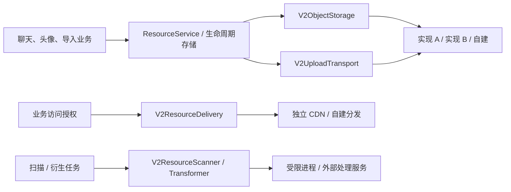

# 资源适配器接入合同与当前装配方式

更新：2026-09-27。本文对应本阶段资源系统实现，补充[完整设计](resource-system-design.md)第 4.1～4.6 节的代码接入方式。当前只验证本地参考实现与测试替身，生产运营商适配器尚未交付；全部缺口见[实施记录](resource-system-implementation.md)。

## 业务与基础设施边界

聊天、资料、授权和生命周期代码只处理 Resource/Media ID、逻辑 home、用途、generation、状态及经过验证的字节事实。客户端只执行 Core 定义的有界 HTTP 传输计划。以下内容不得成为聊天领域或客户端持久状态：bucket、对象路径、原生版本、原生 ETag、厂商 SDK 类型、厂商异常、临时签名 URL 或对象凭据。



存储和分发通过不同实例注入，不要求来自同一家服务商。切换 CDN 不修改逻辑资源 ID；调整默认存储也不改变已有对象和上传会话的归属。现有 `Resources/Adapters/Local` 是一组参考适配器，不是业务层必须依赖的具体类型。

## 代码接入点

| 接口 | 文件 | 适配器必须提供的保证 |
| --- | --- | --- |
| `V2ObjectStorage` | [存储端口](../../IMV2Server/Sources/IMV2Server/Resources/Ports/V2ObjectStorage.swift) | inspect/read/write/delete 都作用于精确的不可变对象身份；写入核验全文大小与 SHA-256；读取使用最多 64 KiB 的背压块；删除不得伤及另一版本 |
| `V2UploadTransport` | [上传端口](../../IMV2Server/Sources/IMV2Server/Resources/Ports/V2UploadTransport.swift) | 声明有限模式和大小；签发临时计划；提供已上传字节；支持导入及取消暂存；不得自行把业务资源标记为 ready |
| `V2ResourceDelivery` | [分发端口](../../IMV2Server/Sources/IMV2Server/Resources/Ports/V2ResourceDelivery.swift) | 只接受上层已授权的精确事实及截止时间；返回 GET 计划，不延长期限或替换内容；缓存命中也要鉴权 |
| `V2ResourceScanner` | [扫描端口](../../IMV2Server/Sources/IMV2Server/Resources/Ports/V2ResourceScanner.swift) | 返回绑定原输入的结果，以及可追踪的 policy/engine version；构造器对外公开，外部模块无需 `@testable` |
| `V2ResourceTransformer` | [处理端口](../../IMV2Server/Sources/IMV2Server/Resources/Ports/V2ResourceTransformer.swift) | 只执行受支持配方，写入预分配的输出身份；回执与输出一一对应；业务发布仍由 owner 事务完成 |

`V2ResourceService`、`V2ResourceVariantProcessor`、`V2ResourceForwardMediaCopier`、`V2BoundMediaProvider` 接收上述协议或窄闭包。新增适配器应放在独立实现目录；云 SDK、原生签名、原生错误解释只存在于该目录及应用装配入口。当前无需为了扩展而拆出新的服务进程或增加全局 service locator。

`resource_catalog` 保存资源的逻辑 home、用途和当前 generation，独立于 `resource_upload_sessions`。服务端转发产生的资源不需要伪造客户端设备或上传会话。下载、扫描、衍生产物和业务绑定统一读取资源目录及已核验 placement；缺少目录或已核验对象时明确失败。

个人和群头像的业务绑定只核对目录、当前代次及必需变体，不调用存储 SDK。绑定与 GC 共用媒体行锁，取得锁后观察当前数据库时间检查新资源的绑定期限，并为替换后的旧头像保留至少 120 秒。更换存储或分发实现不能跳过绑定事务、延长已签发的上层期限，或把上传完成当成业务绑定成功。

群头像沿用相同边界：房间 Actor 只读取/绑定 MediaID、avatar revision 和 resource generation；`V2ResourceGroupAvatarPresentationService` 在控制域校验设备，再通过 `V2ResourceAvatarDelivery` 调用任意分发实现。房间事件只携带失效版本，不携带下载 URL 或供应商位置。签名可能等待外部服务，因此返回后再次检查成员、资源代次、owner 路由和设备；个人资料批量接口也在签名后复核资料、拉黑和房间权限。群头像读写 HTTP、ClientKit 持久管理意图/恢复、提交协议/reader 与失效投影已实现；管理命令、journal 和原提交回执只包含逻辑资源事实，不调用任何存储或签名实现。App 可见群头像展示、管理页与账户恢复已装配，新上传任务与命令原子入库；上传准入同时复核结构化群主和成员角色，完整 UI/并发验收仍待完成，完整进度见实施记录。

客户端恢复通过 `V2GroupAvatarOperationRecovering` 取得绑定完整命令的永久结果。关闭动作及证明持久化，只有明确放弃或创建替代意图后才释放文件；替代操作分配新的业务和上传身份。这个恢复合同独立于上传、存储和 CDN，切换供应商不能把未知业务提交变成“上传失败”或直接分配新命令。

账户菜单的“待处理群头像”直接按本地账户日志分页，即使当前群投影已消失也能定位原操作。列表默认 32 条，管理页按 operation ID 补齐被房间窗口截断的选中记录；这一层只依赖本地记录与上述恢复合同，不调用供应商接口，也不持久保存临时传输计划。

### 不可变身份和配置版本

`V2StoredObjectReference` 保存 placement ID、`V2StorageBinding(id, configurationRevision)`、handle format version 和受限 opaque handle。只有对应适配器可以解释 handle。它可以编码某实现需要的容器、key、精确版本等信息，但不得含临时访问凭据。解码仍执行构造校验；不认识的格式版本必须失败，不能猜测解释。

`ResourceVariantID` 是独立的逻辑身份，存于 `resource_variants.variant_id`，不从当前物理引用推导。衍生任务重放复用原 ID，头像签发返回该 ID；新导入通过它和当前资源 generation 解析位置，不能将物理 placement UUID 当作查询别名。更换位置不会重算逻辑 ID。迁移必须保持内容一致，否则应按新内容的正常发布流程分配身份。

分配闭包必须是无 I/O 的纯身份分配。服务先在 owner 数据库记录会话或输出意图，再调用对象存储；响应丢失后按照原身份核对。`write` 重试同一身份和相同字节返回一致事实，不同字节失败。原生 ETag 只能用作适配器的并发证据，不能代替标准全文摘要。

上层对首次 `write` 和恢复时的 `inspect` 使用相同的回执校验：placement ID、binding ID、配置版本、handle 格式与内容、字节数和 SHA-256 必须全部匹配已登记目标及上传请求。即使适配器返回成功，任一项不符也返回 `integrityMismatch`，不写 active placement、不推进扫描或完成上传；保留原操作以供核对。该校验不能证明适配器实际写入了字节，实际 I/O 的正确性仍由每个实现的合同测试验证。

删除还必须处理迟到写入：当前本地实现持久保存删除标记，阻止同一身份复活。其他实现需要等价栅栏，或先证明写入者和其权限均已排空；仅执行一次 DELETE 后假设以后不会写入，不满足合同。未知删除结果继续重试同一精确身份。

### 传输计划

[Core 传输计划](../../IMV2Core/Sources/IMV2Core/ResourceTransferPlan.swift)描述版本、模式、HTTPS URL、声明式 headers/form fields、大小、SHA-256 与期限。业务代码不依据域名或 `x-某厂商-*` 前缀识别后端。

- HTTP 头通过通用语法与安全边界校验；只有显式 `.objectCapability` 头可以携带对象级 Authorization。业务登录 token 不得出现在对象 URL、headers 或 form fields 中。
- 服务端检查返回计划与已授权事实完全一致，并在签发后复核会话/授权；适配器不能把上层的 120 秒截止扩大到 1 小时。
- 客户端从内存读取计划，不写入 journal。旧附件 envelope 携带新计划时，外层 URL、headers、大小与期限必须一致，避免两套字段选择不同内容。
- 下载落盘前校验大小和 SHA-256；失败只清理本次临时文件，不能覆盖已有缓存。
- 当前本地参考上传适配器声明 `.httpPut` 与 `.httpPartPut`，总对象上限 256 MiB；分片为 8 MiB、最多 32 片。前台分片与账户资源恢复已装配。带逐片 `backgroundAuthorization` 的计划才可交给 iOS 后台上传；普通前台计划、form POST 或只自报 capability 的适配器不能获得后台资格。客户端已实现有界 Range 下载，服务端是否兑现 Range/验证器仍须按具体字节入口核对。

## Range 验证器与本地参考实现成本

客户端的 [Range journal](../../IMV2ClientKit/Sources/IMV2ClientKit/V2RangeDownloadJournal.swift) 与[下载执行器](../../IMV2ClientKit/Sources/IMV2ClientKit/V2MediaTransfer.swift)保存资源事实、偏移及强 ETag，不保存临时 URL。续传携 `Range` 和已有强 ETag 的 `If-Range`。`206` 必须匹配请求起点、原总长和连续偏移；已保存的 ETag 变化则废弃进度。`200` 表示服务端返回完整对象，客户端先清空旧进度再写入；`416` 只有 `Content-Range: bytes */原总长` 且本地已到完整长度才可进入最终校验。最终大小与全文 SHA-256 校验通过前不发布缓存。

[本地文件下载路由](../../IMV2Server/Sources/IMV2ServerHTTP/V2VaporLocalFilesystemMediaRoutes.swift)现使用全文 SHA-256 的强 ETag。在 FileIO 解析 Range 前比较 `If-Range`；不匹配（含弱验证器或日期形式）时移除 Range，返回完整 `200`，避免旧偏移超出新对象长度而误报 `416`。该路由禁用 FileIO 的 `If-None-Match` 捷径，鉴权后的响应仍为 `no-store`。这是 `/v2/local-media/download/:mediaID` 的明确行为；新资源事实入口的实现和顺序读取成本见下文，外部 CDN 仍须独立兑现合同。

当前 [strongETag](../../IMV2Server/Sources/IMV2Server/V2LocalFilesystemMediaProvider.swift)每次请求都扫描全文，使用 128 KiB 块及可取消的独立 utility 任务；取消后等待该任务结束。内存有界，但一次小 Range 请求也承担 O(对象大小) 的磁盘读取和 SHA-256 成本，多个分片请求会重复扫描。尚无持久摘要缓存，也没有吞吐或延迟测量。真实部署应在不可变对象写入校验时保存可信内容摘要，按精确对象版本返回验证器，并单独验证代理/CDN 的 Range、撤权和缓存行为；不能以文件时间或原生 multipart ETag 替代全文内容事实。

[资源事实字节入口](../../IMV2Server/Sources/IMV2ServerHTTP/V2VaporResourceByteRoutes.swift) `/v2/resource-bytes/:placementID` 是当前头像和附件 delivery plan 实际签发的 URL。它先验证能力期限，并将签名声明与不可变对象的 `inspect` 大小及 SHA-256 事实核对，再返回该全文摘要的强 ETag 和 `Accept-Ranges: bytes`。支持单个闭区间、起点到末尾及后缀 Range；有效范围返回 `206` 与精确 `Content-Range`/长度，无可选字节的范围返回 `416` 与 `bytes */总长`。不支持的单位、多段及格式错误 Range 按完整 `200` 处理；`If-Range` 必须精确匹配强 ETag，弱验证器、日期或其他不匹配值返回完整 `200`，不触发偏移越界 `416`。该入口不走 `304` 或公开缓存捷径，仍为 `private, no-store`。

此入口沿 [顺序 storage read 端口](../../IMV2Server/Sources/IMV2Server/Resources/Adapters/Local/V2LocalResourceDelivery.swift)读取，没有高效 seek：每次 Range 都丢弃前缀，输出交集，并继续排空尾部到 EOF，通过现有全文 SHA-256/大小校验后才正常结束。大对象每块最多 64 KiB；16 个物理流许可在 EOF、错误、取消或响应放弃时释放，显式关闭等待正在进行的读取结束，`416` 返回前关闭已打开但未读取的流。每次读取前后检查能力期限，超期中止响应；失败或取消的部分响应不代表完整校验通过，客户端仍须最终校验全文才发布缓存。小对象缓存仅保存先前完整校验过的最多 512 KiB 内容，按相同期限与范围输出。一次小范围请求仍可能读取并校验整个源对象，具体 `inspect` 也可能扫描全文；不能据此宣称 Range 降低本地磁盘或 hash 成本。此实现尚待统一回归，未声称真实 CDN 或平台测量已完成。

## 默认后端切换与存量解析

每个上传会话固定创建时的 binding 与配置版本；默认切换只影响新分配。幂等 create 先查原会话，再检查新会话的当前准入限制，防止新默认的较小限额误拒绝旧会话恢复。

普通转发在任何字节 I/O 前写入 `resource_forward_outputs`，持久保存目标对象身份、大小与 SHA-256。复制后响应丢失时先核对该对象，成功便继续扫描，不依赖重新读取源文件；旧 claim 无权发布。默认后端切换不重新分配目标。未发布的输出也参加 GC 删除，适配器必须阻止之后到达的旧写入复活对象。

运行时 registry 必须保留仍被引用的旧 binding。解析旧资源时按记录精确选择实现，不能找不到 A 就改用 B。当前启动检查对缺失旧配置采取失败策略；旧配置退役、存量迁移与晚签发排空仍需实现，不能删配置代替迁移。

显式导入的 active hold 已纳入上述检查。hold 保存精确引用、字节数、摘要和媒体类型，恢复读取原快照，不重新跟随逻辑资源的当前位置；只有新操作解析新位置。持久快照从创建时完整保存，不依赖旧记录回填。

同 home 的[迁移服务](../../IMV2Server/Sources/IMV2Server/Resources/Application/V2ResourceMigrationService.swift)也只调用 storage 协议：预分配身份先经[owner 存储](../../IMV2Server/Sources/IMV2Server/Resources/Infrastructure/PostgresV2ResourceMigrationStore.swift)入库，再复制并核验精确事实；未知写入结果先 inspect 原目标，不能另开对象。claim、源 generation 和完整引用均参与发布检查，迁移不改变 MediaID、逻辑 VariantID 或业务 home。维护调用者须注入并在事务内执行 operator/owner 授权，不能将该接口直接作为用户上传 API。

当前迁移内核保留所有尚未释放的源/目标引用，readiness 和 GC 已接入这份保护。没有部署入口、定时恢复装配或旧位置释放 API；`switched` 不代表退役完成。旧适配器删除、迁移取消后的输出清理、晚签发/在途读取排空及生产维护验收仍须补齐，不能通过手动写入 `source_released_at` 绕过这些证明。

当前 `V2ResourceBackendConfiguration` **仅是本地参考装配配置**，`directory` 并非运营商通用参数。下面的例子用于验证 A/B 并存：

```json
[
  { "id": "local-a", "revision": 1, "directory": "/srv/im/resources-a" },
  { "id": "local-b", "revision": 2, "directory": "/srv/im/resources-b" }
]
```

通过 `IM_V2_RESOURCE_STORAGE_BINDINGS_JSON` 注入；`IM_V2_RESOURCE_DEFAULT_BINDING=local-b` 与 `IM_V2_RESOURCE_DEFAULT_REVISION=2` 选择新默认。未配置时沿用已有本地媒体目录。非法 revision 或同名多版本但未明确选择时拒绝启动。

接入生产实现时，在应用装配层解析该适配器自己的配置和凭据引用，再构造协议实例。不要往通用端口添加某家独有参数，也不要复用同一个配置版本指向另一套存储。当前尚无生产 SDK 装配或动态适配器加载能力。

### 更换实现时的改动范围

| 变更 | 允许变化的位置 | 必须保留的合同 |
| --- | --- | --- |
| 新增对象存储运营商 | 新 storage/upload 适配器、专属配置、装配与合同测试 | 业务 Resource/Media ID、home、已登记对象身份、幂等和生命周期 |
| 仅更换 CDN | delivery 适配器、私有源站映射、密钥和边缘配置 | 存储 placement、上层权限、大小/摘要与期限上限；旧能力按原合同结束 |
| 更换扫描或转码服务 | scanner/transformer 适配器、受限 worker 配置 | 输入版本、policy/recipe、预登记输出及 owner 发布事务 |
| 某实现缺少分片、Range 或热点保护 | 能力声明与部署准入；必要时增加有界代理 | 对应用途保持关闭；不要求客户端猜运营商或静默绕过约束 |
| 移动已有对象 | 持久迁移任务与 placement 状态机 | 先复制核验，再切读；晚签发、在途使用与旧对象删除互斥 |

不同实现的细节不能提升成通用假设。例如，S3 的 multipart ETag 不等同于全文 MD5，且已开始的下载可能跨过 URL 的到期时间；Cloud CDN 对缺少签名的请求不会仅因配置了签名密钥就统一拒绝，私有源站与无签名路径还需正确配置。这些差异应成为适配器验收案例，而不是让聊天业务适配各家行为。[S3 完整性说明](https://docs.aws.amazon.com/AmazonS3/latest/userguide/checking-object-integrity-upload.html)、[S3 预签名期限](https://docs.aws.amazon.com/AmazonS3/latest/userguide/using-presigned-url.html)、[Cloud CDN 安全注意事项](https://docs.cloud.google.com/cdn/docs/using-signed-urls#security_considerations)。

## 客户端任务所有权

客户端通过 `V2ResourceOperationScope` 为控制请求和本地 journal 操作设置有界准入，关闭账户时取消并等待实际完成，再关闭数据库与文件所有者。构造中尚未交给 AppStore 的服务由 `V2AccountActivationScope` 清理，恢复循环只在完整接管后启动。这些规则适用于任意传输适配器；提供方忽略取消时仍须等待完成，不能以已发送取消信号推断远端没有执行。

临时传输计划、对象凭据和供应商配置不进入任务 journal。账户关闭后仍保留未知操作的原逻辑身份和必要源文件，重新登录后按原合同核对结果，不能因为切换后端或重建运行时就重新分配业务命令。

## 热点分发合同

App 的本地文件使用令牌由账户下载器管理，保护缩略图解码、播放器及系统分享期间的磁盘文件。重新下载发布新的本地代次，替代/撤回延后到最后一个使用者释放后删除；固定文件仍计入本地预算。它不授予服务端访问，也不要求 storage/upload/delivery 适配器理解 UIKit、AVPlayer 或页面生命周期。系统导出只提供本地文件副本和媒体类型，不携带运营商位置或临时能力；实际验证与剩余平台场景见实施记录。

作者补充的订阅与退出属于系统控制层，不由 CDN 或存储 SDK 管理。protocol 32 按原连接的 stream、room、view 精确结束补充，保留其他场景的房间订阅；取消时等待原订阅的实际 socket 写入，再发送退出，避免旧订阅迟到后恢复分发。上层页面/权限代次失效先撤销展示，服务端退出在回执前使未入队的旧资料许可失效。该规则适用于所有分发适配器。Gateway 已安装运行入口，服务端开关默认关闭；App 前台声明支持、后台不订阅。本轮未开启实际部署，实际验证及开销见[实施记录](resource-system-implementation.md)。

一万台设备仍然需要各自获取头像字节。目标是让这些请求到达可扩展的分发层，并把相同内容的回源合并，而非让客户端共享一个网络请求。

生产 delivery 需要独立验收：鉴权在共享缓存查找前执行；缓存键包含不可变内容/变体/存储版本，排除 viewer 和短期 token；同键冷请求合并；上层缓存或等价机制限制回源；超时、退避和并发有上限。不能把忽略签名参数的缓存键误实现成忽略鉴权。

群广播作者提示使用系统自有的 `V2AuthorPresentationIngress`：正文受众和成员版本检查保持原路径，正文先提交，然后同步有界入队；单个消费者转交按接收者重新授权的 dispatcher。准入计数包括正在执行的消费，旧 view/过期提示被拒绝，NIO 正文积压时补充不抢写。该入口无需提供方 SDK；替换存储或 CDN 不改变其预算、退出和关闭合同。运行所有者已经装配并依次关闭 ingress、dispatcher、reader；应用工厂通过 `any V2ResourceDelivery` 注入本地参考实现，可替换为生产适配器。当前一万次入队测试只证明单进程预算，不代表万人容量。

活动群页面的日志拉取也可在原响应写出后，通过同一 ingress 补充附件、引用和历史已接受消息的作者。普通与预编码路径都绑定拉取开始时的 view，并限制为实际返回开头 16 条事件 / 64 KiB、最多 8 个去重作者；预编码正文继续共享。样本只包含事件引用，展示权限和下载计划仍经统一资源接口按接收者重新获取，不进入共享消息缓存。存储或 CDN 适配器无需了解页面、游标及 nonce。

控制域资料读取现已在签名前后按不同 actor/device 合并 SQL，并设置项数、编码字节、排队时间和在途查询上限；同房间 Actor 也在逐信封准入后合并相邻的资料读取，保留每个接收者的独立成员判断和写入屏障。客户端遵守 429 的 `Retry-After`，再附加小幅随机延迟。它们属于本系统的授权与流量治理，不由存储或 CDN SDK 实现。跨房间 owner 合并和完整突发压测仍待完成，详见实施记录。

当前本地实现采用完整对象引用、大小及 SHA-256 作为缓存身份，避免不同 binding 或矛盾事实混用缓存；用 flight ID 隔离失败任务与后续恢复任务。小图为 32 MiB / 512 条 / 64 个回源任务，大附件为 16 个流。能力在命中前、等待回源后及输出块时检查。它证明参考行为，不证明多节点边缘、跨接收者授权或一万并发容量。

本地参考链路现可用[独立验收脚本](../../scripts/verify_v2_live_resource_authors.py)重现：真实 ClientKit 通过 HTTPS 上传并绑定头像，再分别从 Gateway TLS 实时广播、历史拉取取得资料和头像计划；Account HTTP 回退调用另一个进程的房间 Actor。真实下载器检查衍生头像大小及 SHA-256，错误 capability 在已热缓存上仍被拒绝，拉黑后两条资料入口停止新签发。实际 TLS 成员和已读目录还验证不含资料正文，关闭阅读披露仍隐藏读者。脚本只在自有临时进程中打开作者能力，没有生产提供方配置，也不改变通用端口。详细范围、依赖和证据见[实施记录](resource-system-implementation.md)；这项验证不能替代某个生产适配器的合同测试与热点压测。

群昵称也由本系统的房间权威按接收者集合读取，连同独立版本放入有期限的作者资料。签名结束后复核昵称事实，变化时拒绝交付旧观察；客户端压缩、版本下界和异步解码复核均包含该字段。nickname 不属于 storage/delivery 的元数据，适配器不能根据对象缓存自行决定名称或权限。真实链路已经覆盖昵称修改、清空、持久失效事件及旧分页接口的限期授权迁移；其余旧资料入口仍需完成。

App 私聊页面也使用统一的资料与字节管线：对端私聊权限、本人资料权限和页面 activation 均由本系统管理，重复头像行共享本页读取；不会让适配器根据“是否自己发送”判断权限。私聊当前走批量 HTTP，尚未接入群作者主动补充通道。替换分发实现不改变这些上下文和展示期限。

搜索筛选、收藏、转发和附件复制目标的名称同样通过限期展示组件读取，纯名称不执行头像字节计划。选择页拥有独立 activation，同一页的重复 key 可合并；视图和辅助功能名称使用相同的完整 context 与截止时间。数据库只提供私聊对端 ID 作为查询线索，适配器不参与联系人或私聊权限推断。当前通用 HTTP 仍可能签发未被名称组件使用的头像能力，尚未新增按展示字段裁剪的接口。

联系人和个人同步的资料补全也接入账户共享仓库，使用较低优先级并遵守相同的 HTTP/上下文预算。内容落库与账户排空由系统拥有；供应商适配器不决定哪些旧昵称可以继续显示，也不保存展示 lease。旧 `/v2/profile-views/batch` 认证后返回 410，资源服务未装配时也不回退到裸资料响应；剩余接口清理见实施记录。这项迁移不改变存储、上传或 CDN 的接口。

群成员和已读目录的实时协议仅返回标识、角色及分页事实。可见行和管理员移除确认页另取完整房间上下文的限期资料；服务端内部控制筛选仍负责成员、账户和阅读披露规则。目录游标、页面窗口、取消排空及辅助功能的展示规则由本系统管理，不进入供应商端口。该协议调整需协调更新服务和客户端，不影响不可变 placement 或已登记上传/导入身份。

精确 handle 发现使用独立的最长 60 秒查询结果，绑定查询账户、设备和 handle；不包含头像或字节计划，也不扩展通用 profile 批量查询权限。添加好友页的到期、输入变更及退出清理由客户端拥有，实际关系操作仍由系统授权。存储或 CDN 适配器不参与身份发现、昵称授权或好友确认。接口合同及证据见实施记录。

入群审批页使用系统拥有的 `.groupJoinReview(roomID)` 资料上下文：房间 Actor 检查当前邀请管理权限与待审申请，控制域检查资料、设备及双向拉黑。审批结果只携带申请者 ID，名称和头像经统一限期管线取得；分发端口仍只接受已授权的精确资源事实与期限。运营商不需要解释群角色、申请状态或页面生命周期。同房间的普通成员查询和审批查询分别占用上下文预算，签名后复核权限版本；具体实现与验证见实施记录。

## 适配器错误与恢复

| 规范错误 | 含义与上层处理 |
| --- | --- |
| `notFound` | 精确对象不可读；不能改读其他 binding 或可变“最新版本” |
| `preconditionFailed` | 身份/条件或生命周期栅栏不满足；读取持久状态决定后续动作 |
| `integrityMismatch` | 大小、摘要或回执不一致；不得发布业务 ready |
| `unsupportedCapability` | 不具备用途要求的保证；保持该能力关闭 |
| `throttled(retryAfter:)` / `temporarilyUnavailable` | 有界重试和退避，保留原操作身份 |
| `operationOutcomeUnknown` | 可能已经提交；按原身份 inspect/status 核对，不能立即换新资源 |
| `configurationInvalid` | 缺失或矛盾的部署配置；不能回退到另一运营商 |

原生异常需在适配器边界映射。日志记录 operation、generation、placement 和规范错误，不记录签名 URL、opaque handle 的完整内容或对象凭据。

## App 后台装配与验证边界

[AppStore](../../IMApp/IMApp/V2/V2AppStore.swift)在启动任何前台资源活动之前建立账户后台 coordinator，执行 `attachBackground` 的系统 task 对账与物理槽接管；失败则停止该次账户激活，不能继续创建第二个前台所有者。账户活动分别拥有后台字节循环和资源准备循环。页面取消只结束本地观察；持久资源任务、冻结消息身份及 Ready 依赖仍由账户拥有。会话待处理发送视图完整覆盖每房间最多 200 条活跃准备/提交记录；终态拒绝、关闭及过期历史不占这 200 条的执行准入，按 200 条一页另行浏览。页面与数据库观察使用同一有界 SQL 选集和页号，单条重试/取消按原 intent ID 精确查状态，不由当前页是否包含它推断可操作性。

后台 journal 保存 job、session、系统 task、账户 activation、源文件 token 和摘要，临时签名计划不入库。上传从受保护文件交给系统 URLSession；锁屏只能记录系统结果 inbox，解锁后才应用业务库事实。账号退出或切换必须取消并排空旧实际 I/O，随后关闭映射和文件所有者；同账号重新激活先采用系统任务再恢复前台步骤。暂存分片、未完成复制和孤儿文件的清理有扫描与时间上限，零进展容量错误进入可见账户暂停及明确恢复入口。

上述是源码装配合同，不是系统行为验证结论。真实设备的挂起、锁屏、强退、重启、后台晚完成、账户切换和 OS 调度窗口仍需独立验收；不承诺没有执行窗口时完成上传。外部对象存储/CDN 的后台授权、分片幂等、finalize 丢响应、撤权、期限和容量也尚无部署证据。本地参考 provider 或模拟器结果不能替代这些项目。

## F20 真机执行清单（待执行）

此清单复用上述 App 后台装配，补充[弱网验收范围](application-weak-network-regression-scope.md)中的 F20。当前没有本清单的真机执行证据；组件和模拟器通过不能填写为真机通过。

### 环境和安装前置

- 用户指定可清理测试数据的专用 iPhone/iPad、系统版本、测试时间窗口及两个测试账户；不得使用日常账户或在未指定设备上安装。记录设备标识的脱敏值、源码 baseline revision、工作区 dirty 状态和本次签名产物摘要。
- 使用项目现有 `IMApp` scheme 和 `Config/IMApp.entitlements`，配置有该设备权限的开发团队、设备 provisioning、Developer Mode 和所需 capabilities。真机使用正常开发签名，不能沿用模拟器的 ad-hoc `CODE_SIGN_IDENTITY=-` 或关闭签名。通过 Xcode 选择指定设备安装、运行；本项目现有本地联调脚本的 simulator 参数不是设备运行入口，不能直接改 UDID 冒充真机脚本。
- 按 [App 配置说明](../../IMApp/README.md)设置 `IM_V2_ACCOUNT_BASE_URL`、Gateway host/port 和 push environment。设备须实际可达 HTTPS Account、TLS Gateway、计划签发的上传/下载域名；Mac 的 `127.0.0.1` 对设备不可达。证书主机名、链及系统信任必须正确，不关闭 TLS 校验。真实 Push 冷启动另需该签名和环境匹配的 APNs，不能用前台通知替代。
- 指定参考 provider 或实际部署 provider，以及可控制的丢响应/延迟位置。先核对真实计划含逐片 `backgroundAuthorization`，有对应 PUT 能力、期限、大小/摘要和 Range/强 ETag；不具备后台资格时只能验前台恢复，记该后台场景不可执行。外部 provider 地址、签名规则、网络及故障控制权限由用户提供；本地参考 provider 可在设备可达且可信 HTTPS 环境中验参考合同，不能据此验收外部部署。
- 每组选择足以跨越操作窗口的附件，先记录原 send intent/clientMessageID、resource job/mediaID、上传 session/generation、系统 session/task/mapping 的关联证据。只保存脱敏关联表，禁止记录 access/refresh token、签名 URL、bearer capability 或源文件正文。系统 session 名为 `imv2.background.<UUID>`，taskDescription 对应持久 mapping UUID；仅 task 数量不能证明原身份恢复。

### 操作与成功条件

| 操作（各组独立记录，不假定系统一定给执行窗口） | 应观察的生产结果 |
| --- | --- |
| 前台开始附件发送，确认 DB 意图和系统 task 已建立后回到桌面、锁屏；在锁屏期间让 provider 完成一片，再解锁打开 App | 锁屏结果只进入受保护 inbox；解锁后同 job/session/generation 对账，不新建第二次逻辑上传。Ready 依赖满足才交付原冻结消息；accepted 只显示“服务器已受理，等待消息同步”，真实投影到达才移除本地等待行，不能当作已送达。 |
| 后台有 task 时等待系统挂起，再恢复前台 | 先采用系统已有 task 和物理槽，再恢复前台；无两个 owner 同时传同片。记录系统是否实际挂起及是否完成；没有执行窗口允许任务保持待恢复，不要求按固定秒数送达。 |
| task 建立后从多任务界面强退 App；等待后手动重新打开 | 不承诺强退后系统继续执行或重新唤醒。下次允许运行时，以原身份查询/采用已有结果，不换 clientMessageID、mediaID 或 session 来补发；没有原结果才沿原恢复合同继续。 |
| 有未完成任务时重启设备，分别观察首次解锁前和解锁后 | 首次解锁前不能把 Keychain/业务库不可读视为空队列或新账号。解锁后先对账，再恢复；原冻结操作和源文件仍关联原账号。无执行窗口期间保持待恢复不算失败或成功。 |
| provider 已接受片/最终提交但丢弃响应，之后恢复网络或重开 App | inspect/status/query 按原身份收敛；重复片依协议幂等，不能把未知变失败后重建资源。最终大小/全文 SHA-256 通过才发布文件；HTTP accepted 不伪造 timeline。 |
| 取消资源任务或退出/换号后，让旧系统 completion 晚到；随后以另一账户使用 App，再回原账户 | 旧 completion 只能进入原 session/mapping 的核对路径，不改新账户 UI、文件或任务。取消须等待实际 I/O 排空后释放槽；未知原操作仍保留可核对身份，晚完成不复活已取消页面。 |
| 下载/上传中借用文件进行分享或播放，再触发取消/替换/撤权，结束借用 | 借用期间文件不提前删除且继续计额；最后一个使用者释放后才能清理。新账号不能访问旧账号路径；源、part、系统副本和 inbox 按各自生命周期清理，不能删仍被 work/payload 引用的文件。 |

### 证据和结论

以 App 当前账户 activity 状态/暂停与明确恢复入口、既有 OSLog 诊断和只读 journal 关联记录对照 provider 原操作记录。受保护数据可读后，核对原 job、mapping、task、receipt 与消息投影的关联；跨进程无法获知的计时/字节值记 `unknown`，不得补零。暂存诊断的已观察/准入加权峰值不是实测磁盘峰值，系统副本占用另记录实际可取得的证据。

每组记录设备/OS、产物、provider/capability、操作时间、系统是否给窗口、原身份是否保持、最终状态、文件借用/清理结果和脱敏日志位置。无法造成系统挂起、无 APNs、provider 不支持后台计划或设备未指定时，写明未执行原因；不把“重开后能恢复”写成“锁屏已后台完成”。验收结束仅按约定清理专用账户/产物/临时环境，不删除未知原操作来凑空队列。

## 实际验收与仍需完成的迁移

当前测试包含：不可变写入/精确删除；旧后端在默认切换后继续解析；暂存已删除时从封存对象下载；外部模块构造扫描/处理回执；通用对象凭据与业务 token 隔离；100 个小图冷请求合并；缓存身份冲突；慢回源和热缓存的能力过期；下载摘要错误不发布文件。

普通转发已接入不可变存储复制：同一分片内跨 room 的新资源也走持久导出/收件箱，同 room 可复用已授权的源引用。已提交的旧 pair 操作仍按原接受回执重放；仅有旧预留、尚未接受的新资源操作可以进入导入路径。源导出已经提交后，源消息撤回不会取消这份持久复制授权；目标接受仍复核当前权限。已绑定资源的转发不受最初上传绑定期限限制，新副本仍受其绑定期限限制。

真实 PostgreSQL 已验证同分片、同库不同分片及不同物理数据库共 18 个场景组合：复制、丢失复制回执、扫描后重试、旧租约到期、删除未发布输出、源上传绑定期限到期。另已验证无上传会话的转发图片生成预览、旧 pair 接受结果与响应丢失时的路由、重复投递仅接受一次、源对象删除后目标仍可下载。Gateway 使用投递连接池执行复制元数据查询；这些是正确性证据，未替代并发容量和完整生命周期验收。

所有 resource owner 直接从 [canonical schema](../../IMV2/sql/schema.sql) 初始化。目录、复制输出、迁移任务、群头像操作和永久关闭表均属于启动 readiness 合同；不保留旧草案增量脚本或混合版本部署步骤。关闭回执与终态约束不包含供应商字段。Account 与 Gateway 检查运行中任务和资源仍引用的 binding，这是当前模型的生命周期要求。

生产适配器接入还要验证真实权限、网络超时后核对、上传残留清理、缓存/回源、撤权边界、故障恢复和容量。合同测试通过前，对应用途保持关闭；不能以公开资源或回退到业务 API 承担全部字节访问作为默认降级。
