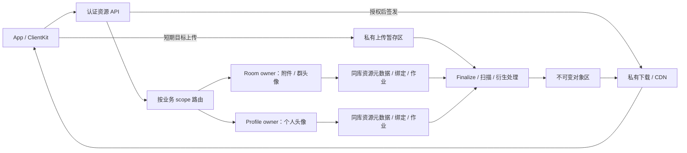
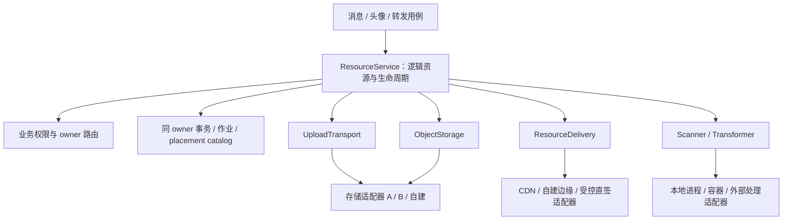

# IM 资源管理与突发访问实施方案

实施约束：项目尚未上线，直接采用统一的新资源模型、接口和 canonical schema，不保留旧版本兼容、旧媒体回退或草案数据库回填。持久重试、未知结果恢复及运营商切换属于新系统正常运行能力，继续实现。
执行范围更新（2026-09-27）：按用户要求，本阶段继续实现并执行本地组件测试，暂不进行生产验证和真实端到端测试；S3 尚未开通不阻塞开发。本文中的生产容量与全链路验收项保留为后续验证要求，不计为本阶段完成条件，也不视为已经通过。
日期：2026-09-26。状态：实施中的详细方案，不替代当前合同或发布证据；具体进度与验收缺口见[实施记录](resource-system-implementation.md)。基于前一版资源草案，合并聊天资料分发与万人首次访问的分析。

范围：聊天图片、动图、视频、语音、文件，个人头像、群头像，以及缩略图、预览图、封面和转码产物；包括昵称/头像展示资料、访问授权、上传恢复、清理和突发流量治理。本文基于仓库静态检查与官方资料检索；没有执行运行时缺陷复现或生产供应商验收。所有新增容量数值和默认值都是首轮实现/测试建议，不能作为已达成的性能承诺。

## 1. 建议结论

在现有 media 系统上演进，统一资源模型、传输能力和生命周期。保留消息只携带不透明 ID、业务 owner 授权、PostgreSQL 原子提交、持久任务恢复等已有边界。

首期采用 **资源随业务 owner 存放元数据，字节存放私有对象存储**：聊天附件和群头像归 room owner，个人头像归 profile/control owner。`home_scope` 是逻辑身份 `room(roomID)` 或 `account(userID)`，owner 数据库只是其可解析的存放位置。上传前确定用途和目标；同一范围内按用途规则复用资源，跨范围显式导入。两个 room 即使同库仍是不同 home。统一 API 和领域模型，不要求所有资源集中在一个数据库。

资源服务必须提供供应商无关的抽象层：业务只依赖逻辑资源、授权和生命周期；对象存储、上传传输、下载分发、扫描及转码通过独立适配器接入。存储和 CDN 可以来自不同运营商，也可使用自建实现。具体接口、能力验收和更换运营商规则见第 4.1～4.6 节。

当前代码的接入点、配置示例、错误语义和实际验证范围见[资源适配器接入合同](resource-provider-adapter-contract.md)。

先不引入独立资源微服务、全局内容去重或通用工作流引擎。对象供应商、扫描/转码 worker 可以独立部署；消息与引用的提交仍由现有业务 owner 完成。新增逻辑边界先落在现有 package；只有 CPU、连接池或部署隔离需要时才拆进程。

核心决策如下，后文给出具体数据和流程：

| 决策 | 本方案选择 |
| --- | --- |
| 权威元数据 | PostgreSQL，随业务 home 放置；账号头像首期仍归现有 control/profile 权威 |
| 文件字节 | 私有对象存储；上传暂存、不可变最终对象、未发布 worker 产物分区管理 |
| 热点下载 | 私有 CDN、请求合并和上层缓存；缓存命中前仍鉴权 |
| 热点授权 | 新增有界批量权威授权和短期边缘凭证；头像热路径不逐请求写 download grant |
| 作者资料 | 消息页/实时响应的可选展示补充；按作者和版本去重，权限按接收者判断 |
| 故障退化 | 正文先到、头像占位；展示补充失败不拖住发送 ACK 或房间提交 |
| 客户端 | 持久传输任务 + 发送意图，资料/授权/字节分层缓存，可见窗口驱动 |
| 后台任务 | PostgreSQL 持久作业、租约和回执；覆盖所有物理 owner 数据库 |
| 供应商 | 强制经供应商无关接口与能力合同接入；存储、上传、分发、处理独立适配，既有对象绑定原后端；厂商文档只作行为参考 |
| 分阶段边界 | 先可恢复前台链路，再完成头像/CDN突发验收，随后开放后台及更大文件 |

“一万人看见新人”意味着最多一万份图片交付和相应访问判断。设计目标是减少额外往返、grant 热写和回源，不能宣称这些工作变成 O(1)。

## 2. 仓库现状与需要补齐的部分

当前系统与证据等级以[系统图](../current-system-map.md)、[implementation status](../../IMV2/docs/implementation-status.md)为准。媒体的已接受基线见 [ADR-002](../../IMV2/docs/05-domain/ADR-002-social-media-mention-policy.md)，下载边界见[媒体授权合同](../reviews/legacy-media-authorization-contract.md)。

| 主题 | 已存在 | 本次设计要补齐 |
| --- | --- | --- |
| 资源身份 | `MediaID` 与对象 URL 分离；消息只存 ID | 元数据、用途、原件和衍生资源的完整模型 |
| 上传 | 设备绑定的幂等意图、临时目标、complete、扫描轮询 | 会话恢复、目标续签、服务端对象核验、分片和取消 |
| 消息提交 | 同 owner 数据库内锁媒体、检查 available、写消息及引用 | 普通上传按目标 owner 路由；群头像等其他绑定 |
| 下载 | 设备/消息/头像授权；消息定位与 owner epoch 复核 | variant 授权、批量元数据、缓存复用、Range/CDN |
| 生命周期 | scan/retention/purge outbox、转发 hold、失败重试 | 所有绑定类型、全部 owner 的作业覆盖、生产删除语义 |
| 客户端 | 文件 staging、前台上传下载、账号隔离、原子发布、本地缩略图 | durable transfer journal、草稿依赖、进度、恢复、共享头像管线 |
| 基础设施 | 本地文件 provider 和 EICAR 测试夹具 | 生产对象存储、真实扫描、受限转码、CDN 与故障验收 |

以下是设计开始前的代码级发现；部分问题已在工作分支修复，当前进度与运行证据见[实施记录](resource-system-implementation.md)，不要把此清单当作最新缺陷状态：

1. **头像保留遗漏。** [Profile 更新](../../IMV2Server/Sources/IMV2Server/PostgresV2ProfileUpdateStore.swift)写入 `avatar_media_id`，而 [retention](../../IMV2Server/Sources/IMV2Server/PostgresV2MediaRetentionStore.swift)的候选判断保护消息引用和转发工作，没有保护头像引用。完整资源系统应使所有业务引用对 GC 可见。
2. **上传意图幂等不足以恢复传输。** [当前上传会话](../../IMV2Server/Sources/IMV2Server/Resources/Infrastructure/PostgresV2ResourceLifecycleStore.swift)持久保存目标与代次，目标签发可重复进行；签发成功但响应丢失时，仍须为同一会话取得新目标，不消费一次性的上传 grant。
3. **完成通知不等于对象验证。** [当前 complete](../../IMV2Server/Sources/IMV2Server/PostgresV2MediaStore.swift)根据 grant 和数据库状态进入 scanning；生产还需要核验存储里的精确对象版本、大小和摘要。
4. **普通上传与多 owner 存在拓扑缺口。** [Account 装配](../../IMV2Server/Sources/IMV2AccountServerApp/main.swift)将上传 metadata 写入 control/default database；[消息接受](../../IMV2Server/Sources/IMV2Server/PostgresV2RoomWriteMediaAcceptance.swift)检查 room owner 本地 `media_objects`。已查路径没有普通上传到异库房间的导入协议；已有跨库导入属于转发流程。
5. **临时寿命与资源寿命混用。** `expires_at` 既用于临时资源又参与再次引用检查；已有消息的下载与保留另有条件。应拆成上传到期、未绑定清理期限、绑定保留期限。
6. **客户端任务尚不持久。** [附件服务](../../IMApp/IMApp/V2/V2ConversationAttachmentService.swift)重试生成新 ID，重启会清理没有持久记录的 staging；[传输器](../../IMV2ClientKit/Sources/IMV2ClientKit/V2MediaTransfer.swift)明确只支持前台。现有消息 outbox 不覆盖上传之前的任务。
7. **缓存没有形成完整命中路径。** [下载服务](../../IMApp/IMApp/V2/V2ConversationMediaDownloadService.swift)重新授权后仍下载文件；[展示模型](../../IMV2Core/Sources/IMV2Core/MediaReference.swift)只有类别、MIME 和大小，缺尺寸、时长、内容摘要和 variants。
8. **聊天展示尚未接入作者资料。** [消息 UI 转换](../../IMApp/IMApp/V2/V2ConversationDataSource.swift)只用 sender ID 判断是否自己发送；消息气泡、会话列表头像仍需实现。群名册每页最多 100 人，只包含公开名称等基础身份。
9. **草案基线中的资料变化仅覆盖部分私聊受众。** [公开资料 worker](../../IMV2Server/Sources/IMV2Server/V2DirectRoomProfilePropagationWorker.swift)枚举已有消息的私聊对端，不做全群分发；草案基线的群昵称写入没有对应群日志变更事件。当前工作区已补充仅含主体与版本的失效事件及客户端持久版本下界，验证与剩余边界见[实施记录](resource-system-implementation.md)。
10. **客户端资料缓存缺少上下文。** [资料仓储](../../IMV2ClientKit/Sources/IMV2ClientKit/V2ProfileRepository.swift)尚无跨调用合并、TTL 或 in-flight 共享；本地资料按 user ID 存储，不能作为所有上下文的访问资格。
11. **资料查询的跨库授权要补齐。** [profile batch](../../IMV2Server/Sources/IMV2Server/PostgresV2ProfileViewStore.swift)在 control 库查询本地房间成员关系；真实 room owner 分库后需要明确路由。当前 100-key batch 是同一 actor 查多个目标，不是 100 个不同接收者合批授权。
12. **已有 provider 接口尚不足以隔离运营商。** [下载 provider](../../IMV2Server/Sources/IMV2Server/V2MediaProviderSessionService.swift)按 MediaID 签目标，通用头策略包含厂商前缀；[客户端传输](../../IMV2ClientKit/Sources/IMV2ClientKit/V2MediaTransfer.swift)固定 PUT/GET。需要补精确 blob placement、后端绑定及声明式传输计划，保证切换默认后端不影响旧对象与进行中的会话。

这些发现指导工作优先级。当前纯消息发送/恢复容量证据不能证明头像、资料查询和 CDN 的组合容量。

## 3. 四个核心概念

| 概念 | 回答的问题 | 建议字段/约束 |
| --- | --- | --- |
| Resource | 这是什么业务资源？ | `resource_id`、`home_scope`、creator、purpose、state、descriptor revision、retention policy；可继续使用现有 `MediaID` 命名 |
| Blob | 精确存储了哪一份字节？ | `blob_id`、大小、可信全文摘要、detected MIME；逻辑字节身份不可变，物理位置由内部 placement catalog 管理 |
| Variant | 原件的哪个处理产物？ | resource ID、source blob/version、recipe ID/version、kind、output blob ID、尺寸/时长、独立 processing state |
| Binding | 哪条业务事实正在使用资源？ | resource ID、message/profile/group identity、业务 revision、slot/ordinal、created/revoked time；由对应业务事务写入 |

关系为：一个 Resource 有一个原件及多个 Variant；每个产物指向不可变 Blob；一个 Resource 可以在同一 home 内具有多个 Binding。

数据库可以沿用 `media_objects` 并新增 blob、variant、upload session/parts 与 profile/group binding 表。已有 `message_media_references` 保留并补齐版本语义。领域上统一 Binding，不强迫所有业务共用一个无法建立有效外键的 `(type, id)` 多态表。

`ResourceDescriptor` 持久展示受控的文件名、真实 MIME、大小、宽高、时长、可用变体和 descriptor revision。文件名是经长度、字符和路径清理后的展示数据；不能用作对象 key。高频传输进度和签名 URL 不进入消息同步载荷。元数据、文件名和缩略图本身也需要授权。

消息保存接受时的稳定展示资料；后续异步产生的 variants 通过带授权的 descriptor/manifest 查询获取。处理完成提示可以丢失，重新打开页面或恢复任务时查询持久状态补齐。头像身份替换走现有资料/群状态同步，不依赖临时处理通知。

### 3.1 最小持久化结构

以下为 schema 设计规格，字段命名可随现有风格调整；不要求把所有现有 media 类型重命名为 resource。

| 表/结构 | 核心字段 | 必需约束或索引 |
| --- | --- | --- |
| 扩展 `media_objects` | media ID、home kind/ID、creator、purpose、generation、state、original blob ID、descriptor revision、unbound GC deadline、delete-after | media ID 主键；home 不可由客户端任意修改；ready 与 deletion_pending 互斥 |
| `media_blobs` | blob ID、大小、MIME、可信全文摘要算法/值、发布状态 | 发布后逻辑字节身份不可变；不包含供应商 SDK 类型 |
| `media_blob_locations` | placement ID、blob ID、storage binding ID/config revision、版本化 opaque locator、核验状态、active/retiring | 精确定位不可变字节；bucket/key/原生版本仅在内部适配层解释；迁移可临时有多个位置 |
| `media_variants` | resource、source blob、recipe/version、output blob、状态、尺寸/时长 | UNIQUE(resource, source blob, recipe, recipe version) |
| `media_upload_sessions` | session、resource、home、actor/device、operation、fingerprint、generation、expiry、storage binding/config revision、版本化 adapter state、state | UNIQUE(home, actor, operation)；设备、用途、声明大小和摘要属于请求指纹；会话固定原后端 |
| `media_upload_parts` | session、part number、大小、标准化校验结果、受限 opaque provider receipt、确认状态 | PRIMARY KEY(session, part number)；适配器解释原生 ETag 等字段；不接受任意数量的分片 |
| 业务绑定表 | message/profile/group 的真实 FK、resource、接受 generation、slot、revoked-at、retain-until | 各表有 resource 索引；有效绑定部分索引；不能只用可漂移的 refcount 决定删除 |
| `media_output_intents` | job/attempt、generation、storage binding/config revision、预分配输出 locator、精确输出版本、发布/清理状态 | I/O 前登记；按 next-check-at 有界核对；输出身份不复用且不随默认后端漂移 |
| finalize/variant/import 等作业 | stable operation、state、attempt、claim token、lease expiry、retry-at、error class | pending 的 retry-at 部分索引与 claimed 的 lease-expiry 部分索引分开 |
| quota reservation | account/home、operation、预留字节、已结算字节、状态、终态回执 | 每项操作幂等预留/结算/释放；跨库不靠超时判断已无占用 |

未绑定回收使用 `(unbound_gc_after, resource_id)` 候选索引。HTTP batch、worker batch、SQL 候选集合同时限制条数和总字节。涉及历史成员过滤的查询要验证实际扫描量；`LIMIT` 只证明返回量有界。

客户端另建 `resource_transfer_jobs`、`send_intents`、`profile_content_cache`、`profile_context_access` 和文件缓存索引；使用现有 SQLite/GRDB，不引入第二套客户端数据库。

## 4. 分片、提交与跨范围使用



上传请求携带 `usage = messageAttachment(roomID) / userAvatar / groupAvatar(roomID)`。服务器从认证会话取得用户和设备，解析权威 owner；客户端不能指定数据库或越过 scope 授权。开始上传时做准入，实际发送或设置头像时再次按当前权限判断。

创建返回可持久化的 locator `(home, sessionID)`；后续 status/targets/finalize/cancel 必须携带 home，由服务器解析当前 owner，再核验 session 的不可变 home、actor/device。导入状态同样使用 `(targetHome, importOperationID)`。locator 只负责定位，不是权限；不能凭随机 session ID 遍历所有 owner，也不能未找到就回退 control 库。客户端 journal 保存逻辑 home，不保存数据库地址。

普通附件发送保持一次 owner SQL 事务：按既有业务锁序取得 operation/room/fence，再按 ID 排序锁资源 → 重新检查 ready、scope、用途、权限和 generation → 写消息及引用 → 写可靠事件/outbox → commit 后 ACK。头像替换先取得 profile/group 业务锁，再按相同顺序锁新旧资源，在该事务内建立新绑定、解除旧绑定；客户端不额外调用 retain。GC 只锁资源并用新查询复查绑定，不反向取得业务锁，避免与发送/头像更新形成死锁。绑定与 GC 使用同一互斥规则，仅仅各自处于一个事务内并不足够。

跨 room、头像转附件等跨范围复用走显式 import：源 owner 授权精确来源及版本并建立 hold，目标 owner 建立幂等导入记录，复制/验证字节并完成处理后，再接受目标业务提交。复用现有 forward export/inbox/receipt 的恢复机制。

**首期跨 home 使用独立对象 key/对象副本，避免多个 owner 各自决定同一 Blob 的删除。** 同一 home 可以多个绑定共享同一资源。先不做跨用户 hash 秒传、跨 owner 物理去重；内容 hash 不是下载或复制权限。

若未来引入全局 Blob 池，必须另行设计唯一 GC 权威与持久 retain/release 协议。reservation 超时、网络不可达或引用投影缺失，都不能证明目标没有提交；需要目标持久化封闭该 operation、禁止晚提交并返回终态回执。分区时宁可延迟回收。

房间执行 Host 的租约切换与数据库 owner 迁移应区分：Host 切换延续当前 activation fence；未来若移动数据库归属，资源 metadata、bindings、未完成 sessions/imports/jobs 要一起迁移并冻结旧 owner。对对象存储的删除还需唯一授权执行器或等价的 I/O 排空/凭据栅栏；仅在旧进程调用 DELETE 前读一次 epoch，不能阻止迟到删除。首期沿用部署前静态分片，不新增在线迁移目标。

### 4.1 资源服务的供应商无关边界



`ResourceService` 是应用服务入口，负责 create/status/finalize/access/import 等用例编排；业务层不直接调用云 SDK。授权、绑定、保留、幂等、quota 与作业状态仍由本系统决定，不能让某家云的 callback 或对象 ACL 成为业务权威。

| 边界 | 输入/输出与职责 | 不承担的职责 |
| --- | --- | --- |
| ResourceAuthorization | actor/device + context → 已验证的精确资源决定及期限 | 不调用云 SDK，不使用存储 ACL 判断群成员资格 |
| ResourceLifecycleStore | 同 owner 保存 Resource/Binding/session/jobs/holds/quota | 不在 SQL 事务中等待 provider I/O |
| BlobPlacementCatalog | blob → 精确 placement/backend/object reference；管理核验和退役状态 | 不把物理 URL 作为 ResourceID，不把默认后端套给旧对象 |
| ObjectStorage | 固定字节版本、检查、流式读写、精确删除；原生 copy 是可选优化 | 不判断用户是否有权看消息，不发布业务 ready |
| UploadTransport | 开始/恢复后端上传、生成传输计划、查询进度、完成/取消及未知结果核对 | 不自行创建新业务 session 或改变 home |
| ResourceDelivery | 已授权的精确 blob/variant + 期限 → 临时传输目标 | 不重新定义 ACL，不扩大对象范围，不修改字节身份 |
| Scanner / Transformer | 精确输入 + policy/recipe → 扫描回执/未发布产物 | 不绕过上层 generation、claim 和发布事务 |

这些是职责边界，不要求每项都新建协议或进程。沿用现有 store/授权类型；只在真实副作用和可替换实现处定义窄 `Sendable` 协议。placement policy 可先是配置驱动的具体值类型，ResourceService 也可保持具体类型。依赖通过初始化注入，registry 只在装配/解析后端的位置使用，避免 feature 到处查询全局容器。

### 4.2 接口草图与不可变字节合同

以下 Swift 为接口设计草图，名称和 DTO 在实现时与现有 media 类型统一，不是已提交的可编译 API：

```swift
protocol V2ObjectStorage: Sendable {
    func inspect(_ object: StoredObjectReference) async throws -> StoredObjectFacts
    func seal(_ request: SealObjectRequest) async throws -> SealedObjectReceipt
    func read(_ request: ObjectReadRequest) async throws -> ResourceByteStream
    func write(_ request: ImmutableWriteRequest,
               bytes: ResourceByteStream) async throws -> StoredObjectReceipt
    func delete(_ request: ExactObjectDeleteRequest) async throws -> DeleteReceipt
}

protocol V2UploadTransport: Sendable {
    func begin(_ request: BeginUploadRequest) async throws -> BackendUploadState
    func plan(_ request: UploadPlanRequest) async throws -> UploadTransferPlan
    func status(_ request: UploadStatusRequest) async throws -> BackendUploadStatus
    func complete(_ request: CompleteUploadRequest) async throws -> UploadCompletionReceipt
    func abort(_ request: AbortUploadRequest) async throws -> UploadAbortReceipt
}

protocol V2ResourceDelivery: Sendable {
    func issue(_ request: AuthorizedDeliveryRequest) async throws -> DownloadTransferPlan
}

protocol V2ResourceScanner: Sendable {
    func scan(_ request: ScanRequest) async throws -> ScanReceipt
}

protocol V2ResourceTransformer: Sendable {
    func transform(_ request: TransformRequest) async throws -> TransformReceipt
}
```

共同 DTO 和语义如下：

- `StoredObjectReference` 包含不可变 `placementID`、`storageBindingID/configurationRevision` 与有格式版本的 opaque object handle。bucket/container、key、原生 version ID 仅由对应 adapter/catalog 编解码；不进入 Core 的持久业务模型或客户端 API。
- `SealObjectRequest` 把完成上传的可变暂存对象固定成上传者不能替换的字节，返回精确身份和可信完整性证据。后续 scan/read/copy/delete 都使用同一精确身份；不能各自仅凭 MediaID 重新选择“当前对象”。
- `UploadCompletionReceipt` 只证明后端上传的状态/对象，不代表已扫描或业务 ready。`begin/complete/abort/seal/write/delete` 请求都关联已持久登记的 operation、attempt 和目标身份；结果可查询核对。进程内重试不能偷偷换 key 或上传会话。
- `AuthorizedDeliveryRequest` 只由已完成业务授权的服务路径内部构造，包含精确 placement/variant 与期限上限；不接受客户端直接反序列化成“已授权”类型。adapter 不能扩大期限、路径或用途，返回值还需通用边界校验。
- `ResourceByteStream` 表示有背压、可取消、分块有界的服务器 I/O，不是把整个文件装入 `Data`。处理器使用受限字节流或 worker 受管文件句柄；外部处理适配器需要输入能力时，由编排层签发受限的内部能力，不把用户登录凭据交给外部服务。
- `ScanReceipt` 绑定输入 blob/version、扫描 policy/engine 版本；`TransformReceipt` 绑定输入和 recipe 版本，列出预先登记的输出及校验结果。厂商回调先验签并关联持久作业，再核对供应商事实，最后由 owner 条件发布。
- Blob 使用本系统验证的全文摘要，首期可统一 SHA-256。provider ETag、原生版本、组合 checksum 属于适配证据，不能替代逻辑内容身份。无原生 version ID 的后端可以用唯一 key、条件创建及权限隔离提供等价不可变性，但必须通过同一合同测试。

统一错误至少包括 `notFound`、`preconditionFailed`、`integrityMismatch`、`unsupportedCapability`、`throttled(retryAfter)`、`temporarilyUnavailable`、`configurationInvalid`、`operationOutcomeUnknown`。外部响应仍按授权合同隐藏资源是否存在；provider 凭据/策略故障不能伪装成用户无业务权限。超时和本地取消都可能发生在远端已经完成之后，未知结果先核对原 operation，再决定是否重试，不能当成明确未执行。

### 4.3 客户端只执行声明式传输计划

业务 API 返回统一 `UploadTransferPlan` / `DownloadTransferPlan`，显式声明协议版本、受支持模式、HTTP 方法、HTTPS target、受限 headers/form fields、文件或 part 范围、大小/摘要约束、expires-at 和安全的 receipt 提取规则。计划中的目标/凭证只在内存短存；持久 journal 只保存逻辑 session、part 进度和不授予访问能力的确认数据。

客户端协议能力明确声明支持的模式，例如单次 HTTP PUT、表单 POST、分片 HTTP 传输、HTTP GET/Range。服务器只选择客户端与后端都支持且满足用途约束的模式；未知模式返回明确 unsupported，不能下发脚本、任意执行步骤或要求安装某家 SDK。新增传输模式需要协议与客户端实现验收，不能用无约束 JSON 绕过类型边界。客户端可以接触临时传输 URL，但不解析域名来识别运营商，不自己拼对象路径或签名。

通用安全检查统一限制 scheme/目标来源、方法、headers/form 的大小和控制字符，并禁止透传业务登录 bearer、长期云凭据、代理/连接控制头和未经许可的重定向。具体签名字段由经过注册验证的 adapter 生成；ClientKit 执行通用约束，不再维护 `x-amz-*`、`x-oss-*` 等厂商名单。需要在 header/form 中携带的短期对象能力必须显式分类，与业务 Authorization 分开，不能简单放开所有 headers。

### 4.4 能力声明、部署准入与突发访问

抽象统一的是结果与保证，不要求所有运营商具有相同 API。每个 backend/edge binding 提供版本化 capability descriptor，并用绑定到该配置的合同测试证据准入；仅适配器自报 true 不算验证通过。

| 能力类别 | 必须统一的保证 | 可选实现与缺失处理 |
| --- | --- | --- |
| 字节身份 | 精确读取/删除，不可变发布，可信大小与全文完整性 | 原生版本或唯一 key 均可；无法保证则禁止该后端发布资源 |
| 上传 | 当前配置的大小硬约束、会话恢复、完成/取消后的核对与清理 | 单次/表单/分片按能力选择；缺分片就收窄文件能力，不假装可续传 |
| 分片 | 支持的 part 大小/数量、结果核验、取消及残留清理 | 统一 session 生命周期，adapter 管原生 upload ID 与 receipt |
| 复制 | 精确来源、不可变目标、全文校验、输出意图 | 同后端原生复制可加速；跨后端以有界流式复制完成相同语义 |
| 分发安全 | 每次请求含 cache hit 鉴权、精确 scope/期限、私有源站 | CDN 原生签名或自建验证均可；不满足则不能启用该分发路径 |
| 大群小图 | 共享字节 cache key、同 key 合并、上层缓存/等价源站保护、受控签发成本 | 声明并验收实际合并范围；不足则补受控缓存层或禁用大群配置，不自动全量直连源站 |
| 可选增强 | Range、主动失效、在线撤权、事件通知、外部转码 | 缺失时关闭对应产品能力；事件始终不能代替持久状态核对 |

`ResourcePolicy` 定义用途所需保证，部署装配检查 `policy × storage binding × delivery binding × client protocol` 的兼容性；开始上传前再次检查实际计划和限额。storage 与 delivery 单独配置，并验证 delivery 的 origin mapping 指向正确 backend/placement。更换 CDN 不修改资源身份；更换存储也不强制更换 CDN。TTL、批大小、Range 和缓存合并参数以已验证能力取交集，不硬编码某家产品默认值。

统一配置只引用 `storageBindingID`、`deliveryBindingID`、adapter type、受限配置引用和凭据引用；厂商区域、容器、endpoint、签名细节放入适配器专属配置。凭据由运行环境注入，可正常轮换；标识对象位置的配置版本不可被原地改成另一家后端。健康检查与 readiness 同时确认配置存在、能力满足和仍被引用的旧适配器可用。

### 4.5 更换运营商与存量资源

1. **新默认只影响新分配。** 每个 placement、上传 session、output intent 固定创建时的 storage binding/config revision；不按当前全局默认解释旧记录。一个 owner 内允许新旧后端并存，逻辑 home 和物理后端是两条不同路由轴。
2. **旧上传继续走原后端。** 续签、status、complete、abort 使用持久的带格式版本 adapter state；只有明确取消并封闭旧 attempt 后才允许重新准备。state 内若有敏感恢复数据，受限加密保存；客户端不持有管理凭据。
3. **存量迁移采用复制后切读。** 同 home 的迁移先建立持久 hold 与输出意图，精确读取旧对象，写入新后端，验证大小/全文摘要，再在 owner 事务内条件发布新 active placement。ResourceID、BlobID、VariantID 保持不变，未验证副本不能被选择下载。
4. **切读与旧位置退役互斥协调。** 下载/处理在解析 placement 时登记有界使用保护或等价 fencing；旧位置进入 retiring 后禁止新的签发/作业引用。退役等待已登记下载能力及在途传输保护、处理/导入 hold 结束，且晚签发被挡住后，再持久安排精确 purge；不能只从切换时刻机械等待一个 TTL。无可证明的传输结束边界时，继续保留旧位置或按明确的最大传输期限终止后清理。
5. **旧 adapter 不能提前移除。** registry 检查 locations、sessions、jobs、holds、未完成 I/O/清理仍有无引用。切读失败保留原 active placement；成功后的回退仅能选择仍存在且校验一致的副本，遵守相同 generation/授权规则。

迁移保护不要求每个热点 GET 写数据库。可按 placement/config epoch 预留有界签发批次租约，切读后禁止新租约并等待已发租约失效/排空；每个 capability 的截止不能超过租约。数据面在途传输的排空由边缘/下载执行层保证或使用已验收的最大传输期限。实现阶段需要一起证明晚签发与删除的互斥，不能为了迁移重新引入逐头像 grant 热写。

跨 home 导入仍按第 4 节建立独立目标资源/对象副本；同 home 的供应商迁移不改变业务归属，两者不能混用。跨运营商自动故障切换只有在事先存在校验一致的副本和可用 delivery binding 时才允许；修改配置不能凭空产生副本。

逻辑变体身份必须独立持久化，不能从当前 placement ID 计算。当前实现使用 `resource_variants.variant_id`：创建衍生意图时分配，重试保持不变，签发和导入均按该 ID 解析当前 generation。所有变体从创建时使用独立 UUID。导入 hold 同时固定精确对象引用、大小、SHA-256 和媒体类型；已建立 hold 的操作恢复时使用这份快照，新操作才解析当前位置。迁移任务不能通过改写既有 hold 将在途读取转移到新位置。上述身份和恢复约束已接入；迁移仍须遵守晚签发保护与退役排空。

实现中的迁移维护内核现以 `resource_storage_migrations` 记录原输入、预分配输出、逻辑变体、generation、claim 和切换状态。复制恢复与条件切读已接入；在旧位置排空证明及释放流程完成前，记录持续保护两个引用，阻止整资源回收并要求保留相关适配器。`switched` 只表示读取位置已经切换，不表示旧对象可以删除。该内核尚未接入部署中的维护入口和定时恢复，完整验收仍按上述五项执行。

### 4.6 代码落点与抽象验收

在 IMV2Server 内先按 `Resources/Application`、`Resources/Ports`、`Resources/Infrastructure` 和 `Resources/Adapters/<implementation>` 组织。IMV2Core 只含供应商无关的业务/传输协议值类型；SDK import、原生错误、签名、bucket/key 编解码只允许在适配器与装配边界。后续确有依赖隔离需要再提取 SwiftPM target，业务服务的测试替身注入不应依赖整套云 SDK。

演进现有 `V2MediaObjectProvider` 为独立 delivery，`V2MediaUploadObjectProvider` 为 upload transport；scan/purge/copy 改为接收精确 blob placement。保留现有 claim/lease/outbox/retry 框架，新增 placement catalog、registry 和 adapter state codec。下载领域与 HTTP 统一使用 `V2ResourceTransferPlan`；下载响应仅含必需的 `plan`，要求完整 GET、明确字节数和 SHA-256。旧 URL/headers 响应不再支持，上传暂存目标与下载计划分型，避免混用读写能力。

每个实现共用合同测试：不可变身份、超时后结果核对、取消晚完成、可信摘要、精确删除、流式内存边界、业务 token 不外泄、cache hit 鉴权及冷回源。用本地确定性实现与 HTTP 假后端验证替换边界，再对实际生产 adapter 跑集成测试；本地通过不等于云端能力已验收。增加“同一 owner 混用 A/B、新默认切 B 后 A 的旧资源及 session 仍可用、迁移与下载/GC 并发”的专项验收。接入新运营商原则上只新增适配器、配置及该合同测试；若必须修改聊天领域模型才能接入，说明抽象边界仍有泄漏。

应用边界统一复核适配器回执，不仅依赖其返回成功：首次写入和响应丢失后的 inspect 都必须匹配原 placement、带配置版本的 binding、opaque handle、大小及全文摘要；不一致不得发布扫描或完成状态。实际实现与生产接入缺口见[适配器合同](resource-provider-adapter-contract.md)；当前的本地配置结构和本地测试通过，不代表已经支持任意运营商配置或存量在线迁移。

## 5. 上传和处理流程

建议分开三类状态，而不是用一个巨大的枚举表达所有组合：

| 对象 | 状态主线 |
| --- | --- |
| UploadSession | created → uploading → finalizing → completed；另有 cancelled / expired / terminal failure |
| Resource | pending → verifying → scanning → processing（有必需产物时）→ ready；另有 rejected / deletion_pending / deleted |
| VariantJob | queued → processing → ready；另有 retry_scheduled / failed / cancelled |

完整过程：

1. 客户端把文件复制到账号隔离的 staging，记录稳定的 operation ID、resource ID、文件 token、预期大小和摘要、usage、关联草稿。
2. 认证 API 在目标 owner 建立上传 session 和额度预留。相同 operation ID + 相同指纹返回同一 session；不同参数返回冲突。
3. 为同一 session 签发可续签的短期上传 capability。首次 session 结果、短期 URL 与 multipart upload ID 分离；目标过期不创建新资源。
4. 字节直接上传私有暂存区。小文件单次上传，大文件/弱网使用 multipart；具体阈值、part 大小和并发通过实际供应商及真机测量确定。
5. `complete` 只触发幂等 finalize。服务端核对对象存在、实际大小、校验摘要和精确版本；multipart 由服务端核验 parts 并确认最终对象，不能直接信任客户端宣称的成功。
6. 固定不可变内容身份后扫描。推荐使用上传者无写权限的最终 key；若暂存 key 可覆盖，必须通过 version ID 或等价的条件读取/复制精确固定源字节，不能先 HEAD 后无条件复制。扫描结果绑定最终 blob/version/hash。
7. MIME 嗅探、结构探测和安全扫描通过，且该用途的全部必需产物就绪后，才能发布 ready。用户完成通知、供应商回调、扫描回调均不能绕过当前状态、generation 与 claim token。
8. 必需处理完成后即可业务绑定；非必需转码异步推进。客户端扫描等待超时表示“仍在处理”，通过原 session 查询恢复，不重新上传。

create/finalize/cancel/import 都定义独立操作身份和确定结果。上传的 session 生命周期不会因刷新一个短期 URL 被重新开始。过期 session 不允许直接复活；客户端显式新建 attempt，但先查询旧 attempt 的终态，避免复制一个已经成功的资源。

finalize、scan 和 variant 使用“事务内登记工作及输出意图 → 事务外 provider/CPU I/O → 带 generation/claim token 条件提交”。提供方 complete 成功但响应丢失时，通过原 provider upload ID、已登记输出 key 和可信版本证据核对，不重新创建另一个对象并返回两份成功结果。扫描器暂时不可用可在既定截止前重试；明确拒绝或超过安全处理截止则进入不可绑定终态，不能因队列故障跳过扫描。

cancel 与 finalize 在同一 session/resource 状态协议内互斥。取消返回 cancelled 后，晚到 worker 不得发布 ready；若 finalize 已完成则返回 completed/conflict，再通过废弃未绑定资源处理，不能声称成功取消一个已经提交的业务绑定。上传及取消都不直接撤回已发送消息。

AWS 官方资料说明，预签名 URL 在有效期内可重复使用，上传同 key 可能覆盖；这直接要求上述不可变发布边界。[S3 预签名 URL](https://docs.aws.amazon.com/AmazonS3/latest/userguide/using-presigned-url.html) 和 [条件写入](https://docs.aws.amazon.com/AmazonS3/latest/userguide/conditional-writes.html)。

multipart 必须保存 provider upload ID、part 编号/结果、摘要算法及计算方式，提供 status、refresh、complete、abort。未完成分片不会自动按应用 session TTL 消失，需要显式 abort 和供应商 lifecycle 兜底。ETag 不能普遍当作文件 MD5；全文 hash 与 multipart composite checksum 必须区分。[S3 multipart](https://docs.aws.amazon.com/AmazonS3/latest/userguide/mpuoverview.html)、[对象完整性](https://docs.aws.amazon.com/AmazonS3/latest/userguide/checking-object-integrity.html)。

摘要必须来自供应商验证过的 checksum 或服务端实际计算，不能信任用户自定义 metadata 中的 hash。选定 provider 后，对条件写入、精确版本读取/复制、checksum、Range、分片完成/取消逐项做合同测试，不能只凭“S3 compatible”认定等价。上传字节限制应在供应商策略或受控入口实际生效；finalize 后才发现超限不能防止暂存占用，应配合并发/暂存额度和兜底清理。

## 6. 衍生资源与处理边界

| 类型 | 首期建议 | 后续扩展 |
| --- | --- | --- |
| 个人/群头像 | 服务器安全解码、方向规范化、去除 EXIF/GPS、生成固定档位静态图 | 动态头像另订用途限制 |
| 聊天图片 | 原件、列表缩略图、预览图；记录宽高 | 按网络策略获取高质量原图 |
| 动图 | 静态首帧、保留原件 | 受限动画预览 |
| 视频 | 原件、时长/尺寸、封面 | 兼容播放版本、自适应码率流 |
| 语音/音频 | 原件、时长、受控波形数据 | 规范编码版本 |
| 文件 | 安全展示名、真实类型、大小、下载 | 文档预览按需求增加 |

首轮固定 recipe 建议：头像 128/256 像素方图，聊天图 320 像素短边缩略图和最长边 1280 像素预览，视频 320 像素封面。保持比例的图片不强制裁切、不放大小原图；头像按明确裁切参数生成。格式首期使用客户端已支持的 JPEG/PNG，透明图保留透明；更多编码经实际设备验证再启用。

这些档位不是用户任意传入的缩放指令。头像在 profile 引用切换前就准备好展示版本；CDN miss 只读已存在的对象，不同步调用转码器。128 像素头像可先以 40 KiB 为编码目标上限，达不到时调整质量或拒绝该配方输出，不能无限扩大网络与解码预算。

头像的安全展示产物是 ready 的必要条件；原始头像不默认向其他用户提供。普通文件的可选缩略图失败不影响已安全通过的原件下载。新头像使用新 Resource ID；新处理配方生成新 Variant/version，不原地覆盖旧对象。

处理任务使用有界的固定 recipe，唯一键建议为 `(resource_id, source_version, recipe_id, recipe_version)`。限制像素、帧数、时长、解压后字节、CPU/内存/临时磁盘和执行时间；不对任意用户尺寸请求即时创建无界产物。解码器/转码器运行在隔离进程或容器，避免阻塞 SwiftNIO event loop。OWASP 建议同时使用类型校验、大小限制、隔离存储和恶意文件检查，单靠扩展名或 Content-Type 不足。[文件上传指南](https://cheatsheetseries.owasp.org/cheatsheets/File_Upload_Cheat_Sheet.html)。

## 7. 访问授权、下载和缓存

### 7.1 上下文与权限矩阵

| 用途 | 权威判断 | 可交付内容 |
| --- | --- | --- |
| 消息附件 | 当前设备有效；消息可见；room/message/content revision 与绑定匹配 | 获准的原件及已发布 variants |
| 个人头像 | 当前设备有效；该 profile context 可见；当前头像绑定及版本匹配 | 固定头像展示档位；原始上传不默认开放 |
| 群头像 | 当前设备有效；群资料可见；群头像绑定及版本匹配 | 固定群头像展示档位 |
| 上传者处理预览 | 当前设备、上传 session 的 actor/用途/状态有效 | 明确允许的已安全处理产物；不直接读 quarantine |
| 跨 home 导入 | 源上下文可见、目标用途准入、精确源版本及持久 hold | 服务器间受限复制能力，不给客户端源站管理凭据 |
| Worker | 指定作业、当前 generation/claim、受限存储身份 | 指定输入/输出；不能用用户下载接口取得广泛权限 |

消息上下文为 `(roomID, messageID, contentRevision, resourceID, variant)`；头像还需要 profile/group identity、avatar revision 及获取资料的业务 context。不同上下文分别判断，同一对象的一条引用不可见不自动否定另一条合法引用。缩略图、封面、波形、文件名和 descriptor 都受对应权限约束，不能仅保护原件。

首期聊天展示采用“当前可授权的公开名称 + 当前群昵称”。当前 room profile policy 要求双方都是有效成员，并受屏蔽等规则约束；作者离群或资料不可见时使用中性占位，不能绕过规则从群名册/全局缓存取旧头像。若产品需要离群作者名片，另增 `.messageAuthor(roomID, witnessMessageID)` 合同：校验读者历史阅读权和真实 sender，仅开放受限字段，并明确 hidden/deleted/blocked 的优先级。该能力是后续明确的权限扩展，不暗含在本次缓存优化中。“发送当时昵称”也需要服务端历史快照，不能从客户端旧缓存猜测。

Matrix 的媒体/thumbnail API 可参考 ID 与访问目标分离、衍生资源认证的做法；不能用其权限规则替代本项目 room/message 可见性。[Matrix 媒体 API](https://spec.matrix.org/latest/client-server-api/#get_matrixclientv1mediathumbnailservernamemediaid)。

### 7.2 热点授权：批量读权威状态，签发短期能力

**新增头像/小预览的无状态边缘 capability 路径，替换该热路径逐项创建、消费 download grant 的方式。** 这是一项需要版本化的新合同，不是现有 grant 流程已经具备的优化。原件及尚未验收的场景继续走现有受控路径；完成相同权限与撤销语义的测试后再逐项迁移。两条路径不能互相升级用途。

建议流程：

1. 网关从已认证连接取得 actor/device，收集完整 context keys；公开 API 只允许同一 actor 的有界批量请求。
2. 按 room owner 分组，在 owner 侧集合查询消息、成员/历史阅读权、绑定及 owner fence；在 control/profile 权威侧集合查询设备、屏蔽、profile 可见性与当前头像。字段来自各自权威，不能假定房间关系仍在 control 库。
3. **新增内部多接收者批处理器**，允许把不同已认证连接的请求按 owner 合批。每行保留独立 actor/device/context 并逐行判断；不能把第一个成员的结果发给其余成员。当前 `/v2/profile-views/batch` 不是这一能力。
4. 候选资料内容可按 `(user, revision, viewClass)` 共享加载；访问决定不可跨 viewer/context 共享。内部请求由可信连接身份构造，不能开放客户端任填 viewer 的接口。
5. 完成本次涉及的 device、owner、room/access、profile/visibility/block 与绑定版本的最终复核后，签发精确对象、变体和用途的短期能力。签名在内存完成，不为每份 capability 新写 PostgreSQL grant，不为每次签名远程调用 KMS；密钥通过受控加载、轮换与 `kid` 管理。
6. 过载按项返回 retryable/pending，附带合理的 retry-after；访问不允许与暂时不可用必须分开，避免把网络失败负缓存为永久拒绝。

room 与 control 分库没有单一原子快照。实现必须定义并测试授权观察点：记录 room/access、device、profile/visibility 和 owner 版本；签发前复核相关 fence，变化时重做或拒绝。相关 authority 在版本有效期内承诺的观察语义、复核的 TOCTOU 边界要写入合同，不能用“缓存 60 秒”代替权威检查，也不能宣称撤权与所有签发全局线性一致。若要求严格跨库即时撤权，需要额外协调或在线边缘校验，属于另一种成本模型。

具体起点是每个权威在主库一致查询中返回相关事实及单调版本，调用方保留 `observedAt`；最终按相同身份和 scope 集合复核这些版本，任何变化、超时或缺项都重新授权/拒绝。本轮观察年龄建议最多 2 秒，超出不得直接签发；不同权威的观察时间取最早者计算各类截止。并发撤权可能发生在最后一次读取之后，按已经发出的有界能力处理；这条语义必须在竞态测试中验证，不能依赖异步缓存失效速度。

能力的语义范围至少包含：受信签发者/受众、精确不可变 blob/variant/version、允许的方法、用途、有效期、密钥版本，以及内部审计关联的 actor/device/context/authority observations。供应商原生签名未必支持任意 claim；adapter 必须证明等价约束，缺少的检查由受控边缘执行。把 user/device 写进 JWT 并不会自动使 bearer token 无法转发；需要严格设备绑定时须另加边缘会话或持有证明。

有效期初值采用现有下载授权的 120 秒，并取 `授权观察时间 + TTL`、设备/相关授权租约截止等限制中的最小值；排队不能重新获得完整寿命。过期或剩余时间不足时重做授权。签名 URL/cookie/capability 只存在临时交付对象，不进入消息、持久资料表、日志或分析事件。可保留受限的操作审计与聚合计数，避免用同步逐 grant 审计写入重建数据库瓶颈。

精确公开 handle 发现保持独立权限域：仅限用户明确发起的单条精确查询，保留认证、反枚举预算和统一不可用结果，不作为任意 UUID 批量资料读取入口。查询结果绑定 actor/device/handle，展示期限最长 60 秒且受认证截止约束；客户端扣除全部往返时间，仅保留当前发现页内存快照，到期、输入变化、后台及离页清除。该结果不包含头像能力；进入私聊、联系人或群页面后使用该页面的完整资料上下文重新授权。当前落地与 HTTP 合同见[实施记录](resource-system-implementation.md)。

入群审批使用独立的 `.groupJoinReview(roomID)` 资料上下文：查看者必须是当前有 `invite_members` 权限的群成员，目标必须存在该群的待审申请；目标尚未入群时不能借用普通 `.room(roomID)` 权限。控制域仍校验账户、设备、资料状态与双向拉黑；签名之后复核待审状态、成员和权限版本。申请接口只交付申请事实及 `applicant_user_id`，审批行另取有期限的名称与头像，不分发无期限申请者资料。普通成员查询和审批查询即使属于同一房间，也分别计入授权上下文预算；审批页有独立 activation，不新增全群作者订阅。权限与待审状态归系统业务层所有，storage/delivery 不解释群角色或审批状态。

### 7.3 CDN 的鉴权、缓存键和冷启动

```text
客户端已有消息/资料访问上下文
  → 随消息附带的 capability，或一次批量 access 请求
  → CDN：先验证短期能力，再查字节缓存
  → edge cache miss：同 key 合并等待
  → shield/上层缓存：再次合并
  → 私有对象存储：读取已生成的不可变变体
```

CDN 验收必须同时满足：

- **鉴权先于缓存命中。** 伪造、过期、错误用途/路径的能力不能读取已经热起来的对象；不得有未受保护的备用域名/源站 URL。
- **字节缓存键不含 viewer 和随机签名。** 建议为 `对象命名空间 + blob/version + variant/recipe + 实际编码格式`；移除签名字段仅是鉴权成功后的缓存策略，不能移除其验证。格式协商必须规范化，避免任意 `Accept`/query 放大 key。
- **源站只接受 CDN/受控 worker 身份。** 用户无法绕过边缘直接访问 bucket；origin access 与 viewer access 是两个独立边界。
- **同 key 并发 miss 合并，启用上层 shield 或等价机制。** 供应商若无此能力，部署有界缓存代理并按 key 合并；不能假设“有 CDN”就天然只有一次回源。
- **缓存是不可变字节缓存。** 签名与资料响应 `no-store`；对象响应则使用经过验证的私有 CDN 缓存策略。不能把 API 的 `no-store/private` 机械复制到对象响应，导致共享缓存和请求合并失效。App 侧以受控文件缓存为准，HTTP 缓存设置与边缘 TTL 分开验收。
- **拒绝与重定向不污染共享缓存。** 不把某 viewer 的 401/403 作为所有 viewer 的对象结果；对象缺失只允许短期、有限的 negative cache，且不跳过鉴权。初期延续客户端拒绝不受信重定向的边界。

可先给不可变展示图设置 24 小时边缘 TTL，再按成本/命中率调整；这不延长 120 秒的访问能力。头像变更产生新资源/版本，自然使用新 key。下架时先阻止新签发，必要时额外 purge/denylist；purge 本身不替代权限撤销。

部署时下载域与业务 API 域分开，链路使用 TLS，存储与备份启用受控静态加密；上传、读取、处理、删除分别采用最小权限身份。普通文件使用安全的 Content-Disposition 和真实类型，禁止把用户文件作为业务域可执行页面提供；必要的 CORS 仅开放受支持来源/方法。浏览器和原生端都不把业务登录凭据发往对象域，访问日志统一脱敏签名参数。

官方资料说明了私有内容访问控制、签名验证和同 key 请求合并；Origin Shield 增加回源前的共享层。但合并范围受边缘位置、缓存键和并发时序影响，不能承诺全球一万个请求恰好一次回源。[CloudFront 私有内容](https://docs.aws.amazon.com/AmazonCloudFront/latest/DeveloperGuide/private-content-overview.html)、[签名 cookie 校验](https://docs.aws.amazon.com/AmazonCloudFront/latest/DeveloperGuide/private-content-signed-cookies.html)、[S3 origin 请求合并](https://docs.aws.amazon.com/AmazonCloudFront/latest/DeveloperGuide/RequestAndResponseBehaviorS3Origin.html)、[Origin Shield](https://docs.aws.amazon.com/AmazonCloudFront/latest/DeveloperGuide/origin-shield.html)。

### 7.4 撤权与客户端缓存

撤回/移除后，后续权威观察应拒绝新签发；已经签发的能力在其剩余有效期内仍可能可用。已开始传输的行为取决于供应商，不能把 TTL 当作强制断流时间。[S3 URL 到期行为](https://docs.aws.amazon.com/AmazonS3/latest/userguide/using-presigned-url.html)。新 Range 请求/续传需要仍有效的能力，必须固定同一 blob/version。

若产品要求每个后续 HTTP 请求立即感知撤销，需要在线边缘鉴权/撤销表及其一致性 SLA；120 秒短签名不足以提供此保证。已交付到设备的字节也无法远程收回。默认方案接受有界的旧能力窗口，并显式记录时钟偏差与已开始传输的例外。

客户端分开管理：

| 缓存 | Key/内容 | 能否独立授权展示 |
| --- | --- | --- |
| ProfileContent | user + profile revision + viewClass，或完整 context projection | 不能；只共享服务器明确等价的内容 |
| ProfileAccess | account epoch + user + 完整 context，关联 visibility/access revisions、页面 activation、展示 lease 截止 | 只能用于合同允许的该上下文，已观察失效立即撤销 |
| Blob 文件 | account + resource/variant/version + checksum，校验后原子发布 | 不能；授权通过后才复用本地字节 |
| 已解码图片 | Blob key + 像素尺寸/scale | 不能；UI 生命周期受对应 access 管理 |

新增 `presentationAccessLease`，包含完整 context、相关 authority revisions、observed-at 与 valid-until；客户端以自己的 account epoch 和页面 activation 关联接收结果。展示 lease 建议初值 5 分钟，截止取本次最早相关权威观察时间 + TTL 与各权威截止的最小值。它只允许当前 context 展示已获授权资料，不能拿去签发下载能力。profile 内容 freshness 只决定何时刷新内容，不能延长 lease；下载 capability 的 120 秒到期也不自动抹掉仍有展示资格的本地头像。

首期离线仅允许当前页面在剩余展示 lease 内续显；到期后隐藏受保护的名称/图片并用占位，网络失败不续期。页面关闭、账号切换或 App 进入后台结束该 activation；返回前台/重新进入需重新授权，旧 activation 的 delta 不得复活展示。客户端使用服务端时间映射到本地单调时钟处理截止；重启、时钟状态不可靠时不复用旧 lease。若产品要扩大离线访问，另定合同。

收到撤回、成员变化、账号退出、头像隐藏时，由账号级管线先撤展示资格，再按其他合法引用决定是否清理文件。一个 context 不可用不能全局删除另一个仍合法 context 的资料。尚未收到失效时，旧资料可能保留至展示 lease 到期；这与旧下载能力窗口分别报告，不能声称离线端即时获知撤权。

## 8. 删除、配额和运维

继续采用“先逻辑不可访问，再异步物理清理”。删除候选必须满足：无有效业务绑定、无未终态导入/处理 hold、到达保留期限，并完成与新绑定的原子互斥。锁资源行并复查后设置 deletion_pending，与 purge outbox 同事务提交；此后拒绝新绑定。Provider DELETE 在事务外执行，完成回执带 resource generation 和 job claim token。

保留语义拆分：上传 session 的到期只关闭上传能力；未绑定资源沿用 ADR-002 的 24 小时基线；撤回引用沿用 30 天基线；有效消息/头像绑定保护资源不被临时上传 TTL 回收。头像替换后旧资源的宽限期另设策略，不能把“撤回 30 天”未经决策套用于所有用途。多条引用存在时，某一引用撤回不删除其余引用仍在使用的对象。

建议把旧头像无其他绑定时的清理宽限期配置为 7 天，作为待产品确认的初值；它只推迟物理清理，不保留旧头像的在线授权。账号删除、资源违规下架和消息正常撤回分别有 reason/policy，不能共用一个模糊的 delete 按钮。行政下架先撤访问资格，再按已确定的保留策略处理字节。

purge 覆盖原件、全部 variants、暂存对象、multipart 残片及需要删除的非当前版本。保留 tombstone 防止迟到上传/worker 复活；取消后的旧上传 URL 仍可能产生暂存字节，因此暂存区需要独立兜底清理。启用 bucket versioning 时，delete marker 不等于所有版本的物理清除。对象 lifecycle 只用于暂存/碎片兜底，不能按对象年龄绕过有效业务引用。

tombstone 只能阻止逻辑状态复活，不能阻止失去租约的 worker 迟到写入对象。每次生成/复制在 I/O 前持久登记输出对象身份，按 attempt/generation 隔离 key，发布结果时再做条件提交。复制成功但元数据提交前崩溃、或旧 worker 晚到的未发布对象，由持久清理记录和对象核对机制回收；清理需覆盖迟到写入，不能把第一次 DELETE 成功当作永远没有残留。

配额至少覆盖每文件大小、账号上传速率、并行会话数、暂存总量、已存总量、衍生处理开销和下载流量。owner 内的额度预留/确认/释放幂等。跨 room 的账号总量不能通过异步相加伪装成严格上限：若要求硬上限，需要 control 配额预留账本及持久结算/释放回执，或有界下发预算；未确定的上传不能仅凭 TTL 释放额度。先明确硬限制与监控软限制。

继续复用 PostgreSQL 有界领取、租约、退避、暂停与 operator replay；扫描、转换和 purge 都必须覆盖全部配置的 owner。通知只用于唤醒，丢通知后由持久作业恢复。扫描/转码每类独立设置并发和资源预算。

统一 owner registry 对物理数据库去重后挂载 finalize、scan、variant、import、retention、purge 与孤儿核对 worker；同库多个逻辑 home 不能意外重复启用无租约的清理器。每个 worker 有独立连接/CPU/I/O 预算和 oldest-job 告警，不能让控制库作业健康掩盖某个 room owner 永久未被处理。

监控上传成功率/恢复率、finalize 延迟、ready 延迟、队列年龄、失败分类、未绑定字节、待删积压、孤儿对象、CDN 命中与流量；标签使用低基数，不记录 URL、token、文件名或内容。支持受认证的资源状态查询、作业重试与审计。数据库恢复与对象存储恢复要做联合演练，避免恢复出的绑定引用已被物理清理的版本。

## 9. 客户端模块与协议

保持现有 package 分工：

| 模块 | 资源职责 |
| --- | --- |
| IMV2Core | ID、用途上下文、descriptor、variant、状态和错误语义，不含本地路径或 URLSession |
| IMV2ClientKit | 传输任务 journal、调度 actor、授权与缓存 repository、重试/限流/进度、消息 outbox 依赖 |
| IMApp | Photos/文件/相机/录音导入、文件保护与平台生命周期适配、统一 Avatar/Media/File 展示 |
| IMV2Server | scope 路由、资源用例、owner 内 SQL、授权、provider adapter、后台作业 |

客户端新增持久 `TransferJob` 和 `SendIntent`：

```text
SendIntent(intentID, draftID, roomID, clientMessageID, messageOperationID,
           immutableText, mentions/entities/reply, orderedAttachmentJobIDs,
           contentFingerprint, schemaVersion, stage)
TransferJob(account, installation, jobID, operationID, resourceID,
            home, usage, localFileToken, checksum, stage, sessionID,
            partResults, retryAt, attempts, lastError)
```

`SendIntent` 创建后，即使 App 退出，恢复时也能查询同一 session、补 finalize、继续处理等待。所有必需资源 ready 后，用稳定 message operation ID 写入现有消息 outbox；ACK 丢失沿用现有幂等恢复。将 send intent 标为已交接和 outbox 插入放在同一个 SQLite 事务，用 intent/operation 唯一约束阻止重复交接。草稿取消先持久化取消状态，再关闭任务并释放 staging；已交接 outbox 后遵循消息取消/撤回合同，不用取消上传冒充撤回。

点击发送时，以本地事务冻结目标、正文、mentions/entities/reply 和附件顺序，并建立 job 依赖；后续编辑原草稿不改变已有 SendIntent。附件 ID 尚在准备时允许在未交接阶段按规则更新依赖版本；交接 outbox 的事务冻结最终命令指纹，此后任何重试参数不得变化。编辑已冻结发送内容需创建新的意图，不能复用原 operation。

24 小时未绑定回收仍然有效，durable journal 不自动在服务器无限保留资源。descriptor/status 返回可绑定截止，交接前检查所有附件状态和剩余期限；这是预检，最终仍以服务端接受时检查为准。未交接的附件已过期时，可以在查询确认旧终态后重新准备并更新依赖；已交接且结果未知时，只查询/重试完全相同的原命令，不能替换 resource ID。取得已接受结果就恢复该消息；只有确认旧命令未接受且已封闭、不可能被迟到请求接受，才允许新意图/operation。若当前命令接口不能证明封闭，保持待确认并补齐 owner 侧终态查询/幂等关闭协议，不自动另发一条。不能把单次“暂未查到”当作未发送证明。

这一关闭能力属于消息命令恢复合同：owner 在与接受命令相同的 operation 锁下，返回已有 accepted 回执，或原子写入 closed/rejected 回执并拒绝后续同 operation 接受。回执保留覆盖该 operation 的全部可重放窗口；相同参数重试取得同一终态。实现不能只取消客户端 URLSession 或查询一次 outbox 就声称服务端已关闭。

签名 URL 不进业务数据库或日志。关闭账号/设备撤销时取消该账号的任务，阻止迟到回调写入新账号；staging 不得被普通下载缓存淘汰。对 protected data unavailable、磁盘满、文件丢失、资源拒绝分别提供可理解状态。

建议的 API 能力（名称示意，正式接入需版本化 DTO/Core/protobuf/SQL）：

| 能力 | 核心要求 |
| --- | --- |
| capabilities | 按用途返回类型/大小/处理档位/传输方式；服务端始终再次校验 |
| create upload | usage + stable operation ID + metadata fingerprint → 同一 session |
| query / refresh upload | 查询服务端确认进度、可续签目标、有限分页的 parts |
| complete / cancel | 幂等状态推进、明确冲突与终态；不允许旧 generation 复活 |
| describe resources | 带上下文、有界批量的 metadata/variant readiness |
| authorize access | context + resource + variant/version → 临时目标或缓存复用所需授权结果 |
| import resource | 精确来源与目标、持久操作状态和恢复回执 |

业务绑定通过 send/updateProfile/updateGroup 等现有业务命令完成，不开放允许客户端任意 retain/release 的通用绑定接口。错误至少区分 processing、retryable、expired、cancelled、rejected、quotaExceeded、notAvailable 与 operationConflict，避免所有状态都显示为上传失败。

先实现**前台可恢复**，再做后台传输。Apple 的 background URLSession 支持进程外传输和会话恢复，上传要求基于文件；它会带来系统管理请求持久化与自动重定向行为，不能只替换 session configuration。[Apple 后台传输](https://developer.apple.com/documentation/foundation/downloading-files-in-the-background?changes=___9&language=objc)。

当前客户端刻意采用不落盘的临时目标、拒绝重定向和 Complete 文件保护。启用后台前应明确：系统管理请求保存是否作为有限例外、锁屏时文件可用性、短期目标在排队后失效的恢复、系统终止/用户强制退出后行为、账号退出与迟到回调。首期继续遵守现有边界。

### 9.1 作者资料如何随消息到达

持久消息仍只保存稳定的 sender ID 与资源引用。新增可选 `AuthorPresentation` 字典作为页面/连接响应的补充，与原消息日志、message hash、revision 分开：

```text
AuthorPresentation {
  userID, profileRevision, viewClass,
  authorizedContext, visibilityRevision, contextRevision,
  presentationAccessLease { observedAt, validUntil, authorityRevisions },
  displayName, avatarResourceID?, avatarVariantVersion?,
  groupNickname?, groupPresentationRevision?
}

EphemeralAccess { presentationKey, variant, capability, expiresAt }
PresentationPending { requestedKeys, retryNotBefore }
```

`AuthorPresentation` 只含该接收者已获授权的字段，可进入独立资料投影；`EphemeralAccess` 只能在内存中短暂保存。内部权限观察信息不必全部暴露客户端，但不能丢掉作出展示判断需要的 context/revision。群昵称优先于公开名称、个人备注仅属于当前账号，隐藏/不可用状态优先于所有旧名称与图片。

资料补充采用以下执行顺序：

1. 消息按既有流程落库，发送者 ACK；房间 actor 不等待资料、对象存储、CDN 或图片下载。
2. 投递/读取层在消息提交后，从本次可见消息提取 distinct sender，按接收者运行第 7 节授权；复用本页已验证的 room 事实，但仍检查设备、屏蔽、profile visibility 等剩余权限。
3. 在独立预算内尝试附带资料和头像 capability。建议等待上限 20 ms；来不及时立即发送正文和 pending，占位可显示，不能等整个资料队列清空。
4. 后续通过同一连接的有界 `presentationDelta` 补充；断线/丢失后客户端可调用批量 API 恢复。这是可重建展示数据，不要求为每个收件人持久写一条补充事件。
5. 同一页面/连接按 user + context + revision 去重，完整名称只发一次。签名到期后按实际可见需求更新，不把每条后续消息都附上重复头像凭证。

连接上“已知作者版本”只是压缩提示，不是授权缓存。即使客户端声称已有版本，服务端也不能据此签发能力或泄露字段。连接重建丢失这份 LRU 只影响流量，不影响正确性；字典项和总字节都有硬上限。

实时补充须单独协商能力，并同时绑定连接 stream ID 与客户端为本次前台订阅创建的随机 view nonce。重新进入同一房间也更换 nonce；服务端只有在正常订阅授权通过后才激活它，旧页取消不会取消新页。客户端不能将推送中的 `serverNow` 直接当成收到时的当前时间。首个实现采用保守的因果计时：从订阅前创建 nonce 到接收 delta 的全部单调耗时，都从剩余展示/字节期限扣除。接收窗口最多 30 秒，实际运行需有界、带抖动地续订新的 nonce，过期或缺失时回退批量 HTTP 重授权。消息正文仍先投递；delta 组件与现有共享正文帧分离。当前 protocol 32 已定义独立命令 121、精确 nonce 退出命令 122/123 与能力/nonce 字段；JSON 最多 32 KiB，完整未压缩帧最多 33 KiB，并取连接配置的更小限制。当前运行入口已装配完整所有者，服务端仍默认关闭，需显式配置才协商；实际部署启用、端到端与容量验收状态见[实施记录](resource-system-implementation.md)。

首次打开历史页，消息页可携带去重的作者资料；头像 capability 优先给实际可见作者。服务器不知道可见窗口时，先给有限首屏，其余由客户端有界批量补齐。不能因一页有 80 条历史消息就为所有作者和所有变体预签名。

公开资料更新仍写 profile revision/outbox。首期保留已有私聊传播；群中依靠新消息补充、进入页面及活跃可见作者的抖动刷新取得当前资料，不扫描用户所有群并逐成员写更新事件。后续需要秒级更新时，增加每连接有界的可见作者订阅：持久 outbox 唤醒网关并失效候选内容缓存，仍逐接收者授权。提示丢失由 revision 查询补齐。

群昵称变更写入一条仅含允许公开的主体 ID 和新 nickname revision 的房间失效事件；若主体 ID 也不应披露，则改为范围失效提示。昵称正文不经 room-log 无条件广播，客户端只为可见作者补查，服务器按接收者权限返回。由此只写一次房间事件，不为一万人写一万份资源事件。客户端持久保存该房间、该作者的版本下界，拒绝迟到旧版本并撤下旧展示；当前通道交付满足下界的已授权资料后可以恢复。访问权限失效仍独立撤销授权，不因内容更新放宽。这里的更新及时性不等于全球即时撤权，旧能力与展示 lease 窗口按第 7 节处理。

### 9.2 客户端调度和界面接入

- 展示入口统一为 `V2ProfilePresentationRepository`，接收完整 context 并返回有期限的 `AuthorizedProfilePresentation`；feature 不能仅用 `profileView(userID:)` 决定显示。`V2ProfileRepository` 只补全本地检索/路由内容，通过共享展示仓库校验远端回复并丢弃 lease 和字节计划；页面仍要独立授权。内容缓存仅对服务器明确等价的 viewClass 共享；权限、negative cache 和 in-flight 均包含 context 与 account epoch。
- profile revision、visibility revision、room access revision 分别比较。A context 的 unavailable 不能清掉 B 的合法资料；迟到响应不能覆盖更新版本或在切账号后复活。
- 前台聊天页先创建共享 activation，可见行通过独立令牌借用同一作者的兴趣；最后一行离开只移除该 key 的可见需求，新页面仍重新授权。已授权的 delta 可能早于消息行出现，须在同页、同 nonce 内有界暂存，初始上限 64 项 / 256 KiB / 5 秒，同时受原展示与 view 期限限制。暂存不能启动图片下载、写入持久消息或成为其他页面的授权；拒绝记录淘汰后仍须阻止旧 nonce 恢复访问。完整的按 key 失效版本快照用于吸收合并通知，不能只保留最后一个变化 key。
- 保留现有 timeline 80 条分页、最多 800 条窗口；资料和头像按“可见行 + 一屏预取”调度。管理页成员列表每页 100，但增加 500～1,000 项保留窗口及服务端搜索，不为聊天气泡加载全群名册。Matrix 的 lazy-loading 同样以正在展示的事件发送者为重要加载集合，可作为访问模式参考。[Matrix lazy-loading](https://spec.matrix.org/latest/client-server-api/#lazy-loading-room-members)。
- 成员目录和已读目录只交付获准披露的成员/读者标识、角色与分页事实，不附带无期限的个人资料。可见行使用 `.room(roomID)` 经共享资料管线取得名称和头像；管理菜单、确认页与辅助功能同样遵守展示期限。目录读取资格、阅读披露偏好、资料展示资格与管理写入权限分别核验；拥有目录结果不能绕过资料拒绝。当前实现保留最多 1,000 个已读者，返回开头时重新查询；其余服务端搜索与完整 UI 验收见实施记录。
- 新建统一 `V2AvatarPipeline`/`V2MediaCacheRepository`，按资源版本共享字节下载、按像素尺寸共享解码。一个页面取消只移除自己的等待者；其他页面仍使用时不取消底层任务。文件正在分享、预览或播放时持有独立且幂等释放的本地 lease，清理器不得删除。重新下载发布新的本地文件代次，不能覆盖正在使用的字节；替代/撤回先停止新借用与迟到发布，再于最后一个使用者退出后删除。账户关闭先移除使用界面，再排空实际使用者；本地 lease 不代替服务端授权，用户已经导出的外部副本不能远程收回。当前落地与平台验收范围见实施记录。
- 缓存命中后先检查上下文资格，再复用 verified 文件；昵称变更不下载头像，头像新资源才加载新图。ImageIO 降采样在主线程外执行，UI 只在约 50 ms 的合并批次更新受影响可见行，避免每个头像变化重查整个 timeline。
- `V2ConversationMessageItem` 保留 senderUserID 与 authorPresentationKey；统一 AvatarView 接入会话列表、消息气泡、联系人、成员列表和资料页。打开页面的 title 改为资料/群状态派生值，不能保留永不更新的初始常量。
- staging 导入采用受保护随机临时文件 → 分块复制/摘要 → 原子 rename → journal 登记。重启只清理无 durable 引用且超过宽限期的孤儿，不再把所有 staging 当作可删缓存。上传进度与未提交 SendIntent 是本地 pending 状态，不能伪装成服务器已接受消息。

staging 与下载缓存各自有预算，并受设备可用空间总预算约束。开始 I/O 前按可信预期大小预留空间；partial、URLSession 临时文件、原子替换期间双份峰值和被 lease 固定的文件都计入，不只统计完成文件。传输中检查实际字节上限与磁盘余量，完成/取消幂等结算和释放。所有可淘汰文件已清理仍不足时排队/拒绝新请求，优先丢预取，不突破硬边界。真机验收系统下载临时目录的额外占用；无法精确控制时保留保守峰值余量并降低并发。

### 9.3 可实施的接口边界

以下路径为建议，实际命名统一到现有路由风格。所有写请求必须有稳定 operation ID、认证设备和有界 body；细节在 DTO/Core 合同中一起落地。

| 接口 | 请求/响应要点 | 约束 |
| --- | --- | --- |
| `GET /v2/resource-capabilities` | 用途支持、档位、大小、上传方式、当前协议能力 | 配置提示，不代替服务端校验 |
| `POST /v2/resource-uploads` | usage、大小、声明类型/摘要、operation → session/resource/status | 同指纹重试同结果；按 home 路由 |
| `GET /v2/resource-uploads/:id` | 携带 home；返回当前阶段、可信进度、有限分页 parts、下次查询时间 | 仅上传主体；不泄露 provider secret |
| `POST /v2/resource-uploads/:id/targets` | home + 当前 generation，为有限 parts 续签目标 | 每批建议 ≤ 16 parts；不延长 session 自身寿命 |
| `POST /v2/resource-uploads/:id/finalize` | home + parts/摘要声明 → processing/completed | provider 事实验证；幂等异步推进 |
| `POST /v2/resource-uploads/:id/cancel` | home + operation → 终态或明确完成冲突 | 不撤回业务消息 |
| `POST /v2/resources/describe-batch` | 完整 context keys → descriptors/variant states | 同 actor，≤ 100 项，限制去重 room 数 |
| `POST /v2/resources/access-batch` | context + 精确变体 → 临时能力或 per-item 状态 | 同 actor；不得批量授予目录/桶范围权限 |
| `POST /v2/profile-presentations/batch` | 有界资料 lookup + 展示 lease + 当前版本，可选小头像 access | 同 actor/device；跨 room 权威路由；每项独立授权；旧 `/v2/profile-views/batch` 返回 410 |
| `POST /v2/resource-imports`、状态查询 | source context/version + target usage + operation；状态查询带 targetHome | durable hold/inbox/receipt，不靠重试新建副本 |
| 内部 presentation/access batch | 多条可信 viewer/device/context → 独立决定 | 不对公网暴露；限制项数、字节、owner fan-out 和 deadline |

HTTP API 同时限制解析前 body 大小、数组项数、字符串长度、去重 room 数、输出字节。建议 batch 100 keys、去重 room 与私聊目标数之和最多 8、owner RPC 并发 4，超出时客户端拆批；数组去重之后仍要计入解析/鉴权成本。所有资料入口统一使用新合同，资源装配缺失时不能返回无展示 lease 的响应。实时补充必须受协议实际 frame 大小约束，不假设 HTTP 大小限制等于 WebSocket frame 限制。

拒绝结果统一到不会暴露资源是否存在的 `notAvailable`；内部仍记录受限原因。网络/owner 不可达使用 retryable，处理未完使用 processing。除硬性 envelope 错误外返回 per-item 结果，避免一项未就绪反复重试整批。服务端返回 retry-after；客户端重试有次数/时间预算和全抖动。

## 10. 一万在线成员的突发访问如何处理

### 10.1 新人第一次发言

前提是 **10,000 个客户端都立即展示该消息且没有该作者缓存**；仅“在线”并不等于都需要立即下载。对这组最坏假设，目标流程为：

1. 新人的头像在设置时已生成固定小图，资料绑定已经 ready；发消息不触发转码。
2. 正文沿现有房间投递链路发送。展示补充在独立队列中按接收者授权，读取内容的 miss 可共享合并；不进行 10,000 次独立资料 RPC 和逐次 grant 热写。
3. 能及时完成的补充附带当前名称、小图版本和短期能力；其余先收到正文和占位，稍后补充。客户端没有 sidecar 才进入批量恢复，并服从 pending/backoff。
4. 有本地授权与该版本字节的客户端直接复用；其余各向 CDN 发起小图 GET。不同接收者签名映射同一字节 cache key。
5. 热缓存由边缘交付；冷缓存通过同 key 合并及 shield 读源站。源站只提供已经生成的对象，业务服务器不搬运一万份头像。

| 工作 | 天真实现 | 本方案目标 |
| --- | --- | --- |
| 作者资料请求 | 每客户端额外请求，甚至每行一次 | 尽量随现有投递附带；缺失按 distinct context 批量恢复 |
| 权限判断 | 10,000 次串行/独立请求的数据库往返 | 仍有约 10,000 份访问判断，改为有界集合查询与独立执行预算 |
| 下载凭证 | 每人 create/claim/consume 等逐项热写 | 已验收的小图热路径无逐 capability grant 写入 |
| 字节交付 | 业务服务或存储入口直接承担所有请求 | CDN 边缘承担客户端 GET 与出口 |
| 冷回源 | 同一对象大量并发穿透 | 按缓存层/key/区域/时间窗合并，测量实际回源数 |
| 展示故障 | 昵称/头像慢拖住消息体验 | 正文先到，占位、延后图片、有限重试 |

定量例子：20 KiB 小头像 × 10,000 次 = **约 195 MiB 终端交付**；40 KiB 则约 391 MiB，不含协议/TLS 开销。CDN 不会消灭这些字节，而是分担它们并保护回源。假设每份额外展示资料为 256 B，则约增加 2.44 MiB 投递数据；真实值须测量编码后的资料和签名大小，不能拿这个例子当协议上限。

假设内部批大小 100、所有请求恰好合满且只涉及一个 room 权威和一个 profile/control 权威，一次集合查询完成各自检查时，基线可约为 `ceil(10,000 / 100) = 100` 次/权威。实际还要加最终 fence/device 复核、跨 gateway 分组不足、超时和重试；行级检查、编码和签名仍是 O(N)。这不是现有 API 的性能实测，也不是总共 200 条 SQL 的承诺。profile batch 内必须真正集合查询，不能包一层 HTTP batch 后循环发 100 次 SQL。

### 10.2 其他必须覆盖的 IM 突发

| 场景 | 特有风险 | 处理 |
| --- | --- | --- |
| 万人同时换到同一群/断线重连 | 页面 80 个不同作者可放大为 80 万 lookup keys | 正文与首屏优先；distinct sender；仅可见头像；按房间、连接与账号公平调度 |
| 活跃用户换头像 | 新 cache key 冷启动、旧图失效 | 先产出再切绑定；新版本自然更新；需要时仅预热少量固定档位，不为所有群成员主动下载 |
| 热门视频/文件被集中点击 | 大字节、Range 与小图争资源 | 独立下载/回源预算；显式点击才取原件；Range 合并与缓存语义单独验收 |
| 扫描/转码积压 | 上传完成但消息不可提交，客户端反复重传 | 持久 processing、查询退避与清晰 UI；限制准入，禁止跳过安全处理 |
| CDN/源站故障 | 自动降级导致所有终端直打业务服务 | 熔断与占位；受限运维旁路另有容量上限，禁止默认全量绕源 |
| 大量唯一头像/随机 ID | 同 key 合并失效、缓存污染 | 按 items/bytes/owner 成本限流、合法性先检、有限 negative cache、预取可丢弃 |
| 同时撤回/踢人/封禁 | 旧缓存和迟到请求复活权限 | context generation、权威版本复核、停止新签发、旧能力期限及撤销策略明确 |
| 大房间压住普通私聊 | 队列被单一 room 占满 | 分车道、加权公平调度、每 room/账号预算；消息资源预算独立 |

## 11. 初始配置与容量边界

以下是落地时可用的起点；通过压测后随部署配置固化。客户端与服务端取更严格的限制，不能只在 UI 阻止超限。

| 参数 | 建议初值/规则 | 用途 |
| --- | --- | --- |
| 单文件/客户端 staging | 先保留现有 50 MiB、512 MiB/64 文件；头像原件建议再限 10 MiB | 首期不因新架构无验收地扩大容量 |
| 上传/下载/解码并发 | 每账号 2 / 4 / 2；下载预留可见小图份额 | 避免原件把头像请求全部占满 |
| Multipart | 后续先试 ≥16 MiB，part 8 MiB、并发 2；受 provider 最小 part 等规则约束 | 断点恢复；不改变首期前台边界 |
| 客户端资料合并 | 32 ms、每批 100 keys、HTTP 并发 2 | 合并同屏需求 |
| 客户端资料等待队列 | 256 distinct context keys；可见优先，满时丢预取 | 可见集合另有窗口上限，不把溢出需求放进无界备用列表 |
| 资料内容 freshness | 活跃页面 5 分钟，刷新时间加抖动；版本事件立即失效 | 只决定刷新，不代表权限有效期；进入新 context 仍授权 |
| 展示权限复用 | 新合同的 context/activation lease 建议 5 分钟；后台/离页终止，到期或观察失效即占位 | 与 freshness 分开；新 capability 仍走权威授权 |
| unavailable 缓存 | 30 秒、按完整 context；权限/关系变化清除 | 网络故障不写 negative cache |
| 资料内存缓存 | 内容/访问各最多 2,000 项，并分别设总字节上限 | 字符串与 context 不能只按条目计费 |
| 图片缓存 | 解码内存 32 MiB/256 项；磁盘媒体先共用现有 512 MiB 总预算 | 头像/预览优先保留；当前文件 lease 优先于淘汰 |
| 服务端合批 | 最多 100 项，合并等待 3 ms、硬上限 5 ms | 同时限制 UTF-8 编码后字节；deadline 到达即处理已有项 |
| 补充展示等待 | 20 ms，之后正文先投递 | 不影响 room commit/发送 ACK |
| 单帧资料补充 | 最多 16 个条目、16 KiB，并取实际 frame 剩余空间的更小值 | 超额拆 delta；完整 envelope 编码后检查 |
| 每连接已知作者 LRU | 128 个完整 context/version hints | 仅压缩提示；另设每节点总字节预算 |
| 边缘能力/对象缓存 | 能力 120 秒并受更短权威截止约束；字节缓存初始 24 小时 | 授权窗口和字节缓存寿命分离 |
| 失败重试 | 1、2、4、8…秒封顶 60 秒，全抖动；前台自动最多 5 次后暂停/提示 | 恢复网络可重新调度，但不同时唤醒所有任务 |
| Worker | 每类独立配置并发、claim batch、超时和最大处理字节 | 不与消息事务共享无限队列/线程池 |

当前本地部署配置存在 64 KiB frame 上限，不能把一页全部头像、资料和签名塞进单帧。以协商/配置的实际最大值计算余量；一条资料无法装入时截断的是可选展示补充，正文与协议必要字段不能被悄悄截断。

服务端队列同时设置 `maxItems`、`maxBytes`、`maxWait`。初始容量按 `实测稳定处理率 × 可接受排队时间` 计算，再取内存上限，不能默认“队列越长越好”。连接池预算满足 `消息预留 + 资料授权 + 资源写入 + workers + 运维余量 ≤ 数据库可承受总连接数`；按全部进程/副本求和。房间公平限额与全局预算必须在相同容量模型中测量，不能给每个房间都配置等于整机的预算。

## 12. 过载、故障与可观测性

优先级建议为：消息提交/同步 > 可见作者资料和小图授权 > 用户主动原件下载/上传控制 > 预取 > 衍生批处理/清理。数据库、签名 CPU、网络、解码/转码线程与队列都要分别有预算；仅拆几个 Swift actor 不等于资源隔离。删除/保留作业低优先也要有最低进度，避免长期饥饿积累账单。

限流维度至少包括 actor/device、room、owner、节点与全局；令牌成本按 lookup items、涉及 owner 数、字节和处理类型计，不只数 HTTP 请求。内部受信批处理仍需要限额。拒绝预取不阻断可见请求；过载暂停新上传准入时，现有 finalize/cancel/status 保留服务能力。

| 故障 | 必须保持的行为 |
| --- | --- |
| owner/control 不可达 | 不签发无法证明权限的新能力；正文是否可继续取决于既有消息路径，不强行依赖展示补充 |
| profile 候选缓存丢失 | 有界合并加载，权限回权威；共享缓存不是正确性依赖 |
| 扫描器故障 | processing + 有界重试/截止；不发布未扫描资源 |
| CDN/源站故障 | 已合法缓存内容按政策展示；新图占位；禁止无上限 fallback |
| worker 崩溃/租约过期 | 其他 worker 恢复；旧 claim 不发布；迟到对象有输出意图可清理 |
| 客户端磁盘满/锁屏保护不可用 | 暂停或给出可恢复错误，保留稳定操作身份；不把缺文件当作已上传 |
| signing key 轮换/泄露 | 正常轮换保留必要验证重叠；紧急撤信任停止受影响 key，新签发使用新 key |
| PostgreSQL/对象存储恢复 | 联合校对绑定、blob/version、输出意图及 purge 进度；核实后恢复破坏性清理 |

指标至少按以下链路关联，trace 使用内部操作 ID，不记录 capability、文件名、原始 URL/query 或内容：

- 体验：发送 ACK、正文可见、资料可见、首张头像可见的 p50/p95/p99；页面掉帧与内存峰值。
- 授权：请求 items、distinct contexts、合批填充率、实际 SQL 往返/扫描行、授权及签名 CPU、权限拒绝、过期/复核重试。
- 缓存：客户端 verified bytes 命中、edge/shield 命中、同 key 回源次数/字节、miss 合并等待、错误/Range 分布。
- 资源：上传/恢复成功率、staging 与正式字节、扫描/ready 延迟、各 owner 队列年龄、hold/未结算额度、purge 和孤儿积压。
- 隔离：每车道队列 items/bytes、拒绝/延后率、DB pool 等待、热点房间与普通私聊延迟差异。

roomID/userID 不作为常态 metrics 标签；使用受限 trace/sample 排查单个对象，避免高基数监控本身成为负担。告警基于已约定 SLO、最老作业和实际资源预算，不能只看平均命中率。

## 13. 验收与压测计划

### 13.1 正确性与恢复

| 测试组 | 必过条件 |
| --- | --- |
| 两个真实 owner DB | 普通附件、群头像落正确 owner；profile/control 跨库授权正确；全部 owner 作业运行 |
| 绑定/GC 竞争 | 头像超过临时 TTL 保留；新绑定与 deletion_pending 互斥；撤回一处不删除其他引用 |
| 上传故障注入 | 有效生命周期内响应丢失/重启复用同 session/resource；跨 24 小时按终态协议恢复；outbox 只接受一次消息 |
| 供应商替换 | 默认后端切换只影响新分配；旧对象/session/jobs 仍定位原后端；A/B 共存、复制切读与下载/GC 竞争不丢数据、不绕过权限 |
| 抽象能力 | 同一合同覆盖不同 adapter；客户端只收到已协商的传输模式；缺少必需安全/热点能力则拒绝启用，不静默降级 |
| 不可变与扫描 | 覆盖暂存对象、伪造 checksum、旧回调均不能让未扫描字节被发布；取消后迟到完成不复活 |
| 跨 home 导入 | hold/inbox/receipt 丢失或重复可恢复；源 hold 不仅因超时释放；孤儿副本可回收 |
| 权限与缓存 | blocked/nonmember/deleted/device revoked、错误 context/variant 被拒；A 场景不可用不破坏 B；切账号迟到结果失效 |
| CDN | 热缓存下伪造/过期能力仍拒绝；源站不可绕过；不同合法签名命中相同字节 key；冷 miss 实际合并 |
| 客户端 | 可见窗口有界；相同资源共享下载；昵称变更不下载头像；强杀/原草稿编辑不改变已发送快照；签名不落业务存储/日志 |
| 客户端期限/空间 | 下载能力到期与展示 lease 分离；后台恢复重授权；全部文件 pinned 时四路下载不超预算；磁盘不足不破坏已有文件 |
| 清理 | 原件/variants/分片/旧版本覆盖；失租约 worker 晚写能核对清理；有效绑定不被 bucket lifecycle 删除 |
| 配额 | 重试不重复预留；完成/取消只结算一次；跨库未知终态不提前释放硬额度 |

相关 SQL 执行 `EXPLAIN (ANALYZE, BUFFERS)` 并包含大量历史成员/撤销记录，验证扫描量、锁等待与索引。`LIMIT 100`、单次 SQL 或本机很快都不等于万人负载下有界。测试真实网络 I/O、并行 membership/profile 修改和资源 worker，不只 mock repository。

### 13.2 负载矩阵

固定并记录 gateway/owner/worker 副本、CPU/内存、DB 配置、网络区域、对象大小和缓存状态；至少包含多个 gateway、两个独立 owner 数据库，及两个边缘位置的供应商验收。

1. 10,000 个既有连接在 1 秒内展示同一个陌生作者消息；另测 10,000 个新连接/TLS 握手，区分连接容量与头像容量。
2. 10,000 客户端分别在 10 秒、60 秒内重连并打开历史页；每页 80 个不同作者，验证可见窗口抑制预取放大。
3. 分别测试客户端已缓存、edge 热、edge 冷/shield 热、全部冷；分别测试一个热点资源与 10,000 个独立资源。
4. 热门文件/视频 Range 请求与可见头像混合，并行上传、扫描、purge；观察普通私聊是否被热点群拖慢。
5. 测试过程中修改头像、踢人、屏蔽、撤销设备、切 owner host，并注入 CDN 429/5xx、源站慢、SQL 慢、worker 崩溃。
6. 以相同硬件/连接/消息负载比较“关闭资源补充”与“开启资源补充”，观察真实消息回归；绝不能拿不同配置的数据作对照。

建议首轮性能门槛：同区域、已建立连接、固定小头像测试中，资料补充 p95 ≤ 200 ms、p99 ≤ 500 ms；热头像可见 p95 ≤ 500 ms，全冷小头像 p99 ≤ 2 s；消息 ACK p99 满足项目既有 SLO，且相对同条件基线回退 ≤ 10%。这些是待校准的验收目标，测不到要定位/调整容量，不写成已实现能力。

无条件门槛是：权限错误交付为零、重复发送为零、队列/内存有界、头像热点不触发逐能力 grant 热写、业务 API 不承担头像字节全量转发。冷回源门槛按选定供应商实际合并边界制定，报告 `origin GET / terminal GET` 与 origin bytes，不能硬编码全球 1 次。突发停止且依赖恢复到额定能力后，建议积压在 30 秒内降回稳态；持续超负载必须明确拒绝/延后，不能靠无限排队伪装成功。

撤权测试分别报告：新权威检查后的拒绝、旧 capability 的剩余可用窗口、时钟偏差、已开始传输和离线本地展示；不能用一个“立即失效”覆盖所有情形。

## 14. 实施拆分与发布顺序

首期生产闭环必须包含头像热点授权与 CDN；不能先开放大群头像，再把抗突发留到很晚的优化阶段。后台上传、更大附件、视频高级转码可以后移。

| 步骤 | 具体交付与主要位置 | 前置 / 完成标志 |
| --- | --- | --- |
| 1. 领域合同 | IMV2Core 的用途/home/blob/variant/descriptor、错误、传输计划与临时展示 DTO；server ports、后端绑定/能力合同；消息未接受操作的终态查询/封闭；协议版本/fixtures | 明确权限、状态机、历史作者政策及供应商隔离边界；本地/HTTP 假后端合同通过 |
| 2. owner 与绑定修复 | IMV2Server 路由装配、`PostgresV2RoomWriteMediaAcceptance`、profile/group binding、retention；canonical SQL | 依赖 1；两个 owner 上发送/头像/GC 竞争通过 |
| 3. 可恢复上传 | upload session store、targets/status/finalize/cancel、稳定 operation、固定后端绑定/adapter state、最小额度预留 | 依赖 2；响应丢失不换资源 ID；切默认后端后原 session 仍可恢复 |
| 4. 生产字节与处理 | 首个生产 storage/upload adapter、placement catalog、不可变 finalize、scanner/transformer、variants/output intents、全 owner workers；基础跨 home import/既有 forward 适配 | 依赖 3；供应商共用合同、hold/独立副本/回执/孤儿恢复通过后才启用对应用途 |
| 5. 客户端 durable 前台 | ClientKit SQLite journal、transfer engine、SendIntentCoordinator；App 附件接入 | 与 4 并行；依赖 3 合同；重启/outbox 原子交接通过 |
| 6. 资料授权与缓存重构 | profile owner 路由、内部 viewer batch、ProfileRepository/context cache、group nickname revision | 依赖 1/2；跨上下文和跨库权限测试通过 |
| 7. 边缘下载 | 独立 delivery adapter、stateless 小图 capability、私有边缘鉴权/共享缓存键/请求合并/上层缓存、密钥轮换 | 依赖 4/6；验证 storage/delivery 配对；缓存 hit 鉴权、冷回源和源站隔离通过 |
| 8. 聊天展示闭环 | 可选 AuthorPresentation/delta、UI sender identity、AvatarPipeline、列表/成员窗口 | 依赖 5/6/7；不阻塞 ACK，头像缓存真正命中 |
| 9. 大群放量门槛 | QoS、指标、负载脚本、第 13 节突发矩阵、操作手册 | 依赖 8；没有容量证据前不宣布万人头像能力 |
| 10. 完整大文件能力 | multipart 恢复/abort、Range、大文件导入复制、硬总量配额和清理扩展 | 依赖基础链路；分别验收后启用 |
| 11. 后台与丰富媒体 | background URLSession 合同、视频兼容版本/流式档位 | 依赖 10 与 Apple 平台验证；按业务需要上线 |

步骤 1～5 是资源基础里程碑，6～9 是大群展示里程碑，10～11 是扩展里程碑。每个步骤保持可运行纵向链路；在用多个 PR 实现时，title/body 说明新合同是否已启用及尚未闭合的依赖。

关键客户端落点为 `V2LocalSchema`、`GRDBV2LocalSyncStore`、`V2ProfileRepository`、`V2MediaTransfer`、`V2CommandOutbox`，新增独立 transfer job/access store，避免把全部逻辑塞进现有 GRDB 大文件；IMApp 改造 `V2ConversationAttachmentService`、`V2ConversationMediaDownloadService`、`V2ConversationDataSource` 与详情状态。服务端按用例/owner store/provider/worker 边界拆分，避免把 provider I/O 放进 SQL 事务或 room actor。

项目当前未上线，服务端采用当前协议和全新 canonical schema。实现时协调 protobuf/version、Core、SQL/bootstrap/readiness、ClientKit 本地迁移和当前合同，不自行指定未经分配的下一版号码，也不额外引入仓库明确不支持的历史服务端迁移。本文中的新能力不会因为文档更新就成为当前已接受合同。

按部署开关分别控制 provider、variants、小图 edge capability、presentation、后台和大文件；每个开关打开前检查供应商权限/源站配置和协议兼容。回退展示补充时正文继续，头像可占位；不能以公开 bucket、无鉴权旧 URL 或全客户端直连业务服务作为应急回退。旧能力在正常窗口内到期，紧急撤 key 走单独预案。

## 15. 待固化的部署与产品参数

资源层明确保持供应商无关，按第 4.1～4.6 节分别装配 storage/upload、delivery 和 processing 实现。首期交付一组生产适配器及替换边界测试；不要求同时接入所有云。正文中厂商文档用于说明已知行为和测试风险，不作为通用 API 或产品选择。区域、数据驻留、边缘鉴权表达能力、请求合并/上层缓存、Range、失效/删除和计费都必须进入能力验收与部署选择。

| 决策 | 本文可先采用的默认值 | 需要改变时影响 |
| --- | --- | --- |
| 撤权要求 | 拒绝后续授权，接受已发 120 秒能力的剩余窗口 | 严格即时策略需在线边缘校验/撤销分发及新 SLO |
| 历史作者 | 当前规则可见才展示；否则占位 | 离群名片需独立 messageAuthor 合同；历史名字需历史快照 |
| 离线资料 | 当前 activation 在剩余 5 分钟展示 lease 内续显；后台/离页/到期结束 | 扩大离线访问需明确期限与本地撤销政策 |
| 头像原件/旧版 | 原件不对其他用户开放；旧版无引用建议 7 天清理 | 存储成本与恢复体验变化，不改变旧版在线授权 |
| 首期文件规模 | 延用 50 MiB 客户端附件上限，可被服务端收窄 | 扩大前补 multipart、配额、后台/Range 测试 |
| 账号存储额度 | 必须由产品配置，区分硬预算与监控软阈值 | 硬跨 room 上限需要统一额度预留/回执 |
| 视频档位 | 原件 + 封面，后续再加兼容版本 | 增加 CPU、临时盘、存储与播放验收成本 |

容量估算分别计算：`日新增原件字节 × 实际保留分布 × 复制/衍生系数`、CDN 终端出口、分层缓存 miss 的回源、扫描/转码 CPU、各 owner 数据增长、传输 journal/staging。长期有效绑定不能按“上传 24 小时后消失”估存储；跨 home 副本、bucket 旧版本和未完成分片必须计入。样本流量测量后再给成本和机器数量，不凭“支持万人群”反推虚构的固定配置。

本方案的交付物是设计与实施拆分。上线验收应附实际供应商配置、数据库查询计划、负载脚本/数据、客户端恢复结果与已知容量边界；文档检查通过不能替代这些证据。
