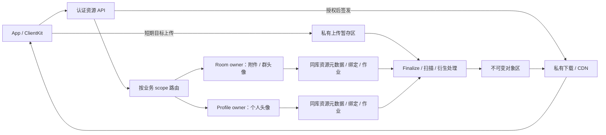

# 统一资源系统设计草案

日期：2026-09-26。状态：调研与建议，未实施，不替代当前合同或发布证据。

范围：聊天图片、动图、视频、语音、文件，个人头像、群头像，以及缩略图、预览图、封面和转码产物。本文基于仓库静态检查与官方资料检索；没有执行运行时缺陷复现或生产供应商验收。

## 1. 建议结论

在现有 media 系统上演进，统一资源模型、传输能力和生命周期。保留消息只携带不透明 ID、业务 owner 授权、PostgreSQL 原子提交、持久任务恢复等已有边界。

首期采用 **资源随业务 owner 存放元数据，字节存放私有对象存储**：聊天附件和群头像归 room owner，个人头像归 profile/control owner。`home_scope` 是逻辑身份 `room(roomID)` 或 `account(userID)`，owner 数据库只是其可解析的存放位置。上传前确定用途和目标；同一范围内按用途规则复用资源，跨范围显式导入。两个 room 即使同库仍是不同 home。统一 API 和领域模型，不要求所有资源集中在一个数据库。

先不引入独立资源微服务、全局内容去重或通用工作流引擎。对象供应商、扫描/转码 worker 可以独立部署；消息与引用的提交仍由现有业务 owner 完成。

## 2. 仓库现状与需要补齐的部分

当前系统与证据等级以[系统图](../current-system-map.md)、[implementation status](../../IMV2/docs/implementation-status.md)为准。媒体的已接受基线见 [ADR-002](../../IMV2/docs/05-domain/ADR-002-social-media-mention-policy.md)，下载边界见[媒体授权合同](../reviews/legacy-media-authorization-contract.md)。

| 主题 | 已存在 | 本次设计要补齐 |
| --- | --- | --- |
| 资源身份 | `MediaID` 与对象 URL 分离；消息只存 ID | 元数据、用途、原件和衍生资源的完整模型 |
| 上传 | 设备绑定的幂等意图、临时目标、complete、扫描轮询 | 会话恢复、目标续签、服务端对象核验、分片和取消 |
| 消息提交 | 同 owner 数据库内锁媒体、检查 available、写消息及引用 | 普通上传按目标 owner 路由；群头像等其他绑定 |
| 下载 | 设备/消息/头像授权；消息定位与 owner epoch 复核 | variant 授权、批量元数据、缓存复用、Range/CDN |
| 生命周期 | scan/retention/purge outbox、转发 hold、失败重试 | 所有绑定类型、全部 owner 的作业覆盖、生产删除语义 |
| 客户端 | 文件 staging、前台上传下载、账号隔离、原子发布、本地缩略图 | durable transfer journal、草稿依赖、进度、恢复、共享头像管线 |
| 基础设施 | 本地文件 provider 和 EICAR 测试夹具 | 生产对象存储、真实扫描、受限转码、CDN 与故障验收 |

以下是代码级发现，尚未作为运行时复现结论：

1. **头像保留遗漏。** [Profile 更新](../../IMV2Server/Sources/IMV2Server/PostgresV2ProfileUpdateStore.swift)写入 `avatar_media_id`，而 [retention](../../IMV2Server/Sources/IMV2Server/PostgresV2MediaRetentionStore.swift)的候选判断保护消息引用和转发工作，没有保护头像引用。完整资源系统应使所有业务引用对 GC 可见。
2. **上传意图幂等不足以恢复传输。** [上传 grant](../../IMV2Server/Sources/IMV2Server/PostgresV2MediaUploadSessionStore.swift)成功兑换后进入 consumed，再次 claim 不接受 consumed。签发成功但响应丢失需要能为同一上传会话获得新目标。
3. **完成通知不等于对象验证。** [当前 complete](../../IMV2Server/Sources/IMV2Server/PostgresV2MediaStore.swift)根据 grant 和数据库状态进入 scanning；生产还需要核验存储里的精确对象版本、大小和摘要。
4. **普通上传与多 owner 存在拓扑缺口。** [Account 装配](../../IMV2Server/Sources/IMV2AccountServerApp/main.swift)将上传 metadata 写入 control/default database；[消息接受](../../IMV2Server/Sources/IMV2Server/PostgresV2RoomWriteMediaAcceptance.swift)检查 room owner 本地 `media_objects`。已查路径没有普通上传到异库房间的导入协议；已有跨库导入属于转发流程。
5. **临时寿命与资源寿命混用。** `expires_at` 既用于临时资源又参与再次引用检查；已有消息的下载与保留另有条件。应拆成上传到期、未绑定清理期限、绑定保留期限。
6. **客户端任务尚不持久。** [附件服务](../../IMApp/IMApp/V2/V2ConversationAttachmentService.swift)重试生成新 ID，重启会清理没有持久记录的 staging；[传输器](../../IMV2ClientKit/Sources/IMV2ClientKit/V2MediaTransfer.swift)明确只支持前台。现有消息 outbox 不覆盖上传之前的任务。
7. **缓存没有形成完整命中路径。** [下载服务](../../IMApp/IMApp/V2/V2ConversationMediaDownloadService.swift)重新授权后仍下载文件；[展示模型](../../IMV2Core/Sources/IMV2Core/MediaReference.swift)只有类别、MIME 和大小，缺尺寸、时长、内容摘要和 variants。

## 3. 四个核心概念

| 概念 | 回答的问题 | 建议字段/约束 |
| --- | --- | --- |
| Resource | 这是什么业务资源？ | `resource_id`、`home_scope`、creator、purpose、state、descriptor revision、retention policy；可继续使用现有 `MediaID` 命名 |
| Blob | 精确存储了哪一份字节？ | `blob_id`、provider、bucket、key、provider version、size、checksum algorithm/value/type、detected MIME；发布后不可变 |
| Variant | 原件的哪个处理产物？ | resource ID、source blob/version、recipe ID/version、kind、output blob ID、尺寸/时长、独立 processing state |
| Binding | 哪条业务事实正在使用资源？ | resource ID、message/profile/group identity、业务 revision、slot/ordinal、created/revoked time；由对应业务事务写入 |

关系为：一个 Resource 有一个原件及多个 Variant；每个产物指向不可变 Blob；一个 Resource 可以在同一 home 内具有多个 Binding。

数据库可以沿用 `media_objects` 并新增 blob、variant、upload session/parts 与 profile/group binding 表。已有 `message_media_references` 保留并补齐版本语义。领域上统一 Binding，不强迫所有业务共用一个无法建立有效外键的 `(type, id)` 多态表。

`ResourceDescriptor` 持久展示受控的文件名、真实 MIME、大小、宽高、时长、可用变体和 descriptor revision。文件名是经长度、字符和路径清理后的展示数据；不能用作对象 key。高频传输进度和签名 URL 不进入消息同步载荷。元数据、文件名和缩略图本身也需要授权。

消息保存接受时的稳定展示资料；后续异步产生的 variants 通过带授权的 descriptor/manifest 查询获取。处理完成提示可以丢失，重新打开页面或恢复任务时查询持久状态补齐。头像身份替换走现有资料/群状态同步，不依赖临时处理通知。

## 4. 分片、提交与跨范围使用



上传请求携带 `usage = messageAttachment(roomID) / userAvatar / groupAvatar(roomID)`。服务器从认证会话取得用户和设备，解析权威 owner；客户端不能指定数据库或越过 scope 授权。开始上传时做准入，实际发送或设置头像时再次按当前权限判断。

普通附件发送保持一次 owner SQL 事务：按固定顺序锁资源及必要业务状态 → 重新检查 ready、scope、用途、权限和 generation → 写消息及引用 → 写可靠事件/outbox → commit 后 ACK。头像替换同样参与资源锁及复核协议，在更新 profile/group 的事务内建立新绑定、解除旧绑定；客户端不额外调用 retain。绑定与 GC 使用同一互斥规则，仅仅各自处于一个事务内并不足够。

跨 room、头像转附件等跨范围复用走显式 import：源 owner 授权精确来源及版本并建立 hold，目标 owner 建立幂等导入记录，复制/验证字节并完成处理后，再接受目标业务提交。复用现有 forward export/inbox/receipt 的恢复机制。

**首期跨 home 使用独立对象 key/对象副本，避免多个 owner 各自决定同一 Blob 的删除。** 同一 home 可以多个绑定共享同一资源。先不做跨用户 hash 秒传、跨 owner 物理去重；内容 hash 不是下载或复制权限。

若未来引入全局 Blob 池，必须另行设计唯一 GC 权威与持久 retain/release 协议。reservation 超时、网络不可达或引用投影缺失，都不能证明目标没有提交；需要目标持久化封闭该 operation、禁止晚提交并返回终态回执。分区时宁可延迟回收。

房间执行 Host 的租约切换与数据库 owner 迁移应区分：Host 切换延续当前 activation fence；未来若移动数据库归属，资源 metadata、bindings、未完成 sessions/imports/jobs 要一起迁移并冻结旧 owner。对对象存储的删除还需唯一授权执行器或等价的 I/O 排空/凭据栅栏；仅在旧进程调用 DELETE 前读一次 epoch，不能阻止迟到删除。首期沿用部署前静态分片，不新增在线迁移目标。

## 5. 上传和处理流程

建议分开三类状态，而不是用一个巨大的枚举表达所有组合：

| 对象 | 状态主线 |
| --- | --- |
| UploadSession | created → uploading → finalizing → completed；另有 cancelled / expired / terminal failure |
| Resource | pending → verifying → scanning → processing（有必需产物时）→ ready；另有 rejected / deletion_pending / deleted |
| VariantJob | queued → processing → ready；另有 retry_scheduled / failed / cancelled |

完整过程：

1. 客户端把文件复制到账号隔离的 staging，记录稳定的 operation ID、resource ID、文件 token、预期大小和摘要、usage、关联草稿。
2. 认证 API 在目标 owner 建立上传 session 和额度预留。相同 operation ID + 相同指纹返回同一 session；不同参数返回冲突。
3. 为同一 session 签发可续签的短期上传 capability。首次 session 结果、短期 URL 与 multipart upload ID 分离；目标过期不创建新资源。
4. 字节直接上传私有暂存区。小文件单次上传，大文件/弱网使用 multipart；具体阈值、part 大小和并发通过实际供应商及真机测量确定。
5. `complete` 只触发幂等 finalize。服务端核对对象存在、实际大小、校验摘要和精确版本；multipart 由服务端核验 parts 并确认最终对象，不能直接信任客户端宣称的成功。
6. 固定不可变内容身份后扫描。推荐使用上传者无写权限的最终 key；若暂存 key 可覆盖，必须通过 version ID 或等价的条件读取/复制精确固定源字节，不能先 HEAD 后无条件复制。扫描结果绑定最终 blob/version/hash。
7. MIME 嗅探、结构探测和安全扫描通过，且该用途的全部必需产物就绪后，才能发布 ready。用户完成通知、供应商回调、扫描回调均不能绕过当前状态、generation 与 claim token。
8. 必需处理完成后即可业务绑定；非必需转码异步推进。客户端扫描等待超时表示“仍在处理”，通过原 session 查询恢复，不重新上传。

AWS 官方资料说明，预签名 URL 在有效期内可重复使用，上传同 key 可能覆盖；这直接要求上述不可变发布边界。[S3 预签名 URL](https://docs.aws.amazon.com/AmazonS3/latest/userguide/using-presigned-url.html) 和 [条件写入](https://docs.aws.amazon.com/AmazonS3/latest/userguide/conditional-writes.html)。

multipart 必须保存 provider upload ID、part 编号/结果、摘要算法及计算方式，提供 status、refresh、complete、abort。未完成分片不会自动按应用 session TTL 消失，需要显式 abort 和供应商 lifecycle 兜底。ETag 不能普遍当作文件 MD5；全文 hash 与 multipart composite checksum 必须区分。[S3 multipart](https://docs.aws.amazon.com/AmazonS3/latest/userguide/mpuoverview.html)、[对象完整性](https://docs.aws.amazon.com/AmazonS3/latest/userguide/checking-object-integrity.html)。

摘要必须来自供应商验证过的 checksum 或服务端实际计算，不能信任用户自定义 metadata 中的 hash。选定 provider 后，对条件写入、精确版本读取/复制、checksum、Range、分片完成/取消逐项做合同测试，不能只凭“S3 compatible”认定等价。上传字节限制应在供应商策略或受控入口实际生效；finalize 后才发现超限不能防止暂存占用，应配合并发/暂存额度和兜底清理。

## 6. 衍生资源与处理边界

| 类型 | 首期建议 | 后续扩展 |
| --- | --- | --- |
| 个人/群头像 | 服务器安全解码、方向规范化、去除 EXIF/GPS、生成固定档位静态图 | 动态头像另订用途限制 |
| 聊天图片 | 原件、列表缩略图、预览图；记录宽高 | 按网络策略获取高质量原图 |
| 动图 | 静态首帧、保留原件 | 受限动画预览 |
| 视频 | 原件、时长/尺寸、封面 | 兼容播放版本、自适应码率流 |
| 语音/音频 | 原件、时长、受控波形数据 | 规范编码版本 |
| 文件 | 安全展示名、真实类型、大小、下载 | 文档预览按需求增加 |

头像的安全展示产物是 ready 的必要条件；原始头像不默认向其他用户提供。普通文件的可选缩略图失败不影响已安全通过的原件下载。新头像使用新 Resource ID；新处理配方生成新 Variant/version，不原地覆盖旧对象。

处理任务使用有界的固定 recipe，唯一键建议为 `(resource_id, source_version, recipe_id, recipe_version)`。限制像素、帧数、时长、解压后字节、CPU/内存/临时磁盘和执行时间；不对任意用户尺寸请求即时创建无界产物。解码器/转码器运行在隔离进程或容器，避免阻塞 SwiftNIO event loop。OWASP 建议同时使用类型校验、大小限制、隔离存储和恶意文件检查，单靠扩展名或 Content-Type 不足。[文件上传指南](https://cheatsheetseries.owasp.org/cheatsheets/File_Upload_Cheat_Sheet.html)。

## 7. 访问授权、下载和缓存

所有访问带明确上下文：消息使用 `(roomID, messageID, contentRevision, resourceID, variant)`；头像使用 `(profileID/groupID, avatarRevision, resourceID, variant)`。请求者不能凭知道 ID 获得字节；服务端校验当前可见性、有效绑定和对应版本。不同上下文分别判断，同一对象的某条消息不可见不自动否定另一条合法引用。

缩略图、封面、波形和 metadata 继承对应绑定的权限。不能给头像或 thumbnail 默认开放公共 bucket。Matrix 的受认证媒体/thumbnail API 可作为“ID 与访问目标分离、衍生资源也认证”的参考，但其授权要求不能代替本项目更严格的 room/message 可见性规则。[Matrix 媒体 API](https://spec.matrix.org/latest/client-server-api/#get_matrixclientv1mediathumbnailservernamemediaid)。

沿用申请 grant → 兑换 → 返回目标前复核的流程，并将 blob/variant/version 固定在授权结果中。Provider 网络 I/O 不持有数据库事务；返回前检查设备、owner 和授权观察点。grant 单次消费不意味着存储 URL 单次使用，后者仍是持有者可用的临时凭证。

撤回/移除后拒绝新签发；旧 URL 的剩余有效期和已开始的传输仍可能继续。若产品需要每个后续 HTTP 请求都撤权感知，需要认证下载网关或边缘授权检查，不能仅缩短 URL TTL；已交付到设备的字节也无法据此远程收回。范围下载重试需要重新授权并固定同一 blob/version。[S3 URL 到期行为](https://docs.aws.amazon.com/AmazonS3/latest/userguide/using-presigned-url.html)。

CDN 接入时关闭公开源站，要求 CDN 对每次访问（含 cache hit）验证短期 capability，再按不可变对象/变体版本复用缓存；签名 API 响应使用 no-store，不把 access token 放入 URL，也不把账号 bearer 转发给对象域名。源站访问控制与用户访问控制是两层配置。[CloudFront 私有内容](https://docs.aws.amazon.com/AmazonCloudFront/latest/DeveloperGuide/private-content-overview.html)。

客户端缓存分成两部分：

- **字节缓存**：账号 + resource/variant/version + checksum；验证大小和摘要后从 partial 原子发布，按 LRU/总字节/磁盘压力清理。
- **访问状态**：业务上下文、当前 revision、已观察撤销状态；缓存命中不能自动授予新的上下文权限。在线授权成功后，命中同一 verified blob 就复用文件，不再下载原件。

建议离线仅展示此前合法取得且尚未观察到失效的内容；收到撤回、成员变化、账号退出、头像替换时，由账号级管线更新访问状态及相关缓存，而不是仅由打开的详情页清理。离线保留期属于产品策略，不能宣称离线端已即时接收撤销。一个 binding 失效时，检查其他有效 binding 后再决定是否删除共享的本地文件。

## 8. 删除、配额和运维

继续采用“先逻辑不可访问，再异步物理清理”。删除候选必须满足：无有效业务绑定、无未终态导入/处理 hold、到达保留期限，并完成与新绑定的原子互斥。锁资源行并复查后设置 deletion_pending，与 purge outbox 同事务提交；此后拒绝新绑定。Provider DELETE 在事务外执行，完成回执带 resource generation 和 job claim token。

保留语义拆分：上传 session 的到期只关闭上传能力；未绑定资源沿用 ADR-002 的 24 小时基线；撤回引用沿用 30 天基线；有效消息/头像绑定保护资源不被临时上传 TTL 回收。头像替换后旧资源的宽限期另设策略，不能把“撤回 30 天”未经决策套用于所有用途。多条引用存在时，某一引用撤回不删除其余引用仍在使用的对象。

purge 覆盖原件、全部 variants、暂存对象、multipart 残片及需要删除的非当前版本。保留 tombstone 防止迟到上传/worker 复活；取消后的旧上传 URL 仍可能产生暂存字节，因此暂存区需要独立兜底清理。启用 bucket versioning 时，delete marker 不等于所有版本的物理清除。对象 lifecycle 只用于暂存/碎片兜底，不能按对象年龄绕过有效业务引用。

tombstone 只能阻止逻辑状态复活，不能阻止失去租约的 worker 迟到写入对象。每次生成/复制在 I/O 前持久登记输出对象身份，按 attempt/generation 隔离 key，发布结果时再做条件提交。复制成功但元数据提交前崩溃、或旧 worker 晚到的未发布对象，由持久清理记录和对象核对机制回收；清理需覆盖迟到写入，不能把第一次 DELETE 成功当作永远没有残留。

配额至少覆盖每文件大小、账号上传速率、并行会话数、暂存总量、已存总量、衍生处理开销和下载流量。owner 内的额度预留/确认/释放幂等。跨 room 的账号总量不能通过异步相加伪装成严格上限：若要求硬上限，需要 control 配额预留账本及持久结算/释放回执，或有界下发预算；未确定的上传不能仅凭 TTL 释放额度。先明确硬限制与监控软限制。

继续复用 PostgreSQL 有界领取、租约、退避、暂停与 operator replay；扫描、转换和 purge 都必须覆盖全部配置的 owner。通知只用于唤醒，丢通知后由持久作业恢复。扫描/转码每类独立设置并发和资源预算。

监控上传成功率/恢复率、finalize 延迟、ready 延迟、队列年龄、失败分类、未绑定字节、待删积压、孤儿对象、CDN 命中与流量；标签使用低基数，不记录 URL、token、文件名或内容。支持受认证的资源状态查询、作业重试与审计。数据库恢复与对象存储恢复要做联合演练，避免恢复出的绑定引用已被物理清理的版本。

## 9. 客户端模块与协议

保持现有 package 分工：

| 模块 | 资源职责 |
| --- | --- |
| IMV2Core | ID、用途上下文、descriptor、variant、状态和错误语义，不含本地路径或 URLSession |
| IMV2ClientKit | 传输任务 journal、调度 actor、授权与缓存 repository、重试/限流/进度、消息 outbox 依赖 |
| IMApp | Photos/文件/相机/录音导入、文件保护与平台生命周期适配、统一 Avatar/Media/File 展示 |
| IMV2Server | scope 路由、资源用例、owner 内 SQL、授权、provider adapter、后台作业 |

客户端新增持久 `TransferJob` 和 `SendIntent`：

```text
SendIntent(draftID, messageOperationID, attachmentJobIDs)
TransferJob(account, installation, jobID, operationID, resourceID,
            usage, localFileToken, checksum, stage, sessionID,
            partResults, retryAt, attempts, lastError)
```

`SendIntent` 创建后，即使 App 退出，恢复时也能查询同一 session、补 finalize、继续处理等待。所有必需资源 ready 后，用稳定 message operation ID 写入现有消息 outbox；ACK 丢失沿用现有幂等恢复。将 send intent 标为已交接和 outbox 插入尽量放在同一个本地事务，重复执行也不产生第二条消息。草稿取消先持久化取消状态，再关闭任务并释放 staging。

签名 URL 不进业务数据库或日志。关闭账号/设备撤销时取消该账号的任务，阻止迟到回调写入新账号；staging 不得被普通下载缓存淘汰。对 protected data unavailable、磁盘满、文件丢失、资源拒绝分别提供可理解状态。

建议的 API 能力（名称示意，正式接入需版本化 DTO/Core/protobuf/SQL）：

| 能力 | 核心要求 |
| --- | --- |
| capabilities | 按用途返回类型/大小/处理档位/传输方式；服务端始终再次校验 |
| create upload | usage + stable operation ID + metadata fingerprint → 同一 session |
| query / refresh upload | 查询服务端确认进度、可续签目标、有限分页的 parts |
| complete / cancel | 幂等状态推进、明确冲突与终态；不允许旧 generation 复活 |
| describe resources | 带上下文、有界批量的 metadata/variant readiness |
| authorize access | context + resource + variant/version → 临时目标或缓存复用所需授权结果 |
| import resource | 精确来源与目标、持久操作状态和恢复回执 |

业务绑定通过 send/updateProfile/updateGroup 等现有业务命令完成，不开放允许客户端任意 retain/release 的通用绑定接口。错误至少区分 processing、retryable、expired、cancelled、rejected、quotaExceeded、notAvailable 与 operationConflict，避免所有状态都显示为上传失败。

先实现**前台可恢复**，再做后台传输。Apple 的 background URLSession 支持进程外传输和会话恢复，上传要求基于文件；它会带来系统管理请求持久化与自动重定向行为，不能只替换 session configuration。[Apple 后台传输](https://developer.apple.com/documentation/foundation/downloading-files-in-the-background?changes=___9&language=objc)。

当前客户端刻意采用不落盘的临时目标、拒绝重定向和 Complete 文件保护。启用后台前应明确：系统管理请求保存是否作为有限例外、锁屏时文件可用性、短期目标在排队后失效的恢复、系统终止/用户强制退出后行为、账号退出与迟到回调。首期继续遵守现有边界。

## 10. 实施顺序与验收

| 阶段 | 交付 | 验收重点 |
| --- | --- | --- |
| P0：确定合同 | 资源/绑定/home 模型；修头像保留；普通上传 owner 路由；稳定 session/operation | 两个真实 owner DB 的上传发送；头像超过暂存期限仍可用；更换头像解绑正确；GC 与绑定竞争 |
| P1：完整基础链路 | 一个生产 provider；immutable finalize；真实扫描；前台持久恢复；所有 owner 清理 | 上传目标/complete 响应丢失、重启、扫描慢、取消、重复提交、扫描后覆盖；跨 home 导入复制后崩溃/回执丢失；孤儿回收和所有 owner 作业覆盖 |
| P2：统一资源体验 | descriptor/variants；头像和群头像；缩略图/封面；授权缓存；进度和重试 UI | 同图多绑定、撤回一处不破坏另一处、跨账号隔离、variant 失败降级、缓存命中无重复字节传输 |
| P3：规模与后台 | multipart/abort、严格配额、后台传输、私有 CDN/Range、存储恢复与负载验收 | 弱网/锁屏/重启、分片恢复、quota 竞争、撤权窗口、CDN 绕源、带资源处理和清理的多 owner 负载 |

每阶段都应有可运行的纵向链路，避免先搭通用平台再接业务。生产发布需覆盖实际启用的供应商、设备、Linux 和分片组合；本地 provider 通过测试不代表这些组合已验收。

项目当前未上线，服务端采用当前协议和全新 canonical schema。实现时同步调整 protobuf/version、Core、SQL/bootstrap/readiness、ClientKit 本地迁移和既有合同；不额外引入仓库明确不支持的历史服务端迁移方案。

容量数值需在选择部署区域、供应商、典型文件分布和日活/峰值后测量。预算至少分别估算 `每日上传字节 × 有效保留天数 × 衍生放大系数`、下载出口、CDN 回源和扫描/转码 CPU。本文不把现有 50 MiB 本机附件限制或任意新阈值当作生产容量承诺。

尚需产品/部署决策的是供应商与区域、用途配额、原图/离线缓存保留、头像旧版本宽限期和视频处理档位。这些不妨碍先落实上述身份、事务、不可变存储及恢复边界。
