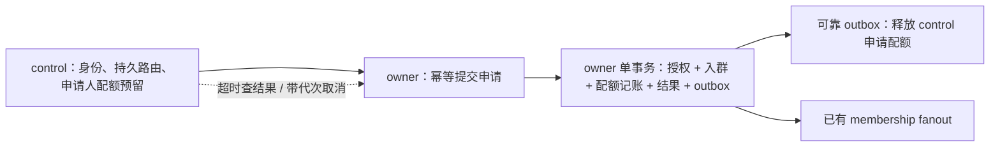

# IM V2 系统修复方案：设计、性能与验收

编制与资料核验日期：2026-09-05。依据：[完整问题表](2026-09-05-system-design-implementation-audit.md)，基准 HEAD `220f5be78ed347bbe8a343be634720070efbb597` 加审查时的工作区改动。沿用 B01–B29、D01–D08、E01–E10，共 47 项，不把设计风险和外部发布缺口改称已发生的故障。

**建议保留现有 Swift 分层、PostgreSQL 提交后 ACK、持久化 outbox/cursor、room-log 以及 Snapshot 切换机制，集中修复事件合同、授权、调度和生命周期。** 没有证据要求更换数据库、消息框架或重写 App。

本文是修复设计，尚未实施或压测。外部资料支持的是平台语义和设计原则；针对本仓库的结构、取舍、候选参数与验收要求是本次分析提出的方案，不是官方对该系统的认证。已有 391 项单元测试通过的证据来自前次审查，本次不重复计作新验证。

项目[当前政策](../../IMV2/docs/implementation-status.md)明确尚未上线，不兼容旧 wire、SQLite 或 PostgreSQL volume。因此目标采用一套新的当前合同与干净 schema；只有明确需要保留的压测数据才做受控迁移、排空和对账，不默认增加长期双写、双协议与旧状态兼容层。

**实施包与依赖**

| 包 | 范围 | 主要交付 | 依赖与优先级 |
| --- | --- | --- | --- |
| W1 | B01/B02/B04/B11/D07 | 强类型数值边界、共享授权、不可变幂等输入 | 先做；授权在事件受众方案前确定 |
| W2 | B03/B06 | 消息级 delivery authority、统一 reducer、房间恢复目录与快照合同 | 依赖 W1；服务端、Core、协议、ClientKit 一起验收 |
| W3 | B07/B12/B13/B14/B17/D01 | runtime 调度所有权、单飞、连接代次与取消关联 | 可与 W1 并行；W2 恢复活性依赖此包 |
| W4 | B05/B08/B09/B16/D02/D03 | 密码输入和哈希、认证终止、Push 最终意图与后台预算 | 可并行；App 与 account service 需组合验证 |
| W5 | B10/B23–B27/D05/D06 | 邀请 ready 状态、owner 原子审批、全局配额及稳定分页 | B10 立即修；其余先确认下面的事务合同 |
| W6 | B15/B18–B22/B28/D04 | 存储生命周期、目标窗口、分页保留、索引通知及隐私/无障碍 | 与主链路并行；清理接 W4 的退出状态机 |
| W7 | B29/D08/E08 | 单一合同来源、真实存储组合回归、干净 checkout 证据 | 从第一包开始维护；每包结束更新证据 |
| W8 | E01–E07/E09/E10 | 预发布部署、真实设备/供应商、灾备和容量证据 | 配置设计可提前；最终演练用修复后的同一制品 |

**服务端授权、幂等和事务边界（W1）**

| ID | 推荐方案 | 设计/性能代价 | 必须通过的验收 |
| --- | --- | --- | --- |
| B01 | **资料版本、HTTP 可选值、有符号 SQL 绑定及个人投影尾序号已补[当前整数边界](profile-and-projection-integer-boundaries.md)，另补媒体/消息/设备响应及 APNs 的[时间戳精确转换](timestamp-integer-boundaries.md)，以及[客户端禁言/心跳/会话命令与 SQLite 日期重建](client-timestamp-integer-boundaries.md)；[账号限流策略、SQL 计数与日期绑定](account-rate-limit-integer-boundaries.md)也已补齐本批边界；其他计数仍待完整审计。** Core 使用 MessageRevision、MembershipRevision、RoomCursor 等值类型；按各自语义允许 0 或从 1 开始，上界均受持久化 Int64 限制。DTO 构造拒绝越界，SQL binding 用 `Int64(exactly:)`，数据库负值报损坏，递增 checked addition。 | 无新增 SQL，常数级检查；不能 clamping/truncate，也不能只检查新操作而漏 replay。 | 0/1/Int64.max/max+1/UInt64.max 覆盖新操作、重放、恢复和 DTO；异常输入变领域错误，不 trap。 |
| B02 | **已完成当前[授权与提交顺序验收](edit-policy-commit-ordering.md)，24 个真实并发场景及相关回归通过。** edit 使用共享 RoomActionPolicy，检查当前成员、冻结、sendMessages、mute 及作者/版本；所有修改相关策略的入口共享 room 锁或同一版本 fence。withdraw/redaction 等清理动作另列规则，不能全部机械要求发言权。 | 复用已锁 room/message 和批量授权快照，避免一属性一查询。优化批量/credit 路径也必须满足相同 fence，不改成逐条串行通用 service。 | 被移除/禁言/冻结/撤权后编辑失败；权限变更与编辑并发符合确定提交顺序；同操作合法重放只回原元数据，不重新编辑。 |
| B04 | 源读取和最终接受均校验原 accepted 受众、当前读取资格、精确源版本、未撤回状态及媒体引用。相同 owner 在事务开始按 roomID/messageID 固定顺序取得完整源/目标锁，避免 destination-first 反向死锁；限制单次源数量。跨 owner 使用下述持久授权复制合同。 | 增加历史成员索引查询；同 owner 多 room 锁须测竞争，不能持锁 RPC。跨 owner 引入 export/inbox 成本，只在 forward 路径，不加到普通 send。 | 新成员不能转发入群前内容；离开再加入按两个历史区间正确判断；源撤回/权限变化、ACK 丢失、两个方向互转、媒体导入失败和跨 owner 重试通过。 |
| B11 | acceptance 同事务保存版本化请求 digest 与原 ACK 结果，覆盖所有业务字段；重放按稳定 operation 键查原输入，不能读当前正文做比较。内容删除后仍保留无正文完成记录或安全的过期 epoch fence。 | SHA-256 在事务外 O(payload bytes)，每消息固定 32 字节+版本字段，不给 digest 加无用索引；减少重读原内容版本，实测新增 WAL/CPU。 | 原发送 ACK 丢失、随后编辑/撤回，再重试仍回原结果；同 ID 任一业务字段变化都冲突；重放不泄露已清除正文。 |
| D07 | 提取四个内部边界：ValidatedCommand/指纹、RoomAuthorizationSnapshot+纯策略、MutationPlan/受众/admission、事务内持久化与 reducer 合同。PostgreSQL/SQLite 各有 adapter，共享向量和不变量。 | 保留 set-based SQL、微批、预借 credits 和 owner 分片；避免全局 actor/通用 Repository 使热路径串行化。文件行数下降不是验收指标。 | planner/preplanned/room-log/hybrid 和快慢路径授权、幂等与额度合同一致；检查所有 role/mute/frozen/policy 更新入口，而不只测 edit。 |

精确整数转换和 trapping/clamping 转换语义不同，应使用可失败转换承接不可信边界。[Swift 整数实现](https://github.com/swiftlang/swift/blob/main/stdlib/public/core/Integers.swift) 每次访问都要完整验证权限，而非信任不受撤权约束的缓存；这是 complete mediation 原则在此系统的应用。[Saltzer/Schroeder 原论文](https://www.mit.edu/~Saltzer/publications/protection/Basic.html)

指纹编码要固定字段顺序、长度前缀、nil/empty、集合和有序数组语义，包括 room、actor、clientMessageID、规范正文、entities 的位置单位、媒体顺序、mentions、reply/forward/source revision/attribution 和业务选项；不能直接哈希普通 JSON 字典或接受客户端自报 digest。ACK 保留 messageID/eventID/初始 sequence/时间/authority 等元数据，正文由正常授权读取接口提供。指纹、操作结果和业务效果在一次提交中落盘，记录随 room migration 移动，GC 覆盖客户端重试及备份恢复窗口。RIFL 原论文支持“结果与效果原子保存、重试可定位记录、回收不能破坏重放安全”这组约束；此处不引入其具体运行时。[RIFL](https://web.stanford.edu/~ouster/cgi-bin/papers/rifl.pdf)

多 owner 下，本地 `(actor,clientMessageID)` 唯一键不等于全局唯一。建议新合同明确 `(roomID,actorID,clientMessageID)` 的幂等范围，同 room 重试由持久 placement 路由且保留完成记录；如果业务坚持跨 room 的 actor 全局唯一，则需额外全局绑定机制，不能靠两个本地索引证明。默认不为热 send 新增 control RPC。

跨 owner forward 在 source owner 事务内校验并持久化 immutable export intent，绑定 actor/source revision/target room/operation/内容与媒体 digest，由 outbox→target inbox 幂等导入；目标仍检查自己的授权和 admission。源权限的线性化点是 export commit，此后普通编辑/撤回不回收已授权的独立副本，需要在 ADR 明示。目标尚未接受时仍显示 pending，不能把 export 成功当消息发送成功。路由迁移携带 export/完成记录和 epoch，未完成媒体导入不能返回可见成功。若要求“直到目标提交前源撤权都必须生效”，两库需要更强协调及可用性代价，短 TTL 或再次查询不能提供此保证；完整支持前明确拒绝不支持的跨 owner 转发。当前 schema 12 已实现源端 export、目标 inbox/共享接受/提交后恢复、媒体保留与本地 epoch 检查，尚未接入投递装配；继续完成实际文件校验/导入、源端终态回执及 pin 释放，不把单独 export commit 视作发送成功。

**消息事件、投影与快照恢复合同（W2）**

| ID | 推荐方案 | 设计/性能代价 | 必须通过的验收 |
| --- | --- | --- | --- |
| B03 | **普通编辑/作者撤回/reaction 已接通接受记录分发归属，见[当前边界](message-mutation-delivery-authority-contract.md)，新 personal 变更的 fanout 已接通[受众交集与预留结算](message-mutation-audience-contract.md)；reaction actor 与普通变更 room pull 已补齐[历史读取及扫描游标](message-mutation-read-contract.md)，新编辑已接通[完整替换和 accepted 晚到保护](message-edit-replacement-contract.md)，普通撤回与快照重放已接通[终态处理](message-terminal-projection-contract.md)，回复/置顶和共用内容读取已补[历史引用授权](message-reference-visibility-contract.md)，旧媒体入口已补[历史授权和兑换完成栅栏](legacy-media-authorization-contract.md)，其他入口、恢复与撤销合同仍待实现。** 每条消息在 accepted 时持久化 `deliveryAuthority: personalLog/roomLog`、accepted eventID/membership revision/room sequence；所有 mutation 跟随该事实，而非当前部署 flag 或 accepted 的物理存储位置。群 mutation 的受众与原 accepted 授权相交；通知/撤销另有明确对象合同。 | schema、wire、writer/planner、服务端投影、Snapshot 和 ClientKit 协同修改；保留 direct room-log accepted 零逐用户正文 fanout。代价是固定元数据及完整恢复目录，而非每条消息扩大 fanout。 | 服务端 checkpoint 与客户端 cursor 在所有合法顺序下收敛；新成员不获旧全文；普通消息/mention/撤回/快照各自可恢复，不能仅看 Gateway ACK。 |
| B06 | 所有持久 feed 用同一 reducer；effect 身份为 accountScope+sourceEventID+projectionKind+entityKey，配 canonical digest。重复同事实 no-op 但消费本次流 cursor；同身份异内容报冲突。分别记录 message revision、reaction add/remove、pin/其他对象版本和 tombstone。 | effect claim、cursor、投影、副作用 job 同本地事务；复用已有字段，缺失处再加，不无界保存第二套全文。ledger GC 与所有重放窗口/代次 fence 一致。 | preview/sync 正反序和重复不重复 unread/FTS job；未来 delta 缺口按合同修复，授权完整 replacement 可跨版本；remove 后晚到 add 不复活，撤销后 accepted/edit/旧 snapshot 不复活。 |

推荐的流矩阵如下；planner/preplanned 只是执行策略，不产生另一套 reducer 语义。

| 消息种类 | 正文与 edit/withdraw/reaction 等恢复来源 | 通知及控制 |
| --- | --- | --- |
| direct planner / preplanned | personalLog，稳定 canonical source event 身份 | 用户会话/已读等沿用独立对象合同 |
| direct room_log | roomLog，accepted 与后续 mutation 同一完整有序恢复路径 | room directory 是小型元数据；普通 accepted 不复制到个人消息投影 |
| standard group | personalLog；普通 mutation 受众是 accepted 可见者与 mutation 提交时成员的交集 | membership/control 独立恢复；当前权限约束补齐与读取 |
| hybrid group | roomLog，读取/快照按历史受众过滤 | explicit mention 是 typed notification/reference，不能假装拥有正文 baseline；pin 返回具体消息时也检查原受众 |

authority 与 `accepted_storage` 必须分开：后者只表示 accepted 物理存 messages 或 room_events。房间默认改变仅影响未来消息；无明确需求时禁止动态切换，若确需混合则 room manifest/snapshot 必须逐消息识别 authority。reaction/pin/角色/公告不能全部挤进 message content revision，各自维护实体版本。 群管理源事件已补 source room sequence，权限幂等已按集合比较，schema 18 的显式策略标记已与回执 GC 解耦；消费顺序与历史兼容仍需按 [群管理效果合同](group-control-effect-contract.md) 完成。

群受众检查采用 `VisibleAtAccepted(user,message) ∩ MemberAtMutation(user,event)`；如果有原定向受众还要相交。离群再入群时两个条件可由不同 membership interval 满足，不能要求同一段区间覆盖两个时刻。过滤必须贯穿 fanout、room pull、foreground preview、按 ID 读取、reply/forward、pin、snapshot/repair 与媒体 grant；仅修改 edit 的 fanout WHERE 不足以闭环。

合法重新入群会产生 content revision 缺口：用户收 rev1 后离群，错过 rev2，重入后收到 rev3。目标把 edit 事件定义为带 accepted 身份、source eventID、完整当前可授权内容及 revision 的 typed replacement；通过该事件受众和完整性校验后，可从 rev1 安全安装 rev3，不补发无权 rev2。不能让客户端把任意 delta 或自报版本当 replacement。reaction/pin 等按各自对象版本合并；真正缺 accepted 身份、缺依赖或未定义 delta 才 repair。快照和按 ID 读取选择内容版本时也须遵守对应版本可见性，不只检查原 accepted 后直接泄露缺口期间内容。验收明确加入离群/重入和重置后的版本缺口场景。

尤其不能只过滤 fanout 目标而保留旧 target_count：当前 planner 要求实际枚举数与预期完全相等。推荐区分 reservation upper bound 与最终 exact target count：writer 按当前 eligible count 预留上界，planner 依据已固定的两个 revision 分页枚举交集，持久累计实际数；结束时 fenced transaction 设置 exact count 并一次释放差额，后续完成只回收真实剩余单位。零目标也需终结 plan slot，重放/lease 更替不得重复释放。小群可在事务内精确 COUNT 简化实现，但大群会增加持锁时长；目标让 writer 不按成员数扫描。新增索引先核对既有 `(room_id,user_id,joined_revision)` 和真实查询计划。[PostgreSQL 多列索引](https://www.postgresql.org/docs/16/indexes-multicolumn.html)

离群与追溯清理要区分。[当前 moderation ADR](../../IMV2/docs/05-domain/ADR-001-moderation-policy.md) 允许保留已授权本地历史，移除只阻止未来同步；不能为了恢复而要求离群者重新拉取无权房间，也不能悄悄把普通 withdrawal 改成全面追溯擦除。显式追溯 redaction 采用独立无正文 `contentRevocation`，由 owner outbox 向历史授权受众稀有 fanout，离群者也能接收；未见 baseline 仍可持久 tombstone，不创建幽灵消息。其 ledger 进入个人 snapshot，正文立即隐藏、引用立即失效，FTS/缓存随后可靠清理。代价是少量清理动作 O(历史受众)，不是普通 accepted 的写放大。媒体 grant 一并撤销，已签 URL 残余期限与已下载/导出副本遵守既有边界。

**Snapshot 不是跨所有 owner 的全局事务。** user snapshot 在自己的 U 包含 personalLog、用户/控制状态、通知、撤销 ledger 和分页 room directory/access manifest；各 room owner 在自己的 R 提供合法 baseline/snapshot，再接 R 后 tail。目录发现通过房间/成员生命周期可靠维护，不能靠每条消息逐用户写目录来变相恢复 fanout。房间目录可批量、有界读取，hint 丢失仍可遍历恢复。

当前 `preserveRoomLogProjection` 已保留部分 room 数据与 cursor，修复应扩展它，而不是声称现有 reset 一律清空。authority、实体版本、去重、未见 baseline 的撤销 ledger、repair 状态与对应 room cursor 配套保留或重建；未经验证不能只保留 cursor。fresh install 从合法保留起点回放，或安装 room 在 R 的完整状态后再推进 R，不能没有物化状态就直接跳 head。room snapshot 含截至 R 的内容、reaction 移除状态、pin 和撤销，并做历史受众过滤与 access epoch 校验；多用户可共享不可变内容块，但不能共享未经授权过滤的全群 manifest。

snapshot 分页采用现有版本化/retention fence 思路，不长持 PostgreSQL 事务等待手机下载。artifact 基线与 GC 协调，客户端按每流原子激活，通过依赖和单调撤销合并各流；不能宣称多个 owner 有同一全局 cut。权限变化使无效 artifact 重新授权或重建。过滤可产生合法 sequence 空洞，wire continuation 应表示 `scannedThroughRoomSequence` 或等价 opaque cursor，绑定 room/schema/access epoch；空可见页也可推进服务端已扫描边界，不能困在无权尾部。

deferred repair 仅用于合同允许的跨流依赖或受控旧积压；正常 authority 流缺 accepted 身份仍是需要修正的合同异常；合法跨版本按下面的 replacement 规则处理，不混同缺 baseline。若允许先消费，必须在同一事务保存原事件、修复任务与 cursor，区分 transportConsumed 与 materializedThrough；未完成依赖不能发布成完整 snapshot/全量同步完成。修复按 room/message 合并，限条数和字节数，有独立公平调度、退避及年龄告警；满额停止该范围推进，不丢已确认记录。notAuthorized/gone/retryable 有不同 typed 结果，授权不足不能补旧全文。把 cursor 和结果一起持久化是可靠重放原则；数据库外观相同不意味着跨两个 pool 原子提交。[Kafka 官方外部 sink 投递语义](https://kafka.apache.org/42/design/design/)

**客户端调度、取消和连接恢复（W3）**

Swift actor 在 await 处允许重入；“actor 内方法”不等于“整个网络操作单飞”。因此保留 actor 隔离，但在首次挂起前登记 flight，提交结果时再验代次。[Swift SE-0306](https://github.com/swiftlang/swift-evolution/blob/main/proposals/0306-actors.md#actor-reentrancy)

| ID | 推荐方案 | 性能/实现边界 | 必须通过的验收 |
| --- | --- | --- | --- |
| B07 | 账号 runtime 持有一个 scheduler worker 和下一到期 timer；启动/重连读 durable 摘要，enqueue、commit、到期和剩余 ready 工作唤醒同一循环。索引读取各 lane 最早 nextAttemptAt，不读全队列 payload 排序。 | 保留独立类型化 command 表；通知只表示“可能有工作”。登记休眠前后检查单调 wake epoch，防查完无工作到开始等之间丢唤醒。Date 持久化，进程内换算 ContinuousClock，前台恢复/时钟跳变重算。 | [双 lane 实际网络与重开恢复](durable-retry-network-contract.md)已通过，包含到期重试、空闲 enqueue、预算耗尽续跑与停止期间无调度/发包；跨有限批次公平性已修复。仍需真实 App scene 后台/挂起恢复验收。 |
| B12 | 将 `mayHaveRemainingWork` 拆成有限目录扫描 epoch/end marker 与已知有更多页的 room backlog；目录大于 12 时每个房间在本轮扫描只探测一次，每页 hasMore 才重排 backlog。 | 每轮每房间一页，持久 round-robin 公平调度；不能用无限 while 反复得到 hasUnscheduledRoom。不同 room 可有界并发，单 room pull 单飞。 | 13/1000 个空房间能停下；单房间多于 200 条能追完；热房间万条不能饿死冷房间一条；无新 hint 也收敛。 |
| B13 | 同一 engine 的所有 flush 入口共用 flight；enqueue 返回命令 ID，UI 订阅自己的结果。同一 canonical 结果的本地重复完成成功，异结果报不一致，不把 accepted 重排 pending。 | 当前单进程先用 actor 所有权；不额外引入持久 lease。将来 extension/多进程都可发送时，才需要 DB 原子 claim+lease。大量 pending 留数据库，不能一条建一个 Task。 | 20 次并发 flush 同 ID 同时只有一个发送者；取消一个 UI 等待不取消共享发送；成功后重入不报假失败。 |
| B14 | 已发送请求取消后立即结束调用方 continuation，但保留 `cancelledOnWire` 关联条目，匹配晚响应只丢弃并释放记录。未发送可立即释放。 | 已取消条目计入 transport 总上限；到硬期限仍无响应时受控关闭整代连接再释放，或未来加入显式取消 ACK。不能任意 TTL 删除 ID 后继续用旧连接，把正常晚包再当未知包。 | A 取消、A 晚包与 B 正常响应交错，B 不受误杀；continuation 恰好完成一次；未知未登记响应仍按协议处理。 |
| B17 | runtime 保存 desired room subscriptions 与 scene consumer token/refcount；每次认证成功的新连接 generation reconcile，然后 durable pull 弥补订阅间隙。 | 不为每房间建 timer；失败保留意图并退避。typing/presence 重连清旧 lease，再读当前状态，不能重放过期瞬态状态。 | 不离开页面也恢复实时更新；多 scene 不重复订阅；旧取消不撤销新代订阅，退群/关页面后集合收敛。 |
| D01 | reader 私有持有 connectionID/generation/decoder；receive、send failure、timeout、cancel 都携带代次，在触碰共享缓冲/状态前校验。`close(expectedGeneration:)` 只清本代。 | 常数级比较，避免跨代共享 decoder；先摘旧状态/推进代次再取消和 drain，防 actor 等待自己回调死锁。独立 waiter 还需 waiterID。 | **已验证**：[真实 Network.framework 回调及反向控制](network-generation-fencing.md)通过，旧 reader 失败不影响新连接；既有生命周期回归覆盖旧 send failure、请求 ID 复用、取消和硬截止。完整客户端回归 388 项实际执行通过，4 项在线测试跳过；TLS 证书/部署配置仍独立验收。 |

通知可合并为 `bufferingNewest(1)`，但真实命令与事件必须在数据库/远端日志；AsyncStream 缓冲满时会丢元素，不能承载唯一业务事实。[Swift SE-0314](https://github.com/swiftlang/swift-evolution/blob/main/proposals/0314-async-stream.md) Clock 注入便于确定性截止测试；普通 Task 不能保证 iOS 挂起时仍到点执行。[Swift SE-0329](https://github.com/swiftlang/swift-evolution/blob/main/proposals/0329-clock-instant-duration.md) 减少 timer、采用事件唤醒符合 Apple 能耗建议。[Apple 减少 timer](https://developer.apple.com/library/archive/documentation/Performance/Conceptual/EnergyGuide-iOS/MinimizeTimerUse.html)

初始只开每 engine 一个发送者、全局两个 command 执行位、两个 room pull 位，且共用 transport 实际上限；这些是待测起点，不要求扩容服务器现有队列。重试保留当前错误分类与 Retry-After 语义，不能把要求用户重新发送的业务拒绝偷偷变成自动重试。任务取消是协作机制，`NWConnection.cancel()` 也不等于撤销服务器已执行的命令；恢复仍复用原 operation ID。[Swift 取消语义](https://docs.swift.org/swift-book/documentation/the-swift-programming-language/concurrency/)、[Apple NWConnection.cancel](https://developer.apple.com/documentation/network/nwconnection/cancel())

**认证、Push 与 App 生命周期（W4）**

| ID | 推荐方案 | 设计/性能代价 | 必须通过的验收 |
| --- | --- | --- | --- |
| B05 | **当前输入/认证合同已验证，39 项测试通过，见[合同](password-hash-contract.md)。** 已拒绝 NUL 并切换固定上游参考 Argon2id v19，保留完整长密码；标准 PHC 存算法版本和参数，含随机盐的完整值用于认证结束的凭据版本比较，不 trim、截断或归一化。旧 bcrypt 保留受限，不自动重哈希或覆盖并发改密。 | Argon2id 固定单次 64 MiB，应用独立双线程池并发 2，无等待队列，满额返回可重试 503；取消不提前归还，停机排空。hash 不占 DB 事务/连接。生产 CPU/内存与多副本容量按 E09 校准。 | 71/72/73/1024 字节、跨界多字节字符、NUL、空白、官方向量、算法参数异常、并发改密和负载；新 hash 区分不同后缀，旧账号歧义有独立迁移证据。 |
| B08 | 用应用级认证状态机拥有退出 checkpoint：先持久化退出意图和 session epoch、停止旧任务，再执行有期限的服务端设备撤销及本地清理。服务端撤销事务同时失效 Push 资格。终止认证时凭据已不存在应完成本地退出；Keychain 暂不可访问单独等待解锁。当前已补[原子文件意图、错误传播与关闭后完成顺序](durable-sign-out-marker-contract.md)，并完成[服务端当前设备撤销及真实事务回滚验证](current-device-logout-contract.md)；服务端已完成[绝对会话期限与到期授权校验](device-session-absolute-expiry-contract.md)（schema 26）；新增[仅撤销凭据存储和兑换事务](device-revocation-capability-storage-contract.md)（schema 27），[HTTP 和独立 ClientKit 传输](device-revocation-capability-http-contract.md)已接通，[注册原子交付和凭据同项保存](atomic-revocation-credential-issue-contract.md)已完成（schema 28）；[独立持久退出交接](device-revocation-handoff-contract.md)已接入 AuthSession 和 App 组装；[独立执行器及本地退出](device-revocation-runner-contract.md)已完成前台接线和真实验证，[暂停反馈与恢复](device-revocation-status-contract.md)已完成，完整生命周期交互仍开放；[客户端注册身份隔离和真实再次登录](registration-lifecycle-contract.md)已通过，不代替完整多阶段 checkpoint/离线撤销。  已补[签发取消与活动旧凭据替换](credential-issuance-boundaries-contract.md)：请求前取消停止后续副作用，新登录在覆盖活动旧记录前先交接其撤销任务；迟到结果持久归属仍待完成。 | 本地只需小型持久状态；网络不可用不能无限阻塞登录 UI。离线补偿需旧 session 专用、仅可撤销且有效期覆盖该会话的 capability，不能用新账号凭据清理旧账号。 | 每个 await 前后终止/锁屏/杀进程；marker 在而 credential 不在仍可完成；A 退出后 B 登录，A 的迟到任务不能删除 B 数据或凭据。 |
| B09 | **B09 已验证。业务 HTTP 接入[会话代次与共享刷新](session-http-authorization.md)；[真实 App＋账号/PostgreSQL/HTTPS＋TLS Gateway](app-gateway-authentication-termination.md)验收复现并修复 EOF 丢失认证拒绝语义。两项 UI 验证远端撤销后回登录、前后台与冷启动，数据库及连接清理均通过。B08 退出/换号与外部部署仍开放。** refresh、restore、TLS 认证统一输出 `sessionInvalidated / protectedDataUnavailable / retryableNetwork / cancelled`；Router 观察认证状态，不只捕获一种 Coordinator error。refresh/restore 单飞，所有迟到结果用 session epoch 校验。 | 减少重复刷新和无效重连；状态快照跨 actor 传不可变值。 | refresh 返回 unauthenticated 后进入重新登录，不无限 reconnect；临时锁屏/断网不误判为账号被撤销。 |
| B16 | 分层实现和 App 接线进度见[Push 意图合同](push-intent-contract.md)与[App 合同](push-intent-app-contract.md)，真实网络及账号生命周期组合验收仍开放。保留现有 APNs token `endpoint_generation`；另增服务端授予的 session epoch 与持久单调 `intentRevision`。客户端先保存 desired，一个 reconciler 合并最终意图；服务端条件写拒绝低版本、同版本异内容冲突，同版本同内容幂等。disabled 保留版本墓碑。 | 每设备常数级状态和短事务；本地 single-flight 减少无效 PUT/DELETE，服务端版本保证跨请求/重启正确。UI generation 或 HTTP cancel 单独都不足够。 | PUT/DELETE 反序完成、重复/丢 ACK、重启、换号、token 轮换和旧 APNs 410；以服务端最终版本与开关状态断言。 |
| D02 | 当前实现见[共享启动合同](shared-app-restoration-contract.md)，已补[真实凭据的无根页面入口验证](headless-push-entry-contract.md)，系统无 scene/APNs 仍需验收。handler 在 App/delegate 共享 owner 初始化时注册，无需 View.onAppear；复用带期限的会话 restore。无 scene 后台启动也能根据真实凭据状态决策。 | 一个 restore 任务服务多个调用者；取消某个调用者不取消其他会话使用者。 | 真机无可见 scene、冷启动、restore 尚未结束时 Push 到达；完成回调一次且必达。 |
| D03 | 增加专门 `backgroundCatchUp(budget)`：网络、restore、页处理共享单调时钟总截止；候选 25 秒工作、5 秒收尾及最多 4 页，时间/页数任一达到即停止。只做增量同步与必要小配额 ACK，重型 reset/索引/媒体留前台，除非支持可断点恢复。当前已接入[专用后台连接、共享截止/总页数及真实提交计数](bounded-incremental-sync-contract.md)；真实回环 TLS/Hello/认证/pull/ACK 挂起与协议重连已通过[网络期限验证](evidence/20260906-background-network-deadlines/manifest.json)，实际 Push/真机收尾与无 scene 组合仍需验收。 | 真机校准；不使用完整 runtime 的无界工作。前后台共享连接时后台只取消自己租约的任务，不能关闭前台 socket。 | 锁屏、首次解锁前、网络悬挂、超大积压、reset、前后台并行；截止前落盘并 completion，newData 只对应实际新增提交。 |

密码参数建议先测试 `m=64 MiB, t=3, p=1`，16 字节随机 salt、32 字节输出；这是本系统并发预算的候选组合。RFC 9106 的内存受限推荐是 64 MiB、t=3、p=4，二者不可混称；OWASP 提供的 Argon2id 最低配置为 19 MiB、t=2、p=1。[RFC 9106](https://www.rfc-editor.org/rfc/rfc9106.html)、[OWASP 密码存储](https://cheatsheetseries.owasp.org/cheatsheets/Password_Storage_Cheat_Sheet.html)

`C ≤ min(CPU 可承受并发, floor(KDF 内存预算 / 单次峰值内存))`，还要预留运行时开销。入口先限请求大小和风险频率，再进有截止时间的有界队列；队满及时返回临时错误。不可取消的底层 hash 结束前仍占用并发令牌，不能因 Swift Task 取消提前归还。未知账号的 dummy hash 也消耗同一预算；不要持久化明文等待后台 rehash。Vapor 已提供异步 worker 接口，需要在它周围补预算，而不是把阻塞 KDF 放到 Swift cooperative executor。[Vapor Passwords](https://docs.vapor.codes/security/passwords/)

旧 bcrypt hash 无法证明用户原始密码的后缀或 NUL 之后内容。普通“验证成功后 CAS 重哈希”只能升级算法，不能消除原等价输入的身份歧义；如保留旧账号，需已有可信设备/Passkey 或批准的恢复路径确认后重新设密，且 CAS 不得覆盖并发改密。没有可信因子时单列受限迁移状态。当前绿地环境优先用新算法重建测试账号，不为不存在的生产旧账号实现长期迁移体系。

离线退出存在真实边界：销毁唯一认证材料后，无法再保证认证撤销远端。推荐在创建 session 时提供仅可撤销该旧 session 的 capability，按 device/user/epoch 绑定，独立 Keychain 命名空间，退出后仅用于幂等补偿。服务端规定有限的会话绝对到期时间，capability 有效期覆盖该会话剩余寿命和刷新交接余量；刷新不能无界延长会话却不延长撤销能力，新的会话/capability 作为同一设备记录原子持久化，交接可幂等恢复。若补偿前 capability 已到期，服务器必须已让对应旧会话及 Push 资格到期；否则只能报告撤销未确认。确认终止后删除补偿材料。不能无期限保留普通 access/refresh token。没有该能力的过渡版本应区分“本地已退出”和“远端撤销未确认”，不能虚假宣称远端完成，也不能堵塞重新登录。

Push 的意图版本与 token generation 分工不同：前者防旧注册覆盖关闭，后者防旧 token 的 APNs 回执误杀新 token。若采用 ETag/If-Match，冲突后只能让当前 desired 意图重试，旧任务不能获取新 ETag 后覆盖；条件请求本身不会推断用户意图。[RFC 9110 条件请求](https://www.rfc-editor.org/rfc/rfc9110.html#section-13.1.1)

Apple 的静默 Push 不保证投递，回调提供最多 30 秒处理时间；它只唤醒增量恢复，不能担当可靠事件总线。[Apple 后台 Push](https://developer.apple.com/documentation/usernotifications/pushing-background-updates-to-your-app) 当前 [Keychain 实现](../../IMV2ClientKit/Sources/IMV2ClientKit/V2KeychainCredentialStore.swift) 使用 `WhenUnlockedThisDeviceOnly`，README 的 `AfterFirstUnlockThisDeviceOnly` 描述应随合同修正。默认保持现有保护级别，锁屏不可读时延期，解锁/前台再依 durable cursor 补齐。[Apple WhenUnlockedThisDeviceOnly](https://developer.apple.com/documentation/security/ksecattraccessiblewhenunlockedthisdeviceonly)

**群邀请：同库原子审批，跨库仅保留必要的恢复协议（W5）**

当前 [ADR-019](../../IMV2/docs/00-foundation/ADR-019-group-invitation-and-approval.md) 选择 `prepare → membership.change → complete`，意图是复用成员准入。实现中的三次提交却制造了 revision 指纹与 approving 恢复问题。核对 [membership store](../../IMV2Server/Sources/IMV2Server/PostgresV2RoomMembershipStore.swift) 后，成员变更本来就把 room revision、admission、operation 和 outbox 放在 owner 本地事务中；[路由层](../../IMV2Server/Sources/IMV2Server/V2RoutedRoomMutationStores.swift) 在事务外取得 control 身份事实。这提供了合并审批事务的条件。

推荐提取内部 `applyMembershipChange(on: transaction, ...)`，让普通成员命令和邀请审批复用同一授权、准入与写入实现。审批调用方拥有外层事务；不可在事务里调用另一个自行开事务的 public service，也不可持锁访问 control DB、其他 owner、NATS 或 APNs。该取舍需更新 ADR-019；不是把 SQL 拼成一条巨大语句，也不是绕过已有 admission。

| ID | 推荐改动与设计约束 | 性能考虑 | 必须通过的验收 |
| --- | --- | --- | --- |
| B10 | App 用 `loading(token,generation)`、`ready(token,preview,generation)`、`failed` 表达状态；切 token 立即撤下旧预览，旧响应不得写回；submit 只捕获当前 ready 值。详情见 W4 的状态原则。 | 单个请求任务与一份状态；取消节约无效请求，generation 保证取消不及时也正确。 | 预览 A 后切 B、B 失败、A 迟到、提交与切换交错，始终只提交用户确认的那份群/token。 |
| B23 | 单库事务修复已验证，见[配额合同](invitation-applicant-quota-contract.md)；全局目标仍未完成。20 条是全局申请人配额，不能仅在每个 owner 加锁。目标在 control 以 `(applicantID, operationID)` 保存幂等 reservation，锁申请人 quota 行并原子占位；owner 使用同一 reservation ID 提交申请。control reservation 是唯一计数单位，绑定 owner pending 后仍是一格，不能将 pending 与对应 reservation 相加；请求重复先返回既有结果，不重复扣额。单库过渡可在同一事务先取得 applicant 事务锁再检查计数，但不能冒充跨 owner 完成。 | 锁按 applicant 分散；同一申请人最多 20 个 outstanding，避免扫描全部历史。每次申请增加少量 control 写入和跨库协调，仅在邀请链路，不能搬到普通消息热路径。 | 从 19 发起至少两个不同 invite/owner 的并发申请，任何已提交状态下按不同 reservationID 计算的占位不超过 20；重复提交不多扣。 |
| B24 | 游标包含 version、roomID、筛选条件及不可变 `(created_at, request_id)`，签名或严格验证后按字典序 seek，不再读取锚点当前状态。时间保持数据库精度，ID 作为唯一 tie-breaker；每页重新授权，限制 page size。 | 用 `(room_id, created_at, request_id)` 的 pending 状态部分 B-tree 索引，`LIMIT pageSize+1`；避免 OFFSET 与全量排序。并发新项可由刷新发现，不承诺跨页快照隔离。 | 审批/删除锚点后下一页仍可读；同时间戳不重不漏；游标不能换 room/filter 复用；空页、尾页和并发新增行为符合约定。 |
| B25 | 统一占链接额度谓词：active、未到期、`approved_use_count < maximum_approved_uses`。管理页明确显示可用、已用尽、撤销/过期状态，已用尽不再阻止新建；“被审批预留满”仍占活跃链接槽，不能释放后又复活导致超过 20。原子审批后可取消长期预留态。 | 在 room 锁下检查，不另扫请求全文；候选部分索引过滤 state 与 used/max，expires_at 留在运行时条件。不能把 `now()` 写入部分索引谓词。 | 20 个已耗尽链接可创建新链接；并发最后一次批准只扣一次；临时预留、释放与新建不能突破 20。 |
| B26 | **2026-09-06 已完成单库事务实现与 PostgreSQL 故障/并发验证，见[原子审批合同](atomic-group-approval-contract.md)；完整组合验收仍开放。** 目标 owner 单事务提交 membership 与审批记账，request 的 decision operation、不可变输入摘要、结果 revision/sequence 一并保存。重放读取原审批结果；读取当前 membership 不足以证明该 operation 成功，因为可能来自其他入群或随后已离群。事务内决定实际 revision，遇到确定未提交的冲突才整体重试。 | 从三段提交缩为一次 owner 提交，减少往返与恢复写；增加同次 room 锁持有内容，应测 lock wait/hold，不预先承诺延迟改善比例。 | 提交前崩溃无任何业务效果，提交后丢响应返回原结果；审批与普通入群/移除并发，额度、membership event、operation 只能各生效一次。 |
| B27 | **已接通 owner 路由、epoch、control 身份及持久创建恢复，schema 25；三库流程和后台租约/退避/时间边界已验证，历史链接创建重试已补原绑定兼容与失败恢复，见[兼容合同](group-invite-legacy-binding-contract.md)；schema 25 已接通分页目录导入与不可变审计，见[导入合同](group-invite-directory-import-contract.md)；普通成员变更已补[owner 事务栅栏](room-membership-owner-fence-contract.md)，消息编辑/撤回/reaction 已补[消息变更栅栏](message-mutation-owner-fence-contract.md)，公告/置顶/权限/成员角色已补[群管理栅栏](group-capability-owner-fence-contract.md)，普通及可信 moderation 已补[事务栅栏](moderation-owner-fence-contract.md)，群已读回执/读者列表已补[共享 owner 栅栏](read-receipt-owner-fence-contract.md)；普通发送、私聊冷/暖批量及大群集合写已补[发送事务栅栏](send-message-owner-fence-contract.md)，同库不再省略 route/epoch。后台目标转发导入已补[接收/accepted 恢复/终态发布栅栏](forward-import-owner-fence-contract.md)。前台同库转发也已补[来源/目标事务栅栏](foreground-forward-owner-fence-contract.md)，覆盖批量来源读取、操作创建/修复、接受和结果补记，184 项定向回归通过。发送 control 身份/策略隔离、其他房间读取与 worker、活跃任务和投影交接与完整迁移执行器仍开放。** 邀请链接、申请、房间授权与批准结果归 room owner。create/list/revoke/approve 走持久 room route 与 epoch。只有 token 的 preview/submit 先用 control 的 `token_digest → inviteID/roomID` 最小目录定位，再解析 room route；目录创建采用幂等 intent，owner 成功且目录 finalize 后才返回可用链接。身份状态仍由 control 提供，不能要求 owner 复制完整 profile/account 表。 owner 迁移同时保留完整成员历史、审批恢复审计和旧 operation 阻断；历史覆盖不足时不得使用缺失历史来释放旧审批。 | token digest 唯一索引，一次最小查询；路由可缓存但写入须遵守已有 epoch fence。directory 仅随链接生命周期写入，不含正文/明文 token；不广播查询所有 owner。 | 两个独立 owner、control 无该群 membership 时完整功能可用；创建中断、路由变更、过期缓存、unknown owner 正确恢复或明确失败，不回退错误数据库。 |
| D05 | **2026-09-06 现有 owner 恢复路径已验证：独立入口、不可变审计/旧操作阻断、历史证据分类、分页及双库回归，见[合同](group-approval-recovery-contract.md)。** 新流程不长期落 `approving`，避免原审批人失权后的半完成状态。若保留旧测试数据，受控恢复器按已记录 membership operation 查确定结果：已提交只补记账；未提交且原授权失效则回 pending，由新授权人用新 operation 处理。结果不确定先查询/隔离，不能凭当前成员资格释放。所有人工修复留审计。 | 一次性按状态索引分批处理旧记录；不永久轮询全历史。 | 原审批人被移除/禁用、已入群后再离群、finalize 失败等组合均不会重复加人或多扣额；没有人能以“恢复”绕过当前新操作授权。 |
| D06 | 增加本人 cancel 与独立 request `expires_at`，推荐初始 7 天作为待确认的产品默认值；链接到期/撤销和申请过期仍是不同规则，已提交申请是否继续批准写入 ADR。cancel/expire/approve 竞争同一 request 状态 CAS，终态保留幂等记录；延续同一 invite 被拒绝不可反复申请的防骚扰规则。 | `(expires_at, request_id)` 的 pending 部分索引，后台有界批次扫描；owner outbox 幂等释放 control reservation。计数不能因清理重放变负。 | cancel 与 approve 同时只能产生一个终态；无人审批最终释放个人槽；worker 中断重启、重复释放、时钟边界和权限校验通过。 |

跨库 quota 的失败闭环必须写清：control 已 reserve、owner 响应丢失时，先按 reservation ID 查询或重试；owner 不存在申请也不能仅凭 TTL 立即回收，因为旧提交可能迟到。先在目标 owner 持久化取消 tombstone/epoch fence，保证迟到提交被拒，再释放 control 槽。owner 已成功则 finalize；终态由 owner outbox 释放，control 的释放与扣额都按 reservation 唯一状态 CAS。取消 tombstone 与请求/operation 随 room placement 迁移，旧 epoch 的迟到创建也须看见该取消。owner 长时间不可用时宁可暂占一个槽并显示可恢复状态，不放宽全局上限；恢复任务要有告警和明确终止路径。

锁约束要统一到所有相关入口：幂等 operation 先查/锁；同 owner 按共同的 room → invite/request（固定 ID 顺序）→ membership → room admission → shard admission 顺序，需要哪些锁就取哪些；多个 room/shard 按稳定 ID 排序。实际重构时应列出所有路径的锁图后核验，不能让旧 approval 的 membership→room 与新路径并存。control reservation 和 owner 事务分开，不跨库持锁。PostgreSQL 的行锁只保护锁到的行，跨邀请的计数必须锁共同资源；事务级 advisory lock 在事务结束释放，锁顺序不一致仍可能死锁。[PostgreSQL 显式锁](https://www.postgresql.org/docs/16/explicit-locking.html)

Read Committed 的逐语句快照解释了“两个事务都读到 19”；推荐局部共同锁或原子 quota 行，避免为整个消息系统开启 Serializable 并承担额外冲突重试。[PostgreSQL 事务隔离](https://www.postgresql.org/docs/16/transaction-iso.html) 上述稳定游标使用行值字典序比较，并以有序索引配合 LIMIT；部分索引谓词必须可由查询推出，且不能依赖当前时间。[行值比较](https://www.postgresql.org/docs/16/functions-comparisons.html)、[索引排序](https://www.postgresql.org/docs/16/indexes-ordering.html)、[部分索引](https://www.postgresql.org/docs/16/indexes-partial.html)、[CREATE INDEX 的 immutable 约束](https://www.postgresql.org/docs/16/sql-createindex.html)

**本地存储、搜索和 UI 窗口（W6）**

| ID | 推荐方案 | 设计/性能代价 | 必须通过的验收 |
| --- | --- | --- | --- |
| B15 | `AccountStorageScope` 统一主库、搜索库、两者 WAL/SHM、partial 与派生文件；清理先推进 account epoch、禁止新任务、取消并 drain 观察/写入，然后非 MainActor 关闭两个 pool，最后删范围目录。持久 cleanup marker 绑定 storage incarnation 支持重启续做，新会话不得复用待删目录。 | 单一目录生命周期避免各调用方遗漏。不能写库时 unlink，也不能把旧全局 FTS 默认为新账号数据；account epoch 防旧写回，目录 incarnation 防 A→B→A 时旧清理删新 A。 | 索引进行中退出、每步 kill/restart、A→B→A；磁盘不存在应擦除的旧正文库/sidecar，新账号文件不被旧任务删除。 |
| B18 | 已实现并验证，见[定位合同](timeline-location-contract.md)。增加 `timelineWindow(around:before:after:)`：按 messageID 找完整 timeline 排序键，在同一短读快照中 seek 前后窗口并返回双向 cursor。保留 800 上限；过渡翻页按 cursor 是否前进判断。 | 索引定位成本由窗口决定；包含 message 与 activity 的共同排序，不只查询 message 表。不存在/已撤回/无权限返回 typed outcome。 | 1k/100k 历史首中尾命中都能定位；深度增加不导致线性翻全部前页，窗口仍有界。 |
| B19 | SearchSession 保存 query/filter/queryGeneration/indexGeneration/cursor；同 captured cursor 单飞，每个 await 后复验，按 messageID 去重作第二防线。索引重排变化后重启 session 或返回 cursorExpired。 | 不加全局搜索锁；不同旧查询迟到只能丢弃。去重能去重复但不能证明索引换代时无遗漏，需版本合同。 | 连点 20 次只发一页；旧 query/progress 返回不能改新页面；cursor 不前进时停止而非循环。 |
| B20 | 观察主库小型 index state/generation，处理首个 ready 值及后续 building→ready，对匹配 query/index generation 的查询自动执行一次；显式有限缓冲，页面退出取消。保留主库 job→FTS 提交→主库确认的可恢复流程。 | FTS 与主库两个 pool 不构成一个原子事务；批次幂等、generation fence 和主投影回查继续保留。避免只监听变化边沿而漏掉注册前已完成的索引；不每事件 COUNT/全表观察。 | ready 自动出结果；索引在查询与观察注册之间完成也重查；FTS 提交后、主库确认前崩溃可重放；换代无旧结果或无限搜索。 |
| B21 | 区分初载/手动重置/后台刷新，保留已加载有界窗口和 viewport anchor；短期至少按已加载数量刷新，深浏览使用围绕 anchor 的窗口或固定当前排序范围并提示新内容。 | 候选列表上限 200–500，后台合并 100–200 ms 后刷新受影响 scope；权限撤销/内容删除立即生效。不能长期持 DB read transaction 维持 UI 顺序。 | 加载 100 条后刷新仍保留有效窗口；顶部大量变更不挤掉正在看的位置；anchor 删除有确定 fallback，联系人子列表独立游标。 |
| B22 | 为容器内缓存时间戳用途补 `NSPrivacyAccessedAPICategoryFileTimestamp`，按最终用途核对 C617.1；检查 App/SDK 合并清单与归档报告，保留既有 UserDefaults 声明。 | 配置修复，不改变缓存算法或新增时间戳上报。 | 实际 archive 的清单、API 用途映射和发布验证记录；plist 能解析不等于 App Store 审核通过。 |
| B28 | sender 筛选 accessibilityValue 从已授权身份快照取显示名/公开 handle，未知时读“选定成员”；内部 UUID 仅作机器标识。 | 复用 identity cache，不在 body/每行联网。 | VoiceOver 可理解筛选对象、选中状态和清除操作；焦点顺序及多语言人工验收。 |
| D04 | 媒体/cache/staging/缩略图按 account+installation scope，下载任务发布文件前验 epoch，旧 partial 留旧范围并清理；内存缓存同生命周期释放。 | 保留 FileProtection.complete 与排除备份；总缓存预算按 App 管理，不能把现有 512 MiB 配额无限乘账号数。默认退出清缓存，其他留存策略需明确。 | 下载完成与换号交错不能写入新账号；退出后旧缩略图/partial 不留存；导出的外部复制件不在 App 清理承诺内。 |

本地擦除要区分派生缓存与未发送业务命令：FTS/媒体可重建；尚未发送的 outbox 若需用户确认放弃或保留，沿用明确产品规则，不能因整理目录偷偷丢弃。账号 scope 隔离不能替代服务器授权，也不等于磁盘物理安全覆盖。

GRDB 的 pool close 会关闭读写连接；应先停止观察和任务。[GRDB 7.10 DatabasePool](https://github.com/groue/GRDB.swift/blob/v7.10.0/GRDB/Core/DatabasePool.swift) WAL 支持读写并行但仍只有一个 writer，长读事务会影响 checkpoint，窗口查询和 snapshot 批次应保持短事务。[SQLite WAL](https://sqlite.org/wal.html) 历史定位采用有索引的 keyset；会话混合 ASC/DESC 排序需展开相应比较，不能简单套一个 tuple `<`。[SQLite 滚动窗口](https://www.sqlite.org/rowvalue.html)、[SQLite 多列索引](https://sqlite.org/queryplanner.html)

GRDB ValueObservation 可用于 index state 的异步状态流，显式选择有限缓冲；FTS5 提供索引能力，跨库完成标记与业务一致性仍由项目负责。[GRDB 7.10 ValueObservation](https://github.com/groue/GRDB.swift/blob/v7.10.0/GRDB/ValueObservation/ValueObservation.swift)、[SQLite FTS5](https://sqlite.org/fts5.html) Apple 当前 API 列表将 contentModificationDateKey 归入文件时间戳类别；搜索可确认 C617.1，正文抓取受动态页面限制，实施归档时仍须核对理由全文与用途。[Apple Required Reason API 分类](https://developer.apple.com/documentation/bundleresources/app-privacy-configuration/nsprivacyaccessedapitypes/nsprivacyaccessedapitype)

**性能验收方法：先保住不变量，再比较成本**

所有下面的数字均为候选测试规模或初始门槛，不是本系统已达到的性能。先固定硬件、Swift/依赖、schema、代码 SHA、数据规模、并发度、冷热缓存和 workload seed，保存修复前基线；对已知错误的场景不能以“旧版本更快”作为拒绝正确修复的理由。

| 链路 | 必测指标与数据形状 | 建议门槛与失败处置 |
| --- | --- | --- |
| 私聊 accepted 热路径 | DB statements/commit、每消息 WAL bytes、per-user inbox/sync/projection 行数、ACK p50/p95/p99、event-loop lag；普通发送与 edit/withdraw 混合分开测 | room-log 普通 accepted 保持 0 个逐用户消息正文投影写入；保留现有批量/credit 路径。相同正确场景若吞吐下降或 p99 上升超过约 10%，要求附因果分析并复评，不自动牺牲正确性。 |
| 可靠恢复 | personal cursor、room cursor、checkpoint lag、deferred 最老年龄、积压净消化率、paused 计数；无新 hint、消息乱序、离线重连和 snapshot reset | 有限积压在服务可达/授权有效时最终归零；稳定输入下处理速率必须高于到达速率；不能只看 ACK 或单轮完成。延迟目标按产品 SLO 另定。 |
| 客户端空闲/重试 | worker 数、timer 数、网络请求数、CPU/唤醒次数、SQLite 写入、Energy Log；有/无 pending、离线/在线 | 每 runtime 最多一个调度 worker 和一个下一期限 timer；无工作时无新增应用级轮询，保留连接必要 heartbeat。截止到来、重连及 enqueue 都不遗漏；后台挂起不承诺精确到点。 |
| PostgreSQL 授权/邀请 | shared buffers、rows examined、WAL、lock wait/hold、deadlock/retry、连接池排队；同用户热点、同群热点和多 owner | 申请上限/审批计数零越界，列表成本由有效窗口决定；必须用真实 Store 测并发，不能用顺序 fake 代替。对新增索引先测历史量大而 pending 小的场景。 |
| iOS 查询/搜索/列表 | 1k、100k 消息夹具；目标定位 SQL 次数、耗时、timeline 常驻数量、FTS 批次时间、主线程 hitch、列表刷新位置 | 目标附近查询不依赖逐页遍历到最旧消息；内存受窗口上限约束。50→100 条后后台刷新仍保留有效已加载项；搜索返回唯一 ID，不用扩大 800 上限掩盖错误。 |
| 哈希与认证 | 每次 hash RAM/CPU、hash 并发/排队、登录 p95/p99、429、Gateway event-loop lag | `并发数 × 每次内存 + 进程其他占用` 留在实例预算内；过载及时拒绝/重试，队列有界。不能只测单次 hash 或用增加线程数掩盖 RAM 压力。 |
| Push 后台 | 从回调进入到 completion 的总时长、可取消阶段、落盘进度、耗电；锁屏、无 scene、冷启动、网络挂起 | 候选工作截止 20–25 秒，留出完成回调余量；真实设备校准。完成回调一次且必达；时间耗尽只停本轮，不丢 durable cursor/outbox。 |
| 长稳/容量 | mixed workload、热点大群、多设备、媒体、离线 catch-up、checkpoint/compaction、NATS/PG 故障、多 Gateway | 报告吞吐同时报告资源余量和恢复时间；限定发送测试不能外推全场景 50k 在线/5k msg/s 或 100k 目标。 |

查询实验用 `EXPLAIN (ANALYZE, BUFFERS, WAL)` 和真实参数，并同时保存 SQL 次数与锁指标；ANALYZE 会执行语句，写查询仅在隔离夹具中测。`SKIP LOCKED` 可用于多 worker 领取过期/修复队列，不能用于审批权限、配额精确计数或用户列表以静默跳过冲突项。[PostgreSQL EXPLAIN](https://www.postgresql.org/docs/16/sql-explain.html)、[SELECT 的 SKIP LOCKED 语义](https://www.postgresql.org/docs/16/sql-select.html)

**测试与文档合同（W7）**

| ID | 交付与设计 | 成本与验收 |
| --- | --- | --- |
| B29 | `Protocol/im_realtime/v2/protocol_version.txt` 保持唯一版本来源；状态页的协议值由生成器写入受控片段或由脚本核对。沿用 `scripts/generate_v2_protobuf.sh` / `scripts/check_v2_protobuf_generated.sh`，增加能力矩阵内容校验，避免只检查链接存在。 | CI 只需轻量读取/比较；更改版本后所有生成物/文档一致，故意改错状态页必须让门禁失败。修复新 wire 时按仓库规则统一提升版本，不在本文提前占用版本号。 |
| D08 | 为每项问题增加“最小失败回归 → 修复 → 真实存储组合测试 → 证据链接”；优先验证下面的跨路径矩阵，避免只加逐函数 happy path。状态页的 implemented/local/external 声明逐项指向测试名、SHA 和报告。 | 不穷举全部笛卡尔积：核心不变量全覆盖，高风险交互定向覆盖，其余采用代表组合。日常小规模确定性测试，长稳/真机/容量分层执行；测试数量不作为正确性的替代指标。 |

必须进入可重复回归的场景：

1. 四种交付路径 planner / preplanned / room_log / hybrid，分别覆盖 accepted、edit、withdraw、redact，连到服务端 checkpoint、snapshot/reset、ClientKit cursor 和 UI；额外覆盖缺 baseline、重复、乱序、多个 revision、入群/退群/重新入群、被移除后清理。
2. 幂等 ACK 丢失后消息被编辑/撤回；Int64 最大值、最大值加一、UInt64 最大值经新操作和重放路径；源读取与转发最终提交之间发生权限或撤回变化。
3. 假时钟驱动 outbox 无外部 hint 自动重试，多次 flush 重入、12 个以上房间/200 条以上积压、网络变化、取消晚包及旧连接失败。时间测试不依赖长 sleep。
4. refresh 被撤销到重新登录 UI；退出中止再启动；Push PUT/DELETE 反序完成、跨进程重试、锁屏 Keychain、无可见 scene 冷启动以及截止时数据库事务提交。
5. 真实两 owner + control 的邀请全流程，19→20 配额并发、最后名额竞争、提交前后 kill、申请取消与审批竞争、路由变化、审批人失权；逐个核对 reservation/operation/outbox，不只断言 HTTP 200。
6. 目标消息超过 800 窗口、FTS 建库完成触发查询、重复分页、100 条刷新保留、退出时主库/FTS/WAL/SHM/媒体目录清理；用磁盘检查补足 UI 检查。

修复后在干净 checkout 运行 [`scripts/verify_v2.sh`](../../scripts/verify_v2.sh)，并保存统一报告；真机、APNs、生产供应商与长稳分别满足 E 项关闭条件，不能用本机测试代替。

**外部发布缺口的关闭方案（W8，E08 同时属于 W7）**

以下全部待执行。每份证据应绑定代码 SHA、镜像 digest/构建号、参数、环境、设备、日期、脱敏原始记录和批准人。资源列用于预算，不代表已选择供应商或已购买；staging、runner、设备可复用。

| ID | 具体行动与前置条件 | 资源/性能代价 | 关闭证据 |
| --- | --- | --- | --- |
| E01 | IaC 创建可复建预发布拓扑，区分 Account/Gateway/worker、PG 与 operator 私网；接 secret manager、最小 IAM、TLS、密钥版本和审计。演练证书/服务密钥/邀请 HMAC 轮换、逐实例升级与匹配制品回滚。 | 从两应用实例和 PG 主从的小规格环境证明流程，容量另看 E09；持续成本含实例、私网、secret manager 和日志。 | 拓扑/访问矩阵、未授权拒绝、轮换期间指标、旧密钥失效、回滚后一致性；备份包含解密与签名材料恢复流程。[OWASP Secrets Management](https://cheatsheetseries.owasp.org/cheatsheets/Secrets_Management_Cheat_Sheet.html) |
| E02 | 接经审查的 WebAuthn RP verifier；challenge 持久化、过期、绑定 ceremony/RP/origin/账号及 deviceID/设备公钥/registration operation 并原子一次消费；验证 type、challenge、origin、rpIdHash、signature、UP/UV。App 配置 AASA/webcredentials，补恢复/删除凭据路径。依赖 E01 与认证状态机。 | PG 小型 challenge 索引表、RP 域名/TLS、两真机及安全评审；不自行实现密码学算法。同步 Passkey 的 counter 可为 0，不能统一要求严格递增。 | 真机注册/登录、错误 RP/origin、重放/过期/并发消费、并发注册交换认证结果被拒、换设备恢复；按规范处理计数和 backup 状态。未完成前功能 gate 保持关闭。[W3C WebAuthn](https://www.w3.org/TR/webauthn-3/)、[Apple Passkey 配置](https://developer.apple.com/documentation/authenticationservices/connecting-to-a-service-with-passkeys) |
| E03 | 私有对象存储+隔离上传区+扫描/审核后才可引用；grant 绑定主体/对象/大小/校验和/期限，支持 multipart abort、超期清理、扫描重试与死信、CDN 鉴权。依赖 E01 与媒体授权/生命周期。 | 对象 GB·月、请求数、CDN 流量、扫描 CPU 和隔离空间；限制解析/解压资源，扫描不占 Gateway event loop。下载 URL TTL 与撤销残余窗口明确约定。 | 真 provider 的超限/篡改/重复 finalize/中断上传/扫描挂起/恢复/回收记录；EICAR 仅证明接线，不能替代恶意内容防护覆盖。[OWASP File Upload](https://cheatsheetseries.owasp.org/cheatsheets/File_Upload_Cheat_Sheet.html) |
| E04 | 受保护 Mac runner 构建 Release archive；两台真机跑双端账号/邀请/相机、Keychain 锁屏重启、离线重连、VoiceOver/Dynamic Type/Reduce Motion/对比度；检查签名、entitlements、dSYM、版本与 TestFlight processing。依赖 E08 和相关 App 修复。 | Mac+两台 iPhone；若发布范围含 iPad，再纳入 iPad。记录最低支持与当前 OS，测试账号/安装隔离。 | 型号/OS/构建号、关键流程视频/截图、无障碍问题闭环、Release 签名和实际安装；Simulator/Debug 证据不能替代。[Apple Release Build 测试](https://developer.apple.com/documentation/xcode/testing-a-release-build) |
| E05 | 使用真实 APNs key/profile，核对环境、topic；测试开关、token 轮换、晚到 410、断网、锁屏、无 scene 冷启动、前后台重叠和截止。依赖 E01/E04/W4。 | 复用设备和 staging，密钥受管；合并无内容 hint，避免每条消息一条静默 Push。 | 脱敏 APNs 响应、最终 intent revision/token generation、completion 时长与 cursor 收敛；区分不可重试 token 错误与限流/服务错误，不要求每条静默 Push 必达。[Apple APNs 响应](https://developer.apple.com/documentation/usernotifications/handling-notification-responses-from-apns) |
| E06 | 配 NKey/JWT 或批准等价认证、最小 subject ACL，给所有实际使用的 client/cluster/gateway/leaf 链路加 TLS；监控放私网。故障 broker、分区、重启并验证 durable 恢复。依赖 E01/E08，最终接 E09。 | HA 方案可用三 broker；采 reconnect、slow consumer、buffer 与应用 cursor lag。Core NATS hint 无需仅为“可靠”改用 JetStream，也不虚构不存在的 consumer lag。 | 错凭据/subject/证书拒绝，链路加密、故障期间缓冲上限、恢复后 durable gap=0。[NATS TLS](https://docs.nats.io/learn/security/encryption)、[NATS Monitoring](https://docs.nats.io/learn/monitoring/monitoring-endpoints) |
| E07 | PG16 物理 base backup+持续 WAL archive，设置失败告警和保留策略；新主机恢复到指定时间点，演练密钥恢复、主从提升、旧主 fencing 和应用重连。恢复开放流量前启用独立受管配置中的新安全 epoch，使备份后已撤销的旧凭据不会随数据回退复活；或恢复不可回退撤销日志。依赖 E01。RPO/RTO 由业务正式确定。 | 备份空间约 `base × 份数 + WAL 速率 × 保留时长`，另加主从磁盘、恢复机时与带宽。可先提案 RPO≤60 秒/RTO≤30 分钟，仅是待测目标。 | 已知时间标记、实际丢失窗口/恢复秒数，账号/设备/消息/outbox/cursor 一致性、无旧主继续写；备份后撤销设备再恢复，旧 access/refresh/设备 assertion 被拒，Push 重新授权登记。多 store 按恢复清单和 outbox/inbox 对账，不把相同时间戳当全局原子恢复点；dump 或 pg_verifybackup 成功不代替 PITR。[PostgreSQL 持续归档与恢复](https://www.postgresql.org/docs/16/continuous-archiving.html) |
| E08 | 先查当前 Actions/账单/runner 状态，再决定 hosted 或受保护自托管；固定 Swift/Xcode/依赖/action 版本，干净 checkout 跑同一总门禁。隔离不可信 PR、生产 secrets 和缓存写权限，部署身份用受约束 OIDC。 | Linux/Mac runner 分钟、并发与 artifact 保留空间；临时 runner 完成不自动证明复用宿主机清洁。不能因额度不足删掉测试范围。 | SHA 绑定的 verify_v2、真实 PG 集成、xcresult、日志与制品；确认今天 runner 状态后更新历史风险，不沿用“额度耗尽”的未核实描述。[GitHub Secure Use](https://docs.github.com/en/actions/reference/security/secure-use)、[GitHub OIDC](https://docs.github.com/en/actions/concepts/security/openid-connect) |
| E09 | 修复后先复跑限定基线，再建议 30 分钟目标负载和 2–4 小时 soak，至少跨完整 checkpoint/compaction 周期；加入媒体/回复/热点群/多设备/离线恢复、两 Gateway、NATS 分区/PG failover，多 owner 与 100k 单独验收。依赖 E01/E03/E06/E08 及核心可靠性修复。 | 独立负载机不与服务抢核；预算按实例数×小时、数据保留、流量计算。资源余量≥30% 可作提案，不能冒充批准 SLO。 | 完整 workload 分布、端到端 p50/p95/p99、ACK-after-commit、ACK 后不丢失、最终 gap=0、队列斜率不持续增长、CPU/RSS/IO/网络/恢复时间；保留[原容量边界](../../IMV2/docs/10-operations/residual-risk-register.md)。 |
| E10 | 原生 ARM64 Linux 上用拟发布同一 binary 做数小时 soak，保存 Swift/libdispatch/依赖和符号；配置非交互 backtrace、受控 core，演练 SIGTERM 与 SIGKILL 后 durable 恢复。依赖 E08/E09 环境。 | 原生 ARM64 机时、受限 core 空间；core 可含秘密和正文，不能公开上传 CI artifact。调查成本取决于能否复现，不能保证工期。 | 同制品负载/时长/退出记录；有崩溃必须符号化定位并回归。无复现但无根因只能标记“缓解证据及残余风险获批”，不能标“根因修复”。[Swift On-Crash Backtraces](https://www.swift.org/blog/swift-5.9-backtraces/)、[Swift LLDB](https://www.swift.org/documentation/lldb/) |

**实施、切换与完成定义**

先提交测试与合同，再按 W1/W3/W4/B10 并行修复；W2 的 protocol/server/client/snapshot 做同一验收里程碑；W5 在 owner 事务和 quota 合同评审后实施；W6 与 W7 持续合入。W8 最终使用完全相同的正式构建制品演练，避免测 Debug 后发布另一套参数。

对于当前绿地环境，发布新版本前创建隔离干净数据库与安装数据完成总门禁，再切换整套匹配版本；回滚使用匹配的旧制品及隔离数据环境。对于明确保留的压测环境，另交付 expand/backfill/校验/切换/排空方案，先停旧写入或设明确 fence；不能让新旧 worker 对同一消息按不同 authority 写入，也不能把新 schema 直接交给旧二进制运行。原幂等记录、消息 tombstone、quota 释放记录的保留期限必须覆盖重试/重放窗口，GC 按已证明安全的 watermark 执行。

每个问题只有在实现、适当层级的回归及对应证据均完成后才能关闭。部署/硬件/供应商选择、具体 SLO、request TTL 是实施前要固化的参数；本文给出默认建议及验证方法，不把尚未开展的外部验收标为完成。

2026-09-07，B08 结果交接补充：已实现收到凭据后、登录接管前的持久恢复记录和 App 冷启动核对，见[合同](received-credential-recovery-contract.md)。先完成真实响应完全丢失时的可授权恢复设计，再覆盖完整退出/换号/后台中断；不得把收到结果的组件重建测试等同于全部强杀验收。当前仍 16 项已验证、31 项开放。

2026-09-07，B08 注册取消仲裁：已实现并验证[服务端事务仲裁](registration-cancellation-contract.md)，PostgreSQL 29。接下来必须让 HTTP 签发强制绑定请求前证明，增加受 trusted-edge 和限流保护的取消入口，随后完成 ClientKit/App 的请求前持久化与独立恢复队列。原入口暂留不算兼容性验收，也不关闭完全丢失响应问题。

2026-09-07，B08 接线补充：[取消 HTTP 边界及客户端传输](registration-cancellation-http-contract.md)已验证。下一步将证明持久加入注册操作，并让 HTTP 签发强制绑定；随后接通退出/冷启动取消队列及旧操作迁移。取消接口的提交/重放测试不替代 App 完整响应丢失恢复。

2026-09-07，B08 后续：已完成并验证[签发前证明持久化与 HTTP 强制绑定](proof-bound-issuance-contract.md)。接下来接通 abandoned 证明的自动取消执行器、可观察退避/暂停状态及冷启动 pending 所有权核对；再处理 legacy 档案和旧服务端遗留会话。不得将已持久采纳的登录当作遗弃请求取消。真实 HTTPS 丢弃整个发行响应后的组件恢复已通过，但不能替代杀进程/锁屏/真实后台验收。

2026-09-07，B08 后续：已接通并验证[自动取消执行器、冷启动归属和 App 反馈](registration-cancellation-runner-contract.md)。下一步补实际 App 在签发响应丢失后的进程重启恢复、legacy 档案与旧会话清理策略、锁屏/系统后台中断验收。重建内存持久适配器和独立 Keychain 测试不能单独证明实际进程被杀后的完整路径；保持 B08 开放。

2026-09-07，B08 验收补充：[实际 App 两次进程中断恢复](registration-process-interruption-contract.md)已完成，替代了该具体场景仅有组件重建的证据。下一步优先实现旧 format 1 注册档案的受认证清理/归属策略，再补其他退出与换号检查点及真机系统边界。已确认当前设备管理 revoke 接口要求现有账号凭据，旧 ID 本身不能成为新的取消权限；不得伪造旧证明或使用新账号权限清理其他账号。

2026-09-07，B08 旧注册档案：已增加[服务端持久取消仲裁](legacy-registration-arbitration-contract.md)，schema 30。下一步在新的设备绑定账号因子验证后提交旧档案清理，再允许新设备签发；ClientKit 需以完整旧档案 CAS 确认完成，HTTP 或本地写入失败仍保留。旧 ID 仅定位目标，不能当作撤销权限；未签发目标需要持久阻断，不能把普通设备撤销的 404 当作完成。

2026-09-07，B08 旧档案 HTTP 已通过[真实账号验证与清理验收](legacy-registration-http-contract.md)。接下来接通 ClientKit 严格空 204 完成判断、401 重新验证/404 保留档案/507 暂停，以及完整旧档案 CAS；App 在新设备账号因子成功后先清理旧档案，再签发新设备。密码只由一次性因子 provider 持有，清理与签发复用同一次因子结果；取消或旧 epoch 不能清除后来的本地档案。

2026-09-07，B08 [ClientKit/App 旧档案恢复](legacy-registration-client-recovery-contract.md)已接线：同一次因子结果先清理再签发，只有空 204 才在原 pending 租约与完整旧档案匹配时确认；失败保留。额外一个恢复位置解决 256 条旧档案满额时无法创建清理尝试的问题。后续补实际 App legacy 登录与进程中断检查点、档案永久冲突处理；不以分层 Keychain/HTTPS 证据替代这些场景。

2026-09-07 后续：[实际 App 的旧档案跨进程检查点](legacy-registration-app-process-contract.md)已通过，覆盖清理提交后确认前的受控终止、真实 Keychain 重放、新登录及再次冷恢复。其他退出/换号检查点、旧二进制升级、真机系统行为及永久冲突/GC 仍开放。

最新补充（2026-09-07，B01 服务端时钟）：[账号证明与 Gateway 时钟边界](server-clock-integer-boundaries.md)已补检查；独立进程复现 NaN 转 Int64 fatal error 后，新增非有限值、有效期相加越界和不可用编码截止的拒绝。Hello 在状态变更前检查，心跳覆盖异步准入后再次失效并释放请求关联；凭据接口将时钟故障返回为空正文、不缓存的 503，修复前错误 401 的三条失败断言留档。最终服务端 **57 项 / 7 套件（6.387 秒）**、真实 HTTPS **5 项 / 2 套件（2.734 秒）**、App UI **2 项（64.268 秒）**、独立后台入口 **1 项（1.298 秒）**通过。数据库 **16|7|0|0|7**、注册取消记录 **17|16|2**，专用数据库根与模拟器已独立核实移除。见[证据](evidence/20260907-server-clock-boundaries/manifest.json)。这不是远端可控时间戳攻击的证明；其余恢复 DTO、计数和时间消费者继续审计，B01 仍实施中，全部47项保持 **16 已验证、31 开放**。
