# 账户在线成员覆盖增量改造核对

> 历史记录说明（2026-10-13）：本文的代码路径、数据库租约/续期描述及测试结论属于文中固定的旧版本，保留作历史证据。当前房间执行使用原生分布式 Actor activation，在线授权使用主动权限传播与 Host–Gateway 共享控制会话；旧房间租约及 Host dirty-head 控制查询链已移除。历史通过或失败不代表当前版本的验证结果。

2026-10-05 历史上限改动当前证据：真实 App r100 的产品、独立事实、全部故障场景及服务／数据库清理通过，forcedKillCount=0、exitFailureCount=0，capacityAcceptance=false；该 App 场景未强制退役历史淘汰。另当前 Signed Actor 认证和房间回调运输两套件20项通过，未跳过（/tmp/imv2-retired-history-real-owner-signed-final.log）。新增容量1／退役历史1／连续3房间场景，实际协调器调用实际 Owner.resetGrant，验证新 generation、实际跨节点 Signed TCP 基线回调、Gateway 安装许可及旧 fence 回调拒绝。范围：Owner 请求方向在本地调用，持久化 source 使用替身；不构成请求方向远端 RPC 或真实 PostgreSQL 的淘汰场景证明。App 证据：/tmp/imv2-account-progress-20261005-r100/candidate/app-room-progress-canary.json。按用户要求停止追加重复 App、数据库和压力验证。

2026-10-05 退役 fence 数量上限：Authority 增加最大退役记录数量（默认等于活跃房间上限），活跃记录＋退役记录有界；每次退役最多淘汰一条。首次淘汰后，未知房间必须经过当前 Owner 的 reset，协调器验证相同 activation、更高 generation 和不同 subscriptionID，才把本地 afterAuthoritativeReset 证明传入安装；普通 grant 或网络 delivery 不能绕过未知房间安装拒绝。保留记录仍按原 floor 校验，Ingress 不保留退役来源。成本是发生历史淘汰后，未知房间重新接入增加一次 reset，正常发送／投递不增加此调用。容量1连续100房间、正常／失败 activate 清理、普通旧 grant 拒绝、重复退役及既有许可／水位回归共53项通过。首次新增直接回归错误地要求被淘汰记录的重复退役返回true，已修正并保留失败日志；最终证据 /tmp/imv2-bounded-retired-fence-final.log。当前 r99 不含此次历史上限修改；实际 Signed Actor／真实 App 验证仍待完成，原正式容量与 r77 原因未关闭。

2026-10-05 活跃容量回收当前真实 App r99：包含 Ingress 精确 fence 退役、Authority 活跃名额与失败安装清理的当前 Server，qualityPassed／productQualityPassed／exactFactPassed 均 true。未打开房间、收发端自动 TCP 重连、Gateway 崩溃、Journal 裁剪、在线及跨 Gateway 成员变化全部通过。Xcode 实际退出0，服务 settled=true／forcedKillCount=0／exitFailureCount=0，自有 PostgreSQL 清理通过。证据：/tmp/imv2-account-progress-20261005-r99/candidate/app-room-progress-canary.json。此项关闭上一条“当前真实 App 未验证”，不关闭退役 fence 历史数量上限、r77 原因或正式容量；capacityAcceptance=false。

2026-10-05 活跃房间容量回收修正：容量1／连续两个房间的确定性回归在修复前 .invalidGrant，证明退役来源与 Authority 条目阻止新房间接入。现在最后关系使用精确 fence 退役：Ingress 释放来源绑定，Authority 单独计数活跃房间，退役清空成员、权限历史和回执，只保留 fence／必要代次状态及 advisory H。旧 fence 不能重新安装或消费迟到消息，新代次必须重新基线；旧清理不能退役新代次。activate 失败时，即使没有成功共享 receipt，清理也退役 acquisition 返回的已安装 fence。三个套件52项检查通过，含正常／失败安装后的容量再利用及旧代次清理；证据 /tmp/imv2-retired-room-capacity-before.log、/tmp/imv2-retired-room-capacity-final.log。失败分支初次测试宏编译错误已修复，不算通过证据。此修正尚未跑当前真实 App；保留的退役 fence 记录数量仍随历史房间增长，长期内存上限尚未解决，不能声称完整容量回收及正式验收完成。

2026-10-05 旧转发 fixture 删除完成：最后 foregroundForwardOwnerFence 已迁移当前协调器／双房间领域执行器，按固定房间顺序取得实际 activation lease，保留源／目标换代、缓存路由拒绝、源变化后原结果重放、错误数据库拒绝、锁等待结束重新校验及精确消息／操作计数。当前错误分类使用 activation ownerChanged／roomNotFound，锁采样匹配实际 FOR NO KEY UPDATE。r97 编译缺少 ActorContracts 导入，补齐后 Fresh PG r98 两场景实际通过，tests=0／cleanup=0。随后删除226行 V2LegacyRoutedForwardMessagesFixture，单元文件改名 V2ActorForwardRoutingTests；Sources／Tests 无旧类型引用，删除后的所有测试 target 编译及14项路由回归通过。证据：/tmp/imv2-owner-postgres-recovery-20261005/tests-r98.log、/tmp/imv2-legacy-forward-fixture-removal-tests.log。房间历史状态容量回收、r77 原因及正式容量仍未完成。

2026-10-05 转发路由单元路径完整迁移：现 V2ActorForwardRoutingTests 全部构造当前协调器，覆盖未知房间、目录和执行器失败、未配置 Owner、pending／paused、排序、并发上限及取消。旧“同物理数据库可跨逻辑 Owner 本地接受”断言改为当前协议：逻辑 Owner 不同必须进入跨 Owner 端口，12配对及结果顺序保持，另验证物理别名不会授予 pair reservation。删除旧 OwnerValidated 测试替身方法和 receivedRoutes 状态。当前两套件14项检查通过：/tmp/imv2-current-forward-all-routing-tests.log。旧 V2RoutedForwardMessagesService 只剩 DeviceAndProfileChanges 的数据库围栏场景和 fixture 定义；迁移前不能删除 fixture。

2026-10-05 旧转发单元场景迁移：pending／paused 的全部目标排队和混合 Owner 配对顺序／并发上限测试已直接构造当前 V2ActorForwardingCoordinator，保留12配对、源／目标结果排序、峰值2、一次批量路由及无点查询断言。新增当前协调器取消回归，待实际配对进入后取消请求，要求 CancellationError 和执行计数回到0，证明结构化子任务已结束。当前与剩余旧路径两套件14项检查通过；不据此声称旧 fixture 已删除。证据：/tmp/imv2-current-forward-ordering-cancellation-tests.log。

2026-10-05 跨 Owner 转发生命周期迁移：forwardRoutedRuntimeLifecycle 的前台改用 V2ActorForwardingCoordinator／V2ActorCrossOwnerForwardService，同 Owner 配对经过实际 activation lease 和当前领域执行器；源导出及 worker 回执使用同一当前 source command 执行器。保留标准／大群、持久 pending、worker 停止后重启、双库精确消息及导出计数、源撤回后原操作重放、改 revision 冲突断言。Fresh PG r95 两种模式均在最后冲突场景失败，定位当前跨 Owner 服务把 terminalStatus 查询放在业务错误映射范围之外；已移入同一映射范围，冲突返回 IDEMPOTENCY_CONFLICT，其他基础设施错误仍抛出。r96 两种模式实际运行通过，tests=0／cleanup=0。证据：/tmp/imv2-owner-postgres-recovery-20261005/tests-r95.log、tests-r96.log。旧 fixture 仍有 owner 围栏及专属单元测试调用，未整体删除；历史房间容量与正式验收仍待完成。

2026-10-05 旧转发测试路径迁移：forwardUsesPhysicalOwnerDatabases 已改用当前 V2ActorForwardingCoordinator 和 activation-fenced V2ActorForwardPairDomainExecutor；实际两个 PostgreSQL 数据库的消息／转发操作／发送完成计数、错误库无消息、撤回源后原操作结果重放断言保留。跨所有者依赖在此物理路由测试显式注入 UNAVAILABLE，不把此项视为实际跨所有者投递证明。Fresh PostgreSQL r92 通过且 cleanup=0；r93 因缺少 D5 专用环境变量跳过，不构成通过证据；补齐环境后 Fresh PostgreSQL r94 实际执行 v2RoomActorForwardPairFenceAndReplay 并通过，验证当前双房间执行器的提交、重放和过期令牌围栏，cleanup=0。旧 V2RoutedForwardMessagesService 仍有其他测试调用，尚未删除整个 fixture。证据：/tmp/imv2-owner-postgres-recovery-20261005/tests-r92.log、tests-r94.log。

2026-10-05 当前退役修正的真实 App 验证 r91：qualityPassed／productQualityPassed／exactFactPassed 全部 true；未打开房间、收发两端自动 TCP 重连、Gateway 崩溃、Journal 裁剪、在线和跨 Gateway 成员变化均通过。Xcode 实际退出0，服务清理 settled=true、forcedKillCount=0、exitFailureCount=0，自有 PostgreSQL 清理通过。当前 Server 包含最后引用精确 fence 暂停；此次不是端口注入测试。证据：/tmp/imv2-account-progress-20261005-r91/candidate/app-room-progress-canary.json。capacityAcceptance=false，历史房间状态容量回收及原正式容量验收仍未完成。

2026-10-05 退役后重新接入验证：扩展实际 Gateway 协调器回归，释放最后引用后让 subscribe 再次返回同一 Owner 的旧 fence，要求 reset 恰好一次、安装更高 generation／不同 subscriptionID 的新基线、旧 head 被拒绝且不能抬升新关系水位，第二次释放后新许可同样失效。Registry 与 RoomSubscriptionOwner 两套件35项检查通过，含 Owner 既有 ACK 退役与用户／Gateway churn 检查。端口在该回归中注入；不据此声称实际跨节点重连验证完成。证据：/tmp/imv2-last-reference-reacquisition.log。

2026-10-05 最后引用退役修正：协调器此前释放最后一个房间关系后只删除路由和续期索引，Gateway Authority 的有效许可仍保留到租约到期。确定性回归在修复前发现两项失败：释放后 renewalCheckpoint 仍有效，迟到 head 仍被接受。现在最后关系清理使用 shared receipt 的精确 fence 执行 Authority.pause，使 socket 许可同步失效，并保留旧代次历史；精确 fence 不会暂停不同代次的新安装。Registry 与 Authority 两套件49项检查通过。证据：/tmp/imv2-last-reference-authority-before.log、/tmp/imv2-last-reference-authority-after.log。此项不解决历史来源／Authority 条目占用容量，也不替代真实 App 或容量验收。

## 当前验收状态（2026-10-05，后文为历史证据）

目标仍进行中。以下区分当前产品证明、组件证明和尚未完成的原验收，不能用历史通过或较窄测试替代整体完成。

| 要求 | 当前证据 | 边界／剩余工作 |
| --- | --- | --- |
| 服务端成员关系驱动未打开房间接收；多 Gateway 加入／退出；断线恢复 | 当前真实 App r100 产品、独立事实和清理全部通过，包含退役历史上限改动及发送端丢弃回执后断线并自动重连查询同一操作 | 小规模功能与故障验证，不是容量；未强制淘汰；r77 退出超时尚未定位，新增退出阶段观测保留 |
| 提交事实与通知独立，通知丢失后仍能恢复 | PostgreSQL 提交后 SIGKILL r27；Host 最终通知丢失及读取／确认失败测试 | 真实提交崩溃与 Host 调度分别证明；不等于所有联合故障 |
| 已缓存远端引用直接调用、同目标 miss 合并 | 真实签名 TCP 10,000 次热发布与 100 miss；Room Directory 100 并发测试 | 组件证据；生产全链 SQL 计数仍不能宣称为零 |
| 认证后正常请求复用身份 | GatewaySession 测试与生产调用链核对 | 后台控制版本／租约读取依然存在，不能称所有 SQL 为零 |
| 跨节点两跳资源隔离、真实调用排空 | 双向压力 r66；四类 callback 混合准入与实际排空 r68 | callback 共享16与 shard 控制4／发布12；独立 RoomActor RPC 不包含在这个32中 |
| 网络隔离后的实际 Room 换代和设备恢复 | 当前生产隔离 r71：120连接、348发送／ACK、最终120游标全部匹配；原 TTL，清理通过 | 本机受控 Actor 网络黑洞；跨机部署及所有网络故障不在证据范围 |
| 只保留当前房间投递与恢复路径 | 已删除旧 room SQL 恢复、重复 stream 索引、未使用 Authority staging、旧分区哈希判定、恒零 authorization 快照 | 当前29项恢复／Registry测试通过；仍需完成全分支替代路径与状态清单核对 |
| Fresh schema 不含旧推送路由表 | 新建 PostgreSQL 完整 schema contract r29通过 | 不提供历史库兼容迁移，符合本次范围 |
| 正式50k/1000、50k/5000及原基线门槛 | 未通过／未验收 | 按用户指示暂缓性能工作；不启动大档，不缩小原验收范围 |

已核对的替代路径清单：当前 Server／ClientKit／App 生产源码不再引用旧 `V2ForegroundGroupInterestManager`、`V2ForegroundRegistrationBarrier`、`V2RealtimeAuthorizationExecutor`、`PostgresV2RealtimeRouteStore`、`V2HTTPMessageSendOperationClient`、`foregroundGroupRecoveryTasks`、`directoryUserAuthorizations`、`preparedAuthorizations` 或 `queuedPreparedExpired`。Registry 的当前 Room 入口使用独立 Owner authority；通用 recovery 的 Room 入口显式拒绝，仍保留 account／presence／typing 的实际恢复与兴趣生命周期。该清单只证明这些命名路径已替代，不证明所有未列出的代码都必需。 后续静态清理删除 ByteStream 无调用的投影房间水位入口及专用写者任务、恢复容器无调用的双轮转入口及专用链表／游标、命令处理器无调用的转换和回执方法；Ingress 来源绑定直接保存 fence，不再重复保存 shardID。当前 Gateway 目标编译通过（/tmp/imv2-gateway-cleanup-build.log），diff 检查通过；本轮未追加测试或压力验证，不据此宣称并发行为或性能验收完成。 随后的应用层、持久化层和客户端无调用私有辅助函数已删除；旧直接批次安全断言经核对当前快速路径的重复房间拒绝及持久 Owner 批次的逐条状态推进后删除。合并验证：IMV2ServerApp 产品与 IMV2ClientKit 目标编译均退出0（/tmp/imv2-server-cleanup-final-build.log、/tmp/imv2-client-cleanup-final-build.log），未运行测试、App、数据库或压测。 后续核对确认激活 close／Host shutdown 已承担订阅 Owner 清理，删除无调用的 retireLostActivation 包装；删除无产生位置的 unsupportedAuthenticatedRevision 及线路映射。IMV2ServerInfrastructure 目标编译通过（/tmp/imv2-error-mapping-cleanup-build.log），覆盖当前 ActorContracts／Application／Infrastructure；其他仍有实际抛出点的错误保留。

旧房间持久 wake 已整体删除：表、两类 INSERT 触发器及函数、Postgres Store、路由 Store、Relay、旧部署模式和房间 outbox-kill 探针。用户同步 relay 和详情提示保留；故障验证改用当前 dirty-head／Owner 路径。压测诊断读取当前持久变化源。Fresh schema r72 完整合同及旧对象缺失通过；真实 PostgreSQL r73 的 20 项检查通过（含提交后 SIGKILL、原子发送、重复安装和触发器失效拒绝），清理完成。另修复 Host 在持久 ACK 生效但响应丢失后无 pending 行时无法唤醒重试的问题，既有检查周期负责重试，27 项组件检查通过。证据：`/tmp/imv2-owner-postgres-recovery-20261005/tests-r73.log`、`/tmp/imv2-room-wake-removal-tests-fixed.log`。不提供历史库兼容迁移；旧表残留拒绝已由 Fresh schema r74 和真实 PostgreSQL r75 复验，20 项检查与清理均通过。

删除旧 wake 后的真实 App 回归尚未整体通过：r77 产品检查全部通过，但替换 Gateway 在90秒清理预算内未退出，被强制结束；PostgreSQL清理通过。补充退出阶段 notice，并让 App canary 采集这些日志后，r78 无强制结束，Registry、Actor realtime、账户覆盖和 durable owners 退出均完成，但 App 在发送阶段抛出 .noReceipt，产品失败。两次失败不能互相抵消，具体原因仍需定位。证据在 /tmp/imv2-account-progress-20261005-r77/candidate/ 和 r78/candidate/。正式容量继续暂缓。

发送恢复后续定位（当前 r81）：确定性测试证明旧客户端在第5次提交结果未知时，错误地用已耗尽的提交预算停止确认轮次。现按下一动作选择已有独立轮次的持久预算，不重置已开始的确认轮次；两类结果未知错误和原发送工作检查通过（10项）。r80 的实际停止状态是确认5次、TRANSPORT_UNAVAILABLE，说明另一个故障来自测试：发送端使用裸 TCP 连接，超时关闭后没有重连生命周期。测试现运行真实发送 App Runtime，主动丢弃成功回执并关闭 TCP，要求新连接查询同一ID/指纹原结果；没有手动重连或新消息ID。r81 完整产品质量、独立事实、发送端/接收端自动重连、Gateway崩溃、Journal裁剪、成员变化及清理全部通过，forcedKillCount=0。r79是较弱旧发送测试通过，r80保留失败；不能用r79覆盖r80。r77退出等待尚未复现定位，保留低基数退出阶段观测。证据：/tmp/imv2-send-round-transition-before.log、/tmp/imv2-send-round-transition-typed-tests.log、/tmp/imv2-account-progress-20261005-r81/candidate/app-room-progress-canary.json。

后续替代路径清理：删除测试目录中的482行 LegacyForegroundGroupEventHintDispatcher 及其专属测试/替身；用户同步 relay 的重试测试独立保留为 V2UserSyncWakeRelayTests。删除生产中无调用的 V2ForegroundGroupEventHintPublishing 协议及 Publisher 提示方法。另删除旧房间批量激活协议、Publisher 的房间激活方法、批量解析字段及 App 无调用的 roomRouter.routes 闭包；账户/presence/typing 的真实共享兴趣生命周期保留。清理时误删同段的presence/typing方法，编译发现后已恢复并完成验证。35项组件与9项真实签名TCP/解析合并/实际排空检查全部通过，证据 /tmp/imv2-room-publisher-activation-removal-tests-fixed.log。属于无调用路径清理，不宣称带来已测性能提升，也不以组件检查替代正式容量验收。

生产装配后续清理：删除了只创建、转存和重复 shutdown 的 `sharedGroupWakeInterests` 包装；账号成员覆盖直接使用 Owner delivery，不再保存这层无调用兴趣对象。`userInterests` 的真实 presence／账号用途和 publisher 保留。当前 ServerApp 编译通过（`/tmp/imv2-unused-group-interest-assembly-build.log`）。

当前 App 证据：`/tmp/imv2-final-account-progress-current-20261005/candidate/app-room-progress-canary.json`；r100 保留为对应历史版本的证据。
当前隔离证据：`/tmp/imv2-actor-realtime-network-partition-current-r71/candidate/result.json`。
最近旧授权快照清理验证：`/tmp/imv2-retired-authorization-snapshot-tests.log`（29项、3套件通过）。

旧记录中的待验证描述与已替代路径只用于追溯；当前行为以上表及对应源代码为准。下一阶段应继续替代路径清单核对与原故障矩阵审计，容量保持未验收。

## 当前收尾边界（最新清理后）

本次列明的替代实现、重复恢复任务索引、无 activation 提交观察者、旧发送发布能力标志，以及确认无调用的适配器与 DTO 已清理。服务端和 ClientKit 的最近编译通过；提交通知、恢复任务真实排空和设备关闭／清理隔离的受影响组件检查通过。最后新增的启动阶段日志已编译，并包含在最新实际 App 进程场景中；运行通过不代表历史 r77 原因已经定位。

当前二进制的小规模实际 App 主链检查已经通过，见下方最新收尾记录。仍未完成：r77 退出超时具体阻塞点；原容量规格及共同基线验收。当前小规模运行不替代这些缺口。用户要求不要过度测试：相关检查通过后停止，不重复 App／数据库场景，不恢复暂缓的容量工作。最近提交后通知合同和设备关闭边界有实际改动，允许一次使用当前二进制的既有小规模 App 主链检查补齐相应证据；不把该检查视为容量验收。无需为补齐运行证据继续无关代码删减。完整目标保持未完成。

## Current implementation ownership (2026-10-05)

```mermaid
flowchart TD
    Auth[Gateway TCP 认证成功] --> Coverage[服务端分页发现账户成员关系]
    Coverage --> Attach[按账户与房间取得共享 Owner 投递关系]
    Attach --> Baseline[Owner 基线建立 Gateway 成员许可]
    Send[客户端 TCP 发送：固定 operationID 与指纹] --> Identity[Session 复用已认证身份]
    Identity --> Room[Room Actor 与领域权限校验]
    Room --> Commit[事务提交消息、事件与幂等结果]
    Commit --> Receipt[返回持久化接受结果]
    Commit --> Feed[有界提交事实通知]
    Feed --> Owner[Owner 按控制顺序推进事件与 H]
    Durable[持久变化源：修复缺失最终通知] --> Owner
    Baseline --> Authority[Gateway Authority：房间、成员、设备许可]
    Owner --> Callback[Signed Actor 跨节点回调]
    Callback --> Authority
    Authority --> Device[枚举账户成员的在线设备]
    Device --> Socket[各连接写者：实际入队时重查许可]
    Socket --> Client[客户端应用事件并持久化游标]
    Socket --> Hint[未打开房间也收到可恢复水位提示]
    Hint --> Recover[客户端从持久游标补齐房间日志]
    Recover --> Client
    Receipt -. 回执丢失 .-> SameID[重连后查询同一 operationID 的持久结果]
    View[客户端打开或关闭详情] --> Detail[仅管理详情 scope 与 Ready]
    Detail --> Socket
    Overflow[账户撤销历史超限] --> Resync[结束旧覆盖纪元并释放 Owner 引用]
    Resync --> Auth
```

图中认证后的成员发现和失败后的重新覆盖会读取持久状态；普通发送的身份复用不重新查询凭据。成员关系决定账户投递覆盖，详情 scope 不决定未打开房间是否可接收。Actor 回调是传输，持久事件与操作结果才是恢复事实；通知入队或发送成功不能替代客户端游标持久化。

| Responsibility | Current owner | Boundary |
| --- | --- | --- |
| Authenticated device identity | Gateway session / physical connection lifecycle | ByteStream validates send admission against Session state; currentAuthenticatedConnection checks the terminal gate, cached identity and session expiry without credential SQL. Authenticated receive passes that identity to send/recover handlers. Background lease/control validation and room permission persistence remain separate. |
| Account membership discovery and online attachment | V2AccountRoomChangeService | Registry.installAuthenticatedAccountCoverage starts bootstrap; GatewayComposition supplies the server directory and acquire/release ports. Directory-listener Ready gates account notifications, not ownership of room attachments. Installing a newer membership removes its redundant revoked floor; absent memberships retain their floor. |
| Message commit and same-ID outcome | Room execution / Postgres send operation store | submit and owner-cohort paths return only after the outer transaction commits; the synchronous bounded committed-message observer runs afterward. Unknown COMMIT outcomes propagate without splitting; same-ID recovery resolves persistence. |
| Room event order, member grants and Gateway deliveries | V2RoomSubscriptionOwner / Relay / Host | Host processes durable control cuts before committed-fact acceleration, drains the durable source when needed and acknowledges only the consumed prefix. Actor invocation alone is not durable delivery; the independent dirty-head cycle repairs missed wakeups. |
| Current local member authority and retained H | V2GatewayRoomSubscriptionAuthority | Exact permits are checked at enqueue. Member authorization IDs invalidate old socket permits; revision floors survive member removal to reject older control incarnations and cap known member identities. Active/retired room counts are bounded separately; history eviction requires Owner reset before unknown-room admission. |
| Pending head work | V2GatewayRoomSubscriptionHeadWorker | One consumer; pending capacity released at transfer to publication; canonical H is read from Authority. |
| Physical device writing | ByteStream / socket writer | Registry.publishRoomSubscriptionHead enumerates Authority online permits; detail connections retain their local head and unopened connections receive the prepared availability frame. Exact permits are rechecked at enqueue. |
| Registry room connection state | One RoomSubscriptionConnection per connection | Holds local lifecycle, optional detail generation and Owner reference. Detail close clears generation/reference before release awaits; connection removal atomically removes the record and returns its reference for cleanup. Existing lifecycle/generation/reference checks reject late acquisition results. Current ServerApp product build passes after the Registry state merge, bounded account history and expanded component shutdown logs (/tmp/imv2-state-ownership-current-build.log). Evidence is compile/static review for the Registry merge and index tests for account history, not a new combined App fault regression. |
| Client durable recovery | Owner availability inbox / room recovery runner / local store | TLS groupEventAvailable enters the room inbox. App receiveAccountEvent persists the target even before local membership reconciliation; runner retains it in GRDB and wakes catch-up. Authorized contiguous live events may apply directly; reported device progress uses only the persisted cursor. Account inbox carries only a recovery boundary; old AccountRoomChanged and duplicate FIFO are deleted. |
| Client send certainty and TCP retry | V2MessageSendWork / V2RoutedMessageSendOperationClient | Work claims validate the frozen command identity/fingerprint before submit or recovery. Unknown acceptance switches to reconcile using the original identity and a separate durable recovery budget; unresolved retries reuse that identity. Routed client delegates both operations to the configured TCP client. Removed the send worker’s unused V2HTTPFailure retry/malformed handling; TCP transport already normalizes errors to V2MessageSendTransportError. Current ClientKit target compiles (/tmp/imv2-send-work-tcp-only-build.log); no new behavioral tests were run. |

Current cleanup boundary: Ingress retains active fences only; Authority retirement releases active capacity and retains bounded fence history. Eviction/reset has deterministic churn and actual Owner/Signed TCP callback evidence, with the scope stated above. Legacy media, forwarding and unused room-mutation fixtures have been removed after caller migration. Nine further unused private storage row/request types were removed; source/test reference review found no dependent private helper functions. The client optional command-integer decoder was also unused and removed. Current ServerApp and ClientKit builds pass after all these deletions and the shared transport drain-stage logging (/tmp/imv2-cleanup-current-server-build.log, /tmp/imv2-cleanup-current-client-build.log). No tests, App faults or capacity runs were added. Shutdown code review found two sequential Actor transport stops each opening a new 60-second budget. Normal shutdown and both startup-failure cleanup paths now use one shared transport deadline; the ServerApp build passes (/tmp/imv2-shared-transport-shutdown-build.log). This bounds the requested drain allowance, not an unconditional wall-clock guarantee, and does not identify the r77 root cause; r77 predates phase instrumentation. Source review confirms an expired deadline still revokes shard qualification/stops admission and closes Gateway inbound before checking sender activity; active work returns false rather than reporting success. Shard qualificationObserver/publisher awaits and actor admission are not bounded by that deadline, so the shared deadline must not be described as a process exit guarantee. Account refresh now uses direct user/room candidate lookups at four call sites; Candidate no longer duplicates the room key. Gateway compilation passes (/tmp/imv2-account-direct-candidate-build.log). A newer installed membership removes its obsolete revoked floor; the existing five index tests pass (/tmp/imv2-account-floor-cleanup-tests.log). Absent-room revocation floors now cap at 4096 per account. Overflow throws before changing index state; both membership-refresh callers invalidate coverage, retaining route ownership for existing cleanup. No floor eviction allows a late response to revive a room. Rejoin releases a floor; final account teardown releases all history. Both refresh failures use one identity/generation-checked helper, with a fixed revocation_history_full log reason; the current Gateway target compiles (/tmp/imv2-account-history-failure-build.log). The replaced-path symbol list was rechecked across Server, ClientKit and App sources/tests, with no remaining references to the listed old paths or the recently removed projected-head, cursor, retirement and authenticated-revision APIs. The six index tests pass (/tmp/imv2-account-history-bound-tests.log), including capacity1 overflow, unchanged membership on failure, duplicate revoke, rejoin capacity reuse and fresh account epoch; this is index proof, not a forced-overflow App scenario. The current IMV2Server assembly module has no remaining single-reference private type/function candidates in the source/test symbol review. Low-reference private fields in assembly, ActorRuntime and Application were also reviewed; the only candidates are actually used atomic identifier counters and remain. This bounds the lexical cleanup review, not a proof that every multi-reference state is necessary. Coverage review only (no execution): existing Registry tests cover unopened-device H, shared relation retirement, delayed Ready revocation, held renewal shutdown and failed activation cleanup. Account service tests cover pre-Ready bootstrap failure and owned refresh cleanup. Their prior runs must not be represented as executions of the latest Registry representation refactor or forced history-overflow service path; current bounded-history proof includes six index tests and one targeted service test with two Ready states (/tmp/imv2-account-history-overflow-service-tests.log). Capacity1 overflows on the second removed room, logs the fixed cause, closes exactly once, releases all Owner references, and sends exactly one resync only after Ready. The service uses actual control/cleanup logic with injected directory/Owner ports and notification sink; socket delivery and client reconnect for this forced-overflow case remain unverified. The production service exposes the history bound as a constructor policy, default 4096. Remaining audit boundaries: the full branch state/ownership audit, the unlocated r77 shutdown cause and formal capacity deferred by user instruction. Small App/component checks do not close those items.

## Ready admission ordering correction (2026-10-05)

The directory Ready handler previously resumed account notification draining after calling the void coverage API. That API may retain Ready behind a rejected or in-flight Recovering transition, so returning does not prove socket-owner admission. The retained transition now owns an optional Ready-admission callback. Only successful scoped enqueue invokes it; Registry rechecks the exact account ticket and directory generation before resuming. The existing control worker owns retries; no additional scheduler or waiter was introduced. A retired/replaced transition cannot resume a successor account.

Initial retained-control tests (5 tests) and account/baseline regressions (26 tests) pass. Directory/room ordering and expired-session callback checks pass (5 tests, including two ordering cases; `/tmp/imv2-ready-admission-callback-tests-r2.log`). PostgreSQL/TCP r25 passes both normal publication and notification-loss cases: 1 parameterized test, 1.606 seconds, tests=0 and cleanup=0. Actual App r40 now also passes after this production change: unopened-room recovery, cross-Gateway join/leave/rejoin, confirmed SIGKILL of Gateway 0 and automatic client reconnect, notification-loss recovery, independent PostgreSQL fact validation, and owned service/PostgreSQL cleanup are all true. Evidence: `/tmp/imv2-account-progress-20261005-r40/candidate/app-room-progress-canary.json`. This run does not inject Journal trimming. This corrects a demonstrated code-ordering defect, but does not establish the root cause of the intermittent duplicate directory scan/installation. The prior bounded repetitions r20–r24 all passed and do not prove absence of that race. Full goal acceptance remains incomplete.

## Obsolete commit observer removal (2026-10-05)

Production has no callers of `V2CommittedHybridGroupEventObserver`; only two tests exercised its replaced Hybrid hint-dispatch chain. Removed the observer, those two implementation-specific tests and their exclusive helpers. The production `V2ForegroundGroupEventHintSubmitting` protocol likewise had no remaining production implementation or caller; its surviving legacy dispatcher test contract now lives in the test module. Removed an unused discarding test sink. Persistent Owner committed-facts tests remain the acceptance evidence for the real post-commit boundary.

The generic ingress also no longer contains unreachable roomWake/userSync foreground handlers: consume already hands those payloads exclusively to durable recovery. Room event, activity and durable recovery behavior is unchanged. Affected regression passes: 19 tests in 3 suites (wake relay, projected head routing and immutable committed facts feed), `/tmp/imv2-obsolete-commit-observer-removal.log`. Product modules build successfully. No new full App run was performed after this deletion; r40 covers the immediately preceding Ready fix. This deletion does not complete the larger remaining Registry legacy API cleanup.

## Duplicate synchronous Registry body route removal (2026-10-05)

Removed `submitForegroundDirectEvent`, `submitForegroundGroupEvents` and their private `submitPreparedForeground` batch adapter. No production caller remained; Registry now has no second synchronous foreground body route. The author-presentation tests use the surviving asynchronous notification entry while retaining body-before-supplement, membership/recipient exclusion, optional-ingress overload and NIO FIFO assertions. The obsolete test publisher immediate method was removed; ByteStream tests use its actual async publishing entry. Lower-level NIO writer tests and the production Owner body path are retained. Affected regression passes: 69 tests in 3 suites, `/tmp/imv2-duplicate-sync-registry-removal-r2.log`, 2.231 seconds. First run failed five NIO output assertions because async coverage control frames were read as business output. Test reads now skip only `.realtimeCoverage`, preserving any unexpected business frame for the original assertions; FIFO and optional congestion cases pass. Product modules build. The generic async foreground compatibility entries remain and require a separate authority/caller audit.

## Actual App journal-trim fault r41 (2026-10-05)

Added explicit `--app-journal-trim-canary` for the room-progress App mode. It only mutates the run-owned disposable database, trims each partition no further than publishedThrough and the minimum consumer control cursor, and fails if no history was actually removed. Existing consumer cursors, membership, credentials and room messages are not changed. Fourteen script tests pass, including rejecting an unowned database before launching psql and refusing zero-row trim as evidence.

Actual r41 stopped Gateway 0 with SIGKILL, advanced 159 partition trim floors and removed 747 consumed entries, restarted the Gateway, and the actual App emitted automatic reconnect, unopened-room recovery and cross-Gateway membership success markers. However the complete run FAILS: the subsequent notification-loss test observed firstHeartbeatBeforeCursor=5 rather than initial cursor=2, despite discarding six notifications and three bodies. SQLite ended at cursor 5 on the same physical/scope generation. This is successful eventual catch-up but does not prove heartbeat causality; the gate was not relaxed. Owned services and PostgreSQL cleanup both pass. Keep r41 failed; investigation must identify what advanced the cursor before the first observed higher heartbeat. Evidence: `/tmp/imv2-account-progress-20261005-r41/candidate/app-room-progress-canary.json`, `app-journal-trim.json`, and the Xcode assertion at line 86. Do not claim full trim-plus-App acceptance based on the earlier stage markers.

## Duplicate client room recovery clock (2026-10-05)

Code audit of r41 identified a competing message-recovery trigger: `V2RoomSubscriptionCoordinator.refresh` replaced each confirmed room's recoveryID every 30 seconds. `V2ScopedActiveRoomSynchronizer.consume` converts that change into a metadata-only wake, and the detail loop then pulls durable history. Heartbeats also run every 30 seconds, so dropping decoded message notifications does not isolate heartbeat causality while this independent room recovery clock exists.

Removed the periodic recoveryID replacement. Activity snapshot expiry and reconciliation retain the existing refresh clock; reconnect/actual subscription installation still create a fresh recoveryID. Notification heads, heartbeat heads, and the account runner's existing integrity recovery retain their responsibilities. A targeted test observes multiple actual refresh/reconciliation iterations and then a real head update; installed recovery identity and baseline remain fixed. Eleven coordinator tests pass (`/tmp/imv2-room-refresh-no-history-tests-r2.log`, 0.029 seconds). Initial new test incorrectly awaited deduplicated unchanged snapshots and timed out; its bounded refresh observation was corrected, not the product assertion. App build-for-testing passes. Actual trim-plus-App r42 still FAILS the identical heartbeat-before-cursor assertion (observed 5, initial 2), after the trim/reconnect/unopened/member stages passed. Resource cleanup passes. Therefore the periodic clock was a competing trigger, but removing it does not establish or resolve the complete root cause. A test-only wrapper now observes detail synchronization cursor-before/after and prints only counts/sequences when armed, to distinguish detail pulls from other recovery owners without changing scheduling or the assertion. Its App build-for-testing passes; the instrumented actual run is pending.

## Instrumented trim-plus-App r43 (2026-10-05)

Actual r43 again fails firstHeartbeatBeforeCursor (5 vs initial 2). The test-only detail synchronizer witness records detailPullsAfterArm=0 and detailAdvancedAfterArm=0. Therefore detail durable pulls, including its initial/fallback pull branch during the armed window, are not the advancing path in this run. Do not claim the duplicate periodic recoveryID was the sole root cause; the remaining investigation must trace the account recovery worker / shared event sync inputs and directory/latest-visible work. Member changes, automatic Gateway reconnect, unopened-room catch-up and actual trim stages passed, but the overall run remains failed. Owned services and PostgreSQL cleanup pass. Evidence: `/tmp/imv2-account-progress-20261005-r43/candidate/app-room-progress-canary.json` and the sanitized `IMV2_APP_RECOVERY_TRIGGER_TRACE` in its Xcode log. No new implementation changes or weaker heartbeat gate were made on this evidence.

## Captured stale account watermark trigger and atomic fix (2026-10-05)

Actual instrumented r44 captures `accountChange(2):1` and `workSelected(2, requiresState:true):2` after the fault was armed at durable C=2. Detail pulls remain zero. The ordinary old account watermark recreated a state-read responsibility; the authoritative state read then observed H=5 and the recovery worker caught up before the first higher heartbeat. The original test discards H>C notifications, so the late H=2 passed its interceptor. This is the captured trigger in r44, not merely a timing inference. Overall r44 remains failed and owned cleanup passes.

Fixed `enqueueRoomRecovery` inside the SQLite write transaction: for ordinary priority-1 heads H>0 only, current local authorized access and durable C>=H cause a no-op. Existing work/revisions are not cleared or replaced. H=0 discovery, directory priority 0, summary priority 2, unknown/denied local access and higher heads still retain recovery responsibility. Extracted the existing local groupEventAccess database helper to reuse identical authorization semantics without a second query implementation. No server authentication shortcut was introduced.

Forty-seven engine/integer-bound tests pass (`/tmp/imv2-covered-head-work-tests-r5.log`, 2.394 seconds), including account/Owner stale heads, preserving the newer request revision, H=0 responsibility and unknown authority. Initial new fixture attempts lacked a local grant and retained initial incomplete work; the fixture now explicitly models authorized C=2 with no pending work for its target room, without changing the product's preservation of preexisting work. App build-for-testing passes (`/tmp/imv2-covered-head-app-build.log`). The actual post-fix joint run remains pending. Full goal remains active.

## Post-fix full App acceptance r45 (2026-10-05)

Actual r45 passes after atomic stale-watermark no-op. Instrumented trace still receives accountChange(2), but selects no target-2 work; later onlineHead(5) selects target-5 work. The unchanged heartbeat gate observes C=2 before the first H=5, then SQLite reopens at C=5 matching the independent PostgreSQL final room fact. Six actual decoded notifications and three bodies were discarded. Physical/scope generations remain fixed in the notification-loss phase; the earlier Gateway SIGKILL phase confirms a new connection generation.

The same run advances 160 journal trim floors and removes 747 consumed entries while Gateway 0 is stopped, then passes cold coverage rebuild, unopened-room automatic catch-up, cross-Gateway membership changes, real client reconnect, Xcode, independent fact gate and owned service/PostgreSQL cleanup. Evidence: `/tmp/imv2-account-progress-20261005-r45/candidate/app-room-progress-canary.json` and the sanitized recovery traces. This is actual trim plus Gateway restart plus App recovery, not an assertion weakened to eventual receipt. Historical r41–r44 remain failed. Pending full-scope cleanup and other named acceptance items must still be checked before completing the goal.

## Production legacy foreground assembly removal (2026-10-05)

GatewayActorRealtimeRuntime no longer installs the old foreground topic interest manager or its batched registration-head query adapter. The installed physical Room Owner subscription branch returns before the recovery coordinator's legacy foreground branch; account coverage still uses the mandatory Owner port and its independent registration-head barrier. Removed the corresponding GatewayRuntime detach call and now-unreferenced Registry detach API. Removed duplicated foreground-manager references in Registry and recovery coordinator: the shared interest owner already retains the underlying manager and enforces one-time installation.

Owner Registry and reentrancy regressions pass: 45 tests in 2 suites, `/tmp/imv2-production-legacy-foreground-assembly-removal.log`, 2.226 seconds. Product binaries build successfully. The latest actual App r45 predates this removal of inactive assembly; no new App run is claimed for this deletion. Generic asynchronous compatibility handlers and their tests still remain; this removes inactive production assembly, not all of the legacy test-facing body route. No performance gain is claimed.

## Generic Actor ingress body route removal (2026-10-05)

The generic Gateway Actor ingress no longer invokes legacy direct/group foreground body handlers or records relayed bodies in the Gateway room-log cache. Its room payloads hand off durable recovery responsibility; actual message body delivery is owned exclusively by the physical Room Owner ingress. Removed the recording closure from its initializer and production composition, the unused infrastructure forwarding API and the Application relay-recording method. Member-tenure/mailbox cache tests directly exercise the cache's existing batch entry instead of retaining a removed production adapter.

Registry's two remaining direct/group foreground methods are now internal and have no production callers; their surviving references are legacy transport/author-presentation tests. They have not yet been deleted, so this is not full completion of the test-facing legacy API cleanup. Affected cache, Owner Registry and author tests pass: 66 tests in 3 suites, `/tmp/imv2-generic-ingress-room-body-removal.log`, 2.229 seconds. Actual r45 predates this production ingress deletion; no new App acceptance is claimed at this checkpoint.

## Owner body author supplement preservation (2026-10-05)

Cleanup audit found author supplements were offered only by legacy foreground body handlers, while the physical Room Owner body callback offered none. The authoritative Owner frame path now samples direct/group authors once and offers bounded optional work after body submission. Background head-only frames do not create author work; only a negotiated selected room view can accept the offer. Existing socket and dispatcher gates still own delayed writes and optional backpressure.

New tests use the actual Registry-configured Owner ingress, a baseline member control, ordered event delivery and an ordered revoke. Both direct and group cases assert one body and one author supplement before revoke; a valid later message for the revoked membership creates neither another body nor another author read. The initial test used the wrong transport closure type, then a broadcast for direct recipients and a skipped authorization control sequence; these fixtures were corrected without weakening the membership or body assertions. The group hint constructor also needed the existing group-specific initializer. Final focused regression: 45 tests in 2 suites pass, `/tmp/imv2-owner-author-supplements-r4.log`, 2.234 seconds.

This is preservation of an existing optional feature in the sole production body path, not completion of legacy API deletion. Legacy NIO tests still exercise old body handlers and must migrate before those handlers are removed. Actual App r45 predates this change, and no latest App acceptance or performance gain is claimed.

## Author NIO and recipient-tenure test migration (2026-10-05)

Migrated the real NIO body-backlog/writability test and saturated optional-ingress test from legacy Registry direct/group notification APIs to the Registry-configured physical Owner ingress. Both direct and group events now cross an installed baseline and ordered recipient controls. The NIO test still asserts that becoming writable cannot let optional author writes overtake the queued body; after explicit FIFO drain it decodes the Owner single-event body and then the optional supplement. No congestion assertion was removed. The saturated optional ingress still rejects optional work while accepting the body.

Migrated the committed group test to Owner recipient-tenure matching: an event naming a member tenure different from the installed baseline creates neither body nor hints; a later valid event creates body before author work. Shared the baseline fixture with the earlier revoke regression, removing duplicated setup. Final regression `/tmp/imv2-owner-author-membership-migration.log`: 21 tests in 1 suite pass, 0.020 seconds. Earlier NIO-only migration regression also passes. An initial test command ran outside the Swift package and was rerun in IMV2Server; that invocation provided no build evidence.

Only the committed-direct author test still references a legacy Registry notification API in this suite; its async prepared/unprepared transport variants remain to be addressed alongside legacy ByteStream test callers. The actual product Owner route requires prepared frame limits and uses NIO or synchronous bounded foreground submission. This test migration does not prove general legacy API removal, latest full App acceptance or performance improvement.

## Author suite no longer depends on legacy Registry bodies (2026-10-05)

Replaced the final committed-direct author test with actual Registry-configured Owner delivery. Three ordered messages independently exercise another recipient, the explicitly excluded device, and the actual recipient; only the third creates body then author work. Removed the fixture's unused preparedForeground switch. The author suite now has no notifyForegroundDirectEvent/notifyForegroundGroupEvents calls.

Preserved the old async prepared/unprepared writer concern as a separate ByteStream boundary test: both body APIs decode a sequence-1 body, complete their asynchronous writer, and only then offer bounded optional hints. This test deliberately does not claim recipient authorization; that belongs to the Owner tests. The first new test compile hit Swift Testing recursive nested #expect expansion; separating attachment result from the closure assertion fixed the fixture. Final regression `/tmp/imv2-author-async-transport-boundary-r2.log`: 22 tests in 1 suite pass, 0.020 seconds. The direct Owner migration also independently passed beforehand.

Remaining legacy body references are in ByteStream tests and their TestLocalGroupEventWakePublisher adapter. No latest real App run, complete Registry API removal or performance gain is claimed.

## ByteStream transport adapter deletion (2026-10-05)

The protocol/lifecycle-fenced synchronous writer and NIO batch writer tests now exercise their actual ByteStream preparation/submission APIs directly. These are transport boundary tests, so they no longer install a foreground room or route through the legacy Registry body API. Both retain unauthenticated rejection, authenticated decoded body verification and post-finish rejection; the synchronous test additionally preserves its zero async fallback writes assertion.

Removed the now-unreferenced TestLocalGroupEventWakePublisher adapter, including its obsolete direct/group body forwarding methods. Final regression `/tmp/imv2-byte-stream-transport-boundary.log`: 25 ByteStream tests pass, 0.231 seconds. The remaining legacy Registry calls are direct ByteStream test fixtures; they still require migration or justified replacement before the implementation methods can be removed. No complete cleanup or latest real App evidence is claimed.

## Compression transport boundary migration (2026-10-05)

The compression variant test now shares one prepared single-event body, matching the physical Owner wire shape, across authenticated compressed/plain ByteStreams. It directly invokes transport writing rather than legacy Registry group broadcast and no longer installs foreground membership for an encoding test. Compression flags, compressed size advantage and decoded sequence assertions are retained; both connections are explicitly finished after assertions. The first two runs failed because fixture cleanup was accidentally placed inside initialization before sending; moving cleanup to the end fixed the test. No production code changed for this migration.

Final regression `/tmp/imv2-byte-stream-compression-boundary-r4.log`: 25 ByteStream tests pass, 0.217 seconds. Recipient authorization remains covered by Owner tests; this test proves negotiated transport encoding only. Remaining legacy direct/group Registry tests and latest actual App acceptance are still outstanding.

## Direct recipient test migrated to automatic Owner coverage (2026-10-05)

The ByteStream captured-recipient test now configures the real Registry Owner ingress before authentication, installs an ordered member baseline, and delivers ordered direct events through that ingress. It performs no client foreground subscribe. The exact recipient gets the decoded body and its original identifiers/payload; a later message naming another recipient produces no additional body. The fixture counts only body frames because the installed production Owner also legitimately offers coalesced watermark-only hints; the initial total-frame-count assertion failed on that hint, not duplicate body delivery. Socket and worker cleanup are explicit.

Final regression `/tmp/imv2-byte-stream-owner-recipient-r2.log`: 25 ByteStream tests pass, 0.231 seconds. This is a real local Registry/ByteStream boundary test, not remote Actor or real TLS App evidence.

Audit of the remaining old group test found two connections authenticated as the same user but installed at different per-connection membership revisions. That fixture models the old detail-subscription permission owner; the new account-authoritative model must apply one member tenure to all of that user's devices, with stale-tenure events rejected for all. It requires semantic replacement with shared membership/revoke/regrant coverage rather than mechanical forwarding to Owner. Remaining group and fanout legacy tests, removal of their Registry methods and latest App acceptance are still pending.

## Legacy Registry body paths and revision cache removed (2026-10-05)

Replaced the old per-device group-revision fixture with one authoritative account member tenure across two independently authenticated devices. Ordered Owner controls verify stale tenure rejection for both, current-tenure delivery to both, revoke, no post-revoke body, regrant with a newer tenure, old-tenure rejection and new-tenure delivery. The two direct fanout/origin-exclusion cases share this Owner socket fixture and preserve exact decoded payload and equal encoded bytes for equal contracts. No client room subscription is needed. Member-control sequence labels and the explicit authenticated envelope version were corrected during fixture compilation.

After the migrated tests passed, removed Registry notifyForegroundDirectEvent/notifyForegroundGroupEvents and the unused event-recipient lookup, cached streams-by-member-revision and dirty revision-room set. Sources/tests contain no remaining references to these APIs or caches. The foreground route index still supports detail scope target lookup and metadata-only wake handling; it has not been indiscriminately deleted.

Final combined regression `/tmp/imv2-legacy-registry-body-removal.log`: 70 tests in 3 suites pass, 2.239 seconds. The migrated ByteStream tests independently pass before API removal (24 tests, with former fanout/origin tests now two arguments of one test). Latest real App acceptance and broader source-incarnation/late-task audit remain pending. Actual r45 predates this deletion; no updated App pass or performance gain is claimed.

## Latest production App acceptance r46 (2026-10-05)

Actual r46 executes the current server binaries after generic ingress/body recording deletion, preservation of Owner author supplements and removal of legacy Registry direct/group body APIs and revision caches. Its full App gate passes: unopened-room reconnect, automatic TCP reconnect, SIGKILL Gateway recovery, consumed journal trim/cold rebuild, online and cross-Gateway membership changes, Xcode, SQLite proof, independent PostgreSQL fact, product quality and both owned service/database cleanup. Xcode exits 0 with TEST EXECUTE SUCCEEDED. Evidence: `/tmp/imv2-account-progress-20261005-r46/candidate/app-room-progress-canary.json`.

The retention fault advances 162 partition trim floors and removes 747 consumed entries. `consumerCursorsPreserved` in the existing trim artifact is a construction claim emitted as a literal from SQL that does not update the consumer table, not an independently measured before/after cursor comparison; do not cite that boolean as independent cursor evidence. The post-trim real cold App recovery and independent final room fact are measured.

This removes the latest-App-after-cleanup evidence gap. It does not establish capacity improvements or eliminate every intermittent timeout. Full source-incarnation/late-task joint audit and complete replaced-path inventory remain outstanding before declaring the goal complete.

## Residual head helper narrowed (2026-10-05)

The sole remaining foreground publication helper caller sends metadata-only heads. Removed its unused directEvent, author hints and author ingress parameters and the unreachable author offer branches. Renamed the private helper publishForegroundHead; retained the existing small sequential/bounded concurrent head write behavior and cancellation checks. Ordinary Owner body delivery continues through its separate permit-gated frame path.

Regression `/tmp/imv2-registry-head-only-helper.log`: 70 tests in 3 suites pass, 2.235 seconds; subsequent source edit fixes whitespace only. Real App r46 predates this inactive fallback helper cleanup. Source-incarnation/late-task joint evidence audit remains incomplete; the located local Journal ingress/projection tests prove local authority gating, not by themselves a whole production reincarnation scenario.

## Revocation across incarnation replacement local boundary (2026-10-05)

Added a combined actual authority-entry test: capture a body permit, revoke its member, install a newer activation with a different host incarnation and an empty cold baseline, then submit the old source's grant/baseline and old captured write. Both old controls are stale, the write is denied and no online member permit remains. A new source grant at the newer membership tenure then accepts a fresh body/write under the replacement activation. This proves the local authority composition of replacement and revocation, not a real crashed process or in-flight remote packet.

Regression `/tmp/imv2-replacement-revoked-membership-r2.log`: 24 authority tests pass, 1.208 seconds. Initial test macro expansion incorrectly erased Sendable closure typing; assigned admission results before assertions, consistent with existing tests. No production behavior changed. Remaining full production source-incarnation/late-task evidence audit is still required.

## Remote retired controls after revoke (2026-10-05)

Extended the existing two-Gateway distributed Actor/TCP activation test. It retains each old physical fence for the first room, installs/reaches the replacement, delivers the valid current body, and applies current-source revoke. It then sends old-source grant and baseline through the actual remote Actor router to each Gateway. Both return stale and the first room has no online permits. The existing actual TCP device-progress request still returns FORBIDDEN and a subsequent heartbeat succeeds, so stale control rejection neither restores access nor terminates the authenticated socket.

Targeted regression `/tmp/imv2-remote-retired-control-revocation.log`: 1 distributed Actor/TCP test passes, 0.044 seconds. The same exercise is called by the actual PostgreSQL post-commit SIGKILL fixture with a real retired token, but that database-enabled branch has not been rerun after this extension. This run uses controlled activation replacement, not natural process lease expiry or actual crash; those stronger joint claims remain unproven here.

## Post-commit SIGKILL with retired controls r26 (2026-10-05)

Re-ran the database-enabled committedSendSurvivesMissingOnlinePublication test against two newly created disposable PostgreSQL databases. Both actualCrash=false (omit in-memory notification) and actualCrash=true pass. The crash branch requires the committed-before-notification checkpoint and child termination by SIGKILL, reads the committed message via the replacement production subscription source, then exercises actual remote Actor delivery to two Gateway TCP devices with the real retired activation token.

The newly added post-revoke retired grant/baseline assertions execute in this real-token branch: both old controls return stale, no online permit remains, actual TCP device progress remains FORBIDDEN and heartbeat remains available. `/tmp/imv2-owner-postgres-recovery-20261005/tests-r26.log`: 1 test with 2 arguments passes, 1.857 seconds. Driver status-r26.txt records tests=0 and cleanup=0; owned PostgreSQL stops normally.

The parent withRoomActivation fixture releases the old lease before replacement; this is a real post-commit crash and retired-control joint proof, not natural-TTL Room Host takeover. Actual natural Host expiry remains independently covered by the earlier r4 evidence. Do not conflate them. Broader replaced-path inventory and full completion audit remain outstanding.

## Duplicate member version removed from detail route index (2026-10-05)

After body recipient lookup removal, the detail connection index's Entry/Target membershipRevision field and upsert argument had no remaining readers. Removed them and their duplicate construction state; detail targets still retain connection, user and stream identity for view/head routing. Updated the ownership comment: account member tenure and actual write permission belong to Room Subscription Authority, not the detail index. No member fence was removed from Authority or Owner.

Regression `/tmp/imv2-detail-index-membership-state-removal.log`: 67 Registry/reentrancy/author tests in 3 suites pass, 2.243 seconds. Inventory still finds test-facing legacy foreground metadata wake/interest installation interfaces with no production callers; their broader state dependencies must be reviewed before deleting them. This is not complete removal of all replaced subscription infrastructure.

## Foreground installation inventory correction and unused detach removal (2026-10-05)

The initial single-room barrier inventory searched parenthesized calls and missed trailing-closure calls. Compilation identified five test callers. Restored the single-room barrier API, field and query behavior rather than deleting exercised permission semantics or weakening tests. It has no production callers, but migration is still needed before removal.

Separately, configureForeground's nil/uninstall branch has no callers; all actual callers install a nonoptional manager, while shutdown already owns interest cleanup. Removed that dead optional branch and narrowed the setter to installation only.

Initial combined regression failed an existing prepared-cohort test after its bounded loop had already observed five retained room scopes: subsequent awaits sampled a different instantaneous stage count. Preserve the observed settlement snapshot for that checkpoint assertion; the three-second bounded wait still requires exactly five and the retried Ready, and all account/job/writer assertions remain. Final `/tmp/imv2-unused-foreground-detach-branch-removal-r2.log`: 59 tests in 4 suites pass, 2.243 seconds. Three independent focused skip-build executions of the cohort test each pass (exit codes 0). This does not claim elimination of every timing failure. Broader legacy foreground fixture migration remains outstanding.

## Negative legacy barrier probes migrated (2026-10-05)

Migrated the Owner Registry and Journal head-routing tests' never-called single-room barrier probes to the existing batch barrier port. Both retain zero legacy permission-read assertions; the Journal probe counts requested keys and returns the same H=6 if accidentally invoked, while the Owner probe retains its throwing legacyPath sentinel. The actual Owner/Journal behavior and coverage assertions are unchanged.

`/tmp/imv2-negative-barrier-tests-batch-migration.log`: 25 tests in 2 suites pass, 2.219 seconds. Three reentrancy tests still exercise the old single-room query path, so the old API is not yet removed. No new production scheduler or permission state was introduced.

## Single-room foreground authorization path removed (2026-10-05)

Migrated all three remaining reentrancy callers to the existing batch barrier. The simple Ready/expiry provider returns the same H=7; the incremental-head provider retains its no-new-query checks for retained H8/H9 and counts queried keys; the slow provider streams per-key results from a bounded fixture TaskGroup so four blocked room queries cannot prevent the healthy room's independent hint/actual-write cleanup. Existing cancellation, retention, stage counts, repeated Ready, permission and query-count assertions remain. Each intermediate 21-test reentrancy run passed.

Removed configureForegroundRegistrationBarrier, its coordinator setter/field and its separate single-room query/telemetry branch. The room Ready permission witness now refers only to the installed batch barrier; no production caller used the removed API. A bare-name source/test search confirms no remaining single-room barrier references, including trailing-closure syntax.

Final `/tmp/imv2-single-room-barrier-final-removal.log`: 59 tests in 4 suites pass, 2.218 seconds. Earlier failed deletion attempt remains in history; this final removal follows migration of its real test callers. Actual App r46 predates this inactive legacy-query cleanup. Broader legacy room-interest/metadata path inventory remains pending before full completion.

## Owner/Journal negative head tests use current generic ingress handoff (2026-10-05)

The two Owner/Journal isolation tests no longer call notifyForegroundGroupAvailable. They inject H999 through Registry.applySharedRealtimeDelivery, the current generic delivery responsibility handoff, while the physical Owner ingress owns room Ready/H/body permission. The Journal test retains the lower-level independently valid old projection and tests both before and after the actual Owner baseline/head; H999 cannot reach its socket hints and the old permission read counter stays zero. The Owner Registry test still accepts only the valid Owner event and rejects the expired socket permit.

Regression `/tmp/imv2-owner-head-negative-ingress-migration.log`: 25 tests in 2 suites pass, 2.227 seconds. This is local current-entry isolation evidence, not proof of remote signature verification. Remaining legacy hint callers are outside these two suites; the old hint API has not yet been deleted.

## Obsolete detail-only receipt test removed (2026-10-05)

Removed the old ByteStream emitsGroupEventAvailableOnlyWhileLocallySubscribed test. Its assertion that closing a detail subscription stops room receipt contradicts the account-membership product model; it used an async recorder, not actual TLS despite its old title. The existing actual Owner Registry unsubscribeAndImmediateConnectionFence test retains the meaningful replacement: old detail permit fails, both online devices still receive the room body after detail unsubscribe, a new detail scope cannot revive the old permit, and immediate connection revoke blocks the new permit before shutdown. Transport encoding/lifecycle tests remain.

`/tmp/imv2-obsolete-detail-only-receipt-test-removal.log`: 47 ByteStream/Owner Registry tests in 2 suites pass, 2.244 seconds. Remaining legacy head callers are normalization/mismatched-command tests; they need a current Owner/detail-authority fixture rather than retaining the old metadata broadcast API. The API is not yet removed.

## Current acceptance audit (2026-10-05)

The objective remains active. The following table describes current evidence; the older chronological notes below retain failures and earlier limitations and must not be read as current acceptance status.

| Requirement | Current evidence | Limit |
| --- | --- | --- |
| Server membership determines account coverage; no per-room client subscription required | Actual App r45: unopenedRoomReconnectPassed and crossGatewayMembershipPassed; two Gateways, independent device SQLite stores, formal join/leave/rejoin | Member changes use App/store assertions; independent PG fact gate covers the later notification-loss scenario |
| Actual control assembly applies membership changes to online devices | r45 cross-Gateway membership phase passes while original device connection generations remain unchanged | Journal trim is exercised later in the Gateway crash/cold rebuild phase |
| Message commit survives absence of in-memory publication | PostgreSQL r13: omitted-notification and actual post-commit SIGKILL cases pass; fresh source and two remote Actor/TCP devices | Parent fixture releases the old activation; natural TTL is independently covered by r4 |
| Client socket-Gateway crash and automatic catch-up | r45: confirmed SIGKILL Gateway 0 plus actual journal trim, new physical generation, directory installed, SQLite cursor caught up; overall quality and owned cleanup pass | Single successful real run does not prove elimination of every intermittent timeout |
| Room Owner crash and natural activation takeover | r4: actual SIGKILL Gateway 4, unmodified TTL, 348/348 ACK, 120/120 receiver heads match PG | Late old network packet was not injected jointly |
| Old activation cannot write through a new fence | Remote Actor/TCP old-activation test passes with explicit trusted epoch replacement | Separate from the actual Owner SIGKILL run |
| Normal TCP messages do not authenticate credentials repeatedly | Production caller/SQL inspection; PG test authenticator count 3 for 3 connections over message/progress/heartbeat activity | Background Journal control-version reads remain; total SQL count is not proven zero |
| Remove replaced account receive scheduling/state | Account service no longer contains notify/processWakes/pendingRooms/wakeTask/retainRecoveryWake; directoryUserAuthorizations and unused combineWritePermits removed | Legacy Registry direct/group body APIs and revision cache are deleted; 70 regressions and latest real App r46 pass. Broader replaced-path inventory and source-incarnation/late-task joint audit remain outstanding |

The last deletion's affected tests: /tmp/imv2-unused-directory-permit-removal.log, 6 tests in 2 suites passed. No capacity/performance gain is claimed.

## Historical investigation record

核对日期：2026-10-05。完整生产装配与联合故障验收尚未完成，目标保持进行中。本文记录当前实现和最强现有证据，不将分层测试推广为完整端到端证明。

最新验证：Ready successor 保留修复后的真实 App r33、r34 连续通过，automaticTCPReconnectPassed、unopenedRoomReconnectPassed、onlineMembershipChangesPassed、exactFactPassed、qualityPassed 均 true，Xcode 退出 0，自有服务及 PostgreSQL 清理通过。此前 r29/r30/r32 的目录 Ready 缺失症状与已确定的 ByteStream 前驱写入失败后丢弃 Ready 缺陷一致；确定性回归验证无需调用者重新提交 Ready，由原有重试交付。两轮实际通过支持修复，但不等于所有节点故障窗口已验收。临时握手拒绝保留凭据与认证 epoch 的回归已通过，整体目标仍需联合边界验收。

Owner terminal 恢复判断修复后的真实联合 r17 `/tmp/imv2-account-progress-20261005-r17` 全部通过：实际 App/TLS/SQLite 的在线加入/退出/重新加入、未打开房间重连自动补齐、详情丢通知心跳恢复；Xcode 退出 0，独立 PostgreSQL 事实门及整体质量门通过，拥有的服务/数据库正常清理。Gateway 0 最后有效采样 `catchUpRequired=0`、`acquisitionRemoteOverloaded=13`，对比 r16 的 2307/2193，不再出现该轮无限授权追赶拒绝。该结果支持修复与故障相关，但单轮不证明所有重连竞态；相同联合 r18 `/tmp/imv2-account-progress-20261005-r18` 重复通过，Xcode 退出 0，两个产品标记、独立 PostgreSQL 事实及质量门均通过，服务和数据库正常清理、无强杀。完整目标仍需多设备成员变化、Gateway 重启等联合故障与旧路径清理，未宣布完成。

当前关闭/清理修改后的真实联合 r14 `/tmp/imv2-account-progress-20261005-r14` 通过，Xcode 退出 0，未打开房间重连、在线成员变化、详情丢通知恢复标记及独立 PostgreSQL 事实门均通过；`qualityPassed/productQualityPassed/exactFactPassed/ownedServicesCleanupPassed/ownedPostgresCleanupPassed=true`，无强杀。此前 r9–r13 失败仍需解释，不能凭单轮通过宣称已修复间歇超时。r13 最先报告失败的是 availability 循环；代码核对确认通知等待没有期限，任一请求超时关闭连接会将相同错误广播给所有消费者，因此该循环不证明超时请求来源。连接现在仅保留超时发起命令码供测试诊断，不输出载荷；取消请求期限及错误传播保持不变，16 项 TLS 生命周期测试通过，App build-for-testing 通过。重复真实验收 r15 已失败（25.903 秒），精确捕获 `lastTimedOutCommand.rawValue=115`，对应 `accountRoomChangesStart`，不是 roomSyncStateBatch（113）。当前定位转向 Registry start 的用户基线屏障与共享 bootstrap 等待；尚不能判断这两段哪段阻塞。r15 服务正常清理，无强杀或退出失败。

在线成员变化到实际 App 收件联合验收通过：`/tmp/imv2-account-progress-20261005-r8`。初次目录扫描完成后创建不包含接收者的新群，经正式 HTTPS membership admit/submit 加入在线接收者，再经实际 TLS TCP 发送；生产 App runtime 自动保存消息且本地权限有效，没有详情订阅。随后正式退出，等待本地权限撤销，提交间隙消息，再正式加入并发送新消息；新消息自动落盘，间隙 messageID 不出现在 SQLite，本地权限恢复，全程 room scope 为空。canary 要求成员与重连标记各恰好一次，Xcode 和整个质量门通过；同轮详情丢通知 PG 事实门通过，服务正常清理。成员场景尚无独立 PG 事实门，且未联合多 Gateway 多设备、Gateway 重启或迟到远端任务故障，不能将分层竞态测试扩大为该联合故障已通过。

未打开房间重连联合验收已通过：`/tmp/imv2-account-progress-20261005-r7`，实际 App runtime、TLS 与 SQLite。接收端全程不创建详情订阅，初次自动追齐后关闭 runtime/SQLite，发送端在离线期间提交三条真实 TCP 消息；同设备重建 runtime、重新认证建立新物理连接并自动补齐，验证连接代次变化、三个 messageID 均落盘、重开 SQLite 后连续游标和设备进度与最终接收序号一致。没有测试手工拉取。该场景并入现有精确联合用例，canary 要求其标记恰好一次；整轮用例通过（35.474 秒），`unopenedRoomReconnectPassed/productQualityPassed/exactFactPassed=true`，服务正常清理。独立 PostgreSQL 三操作事实门针对同轮详情丢通知场景；未打开重连场景的发送收据校验和 SQLite 断言由实际测试执行，不能宣称另有独立 PG 事实门。重连故障为受控 runtime 关闭重建，未模拟突然进程死亡或网络半开。成员变化和 Gateway 重启联合验证仍未完成。

真实 App 丢通知恢复现已通过：`/tmp/imv2-account-progress-20261005-r6`，当前生产 App runtime、实际 TLS、SQLite、六 Gateway 与独立 PostgreSQL。测试通过（31.522 秒）、Xcode 退出 0，独立事实验收 `appProofPassed/exactFactPassed/productQualityPassed=true`。覆盖建立后持久游标为 2，注入丢弃 6 个通知和 3 条正文；实际心跳观察 H=5 时 C 仍为 2，生产恢复自动补齐，重开 SQLite 后 C=5，与 PostgreSQL 最终 H=5 一致。没有手工 pull，物理连接和 scope 代次保持。服务正常清理，无强杀或退出失败。该证据覆盖打开详情的心跳恢复，仍不证明未打开房间断线重连、成员变化或 Gateway 重启联合故障。

最新真实联合证据：`/tmp/imv2-account-auto-receipt-20261005-r11`，实际 iOS 模拟器 TLS/Protobuf 客户端、独立 SQLite、当前 Gateway/Account 可执行程序、六 Gateway 和独立 native PostgreSQL。测试 `oldSocketUnsubscribePreservesBothCurrentDeviceScopes` 通过（2.615 秒），Xcode `TEST EXECUTE SUCCEEDED`、实际退出码 0、canary `productQualityPassed=true`，无失败断言；拥有的服务与 PostgreSQL 正常清理。两个当前设备在首次收件前没有发送房间订阅，已完成首次提示与消息落盘；旧连接取消前台订阅并关闭后，两设备继续收到新消息，物理连接代次保持且重新订阅 scope 代次增加。该用例覆盖一个直接房间，尚不证明群成员在线加入/撤销、journal 重建、进程故障、真实客户端重连或认证 SQL 计数。

账号启动等待边界修正：Registry 不再在 Start RPC 中 join 账户 bootstrap 的目录读取/Owner 准入重试任务；复用账户拥有的任务，尚未完成时返回现有 retryable UNAVAILABLE，只有实际 bootstrapped 才通过 Ready 检查。账户服务及用户基线 23 项通过，Gateway 构建通过。r16 真实验收仍在 129.446 秒恢复超时，采样证明 Start 请求及时拒绝（至少 70 次），auth/TLS 连接均为 2，无请求超时关闭；覆盖初始化仍未完成，不能把该边界修正当成根因修复。Owner 指标 `catchUpRequired=2307`，Gateway `acquisitionRemoteOverloaded=2193`，表明此处“过载”包括未追齐授权，而非已证明容量不足。

沿该拒绝追到具体缺陷：Owner.subscribe 先无条件检查 relay.controlInvalidated（通过 requiresControlReset），使终止通知已实际确认的旧 scope 也永远不能进入后面的 needsBaseline 重建分支。现改为只在 controlInvalidationPending 时拒绝，删除唯一调用的重复 requiresControlReset 方法；Ready/授权校验与实际 terminal ACK 前的阻断仍保留。新增门控测试分别验证 terminal 未确认时拒绝、确认后 generation+1/subscriptionID 更新。相关 43 项回归（6 套件）通过，包括该 terminal 门控用例（0.011 秒），Gateway 构建通过；修复后的 r17 完整 TLS 联合通过，见本文最前证据；r18 重复联合验证也通过。

旧 Gateway 协议测试改为服务端分页 bootstrap 129 个成员房间：客户端目录分页及个人同步不会增加覆盖数量。测试补齐 scoped writer，按真实权限围栏处理通知，并给收件等待设 3 秒上限；旧 fixture 原本遗漏 scoped writer，导致 notification 返回 false，且使用不可取消 continuation 无限等待。更新后两个参数场景通过（0.017 秒）。TCP 测试用命令处理器同步正式 UNAVAILABLE 映射和有界重试，TCP 套件通过；最终统一回归 43 项通过（0.144 秒）。

## 产品与实现边界

删除后的真实 r20/r21 同样在最初发送失败：r21 增加阶段和测试帧边界观测，确认双方已认证，接收者第一次 command=127 发送收到 TLS `connectionClosed`，上层按未知提交结果映射为 outcomeUnknown。不是已定位的 Start 超时，也没有进入成员/重连场景。服务/数据库均正常清理。服务 bootstrap 终止失败新增固定枚举原因和 error_type 日志，不记录用户、房间或载荷；23 项服务/协议回归通过（0.137 秒），Gateway 与实际 App 构建通过。r22 使用该观测定位关闭来源，执行中；尚未确定删除与早期关闭是否存在因果。

旧恢复协调器与账号覆盖的重复调度连接已删除：`V2RealtimeRecoveryCoordinator` 不再持有 accountChangeService，移除 configureAccountChanges，以及 durable notification/arrangeRealtimeRecoveryHeads 两处按房间转交账号唤醒的逻辑；服务中唯一对应的 retainRecoveryWake API 也删除。正式 journal 通过 userControlProjection 去掉房间正文、水位和权限，房间覆盖归 Owner 路径负责。新增协议断言证明：已覆盖的 129 个成员房间没有详情范围时，旧恢复入口不能声称保留房间水位，也不调用账号 states 查询。17 项相关回归通过（0.506 秒），含旧协调器任务排空、查询所有权、Owner 与 journal 水位边界。容量尾部测试原断言误要求已有 Ready 再发一次，现改为 1101 个范围各完成 Ready，并明确验证已有范围收到最终 H=16，不只修改计数。service.notify/processWakes 的旧 Registry 通知调用仍存在，尚未全部删除，不宣称旧调度已完全清理。Gateway 构建通过。真实 r19 在最初消息提交阶段 1.250 秒 outcomeUnknown，尚未进入成员/恢复验收；原因未确定，不能宣称删除后端到端已通过。r19 服务/数据库正常清理；r20 使用相同产物重跑，未放宽提交或事实验收。

共享兴趣的全局 `.accountCoverage` 枚举分支已删除：无生产调用者，三个测试改用实际 `.account(UUID)` 生命周期。生产账户只有带引用身份的 scope；共享需求、撤销中重新获取与账户服务共 23 项回归通过（0.130 秒），此次 API 变化构建 41.07 秒。

产品中的空 `V2LocalRoomChangeInterest` 已删除，所有五个调用点均属于测试，现移到 TestSupport 的 `TestLocalRoomChangeInterest`。正式账户覆盖继续依赖组合根提供的 Actor 共享兴趣及在线 Owner 端口；该空适配不再是产品 API。账户服务、用户基线／控制及 TCP 四套 30 项非 PostgreSQL 回归通过（两个数据库用例按条件跳过），构建 66.14 秒；数据库联合证据见后文最近 32 项组合。

认证后的账户成员关系决定收件资格。客户端不逐房间订阅；同 Gateway 上同用户设备共享账户覆盖，正文送至所有有效在线设备。Registry 正文入口 `submitRoomSubscriptionEvent` 使用有效许可和 `onlineRoomStreams`；`publishRoomSubscriptionHead` 按账户在线许可处理水位头：已打开详情沿用 Ready／H 状态，未打开房间通过现有 GroupEventAvailable 帧收到纯水位提示；不决定正文收件资格。

成员事务的 `membership.changed` 保留目标房间，从 `membership_room_id` 经 outbox、journal、fanout 到签名 Actor projection。目标是失效提示，不能直接授予权限。正式控制恢复读取权威用户快照，Registry 仅在成员发现版本前进时刷新：事件成员版本与权威版本精确匹配且有目标提示时定向读取，否则完整核对。

账户刷新复用一个任务，重复房间合并，每批最多 100 个；超过 4096 个待刷新房间降为完整目录核对。定向刷新按房间 ID 查旧 scope，不遍历完整兴趣目录。撤销同时核对查询前后的成员版本、Owner 纪元及 scope；旧结果不能撤销新覆盖。冷启动、日志裁剪和不完整提示仍需完整重建；失效读取关闭恢复。

查库路径复核：`processWakes` 按候选用户读取房间状态，但 Registry 的旧前台通知及共享 journal 正文入口只有在 `roomSubscriptionAuthority == nil` 时才调用账户唤醒；正式 Owner 正文入口 `submitRoomSubscriptionEvent` 不调用该唤醒。因此不能将旧唤醒的逐用户状态查询归因于当前正常 Owner 正文投递。旧路径仍存在，是否可删除需核对其测试和替代传输调用者，不能用条件隔离代替最终代码清理。

会话失效与成员变化保留不同版本，混合会话事件不能抹掉成员目标。持久控制进度必须对应已处理责任，或断线后强制完整重建；仅进入内存队列不构成恢复完成。

Registry 控制入口复用一份用户控制快照索引，删除重复索引及逐用户线性查找。账户服务、用户控制和控制接入层共 23 项回归通过；授权条件保持原样。

正式 journal 用户控制恢复已删除未使用的房间路由器依赖及恒为空的房间水位返回值，外层 runtime 也不再保留／转传该路由器。房间路由仍由实际房间运行时持有；来源租约、用户权威快照和成员定向刷新校验保留。控制接入、Registry 用户控制和生产 journal runtime 共 8 项回归通过。

生产组合根要求 Actor runtime、共享兴趣管理器和 publisher；已删除可选 Actor 装配及本地兴趣兜底。账户覆盖固定安装注册后水位读取和在线投递端口；生命周期用 Optional 保留。配置回归 36 项通过。

删除 Actor 模式下未接入发送存储、却仍构造及安装的 `committedHybridGroupEvents` 组合根状态，发送存储明确不安装旧 observer。命令处理器从未读取的 `foregroundGroupEventHints` 属性、构造参数及其转传已删除。随后确认提示 dispatcher 无生产输入，删除组合根构造、后台 worker 和停止状态；dispatcher 移至测试目录，不再属于产品 API。Owner 提交事实 feed 仍负责正文投递。命令处理器、配置、ByteStream 和旧队列测试共 111 项回归通过；本次产品模块变化触发测试批次重新编译，构建 173.47 秒，测试 0.614 秒。

进一步删除产品模块中没有生产调用者的 `V2LocalGroupEventWakePublisher`，其两处 ByteStream 测试调用改用测试支持代码中的 `TestLocalGroupEventWakePublisher`；本地替代发布器不再作为 Gateway 产品 API。受影响 ByteStream 回归 25 项通过，未新增调度器。

随后删除仅由测试替身实现的 `V2ImmediateForegroundDirectEventPublishing`、运行时类型转换和两类立即发布分支。提示队列统一使用原有有界异步发布，保留排序、批量、背压及降级唤醒。测试改为验证实际异步队列行为；独立同步 socket 写者测试保留。唤醒 relay 与 ByteStream 共 41 项通过；日志包含已有 EmbeddedEventLoop 跨线程使用诊断，不能据测试通过宣称测试设施没有并发限制。

## 当前验证证据

客户端恢复错误观测补齐：runtime 原先在后台循环失败时丢弃原始错误，只停止连接并由账户 runtime 重连。现保留当前 running 代次最后一次非取消错误及固定循环来源，退休代次不能覆盖记录；联合测试在重连追齐等待中检查该错误。r12 因原始 `requestTimedOut` 在 27.685 秒失败，不再只有 120 秒后笼统 timeout；成员变化仍通过。初始同步／权限／房间订阅／房间恢复／可用性／心跳的来源分类已补上，客户端生命周期 11 项测试和实际 App 构建通过；下一轮须读取来源并进一步定位请求超时，不能据错误观测宣称恢复问题已修复。

NIO 注销顺序直接竞态用例通过：复用异步测试 Channel 和挂起命令，命令忽略取消、保持闸门未释放时关闭 TLS，Registry activeConnections 从 1 变为 0，然后才释放命令。两个参数场景及 idle 定时器通过（`/tmp/imv2-nio-retirement-order-tests.log`）。真实联合 r11 仍超时，但采样认证连接与实际 TLS 同为 2、Gateway 0 全程未见连接上限错误；在线成员变化通过。客户端只读 SQLite 现场发现 directory_complete=1、恢复队列仍有一条 target_head=5、requires_state=1 的责任，因此不能归因于漏掉待恢复水位；恢复状态核对为何不推进尚未定位。该数据库属于专用模拟器本轮测试临时目录，测试失败后正常删除；观察字段已记录于本文，未输出用户身份或消息正文。最新 TLS 重连尚未通过，目标保持进行中。

租约诊断修正：`leaseController.revoke` 仅撤销内存生命周期，不执行数据库删除；实际 `removePresenceLease` 原在 Registry 注销链尾部。现将真实持久清理也移到房间释放／恢复 detach 之前。24 项回归通过，但实际联合 r10 仍超时并报连接上限。现场 PostgreSQL 有 3 条有效租约（同设备最多 2 条），Gateway 认证连接 gauge 为 3，而 TLS 活跃连接 gauge 为 1，表明物理关闭后的登记未及时退出。NIO `channelInactive` 原先先 join processing/attachment/revocation，之后才 finish/unregister；现先调用 ByteStream `retireTransportConnection` 撤销身份和注销，再 join 请求任务和最终排空。ByteStream 与基线 26 项回归通过（`/tmp/imv2-transport-retirement-tests.log`），不代表已经覆盖 NIO 暂停请求时的注销顺序；该直接竞态用例及最新实际 TLS 联合验证仍待补齐。

实际 socket 关闭改动后的联合回归 r9 出现重连失败，Gateway 捕获 `authenticated_connection_limit`，因此此前 r8 通过不能用于证明该最新关闭实现完整恢复已通过。注销代码存在租约释放晚于房间引用释放、恢复任务 detach 的顺序；现将数据库连接租约撤销移到这些清理 await 之前，仍按精确 connectionID/lifecycle 撤销。24 项账户、用户基线和 presence 调度回归通过（`/tmp/imv2-early-lease-release-tests.log`），尚未注入慢清理断言或通过新一轮实际 TLS 重连；连接额度失败的完整原因仍待核对，不能宣称前移已解决联合失败。

失效账户覆盖的实际传输退出已补齐：此前 service 的 close 回调在 Registry 内仅发送 directory recovering，没有调用 socket 关闭。现在 `accountRoomCoverageLost` 在精确连接生命周期和目录代次校验后，调用原有 ByteStream `closeForAccountRecovery`，使未 Ready 的失效覆盖也有实际连接退出。真实 ByteStream 用户基线用例增加 requiredNotificationClose 被调用、通知能力关闭的断言，并覆盖连接注销及账户任务排空。账户服务／用户基线／用户控制回归通过（最终日志 `/tmp/imv2-account-coverage-socket-close-final-tests.log`）；尚未注入实际 TLS 自动 bootstrap 失败联合故障。旧 wake 调度仍有恢复屏障调用，不能作为完全无调用代码直接删除。

成员联合用例准备：实际 App HTTPS 建群与成员 admit/submit 操作从原单一测试中提取为 `localCreateGroup/localChangeMembership`，原测试改为复用；保持正式 intent、admission 和 receipt 校验，未引入测试直写数据库或成员权限替身。当前 App 构建通过（`/tmp/imv2-membership-shared-build.log`），尚未运行成员变化到 App runtime 自动收件的联合测试，不能据此宣称成员链路完成。

后续 r4/r5 日志将启动失败定位到 `coldRefresh/coverageChanged`：目录启动在用户分区 journal coverage 安装前调用用户基线，异常透出命令处理并关闭连接，导致建立中的连接兴趣被重连反复撤销。用户基线 barrier 现把权威未安装错误转换为既有 publication backpressure；命令处理器将其映射为可重试 UNAVAILABLE，保留物理连接和兴趣，未绕过租约或快照条件。产品构建通过，`accountCoverageAuthorityPending` 回归通过（`/tmp/imv2-journal-pending-response-test.log`）。该修复尚待实际 App 联合恢复验证，不能宣布启动或丢通知恢复已完成。

实际 App 丢通知恢复联合验收仍未通过。`/tmp/imv2-account-progress-20261005-r1` 暴露构建包默认 Gateway 7443 与夹具 18443 不一致；按 `IM_V2_GATEWAY_PORT=18443` 重建后，r2 进入生产运行链但 Gateway journal 权威安装报 `V2RealtimeJournalError`，请求连接反复关闭，测试未达到恢复条件。因此不能把已有正常多设备收件证据推广为真实 App 完整恢复成功。Ready 测试改为固定安装基线与持久游标分别验证；canary 前置检查增加读取实际 App Info.plist 端口，相关 7 项脚本测试通过。journal 日志增加固定枚举原因分类（invalidInput、leaseLost、corruptPersistenceState），产品构建通过；下一轮须用此分类定位并修复权威安装拒绝，尚未完成。

自动覆盖失败在目录 Ready 前的恢复出口已补齐：此前 invalidate 仅 kick 写者，而 kick 被 session.ready 阻挡，未启动目录消费的认证连接可能停留在失效覆盖上。现在未 Ready 的失效会话不发送目录通知，释放覆盖并关闭该连接纪元；已 Ready 的会话保留既有 resync 边界。新增自动 bootstrap 异步失败用例，调整旧用例以分别验证 Ready 前关闭和 Ready 后清理围栏。账户服务 22 项回归通过，最终日志 `/tmp/imv2-bootstrap-before-ready-final-tests.log`；此证据尚不证明真实 TLS 客户端重连后恢复成功。

上述正式恢复装配继续验证设备失效：同一 PostgreSQL 事务推进用户 session 控制与设备 latest_change 到 3，refresh 读取权威状态后 Registry 删除旧连接；下一次冷读清除 receiver 中已离开用户的认证 floor。来源目录四项测试通过（3.004 秒），独立数据库已清理。手写失效事务现已替换为正式 V2PostgresDeviceSessionService.revokeCurrentDevice：验证实际 auth_devices 撤销／revocation 触发器产生控制状态，操作重试幂等，正式恢复删除连接并清理离开用户 floor。四项来源测试通过（3.041 秒），独立数据库已清理；固定 schema 用例失败时只清理自己成功创建的 schema。仍未联合签名 TCP。

`productionRecoveryRequiresAcknowledgedCoverageAndCurrentSourceLease` 直接执行正式 GatewayJournalAuthorityAssembly.refresh；实际 PostgreSQL 分别取得 routing 与 source publisher 租约，正式分区服务处理 coordinator snapshot 并生成 ACK，不直接注入覆盖。无 ACK 时拒绝、凭据齐全时安装用户控制快照并核对两个独立 token／session、来源租约过期后拒绝，覆盖撤销后 binding 不可用。来源 catalog 四项回归通过（4.148 秒），独立数据库已删除。传输适配仍在进程内，用例现已注册一个用户／设备，并配置生产认证来源白名单，实际读取并应用控制版本 1→2，确认连接仍保留；认证身份通过 Registry 测试注册，传输仍为进程内。四项来源回归通过（2.814 秒），独立数据库已删除。尚未覆盖成员目标变化及签名 TCP 联合装配，不能替代下述成员组合。

| 用例／证据 | 实际覆盖 | 主要限制 |
| --- | --- | --- |
| `postgresTargetedAccountMembership` | 实际成员加入／退出事务、正式 journal publisher 租约及发布、目标房间和成员版本、签名远端 Actor/TCP、正式 AuthorityIngress 自动调度、正式 PostgreSQL 用户快照、Registry 定向刷新、在线引用增删；完整目录读取一次 | 观察 probe 和接收后手动调用已删除；AuthorityIngress 的 recoverControls 仍为测试闭包，未接组合根的 catalog／路由覆盖／租约确认；来源 fence 使用发送 Actor 身份持有的实际发布租约，已核对 token／纪元／incarnation；路由 fence 仍为夹具构造，节点同进程 |
| `durableSendAutomaticRecipientCoverage`，即时／丢失通知两参数 | A 经 TCP Hello 和真实 HMAC 认证发送；正式 Gateway 命令及 RoomRef messaging client；实际消息／幂等事务；真实成员目录、正式 Owner、Host、pump、签名 Gateway Actor 和 B 两台 TCP 设备；收据序号与事件相同，两设备独立确认 | RoomRef 调用出口绑定实际激活令牌存储闭包，未接完整 Directory／物理 Actor；外围 domain handler、TLS、真实客户端 SQLite 未联合；节点同进程 |
| 上述丢失通知参数 | 无提交观察器，正式 SQL 触发器维护 dirty head，正式 Host 自动发现并投递，dirty ACK 配置启用 | 检查间隔为 50 毫秒，不能证明生产间隔时延或进程重启 |
| `postgresOwnerAutomaticCoverage` | 真实成员目录、HMAC 会话、Owner 激活租约与源，账户一次启动，远端 Actor 投递至两设备并确认 | 事件由夹具事务写入；完整发送证据见上一用例 |
| `committedMessageDuringAccountRegistration` | 目录返回后、覆盖激活中提交真实消息；注册后权威水位取得 1；Ready 前无通知，resume 后正确账户 epoch 收到水位 | 激活回调用于时序注入，没有联合真实 Owner／TCP／SQLite |
| `unopenedRoomWatermarkAfterStoreRestart` | 真实 GRDB SQLite 关闭重开，冷目录核对后有界预算恢复未打开房间，正文／连续游标 1 一致，确认观察到已提交游标 | 网络为替身，关闭重开不等于 OS 进程故障 |
| 客户端 `killedCommitRecoversAtomically` | 实际子进程 SIGKILL，body、recovery、enqueue、mergeTarget、finishWork 各提交前／后，共 10 场景；重开 SQLite、原子游标和幂等重放 | 独立客户端数据库故障，未联合服务端网络 |
| `VirtualActorBusinessProbe` | 实际 Host SIGKILL、数据库时钟租约过期、替换进程接管；激活纪元 1→2，incarnation 变化，旧围栏拒绝写入，重放仅一条消息，订阅水位 1 | RoomRef 发送／重放与订阅查询，不代表账户自动覆盖到真实客户端 SQLite |

进程探针证据：`/tmp/imv2-va-g4-1791134834-28430-evidence`。脚本支持 `VA_G4_LOCAL_POSTGRES=1`，仅创建／清理任务独立数据库；补齐探针 realtimePeers 和 Host 启动失败清理。各轮任务临时数据库均已清理。

其他分层证明：

- `copyAndMultipleStatementsKeepCoalescedHeadsAndIndependentControlRows` 验证成员事件发布及重放保留房间和类型；`rolledBackMembershipDoesNotPublishTargetOrAdvanceDiscovery` 验证回滚不发布也不推进成员版本。
- `memberChangePreservesTargetWithoutRoomInterest` 验证无房间兴趣仍能依据用户兴趣产生成员投影。`mixedMemberAndSessionControls` 保留成员房间、成员版本、总控制版本和设备身份；快照超前会完整核对。
- `membershipTargetColumnsAreRequiredForSourceReadiness` 在实际事务安装 Actor 模式后校验 readiness：缺少任一目标列拒绝；触发器源码哈希已同步。
- `signedMembershipTargetsAcrossGateways` 验证两个 Gateway Actor 节点收到相同成员提示；仍为同进程观察接收器。
- `staleRemovalPreservesNewMembership` 在读取挂起期间安装更高成员版本；旧 unavailable 结果不能撤销新在线引用或共享兴趣。账户服务与用户控制回归 21 项通过。

## 已处理的竞态与验证问题

纯水位账户投递接入真实发送组合后，初次回归发现注册基线 H=0 被重复发为账户提示；现未打开房间只发送高于成员 baseline 的 H，注册基线仍由既有恢复屏障负责。TCP 夹具同步等待正文／命令响应的旧假设也被打破：现校验并消费已知房间 H=1 的纯提示，按 requestID 匹配确认／拒绝／心跳响应，不将异步提示误认正文或响应。实际 PostgreSQL 提交、即时／丢失通知发送、成员增量、注册中提交及未打开水位四项组合通过（5.593 秒）；进一步含双设备／多房间／不同 Gateway、实际进度存储与 Owner 的 TCP／Registry／发送三套共 32 项通过（2.236 秒）。两套独立数据库已清理；仍未补齐 Directory 物理 Actor 和真实 TLS SQLite 联合链路。

在线持久水位入口补齐完成判定验收：最终个人同步证明期间入队 Owner 水位，旧完成候选不能宣布 live；coverage resync 之后该入口拒绝继续写旧恢复责任。两个用例（完成判定含四个参数场景）通过，分别使用实际 SQLite 和正式 engine 版本／待写计数围栏。正式控制组合的后续验收须复用真实分区 snapshot ACK 建立 coordinator coverage，而非直接构造路由 fence；已有分区控制 TCP 装配可以提供传输基础。

账户水位许可增加四类迟到写入验收：成员撤销、连接移除、到期边界及房间退休。用例不安装任何前台兴趣，捕获在线许可并暂存帧；状态失效后，重新捕获为空，暂存提交及直接 enqueue 均拒绝、写入次数为零、待提交字节释放。权限层 23 项测试通过，覆盖新水位路径复用的原子权限围栏。

Owner 纯水位通知原来只经前台兴趣许可投递，未打开房间会被遗漏。新增账户在线许可读取，复用正文的现有帧提交与许可围栏；详情 Ready 保留原许可。两台未打开房间设备的真实 Registry／ByteStream 用例先超时、修复后通过。同步修正三个仍要求按前台筛选正文的旧断言，明确关闭详情不撤销账户收件资格。Registry 与权限层共 46 项回归通过；此证据未覆盖完整 TLS／SQLite 联合恢复。

进一步核对正式协调器：撤销引用后，挂起的 acquire 会抛出 superseded。账户服务现只在原 scope 仍有效时传播激活错误；原 scope 已撤销／替换时清理原 UUID，不使整个账户失效。激活竞态用例扩为四个时序组合（退出／退出重入 × 迟到成功／迟到失败），明确断言重入后仅保留一条新引用及共享兴趣；19 项账户服务测试通过。该处理不放宽当前 scope 的失败规则。

账户在线路由激活在 `await` 期间可能与成员撤销交错。原实现只验证账户／连接，迟到的激活可重新留下已撤销房间引用；现激活前核对 scope，激活后若 scope 已撤销或替换则清理原引用。`removalDuringOnlineActivation` 挂起真实服务的激活端口、完成成员撤销后放行：临时移除修复时明确失败于路由仍存在，恢复修复后账户服务 19 项回归通过。此用例证明本地引用生命周期，不能替代远端 Owner 权限围栏验收。

删除空转前台 worker 后，重新启用两套一次性 PostgreSQL 验证发送两参数、注册中提交与成员增量组合：3 个测试通过（发送包含两个参数，5.849 秒）。另运行真实来源目录、journal runtime 和生产分区租约控制器，11 项通过（43.816 秒），包括来源租约过期／换代拒绝、控制库不可用时不刷新缓存权威、关闭期间不安装迟到结果。这些是分层故障证明，仍不能替代完整账户自动覆盖与真实客户端联合验收。两套数据库已清理。

Ready 顺序原为先 resume 账户通知、再写 coverage Ready，引起两条控制路径竞争及重复目录读取。现先写 coverage Ready，再核对账户 epoch／目录 generation 并 resume；真实发送两参数及账户 TCP／账户服务／用户基线回归通过。

成员组合曾出现退出引用断言超时。临时诊断确认 prior/latest 版本和 Owner 纪元、scope 校验均匹配，撤销最终完成，但晚于测试忙轮询断言。夹具改用可取消的 1 毫秒休眠，保持两秒期限；首次及三次同构建复跑通过。证据支持忙轮询影响推进，未测量底层执行器优先级；生产围栏未放宽。临时诊断输出已删除。

其他夹具问题已修正：Owner 组合遗漏 pump.start、journal 发布误用路由分片租约；快速路径 JSON 与 jsonb 文本字节排序不同，正文断言比较全部字段语义。不能将这些夹具问题描述为生产缺陷。

## 尚需完成的验收

客户端 App 的 `receiveAccountEvent` 已删除缺口时的 `synchronizeUntilCaughtUp` 调用，改为持久合并目标水位并唤醒既有恢复 runner；在线连续正文仍直接落库。新增入队入口不依赖扫描已启动，核对 SQLite 用户绑定，恢复阶段仍查询权威状态；通知版本／待写计数参与既有完成围栏。账户提示在前台兴趣筛选前处理，未新建调度器。40 项恢复／订阅协调测试通过，新增冷启动入队用例验证错误账户拒绝、目标取最大值、入队不推进正文游标。App 源码解析及仓库 `verify_generic_simulator_build.sh` 的实际模拟器 build-for-testing 均通过（包含 App、单元及 UI 测试 bundle；未运行模拟器测试）。冷重开 SQLite 用例扩为账户 changed 与 Owner 无正文水位两种输入，确认纯提示不直接推进游标、拉取后消息及游标一致、后续确认观察到持久游标；两参数通过。网络仍是夹具，尚非 TLS 联合证明。

1. 实际 journal → 签名 Actor → 正式控制恢复装配 → 权威读取 → Registry → 成员覆盖，补齐组合根的 catalog、路由覆盖与来源租约确认；观察接收器和手动接续已删除。
2. 正式 Directory／物理 Room Actor 与外围 domain handler 接入账户自动投递组合。
3. 实际 TLS／Protobuf 客户端与 SQLite 联合验证：未打开房间、在线加入与退出、多个 Gateway／设备、提交后通知丢失、服务端进程故障和客户端重连补齐。
4. Gateway 重启、来源 incarnation 变化和 journal 裁剪后的完整重建；旧任务及延迟事件不能恢复已撤销权限。
5. 大目录单房间变化保持有界读取；正文正常路径不重复查询登录认证；删除确已被替代的订阅收件路径及重复状态／调度。

当前通过证据不能证明上述完整生产联合验收，亦未测量数量级性能收益。

安装基线 H=10 与后续 H=24 的两个 Registry 参数通过；最新 App/Gateway/Account 构建通过。前台验收按实际代码纠正 Ready 语义：Ready H 是固定安装基线，与本地持久游标分别验证，不要求重新订阅的 Ready H 追上消息序号。真实 r10 `/tmp/imv2-account-auto-receipt-20261005-r10` 已完成首次及旧连接清理后的消息接收/SQLite 持久化，但最后两个 scopeGeneration 断言失败（5==5、6==6），日志表明订阅响应 head=0，等待任意 Ready 立即复用了旧快照。现等待条件要求实际收到比上一次更高的 scopeGeneration，原代次断言保留，App 增量构建执行中（`/tmp/imv2-account-ready-generation-build.log`）。虽出现成功 marker，actualTestFailure 明确存在，不能据 marker 宣称通过。

真实 r9 `/tmp/imv2-account-auto-receipt-20261005-r9` 到 B 回复提交后，A 未收到对应房间提示而 timeout，未进入后续 Ready 阶段。代码发现后台头发布使用 `H > authorization.baselineSequence`，把安装基线误当作设备已落盘水位；消息在安装期间成为 baseline 时可能不发恢复提示。现改为所有有效非零 H 均可通知后台在线设备，H=0 仍不产生冗余初始提示，许可围栏保持原样。Registry 未打开房间用例扩为 H 等于安装基线 10 与后续 H=24 两参数；相关 Registry/TCP/账号测试执行中（`/tmp/imv2-baseline-watermark-recovery-tests.log`）。尚需确认包含新增参数的测试及重跑真实验收，不能据代码推断认定 r9 已被修复。

账号后台 bootstrap/Owner overloaded 恢复最终 21 项用例通过（0.130 秒），包括认证式启动先返回、两次拒绝后同一引用恢复、目录仅一次和 stop 清理。Gateway/Account 构建通过。真实 r8 `/tmp/imv2-account-auto-receipt-20261005-r8` 阶段标记已证明 B 回复提交、A 发送仍就绪、A 消息提交、old/device1/device2 全部 SQLite 落盘，两个当前设备此前没有发送房间订阅。整项测试仍在后续前台 Ready 更新阶段 timeout（12.269 秒），不能宣称整项成功；需核对订阅响应头、实际 Ready 基线和已持久游标，新增对应阶段日志，App 构建执行中（`/tmp/imv2-account-ready-stage-build.log`）。

Owner subscribe 的 enter 门控在操作跨 await 时可返回 busy，协议映射为 overloaded；因此远端 overloaded 不等同机器或连接数量不足。认证现在只启动原有账号 bootstrapTask（waitForCompletion=false），不等待全量在线覆盖；显式账号监听 Ready 仍等待同一任务成功。临时 Owner overloaded 仅在当前引用仍属于同一账号/成员 scope 时由该既有任务等待 50ms 再获取，取消会终止，不重新扫描目录或新增调度器；其他错误仍使覆盖失效并保留任务失败结果。新增用例验证两次拒绝后成功、自动启动先返回、显式等待完成、目录只读一次、stop 释放引用；相关测试正在执行（`/tmp/imv2-account-owned-bootstrap-recovery-tests.log`），尚未重跑真实 TLS 验收。

初始覆盖/成员刷新串行边界的新增门控用例及原有用例共 20 项通过（0.130 秒），Gateway/Account 构建通过。真实 r7 `/tmp/imv2-account-auto-receipt-20261005-r7` 仍在 1.875 秒 connectionClosed；安全分类明确为 Owner 拒绝 `overloaded`，并非该轮 superseded，journal otherRejected 明确为 `V2RealtimeJournalError`。该次变化不足以证明 superseded 全部解决，但下一步应检查 Owner 订阅准入拒绝原因，以及为何暂时的覆盖准入失败仍沿认证后链路关闭物理连接。尚未达到自动收件验收。

检查账号 service 发现初始 bootstrap 与 journal 成员刷新可同时安装相同账号引用；已有刷新 worker 现先等待初始 bootstrap 完成，期间变化保留在其原有 pending rooms/full 标记中，不增加调度器。新增门控测试在初始兴趣激活暂停时请求另一房间刷新，检查状态读取未提前执行，释放后两个房间均进入覆盖且新房间请求没有丢失。相关测试执行中（`/tmp/imv2-bootstrap-membership-serialization-tests.log`）；这修正了明确的并发安装入口，尚不能据此认定真实 superseded 的触发者已被证明或完整修复。

最新 App/Gateway/Account 构建均通过，ByteStream 分类相关 25 项测试通过。真实 r6 `/tmp/imv2-account-auto-receipt-20261005-r6` 捕获 connectionClosed（1.863 秒），gateway-0 明确记录 `room_coordination_error_code=superseded`，同时 journal reconcile otherRejected；该轮连 authenticated 阶段标记也未到达，说明自动成员覆盖建立与投影恢复替代存在竞争，不是消息发送负载导致。尚未确定哪个撤销路径移除了正在获取的引用；需沿协调器 hasReferences／relation 身份围栏与 journal 恢复释放路径继续定位，并避免在线覆盖失败沿认证后链路关闭登录连接。未放宽围栏，未添加重试掩盖失败，真实自动收件仍未通过。

r5 真实运行阶段标记确认 B 的 peer-reply 已提交，随后 A 的 `messageSendSession` 为 nil。补查 A 所在 gateway-0 可见 `V2GatewayRoomSubscriptionCoordinationError` 请求处理失败（先前只查 gateway-1，不能据此排除服务端关闭），journal 同时记录 otherRejected。尚未确定该枚举具体分支；Gateway 安全日志新增固定协调错误分类及 Owner 拒绝枚举值，不输出原始异常描述。已有日志分类测试增加 superseded/refused 断言，执行中（`/tmp/imv2-room-coordination-classification-tests.log`）。验收进一步在 B 回复时监听 A 的房间提示以捕获通知原始错误，App 增量构建产物需在最终测试源码稳定后重建。此阶段仍无完整通过证据。

拆分账号覆盖与 journal 用户基线后 50 项相关测试通过（2.224 秒）；Gateway/Account 重建通过。真实 r4 `/tmp/imv2-account-auto-receipt-20261005-r4` 已完成认证和旧前台 Ready，但在 first_committed 前抛 `unavailableBeforeSubmission`（2.125 秒），未进入两个未订阅设备的收件验收。尚未确定哪个发送连接丢失就绪，新增双方发送就绪及接收账号回复提交阶段标记，保持提交结果校验、不添加重试；App 增量构建执行中（`/tmp/imv2-account-send-stage-build.log`）。r4 服务和独立 PostgreSQL 已由 harness 清理。自动覆盖仍未完成真实联合证明。

认证自动覆盖首版 50 项服务/Registry/TCP 测试通过；实际 r3 组合却在 1.853 秒因 notConnected 失败，Gateway 记录 `V2RealtimeJournalError`。自动调用账号监听启动方法过早要求 journal 用户基线，仍存在边界耦合。已拆开：认证自动覆盖调用共享 bootstrap，但不要求账号监听 journal 基线；显式启动账号变更监听时确认该基线并更新当前目录授权，通知写入读取当前授权以保留撤销围栏。相关测试重新执行中（`/tmp/imv2-auto-coverage-baseline-separation-tests.log`）。r3 测试服务与 PostgreSQL 已清理，不能宣称自动收件已通过。

第二次真实运行 `/tmp/imv2-account-auto-receipt-20261005-r2` 阶段标记证明：认证、旧前台 Ready、首次消息提交、旧连接 SQLite 落盘均完成，随后 device1 未收到未订阅房间提示并在 12.116 秒 timeout。当前代码只有 `startAccountRoomChanges` 才调用服务 begin/bootstrap；认证成功未建立账号覆盖，这是产品语义缺陷。已把覆盖 bootstrap 接到认证响应写出后的 ByteStream 链路；后续客户端 start 复用 ticket，仍等待 bootstrap 完成并校验 ticket 身份，再由账号 Ready 响应开启目录通知。GatewayComposition 注释同步更新。相关服务/Registry/TCP 测试正在编译运行（`/tmp/imv2-authenticated-auto-coverage-tests.log`），尚未确认通过，真实组合仍需重跑。r2 的服务/PG 自动清理已完成。

真实 TLS/SQLite 多设备验收已实际运行：`/tmp/imv2-account-auto-receipt-20261005-r1`，使用当前 debug Gateway/Account、独立 native PostgreSQL、六 Gateway、专用 iOS 27 模拟器 `6A17A662-BC54-4F9A-BE33-5C0C468E7758`；只在该专用模拟器安装已校验的测试 CA，TLS 验证未关闭。测试 `oldSocketUnsubscribePreservesBothCurrentDeviceScopes` 在 12.345 秒抛出 timeout，未通过；canary 报告 actualTestFailure，所有拥有的服务及 PostgreSQL 已正常清理。现有日志无法定位具体等待点，验收新增认证、旧前台 Ready、首次提交及各设备落盘阶段标记，超时和业务断言保持不变，增量构建正在执行（`/tmp/imv2-account-receipt-stage-build.log`）。失败证据不能作为自动收件或恢复成功证明。

多设备验收更新后的 App build-for-testing 已通过，保留的 xctestrun 为 `/tmp/imv2-account-product-verification-20261005/Build/Products/IMApp_iphonesimulator27.0-arm64-x86_64.xctestrun`；构建日志 `/tmp/imv2-account-product-verification-build.log`。当前源码的 `swift build --product IMV2ServerApp` 与 `--product IMV2AccountServerApp` 均通过，二进制位于 `IMV2Server/.build/debug/`。历史 fixture `/tmp/imv2-direct-ring-fixture-canary-paired-policy-20261001` 的 manifest SHA256 与已有 120 用户 App canary 记录一致；该数据只用于非容量验收，不作为真实性能证明。真实 TLS 测试尚未运行。

真实 TLS 多设备验收 `V2CrossGatewayMultiDeviceIntegrationTests` 删除两个当前设备在首条消息前的房间订阅：只有旧物理连接建立前台 scope，两个当前设备先凭账户覆盖收到提示并完成 SQLite 持久化，之后才建立前台 scope，继续检查旧 scope unsubscribe/close 不影响当前设备的连接代次和消息游标。此验收源码解析及 diff 检查通过，尚未实际运行；通用 App 构建正在执行并保留到 `/tmp/imv2-account-product-verification-20261005` 供后续 test-without-building 使用。当前目标 Gateway 18443/18444 未监听，模拟器均未启动；现有 canary 支持独立 native PostgreSQL 集群，不需要 Docker，下一步可利用该组合建立真实运行环境。

本轮 App `verify_generic_simulator_build.sh` 已实际完成：`TEST BUILD SUCCEEDED`，日志 `/tmp/imv2-app-notification-reconciliation-build.log`，此前依赖 TLS 获取错误后构建继续并成功；未运行模拟器测试。慢 TLS 验收源码修正为使用独立 secondary 连接和对应 Protobuf transport 发送压力消息，避免接收端暂停读取时连同发送响应一起阻塞；该验收文件源码解析及 diff 检查通过，尚未运行真实慢 TLS 场景，不能将通用 App 构建当作其运行证明。

账户通知入口已删除本地成员投影缺失时的个人同步等待：目标水位先进入持久恢复队列并返回，恢复 worker 查询服务端房间状态后再拉正文。冷重开 SQLite 的 Owner 水位用例显式删除本地房间权限投影，验证 `groupEventAccess == nil` 时仍可入队并恢复消息；服务端 unavailable 用例增加在线提示目标水位输入，验证工作清除且正文拉取次数为 0。45 项相关测试通过（`/tmp/imv2-notification-missing-membership.log`），App 源码解析及改动文件 diff 检查通过。本轮完整 App build-for-testing 尚在执行，依赖解析出现 GitHub TLS 获取错误，结果未确认；此前的成功构建不能代替本轮验证。

在线正文入口进一步移除等待同房间网络补拉的行为：`applyOnlineEvents` 在已有房间 flight 时立即返回 false，由账户回调持久合并目标水位并唤醒既有恢复 worker；不清除、不取消原 flight。门控测试在网络请求仍未释放时验证返回 false、该房间游标仍为 0、另一个房间可完成正文应用；释放后原补拉正常提交，再以游标 1 拉取下一页。恢复、通知协调及有限补拉共 45 项测试通过（`/tmp/imv2-online-flight-handoff.log`）。前台调用者的 false 分支仍保留可靠补拉。账户回调在本地成员状态缺失时等待个人同步的耦合尚未移除；此变更不证明完整 TLS/SQLite 组合验收。

成员组合经过正式 `V2GatewayJournalAuthorityIngress` 的任务调度和成员提示合并，远端收到投影后自行读取权威状态并触发 Registry；2.679 秒通过。恢复闭包尚未替换为完整 `GatewayJournalAuthorityAssembly`，不能宣称完整生产来源围栏验收。临时数据库已清理。

成员投影进一步使用持久 journal 实际序号及发送 Actor 身份持有的正式发布租约，恢复入口查询当前发布租约并比对 token、纪元、incarnation；成员组合与双 Gateway 投影两项通过（3.088 秒）。路由覆盖／session 围栏及 catalog 仍待正式组合根验收；临时数据库已清理。
# 2026-10-05：删除账号覆盖的旧 journal 前置依赖

Registry 前台／journal 转接删除后的 33 项联合回归通过（`/tmp/imv2-remove-foreground-account-notify-tests.log`）。迁移 serverOwnedCoverage 与 completeCoverage 两项旧唤醒测试到 Owner bootstrap：服务分页发现 2/129 成员房间，Owner 路由确认后 fresh head barrier 入队；Ready 前无通知，Ready 后每房间通知有序排空，shutdown 释放 Owner routes，旧 broker 始终空。两项不再调用旧 notify。最新 `/tmp/imv2-owner-bootstrap-replaces-legacy-wake-tests.log` 正在执行，尚未确认；其余旧调度测试仍待迁移。

最新实际 App r25 回归终态通过：productQualityPassed、exactFactPassed、onlineMembershipChangesPassed、unopenedRoomReconnectPassed 均 true，Xcode exit=0，owned 服务／数据库清理通过、无强制终止；证据 `/tmp/imv2-account-progress-20261005-r25/candidate/result.json`。这验证之前生产清理的正常主链，不含主动覆盖失效或进程崩溃。

进一步删除 Registry 的四处前台／旧 shared journal → account notify 转接及 notifyAccountRoomAvailable 方法；账号旧 notify 降为 internal，仅剩旧 testable 夹具使用。协议夹具直接触发其账号服务通知，不再借前台通知建立全账号收件。旧调度本体尚在旧测试模式中，不能称为整体物理删除。最新 `/tmp/imv2-remove-foreground-account-notify-tests.log` 正在执行；此轮删除发生在 r25 构建之后，r25 不能代替该变更的验证。

独立 PostgreSQL 回归终态：14 项／3 suites 通过（`/tmp/imv2-owner-postgres-recovery-20261005/tests.log`），status.txt 为 tests=0、cleanup=0。实际启用了 Owner lifecycle、Postgres committed source、AccountDeliveryTCP 的数据库用例；验证瞬态读失败不释放 activation、日志 gap 退休后释放租约并 restore 新 epoch、旧 token 不能释放新租约，以及 PostgreSQL Owner pump/设备确认等行为。它们不是进程 SIGKILL 故障，仍不证明真实提交后崩溃组合。最新生产服务端构建 `/tmp/imv2-account-owner-cleanup-build.log` 正在执行，随后应以最新 binary 验证实际 App 收件主链。

启动独立 PostgreSQL 16 一次性集群 `/tmp/imv2-owner-postgres-recovery-20261005`（仅 loopback 18539），明确 disposable 测试标志，执行正式 PostgresV2RoomSubscriptionOwnerLifecycleTests、PostgresV2RoomSubscriptionSourceTests 及 AccountDeliveryTCP 的数据库启用用例；日志 tests.log，owned Python job 在 finally 中 pg_ctl stop 并写 status.txt。当前仍在执行，尚无通过证据。该运行验证实际存储/租约/Owner 生命周期，不是 SIGKILL 提交后崩溃组合，不能混称。

TLS 公共夹具回归终态通过：9 项账号/TCP/TLS 及慢读取关闭测试通过（`/tmp/imv2-shared-tls-fixture-tests-r2.log`，慢读取 25.423 秒），没有放宽关闭超时或背压断言。

现有提交事实与 Owner 恢复回归已核对并运行（`/tmp/imv2-committed-facts-owner-recovery-tests.log`）：lostCommitNotificationRestoresFromDurableHead 使用内存 source 模拟持久头从 0 推进到 5，旧 Owner 不消费通知、关闭后新 activation restore 的 grant baseline 为 5；pressureBecomesDirtyRepair 验证容量溢出合并 dirty head 5，并仅在 consumedThrough ACK 后释放责任。该证据覆盖 Owner 恢复算法和内存责任，仍不证明真实 PostgreSQL 提交后进程崩溃的组合。

TLS 公共夹具第一次编译发现慢读取测试仍引用移出的 serverTLS.shutdownTimeout；改读实际 serverContext.configuration.shutdownTimeout，保留关闭时间断言。最新 `/tmp/imv2-shared-tls-fixture-tests-r2.log` 仍在执行，尚未确认。

提交边界代码核对：单次 submit 等待外层数据库事务提交后才向 bounded committed observer 提交 accepted outcome，然后直接返回提交结果；在线通知不在数据库事务内。V2RoomCommittedFactsFeed 对容量不足／不支持内存加速的消息转为 durable repair head（degrade），不是将内存通知当持久事实。此为代码链路证据，尚未替代提交后进程崩溃故障验收。

跨 Gateway TLS 失效组合通过（`/tmp/imv2-cross-gateway-tls-coverage-tests-r2.log`，8 项／单双 Gateway 参数）：双 Gateway 独立覆盖、原 TLS 连接新纪元、分布式 Actor 回调投递、设备确认及撤权心跳均通过。仍是内存设备存储和 NIO 客户端，尚非完整 App/SQLite 主动故障或节点崩溃组合。

将账号 TLS、慢 TLS、慢 fanout 三处相同证书及 TLS context 创建合并为 `V2GatewayTLSFixture.swift`，删除重复 openssl/临时文件/信任配置；TLS 1.3、localhost 校验和临时 trust root 保持。最新 `/tmp/imv2-shared-tls-fixture-tests.log` 正在验证账号投递及慢读取关闭功能；不运行 fanout 容量压测。

索引 install/end 仅保留成员职责的 38 项联合测试通过（`/tmp/imv2-account-index-membership-only-tests.log`）。真实 TLS 失效用例扩展为单 Gateway／双 Gateway 两个参数，双 Gateway 启用原 distributed callback router，各 Gateway 独立覆盖服务及 pump、各设备原连接恢复；扫描／订阅断言按 Gateway 数量计算，全部 pump 在成功或失败时清理。最新 `/tmp/imv2-cross-gateway-tls-coverage-tests-r2.log` 正在执行，尚未确认；不能提前宣称跨节点故障恢复通过。

索引退休简化的 38 项联合回归通过（`/tmp/imv2-account-index-retirement-state-tests.log`）。继续删除 install 的 activated room Set 返回值及构造逻辑，生产调用方已只通过成员项维护 Owner route 引用，不使用索引激活结果；测试改查候选成员及撤权围栏。索引 install/end 不再表达旧 broker 激活／释放职责。最新 `/tmp/imv2-account-index-membership-only-tests.log` 正在执行；未完成整体旧调度删除。

物理删除账号旧 journal 回调后的 33 项联合测试通过（`/tmp/imv2-delete-account-journal-callback-tests.log`）。覆盖索引 end 原继续构造无人使用的 inactive room Set，生产唯一调用方不消费它；Owner route 引用由服务单独释放。现删除该返回集合与构造工作；索引测试改为验证首设备退出成员索引仍在、最后设备退出候选清空，旧 ticket 仍不能影响新生命周期。最新索引及账号/TCP 联合测试 `/tmp/imv2-account-index-retirement-state-tests.log` 正在执行，尚未确认。

关闭正式模式旧 notify 的 33 项联合测试通过（`/tmp/imv2-owner-disables-legacy-notify-tests.log`），包括 legacy notify 不触发房间状态读。进一步物理删除账号服务的 journalInterestChanged 字段、配置接口、安装／撤权／退出的四处回调和 Registry 的两处转接。Registry 自己的 journal 连接兴趣更新仍保留。删除仅验证零调用的旧回调断言，保留双设备覆盖生命周期及零状态读行为断言。最新联合回归 `/tmp/imv2-delete-account-journal-callback-tests.log` 正在执行，尚未确认；旧 notify 调度器本体仍待迁移旧测试并删除。

路由 unavailable 重试联合回归通过（32 项，`/tmp/imv2-account-owned-route-recovery-tests.log`）；退休回归通过（24 项，`/tmp/imv2-account-route-retry-retirement-tests.log`）：Owner 持续 unavailable 时设备 stop 加入 owned bootstrap 的退出，随后同 connectionID 的新 ticket 可成功建立路由，晚到的旧 stop 不撤新路由。

正式 Owner 模式进一步禁止旧 account service.notify 调度；该路径原会逐用户读房间状态生成账号水位。参数化 Owner 忙／不可用用例增加 legacy notify 后零状态读断言。最新联合回归 `/tmp/imv2-owner-disables-legacy-notify-tests.log` 正在执行；旧调度器本体仍因旧测试模式存在，尚未完成物理删除。

Ready 响应预留最终版本的 32 项联合回归通过（`/tmp/imv2-ready-write-coverage-race-tests-r2.log`），包括真实 TLS 双设备失效、确定性 Ready 窗口及旧 journal 回调零调用断言。继续核对发现 coordinator.prepare 在 room routeRecovery.retryAt 尚未到期时明确拒绝 `.unavailable`；账号安装原只重试 overloaded，会把这段合法恢复退避误作永久覆盖失败。现允许 overloaded/unavailable 在原 account bootstrap 任务内重试当前引用（50/100ms），不重扫目录；旧引用被撤权、账号换代、连接退出或任务取消仍终止。回归将原忙 Owner 用例参数化覆盖这两种拒绝，最新 `/tmp/imv2-account-owned-route-recovery-tests.log` 待确认。该调整不宣称所有初始化错误均自动恢复。

旧回调删除后的联合回归暴露 Ready 写后确认竞态：TLS 客户端已收到 Ready，而 service.resume 尚未执行，此时 invalidate 将该 session 视为未 Ready 并退休，导致客户端收不到 resync、30 秒后空闲断开。新增确定性回归和 Ready 响应预留状态：仅在 Registry 全部准入检查成功、返回 Ready 前 reserve；invalidate 在 reserve 至 resume 窗口保留边界，resume 后排空 resync 再退休。不能在 requireBootstrapReady 中提前 reserve，否则后续 baseline 准入失败没有 Ready 写确认，会留下等待。首版 32 项通过，但随后将 reserve 移到最终准入出口；最新验证 `/tmp/imv2-ready-write-coverage-race-tests-r2.log` 正在执行，结果待确认。

正式 Owner 模式不再接入账号服务的旧 journal 兴趣变更回调；避免成员安装、撤权和退出重复唤醒旧 journal 更新任务。双设备重建回归增加该回调零调用断言。账号服务、Gateway 协议、TCP/TLS 联合回归正在执行（`/tmp/imv2-owner-removes-journal-change-tests.log`），尚无终态，不能宣称通过。

核对认证 baseline 入口：`GatewayJournalRuntime.ensureUserBaseline` 已先检查 receiver 的 authenticationBinding，存在即返回内存 proof，缺失时才修复认证来源；不是每次 Start 都查认证数据库。这是代码证据，尚未替代常态 SQL 计数验收；不再添加重复认证缓存。

真实 TLS 双设备覆盖失效验收通过（`/tmp/imv2-two-device-tls-coverage-recovery-tests-r2.log`）：复用 TCP 投递夹具，双方 TLS 1.3、临时自签证书作为明确 trust root 并校验 localhost，认证后的两条连接同时失效账号覆盖，收到各自旧纪元 resync，原 Channel 请求新纪元并仍 active。两设备共享第二次目录扫描及新 Owner 授权，继续通过后续投递、各自设备进度确认、撤权拒绝及心跳。测试未重新发送握手或认证；夹具 handler 与正式 handler 一致将退休中的 staleConnection 映射为 retryable UNAVAILABLE。该联合测试使用 NIO 客户端与内存设备进度存储，没有实际 App/SQLite 恢复 worker，也没有跨 Gateway 重启或多真实 App 设备故障。首次测试在补齐服务器 TLS handler 前编译，握手 EOF；补齐 handler 后重跑通过，失败不能算作生产恢复缺陷。

最新 App 构建成功（`/tmp/imv2-coverage-session-app-build.log`），真实 App/TLS/SQLite r24 组合通过：在线成员变更、未打开房间断线补齐、通知丢失恢复、独立 PostgreSQL 事实门均通过；Xcode 实际退出码 0，服务与 PostgreSQL 清理通过，无强制终止。该组合未主动注入账号覆盖失效，因此不能将正常通过视为同连接覆盖重建的真实 TLS 故障证明。

双设备共享覆盖回归扩展并通过：同一用户两个旧 ticket 失效后，复用两个 connectionID 建立不同新纪元，两个 bootstrap 共享一次目录扫描和一条 Owner 路由；随后延迟 stop 两个旧 ticket 不影响新路由，停止一个新设备仍保留路由，最后一个退出才释放。22 项账号服务测试通过（`/tmp/imv2-shared-device-coverage-rebuild-tests.log`）。这是服务层生命周期验证，不是多个真实 App 设备的故障组合。

协商版本 getter 同样改为显式 async，与连接 ID getter 一起覆盖直接调用及 `any V2AuthenticatedFrameTransport` 调用。60 项 TLS 生命周期、Protobuf transport、房间恢复 transport、客户端 runtime 测试通过（`/tmp/imv2-authenticated-wire-witness-tests.log`）；服务端最新构建通过（`/tmp/imv2-preserve-coverage-session-build.log`）。App build-for-testing 使用专属 derived data 与 Gateway 18443，日志 `/tmp/imv2-coverage-session-app-build.log`，结果待确认；尚未开始本轮真实 App 验收。

帧连接联合回归新增：正式 `V2TLSFrameConnection` 和 Protobuf transport 经测试 byte peer 完成认证、旧 resync、新 Ready、新纪元序号 1 通知；认证连接 ID 保持一致。该回归发现同步 Actor getter 与协议异步默认 `authenticatedConnectionID` 的调用选择问题：认证后直接 await 取得 nil，而握手返回的 connectionID 有值。实际 getter 改为显式 async 后 17 项 TLS request/generation 测试通过（`/tmp/imv2-tls-frame-coverage-replacement-tests-r4.log`）。这是帧解析与连接状态联合验证，byte peer 不进行真实 TLS 加密，不能替代真实网络故障验收；连接身份实现变化仍需相关 transport 与 App 验证。

退休竞态服务端验证完成：23 项账号覆盖与 Gateway 协议测试通过（`/tmp/imv2-server-coverage-retirement-race-tests.log`）。两种安装时序下，失效后立即 Start 的可重试请求最终在同一 ByteStream 建立不同覆盖纪元。仍需实际 TLS inbox、客户端 worker 与服务端退休组合故障验收，不能用上述分层测试代替。

TLS 收件箱发现仍有“只能首次 begin”的约束，已改为仅在旧 resync 边界消费后允许不同覆盖纪元 begin，清空旧待收状态并重置序号。健康覆盖、未消费 resync、重复旧纪元 begin 均拒绝；新覆盖拒绝旧纪元事件。客户端 37 项 inbox 与 recovery 测试通过（`/tmp/imv2-client-coverage-epoch-replacement-tests.log`）。服务端生产 handler 原已将 staleConnection 映射为 retryable UNAVAILABLE；协议夹具同步该行为，并移除覆盖失效后先等待 broker 清空的条件，让 Start 与退休真实竞争。此轮服务端验证仍在执行，尚未得出结果。

Registry 的账号覆盖失效回调已移除 `closeForAccountRecovery`：仍清除旧 ticket、更新 directory generation 与写围栏、发送 recovering，但不撤销认证传输。协议测试两种安装时序均通过：同一 ByteStream 在覆盖失效后释放旧 129 房间路由，随后 Start 建立不同覆盖纪元并恢复 129 房间覆盖；未重新握手或认证。日志 `/tmp/imv2-server-coverage-preserves-session-tests.log`。该测试等待旧路由退休后请求新覆盖，尚未覆盖退休中的 Start 竞态、双设备共同重建、初始化失败后的服务端自动重试，也不等价于真实 TLS 故障组合验收。

客户端局部覆盖恢复已加入 `V2RoomRecoveryRunner.run`：仅捕获明确的 `V2RoomRecoveryEngineError.coverageLost`，等待旧 structured task group 的消费者和驱动退出，停止旧 engine scope，再建立新的监听与目录恢复；每次重建使用新的唤醒流并清除旧 consumerFailure。其他错误继续向 runtime 传播。31 项恢复驱动测试通过，新增用例验证 resync 后监听启动次数从 1 到 2、目录重新扫描、后续通知推进 SQLite 游标、取消后 engine idle；原传输失败传播和子任务排空测试仍通过。日志 `/tmp/imv2-client-scoped-coverage-recovery-tests.log`。服务端仍关闭物理连接，故这尚不证明整条链路的认证生命周期解耦。

正式 Owner 在线投递模式不再注册或注销旧 shared journal 房间兴趣。原初始化先等待旧兴趣恢复确认，再激活 Owner，而旧确认依赖已删除的账号唤醒路径；真实 App r22 在首条 TCP 消息时因覆盖初始化失败而被关闭连接。对应测试改为控制 Owner 激活，以账号覆盖索引确认撤权完成，不再使用已退出正式路径的 broker 集合判断进度。

30 项账号覆盖、Gateway 协议和 TCP 测试通过；临时 Owner 准入拒绝回归同时注入旧 journal 注册失败，确认覆盖建立成功且旧注册、注销次数为零。服务端构建通过。日志：`/tmp/imv2-owner-coverage-independent-journal-tests-r2.log`、`/tmp/imv2-owner-coverage-independent-journal-build.log`。

真实 App/TLS/SQLite 组合 r23 通过：在线成员加入、退出、重新加入；未打开房间的断线补齐；通知丢失后的水位恢复及独立 PostgreSQL 持久化事实检查。`/tmp/imv2-account-progress-20261005-r23/candidate/result.json` 的 productQualityPassed、exactFactPassed、onlineMembershipChangesPassed、unopenedRoomReconnectPassed 均为 true，Xcode 实际退出码 0；服务及 PostgreSQL 清理完成，无强制终止。这是小规模功能验收，不是容量证明。

剩余边界：Registry 覆盖失效仍关闭物理连接；客户端 roomRecovery 非取消错误仍进入整个 runtime 的断连处理。后续必须同时让服务端重建账号覆盖、客户端仅重启对应恢复循环，不能只删除 socket close 留下失效 ticket 或停止的恢复 worker。正式路径之外的 legacy notify/processWakes 和测试模式依赖仍存在，尚未完成删除。

### 2026-10-05：删除账号覆盖旧调度与 broker 备用路径

此段更新此前记录中的遗留状态：账号覆盖失效现在保留认证传输，客户端局部重建覆盖循环；旧 `notify/processWakes`、唤醒队列、容量配置与 shutdown 等待均已删除。`V2AccountRoomChangeService` 不再依赖 `V2SharedGroupEventWakeInterests`，Owner `OnlineDelivery` 为必需依赖；账号只持有房间到 UUID 路由引用的映射，成员移除及最后连接退出直接释放对应引用。生产装配仍保留其他功能需要的 shared journal，不能将整个 journal 一并删除。

初始化、129 房间、慢设备独立溢出、Ready 写入竞态、失效期间 Owner 激活/水位读取、共享设备退出及清理生命周期测试已迁到 Owner 路径。控制源退休测试保留旧授权不能发送 Ready/presence/typing 的断言，并明确覆盖退休不等于凭据撤销或物理连接故障。37 项、5 个 suite 联合验证通过，日志 `/tmp/imv2-mandatory-account-owner-tests-r2.log`。最新服务端产品构建通过，日志 `/tmp/imv2-account-owner-final-product-build.log`。

最新真实 App 功能组合 r26 正在运行；尚未确认结果，不将此前 r25 通过当作本次删除后的运行证据。进程崩溃后的持久化恢复、实际 App 主动覆盖故障组合及稳态认证 SQL 次数仍未完成验收，整体目标未完成。

r26 已结束并通过：`/tmp/imv2-account-progress-20261005-r26/candidate/result.json` 中 productQualityPassed、exactFactPassed、onlineMembershipChangesPassed、unopenedRoomReconnectPassed、xcodePassed 均为 true；Xcode 实际退出码 0，服务及 PostgreSQL 清理通过，强制终止数 0。此结果验证删除旧路径后的实际 App/TLS/SQLite 功能组合，仍不代表进程崩溃或主动覆盖故障注入已验收。

### 提交后恢复验证与夹具修正

启用 disposable PostgreSQL 验证时，双 Owner 夹具此前在第二数据库 URL 缺失或与第一数据库相同时静默返回，可能产生空跑通过。现改为明确要求两个不同 URL。初次 r2 过滤过宽且缺第二数据库，结果不可作为目标链路证明；数据库清理正常。双数据库 r3 的收件设备初始化计数曾出现扫描/订阅均 2（预期 1）的失败，原因尚未确定，不将后续通过称为已修复。

最新诊断保留扫描账号和订阅 actorUserID，原计数断言不放宽。双数据库 r5–r9 连续五轮、每轮三个测试通过：真实事务提交经 Owner/远端 Gateway 到双设备（包含丢弃内存通知参数）、无在线发布后替换订阅源读取、旧持久化 ACK 不能清除新责任及 inactive room 责任保留。日志位于 `/tmp/imv2-owner-postgres-recovery-20261005/tests-r5.log` 至 `tests-r9.log`；每轮测试退出与 PostgreSQL 清理均 0。这证明相应组件链路，但不等同于实际节点 SIGKILL 或 App 主动覆盖故障；偶发初始化次数异常仍保留为待解释项。

### 最新认证边界与覆盖安装证据

`V2DeviceConnectionRegistry` 新覆盖创建在多个 await 之间存在未持有 ticket 的重入窗口，现按连接精确 lifecycle 记录安装占用，并在同一生命周期的并发新建请求返回 receiverQueue；defer 仅释放自己的 lifecycle。已持有 ticket 的 Start 继续复用；认证自动安装遇到已有安装任务的忙状态不会关闭认证传输。暂停 Installing 实际写入的测试观察到此时 ticket 已建立，因此断言并发 Start 复用同一纪元、仅扫描一次，而非错误要求此阶段返回忙。34 项覆盖、协议、TCP 测试通过，日志 `/tmp/imv2-coverage-install-reentrancy-tests-r4.log`；最新双数据库 r10 恢复测试通过。此修正不构成此前偶发计数异常的因果证明。

双数据库 r11 为真实 `V2PostgresGatewayAuthenticator` 增加测试侧调用观察：两台收件设备及一台 TCP 发件设备共三次 authenticateSession，后续投递、拉取、设备确认和心跳没有追加凭据认证；含丢失内存通知参数的三个恢复测试通过，PostgreSQL 清理退出 0。日志 `/tmp/imv2-owner-postgres-recovery-20261005/tests-r11.log`。这比会话假认证器计数更强，但未统计全部 SQL。

后台控制源仍有数据库访问：`GatewayJournalRuntime.reconcileSource` 使用空用户/设备集合读取 journal partition cut 和 lease proof，正常匹配时续期内存绑定；缺失绑定或 cut/lease 变化才冷刷新。`PostgresV2RealtimeChangeJournalStore.userSnapshot` 查询控制版本表，不查询 auth_devices 或 device_access_tokens。不能将“正常消息没有重复凭据认证”表述为“整个服务端不再访问认证控制数据库”。实际 App 主动覆盖故障、进程崩溃恢复以及全 SQL 分类仍待验收。

### 实际 Room host 故障场景进行中

故障脚本此前硬编码候选 wire46，而当前生成协议和加载器为 wire47，r1 在启动前校验失败，未运行节点或数据库故障。脚本已改为读取生成的服务端协议版本，统一启动、checkpoint 与结果验证；加载器仍必须显式支持 reference wire45 和当前候选版本。14 项 Actor 脚本测试及 6 项 Room host 场景测试通过。

r2 `/tmp/imv2-account-room-owner-crash-20261005-r2` 已确认 SIGKILL，终止前 120 条客户端覆盖 Ready。数据库实际样本显示原激活 epoch1 在自然到期后由新 incarnation 以 epoch2 接管，TTL 未修改；接管后消息投递的最终验收尚在运行，不提前报告 passed。此场景客户端均留在存活 Gateway，不能证明 App 断线恢复，也不是提交与通知之间的精确 crash-window 注入。

### Room Owner 故障验证：收件覆盖未完成（2026-10-05）

实际 SIGKILL 场景 `/tmp/imv2-account-room-owner-crash-20261005-r2` 的节点接管证据通过，348 条发送全部 ACK，但 foreground-delivery-proof 检查 120 个收件游标时发现 5 个落后，整体质量失败。不能以单房间接管成功或全部 ACK 代表全部收件恢复完成。

代码检查发现 Coordinator.prepare 会在一个用户激活后本地迁移其他用户 receipt，而新 Owner.subscribe 只登记传入用户。正在删除这种未经远端登记的迁移，并让房间 rebuild 为全部仍有效用户取得实际 grant。此缺陷与故障现象一致，尚未通过修复后真实故障重跑证明因果。

本轮验证：Registry 24 项测试通过（`/tmp/imv2-all-member-rebuild-tests.log`）；typedRouteRecovery 的五类故障参数通过（`/tmp/imv2-all-member-rebuild-proof.log`），新增断言要求在再次 acquire 之前，新激活节点已收到双方用户 subscribe。真实 SIGKILL 场景尚未重跑，因此最终收件恢复仍未证实。

### 修复后实际 Room Owner 故障重跑 r3

`/tmp/imv2-account-room-owner-crash-20261005-r3` 命令退出 0。confirmedSIGKILL=true，naturalLeaseExpiry=true，alteredTTL=false；348 条 TCP 消息发送并 ACK，failed/workloadFailed/heartbeatMissed/消息队列溢出均为 0。foreground-delivery-proof 检查 120 个前台游标：missing=0，behindCommittedHead=0，passed=true；整体 qualityPassed=true。本次杀掉 Gateway 0 上的 Owner，存活 Gateway 保持 TCP；上次 r2 杀掉 Gateway 2。结果支持恢复全部用户登记的修复，但不是相同落后对象的逐项复现；客户端断线恢复和延迟旧围栏注入未由此场景证明，不能据此宣告整体目标完成。

### 部分成员恢复与权限边界回归

`/tmp/imv2-partial-member-rebuild-tests-r2.log`：24 项测试、2 个套件通过；typedRouteRecovery 覆盖五类故障 × 是否第二个用户首次拒绝（10 组参数），确保再次 acquire 前补齐远端登记。首次新测试失败是 outcomeUnknown 保留二级退避、虚拟时钟只推进 1 秒；推进 2 秒后通过，未改生产退避。Authority 测试验证旧 Owner/乱序控制、撤销后实际提交拒绝和连接替换等边界；这不是实际跨节点旧围栏注入证据。

真实双 PostgreSQL r12（`/tmp/imv2-owner-postgres-recovery-20261005/tests-r12.log`）3 项、2 套件通过，tests=0、cleanup=0：自动收件覆盖、丢失在线提交通知后的持久化恢复、旧确认不能清除更新提交责任。

### 真实 App 自动 TLS 断线恢复：r27 未到达故障注入

新增真实 App 测试在已有 unopened-room 重连验证中保留 runtime/auth/store，断开真实 TLS 并要求新 connectionGeneration 自动恢复、SQLite 游标追到新消息；runner 必须捕获独立自动重连标记。App build-for-testing 通过，相关脚本 12 项测试通过。r27 在 initial_committed 后初始 coverage 等待超时（120 秒），未到达新增断线动作，因此不能认定自动重连失败或成功。Gateway account_bootstrap 报 coordination 类型，缺少具体错误分类；已展开 enum 日志原因待下一次复现。r27 所有自有服务及 PostgreSQL 清理通过。

### r28/r29 自动 TCP 重连存在不稳定性

r28 实际 Xcode 测试退出 0，在线成员变更、自动 TCP 重连、未打开房间恢复、通知丢失后的心跳恢复均通过；runner 因 UNOPENED 成功标记与系统日志粘行误判，已修正解析同时保留重复检测。r29 在自动断线恢复等待超时，尚不能认定稳定。已补充自动恢复开始标记及超时游标/预期水位/覆盖安装/连接代际/后台失败 loop 诊断，待下一轮编译运行。

另修复 bootstrap 生命周期：旧设备已离开时的迟到错误不再使同账户新设备覆盖失效。27 项服务端回归通过，新增确定性 closed 错误交接测试。此修复并未消除 r29 自动重连超时，需继续分析。

### r30 自动断线诊断

实际超时诊断 cursor=6、expected=6、installed=false，后台失败 loop=availability。这证明 SQLite 消息补齐完成，但目录覆盖确认未恢复。旧诊断 generationChanged 使用 Optional 不等式，nil 也会算 changed，不能据此证明实际连接代际变化；已改为非 nil 新代际才通过，并增加 authenticatedConnectionID 是否存在、coverage 状态及目录状态诊断。r30 未通过，目标保持未完成。

### r31 实际 App 自动重连与恢复全部通过

`/tmp/imv2-account-progress-20261005-r31/candidate/app-room-progress-canary.json`：qualityPassed/productQualityPassed/exactFactPassed/automaticTCPReconnectPassed/unopenedRoomReconnectPassed/onlineMembershipChangesPassed 均 true，xcodeActualExitCode=0，自有服务及 PostgreSQL 清理 true。新判断要求目录覆盖非 nil、subscriptionInstalled=true、新连接代际且 SQLite 达到目标水位。包含真实 App 保留 runtime/auth/store 直接断开 TLS 后原循环自动重连，以及通知丢失后的心跳恢复。r29/r30 超时仍未因果定位，r31 通过不能证明已消除不稳定性；目标仍未完成。

### 修复覆盖 Ready successor 丢失

ByteStream.enqueueRealtimeCoverage 原先先尝试写 Recovering，失败便返回，尚未保存 Ready；已有同种控制写入进行中同样会返回 false，因此 Ready 可永久丢失，而 Registry 随后仍 resume 事件投递。这能解释消息水位补齐但目录显示未 Ready 的症状，真实超时因果尚待修复后 App 验证。现有 pendingCoverage 改为每 scope 最多两项：Recovering 与 Ready successor；先保存后尝试写入，实际前驱入队后推进写围栏，连接拥有的原有重试自动补交 successor，无新增调度器。30 项相关回归通过；强化后的 5 项 retained-control/retired-worker 测试通过，要求 Ready 初次失败后调用者不再提交 Ready，靠现有重试最终收到它。

另修复客户端握手错误分类：只有 Authenticate 的明确非重试 UNAUTHENTICATED 触发终止认证，其余服务端错误保留 code/retryable；异常认证响应映射 invalidHandshake。6 项 TLS/session 回归通过，包括四种握手错误。r32 在手动重建 runtime 后初始覆盖等待超时，未到自动断线动作；未把本轮局部测试解释为整体目标完成。

### Ready 修复后实际 App r33/r34 与会话保存回归

`/tmp/imv2-account-progress-20261005-r33`、`/tmp/imv2-account-progress-20261005-r34` 均命令退出 0，App canary 全部产品/数据库事实/质量门通过，服务和 PG 清理 true。`/tmp/imv2-bootstrap-session-preservation-tests.log` 7 项测试通过，包含 SERVER_BUSY/UNAVAILABLE 不清除凭据、不改变认证 epoch，以及四种实际 TLS 握手错误分类。没有扩大到容量测试或据此宣布全部目标完成。

### 跨节点旧激活围栏回归

`/tmp/imv2-remote-old-activation-tests-r2.log` 3 项（TLS coverage recovery 两组参数）、1 套件通过。新增 oldActivationRejectedAcrossActorGateways 复用既有两 Gateway、两个实际 TCP 设备、远端 distributed callback 夹具；每房间 Gateway 可信入口安装 epoch 2 新围栏后，远端送 epoch 1 旧事件（H=99/独立载荷）返回 stale，新围栏正常事件 H=1 到达两设备，两设备确认独立保存；随后新围栏 revoke 使两设备进度请求 FORBIDDEN，而 heartbeat 仍成功。首次运行撤权阶段引用旧 fences 数组导致预期失败，已改为记住最终安装围栏，重跑通过。此测试真实跨节点 Actor/TCP，但新围栏由夹具可信安装，未将它宣称为实际 Owner SIGKILL 后迟到网络包联合验收。

### 双 Gateway、双设备成员变化与个人同步许可解耦

真实 App 测试扩展为同账户两设备在 Gateway 0/1 运行完整 runtime、独立 SQLite，正式设备注册/成员写入，未创建详情订阅：加入后两端收到消息，退出后两端权限失效，重新加入后两端收到新消息，间隙 messageID 不在两端 SQLite，两端保持原 connectionGeneration。公共设备注册帮助函数复用并删除原跨 Gateway 测试的重复注册逻辑。App build-for-testing 与 12 项脚本回归通过。

r35 成员变化部分通过，但后续主设备 runtime 重建超时。代码发现目录 Start/Ready/通知引用个人同步 Journal 的用户基线许可。已删除 directoryUserAuthorizations 缓存及三处基线耦合，Start 只等待成员覆盖 Ready；实际通知仍由连接围栏、目录代次和 Owner/成员覆盖控制，个人同步与在线活动的许可不变。12 项、3 套件回归通过；新增/调整断言：源退役时目录 Ready 仍写入，个人基线查询计数为 0，而 presence/typing 源控制仍生效。

r36 `/tmp/imv2-account-progress-20261005-r36` 全场景退出 0：crossGatewayMembershipPassed、automaticTCPReconnectPassed、unopenedRoomReconnectPassed、onlineMembershipChangesPassed、exactFactPassed、qualityPassed 均 true；Xcode 退出 0，自有服务/PG 清理 true。支持目录成员覆盖与个人同步源解耦；单轮不证明全部故障窗口，成员部分仍以实际 App/SQLite 断言为证，独立 PG 事实门覆盖后续详情通知丢失消息场景。

### Control notifications: authenticated session expiry fence

connectionFencedNotification now checks the existing in-memory session.connectionIsActive at actual enqueue. Registry.revoke invalidates that same gate before cleanup awaits. No new authentication state, database lookup, or scheduler. Retained control retries stop when the session is no longer valid.

/tmp/imv2-coverage-expiry-fence-tests-r2.log: 19 tests in 3 suites passed. The new test pauses an actual selected coverage writer, advances the clock to token expiry, and releases it: enqueue is rejected while recoveryOutbound.revoked remains false. The first test incorrectly expected supportsRequiredNotifications=true after expiry; that method itself checks session validity, so the assertion was replaced with the transport-revocation check without weakening the enqueue assertion.

### Latest-build Owner crash canary r4

/tmp/imv2-account-room-owner-crash-20261005-r4/candidate/result.json reports qualityPassed=true; foreground-delivery-proof.json reports missing=0 and behindCommittedHead=0. room-host-restart-canary.json confirms actual SIGKILL of Gateway 4, natural lease expiry and no altered TTL. This run uses the directory/Journal decoupling and in-memory session expiry fence. It does not prove client Gateway crash/reconnect or late old-fence network injection. Cleanup is still pending at this observation; do not treat intermediate files as terminal process success.

Terminal r4 process exited 0. Messages sent/acknowledged: 348/348; failed/workloadFailed/heartbeatMissed: 0. All 120 foreground receivers match committed heads. service-cleanup.json: settled=true, forcedKillCount=0; exitFailureCount=1 is the deliberate SIGKILL target (ordinal 11, exitCode=-9); all remaining owned service exits are 0. This confirms bounded takeover delivery, not completion of the whole goal.

### Actual App socket-Gateway SIGKILL verification in progress

The room-progress runner now owns a Gateway-0 SIGKILL/restart callback triggered by an App marker. The App retains runtime/auth/SQLite, waits for its old authenticated transport to close, and requires a new connection generation with installed directory coverage and the committed message cursor. Sender TCP uses Gateway 1 to keep the send independent of the killed socket host. Cleanup exempts only the exact owned PID with confirmed SIGKILL. Twelve script tests and App build-for-testing passed. Actual r37 is running in exec session 52424; no recovery result is claimed yet.

### r37 failed before crash injection; physical connection/ticket cleanup gap

r37 failed at initial coverage (actual_test_failed, before any Gateway crash callback). Owned services and PostgreSQL cleanup passed. Gateway-0 logged account_bootstrap reason=closed. Registry.unregister removes directory streams before several cleanup awaits and accountChangeService.stop; acquireAccountRoomDelivery previously classified this physical-online gap as coordinator closed. It now reports refused(unavailable) when no physical streams remain, allowing the existing account-owned retry until ticket cancellation or a replacement stream. Actual service shutdown/missing coordinator remains closed. Forty-nine tests in two suites passed, including both before/after ticket removal orders. A direct Registry assertion was added; its first compile used an unsupported non-Equatable error-value assertion and was repaired with explicit typed error matching. The repaired targeted run is pending. The code defect is verified; its causal contribution to the actual App timeout still requires the next real run.

Targeted Registry/service r2 passed (2 tests, including 2 departure-order cases). Latest binaries were rebuilt by Swift test. Actual App r38 started with the unchanged crash scenario and the fixed Registry classification; no outcome yet.

### r38 actual Gateway crash phase passed; overall run pending

app-gateway-crash.json confirms Gateway 0 SIGKILL and replacement startup. Actual App log contains one GATEWAY_CRASH_RECOVERY_PASSED, AUTOMATIC_TCP_RECONNECT_PASSED and UNOPENED_ROOM_RECONNECT_PASSED, after cross-Gateway membership passed. The App retained runtime/auth/SQLite and required a new physical generation plus directory installation and exact committed cursor. This is direct socket-Gateway crash recovery evidence. The remainder of the combined notification-loss/independent PostgreSQL fact gate and owned cleanup is still running (exec session 56073); overall quality is not yet claimed.

Terminal r38 exited 0. app-room-progress-canary.json: qualityPassed/productQualityPassed/exactFactPassed/gatewayCrashRecoveryPassed/automaticTCPReconnectPassed/crossGatewayMembershipPassed/unopenedRoomReconnectPassed all true; xcodeActualExitCode=0; ownedServicesCleanupPassed and ownedPostgresCleanupPassed true. The newly classified online gap no longer prevented initial installation in this run. This supports the fix but one pass does not establish timeout frequency or resolve every tracked fault window. Post-commit/pre-notification actual process SIGKILL remains unverified.

### Actual post-commit/pre-online-notification process SIGKILL

committedSendSurvivesMissingOnlinePublication now covers both omitted notification and an isolated child process killed at the production store committed observer boundary. The child writes committed-before-notification then SIGKILLs itself without enqueuing any online notification. The parent requires that exact marker and uncaught SIGKILL, then a fresh activation/source reads the committed event and the existing real remote Actor/two-Gateway TCP fixture delivers it to two devices. No production fault hook was added. /tmp/imv2-owner-postgres-recovery-20261005/tests-r13.log: three tests/two suites passed in 3.738 seconds, including two crash parameter cases; status-r13.txt tests=0, cleanup=0. Child checkpoint was independently inspected. The fixture releases the old activation in the parent; natural TTL takeover is covered separately by r4 and is not claimed as part of this exact-boundary test. Joint late-old-packet/actual Owner kill proof and full SQL responsibility audit remain outstanding.

### Current authentication SQL responsibility audit

Source inspection: GatewaySession calls authenticateSession only in Authenticate; normal dispatch uses the existing terminalGate connectionIsActive. DeviceRoomProgressStore records/loads only device_room_progress and does not query credentials/membership. MessageSendOperationStore and RoomSubscriptionSource contain no auth_devices/device_access_tokens query; their reads concern domain authorization, activation fencing and durable message state. Directory Start/Ready no longer calls authorizeJournalUserBaseline. Personal synchronization still uses that baseline barrier; presence/typing retain their control-source permits. Journal userSnapshot reads realtime_control_versions and realtime_device_control_versions, not access tokens or auth_devices; the five-second reconcile checks source/lease/control cuts and may refresh after source loss. These background control reads are not zero SQL and are not covered by the three-call authenticator counter as a total-query claim. HTTP middleware and public identity resolution still authenticate separate HTTP requests, outside the established TCP message session. Deleted unused combineWritePermits (14 lines), left over from the removed directory/personal-sync gate coupling; repository-wide search found no callers.

### Removed unreachable Journal room-head publication

Registry journalReceiver has one installation method, configureJournalUserControlReceiver, which always set journalUserControlOnly=true. publishSharedJournalRoom required that same flag to be false while the receiver was present, so its publication branch was unreachable; sharedJournalRoomsChanged had no production callers. Deleted that publisher, callback and flag, and removed the ineffective publish attempts from shared realtime control handling. The legacy foreground availability entry still returns without writing when a user-control receiver is present, preserving its existing behavior. Tests now exercise that actual remaining public entry instead of the removed no-op callback and retain assertions that Journal cannot advance room Ready/H while Owner ingress can. Targeted regression is running in session 23616; no pass is claimed yet.

Journal room-head deletion regression passed: 26 tests/3 suites, /tmp/imv2-dead-journal-room-head-removal.log. Further removed projected Journal room-body targets, permit composition and duplicated socket batch helpers. Legacy foreground body entries now require both absence of Room Owner authority and absence of user-control Journal receiver; current production Room Owner delivery is unchanged. This prevents an obsolete user-control receiver from granting room bodies after deleting its old capture path. Related regression is pending.

Journal room-body removal regression passed: 51 tests/4 suites, /tmp/imv2-journal-room-body-removal.log. Removed the remaining detail-room-to-Journal source invalidation callback/state and three subscription lifecycle calls. Journal source retirement remains owned by the real coverage observer in GatewayJournalRuntime, which retires each alias on partition invalidation and wakes reconciliation. Subscription interest changes retain their existing coalesced wake callback. Related Registry/user-control/production-runtime regression pending.

Detail-to-Journal source coupling deletion passed: 28 Registry/user-control tests in 3 suites and 3 production-runtime tests in 1 suite, /tmp/imv2-journal-detail-source-coupling-removal.log. Journal trim path inspection: PostgreSQL replay below trimmedThrough returns requiresSnapshot; fanout establishes a source-fenced cold snapshot before advancing the ordered checkpoint. Actual PostgreSQL trim regression is being rerun on owned disposable databases. These pieces still do not establish the pending full App/member-coverage trimming fault acceptance.

### Trimmed membership control recovery verification

Owned PostgreSQL r14 replay/trim regression passed (one test, 0.436 seconds; process exit 0). Extended postgresTargetedAccountMembership with an actual trim mode: publish committed join/leave controls, trim their journal ranges, require replay.requiresSnapshot with no retained entries, and send only a signed remote Actor baseline request without a membership-room hint. The trusted recovery callback reads a fresh PostgreSQL user snapshot and applies it through Registry; the account service must fully reload its directory and install/remove route references. Untrimmed mode retains one initial directory scan and targeted reads. This uses a probe online-delivery port, not actual App sockets or the production composition root, so it does not close the full joint acceptance gap. Actual r15 is running in session 49269; no pass claimed yet.

Trimmed member control r15 passed both modes (1 parameterized test, 1.707 seconds); tests=0, cleanup=0. Found and deleted unused production catalog room snapshot/grant adapters and proof helpers. No production callers remained; the one lease-proof test now exercises the actually used userSnapshotProof and retains identity/deadline assertions. Catalog/runtime PostgreSQL regression is pending.

Catalog r16: tests=1, cleanup=0. Two expectations still used V2RealtimeJournalError.leaseLost despite existing production-specific error classification: no installed routing coverage returns coverageChanged; absent/changed source lease returns sourceLeaseChanged. The actual authorization, revocation, user snapshot and lease-proof assertions passed. Updated those exact expected errors after checking the production guards; no authorization assertions removed. r17 rerun pending.

Catalog/runtime r17 passed all 7 tests in 2 suites (1.851 seconds), tests=0 and cleanup=0. This includes actual source lease expiry/replacement rejection, conservative initial read deadline, device revocation removing the registered connection, user baseline cleanup and UUID partition consistency. The removed room Catalog adapters are no longer present. Actual App regression on latest production cleanup is next; prior r38 predates these deletions.

Latest-cleanup actual App r39 exited 0: qualityPassed/exactFactPassed/gatewayCrashRecoveryPassed/crossGatewayMembershipPassed true; Xcode exit 0; owned services and PG cleanup passed. This uses the deleted Registry Journal room-head/body/source-invalidation paths and deleted Catalog room grant adapters. /tmp/imv2-large-account-targeted-membership.log: 2 tests in 1 suite passed, including 0/1000 existing room coverage parameter cases; single-room join/exit reads only that room, no repeat directory scan, unrelated route references preserved. This is bounded-work evidence, not a capacity benchmark.

### Actual commit-process crash plus retired token rejection

PostgreSQL r18 committedSendSurvivesMissingOnlinePublication passed both modes. Actual crash mode preserves the activation token used by the SIGKILLed committed process; after a fresh activation/source installs current Gateway baselines, a real remote Actor call injects that retired token with H=99 into both Gateways. Both return stale; new committed messages reach both TCP devices and independent progress confirmation remains valid. Fixture creates a subscription ID for the retired token and parent releases its activation; this does not claim production Host natural-TTL plus captured original subscription-packet injection. Full r18 failed: automatic delivery mode loseCommitNotification=false observed scans=2/subscriptions=2 instead of 1 on a single Gateway. Original exact-one assertions remain. This previously observed intermittent duplicate installation is still unresolved. tests=1, cleanup=0; do not report aggregate success.

Duplicate installation investigation: account drain retires its ticket when sendAccountRoomNotification returns false; the latter can return false solely because a retained Recovering predecessor is not admitted or another control write is in flight. Registry resumes account drain after sendRealtimeCoverage returns even if the retained coverage write is pending. This is a candidate race, not established r18 causality. Added bounded reason/ready/recovering diagnostic to account epoch retirement, without IDs or payload. Exact-one scan/subscription assertions preserved. Owned PG automatic-delivery r19 is running to inspect actual retirement reasons.

Automatic delivery r19 passed both notification modes (1 test, 1.804 seconds), no account_delivery retirement diagnostic observed. This does not establish the proposed race as r18 cause. Started at most five identical small isolated repetitions r20-r24, stopping on first failure, to capture retirement evidence while preserving exact-one scan/subscription assertions. No capacity workload or source change was introduced by these repetitions.

## Legacy detail head endpoint removal (2026-10-05)

Removed Registry notifyForegroundGroupAvailable, its dedicated asynchronous fanout helper and its now-unused detail stream snapshot method. No source or test references remain. Canonical group response, failed/mismatched acknowledgement and invalid unsubscribe tests now assert detail registration state directly; presence/typing retain their notification assertions. They do not infer account receipt from detail cancellation. Existing actual Owner tests retain independent coverage for continued account delivery after detail unsubscribe and exact permit fencing. Final focused regression: 82 tests in 3 suites passed, /tmp/imv2-detail-command-legacy-head-removal-final.log (2.246 seconds). This is local protocol/Owner regression, not a fresh full App or performance acceptance. Remaining legacy recovery/interest branches and final scope audit are still pending.

## Live interest shutdown ownership (2026-10-05)

Removed the post-shutdown detachLiveActivityBroker API and Runtime call. Recovery shutdown already drains work and shuts down presence/typing shared interests; it now releases those references and the broker after the inline-retention drain. Registry clears its broker reference and local routing flag inside its existing final scope cleanup. configureLiveActivity is installation-only, removing the second nil teardown branch. Recovery/reentrancy/scheduler tests: 36 passed (/tmp/imv2-live-interest-single-shutdown.log); durable live activity policy test: 1 passed (/tmp/imv2-live-interest-single-shutdown-activity.log). No remaining detach or nil-configuration references. This reduces duplicate lifecycle cleanup, not the remaining legacy room recovery machinery; no fresh App/performance acceptance is claimed.

## Unreferenced projected room recovery removal (2026-10-05)

Removed projectedRoomWritePermit and recoverProjectedRoom after a source/test reference audit found no callers. The former was the only reader of projectedReadyScopes; removed that duplicate Ready dictionary and all of its write/cleanup sites. Actual retained Ready confirmations, journal authorization permits and Owner authority remain. Recovery coordinator, reentrancy, Owner Registry, Journal head isolation and scheduler ownership regressions: 61 tests in 5 suites passed (/tmp/imv2-obsolete-projected-ready-state-removal.log, 2.234 seconds). No remaining references to the deleted APIs/state. The test-facing legacy foreground interest/barrier scheduling is still present, so broader room-recovery migration and final App acceptance remain pending.

## Unused Registry wrappers and baseline branch (2026-10-05)

A source/test call audit identified no users of requestRoomSubscriptionBaseline, receiveSyncAvailable or presenceRefreshSnapshot. Removed these wrappers and the coordinator requestBaseline(expectedFence:) branch reached only by the unused wrapper. The actual requestBaselineIfRequired(roomID:) repair path remains. Moved the signed-port configuration comment to its correct declaration. Owner Registry, Journal head, reentrancy and presence position regressions: 47 tests in 4 suites passed (/tmp/imv2-unused-registry-recovery-entrypoints.log, 2.238 seconds). Remaining legacy foreground scheduler migration and fresh final App acceptance are not completed by this deletion.

## Latest cleaned-source App acceptance r47 and trim proof correction (2026-10-05)

Actual r47 on the current rebuilt server fails; it must not be reported as post-cleanup acceptance. Cross-Gateway online membership changes pass before the crash marker. After Gateway 0 SIGKILL and journal trim/replacement, the sender on the secondary Gateway times out on command 127; the transport maps requestTimedOut to outcomeUnknown. This occurs before the automatic reconnect completion assertion. The blocking server stage and causal relation to cleanup remain undetermined. Owned services/PostgreSQL cleanup pass. Evidence: /tmp/imv2-account-progress-20261005-r47/candidate/app-room-progress-canary.json and its Xcode stage markers. Historical r46 stays passed, but does not prove current final acceptance.

Corrected the independent trim evidence: consumerCursorsPreserved was previously a SQL literal. The owned fault transaction now locks the journal partition/consumer tables, snapshots every consumer record, performs bounded deletion, and compares both directions with EXCEPT ALL in a subsequent statement. It reports the actual checked row count and rejects empty/missing/changed proof. Eight runner tests pass (/tmp/imv2-trim-cursor-proof-tests.log). Actual isolated PostgreSQL verifies two preserved consumer rows and deletion only through min cursor; a deliberately corrupting delete trigger is detected and rejected (/tmp/imv2-trim-cursor-proof-pg.log). Owned DB/cluster cleanup pass. This is a real SQL gate verification with minimal fixture tables, not a fresh full App pass or production-load lock result. Current App r47 predates this stronger evidence implementation. Full goal remains active; latest failure needs server-stage diagnosis and remaining legacy scheduler cleanup is unfinished.

## r47 sender boundary inspection (2026-10-05)

Inspected the actual failing call: unopenedRoomReconnect invokes its send helper immediately after the crash disconnect; that helper directly submits V2ProtobufMessageSendOperationClient once and requires an accepted receipt. It does not use the production SQLite-backed V2MessageSendOperationService. The observed client error is requestTimedOut on command 127, mapped to outcomeUnknown. Production send work explicitly retains the same identity and changes nextAction to reconcile on outcomeUnknown. GatewayRoomServicesAssembly uses runtime.callTimeout; the RoomRuntimeConfiguration default is 30 seconds, while TLSFrameConnection defaults to 20 seconds. These code defaults do not prove which server stage blocked in r47 or prove the effective fault-run budget. No timeout increase or alternate-ID resend was applied. Next relevant acceptance adjustment is to exercise the existing durable send work and result reconciliation at this failure boundary, retaining exact accepted-receipt/SQLite/PostgreSQL assertions; recovery must be measured, not replaced with a sleep or weakened success gate.

## Durable post-crash send and current App acceptance r50 (2026-10-05)

The post-crash sender now freezes an intent in a separate real SQLite store, hands it to the existing V2MessageSendOperationService, claims only work actually due at the real clock, and executes its persisted nextAction. It rejects needsAttention instead of silently extending recovery; each execution and completion checks the immutable command, and the captured actual transport receipt must validate the frozen identity/fingerprint and be accepted. Receiver cursor, final reopened SQLite, and independent PostgreSQL acceptance assertions remain. Only the formerly one-shot post-interruption send changed; normal send and heartbeat-loss paths are unchanged. App build-for-testing passes (/tmp/imv2-durable-crash-send-app-build.log).

r48/r49 fault injection failed before App completion: the new trim gate incorrectly required a nonempty consumer table. Added fixed fault stage/reason diagnostics; r49 identifies app_journal_trim_no_consumer_cursors_checked. Removed that extra unsupported requirement: a measured integer count of zero is valid, missing/invalid counts and unequal before/after sets still fail. Sixteen runner tests pass (/tmp/imv2-durable-crash-runner-tests.log). The earlier nonempty real-PG comparison and mutation rejection remain independent evidence.

Actual r50 passes all current App gates: unopened-room recovery, automatic TCP reconnect, Gateway SIGKILL recovery, journal trim cold rebuild, online/cross-Gateway membership, actual Xcode, exact client/independent PostgreSQL facts, fixture/service/PostgreSQL cleanup. /tmp/imv2-account-progress-20261005-r50/candidate/app-room-progress-canary.json. Actual trim advanced 161 partitions, removed 747 entries, and compared an empty consumer-record set (consumerCursorRowsChecked=0); do not describe this run as nonempty cursor preservation. This proves post-crash send completion through production durable work, but by itself does not force a timed-out submit/result-reconcile attempt. No capacity/performance acceptance. Legacy foreground recovery scheduler cleanup and the full numbered completion audit remain unfinished; goal stays active.

## Forced actual acceptance-loss reconciliation r51 (2026-10-05)

The post-crash real TCP client now discards its first decoded accepted submit receipt before V2MessageSendOperationService sees it, reporting outcomeUnknown. The durable-work test requires at least one actual recover call before accepting the final validated receipt; immutable command checks remain. This injects response loss at the decoded client boundary, not a fake service result or server pre-commit failure. The actual r51 log contains exactly one IMV2_APP_DURABLE_SEND_ACCEPTANCE_DROPPED marker. Current build-for-testing passes (/tmp/imv2-forced-send-reconciliation-build.log); full App gates, independent PostgreSQL/SQLite agreement and owned service/database cleanup all pass (/tmp/imv2-account-progress-20261005-r51/candidate/app-room-progress-canary.json). This proves durable result reconciliation after a lost real acceptance in the Gateway-crash scenario, not the root server-stage cause of historical r47 timeout or capacity performance. Remaining legacy room scheduler cleanup/full scope audit still pending.

## Shared interest cleanup tests migrated to live typing (2026-10-05)

Migrated exactMultiDeviceInterestRelease and delayedActivationCompensatesAfterActualJoin from legacy foreground room interests to configured live-activity typing interests. The existing gated fake implements the live broker boundary; the tests still require a single shared activation, exact per-device release without sibling deactivation, bounded detach before held activation completion, and one final compensated release. No production logic or ownership assertions removed. Recovery suite: 13 tests passed (/tmp/imv2-interest-cleanup-current-typing-migration.log, 0.537 seconds). Four remaining tests in this suite still install legacy foreground interests; the main legacy room scheduler is not yet deleted. The first test invocation was outside the package and supplied no evidence; the recorded passing run used IMV2Server. Latest product App r51 is unaffected by this test-only migration.

## Cold interest/query isolation now uses live activity (2026-10-05)

Migrated warmQueryProgressesWithFourColdInterestWaits to four held typing activations and a real authenticated presence handoff. Coverage invalidation triggers a second presence preparation while all cold interests stay held; query/control capacity, no cold queries and complete shutdown ownership assertions remain. Removed the fake’s obsolete room-read-key recorder and room deactivation method. Thirteen recovery tests pass (/tmp/imv2-cold-typing-warm-presence-final.log, 0.537 seconds). Three tests in that suite still install legacy foreground interest; production scheduler removal remains pending. Test-only change, no new App run needed; r51 product evidence unchanged.

## Retired room head scheduler tests removed (2026-10-05)

Removed readyBaselineRemainsFixed and expiredRoomHintUsesQueryLane, plus their exclusive RecoveryHintWriterGate. Current Owner requestedDeviceAndIndependentReady directly proves fixed Ready S with advancing H; retainedHeadWaitsForFreshPermit proves rejected delayed writes preserve maximum H until a fresh trusted offer. Typed route recovery tests retain actual coordinator stale/uncertain resolution coverage. The removed old query-lane assertion required room hints to enter the obsolete generic permission scheduler, which is not the current design. Recovery/Owner Registry/Journal suites: 36 tests passed (/tmp/imv2-obsolete-room-head-tests-removal.log, 2.220 seconds). One remaining test in the recovery suite still configures foreground authority; other Registry/scheduler legacy dependencies also remain. No production change; current App r51 evidence unaffected.

## Recovery suite no longer installs legacy room authority (2026-10-05)

Migrated Ready rejection telemetry to an actual authenticated typing Ready, retaining exact generationInvalid, permissionExpired, closed, coverageChanged counters and no fabricated counters for ordinary permits. Removed the old second-room-query gate and fake group-interest conformance; the suite has no configureForeground/configureBarriers calls. Initial attempt incorrectly treated a supplied head=7 as a required-watermark update; it failed because typing has no durable watermark requirement. Removed that artificial typing-head scenario; current Owner fixed-S/advancing-H and delayed permit tests remain the product room-watermark evidence. Final recovery and Owner Registry suites: 35 tests passed (/tmp/imv2-ready-permit-live-typing-final.log, 2.229 seconds). Registry reentrancy/scheduler test legacy dependencies and the production-compiled legacy room branches still require migration/removal.

## Registry delayed Ready shutdown now uses presence (2026-10-05)

Migrated shutdownRevokesLateReadyEnqueue (active and already-retired connection parameters) to the installed presence reader/broker path; released only the fixture observation/interest gates so the actual scoped Ready write remains controlled. Removed its old room interest/barrier setup and dead presence/room branches. Assertions still require zero shared actual tasks, one retained outbound presence owner, no late Ready admission, and shutdown joining that original owner before completion. Owner delayedReadyCannotOutliveRevocation separately covers membership-revoked room writes. Registry reentrancy/Owner regressions: 45 tests passed (/tmp/imv2-presence-shutdown-late-ready-migration.log, 2.237 seconds). Remaining legacy Registry room scheduling tests and compiled implementation are not yet removed.

## Future retry/query drain test migrated to presence (2026-10-05)

Migrated retryWakeAndActualShutdownOwnership to configured live presence preparation. Its first failed query must schedule the second actual provider call without new input or a desired-scope census; shutdown remains incomplete while that query is held and must join it before all query/scheduler/wake ownership reaches zero. Assertions now distinguish the real presence query root from the room-specific authorization count. The existing fake shares a bounded query gate rather than a new scheduler. Initial missing actor protocol conformance was corrected. Thirteen tests in the recovery and scheduler ownership suites pass (/tmp/imv2-presence-retry-owned-query-final.log, 0.512 seconds). The scheduler tail/capacity room test still needs migration, as do Registry legacy dependencies; no production deletion claimed.

## Scheduler tail/capacity now exercises presence (2026-10-05)

Migrated tailScopeBeyondCapacityProgresses, retaining both refused-output and real authenticated successful-output parameters, 1,100 queued scopes, four actual held queries, >1,024 desired demands with bounded positions, automatic tail refill without new input, and all 1,101 Ready completions with zero refused presence writes. Presence uses its installed preparation port; no room authorization batch remains. Removed fake room authority keys/head state, group-interest conformance and obsolete room-hint recorder. The sixteen old room-head scheduler census assertions were retired with that old room path; current Owner H/Ready tests retain product watermark semantics. Both scheduler tests pass (/tmp/imv2-presence-capacity-tail-migration.log, 0.510 seconds). This suite has no configureForeground/configureBarriers/roomEvents references. Registry legacy room dependencies remain before production branch deletion.

## Refused Ready observation reuse on current presence (2026-10-05)

Migrated refusedReadyReusesOriginalProof to current presence preparation with a real authenticated stream. One rejected Ready is followed by one accepted Ready, enqueueRefused telemetry remains observed, the live reader performs exactly one batch and zero scalar queries. Removed its legacy room barrier/interest installation; no new fixture API or production behavior added. Registry reentrancy and Owner suites: 45 tests passed (/tmp/imv2-presence-ready-refusal-proof-reuse.log, 2.241 seconds). Legacy Registry room branches and remaining test dependencies still pending deletion.

## Five suspended Ready owners do not occupy presence query roots (2026-10-05)

Migrated recoveryAuthorizationDoesNotWaitForSocket to six current presence scopes. The first five actual authenticated Ready writers remain held, yet the sixth completes; the actual reader performs at least six batches and no scalar queries, and Registry queryRoots is zero while those writes remain held. Removed this test’s room-interest/barrier installation. All held writers are released before shutdown cleanup. Registry reentrancy/recovery suites: 32 tests passed (/tmp/imv2-five-held-writers-presence-query-isolation.log, 0.852 seconds). Remaining legacy room authorization cohorts/state and Registry head tests still require cleanup.

### Retired legacy room reauthorization window test

Removed `foregroundReadyReauthorizesAfterDelayedEnqueue` and the Registry/coordinator test-only window narrowing APIs. The old assertion required the inactive room recovery scheduler to repeat a database authorization after a delayed Ready; current Owner delivery validates its trusted permit at physical enqueue and preserves pending H until a fresh trusted offer. Current coverage remains in `delayedReadyCannotOutliveRevocation` (revoke while Ready is held rejects late enqueue) and `retainedHeadWaitsForFreshPermit` (invalid permit keeps H=99 and a fresh offer resumes it without reducing H). The remaining legacy interval is immutable; its scheduler has not yet been removed.

Validation: `swift test --package-path IMV2Server --filter 'V2DeviceConnectionRegistryReentrancyTests|V2GatewayRoomSubscriptionRegistryTests'`: 44 tests in 2 suites passed, 2.234 seconds. Log: `/tmp/imv2-retired-room-reauthorization-window.log`. No performance acceptance claim.

### Retired obsolete pair-authorization batch callback fixture

Removed `foregroundAuthorizationCollectsPairsAndDrains` and its exclusive `RegistryBatchAuthorizationGate`. Its exact assertions concerned SQL room/viewer batch callback collection, a callback arriving before its query task returned, and successor attachment to that legacy query. Those are intentionally retired mechanisms, not behavior claimed to be covered by Owner tests. Current product invariants are covered separately: `sharedSignedSubscriptionPort` shares one subscribe/activate across devices and releases only the last interest; `delayedReadyCannotOutliveRevocation` proves an independent healthy writer and rejects delayed enqueue after revoke; `unsubscribeAndImmediateConnectionFence` covers detail-only cancellation and immediate connection fencing; current presence shutdown tests retain actual writer joining. Remaining old room cohort/fairness tests and production scheduler branches still require cleanup.

Validation: `swift test --package-path IMV2Server --filter 'V2DeviceConnectionRegistryReentrancyTests|V2GatewayRoomSubscriptionRegistryTests'`: 43 tests in 2 suites passed in 2.233 seconds. Log: `/tmp/imv2-retired-room-pair-authorization-gate.log`.

### Single detail stream routing index

Removed `V2ConnectionSubscriptionState.streamsByForegroundGroup`: the same physical detail streams already live in `V2ForegroundConnectionRoutes.entriesByRoom`. Detail detach now returns room identity only; Registry captures the exact route stream synchronously, removes the route before suspension, and passes that captured stream to subsequent scope cleanup. This remains valid when physical connection directory removal precedes detail cleanup and never re-resolves a successor after an await. Detail metrics derive distinct rooms from the authoritative connection-to-room identities; this diagnostic operation is linear in detail viewers, outside message dispatch. Removed unused route `targets`, recipient `streams`, `targetsByRoom`, and dirty-room cache state. Account membership delivery and live presence/typing indexes are unchanged.

Validation: six affected suites (Owner Registry, Registry reentrancy, ByteStream, domain commands, account room Gateway, author presentation): 125 tests passed in 2.242 seconds. Log `/tmp/imv2-detail-route-single-stream-index.log`. Legacy room query scheduling cleanup remains incomplete.

### Presence writer isolation no longer installs legacy room authorization

Simplified `recoveryRetentionIsPerConnection` to the actual presence path. Removed its legacy room parameter, SQL registration barriers, fake mutable room H/session fixtures and room-only hint/cohort assertions. Preserved real presence batch deduplication, healthy device Ready while the sibling physical writer is held, coverage invalidation returning without that writer, ended-scope permit rejection, successor generation validation, and actual shutdown cleanup. Current Owner H semantics remain in `retainedHeadWaitsForFreshPermit`; stale subscription controls and membership revocation have separate current authority/Owner coverage. This does not claim equivalence to the retired SQL callback algorithm. Deleted exclusive observed-head/session fixtures and unused Ready-enabling fixture method.

Validation: Registry reentrancy and Owner Registry suites: 43 tests passed, 2.229 seconds; `/tmp/imv2-presence-retention-single-path.log`. Final subsequent edit only removed branch indentation/trailing whitespace. Four other reentrancy methods still install legacy room barriers; production legacy scheduler cleanup remains unfinished.

### Legacy room barrier tests and Registry installers removed

Retired four room-SQL-only scheduling tests (`recoveryServiceClassesAreFairAndDrained`, `preparedRecoveryCohortsKeepFairnessAndActualOwnership`, `authorizationReturnsOwnQueueCapacityAndGeneration`, `inlineDurableRetentionIsIndependentAndDrained`) plus their exclusive immediate-room, fair-authorization callback, inline-authorization and read-counter fixtures: 777 reentrancy-test lines removed. Existing current presence/typing tests exercise four held query roots with independent control, cold-interest isolation, retry wake ownership, generation revocation, actual physical writer drain, and >1024 unrepresented scope refill including successful Ready. Current Owner tests exercise H retention and permission revoke; obsolete SQL batching/callback protocol itself is intentionally not preserved.

Deleted Registry foreground interest/barrier configuration entrypoints with zero production callers. Removed two negative test probes that installed those now-deleted interfaces; their actual Journal-versus-Owner notification and Ready assertions remain. Test stream helper no longer auto-subscribes a legacy room. Coordinator internal obsolete state/branches still exist and must be removed next.

Validation: 53 tests in five affected suites passed in 2.229 seconds; `/tmp/imv2-legacy-room-barrier-entrypoint-removal.log`. This is code cleanup evidence, not performance acceptance or full completion.

### Removed generic recovery room interest owner

Deleted Coordinator `configureForeground` and `configureBarriers` installers after Registry installers and all callers were removed. Deleted `foregroundInterests`, its installed flag, shutdown join and room-specific batched interest activation. Exact local interest ticket capacity now accounts for the two actual supported scoped kinds, presence and typing; account acquisition continues through its separate owner. Room interest ownership resides in the current signed Owner subscription coordinator. The generic interest switch refuses room kinds rather than acquiring them. Obsolete room authorization scheduling/fields remain compiled and unconfigured; this step does not claim their deletion.

Validation: 54 tests in five affected suites passed in 2.227 seconds; `/tmp/imv2-legacy-room-interest-owner-removal.log`.

### Removed room SQL batch authorization execution

Deleted generic recovery `runAuthorizationBatch`, `applyAuthorizationResults`, room SQL barrier fields/deadline and executor ownership/shutdown. Removed the room-only 128-scope cohort collection and its task dispatch. Presence preparation retains exact reserved return positions and real task ownership. Removed legacy room viewer SQL deadline capture before Ready. Current signed Owner enqueue permission remains separate. Prepared-room proof state/classification still remains as dead infrastructure and requires subsequent removal; this step does not claim the whole generic room path is gone. 138 production lines removed.

Validation: 54 tests in five affected suites passed in 2.230 seconds; `/tmp/imv2-legacy-room-authorization-executor-removal.log`.

### Removed unreachable prepared room proofs and cohorts

Deleted `PreparedAuthorization`, prepared-room and outbound-room proof dictionaries, original-deadline expiry/restoration logic, `runPreparedRoomRecovery`, `claimNextPreparedScope`, and room interest/authorization/prepared scheduling classes. Generic control now only consumes actual acquired interests and current presence proof; no synthetic room SQL observation can populate it. Presence original-deadline and denial behavior remains. Removed approximately 115 production lines. Some generic room ingress/retention branches and old room authority timestamps still require cleanup; the whole scope removal is not yet complete. Initial compile caught a leftover deletion fragment and was corrected before successful validation.

Validation: 54 tests in five affected suites passed in 2.240 seconds; `/tmp/imv2-legacy-room-prepared-proof-removal.log`. Search confirms removed proof types and room scheduling classes have no remaining reference in Coordinator.

### Removed unpopulated legacy room permission clock

Deleted `authorityValidatedAt`, its old 30-second recheck constant, all cleanup reads and scheduled expiry. After room SQL proof removal the dictionary had no assignment. Generic room retention/notification proof checks now explicitly refuse roomEvents rather than accidentally accepting them when the obsolete condition disappears; durable generic room notification enqueue also refuses. Signed Owner room enqueue permission remains the production mechanism. Other generic room ingress must still be removed.

Validation: 53 tests in five affected suites passed in 2.224 seconds; `/tmp/imv2-obsolete-room-authority-clock-removal.log`.

### Registry no longer starts generic room recovery

Removed detail subscribe/unsubscribe fallback transitions into generic room recovery and their unrelated Journal-interest callback. In a minimal Registry without Owner authority, detail identity/metrics still exist but no room recovery task is started. Generic `requestScope` and `beginScopeRecovery` refuse roomEvents, including caller-supplied generation. Three generic connection/shutdown/reordered-generation tests now use supported typing scope and retain their assertions; initial verification exposed their obsolete room placeholder use. Added a direct test proving refused room registration, no installed generation, and zero actual jobs. Current Owner delivery/detail tests remain.

Validation: 113 tests in seven affected suites passed in 2.241 seconds; `/tmp/imv2-registry-legacy-room-scope-fallback-removal.log`. Generic payload/room notification branches still need structural deletion, and original full-scope completion audit remains pending.

### Generic recovery has no room socket send branch

Deleted the unreferenced 49-line `V2RealtimeAuthorizationExecutor.swift`. Generic durable delivery now accepts only userSync payloads; it no longer derives H from roomWake or roomEvents. Deleted generic `retainGroupEventAvailable` calls from scope hint and durable notification paths. An impossible room scope is explicitly refused rather than written. Current Owner room delivery is still exercised independently.

Validation: 56 tests in six affected suites passed in 2.235 seconds; `/tmp/imv2-generic-room-notification-code-removal.log`. Full product completion audit and remaining dead scheduling metrics cleanup are pending.

### Removed dead room scheduling observation state

Deleted unpopulated actual room query attempt timestamps, prepared-room work counters and expired-room-proof counter from Coordinator. Removed always-nil per-task workKind and unreachable task/scope counter updates; exact task removal remains unconditional. Existing shared public metrics fields default to empty/zero; the internal legacy authorization tuple count is explicitly zero. Current query-root, interest, control, queue position and physical outbound observations are retained. Public metrics schema is not claimed removed.

Validation: 54 tests in five affected suites passed in 2.233 seconds; `/tmp/imv2-obsolete-room-work-observation-removal.log`. Overall requirement audit still pending.

### Current production chain audit after generic-room removal

This audit uses current source, not a claim of full completion.

| Requirement | Current production evidence | Verification and remaining gap |
| --- | --- | --- |
| Authenticate once, automatically cover owned rooms | `V2GatewayByteStream` calls `installAuthenticatedAccountCoverage` after the actual authentication response; Registry starts account changes with `requiresReady: false`. `GatewayComposition` supplies server directory pages of 100 and online activate/deactivate ports. | Current Owner/account tests pass. r51 App unopened-room behavior passed before the latest cleanup; fresh joint App acceptance remains required. |
| Membership decides recipients and all online devices | Account change service owns account coverage and room references. Registry acquisition invokes signed room subscription coordination. Owner ingress supplies permits; `submitRoomSubscriptionFrame` resolves each permit through `onlineRoomStreams`, not the detail-room index, and checks authority at actual enqueue. | Current broadcast, independent Ready, unsubscribe/account delivery and revocation tests pass. |
| Detail cancellation does not end account receipt | Registry removes the detail reference/interest and exact detail stream generation; account room coverage has independent references. Generic room fallback is deleted. | `unsubscribeAndImmediateConnectionFence` and account Gateway tests are current evidence. |
| Persistence success is independent of online completion | Message operation store invokes committed-message observer only after transaction return, including Owner cohort path; durable result is returned without waiting for actual recipient socket completion. | Existing post-commit PG crash evidence and r51 same-ID recovery exist; fresh full completion audit must inspect their coverage limits. |
| Generic recovery cannot recreate room authority | Room scope request/begin refuses roomEvents; SQL barriers, executor, prepared room proof/cache/cohort and generic room socket send are deleted. | Current explicit refusal test and 113-test related regression passed. Shared diagnostic schema remains partly legacy. |
| Account Ready is directory-consumer readiness | Bootstrap begins before client Ready; `accountRoomChangesReadyWritten` routes the exact response/epoch to the account owner. | Existing actual scoped socket enqueue and App SQLite tests remain; r51 is historical relative to cleanup. |

Inspected current sources: `GatewayComposition.swift`, `V2GatewayByteStream.swift`, `V2DeviceConnectionRegistry.swift`, `V2AccountRoomChangeService.swift`, `PostgresV2MessageSendOperationStore.swift`. Current r51 artifact exists and reports product quality, unopened room reconnect, automatic TCP reconnect, Gateway crash recovery, cold recovery after Journal trim, online membership and cross-Gateway membership all true; capacity acceptance is explicitly false. r51 alone does not prove current binaries after the subsequent production cleanup. No goal completion is claimed. Next required work: remove or reconcile obsolete diagnostic schema, inspect remaining composition/recovery boundaries, rebuild and refresh the bounded product canary rather than run large performance workloads.

### Fresh product acceptance after generic-room cleanup: r52

Built current `IMV2ServerApp` successfully (`/tmp/imv2-post-cleanup-product-build.log`), then executed the existing bounded actual App canary with current server binary, TLS TCP, SQLite and disposable PostgreSQL. `/tmp/imv2-account-progress-20261005-r52/candidate/app-room-progress-canary.json` reports quality, unopened-room reconnect, automatic TCP reconnect, Gateway crash recovery, Journal-trim cold recovery, online membership changes, cross-Gateway membership, Xcode, App proof, exact database facts and product quality all true. Fixture/App fixture/service/PostgreSQL cleanup and owned Xcode process settlement are true. Runner exit 0. Actual Xcode log contains one forced actual acceptance-drop marker and `TEST EXECUTE SUCCEEDED`; same-ID durable recovery remains tested. Capacity acceptance explicitly false; this is product correctness canary, not large-load performance evidence. Full original requirement audit and remaining diagnostic schema cleanup are not complete.

### Retired room-batch public diagnostics

Deleted `V2RegistryRecoveryWorkKind`, `V2RegistryRecoveryWorkSnapshot`, snapshot `work`/`queuedPreparedExpired` fields and constructor arguments, and their Prometheus outputs. Only renderer and contracts still referenced them; no active writer, test assertion or script consumer remained. Current scheduling/query/position/outbound diagnostics remain. This is a diagnostics-only change after fresh r52 product canary, not a change to delivery behavior.

Validation: 20 tests in four metrics-route/recovery suites passed in 0.670 seconds; `/tmp/imv2-obsolete-room-metric-schema-removal.log`. Original completion audit remains pending.

### Current post-commit recovery and sole room notification path audit

Current room message/event SQL statement triggers in `IMV2/sql/realtime-change-journal.sql` maintain `realtime_dirty_room_heads` transactionally. The partial pending index exists; `PostgresV2RoomSubscriptionDirtyHeadStore.pendingHostQuery` starts from pending heads, limits pages to 128 and validates current host incarnation/activation ownership. Activation factory retains completed exact dirty receipts and retries failed acknowledge rather than forgetting responsibility. These are current-source observations, not a fresh PG query-plan measurement. Remaining `V2GatewayByteStream.retainGroupEventAvailable` call is the current Owner head worker and must remain; the generic Coordinator has no room socket call.

Refreshed Owner integration, relay and authority suites against current source: 43 tests in 3 suites passed in 1.212 seconds; `/tmp/imv2-final-owner-relay-authority-chain.log`. This covers current in-process composition and cannot substitute for actual PG process-crash evidence. r52 remains current product evidence. Original full requirement audit is not yet finished.

### Refreshed actual PostgreSQL commit-before-notification crash recovery: r27

Ran current `committedSendSurvivesMissingOnlinePublication` against two owned disposable PostgreSQL databases, with both `actualCrash=false` and `actualCrash=true`. The true branch invokes a child that persists acceptance then terminates itself with SIGKILL; the parent requires uncaught-signal/SIGKILL termination. Replacement production subscription source snapshot/read asserts H advances by one, exactly one online-body record and matching event H, then uses the existing remote/TCP recovery validation. The helper retires/releases the old activation before replacement; this does not prove natural lease expiry during a simultaneous process fault.

Current test result: 1 parameterized test in 1 suite passed, 1.929 seconds, `/tmp/imv2-owner-postgres-recovery-20261005/tests-r27.log`; runner `/tmp/imv2-owner-postgres-recovery-r27.py`; authoritative status `/tmp/imv2-owner-postgres-recovery-20261005/status-r27.txt`: tests=0, cleanup=0. Fresh r52 App evidence independently covers Gateway SIGKILL and automatic client reconnect. Full completion audit remains ongoing.

### Refreshed TCP authentication and cached Actor route boundaries

Inspected current `V2GatewaySession`: credential authentication occurs in the Authenticate transition; subsequent business dispatch uses the retained authenticated identity and local expiry/terminal gate. Current `V2RoomDirectory` invokes `transport.tryInvokeCached` before resolving location; uncertain outcomes retain operation identity, explicit stale refreshes location, and cold queue saturation does not admit cached sends through the resolution scheduler. The transport cache hook is a protocol port; network behavior is separately established by product/cluster evidence, not inferred solely from this unit test.

Current `V2GatewaySessionTests` 13 tests passed (0.002s), including authenticated heartbeat/business dispatch auth count; `V2RoomDirectoryTests` 30 tests passed (0.168s), including full cold queue, cached calls, same-ID recovery deadline, ABA and lease confirmation. `/tmp/imv2-final-tcp-auth-directory-boundaries.log`. This proves no repeated credential authentication in session dispatch, not zero total SQL: membership bootstrap, revocation controls, activation lease recovery and durable message operations still have legitimate persistence work. Full scope audit remains ongoing.

### Refreshed actual signed distributed Actor room transport

Current network test constructs two ClusterSystem instances, resolves a remote `V2GatewayRealtimeEndpoint`, requires `__isRemoteActor`, distinct node identity, actual active associated NIO channel and peer TCP port before asserting signed room baseline/body controls. It verifies cumulative batch retry does not repeat publications, closes/restarts the peer at the same port with a new node UID/incarnation, accepts replacement handshake and rejects old identity paired with replacement endpoint. This is actual localhost Actor network transport, not only a mocked port. Authentication suite additionally tests shard/recipient/session and malformed/uncommitted receipt rejection.

Fresh result: 4 tests in 2 suites passed in 0.039 seconds; `/tmp/imv2-final-signed-room-actor-network.log`. Fast completion is not a substitute for inspecting network assertions, which were inspected. The test does not measure WAN latency or load capacity. Original full requirement audit remains ongoing.

### Refreshed bounded account membership lifecycle

Current account service/index/buffer/Gateway tests cover server bootstrap before directory Ready, temporary Owner admission without blocking auth callback, topology mismatch rejection, shared multi-device route ownership and final-device release, stale membership result fencing, targeted update with 1000 existing rooms, bounded per-device overflow and sibling progress, actual cleanup ownership, and coverage invalidation across suspended reads/activations. Index tests exercise 1000/10000 memberships without a 128-room lifetime ceiling; these are in-memory capacity correctness tests, not 10000-device load acceptance. Actual unopened-room product behavior is independently covered by r52.

Fresh result: 38 tests in four suites passed in 0.270 seconds; `/tmp/imv2-final-account-membership-lifecycle.log`. Remaining final audit must compare current state to the original routing/recovery design documents, not just infer completion from passing focused suites.

### Original design requirements comparison started

Inspected original routing plan A–F and §11 acceptance plus connection recovery design. Explicit historical capacity sequence remains unaccepted; subsequent user direction deferred performance work, so no large load was resumed. Updated both design documents with current product semantics and retired mechanism boundaries, retaining historical gates. Concrete next audit items remain routing SQL schema/config removal and fresh-schema contracts, 10000-publication no-location-work evidence, repeated-miss singleflight coverage, and original failure/termination matrix. Current correctness tests cannot silently redefine those requirements.

### SQL route removal and real Journal schema contracts

Searched production Sources, IMV2 SQL/scripts and Swift/SQL/Python/environment/Compose inputs for old route Store/registry/table and sqlRoutes/actorRoutes names. No implementation/creation/config use found; legacy table names remain only in readiness/current-schema absence checks. `im_v2_actor_realtime_interests` is a current in-memory metric, not the removed SQL table. Search absence establishes the inspected scope only.

Ran current Journal schema readiness plus current-schema-source suites with disposable PostgreSQL enabled: 4 tests in 2 suites passed, 1.315 seconds. Tests exercise actual trigger capture, versioned pending-head ACK, and missing/disabled trigger/index rejection, not only SQL string matching. `/tmp/imv2-owner-postgres-recovery-20261005/tests-r28.log`; status `tests=0`, `cleanup=0`. This is Journal schema proof, not a standalone fresh complete-schema contract run; product r52 started its current owned schema successfully. Remaining audit: exact hot-publication evidence and original failure matrix.

### Exact 100 concurrent room miss singleflight coverage

Original design required 100 simultaneous same-room misses, but current Directory singleflight test only used two. Parameterized it for 2 and 100 actual callers, holds the owner provider until all admitted waiters are registered, then requires every result equal and exactly one owner read, one lease locate and one transport activation. Explicit test waiter capacity allows the cohort; other fixture defaults and production budgets are unchanged. Failure cleanup releases and joins every actual task. Initial 100 attempt timed out because the existing fixture admitted only 3 waiters; fixed fixture capacity rather than extending deadline or weakening counts.

Current Directory suite 30 tests passed including both parameters in 0.168 seconds; `/tmp/imv2-directory-100-concurrent-miss-proof.log`. This covers Directory provider ports, not 100 actual network discovery RPCs. Exact 10000 hot publication evidence remains to inspect.

### Actual realtime shard discovery singleflight refreshed

Inspected transport `resolve`: live descriptor cache snapshot returns before resolution waiter registration/discovery startup. Existing shard auth suite constructs real ClusterSystems, Receptionist beacon, remote signed-response barrier and 100 concurrent partition resolves, cancels 25 actual waiters, then requires 100 misses, one installed partition and one settled discovery pass; cancellation retains original actual pass. Refreshed 9 tests passed in 0.024 seconds; `/tmp/imv2-final-realtime-discovery-singleflight.log`. This closes the real-network 100-miss/cancellation evidence gap. It does not yet prove 10000 actual hot publications or absence of periodic background discovery; that explicit requirement remains pending.

### 10000 actual signed hot publication RPCs

Extended the existing real two-node discovery test after its 100-miss/25-cancellation barrier settles. It now resolves the installed partition and publishes 10000 signed room-watermark RPCs; each checks the exact token and decoded acceptedAsWatermark reply. Requires 10000 additional cache hits, no additional cache misses and exactly 10000 recipient Serving invocations. Transport cache-hit source inspection confirms return before resolution waiters/discovery startup; periodic one-second discovery is independent and is deliberately not claimed stopped. The inbound domain Serving is a test implementation, so this verifies real serialization/signature/Actor/TCP/cache dispatch, not 10000 production subscriber/socket fanouts or database query counting. No SQL dependency is attached to this transport.

Current suite 9 tests passed in 5.407 seconds; `/tmp/imv2-10000-signed-hot-publications.log`. Provides direct high-count hot transport evidence; original zero per-call Receptionist criterion rests on inspected cache-hit branch plus counts, not instrumentation of every Receptionist operation. Remaining original fault/termination audit and full fresh-schema contract remain open.

### Full fresh canonical schema contract: r29

Created a new owned disposable PostgreSQL database and loaded current `IMV2/sql/schema.sql` then `realtime-change-journal.sql`, matching the canonical schema/Journal order in local-account Compose. Executed the entire current `IMV2/scripts/current_v2_schema_contract.sql` with ON_ERROR_STOP and required exact output `t`; no subset selection or assertion changes. Complete contract passed, including old realtime SQL route table absence. No historical upgrade was installed.

Runner `/tmp/imv2-fresh-complete-schema-r29.py`; log `/tmp/imv2-owner-postgres-recovery-20261005/tests-r29.log`: complete_schema_contract_passed=True. Status `/tmp/imv2-owner-postgres-recovery-20261005/status-r29.txt`: tests=0, cleanup=0 (tests field represents contract runner success here, not a Swift test count). Owned PostgreSQL stopped successfully. Remaining original failure/termination matrix still needs audit; capacity remains explicitly deferred and unaccepted.

### Failure matrix: actual outbound drain and routing budgets

Refreshed existing outbound/routing suites: 15 tests in 2 suites passed in 5.332 seconds, `/tmp/imv2-final-failure-drain-budget-boundaries.log`. Direct cases include held socket worker join and permit revocation, actual session expiry, Recovering admission ordering before H/Ready, independent connection progress, exact queued settlement with executing slot retained, peer publication failure after all actual peers settle, transient versus durable publication admission, held head barrier with independent renew/control, and cancelled waiter preserving actual recovery slot. These are deterministic in-process resource gates. No direct bidirectional cross-node publication-under-saturation test was found in the inspected suites, and no network-partition joint recovery evidence was established. Those original matrix entries remain unverified and must not be folded into the passing restart/cancel evidence. Capacity remains deferred, not achieved.

### Current signed duplex pressure verification: r66 (2026-10-05)

Rebuilt `VirtualActorBusinessProbe` from the current worktree and executed
`test_v2_realtime_actor_callback.py --duplex-pressure`. Evidence:
`/tmp/imv2-realtime-duplex-current-20261005-r66/duplex-pressure-result.json`.
The runner exited 0, passed=true, and both actual child processes exited 0.
Each direction held two publications while signed renewal, subscription
updates and reverse callbacks advanced. Each peer recorded control
started/settled=3/3 and publish started/settled=4/4; cancellation retained
actual invocation ownership and remote methods settled before drain.

This directly refreshes the two-process Actor transport pressure evidence;
it does not prove PostgreSQL lease admission (explicitly false in the
fixture), network-partition recovery, or production capacity. The earlier
assumption that no duplex fixture existed was incorrect: the executable
probe and Python verifier already cover this transport boundary.

Budget audit: shard sender control4/publish12 are separate; generic
ShardService delivery has an inner global16 worker ceiling. However,
GatewayActorRealtimeRuntime also installs room subscription delivery with
maximumCalls32 on the same callback handle. Therefore 4+12+16=32 describes
the generic shard path, not yet a proved aggregate ceiling across generic
and room subscription traffic. Combined traffic admission remains to be
traced before claiming the original global32 invariant or changing limits.

### Shared production callback budget corrected (2026-10-05)

The callback Sender uses the same active/per-peer counters for generic
publication, journal projection, single room delivery and room batches.
Its former default32 combined with shard control4/publish12 permitted48
outbound operations across these two senders; the generic service inner16
limit alone did not bound mixed room traffic. Production composition now
explicitly passes maximumConcurrentCalls16 to the shared callback handle
and maximumCalls16 to the room delivery pump. Shard lane budgets remain
control4/publish12; this pair of senders is therefore bounded at32, including
mixed callback types. Other RoomActor operations are separate and are not
included in this claim.

Current IMV2ServerApp build passed. Focused RoomSubscriptionNetwork,
RoomSubscriptionDeliveryPump and ActorRealtimeRouting suites passed;
logs `/tmp/imv2-callback-budget-build.log` and
`/tmp/imv2-callback-budget-tests.log`. These checks cover actual room Actor
network calls, delivery retries/drain and lane isolation; they do not prove
production throughput or a globally saturated16-callback mixed fixture.

### Single callback admission and shutdown ownership checks (2026-10-05)

Generic delivery, journal projection, room delivery and room batches now
call the same Sender acquireCallback/releaseCallback methods, removing
four copies of resource accounting. Acquisition precedes session lookup
and handshake suspension; the enclosing invocation defer releases it.
The direct admission test fills sixteen slots over eight peers, rejects a
ninth, admits it after release, then checks the per-peer-two rejection
with global capacity available. stop(deadline: now) returns false with
outstanding owners, refuses new work, and succeeds only after releases.
This is a direct counter/lifecycle test, not sixteen blocked remote calls.
Authentication and real TCP room suites passed in
`/tmp/imv2-shared-callback-admission-tests.log`; isolated peer and shutdown
checks passed in `/tmp/imv2-shared-callback-peer-tests.log` and
`/tmp/imv2-callback-shutdown-ownership-tests.log`. The routing plan now
distinguishes the historical generic-path32 inference from the explicit
current combined Sender ceiling.

### Actual mixed callback ownership: r67/r68 (2026-10-05)

Extended the existing two-process mTLS inflight-drain probe rather than
adding another fixture. In this mode callback capacity is explicitly one,
while per-peer remains two: a generic callback crosses the real transport
and is held inside production remote ingress.offer. Before stopping the
Sender, valid single-room delivery, room batch and Journal baseline calls
all reject as overloaded. This distinguishes shared global admission from
the peer ceiling and the stopped flag. The original stop-timeout and
actual-drain checks remain unchanged. r67 covered room types; r68 adds
Journal and the Python verifier requires journalAdmissionRejected=true.

Current probe build and r68 runner exited0. Evidence directory:
`/tmp/imv2-all-callback-drain-20261005-r68`; receiver accepted exactly1 and
confirmed controlledOfferCompleted; sender confirmed all mixed rejections,
inflightStopTimedOut, newCallsRejected, dispatchCompleted and
finalDrainCompleted. The capacity-one fixture proves shared admission
under actual network wait; the separate direct sixteen-slot test proves
the production numerical ceiling. Neither is a throughput measurement or
a sixteen-peer network saturation benchmark.

### Detail changes no longer discard staged account delivery (2026-10-05)

Authority registerRoomInterest/removeRoomInterest previously called the
whole-connection purge, discarding account-authorized staged bytes when
a user changed or closed a detail view. They now purge only pending
permits requiringRoomInterest; account permits remain governed by member,
room and connection authority. Actual member revoke, room retirement,
connection removal/replacement still use complete applicable purges.
The detail API comment now explicitly distinguishes detail Ready from
account delivery to all member devices.

Two parameterized checks cover detail cancellation and room switching:
account bytes commit while detail bytes are retired. Another two cases
retain account bytes after detail cancellation, then revoke membership or
remove the connection; pending count/bytes return to zero, and both staged
commit and old-permit enqueue reject. Authority/Registry suites passed
49 tests in `/tmp/imv2-detail-account-staging-tests.log`; the subsequent
Authority suite with retirement checks passed in
`/tmp/imv2-retained-account-retirement-tests.log`. This concerns Authority's
optional bounded staging; it does not claim an observed production packet
loss caused by that optional path.

### Automatic coverage retry without a second request (2026-10-05)

Strengthened bootstrapRecoversOwnerBusyWithoutRepeatingDiscovery: after
starting the owned background bootstrap once with waitForCompletion=false,
the test no longer calls bootstrap a second time to join it. For both
overloaded and unavailable, two rejected Owner activations are followed
by autonomous successful activation; Ready becomes available, discovery
scans stay at1, and no state-reader batches occur. No directory listener,
client room subscription or public pull is used to drive retry. The full
AccountRoomChangeService suite passed in
`/tmp/imv2-autonomous-account-bootstrap-tests.log`. This is a service-level
retry test; real unopened-room App evidence remains the earlier r52 canary.

### Missing final notification settles durable responsibility (2026-10-05)

Strengthened the existing periodicHeadCheckRecoversMissingFinalNotificationAndTransientReadFailure test. No commit signal or second message is issued; the physical-host checker observes the dirty change and recovers the single body after one failed read. The test now additionally waits for exactly one durable dirty acknowledgement, requires Owner consumedSequence1, and verifies two subsequent unchanged feed checks cause neither additional source reads nor duplicate acknowledgements. Host/facts-feed suites passed in `/tmp/imv2-final-notification-settlement-tests.log`. This exercises the real host scheduler with an in-memory dirty-feed/source fixture and a20ms test interval, not PostgreSQL query performance or the production5s recovery latency.

### Failed dirty acknowledgement retains final-change responsibility (2026-10-05)

Parameterized the final-notification host recovery test with a first
dirty-acknowledgement failure. Both variants drop the commit notification
and fail the first source read. In the acknowledgement-failure variant,
the next independent host cycle retries the exact receipt; attempts=2,
successful acknowledgements=1, Owner consumedSequence=1. After settlement,
unchanged feed checks produce no new source reads or successful receipts.
The current Host suite passed in `/tmp/imv2-dirty-ack-failure-tests.log`.
This confirms the scheduler keeps completedDirty on acknowledgement error
with the fixture; it does not simulate a PostgreSQL commit-unknown result.

### Dirty acknowledgement effect succeeded but response lost (2026-10-05)

The final-notification host test now has three variants: acknowledgement
succeeds, throws before durable effect, and throws after the fixture applies
the effect. In the last variant the host retries the retained receipt even
though the dirty feed no longer returns it. Attempts settle at2 and actual
acknowledgements at1; consumedSequence stays1 and stationary checks cause
no new source reads. The current Host suite passed in
`/tmp/imv2-dirty-ack-unknown-tests.log`. This proves host behavior under an
acknowledgement-effect/response split using a fixture; it does not inject
a real PostgreSQL network failure. Actual store SQL separately matches
revision, room sequence, control version and activation before clearing,
so later changes are not cleared by an earlier receipt; source inspection
is not substituted for a new concurrent PostgreSQL execution test.

### Unused Authority staging removed (2026-10-05)

Production reference audit found no caller of Authority stage/commit:
actual Gateway delivery uses enqueueIfCurrent at socket admission. Removed
optional Pending bytes, three pending indices, count/byte accounting,
configuration and purge routines. This supersedes the earlier staging
retention fix rather than leaving an unused secondary queue in place.
Socket-owner bounded byte queues remain unchanged. Tests for detail
cancellation, member revoke, replacement, expiry and Relay replay now
exercise captured permits at actual enqueue. Only the staging-specific
one-shot/capacity test was retired. Authority/Registry/Owner integration
suites passed in `/tmp/imv2-authority-staging-removal-tests.log`.

### Current App product canary after callback/Authority cleanup: r53 (2026-10-05)

Built current IMV2ServerApp and reran the existing small actual App
TLS/TCP/Protobuf/SQLite/PostgreSQL canary. Runner exited0;
`/tmp/imv2-account-progress-20261005-r53/candidate/app-room-progress-canary.json`
reports qualityPassed/productQualityPassed/exactFactPassed/appProofPassed
and xcodePassed=true. Unopened-room reconnect, automatic TCP reconnect,
confirmed Gateway SIGKILL/replacement recovery, Journal trim cold recovery,
online membership changes and cross-Gateway membership all passed. Journal
consumer cursors were preserved. Xcode, fixtures, services and owned
PostgreSQL cleanup all settled. capacityAcceptance=false is preserved.
This refreshes real product evidence after explicit callback16 composition
and deletion of unused Authority staging; it is not capacity acceptance.

### Current production partition canary r69 failed; Owner observation added

Runner exited1 with partition_canary_recovery_window_exhausted and owned
cleanup passed. Preserved evidence at
`/tmp/imv2-actor-realtime-network-partition-current-r69/candidate`. Prefill
quality and nonzero-head proof passed; isolated qualification withdrew,
client heartbeats continued, and realtime-partition takeover was witnessed.
After healing all120 account and120 room scopes were Ready/passed, with
physical continuity. The old rebuilt_scope gate remained false: its two
rooms selected by realtime topic hash had unchanged generation/revision.
No measured sending phase began; this is not a recovery acceptance pass.

Code audit distinguishes realtime partition ownership from independent
Room activation ownership. Added bounded read-only before/after snapshots
of actual room_activation_leases for checkpoint room IDs, requiring the
exact complete room set (<=500). The old recovery gate is unchanged.
Checkpoint predicate tests, including missing/substituted/duplicate room
rows and empty-set rejection, pass in
`/tmp/imv2-room-activation-checkpoint-tests.log`. Current fault needs rerun
to determine actual isolated-host Room activations before replacing an
obsolete predicate or diagnosing server failure.

### Current Owner-aware production Actor partition recovery: r70/r71

Retain r70 as failed under the historical realtime-topic scope predicate;
cleanup passed. Room snapshots instead proved seven actual isolated-host
activations advanced and all14 corresponding device scopes rebuilt. Host
IDs must be normalized UUIDs from the generated Actor configuration, not
realtime gateway names or case-sensitive UUID strings.

The canary now arms only when sampled rooms actually belong to the isolated
Room host. Healing requires every affected Room activation epoch to
increase, data-owner shard/epoch to remain unchanged, a live replacement
lease, and every affected sampled device scope to rebuild. Realtime
partition lease-history takeover, qualified roster,256 installed partitions,
physical connection continuity, heartbeat continuity, nonzero prefault
head, final independent cursors and cleanup gates remain required. Exact
Owner predicate negative tests pass (old epoch, changed data owner, expired
or missing holder, missing lease, only one device rebuilt, wrong isolated
host); same UUID with different letter case is handled.

Current r71 full runner exited0. Evidence:
`/tmp/imv2-actor-realtime-network-partition-current-r71/candidate/result.json`
and `actor-partition-canary.json`. Actual120 authenticated connections,
348 TCP sends/348 ACK,12reports/12exit0,120 final viewers missing0/behind0/
ahead0. qualityPassed/productQualityPassed/coverageProofPassed/
messageTransportVerified/drained/fixtureCleanupPassed=true.
roomActivationRecoveryProven=true; production controller used, TTL and
pool budget unchanged, no requested reconnects, qualification withdrawn
and heartbeats continued during isolation. This refreshes current
production network-partition/Room recovery evidence after account coverage
changes. The small scenario's capacityCompleted flag is not formal50k
capacity acceptance; the original capacity gates remain deferred.

### Retired partition-hash recovery predicate removed

Deleted checkpoint_rebuilt_scope and its exclusive assertions after r71
validated actual Room-owner recovery. No runtime/test references remain;
Room activation and per-device scope rebuilding have one authoritative
predicate. Physical-channel/heartbeat checks and realtime partition
lease-history fences remain. Checkpoint tests passed in
`/tmp/imv2-retired-partition-predicate-removal-tests.log`; this deletion
requires no repeat of the already-passing production fault scenario.

### 2026-10-05: late-device account baseline repair

A device joining an existing user/room relation receives no fresh Owner callback. Account acquisition now resignals the retained authorized baseline through the existing head worker, matching the detail acquisition boundary without an extra SQL read or Owner RPC. The socket regression times out before the change and passes afterwards; all 24 Registry suite tests pass (`/tmp/imv2-late-account-baseline-after.log`). The regression also checks one subscribe/activate, unopened recovery without detail Ready, and shared-reference retirement. This does not remove the production registration head barrier or prove formal capacity acceptance; those remain pending.

### 2026-10-05: production registration uses Owner baseline only

Removed the production registration-head barrier configuration, its dedicated runtime reader/router and recovery-store collection. Owner ingress baseline/head plus account-acquisition resignal now trigger unopened-room recovery. The old optional service barrier and its test-only readers remain pending deletion; they are no longer wired into production. Component validation: 55 tests in 3 suites pass (`/tmp/imv2-owner-only-registration-tests.log`). Actual App r82 passes product quality, independent database facts, unopened recovery, sender/receiver automatic TCP reconnect, Gateway SIGKILL, Journal trim, online membership and cross-Gateway membership. All owned services/Postgres settle with zero forced kills. Evidence: `/tmp/imv2-account-progress-20261005-r82/candidate/app-room-progress-canary.json`. Formal capacity remains deferred and unaccepted.

### 2026-10-05: retired registration barrier removed

Removed the service barrier flag/reader/query block, registration-head contract and Postgres-specific adapter method. TCP fixtures no longer install or filter the retired account head notification. Preserved lifecycle, sibling ownership, cleanup and membership tests; initialization checks route coverage and zero state queries. Removed tests exclusive to the retired head-read path, including the synthetic Postgres callback registration test; the actual durable Owner/remote-Gateway test remains. First compile found an overlooked Gateway fixture argument; corrected. First executed run found two old expectations requiring two head queries; now require zero. Final 57 tests in 4 suites pass (`/tmp/imv2-retired-registration-barrier-tests-final.log`). No remaining registrationHeadBarrier/registrationHeads/V2RealtimeRegistrationHeadReading references in Server sources/tests. Actual Postgres durable-delivery regression after this test-fixture change remains to be rerun; r82 App proof precedes this final deletion. Capacity remains deferred.

### 2026-10-05: current Postgres delivery and membership regression

Fresh disposable Postgres r83 passes actual Owner/remote-Gateway dual-device delivery with and without the final commit notification, plus replacement-source recovery including actual crash. Removed the retired coverage-index authorized-head enqueue method. r84 compilation exposed its remaining direct index tests; updated them to assert membership sharing, revocation fences and stale connection cleanup without the retired metadata producer. Fresh r85 passes 31 tests in 4 suites, including actual Postgres targeted membership join/exit with control trimming, durable dual-device TCP delivery and committed crash recovery, account service/Gateway lifecycle and index tests. Status tests=0, cleanup=0; owned Postgres stopped. Evidence: `/tmp/imv2-owner-postgres-recovery-20261005/tests-r85.log`, `status-r85.txt`. Formal capacity remains deferred.

### 2026-10-05: account metadata queue removed

Removed the unused V2AccountRoomChangeBuffer FIFO, watermark merging, notification sequence and pending-room capacity, its exclusive tests and the dead candidate invalidation helper. Account coverage now holds only active/pending/delivered recovery state per connection. One boundary is emitted per lifecycle; repeated invalidation cannot repeat it. Room message/head delivery remains Owner authority. Unified service notification callbacks; production send retains the exact directory-generation enqueue permit. Replaced retired changed-frame construction in ByteStream/TLS tests with the retained recovery frame. 85 tests in 6 suites pass (`/tmp/imv2-account-recovery-boundary-only-tests-fixed.log`); real slow TLS passes with accepted=3986, nonwritable=0, writeTimeout=1 (`/tmp/imv2-recovery-boundary-slow-tls.log`). Current App/Postgres whole-chain proof predates this final state simplification; revalidation remains pending. Formal capacity remains deferred.

### 2026-10-05: account boundary simplification validated end to end

Current-source disposable Postgres r86 passes 32 tests in 4 suites, including dual-device Owner/TCP delivery, missing final notification, committed crash recovery, targeted membership/control trimming, account lifecycle and one-boundary-per-device checks. tests=0, cleanup=0. Actual App r87 passes product quality, exact independent database facts, unopened-room reconnect, sender/receiver automatic TCP reconnect, Gateway SIGKILL recovery, Journal trim, online membership and cross-Gateway membership. Owned service cleanup settled, forcedKillCount=0, exitFailureCount=0; owned Postgres cleanup passes. Evidence: `/tmp/imv2-owner-postgres-recovery-20261005/tests-r86.log` and `/tmp/imv2-account-progress-20261005-r87/candidate/app-room-progress-canary.json`. This closes the App/Postgres revalidation pending in the preceding simplification notes. Formal capacity and full branch replacement-path audit remain pending; r77 shutdown cause remains unlocated and is not inferred from these passing runs.

### 2026-10-05: client account inbox only receives recovery boundaries

Removed client account inbox room FIFO, coalescing, sequence-gap/capacity tracking and old accountRoomChanged wire receiver. Current Owner groupEventAvailable remains room-progress ingress; unsupported old room-change notifications fall through to unexpected-response handling. Inbox tests now verify one boundary, epoch identity and consume-before-replacement. TLS lifecycle tests cover Ready plus recovery in the same read, wrong-epoch closure and authenticated epoch replacement. 53 tests in 3 suites pass (`/tmp/imv2-client-account-boundary-only-tests.log`). The domain recovery engine's test-driven changed case and generated protocol field remain to be removed; actual App validation for the new client build is pending. Formal capacity remains deferred.

### 2026-10-05: old account room-change domain and protocol removed

Removed V2AccountRoomChange.changed and its recovery-engine branch/observation. Race, hot/cold fairness, persisted wake and runner tests now inject real Owner-head ingress via engine/runner retainOnlineRoomHead; removed the duplicate completion-proof test case. Removed AccountRoomChanged proto message/oneof, command constant and client/server frame mapping, regenerated both Swift protobuf outputs with the existing generator/plugin. No old accountRoomChanged/AccountRoomChanged/account_room_changed references remain in source/tests/protocol/script searches. Client 62 tests in 4 suites and Server 45 tests in 4 suites pass (`/tmp/imv2-owner-only-client-recovery-tests.log`, `/tmp/imv2-retired-account-room-server-tests.log`). Updated real App build and fault validation remain pending; r87 predates the client/protocol deletion. Formal capacity remains deferred.

### 2026-10-05: rebuilt App validates Owner-only room progress

Updated App build-for-testing succeeds (`/tmp/imv2-owner-only-account-app-build.log`). Actual App r88, with retired account room-change protocol/domain/inbox removed, passes product quality and independent database facts: unopened room delivery/reconnect, sender/receiver automatic TCP reconnect, Gateway SIGKILL, Journal trim, online membership and cross-Gateway membership. Final qualityPassed=true after owned service/Postgres cleanup; forcedKillCount=0, exitFailureCount=0. Evidence: `/tmp/imv2-account-progress-20261005-r88/candidate/app-room-progress-canary.json`. This closes the updated-App verification pending in the previous two client-cleanup notes. Formal capacity and broader branch audit remain pending; r77 shutdown cause remains unlocated.

### 2026-10-05: head-worker capacity follows pending lifetime

Found that the room head worker retained every published room in its capacity dictionary. A capacity-2/100 sequential-room regression fails before the fix: historical published rooms reject new room heads. The worker now removes each pending head when transferring ownership to its single publisher; a head offered during publication creates a fresh queued entry and coalesces within the unchanged pending capacity. New tests prove historical rooms release slots, in-flight heads are retained/coalesced, pending saturation rejects excess and shutdown rejects offers. All 26 head-worker/Registry tests pass (`/tmp/imv2-head-worker-capacity-after.log`); failing evidence `/tmp/imv2-head-worker-capacity-before.log`. Detail offers are actor-local retention calls, not waits for socket writes; no extra per-device tasks added. This fixes a demonstrated pending-lifetime defect, not a measured throughput claim. App r88 precedes this worker fix; formal capacity remains deferred.

### 2026-10-05: account recovery owns a single notification

Removed the retired queue-drain loop, always-true resync discriminator and queue re-kick from account service. The one pending recovery boundary sends once and retires the exact ticket; Ready admission, in-flight ticket checks and owned cleanup remain unchanged. Current account service/index/Gateway/TCP/head-worker tests pass (`/tmp/imv2-account-single-recovery-notification-tests.log`). Ingress and head worker share the room-admission cap; rejected offers alone are not evidence of production packet loss. Source bindings/Authority fence history remain intentionally retained against delayed callbacks and are not deleted as plain cache state; their long-lived room capacity is still an audit item. Actual App r88 predates this simplification and prior worker-capacity repair. Formal capacity remains deferred.

### 2026-10-05: account index duplicate epoch removed

Removed the unused accountEpoch candidate field and account UUID. Refresh/bootstrap mutations already guard exact Account object identity, connection Ticket and refresh generation; membershipRevision and ownerEpoch remain. Current 29 account service/index/Gateway tests pass (`/tmp/imv2-account-duplicate-epoch-removal-tests.log`), including replacement connection and stale asynchronous membership results. Source/Authority retained room fence state rejects delayed callbacks; no unsafe cache clearing was introduced. Legacy test-only forwarding/media fixtures still have callers in business/atomicity tests, so names alone do not justify deleting them. Long-lived source/Authority capacity, remaining test-fixture migration, r77 shutdown cause and formal capacity remain audit items.

### 2026-10-05: Authority is the sole retained room head owner

Expanded Authority-suite validation exposed a missed old test expecting permanent worker head retention; the earlier 26-test subset did not cover this contract. Production head publication now takes max(local hint, Authority recovery H). Authority retains permission-bound progress while worker capacity follows pending lifetime, avoiding a second historical head map and stale-hint regressions. Replaced the old test with authoritative-head retention, reusable pending capacity and lower-hint checks. Strengthened the actual Registry socket test: while detail Ready is held, an unopened sibling receives H=24; subsequent revoke rejects the held Ready at actual enqueue. All 51 tests in 3 suites pass (`/tmp/imv2-authority-owned-head-isolation-tests.log`). Prior failing evidence `/tmp/imv2-slow-detail-unopened-isolation-tests.log`. This is local socket/authority proof; current App fault rerun remains pending, source/Authority long-lived room capacity and formal capacity remain incomplete.

### 2026-10-05: current head/recovery implementation App regression

Actual App r89 validates the current Server head-worker pending-capacity fix, authoritative-H publication and one-shot account recovery notification. All product/independent-fact checks pass: unopened recovery, automatic sender/receiver TCP reconnect, Gateway SIGKILL, Journal trim and online/cross-Gateway membership. Final qualityPassed=true, service cleanup settled with forcedKillCount=0 and exitFailureCount=0; owned Postgres cleanup passes. Evidence: `/tmp/imv2-account-progress-20261005-r89/candidate/app-room-progress-canary.json`. This closes current-App verification pending in preceding worker/notification notes. Original capacity remains unaccepted.

### 2026-10-05: legacy media-download test path replaced

Removed V2LegacyRoutedMediaDownloadFixture.swift. Its download/forwarded-attachment tests now use production V2RoomRefMediaDownloadClient and fresh activation-backed V2RoomMediaAuthorizationDomainExecutor queries; old raw-owner authorization SQL fixture is gone. Preserved real downloaded bytes, membership/message/device visibility, provider-wait revocation, cancellation, route-owner fencing and clock/grant-state assertions. Owner change now asserts the current activation ownerChanged error before provider access or grant creation. Fresh disposable Postgres r90 passes all three parameterized groups (messageScopedMediaDownloads, forwardDeliveryWorkerRecovery, roomRefMediaDownload), with tests=0 and cleanup=0. Evidence: `/tmp/imv2-owner-postgres-recovery-20261005/tests-r90.log`. This validates current client/executor/persistence locally, not a new cross-node media transport claim; current Actor routing is separately tested. Forward/room-mutation legacy fixtures still require migration. Formal capacity remains deferred.

### 2026-10-05: unused legacy room mutation fixture removed

Source/test search confirms V2RoutedGroupCapabilitiesStore has no callers; removed its 185-line legacy test fixture and private owner-store selector. All test targets compile; 28 tests in 3 suites pass (`/tmp/imv2-unused-room-mutation-fixture-removal-tests.log`). No production behavior changed. V2LegacyRoutedForwardMessagesFixture remains called by business/atomicity/replay/owner-fence tests and must be migrated to the current forward coordinator/RoomRef ports before removal. No blanket deletion of those assertions. Formal capacity remains deferred.

### Targeted membership refresh generation fence

Targeted refresh now checks its generation before each room and after route activation/deactivation suspension. A superseded pass exits before processing subsequent rooms; its existing failure handler ignores superseded generations. This does not cancel an activation already in flight, which retains its own route-reference/lifecycle checks. Gateway target compilation passed in 2.16 seconds (`/tmp/imv2-membership-refresh-generation-build.log`). No additional runtime tests or capacity runs were performed. Removed the client send observation’s constant TCP transport field; ClientKit compilation passed in 3.24 seconds (`/tmp/imv2-tcp-send-observation-cleanup-build.log`). Full goal completion remains unproven.

Current account service verification after generation fencing and bootstrap page-memory cleanup: existing V2AccountRoomChangeServiceTests, 23 tests in one suite, passed in 0.207 seconds; build 36.58 seconds (`/tmp/imv2-account-coverage-lifecycle-current-tests.log`). Covers shared device ownership, departing bootstrap device, Ready failure, targeted membership changes, delayed activation and owned cleanup using injected ports. No new socket/PostgreSQL/capacity claim. Client recovery inbox is now an explicit idle/active/pending/retired state; its three existing tests passed (`/tmp/imv2-account-inbox-state-tests.log`). No broader tests were run.

Device revocation now detaches exact room references and invalidates writes synchronously, then uses two bounded structured phases: physical socket revocation, followed by lifecycle-checked unregister. Remote room-reference release follows socket closure. Cleanup cannot occupy the 16 closure worker slots; a slow physical close can still occupy one closure slot, and total control retirement still awaits all owned cleanup. Gateway compilation passed in 2.53 seconds (`/tmp/imv2-device-revocation-phases-build.log`); no new runtime fault proof is claimed.

Revocation follow-up: inspected ByteStream revealed public revokeDevice also awaited unregister, so the first two-phase Registry change alone did not isolate cleanup. Extracted internal closeTransportForDeviceRevocation, reusing the existing owned revocation task; Registry closure phase uses this entry, cleanup phase calls full revokeDevice and lifecycle-checked unregister. NIO revocation callback awaits the channel close promise. Current Gateway compilation passed in 3.68 seconds (`/tmp/imv2-device-transport-revocation-build.log`). Runtime fault validation remains outstanding; prior compilation is not evidence for isolated physical closure.

Revocation phase component proof: revocationTransportPrecedesCleanup uses the actual authenticated ByteStream, Registry and account coverage service, holds the injected Owner-deactivation port, and proves physical close returns once while full retirement remains pending; repeated physical close also completes without waiting for held cleanup. One test passed in 0.003 seconds (`/tmp/imv2-device-revocation-boundary-test-fixed.log`, build 29.08 seconds). Initial fixture was rejected as stale because it lacked required notification writers; added the production admission ports. This is a single-stream component boundary proof with injected close/deactivation callbacks, not actual NIO transport or a greater-than-16-connection cohort fault test. No broader tests were run.

Historical r77 exit reinspection: service-cleanup.json reports settled=true, forcedKillCount=1, exitFailureCount=2. Ordinal 7 exited -9 without a cleanup termination request (the intentional crash); ordinal 13 exited -9 after a cleanup termination request (the unresolved replacement process). The replacement log has no application TLS-bound, metrics-bound or shutdown-signal markers, but gateway-1, which exited 0, lacks those same markers. Their absence cannot locate startup versus shutdown. No sampled task stack or stage witness exists in this artifact. Recent device revocation isolation and shared transport deadline changes are not claimed as r77 root-cause fixes. No new workload was run.

Recovery task-state convergence: removed the duplicate key-to-Task index, per-key copy of root start time, unused RecoveryTask.kind and unused lane demand parameter. recoveryTasks owns actual task handles/start times/lanes; recoveryJobIDs fences per-key callbacks. Independent phase times and reasons remain. Existing single-request retryWakeAndActualShutdownOwnership now asserts actualScopes/queryRoot counts of one while the query is held and zero after joined shutdown; passed in 0.532 seconds (`/tmp/imv2-recovery-unique-task-ownership-test.log`, build 38.72 seconds). No capacity suite was run. Added fixed TLS-resource and Room-Actor exit-stage boundaries; ServerApp compilation passed in 8.29 seconds (`/tmp/imv2-gateway-exit-stage-build.log`), without claiming r77 reproduction or root cause.

Commit/online boundary source audit: PostgresV2MessageSendOperationStore scalar submit, Owner cohort and room batch notify only after their enclosing transaction returns; receipts then return without awaiting online RPC/socket. Current production observer is the bounded V2RoomCommittedFactsFeed, whose mutex mailbox coalesces overflow to dirty H and signals its physical Host synchronously. GatewayRoomOwnerAssembly explicitly passes nil to generic V2SendMessageAdmissionBatcher/V2ShardedSendMessageAdmissionBatcher observers. Their activation-less observer path remains implemented and exercised by tests; therefore the committed-observer replacement-path inventory is not yet complete. Before deleting it, migrate or classify the tests relying on generic observer completion and publishesCommittedGroupEvents. No runtime workload was run for this source audit.

Generic sender observer removal: removed optional committedMessageObserver configuration, state, capability flag and pre-continuation callback from V2SendMessageAdmissionBatcher and its sharded wrapper; production actor-granted batching remains, with no observer argument. Kept failure propagation and fallback acceptance assertions; migrated the observer-order-only success test to actual returned accepted sequence coverage and removed its exclusive recorder. Three affected tests passed in 0.002 seconds (`/tmp/imv2-generic-observer-removal-tests.log`, build 43.86 seconds). Current activation-fenced Postgres committed-facts observer remains intact. Activation-less observer protocol/feed adapters and their remaining test dependencies have not yet been removed. No PostgreSQL/App/capacity run was performed.

Activation-only committed observer contract: deleted activation-less message/room-sequence requirements, default forwarding adapters and feed repair entry points. Feed dirty marking now requires an exact activation token. Existing observer fixtures for durable commits/crash/batch isolation were migrated to the explicit token signature; their assertions were retained. Deleted only the retired no-token compatibility assertions from the feed suite; stale-token rejection, successor isolation, lost notify, pressure coalescing and consumed-prefix tests remain. Four feed tests passed in 0.001 seconds; all test targets compiled (`/tmp/imv2-activation-only-commit-observer-tests.log`, build 47.87 seconds). PostgreSQL-backed tests were not executed in this run, so their fixture compilation is not a new database behavior proof.

Unused production-state/adapters audit: removed the write-only Registry publicationSuppressedByConnection copy (lease/controller behavior remains), the unused publishesCommittedGroupEvents contract/forwarding, and two globally unreferenced adapters: V2RoutedUserSyncWakeStore (205 lines, including rotating claim scheduling and lease-owner index) and V2StaticRoomShardStorageRegistry (31 lines). Current user wake relay and V2RoomShardStorageResolving/location contracts remain. Infrastructure compilation passed in 7.50 seconds (`/tmp/imv2-unused-route-adapters-build.log`); preceding ServerApp publish-flag cleanup passed in 12.49 seconds. No additional tests were run for these uncalled paths.

Named replacement-path closure check: searched Server/ClientKit/App production sources and package manifests for the original SQL/Actor switch, SQL realtime route store/registry, HTTP message operation sender, foreground registration/interest/authorization executor and retired room recovery state names. No operational implementation remains; realtime_gateway_leases/realtime_interests occur only in explicit fresh-schema absence checks, while the actor interest metric name is current telemetry. Verified authenticated response dispatch starts server-owned account coverage and Directory hot invocation calls tryInvokeCached. Recent orphan cleanup also removed old invitation coordinator DTOs/mapping, unused membership request wrapper and client conversation-summary/reaction-error types. V2RoomShardStorageLocation and invalidLocation remain used by startup/forward validation; only the uncalled resolving protocol was removed. ServerApp build passed in 11.39 seconds and ClientKit in 4.67 seconds after these corrections. This closes the enumerated symbol inventory, not every possible semantic redundancy or the deferred capacity/fault acceptance gaps. No new tests were run for this inspection.

### Current-binary bounded App closure — 2026-10-05

Built current ServerApp and AccountServerApp products and the actual App build-for-testing once. One existing candidate-only App room-progress canary with journal trim passed against 120 fixture users; App mode schedules no Loader or capacity phases. Evidence: `/tmp/imv2-final-account-progress-current-20261005/candidate/app-room-progress-canary.json`. qualityPassed, unopenedRoomReconnectPassed, automaticTCPReconnectPassed, durableSenderTCPReconnectPassed, gatewayCrashRecoveryPassed, journalTrimColdRecoveryPassed, onlineMembershipChangesPassed, crossGatewayMembershipPassed, xcodePassed, appProofPassed and exactFactPassed are all true. Owned services and PostgreSQL cleanup pass. service-cleanup.json reports settled=true, forcedKillCount=0, exitFailureCount=1: the sole nonzero exit is ordinal 7's intentional SIGKILL with terminationRequested=false; the replacement ordinal 13 exits 0. This closes the current-App evidence gap for recent commit-observer, recovery-state and connection-close changes; it does not establish greater-than-16-device revocation cohort behavior, the historical r77 cause, or capacity acceptance. No further test runs are scheduled after this pass, honoring the user's request to avoid excessive testing.

Execution correction: the first startup attempt accidentally selected the stale September architecture-specific executable directory. Its service startup failed before App execution; cleanup settled with no forced kills. Corrected to SwiftPM's current `.build/debug` product paths, retained the failed artifact separately at `/tmp/imv2-final-account-progress-20261005`, and ran the above current-binary check. A preceding HTTPS-port preflight rejection started no services. Neither failed preparation is counted as current-code product evidence. Build logs: `/tmp/imv2-final-current-server-build.log`, `/tmp/imv2-final-current-app-build.log`.

### User-requested local 10k online / 1000 msg/s — 2026-10-05

Current Release ServerApp, AccountServerApp and Loader were built, then one candidate-only scaled diagnostic ran with 10,000 direct-ring users, six Gateways and TCP send/query recovery. All 10,000 authenticated and warmed; the intended 30-second rate-1000 window stopped at about 20 seconds when the workload failure guard triggered. Result: qualityPassed=false, acknowledgedMessagesPerSecond=597.531, messagesSent=19,888, messagesAcknowledged=12,031; 5,735 SERVER_BUSY response events and 7,645 outcome-unknown connection-close events (events include retries/termination, not distinct lost messages). All 10,000 foreground viewers were checked; 1,626 remained behind committed head. heartbeatMissed=0. Service cleanup settled without forced kills and owned PostgreSQL stopped. Twelve Loader exits were nonzero due to failed workload; service-cleanup additionally records one nonzero edge exit, so cleanup is not described as every process exiting normally. Evidence: `/tmp/imv2-10k1000-current-run-20261005/candidate/result.json` and per-part reports. This fails the requested local rate check and does not prove database message loss or a root cause. No repeated run or higher tier was launched.

### Owner pressure logging and same-tier localization — 2026-10-05

Added per-physical-Owner rate-limited warning summaries (maximum one/second, emitted only on slow dispatch, capacity rejection or queue expiry). Fields distinguish retained items/bytes and limits, oldest queue age, ready/occupied rooms, resource demand limit, admission waiters, acquiring-connection/executing batch counts and cumulative rejection/expiry. No identity or payload logging; no task or scheduling policy changes. Release ServerApp builds successfully in 95.42 seconds (`/tmp/imv2-owner-pressure-log-build.log`).

One same 10k/1000 diagnostic rerun retained at `/tmp/imv2-10k1000-pressure-20261005`. All 10,000 warmed; workload failed again and runner cancelled remaining work. Gateway-0 pressure samples show oldest_queued_ms=3531, executing_batches=4, waiting_admission=4, acquiring_connection=0, resource_demand_limit=8, retained_items=443/1152 and retained_bytes=195573/4718592; next sample age3442ms, executing5/admission3. capacity_rejections=0 and queue_expirations=0 at these samples. Existing metrics show owner body max236ms, per-node connection_count send rejection up to410 and PG sampled blocked total max2. Actual ByteStream admission rejects when its messageSendTasks count reaches maximumConcurrentMessageSends; unfinished submits/recovery requests share that gate. Established waiting mechanism: physical owner execution and admission slots are occupied while ready-room turns accumulate seconds; ACK delay increases per-connection task retention and SERVER_BUSY rejection. This is not evidence of owner retained-memory exhaustion, prolonged connection borrowing or a PostgreSQL deadlock. Admission shares foreground write/control/read capacity by policy and cannot borrow peers' reserved capacity while they queue; the logs prove waits, not which peer consumes each slot or a fully exclusive root cause.

Cleanup settled=true, forcedKillCount=0; owned PostgreSQL stopped. Failed Loader/edge exit codes are retained rather than called clean successful exits. Do not interpret connection-close outcome counts after runner failure cancellation as independent spontaneous transport faults or lost database messages. No tuning and no higher load tier was performed.
