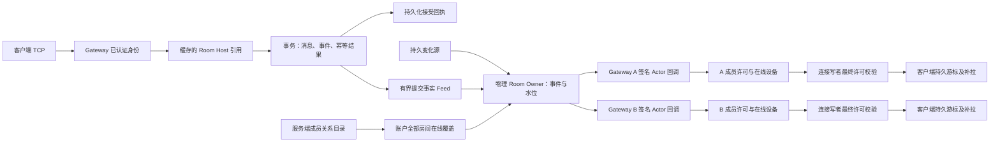

# Gateway Actor 实时路由修正方案

## 当前产品语义与审计范围（2026-10-05）

后续产品要求已明确：认证后由服务端成员目录自动建立全部成员房间的在线设备覆盖，客户端详情订阅只表达详情兴趣。当前房间正文与 H 通过物理 Room Owner 的签名订阅投递；通用实时分片仍服务账户控制、presence/typing 等范围，不再承担第二套房间 socket 路径。本文早期将 roomEvents 统一放入通用 Topic/Ready 的实现描述不能作为恢复旧路径的依据。

当前证据见 [增量审计](account-membership-incremental-audit.md)：当前服务端和 App 二进制的小规模实际检查通过，证据为 `/tmp/imv2-final-account-progress-current-20261005/candidate/app-room-progress-canary.json`。覆盖未打开房间、收发端自动重连、Gateway 崩溃、Journal 裁剪及在线／跨 Gateway 成员变化，独立数据库事实和服务／数据库清理通过。该运行包含最近的提交观察者合同、恢复任务状态收敛及设备关闭阶段拆分。消息提交成功、在线投递和客户端持久 C 分别判定；详情退订不停止账户消息接收。
当前收尾清单：

| 项目 | 当前结论 | 尚缺的证据或工作 |
| --- | --- | --- |
| 成员关系自动建立在线覆盖；详情兴趣独立 | 生产装配与当前 App 主链检查通过 | 小规模结果，不证明容量或全部部署拓扑 |
| TCP 发送及同一操作结果恢复 | 当前 App 发送端自动重连及同操作恢复通过 | 不证明所有联合故障 |
| Actor 缓存路由、签名回调及失效恢复 | 已有真实网络与故障组件证据 | 各故障证明范围见增量审计，不扩展为所有部署拓扑 |
| 删除替代路径及重复状态／调度 | 列明的旧路径、重复任务索引及无 activation 提交观察者已删除 | 未列出代码的语义必要性不能由符号搜索证明 |
| 生命周期真实排空 | 当前实际 App 清理 settled=true、forcedKillCount=0；替换 Gateway 正常退出 | r77 历史退出超时具体原因仍未定位；组件检查不证明超过16连接的吊销批次 |
| 原容量门槛 | 未验收，继续暂缓 | 原50k/1000、50k/5000及共同基线门槛仍保留 |

当前必要的小规模检查通过后停止追加测试；按用户要求不重复 App、数据库或大规模压测。上述缺口继续保留，不以更小检查重新定义完整目标的完成条件。

原 §11.2 容量门槛仍未通过。按用户“先不管性能、减少多余代码”的后续指令，本阶段不启动大规格容量工作，也不删除或降格历史未通过的验收条件。正确性证据不构成容量结论。A–F 各项的完整审计尚未完成。

编制日期：2026-10-02。当前状态：**r148 返回位修正、相关测试和生产构建通过；r149 小规格10k/1000质量与覆盖通过；r150 原50k/1000完整运行但最终871个viewer落后，质量与覆盖未通过。正式1000及后续5000／共同Loader基线≥80%仍未验收。**

最新修正点是授权结果回队列的所有权：原1024预算内同步预留精确返回位，结果回调原子消费并回FIFO；补位沿原RR顺序，仅补当前队列缺少的类别。七项相关测试通过，小规格最终10000viewer全部追上提交头；不新增队列容量、任务槽或权限期限。正式规格仍未收敛：r150的871个落后viewer均未获最终H、无待拉取或重试；准备证明排队过期计数降为0，但恢复需求仍有积压。关闭前抽样发现部分持久唤醒到期后等待17–77秒；r151已将同一Relay pass改为最多8项独立发布和结算，取消/致命错误真实排空，相关12参数用例通过，生产构建通过；r152缩小10k/1000覆盖通过但有1个viewer落后，质量失败。当前逐案分析该端的水位、持久唤醒和重试时间，尚不进入原50k规格。下文历史故障、提案和逐轮验证保留用于追溯，当前结果以实施证据最新章节为准。

目标是将实时寻址和订阅管理改为分片内存索引与分布式 Actor 引用调用。客户端消息发送使用 TCP 长连接；持久日志、权限、幂等和设备游标继续由数据库确定。按统一服务端/客户端版本、全新 schema 实施，不保留旧路由后端、混合版本、双写或消息 HTTP 自动重投路径。

本文替代此前“SQL 短期订阅登记＋逐次发布查询”的目标设计。本次复核确认生产装配已接入 ShardService、缓存 Actor 传输、分片租约控制和订阅协调器；这只能证明装配方向，不能证明完整链路运行正确。历史测量见[实施证据](actor-realtime-routing-evidence.md)。实施遵守[房间 Actor 合同](room-virtual-actor-contract.md)、[房间读模型合同](room-read-model-contract.md)和[实时订阅合同](2026-09-05-room-subscription-contract.md)，对应合同随实际实现同步修订。

## 1. 已确认问题

| 当前位置 | 行为 | 修正 |
| --- | --- | --- |
| [GatewayActorRealtimeRuntime](../../IMV2Server/Sources/IMV2ServerApp/GatewayActorRealtimeRuntime.swift) | 每次 userPresence/userSync 查询 UserShardRouter，重连注册共享该路由池 | 实时 Topic 稳定哈希寻址、缓存分片引用；业务归属另外维护版本快照 |
| [V2RealtimeFanoutDispatcher](../../IMV2Server/Sources/IMV2ServerApplication/V2RealtimeFanoutDispatcher.swift) | 每次发布查询 SQL 订阅表，四个查询名额跨通道共享，限制在 topic 解析之后 | 内存读接收集合；入口先准入；控制、持久提示、瞬时活动分别预算 |
| [V2DeviceConnectionRegistry](../../IMV2Server/Sources/IMV2ServerGateway/V2DeviceConnectionRegistry.swift) | 续租后持续发布 presence；注册等待订阅，异常可发生在认证回复之前 | 续租与广播分离；认证、本地注册、实时覆盖就绪分阶段 |
| [V2RoomDirectory](../../IMV2Server/Sources/IMV2ActorRuntime/Client/V2RoomDirectory.swift) | 消息操作已有缓存路径；多数读取仍先解析/确认 | 合法远端引用直接调用；只有缺失/明确失效进入解析队列 |
| [PostgresV2RealtimeRouteStore](../../IMV2Server/Sources/IMV2ServerInfrastructure/PostgresV2RealtimeRouteStore.swift) | 存储进程引用和兴趣、参与每次发布寻址 | 删除短期 SQL 路由，仅保留低频分片控制租约 |

最近固定 50k 连接/1000 条每秒诊断在约 37.947 秒失败，未完成 90 秒验收。空载窗口 routes 约 1666 次/秒而 RPC 增量为零；消息窗口路由查询平均约 88.11ms。受控测试证明四个返回空集合的 presence 查询能挡住 roomEvents。重连终止错误为认证前连接关闭，服务端同刻有连接池超时；尚无连接级 waiter 关联，不能精确配对某条池日志与该连接，也不能断言这是全部瓶颈。

本设计消除已确认的 SQL 寻址放大与通道争用。恢复读取的 SQL 往返、事务围栏占用、执行器/NIO 延迟及高连接数内存压力仍要测量，不能当作 Actor 改造已经解决。

## 2. 官方资料与能力边界

本轮重新检索下列官方资料，并核对实际 Vendor API。分片、订阅和重建协议是项目设计，不是 Swift 自动提供的功能。

- [SE-0336](https://github.com/swiftlang/swift-evolution/blob/main/proposals/0336-distributed-actor-isolation.md)规定分布式隔离；[SE-0344](https://github.com/swiftlang/swift-evolution/blob/main/proposals/0344-distributed-actor-runtime.md)明确 resolve 成功不证明远端存活。逻辑发现、激活和失效恢复另行实现。
- [固定版本 Receptionist 文档](https://github.com/apple/swift-distributed-actors/blob/50e789fbb6db9a9869a60b1915e659bd752e1d42/Sources/DistributedCluster/Docs.docc/Receptionist.md)建议发现稳定入口，高频变化的引用交给应用管理。Vendor 的 listing 逐个发出发现的 Actor，不是完整成员增删快照，没有显式 checkOut；不能将其视为全局同步屏障。
- [固定版本 Lifecycle 文档](https://github.com/apple/swift-distributed-actors/blob/50e789fbb6db9a9869a60b1915e659bd752e1d42/Sources/DistributedCluster/Docs.docc/Lifecycle.md)提供终止监控。实际 API 为 `LifecycleWatch.terminated(actor:)` 和 `watchTermination(of:)`；节点判 down 不证明分区另一侧进程已物理停止。
- [固定版本分布式 Actor 介绍](https://github.com/apple/swift-distributed-actors/blob/50e789fbb6db9a9869a60b1915e659bd752e1d42/Sources/DistributedCluster/Docs.docc/Introduction.md)说明请求可能执行成功而回复丢失；超时后的订阅修改与消息发送必须识别重复。
- [SE-0306](https://github.com/swiftlang/swift-evolution/blob/main/proposals/0306-actors.md)说明 Actor 不保证请求 FIFO，跨 await 状态可变化。保留房间顺序调度与版本围栏；可重入不代替资源等待图检查。
- [官方 ClusterSingleton 文档](https://github.com/apple/swift-distributed-actors/blob/main/Sources/DistributedCluster/Docs.docc/ClusterSingleton.md)提供代理/接管，默认按领导节点放置。本项目不把所有订阅和吞吐集中到单个全局 Singleton。

继续使用 [UPSTREAM.json](../../IMV2Server/Vendor/swift-distributed-actors/UPSTREAM.json) 固定的 `50e789fbb6db9a9869a60b1915e659bd752e1d42` 与 [PATCH.md](../../IMV2Server/Vendor/swift-distributed-actors/PATCH.md)。不顺带升级依赖、更换 ActorSystem 或引入另一套虚拟 Actor 插件。

## 3. 目标组件与热路径

当前房间消息由 Room Owner 直接管理 Gateway 投递关系，不经过通用实时分片的第二套房间订阅。下列 §3.1–3.3 中通用 Topic 分片的描述只适用于仍存在的账户控制、presence/typing 范围；其中历史 roomEvents 示例已被本页顶部的产品语义和上图替代。

### 3.1 Gateway 接收端

每进程继续持有一个 `V2GatewayRealtimeEndpoint`，认证后的调用进入有界 ingress，再由 Registry 按账号、设备、连接生命周期、受众和成员版本投递。同一 Topic 在同一 Gateway 上十条连接也只有一条跨节点订阅。

保留现有签名、trust 权限、服务身份、incarnation、会话绑定、重放窗口、帧限制。发现引用不代表有权调用或读取内容。经验证的描述符在 ActorCluster 解析一次，缓存实际类型的 Actor 引用；后续直接调用，不逐次解析地址。

TopicKey 不包含数据 owner，但发布信封仍携带业务 dataOwner/ownerEpoch 和已提交事件来源；服务签名必须具备该 owner 的发布权限。分片与 Gateway 都校验来源、目标 incarnation 和订阅围栏，不能把“实时分片承载者”当成“内容拥有者”。未准备完整受众/成员版本的正文仅发送水位，读取时再执行权威授权。

### 3.2 分片入口

每个可承载实时分片的节点新增一个 `V2RealtimeShardEndpoint` 分布式入口，内部用普通 Actor 管理各分片。避免每连接/每房间一个分布式 Actor，也避免所有 Topic 共用一个巨大状态与队列。

`TopicKey = (kind, logicalID)`，`partitionID = StableHash(version, TopicKey) % partitionCount`。使用明确版本/字节编码，禁止随机 Swift `Hasher`。初始提案为 256 个逻辑分片，需验证分布及内存后冻结；扩节点改变承载位置，不改变分片号。实时分片与房间数据 shard、用户 bucket 是不同概念。

状态为 `TopicKey → GatewaySubscription[]`，不包含消息副本或客户端确认游标，也不要求激活业务 Room。房间冷回收不影响账号目录订阅。

正常发布只做：计算分片 → 缓存入口/代次 → 内存截取接收集合 → Gateway 引用调用。不调用业务路由器，不执行 `routes(for:)` SQL。房间事件、用户同步、presence、typing 使用同一寻址规则，但有独立流量策略。

### 3.3 稳定发现

扩展现有 `V2RoomDiscoveryBeacon` 的签名挑战/可信配置模式，广告包含 incarnation、Gateway/分片入口引用及所承载分片的租约代次；Gateway-only 节点也发布相应广告。

Receptionist 每进程登记稳定 Beacon。后台任务维护 `partitionID → endpoint reference + epoch + deadline`；广告刷新传播分片变动。领域及持久化模块不依赖 ClusterSystem。正常缓存调用不访问 Receptionist；listing 增量、终止 watch 和有限周期校验维护缓存。

未知/过期/明确失效使用 singleflight：同一分片的并发缺失只启动一次发现。各等待者可取消，底层工作按自身期限收尾。超时、SERVER_BUSY、队列满不作为远端死亡证据，不触发全量重建。

## 4. 数据库与所有权

数据库继续负责持久日志、幂等接受事实、权限/成员版本、设备会话/连接配额、在线状态权威租约、业务路由及房间激活。Actor 引用不能替代这些事实。

新增固定规模 `realtime_partition_leases` 控制表：`partition_id, host_id, process_incarnation, lease_epoch, lease_token, expires_at`。行数随固定分片数增长，不随连接/用户/消息增长。不存 Actor 引用或订阅成员。

- 候选按稳定哈希与承载配额选择分片；统一锁序批量 claim/renew，检查完整 token、递增 epoch、锁后数据库时钟。续期失败或剩余时间不足停止该代次服务。
- Host 从返回的剩余期限扣除完整数据库请求耗时，安装保守单调截止时间；接收签名广告同样扣除广告请求耗时。逐条 RPC 只核对内存 epoch/deadline，不查租约。
- 新节点不能仅因 SWIM/down 即替换仍有效租约。旧节点保守到期停服，新节点在数据库允许后获取更大 epoch。主动搬迁先停止旧服务再交接/释放 token。
- 分区期间允许实时覆盖降级为日志恢复；实时 lease 不授予消息写权限，业务数据 owner 和激活围栏保留。

分片 TTL、续期间隔及提前停服余量经故障测试确定，不照搬设备 90 秒或旧 SQL 推送 45 秒租约。控制 SQL 有独立预算/来源，不进入心跳或逐次发布栈。

claim/renew 的 COMMIT 结果未知时，不凭请求已发出安装更长本地期限或广告新所有权；通过控制路径确认同一 token/epoch 后再接纳。续期未获确认只保留先前已确认的截止时间，不能无限猜测续期成功。

业务 User/Room 路由配置启动加载版本快照。当前静态部署，变更需显式重装或重启，不新增数据 owner 在线搬迁。事务仍检查权威围栏，过期缓存收到明确拒绝后刷新。不能借快照优化删除发送、恢复、权限的正确性锁。

## 5. 订阅协议与 Ready

### 5.1 需求、修订和会话

Gateway 持有本地 desired interests，按连接/账号目录作用域引用计数，仅 0→1/1→0 修改跨节点订阅。目录按现有上限批量登记，不激活所有冷房间。

控制会话绑定 `(gatewayNodeID, gatewayIncarnation, partitionEpoch, sessionID)`。修改带 `baseRevision, nextRevision, payloadFingerprint`；只接受连续修订或完全相同的重试，缺口要求快照。不能用某个 Topic 的新修订跳过其他 Topic 的旧增量。

每个 Topic 的订阅另有 `interestGeneration`，0→1 或重新安装时更换，修改其他 Topic 不改变它。投递携带 `(partitionID, partitionEpoch, sessionID, interestGeneration, gatewayIncarnation)`；Gateway 只接收匹配本地意图的代次。控制批次修订用于修改顺序，不能用一个全局 appliedRevision 误拒绝其他未变 Topic 的合法在途消息。

Gateway×分片一个修改 worker，连接任务只是等待者。取消一个等待者不取消共享订阅。snapshot 有界分批 staging，完整且摘要通过后原子替换；限制旧集合加 staging 的峰值。迟到的旧 session subscribe/unsubscribe/renew/close 不改变新 session。

先安装本地 desired generation 和有限待就绪围栏；确认前到达提示合并水位。所有跨 await 返回均核对 connection lifecycle、scope generation、partition epoch/修订。session 修订水位保留至退役，防止延迟增量复活已删除订阅。

### 5.2 安装顺序

1. 本地记录需求与生命周期，建立待就绪围栏。
2. Actor 调用 `subscribeBatch`，分片在同一隔离段修改集合，确认已应用代次/修订。
3. **释放订阅控制名额后**，按当前业务 owner 读取持久头 `H`；这是授权的业务读取，不是查推送目的地。
4. 验证同一连接/作用域/代次仍有效，安排按客户端游标恢复到 `H` 的提示或响应，合并期间更高水位。
5. 屏障与恢复安排完成后发送该覆盖范围 `RealtimeReady/RoomReady/DirectoryReady`；失败是 recovering/coverageLost，不能发 Ready。客户端应用至 `H` 后另以持久游标确认 caughtUp，Ready 不代替应用确认。

只有提交后才能发布：安装前提交由随后读头覆盖，安装后提交进入新接收集合，重复由日志序号/游标去除。Ready 不代表全局发现收敛或远端永久存活。

### 5.3 续期与关闭

按 Gateway×分片合并控制会话续期，纯 Actor 调用，不逐 Topic 写库、不挂到每条客户端心跳上。正常取消更新修订，异常关闭依靠 watch 和有限会话期限回收。

shutdown 停止新连接/订阅需求、撤销 Ready、关闭并 drain workers，退役会话/分片 token，最后释放 Actor/ClusterSystem。不得保留强引用阻止本地 Actor 终止后还等待 watch 清理。

## 6. 失效与恢复

| 情况 | 行为 |
| --- | --- |
| Gateway 重启 | 新 incarnation、新连接 scope/订阅；watch/期限回收旧引用；旧清理只作用旧 session |
| 分片 Host 崩溃 | 缓存失效；租约允许后新 Host 获取更大 epoch；Gateway 从 desired interests 重建并重新读头 |
| RPC 超时 | 结果未知，查询/重试同一修订或发布标识，不销毁所有缓存和连接 |
| 持久提示积压 | retryable/coverageLost、合并水位、游标恢复；持久事实不变 |
| 瞬时活动积压 | 合并/丢弃过期状态，不消耗认证和持久提示保留预算 |
| 网络分区 | 旧 lease 保守到期停服；缺失覆盖 recovering，恢复后重装 Ready |

发现入口、创建引用、调用成功、订阅就绪分别记录。新分片集合为空不证明集群没有活跃需求。新 epoch 下旧 Ready 失效；续期失败及有限周期检查也触发重建，不只依赖 watch。

保留提交观察者和持久合并水位 relay。分片按当前集合投递，Gateway ACK 只表示进入有界 ingress，不代表客户端应用/持久确认。当前集合存在失败目标时保留 outbox 修订重试；成功目标可能重复，按游标去除。

分片按 Topic×Gateway 使用有界发送 lane，正文按持久 roomSequence 排序，水位取最大值，Gateway 按同房间合并写出；单个慢目标只阻塞自己的 lane。不同发布者及故障重试仍可能乱序，不能承诺仅凭 Actor 调用实现端到端 FIFO。收到缺口时，同一连接作用域×房间只保留一个实际恢复任务和最新目标水位，避免每个提示另起读取；不设置固定等待来掩盖缺口。可共享原始事件缓存，用户权限、成员代次和客户端游标保持独立，不能把不同用户的授权结果直接合并。

`noSubscribers` 仅表示当前集合为空，不能删除日志、推进客户端游标或声称全局无人在线。空集合可结束这次提示尝试；后来/故障后订阅靠读头屏障恢复，已连接 Gateway 保留有限周期的持久头核对。即使提示 ACK 后进程崩溃，也能发现未应用持久数据。`locationUnknown/sessionRecovering` 必须单独报告，不能伪装为空集合成功。

周期核对只覆盖本机活跃需求，按业务 owner 批量、错峰、有独立上限；故障指数退避/合并水位，不逐错误全房间补拉。实时推送延迟与恢复收敛分别验收。

## 7. 心跳、在线状态和认证

心跳处理连接存活与设备/在线权威租约续期。续期仍可批量写数据库，但不解析实时 owner、不查接收方、不等远端推送。独立有界 worker 合并待续期连接；若无法在安全期限内完成，按租约规则失效，不无限提前 ACK 后维持虚假的有效会话。

当前 presence 载荷是失效提示，观察端读取权威状态。本机公开在线连接集合或隐私策略变化、权威租约到期扫描发现变化时标记用户 dirty，按用户合并。单个 Gateway 最后连接离开不能宣布该用户全局离线。

只延长有效期的续租不逐次广播。观察端在已有截止时间安排合并刷新，现有周期观察刷新改为可见目标批量读取，避免提前显示离线。typing 保留 source/sequence/expiry，过期直接丢弃。

连接状态明确 `authenticating → authenticated/recovering → realtimeReady`。认证校验、数据库连接准入、本地生命周期注册成功后回复 authenticated；实时分片恢复不会把成功认证变成无解释的 socket close。

authenticated 允许经权限校验的 TCP 消息及恢复读取，前台加速等待对应范围 Ready。认证不表示通知覆盖完整；客户端 recovering 时恢复游标并展示可解释状态。永久认证失效仍终止；覆盖故障返回结构化原因。

注册、订阅 worker、读头各有预算。超限可拒绝新连接或 bounded recovering，不无限保留已认证未就绪连接。同步更新 protobuf、ClientKit、App 状态机和验证，统一版本发布。

## 8. Room Directory 与 TCP 发送

Directory 缓存包含数据 owner、激活 epoch/token、Host incarnation、实际引用、保守期限。符合重放策略的读取复用合法远端引用，命中不进入 128 并发/1024 等待的解析队列；Host 继续执行实际事务权限/激活围栏。

`staleActivation/wrongOwner/retiredIncarnation/terminated` 等明确失效仅驱逐匹配旧代次，再 singleflight 刷新。过载/未知结果不制造新激活。读取可安全重试，稳定 operationID 命令查/重试同一事实，非幂等未知操作不自动重放。

消息使用 TCP 认证连接。首次发送前持久保存 operationID/指纹，重连继续同一操作，超时先恢复结果；发送入口收敛，不在 TCP 不确定时竞速 HTTP。账号/媒体 HTTP API 保持各自用途，不作为消息无标识重投入口。

先扩展已存在的消息操作缓存分支到可重放读取，不重写 Host 租约验证，不假设分布式 Actor 代替房间 FIFO。

## 9. 背压与推进

准入在解析/发现/创建任务之前。限制工作数和字节数；水位队列只保留每 Topic 最大值，正文受限窗口超限退化为水位。订阅 staging、重试、引用缓存、套接字队列均有数量及字节上限。

控制、发布到分片、分片投递 Gateway 分开预留 RPC 推进预算。**禁止等待投递时占满投递需要的同一组名额**：两跳共用全局/每 peer permits，节点互相发布可能形成资源等待环。各阶段设独立保留配额并检查每 peer 等待关系；以现有全局 32 为初始总预算基线，不能每分片复制一份 32。具体划分经阻塞注入和测量确定，不盲目增队列。

2026-10-02 r65 已验证 peer 预留修正：旧 Sender 的控制/发布共用每 peer 2，两个等待回复的 publish 会阻塞同 peer 控制；现在 control2/publish2 独立计费，单 peer 合计上限由2变4，不能称所有预算未变。global control4/publish12保持。实际生产 ShardService 共享 delivery workers 上限16、peer2，presence/typing的4包含于16；当时 Gateway callback transport 未显式传 limits，默认32只限制 callback 总量；该证据只能说明普通分片链，不能证明混合房间投递的总预算。2026-10-05 已修正生产组合：所有 callback 类型共用显式16的 Sender 上限，房间投递 pump 同步收紧至16，控制4/发布12保持，两个 Sender 合计上限32。四类 callback 的准入与释放已收敛至唯一入口；此上限不包含独立 RoomActor RPC，也不代表容量验收。

r65真实两进程双向持有publish回复时，renew、subscription delta及独立反向callback仍推进；取消未提前释放本地invocation，远端门控实际放行后两端排空。RemoteCall timeout只证明本地continuation终态，不证明远端结束。本fixture手工安装token，不证明PG ownership；r54生产隔离证据独立保留。

- 房间事务/turn 不等远端或 socket，提交边界仅本地有界 offer。
- 分片修改集合/截取接收者时不等 SQL、远端、socket；等待扇出前冻结快照，回来复核 epoch。
- 订阅回复释放控制名额后才借库读头；SQL 事务不等订阅或远端 ACK。
- Gateway inbound 仅认证、围栏和有界 offer，不反向获取发布者持有的资源。
- 每分片/控制会话/物理 Store 有有限且有 owner 的 worker，不每心跳/Topic 启动长寿命 Task。
- 等待者取消不伪造实际 SQL 结束；SQL future/本地 transport invocation 终态释放对应资源；未知远端结果靠版本/幂等恢复。
- shutdown 停需求、取消等待者、drain 实际工作；不可取消事务保留所有权，停机超限明确报告失败。

Actor 可重入不保证数据库连接、任务名额或网络预算没有等待环，资源依赖必须审查和注入测试。

数据库预算按物理存储身份统一记账，逻辑 owner alias 共用实际借用上限。控制类保留名额属于该总预算，不通过新开不受观测的连接池绕过它。新 lease、启动路由快照和真正恢复读分别标记来源；原单连接路由池不再接入实时发布或认证后的订阅寻址。

## 10. 实施责任与顺序

| 步骤 | 改动 | 完成条件 |
| --- | --- | --- |
| A 合同与观测 | TopicKey、分片代次、会话修订、Ready/Recovering、发布结果；连接诊断关联 | 认证、SQL waiter、订阅阶段可关联，指标无身份高基数 |
| B 引用与控制 | ActorCluster ShardEndpoint、签名 Beacon、watch、缓存；分片 lease 批量 claim/renew | 热路径零寻址 SQL，miss singleflight，旧代次/分区正确 |
| C 内存订阅扇出 | Application desired interests、snapshot/renew、屏障、独立预算 | 多端、乱序/丢失/恢复、慢 Gateway、取消/drain 通过 |
| D 连接与 presence | 本地注册/覆盖拆分，心跳批量续期、presence 合并；协议与客户端状态 | 实时故障不关闭成功认证，迟到清理不影响新连接 |
| E 缓存与发送 | Directory 读取缓存快路径；TCP 单入口、同操作恢复 | 读取命中不占解析，回复丢失不重复落库 |
| F 删除与容量 | SQL 路由 Store/表/配置清除，合同/夹具更新，分阶段验收 | fresh schema、模块边界、完整容量/故障矩阵通过 |

当前 A–F 核对（2026-10-05，未将暂缓项改成通过）：

| 步骤 | 当前生产落点与证据 | 判定 |
| --- | --- | --- |
| A | Gateway/Owner 的代次、许可、Ready 与恢复边界；低基数生命周期阶段日志；当前 App 独立事实检查 | 产品状态与观测已落地；历史 r77 无任务堆栈，无法追溯具体等待者 |
| B | `V2RoomDirectory.tryInvokeCached` 热调用；签名引用、分片控制与既有真实网络/100 miss 组件证据 | 已实现；未以组件调用计数证明全部生产 SQL 为零 |
| C | 账户成员覆盖建立 Owner 投递关系；Registry Authority 决定在线设备，写者最终校验许可；通用恢复拒绝 roomEvents | 当前 App 未打开房间与跨 Gateway 成员变更通过；全部组合故障不在本次证明范围 |
| D | 认证回复后 `installAuthenticatedAccountCoverage`，身份存于 Session；设备吊销先关闭物理传输后清理覆盖 | 当前 App 自动重连和进程清理通过；超过16连接的吊销队列只有设计/源码依据，无运行证明 |
| E | Directory 缓存调用与 TCP 固定操作结果恢复 | 当前 App 丢回执后自动重连及独立持久事实通过 |
| F | 列明 SQL 路由、旧房间 wake、HTTP 发送及无 activation 观察者已删除；fresh schema 证据见增量审计 | 删除清单已核对；原容量与共同基线验收仍未通过且由用户暂缓 |

此表指向已有证据，不安排重复测试。当前没有从代码核对得到的新缺陷，不能为了持续推进而继续机械拆分 Actor 或删除有实际调用的状态。尚缺的正式容量证据须在用户恢复该项后获得；历史 r77 的具体原因须有复现或当时有效任务证据，当前正常退出不能反推历史原因。

ActorContracts 提供可序列化 Sendable DTO，不依赖 ClusterSystem；ActorCluster 持有引用和认证传输；Runtime/Application 管逻辑目录与生命周期；Gateway 管 socket/本地授权；Infrastructure 提供持久业务与控制 lease。App 装配不能再把逐次 SQL 路由接回热路径。

统一切换后只装配一套实现，无 `sqlRoutes/actorRoutes` 开关/双写。删除 `realtime_gateway_leases`、`realtime_interests`、PostgresV2RealtimeRouteStore、V2RealtimeRouteStoreRegistry 及运维清理逻辑。保留设备/在线租约、房间激活、持久日志/outbox；更新 fresh schema 标识、schema contract、Compose、环境示例、容量夹具，不写旧库在线升级脚本。

## 11. 验证与验收

先验证机制再测容量。Swift build、数据库、服务测量串行，不随机重复大档或加空载等待。

### 11.1 确定性与真实两节点

- 已安装引用/订阅下 10,000 次发布：零寻址 SQL、零 per-call Receptionist lookup，空集合也不借库。
- 100 个相同分片/房间并发 miss：一个解析；部分等待者取消不取消实际共享工作。
- 订阅与提交交错、确认丢失/重复、乱序修订、不完整 snapshot：无错误 Ready，日志恢复无缺口。
- 提交观察者与 relay 交错、正文/水位乱序：单目标发送有序且有界，缺口恢复合并；不因一串高水位启动同数量 SQL 读取。
- 同用户多设备、跨 Gateway 同设备共存：逐连接生命周期正确，旧 close/unsubscribe 不影响新 session。
- presence/typing 满队列、数据投递阻塞、双向发布：控制与恢复仍推进，无 permits 等待环，认证结果明确。
- 进程重启/down/分区/续期失败：旧 epoch 停服、新引用重建、游标收敛；不用 sleep 代替屏障。
- 帧/订阅字节超限、慢写、取消事务、shutdown 超限：终态和回收明确，不静默裁剪。
- TCP 请求/回复丢失、重连：同 operationID 一份接受事实，未知非幂等操作不重放。

实际 Vendor 的 listing/watch/远端取消另做真实两节点集成，mock 不替代它；保留签名权限、非法引用与授权失效测试。

### 11.2 容量顺序

1. 复用曾成功的 10k 连接、自然冷热、1000 条/秒×30 秒 TCP 场景验证新模块，仅有新失败才重复。
2. 然后一次固定 50k 连接/1000 条每秒、原 180 秒检查点＋90 秒消息阶段，保留重连/同步/质量条件，回归上次失败。低连接数成功不能替代此项。
3. 完整通过且无推进异常后，才跑 50k/5000 条每秒×90 秒。CPU/内存、DB 连接预算、超时、质量条件一致，完整 baseline 同条件比较，原 ≥80% 基线门槛保留。

全部分片报告齐全才接受结果。认证前断开、SERVER_BUSY、未知发送、最终 viewer 缺口分别归类；补拉收敛不算实时推送成功。实施前不再跑大档期待问题自行消失。

### 11.3 观测与硬性条件

固定枚举记录缓存 hit/miss/明确失效、发现次数、lease 续期/换代、订阅/Ready/覆盖失效/重建、控制/发布/投递排队和执行、presence 合并、noSubscribers/locationUnknown、正文降级、恢复延迟。保留 SQL loan 分段、Swift resume、EventLoop lag、压缩内存/交换观察。

诊断日志关联脱敏的 connection lifecycle、operationID、control session 和 SQL waiter，禁止这些标识进入 metrics label。只有能配对的记录才判断某连接关闭的直接原因。

验收必须满足：

1. steady state 每次发布/普通心跳的**寻址 SQL 为零**，业务租约写入/恢复读另计。
2. 控制库不可达时有效缓存按期限工作，到期明确降级；缓存不扩大业务写权限。
3. 瞬时活动不耗尽 reconnect/控制/持久提示预算；排队项、任务、字节、实际在途资源均有界。
4. 多端恢复无缺口，重复幂等，旧代次不污染新连接；推送与恢复各自符合质量门槛。
5. 固定 50k/1000 完整通过后才评估正式 5000/基线门槛，没有数据保持未验收。

当前按持续目标继续并行落地；构建与运行验证由主代理串行执行。实施按 A→F 完成；若路由修正后持久恢复仍拥塞，再按实际来源优化 SQL 往返和锁持有时间，不预先承诺 Actor 替换解决全部瓶颈。

## 12. 本次复核后的实施约束

### 12.1 数据库为何仍存在

分布式 Actor 承担调用与发现，分片租约是本项目选择的所有权协议。不是 Swift 要求每次调用查库。若放弃唯一分片承载者，也能设计多副本订阅，但需要另一套订阅合并、分区及去重协议；本方案选择已有 PostgreSQL 提供固定规模的唯一所有权，不叠加第二套共识组件。

| 操作 | 是否需要数据库 | 依据 |
| --- | --- | --- |
| 已就绪 Topic 发布/投递 | 不需要寻址 SQL | 稳定分片号、缓存引用、内存订阅集合 |
| 已缓存业务 Room 引用调用 | 不需要先查询物理位置 | Host 自己校验激活与业务权限；真正持久操作仍查库 |
| 客户端普通心跳 | 不查询推送目的地 | 设备/在线权威租约仍可批量续期 |
| Gateway×分片订阅续期 | 不需要 SQL | Actor 控制会话与本地期限 |
| 分片承载者 claim/renew/接管 | 需要低频控制 SQL | 网络分区下唯一所有权与递增 epoch |
| 首次订阅、重建覆盖、周期补漏 | 需要持久头/日志读取 | 推送不能取代持久接受事实与客户端游标 |

初始控制参数可用 TTL 30 秒、每 5 秒批量续期、至少 500ms 提前停服余量，均作为待故障验证的配置。对 256 个固定分片，正常全局续期约 51.2 行更新/秒；实际事务频率约为承载节点数/5 秒，另计接管及重试，不能声称零 SQL。单调截止时间必须扣除整个请求耗时；时钟速率误差与停顿纳入余量，发送前再次核对有效期。对已经在途的旧代次，Gateway 仍以接收围栏拒绝。

### 12.2 发现、未安装和退役必须分开

稳定发现配置显式声明 nodeID、serviceID、地址和端口，并与签名 trust 及允许承载的 roster 一起校验。不能从 Room Host UUID 推测 Gateway 身份。零分片节点仍应被发现，才能参与后续承载。

Membership/探测只影响候选选择与路由可用性，不授予接管权。短时失联先撤销本地 Ready，保留需求并退避；不每次漏探测都释放健康租约、搬迁全量订阅。实例终止事件只移除相同 ActorID/incarnation 的引用。

`notInstalled/recovering` 表示目标尚未完成安装，保留该 token 的重试机会；`retiredEpoch/retiredIncarnation` 表示明确退役，才精确驱逐匹配缓存。不得把前者放进永久拒绝集合，也不得因超时、busy 或连接池拥塞宣告死亡。未知 COMMIT 只在控制通道确认同一 token，业务发布不查询租约。

### 12.3 Ready 与客户端追平分开表达

认证成功只说明会话与连接准入成立。`coverageReady` 说明订阅已安装、持久头屏障已取得且恢复提示已经安排；不能仅凭 Gateway ingress ACK 声称客户端已应用到头。

若界面需要表示“已同步”，还必须以客户端持久游标达到屏障 H 确认 `caughtUp`。Ready 帧携带 scope、scope generation、状态修订与屏障水位；发送帧前再次验证同一 partition epoch/session/interestGeneration。确认到发送期间换代则改发 recovering。账号、房间、目录、presence、typing 为不同 scope；取消作用域也递增代次并发送结束状态，避免客户端永久保留旧 Ready。

服务器重建顺序为：撤销旧 Ready → 发现新合法入口 → 从 desired 集合发送完整快照 → 订阅确认 → 释放控制名额 → 批量读头 → 提供恢复提示 → 精确确认并发 Ready。接入恢复失败维持有界 recovering；超过需求/内存预算返回明确拒绝，不无限增加任务。

### 12.4 无兼容性要求必须落实到删除项

新 Delivery 的 partitionEpoch、sessionID、interestGeneration、gatewayIncarnation 均为必需字段；删除 optional 过渡字段、旧 interestRevision 及旧 authority 解释。消息发送删除自动 HTTP 回退与无标识重投；显式 HTTP 消息发送入口也从产品发送路径和装配移除。账号、上传等独立 HTTP API 不在此次删除范围。

只发布新协议和新 schema。不保留旧 SQL route Store、双后端开关、双写、旧协议解码分支。以最终源码清单核对删除项；已经删除某个文件或更新某个字段，也不能当成生产链路验收完成。

### 12.5 防止重构只是转移瓶颈

固定分片并不能拆散单个热点 Topic。热点 Topic 仍会集中在一个分片，但单目标慢写应隔离在自己的 lane。记录每分片最大负载、接收集合规模和最慢目标，不只报告全局平均值。仅需提示时优先发送合并水位；正文加速只在已有完整权限上下文且窗口有界时启用。

启动 owner 快照的数量与字节有上限，超限明确启动失败。新建房间的首次 owner miss 允许有界、合并的控制读取；稳态已知 owner 不过期回源。在线业务 owner 迁移不属于这次实施：权威围栏发现不同 owner/epoch 时拒绝旧视图、停止相应覆盖并要求重新加载，不能静默继续发布。实时分片换代本身不改变业务 owner。

首轮最多围绕六组真实不变量验收：热路径零寻址 SQL；订阅/读头交错；两节点双向阻塞仍推进；重启/分区换代；多端与旧清理；TCP 未知结果幂等恢复。mock 验证状态机，真实两节点验证 Vendor watch/签名/RPC，真实 PG 验证锁序/epoch/未知结果。通过后先回归 1000 档；无新失败不重复相同大档。

装配必须明确持有并关闭：发现任务、分片控制 worker、订阅 worker、投递 lanes、Gateway 恢复 worker 和 Cluster 引用。最终检查生产入口确实调用新实现，旧 SQL 路由的引用计数为零；单个新文件存在或单元测试通过不算生产切换完成。

## 13. 当前实现复核与补充修正

### 13.1 区分旧诊断与当前实现

第 1 节列出的 SQL 路由问题是历史故障证据，不能继续描述为当前源码仍原样执行。当前 `GatewayActorRealtimeRuntime.build` 已装配业务 owner 快照、ShardService、显式可信 peers、分片控制租约、InterestCoordinator 和 Actor fanout；Fanout 的 `resolve(partitionID:)` 应命中传输缓存，不等于每次访问数据库。生产验证必须检查实际实现与实际 SQL 来源，而不能按方法名推断。

当前仍存在清晰的放大点：`V2DeviceConnectionRegistry.refreshObservedPresence` 与恢复屏障的 presence 分支对每个 watcher 分别调用 `reader.presence`；同一个 viewer 的多个设备可重复读取，周期刷新与重建也可能争用数据库。该读取承担成员关系、拉黑、隐私和权威在线租约判断，不能简单删掉。它应改成有界批量授权读取。

此前定向测试等待已定位到认证 fixture 的重复 gate；修正后统一选定的 33 个测试函数完整通过。该事实不证明历史生产卡住只有同一原因，不能将测试夹具故障与真实负载故障混为一谈；容量仍按原顺序验收。

### 13.2 在线状态批量读取

增加强类型请求 `(roomID, viewerUserID, targetUserID)`，每批最多 128 个不同键，返回逐键的 observed/denied 结果；基础设施错误使整批失败。单条 SQL 在同一快照内完成 direct pair、当前成员版本、双向拉黑、在线偏好及有效非 suppressed 租约判断。与现有接口对齐未知房间、非 direct room、非成员的错误顺序；显式 target 必须等于授权得出的 peer。

Gateway 建立独立 collector，初始上限 4 个实际批次、1024 个排队键；周期刷新、dirty 提示和严格重建共用此 collector。它不得借用 4 个订阅恢复 worker 的名额：恢复 worker 等待 presence 屏障时再等待自身 worker 名额会形成等待环。

仅排队阶段合并相同授权键。某批已经开始查询后，新作用域的请求进入后继批次，避免新订阅复用订阅建立前的状态。查询结束后分别验证 connection lifecycle、scope generation、watch target 与原 stream 引用；同一 viewer 可共享原始结果，不同 viewer 不共享授权结论。严格恢复等待实际查询与提示保留成功，不能提前 Ready。

### 13.3 推进责任和取消责任

每类长期 worker 必须有唯一持有者、有限需求表、实际任务表和 shutdown drain；`Task.detached` 只能用于受此持有者管理的有限任务，不能按每个通知创建无限任务。

资源等待顺序明确为：控制准入 → 完成订阅 RPC → 释放控制准入 → 恢复读取 → 提示保留 → Ready。发布到分片与分片回调 Gateway 使用不同实际 RPC 预算；数据库事务提交并归还连接后才允许网络投递。任何等待者取消都不提前归还仍在执行的底层 SQL/RPC 名额。超时表示调用结果未知，直到实际操作终结前仍计入资源。

shutdown 首先停止新需求，撤销覆盖状态，取消/等待 Registry 恢复与 presence 工作，关闭订阅协调器与发布任务，再退役分片、关闭 ingress 和传输，最后关闭 ClusterSystem 与数据库。重复 shutdown 等待同一实际关闭任务。

### 13.4 实施顺序与可核验交付

| 顺序 | 交付 | 完成证据 |
| --- | --- | --- |
| 1 | 统一 Topic、分片 token、会话修订及 Delivery 必需围栏；清理兼容分支 | 编译通过，生产协议与调用方一致，旧后端引用为零 |
| 2 | 接通 Actor 引用缓存与后台发现、分片控制、内存索引 | 预热发布逐来源寻址 SQL 为零；实际缓存 hit，无逐请求发现 |
| 3 | 完成 Registry 独立恢复、批量 presence 与准确 Ready | 安装/提交交错无缺口；新旧 scope 与多设备互不污染 |
| 4 | 完成实际资源归还、两跳预算与生命周期关闭 | 双向阻塞注入仍能完成控制；取消后实际任务归零 |
| 5 | TCP 单入口及 operationID 结果恢复 | 回复丢失、重连后仅一份接受事实 |
| 6 | 真实两节点与 PostgreSQL 故障验证，再按 1000→5000 验收 | 分区/崩溃后 epoch 换代，旧代次拒绝，完整质量及资源报告 |

使用已有测试夹具和六组不变量，不为简单包装器逐一新增镜像测试。每次测试设置显式整体期限与进度证据；超时后先保存任务/线程、SQL waiter、控制会话与队列快照，再判断等待环或慢操作，不直接增加 timeout 或重跑大档。

对外声明区分设计完成、实现装配、定向检查通过、故障验证通过及容量通过。真实接管已验证相同端口进程重启、epoch 换代、原订阅自动重建和实际回调；该 fixture 使用加速到期与 fixture 续期，不能代替自然 TTL、完整生产控制器或 App 游标恢复验收。性能改善结论必须等待实际容量验收。

## 14. r24 后继续实施的控制与恢复隔离

r24 在不改变预算的 10k/1000 场景下完成覆盖与独立游标核对，证明旧代次 waiter 缺陷已闭合；详见实施证据。此小规格结果不替代正式容量门槛，也不删除以下结构要求。本节控制与恢复隔离已实现，定向推进和实际排空检查以及生产 Release 已通过；最新容量状态见本文末尾，仍需原正式规格验收。

### 14.1 三层确认

分片控制只确认订阅集合与会话。独立 Topic 恢复读取持久头并实际保留本地有界恢复需求。连接覆盖状态机必须完成当前 connection lifecycle/scope generation 的实际提示保留或 presence 授权状态交付，才可以向该连接发送 Ready(H)。Topic 的内部确认不能直接成为所有连接的 Ready，也不推进任何客户端游标。

Registry 每个活跃作用域只保留当前 generation 的最大目标头与交付 receipt，随作用域结束清理；存量受真实活跃作用域限制，实际工作使用既有有界恢复 pump。单连接慢写不被 await 在全分片屏障上；失败仅令该连接作用域 recovering。返回成功的 Topic 必须已实际保留恢复需求，排队拒绝不能伪装成功。

### 14.2 独立推进与逐 Topic 结果

Coordinator 将 subscription control、session renewal 和 head/recovery 分为独立受生命周期管理的工作。renew 继续共享原控制 RPC 总预算，不等待读头或 socket，也不因持续 delta 饥饿。恢复按 Topic 合并，有限实际在途，取消/超时不能提前释放尚未结束的名额；shutdown 排空所有类型实际工作。

Heads 返回完整逐输入的 available(H)/unavailable(reason) 结果；reason 为闭合枚举。缺失或 owner 错误局限于实际 Topic，同一物理 SQL 故障局限于该 group，其他 group 可继续。Recovered 返回确实已安排的 Topic 集合，未知键或隐式缺键均不得获得 Ready。每次 await 后核对 partition object、token、session、topic generation 和原安全期限；读头或本地恢复失败不旋转整个控制会话。

房间头读取在一个 SQL 快照内核对 rooms 的完整 room_shard_id/owner_epoch，不以 Actor 引用授予权限，不做逐 Topic SQL。用户授权与业务所有权事务仍是权威边界；本项目的静态部署快照与不支持在线业务 owner 迁移的范围保持明确。

### 14.3 续期不修改订阅修订

renew 为同一活跃会话延长期限，不创建会话、不复活已到期/关闭会话、不改变订阅 revision、snapshot staging 或最后 mutation fingerprint。wire .renew 采用统一的新语义，不保留旧修订推进兼容分支。实际确认剩余期限受分片租约约束并扣除请求耗时；未知回复不能延长本地权威。

本阶段只新增能证明独立控制推进、局部失败、实际 receipt、跨 await CAS 与 drain 的定向回归。全部源码冻结且检查通过后进行必要的小规格验证，再进入原 50k/1000→5000/基线门槛；不在源码未稳定期间反复运行大档。

### 14.4 心跳与数据库续期分离

Registry 以本地 confirmed deadline、renewAt 和已成功覆盖的 heartbeatInstant 调度续期。正常 heartbeat 仅更新时间并调度唯一 wake；确认剩余窗口约 2/3 处且存在未覆盖心跳时，才进入既有 batcher。成功使用实际剩余确认时间安排下一轮；批内新心跳不驱动立即再次 SQL。没有新心跳的连接不能被后台永久续活。未知结果或排队拒绝只在旧确认期限内有界重试，实际任务仍在途时旧 expiry 必须被武装，过期后迟到结果不能复活权限。生产 TTL、全局连接准入规则与物理 SQL 总预算保持原值。

该实现的原门控测试已在 r27 实际通过；r32 已验证生产控制器真实 SIGKILL/restart、原 TTL 自然到期及幸存 Gateway 客户端恢复，r54 已验证非零头下 Actor-only 隔离和同实例恢复。具体规模与证据边界见实施证据，不能替代正式容量验收。生产控制器 restart canary 仅可操作本次 owned 进程，保留自然租约 TTL，记录实际旧 PID SIGKILL、新 PID/incarnation 与真实 epoch/expiry；不通过 UPDATE 租约、放宽质量条件或忽略意外 loader/service 退出获取通过。幸存客户端的节点恢复证明与客户端自身断线重连证明分别报告。

## 15. Actor 网络隔离时的节点服务资格

### 15.1 两种权威分别建模

分布式 Actor 引用承担正常跨节点调用；Receptionist 与后台认证探测负责发现。PostgreSQL 保留房间/分区的唯一 owner epoch/token。新增节点级 V2ActorServiceQualification 只表示本节点是否有资格继续服务及发起续租，不充当 PG ownership，也不实现新的分布式共识。Gateway 在房间 Host 启动前构造一个固定 roster 对象，RoomHost、实时分区控制器、实时服务与认证发现共享同实例。多节点 localOnly realtime 配置拒绝启动，不允许 host 在后台探测未接线时隐式降级成 standalone。

固定 roster 使用节点 ID 与服务身份摘要，并将请求方 identity/incarnation、目标节点、challenge、摘要绑定在签名请求和签名响应中。多数门槛 floor(N/2)+1，自身一票；远端证据期限从实际 RPC 开始计，不能因迟回复延长。资格期限取维持多数所需最长有效见证集合的最早期限；连续有效更新保持 generation，失效再取得必须换 generation。三节点可承受一节点隔离，两节点失联双方无法取得多数；单节点只用于明确单机配置。roster 不一致拒绝证据，名单变化需要协调部署，本阶段不实现在线成员共识迁移。

### 15.2 失格和已在途 SQL

服务实际入口同步检查资格 generation/期限；每个 Room entry 和 realtime partition 固定绑定创建资格代次，不能把新 proof 套给旧 entry。唯一节点资格 watchdog 独立于 SQL 工作，失效撤销 Ready 广告、拒绝新排队业务和新续租。实际已派发数据库事务仍由原任务持有至真实结束；旧 acquire/renew 的晚成功结果不得恢复旧服务，并在获得完整 token 后精确释放。unknown claim 没有可确认 epoch 时保留原 token，不在失格状态调用 claim 制造清理权限，等待实际数据库租约自然到期。房间退役需等待实际续租、restore、业务 turn 与 reservation 全部结算后再释放。

不新增 PG 资格证明表或每业务调用资格 SQL。已派发的一次续租可能在失格之后实际提交，因此接管时间包含该有界 SQL 收尾与旧 lease 剩余 TTL；不宣称本地 revoke 会立刻缩短 PG expiry。幸存节点不可强占旧有效 token。操作员永久 shutdown 与暂时资格丢失分别处理，恢复只能建立新代次，不能重新打开永久 shutdown。

健康探测过期只作为可恢复的失联：关闭本地新调用准入，保留实际在途调用直到结算，再清除旧 session 与引用缓存。重新取得签名 challenge 证据后，同一存活 UID 可以重新握手；资格 generation 已失效的旧房间/分区不能借此复活。`cluster.down` 只用于明确实例替换或已确认终止，不能充当关闭 socket 的 API。[官方成员生命周期实现](https://github.com/apple/swift-distributed-actors/blob/50e789fbb6db9a9869a60b1915e659bd752e1d42/Sources/DistributedCluster/Cluster/Cluster%2BMember.swift)将 down/removed 设计为永久退役，并以 tombstone 拒绝旧节点重新通信。

实际固定版本库的 `ClusterShell.beginHandshake` 对旧 associated endpoint 直接返回，且 incoming 同 UID 握手拒绝已有 association；因此单纯重复 join 不保证关闭连接重建。对库作有限补丁：只允许已关闭 channel 在锁内回到 associating，保留同一 Association 对象；active channel 与 tombstone 不解除围栏。同 UID 握手保留原 membership，新 UID 的成功握手继续走精确实例替换。此补丁必须同时验证同 UID 连接恢复与同端口进程重启，生产静默网络故障仍须独立验证。

Sender 的准入按当前认证精确引用管理：每个 roster node 保存完整 identity、opaque endpointReference、本地 generation 与 open/suspended 状态；只有认证发现可安装，禁止首次业务调用自行接纳引用。正常同引用健康刷新保持 generation/session；失联恢复和物理引用替换换代。开始调用、握手 await 返回及实际派发前都校验当前引用与 generation；已真正派发的旧调用保留真实回复及实际占用。旧实例退役不能覆盖新实例挂起状态；被捕获而晚到的旧 descriptor 也不能靠退休记录清除重新进入。实际退休工作独立有界并随真实结算/终态回收，不能通过永久身份集合不断积累正常实例更换。

### 15.3 验证与既定门槛

r65 `/tmp/imv2-realtime-duplex-pressure-r65/duplex-pressure-result.json` 实际passed=true、两个child exit0；每端control started/settled=3/3、publish=2/2，真实互签资格、双向数据压力中的控制推进、反向callback、取消不提前释放及重复drain均通过。token手工安装且postgresLeaseAdmissionTest=false，不能替代r54完整生产控制器/自然TTL/PG epoch与客户端游标证明，也不替代正式容量验收。实际lane预算口径见第9节。

仅增加能够区分权威结果的定向检查：固定两/三 voter 多数；签名 requester/recipient/roster；晚 acquire/renew/claim 与 revoke/shutdown 的实际收尾；无需 membership 回调的资格到期；实际服务/投递队列拒绝旧 generation。原生网络夹具使用每 source/target 专用 Actor TCP proxy 与 task-owned Darwin connect interpose，保留 ActorID、TLS、PG及客户端端口。必须先证明生产 binary hook 和每条实际 Actor association 经代理，再将 Actor-only 黑洞视作产品故障证据；fixture unavailable 单独报告。故障需在非零持久头及明确客户端 Ready 屏障后注入，验证孤立进程/PG/客户端仍存活、孤立服务停止、多数仅在合法 PG expiry/release 后接管、愈合旧消息不复活代次与最终游标补齐。

r33 10k/1000 通过不覆盖此新源码。冻结本批并完成必要定向和小规模故障检查后，仍按原正式 50k/1000（原预热/checkpoint/180s+90s）→50k/5000与完整基线至少80%门槛执行，不放宽原资源预算和质量条件。App 持久 outbox 自动重连、多端跨 Gateway、控制进展与数据压力、热路径零路由 SQL/singleflight、最终协议/schema/遗留清理等原范围仍保留；任何 Loader planned handoff 或静态检查均不得代替其实际证据。

### 最新实测边界（r69–r71）

r69生产Server/Account Release已实际通过。r70原10k/1000×30秒的12报告完整，10000认证、29988 ACK、约999.532/s，最终10000 viewer全部对齐，coverage/quality通过。仍有6315 live gap frames和9181 metadata gap observations，结论是恢复后的最终收敛，不宣称直播严格FIFO或零补拉。生产离线proof在共同phase内6个完整六节点sample测得27042次publish结算，route_lookup/realtime_owner_snapshot实际SQL增量各0且边界无挂起；范围仅指定地址来源，业务授权/注册/头读取/持久化/租约SQL不在零SQL声明中。

正式50k/1000 r71、r80、r87和r102均已失败。真实Gateway→Host授权合批、reservation跨await两处CAS修正及Ready原权限截止检查已落地，r97小规格通过，但r102在约40秒触发guard：读取前门排满384，纯state批先持多房间独占reservation再等前门，且读结束清写缓存，存在结构放大条件。纯state路径现改为exact生命周期read pin及独立共享SQL围栏；r103 Host/预算/取消/失格回归和r104实际PG读读兼容、写/expiry阻挡、锁后过期拒绝均通过，r105两Release及模块边界通过，r106小规格通过；r107原正式规格完整跑满但31 workload failure、4 missing/1867 behind，原独占reservation峰0而interactive读取队列仍满384，权限复核被日志拉取共享FIFO挤压。下一修正在原预算内增加必要授权/普通拉取公平准入，不扩大池或权限期限。保持原180秒checkpoint、90秒消息、资源与质量条件，继续小规格→原50k/1000复验。50k/5000、完整同规格基线至少80%、全部故障/资源矩阵仍未验收。详细原始路径与采集窗口见[实测证据](actor-realtime-routing-evidence.md)。

### 15. r87后的必要授权集合执行

周期头恢复继续保留，以处理漏醒和覆盖换代。对仍需权威许可的scope，Gateway收集完整(room,viewer)键并仅合并尚未提交的需求；未授权的读取结果不得变成Ready。每项绑定connection、lifecycle、scope generation、当前owner token/session/interest generation及原始deadline。普通新H继续使用Ingress原四消费者的强通知通道；它不能绕过权限30秒有效窗。

原四个Gateway恢复实际任务改为批授权与socket阶段共用：每个批任务最多128需求，按已缓存物理Host和业务owner分组，每group最多100项、64KiB请求/256KiB回复。一个worker顺序处理Host group，全Gateway最多四个真实授权RPC，每peer最多两个，禁止四个worker各派四个内部RPC形成16并发。各group实际返回时先做局部结果CAS和有界PreparedAuthorization记录，随即使这些scope进入公平写入队列；不在SQL结果回调串行等待多个socket。准备的证明不是Ready或hint receipt；实际写入仍占原任务槽并遵守原停机drain。权限时窗从本次实际授权观察的保守时刻计起，不能在排队后重新延长。

Host批RPC采用现有互签身份和资格/session边界；普通用户不能通过viewer字段代他人查询。可信Gateway的多viewer服务请求必须通过明确服务角色授权。r102后纯state读取改为每房间exact生命周期read pin，代替先占多个独占命令reservation再等待共享读取准入；多viewer共享生命周期pin但各自保持业务授权，拒绝项独立结算。同步完成pin准入后才进入原有读取预算及排序SQL共享围栏，禁止拿着数据库锁等待房间命令准入。旧owner/token/session、过期资格、数据库未知结果及基础设施失败沿typed边界处理，不拆单重试掩盖失败；实际callback结束才释放pin，纯读不清写缓存。

已获read pin的state请求进入现Host集合SQL，保留全部token围栏、viewer membership及已读/自己发送水位独立性。状态具有授权数据库快照语义，不承诺观察尚未COMMIT的命令FIFO；已经ACK的提交可见。共享读锁允许读读兼容，仍会与写和续期冲突，不能承诺批内零等待；不同Host结果不设置全Gateway屏障。相同当前session/generation、H已真实保留且Ready已成功入队时，成功复核仅更新服务端许可和连续覆盖证明，不重复发送相同Ready；权限拒绝、覆盖丢失和代次变化仍执行Recovering及完整恢复。所有await后按scope和本次证明CAS，新的H不能被旧完成清掉，新scope也不能附着已提交旧读取。

指标区分实际任务数与批内scope数：原actual gauge仍为最多四个实际owned任务，新增scope数量；authorization/interest_activation/inline阶段与真实RPC/SQL准入继续分开。取消不提前归还真正调用，shutdown撤enqueue许可并等待全部已提交批RPC、SQL和socket真实结算。新检查仅覆盖真实授权合批、局部拒绝/旧代次、原deadline、预算、慢socket隔离及实际drain；源码统一冻结后一次构建，不重复此前已通过的无关故障/App检查。容量仍从10k/1000到原50k/1000，再按原完整5000及基线门槛验收。

房间权限的30秒窗口起于真实授权观察，不能因消费prepared结果或等待socket重新计时。强提示与Ready写入都捕获原截止，并在实际入队的代次围栏锁内检查；跨await过期保留恢复需求，重新进入必要授权合批。account不附加房间viewer权限窗口。Host完成旧reservation后的清理使用exact grant CAS；已实际获批的后继可接管finishing标记，同grant重复finish仍拒绝。旧continuation既不能清后继能力，也不能迫使后继靠第二次finish完成生产结算。

### 16. r107后的读取公平边界（定向通过，容量尚未验收）

interactiveRead保留原整体保障份额、空闲前台借用规则、总在途及384等待额度，在内部区分普通读取和必要覆盖授权两个FIFO。双方有积压时1:1授予，只有一方时使用可用份额；不抢占实际SQL或释放仍在执行的调用。普通日志拉取、用户state和scalar业务查询均为普通用途；只有签名Gateway批入口经过Host生命周期pin后、物理HostQueryBatcher实际states cohort才标必要覆盖授权。用途不出现在客户端或Actor wire中，不改变任何viewer/owner/token/资格检查。

每物理HostQueryBatcher既有实际states最多4，物理资源按URL/schema复用；composition按所覆盖独立物理资源数乘同一默认actual上限，从原等待预算内计算授权预留。单物理资源为4、普通等待上限380，总等待仍384；较小队列最多预留total-1，明确不保证能容纳全部实际授权批。原caller deadline与policy deadline取较小值，每等待、取消、授予与实际结算按同一用途配对计费，两个purpose指标之和须等于原interactive aggregate。

定向验证只覆盖持续双边积压下FIFO/公平、共享预算、取消与原deadline、实际结算后释放、物理别名composition和目的指标。另补真实PG初租约+真实双ClusterSystem的控制存储失败测试：测试依赖wrapper阻断续期、不改生产30秒TTL，原databaseDeadline前缓存发布实际callback，到期双方拒绝且实际排空；此测试不声称实际PG网络断开或替代业务写权限矩阵。完成这些检查后继续小规格及原50k/1000，尚不进入5000。

上述定向检查r108通过；新控制存储失败夹具补齐正常订阅续期后r109真实PG/双Actor自然期限测试通过。r110两Release完成；r111小规格完整通过，r112原50k/1000仅9/12报告、发送窗口完成但completion drain timeout而失败；公平critical平均等待39.5ms及零拒绝已真实生效，Registry长尾仍在未分段的Host/Directory链。下一步补目的actual/busy及冷解析/HostRPC分段，正式容量尚未验收。详见实测证据的原始日志和故障边界。

### Current implementation and acceptance state after r120

r117 segmented evidence established ordinary pull admission waiting inside the exclusive room command lane and a cold-resolution collect-all barrier. r118 extends only pure roomLog.pull to exact lifecycle read pins with the original CommandBudget count/bytes and ordinary database admission, full shared SQL activation/member fences, and committed-only postvalidation. Unknown/rollback retain certainty, subscribe/mutations retain their command path. Directory cold batches now reuse bounded Pending observers and send completion-ready host/owner groups promptly without per-room caller tasks or extra queues. Six targeted test functions/eight parameter cases including actual PostgreSQL validation passed after two build-only fixture/API repairs.

r119 Release builds passed; r120 original scaled10k/1000 quality, full final cursor proof and scoped hotpath SQL/Receptionist proofs passed. r121 original50k/1000 failed at approximately30s after its unchanged180s checkpoint:4 Sync SERVER_BUSY failures out of2748 offered message/Sync operations triggered the original0.1% guard. Only one incomplete report exists. Complete samples stop before the first rejection, so growing Sync backlog supports, but does not directly prove, a5s admission timeout. Original50k/5000 and full original baseline at least80% remain required and unverified; no smaller test substitutes for them. Details and raw paths: actor-realtime-routing-evidence.md.

The next change preserves all resource budgets and quality gates: separate device advisory acquisition from the fresh revocation snapshot, then reduce safe cursor/retention SQL round trips. A second independent change supplies same-connection bounded Sync SERVER_BUSY retries for the exact pull or ACK action, preserving pending receipts and hint demand. It uses the existing interactiveRead policy as a2-attempt/10s basis, with an absolute deadline reaching actual TCP admission/response waiting. Loader retries must retain every Busy failure and the original offered-operation denominator, with separate wire/retry counters; they cannot dilute the acceptance guard. These implementations remain unverified until source freeze and targeted real checks. No5000 run is admitted before formal1000 PASS.

These targeted checks now passed: r122 actual PostgreSQL three lock-wait cases for revocation, first cursor and retention; r123 ClientKit six cases for immutable Busy actions, actual cancellation ownership, server floor, connection replacement and scoped TLS deadlines. r124 Loader typecheck passed, followed by a narrow latency-field correction to include original request plus retry wait. r125 source boundary/dependency checks pass with662 server sources, no forbidden dependency/cross-target cycle/migration exception; production Release is running. Dynamic capacity after these changes remains unverified and the formal1000 gate remains failed r121. Raw logs and precise limits are recorded in actor-realtime-routing-evidence.md.

r125 production Server/Account/Loader builds now passed. Initial r126 preflight caught a stale embedded Loader source hash before service startup; root updated the canonical identity and rebuilt only Loader with the verifier intact. r126 rerun passed the original10k/1000 scenario:29988 sent=ACK,zero workload failures,full final10000 viewer convergence and scoped hotpath proofs. r127 original50k/1000 is running with unchanged180s checkpoint/90s sending and original acceptance conditions. The final full original5000 candidate/reference comparison must use the same updated common Loader artifact. No formal1000 or5000 completion is claimed.

r127 has now actually failed the unchanged guard, with5 incomplete reports. Boundary samples prove36 in-phase Sync admission timeouts. The strict33.715s window shows87.85 Sync admissions/s,390 queued,77.34ms average physical gate waiting and106.02ms actual borrowed holding. The logical3 slots include shared ordinary-pool waiting; five owner/route SQL statements alone do not eliminate that contention. Most whole-report client deadlines and connection closures are cleanup observations, not the first guard failure.

r128 introduces Sync/general fair service inside the original physical gate: shared non-renewal9 (ordinary+Sync+activation), activation2, renewal2, total11; original queue, deadline and logical admission budgets remain unchanged. Trusted purpose is captured before the outer Sync route borrow and does not globally tag the shared control facade. Six functions/ten parameter cases, including real PG connection reuse and real signed two-Cluster64KiB request boundaries, passed. r129 production Release is running after663-source boundary/dependency checks. Formal capacity after fairness remains unverified; continue the original small→formal1000→full original5000/common-Loader baseline80% sequence.

r129 production Server/Account Release passed (169.88s/10.65s), unchanged verified Loader reused. r130 small10k/1000 passed with29988 sent=ACK,zero failures,complete final10000 viewer convergence and both scoped address-SQL/foreground-Receptionist proofs. r131 original50k/1000 is now running with original180s checkpoint/90s sending; still no5000 admission. Current source is frozen. Read-only audits found no additional proven routing/storage correctness blocker, but §12.5 max partition load/recipient-set/slowest-target observations are not fully implemented; bounded instrumentation is being prepared outside the repository for review after the actual run terminates. This requirement remains open alongside formal capacity gates.

r131 originalformal1000 actually failed at~60s afteroriginal180scheckpoint. Fivepartialreports/strict11complete6GWsamplewindow prove Syncfairnessmechanism (99.17admit/s,timeout/full0) but sendownerandordinaryreadpressure remain; formal1000and5000 gates stillunpassed. Source thawed onlyafter actualroot24938terminal1 and ownedserviceexit. The next bounded correction preserves fresh coherent proofauthority SELECT and all guards while combining strict authorizationproof/permanentreceipt writes in acceptedcohorts, removing one actualSQLcycle without movingquota/locks/COMMITcertainty. §12.5 fixedskewobservation is also being applied after stagedreview; both awaitroot targetedverification. Loaderordinarypull retryfloor fidelity is under separateofflineaudit; no load/guardchange hasbeenmade. No unchangedformalrerun is scheduled.
r132 combined strict-proof/permanent-receipt SQL and fixed skew observations passed targeted actual checks. r134 small10k/1000 passed, but r135 original50k/1000 failed with all12 phases incomplete at approximately70s; formal1000 and full5000/common-Loader baseline gates remain open. Ordinary read saturation is supported by actual queue and physical-loan observations, while Sync fairness remains effective. r136 preserves proven room-pull overload as typed SERVER_BUSY with the retry floor. r137 shares pure pulls and authenticated recovery cohorts in the original Host400 retained-item/four-actual-batch budget, with one original admission deadline, fresh fenced setwise page reads and commit-before-streaming-settlement. Fixed packing hints avoid repeatedly recomputing all remaining large pages; hints grant no authority. Shutdown drains the collector after Host actors and before lower loan pools. Source is being frozen for targeted checks; no capacity acceptance is claimed. Continue small→original formal1000→full original5000 only after the preceding gate passes.

r137 targeted real PostgreSQL and collector checks passed; r139 small1000 passed complete quality. r140 original50k/1000 completed its180s checkpoint/90s sending with89988sent=ACK and zero workload failures, but final coverage/convergence failed:416connections fail coverage and338foreground views lag committed heads. This is not a formal1000 pass. The original ordinary SQL queue storm did not recur;36planned-reconnect account recoveries queued for up to58s without any actual execution. Registry prepared-room promotion, nonroom tail reinsertion and prepared priority eviction permit starvation before SQL.

r141 corrects dispatch with eligible FIFO heads in three fixed classes (prepared room, room authorization, other scope) and round-robin advancement only on actual submission. Empty classes borrow capacity; all work still shares four actual tasks,1024 queued IDs and128 authorization scopes. Full occupancy avoids repeated scans; full-queue merges mark a fixed missing-class bit, and finite pump refill admits a missing class without discarding its bounded demand or adding capacity. Durable hintOnly notification entry follows the same queue/dirty-class path if inline or actual ownership prevents immediate progress. Original authorization observation期限、scope/epoch CAS and actual cancellation/drain remain unchanged. Five focused checks and the two affected refinement checks passed; production Release is rebuilding. Loader late subscription replies coalesce monotonically and retain the exact current handler/scope, without altering rate/hold/retry/quality rules. The final318views with unannounced committed data remain a dynamic convergence requirement, not an already-proven fix. Formal1000 and full original5000/common-Loader baseline≥80% remain open.

r142 production artifacts passed; r143 small1000 passed. r144 original50k/1000 completed89988sent=ACK with no workload failures, but3137foreground viewers lagged committed heads and quality failed. All50000account scopes are Ready; the prior36reconnect-account starvation is corrected. Full-head joins show all3137lagging viewers have no announced final H or in-flight pull/retry;34preclose samples already had their missing committed H before the later final client snapshot. This rules out late commits for those34, not every timing ambiguity. Complete phase samples show room desired30077→49329, oldest queued251.486s including checkpoint backlog, whereas actual authorization≤2.135s and ordinary SQL admission rejects0. Existing final drain is narrower than room recovery. No5000 admission.

r145 addresses a source-proven dispatch granularity mismatch: one authorization task produces≤128prepared scope results, while a prepared task currently handles only one and repeats queue scanning. Preserve four actual tasks,1024 queued IDs,≤128 scopes per bounded task,30s permission observation and the original quality/resources. A prepared task dynamically claims one current FIFO scope at a time and retains its actual slot through all actual writer returns, up to128items; other queued scopes remain available to the remaining tasks. Eligible account/other-scope work interrupts further prepared borrowing after the current item settles. Each item rechecks the original permission observation and complete lifecycle/session/token/interest identity; expiry re-enters authorization without extending permission. Scope failures settle independently; shared-task slots are released only by the outer owner. This is being implemented and remains unverified. Targeted deterministic ownership/fairness checks precede the original small→formal1000→full original5000/common-Loader baseline≥80% gates. A batching change alone cannot be claimed to explain or fix all3137gaps.

r145 implementation is now frozen and targeted checks passed: seven functions/eight cases including real132scope/128authorization-result fairness and actual-writer drain; two affected functions reran successfully after independent review closed the consumption-expiry fallback. New fixed counters distinguish task/scope starts/settlements and queued original-proof expiry. Boundary/dependency checks pass with zero forbidden/cyclic edges. Production Release is running; runtime small/formal1000 and original5000/common-Loader baseline gates remain required and unverified. Details and logs are in the evidence record; r144 failed final convergence remains the authoritative capacity outcome.

r145 Release builds passed; r146 small1000 passed. r147 original50k/1000 completed180s checkpoint/90.008s sending with89988sent=ACK and no workload failures, but1049foreground viewers lagged committed heads and1062room scopes remained Recovering. Formal quality still failed. Actual prepared batching is measured37.52scopes/task versus authorization84.20;4889original queued proofs expired. Source review identifies callbacks returning to an already-full ordinary queue: successful prepared proofs remain outside consumer visibility until unordered refill or expiry. This is a proven possible ownership gap, not a traced attribution of every1049lagging viewer.

r148 now implements return-position ownership in the original queue: when authorization selectsNIDs, reserve their result-return positions synchronously (queued+reserved≤1024). Exacttask/key/lifecycle/scopeGeneration callbacks consume the original reservation atomically with original-FIFO append; stale or duplicate results cannot borrow another generation's position. Unused reservations return at actual scope/outer settlement; the original four actual tasks remain owned through all RPC/writer completion. All enqueue/refill/missing-class replacement paths count reservations. Valid prepared entries cannot be evicted into invisible cache; real dequeues admit previously found fixed missing-class candidates before further borrowing. No new queue, larger task pool, socket wait inside SQL callback or permission-window extension. Source is thawed only for the implementation owner; independent reviewers check ownership, H/version fences and bounded account progress before root's focused verification. Relay revisitation remains a separate measured tail candidate; no additional optimization is presumed necessary before this correction is verified.
