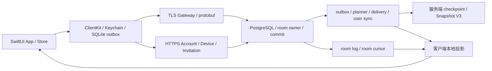

# IM V2 系统设计与实现审查

> **历史归档（2026-09-05 基线）。** 这是整改开始前的原始审查报告，问题编号
> B01–B29、D01–D08、E01–E10 由本文首次提出。文中引用的代码行号对应当时的基准
> HEAD `220f5be7`，不保证与当前代码一致。**判断当前状态请看**
> [问题状态表](../status.md)，**判断当前合同请看** [合同索引](../README.md)。

审查日期：2026-09-05。基准：HEAD `220f5be78ed347bbe8a343be634720070efbb597` 加当前工作区未提交改动，包含新增群邀请功能。审查覆盖 IMApp、IMV2ClientKit、IMV2Core、IMV2Server、协议/压缩边界、IMV2 schema、脚本、CI 和运维文档；重点链路做了深入控制流审查及隔离实验，不等于对全部代码的形式化证明。

**判断：现有分层和持久化基础值得保留，但当前实现仍有会阻塞同步、恢复和登录的关键问题，也存在权限检查不一致。建议先修复 P1，再扩大部署和容量目标。**

本次记录 **29 项已确认实现、配置或文档问题（10 P1、17 P2、2 P3）**，另列 **8 项设计风险**、**10 项仓库已登记的外部发布缺口**，共 47 项。已合并服务端与客户端“缺 accepted baseline”的共同链路问题；跨流重复应用是另一项独立问题。未发现有充分证据支持的 P0。P1 表示应优先修复的权限、核心可靠性或认证阻断；P2 为局部正确性、恢复和集成问题；P3 为较低影响的文档/展示问题。外部发布缺口不计入代码缺陷数。

**系统设计与主要矛盾**

领域模型、传输、持久化和 UI 的总体依赖方向清楚。服务端提交后 ACK、持久化 outbox/inbox、游标恢复、Snapshot shadow tables 在服务器 ACK 后切换、设备 Keychain、HTTP no-store、媒体 grant 等机制均有实现和测试。NATS 被限定为可丢失提示，这一设计本身合理。

风险主要出现在这些机制组合时：accepted 与 mutation 分处不同事件流，多个入口写同一投影却没有统一去重；任务设置了单轮上限，却未保证剩余工作继续被调度；认证、Push 清理与 App 路由的终止状态不一致；审批分阶段提交缺少完整恢复指纹和接管路径；send/edit/forward 在不同 SQL 实现中逐渐采用不同授权规则。因此建议优先统一跨路径不变量和恢复状态机，再做规模优化。

**已确认问题完整表**

| ID | 优先级 | 证据等级 | 问题 | 代码位置与触发条件 | 影响 | 修复建议 |
| --- | --- | --- | --- | --- | --- | --- |
| B01 | P1 | 静态确认 | 幂等比较可因 revision 整数越界终止 Gateway | [PostgresV2MessageEditStore.swift:98](../../../IMV2Server/Sources/IMV2Server/PostgresV2MessageEditStore.swift)；[PostgresV2RoomMembershipStore.swift:302](../../../IMV2Server/Sources/IMV2Server/PostgresV2RoomMembershipStore.swift)；WithdrawalStore:165。同一已成功操作重放时，将 protobuf/domain 接受的 UInt64 直接转为 Int64，缺少上界校验。 | 合法登录用户的异常 revision 可触发不可捕获的 runtime trap，影响整个 Gateway 的连接。未发送崩溃请求。 | 在领域入口统一限制持久化整数范围；使用安全转换，覆盖新操作和幂等分支。 |
| B02 | P1 | 静态确认 | 编辑旧消息绕过当前群写入权限 | [PostgresV2MessageEditStore.swift:27](../../../IMV2Server/Sources/IMV2Server/PostgresV2MessageEditStore.swift) 只检查消息作者、撤回状态和版本；对照 [PostgresV2RoomWriteStore.swift:2012](../../../IMV2Server/Sources/IMV2Server/PostgresV2RoomWriteStore.swift) 的冻结、成员、发言权限和禁言检查。 | 作者被移出群、禁言或房间冻结后，仍可编辑旧消息并向当前成员产生新内容事件。 | 把编辑纳入统一的房间写入授权策略；保留原操作幂等重放语义。撤回清理权限单独定义。 |
| B03 | P1 | 服务端/客户端分支均隔离复现 | room-log 消息的 mutation 缺少原始消息投影，阻塞恢复 | [PostgresV2UserProjectionWorker.swift:597](../../../IMV2Server/Sources/IMV2Server/PostgresV2UserProjectionWorker.swift)、[GRDBV2LocalSyncStore.swift:3065](../../../IMV2ClientKit/Sources/IMV2ClientKit/GRDBV2LocalSyncStore.swift)。direct room_log 的 accepted 不走个人 sync，但 edit/withdraw 仍 fanout；标准群新成员接到入群前消息 mutation 也可能缺 baseline。 | 服务端用户 checkpoint 反复失败并可能 paused；客户端个人同步失败后，后置 room-log 追赶无法执行。影响可扩散至同账号其他会话。 | 统一 accepted 与 mutation 的可靠恢复合同，或持久化缺基线事件并安排补齐；群 mutation 受众与原消息授权相交，不能通过向新成员补发旧全文规避授权。 |
| B04 | P1 | 静态确认 | 转发源缺少消息提交时的成员可见性检查 | [V2ForwardMessagesService.swift:173](../../../IMV2Server/Sources/IMV2Server/V2ForwardMessagesService.swift)；[PostgresV2RoomWriteStore.swift:2072](../../../IMV2Server/Sources/IMV2Server/PostgresV2RoomWriteStore.swift)。两次授权都只看当前 room membership revision。 | 后来加入群的用户若获知旧 messageID，可经转发路径访问入群前历史；与 room-event pull 的历史授权不一致。未向实际服务执行读取。 | 源读取和目标写入二次校验均使用 accepted_membership_revision／原 accepted event 的受众，同时检查当前权限和撤回状态。 |
| B05 | P1 | 锁定依赖隔离复现 | 密码长度规则与 bcrypt 实际输入不一致 | [V2PasswordAccountRoutes.swift:114](../../../IMV2Server/Sources/IMV2ServerHTTP/V2PasswordAccountRoutes.swift) 接受 12–1024 UTF-8 字节且不排除 NUL；锁定 Vapor 的 bcrypt.c:84 使用 strlen，并截断到 72 字节。 | 不同长密码可得到同一验证结果；包含 NUL 的输入实际参与哈希的前缀可短于要求的最小长度。 | 立即拒绝 NUL，并让密码长度/编码合同与实际哈希算法一致；若保留长密码支持，采用经过审查、带版本的完整输入哈希方案并测试迁移。 |
| B06 | P1 | 真实 GRDB 隔离复现 | 同一编辑/撤回经两条事件流到达时不幂等 | [GRDBV2LocalSyncStore.swift:3032](../../../IMV2ClientKit/Sources/IMV2ClientKit/GRDBV2LocalSyncStore.swift)、[GRDBV2LocalSyncStore.swift:3065](../../../IMV2ClientKit/Sources/IMV2ClientKit/GRDBV2LocalSyncStore.swift)。foreground room preview 已应用 revision 2，个人 sync 再应用同一事实时仍要求版本严格递增。 | 抛 invalidMessagePayload，整个个人同步事务回滚，重连重复同一事件仍卡在旧游标。 | 跨流按 source event ID 和 revision 统一去重；相同事实 no-op，旧事实不能覆盖新状态，tombstone 保持终态。 |
| B07 | P1 | 静态确认 | outbox 记录了重试时间，却没有到时唤醒任务 | `V2CommandOutbox.swift`（历史实现，现已退役）；[V2AvailabilityDrivenSyncRunner.swift:28](../../../IMV2ClientKit/Sources/IMV2ClientKit/V2AvailabilityDrivenSyncRunner.swift)；[V2HeartbeatScheduler.swift:15](../../../IMV2ClientKit/Sources/IMV2ClientKit/V2HeartbeatScheduler.swift)。只依赖连接或新的 sync hint 触发 flush。 | 一次可重试失败或过早重连后，安静会话的命令可能长期 pending，健康连接也不自动重试；预算耗尽后同样缺续调度。 | runtime 持有可取消 worker，按最早 nextAttemptAt 唤醒；enqueue、联网恢复和剩余 ready work 都应驱动后续有界轮次。 |
| B08 | P1 | 静态确认 | 认证失效后退出流程依赖已删除的凭据 | [V2AppStore.swift:462](../../../IMApp/IMApp/V2/V2AppStore.swift)、[V2AppStore.swift:493](../../../IMApp/IMApp/V2/V2AppStore.swift)、[V2AppStore.swift:508](../../../IMApp/IMApp/V2/V2AppStore.swift)；Coordinator 终止认证先删凭据。 | Push 曾启用或清理进程中断时，后续 DELETE endpoint 永远无法认证，用户卡在“正在完成退出登录”，不能重新登录。 | 区分终止认证与主动注销；持久化清理步骤，允许凭据已不存在时完成本地退出；远端撤销负责对应端点清理。 |
| B09 | P1 | 静态确认 | 刷新凭据的终止错误未映射成重新登录 | [V2RealtimeSessionCoordinator.swift:41](../../../IMV2ClientKit/Sources/IMV2ClientKit/V2RealtimeSessionCoordinator.swift)；[V2AuthSession.swift:415](../../../IMV2ClientKit/Sources/IMV2ClientKit/V2AuthSession.swift)；[V2AppStore.swift:789](../../../IMApp/IMApp/V2/V2AppStore.swift)。unauthenticated 在 Coordinator 的错误映射之外抛出。 | App 保持 signedIn，反复用已删除凭据重连，不向用户呈现重新认证入口。 | 统一终止认证领域结果；App 同时响应认证状态变化，补刷新撤销到 UI 的组合回归。 |
| B10 | P1 | 独立 App 副本复现 | 邀请预览与实际提交 token 可指向不同群 | [V2GroupInvitationsUI.swift:72](../../../IMApp/IMApp/V2/V2GroupInvitationsUI.swift)、[V2GroupInvitationsUI.swift:79](../../../IMApp/IMApp/V2/V2GroupInvitationsUI.swift)、[V2GroupInvitationsUI.swift:138](../../../IMApp/IMApp/V2/V2GroupInvitationsUI.swift)。打开 B 先替换 token，不清 A 预览；B 请求失败或被 isWorking 丢弃后仍展示 A。 | 用户看到群 A，却向群 B 提交入群申请；旧请求迟到也可覆盖新预览。 | 将 token 与对应预览绑定为同一 ready 状态；切换立即清旧展示，增加 generation/cancellation；只允许提交匹配的预览。 |
| B11 | P2 | 静态确认 | 编辑/撤回后重放原 SendMessage 被误判冲突 | [PostgresV2RoomWriteStore.swift:3545](../../../IMV2Server/Sources/IMV2Server/PostgresV2RoomWriteStore.swift) 读取当前可变正文，[PostgresV2RoomWriteStore.swift:1995](../../../IMV2Server/Sources/IMV2Server/PostgresV2RoomWriteStore.swift) 与原始请求比较。 | 首次 ACK 丢失且消息已被另一端编辑/撤回时，同一 clientMessageID 的合法恢复变成 IDEMPOTENCY_CONFLICT。 | 保存不可变 acceptance 输入指纹与原结果，完整涵盖正文、实体、媒体、mentions、reply/forward。 |
| B12 | P2 | 静态确认 | 房间追赶的一轮预算耗尽后不继续 | [V2GroupEventSync.swift:172](../../../IMV2ClientKit/Sources/IMV2ClientKit/V2GroupEventSync.swift) 返回 mayHaveRemainingWork；[V2AppRealtimeRuntime.swift:1138](../../../IMApp/IMApp/V2/V2AppRealtimeRuntime.swift) 丢弃返回结果。 | 超过每轮 12 个房间，或单房间超过一页积压时，没有新 hint 就可能一直只恢复部分历史。 | 保留每轮预算和公平性，但消费 remaining 标记，逐轮让出执行权并继续追赶。 |
| B13 | P2 | 真实 outbox 隔离复现 | 并发 flush 同时取到同一 pending 命令 | `V2CommandOutbox.swift`（历史实现，现已退役）；`GRDBV2LocalCommandStore.swift`（历史实现，现已退役）。actor 跨 await 不提供整个操作的排他执行。 | 同一命令并发发送两次；第二次本地完成抛 commandNotPending，可造成假失败或触发运行时重连。未发现重复 canonical 消息。 | 为 flush 建立 single-flight，或原子 claim/lease；终态同结果提交应可幂等完成。 |
| B14 | P2 | 静态确认 | 取消单个请求会把迟到响应升级为整条 TLS 失败 | [V2TLSFrameConnection.swift:611](../../../IMV2ClientKit/Sources/IMV2ClientKit/V2TLSFrameConnection.swift) 删除 waiter；[V2TLSFrameConnection.swift:544](../../../IMV2ClientKit/Sources/IMV2ClientKit/V2TLSFrameConnection.swift) 将迟到响应当 unexpectedResponse；:496 关闭 transport。 | 页面取消一个已发送请求，可连带中断其他请求、同步与活动订阅。 | 保留有界取消 request ID 集合并丢弃对应迟到回复，或继续维护 transport correlation；测试取消与其他请求并行。 |
| B15 | P2 | 静态确认，未证实 UI 串号 | 擦除主 SQLite 时遗漏保存正文的独立搜索库 | [V2LocalInstallationBinding.swift:176](../../../IMV2ClientKit/Sources/IMV2ClientKit/V2LocalInstallationBinding.swift)；[V2AppStore.swift:924](../../../IMApp/IMApp/V2/V2AppStore.swift)；[GRDBV2LocalMessageSearchIndex.swift:299](../../../IMV2ClientKit/Sources/IMV2ClientKit/GRDBV2LocalMessageSearchIndex.swift)。 | 账号/安装重绑定或明确擦除时，旧正文仍留在 search DB 及 sidecars；正常搜索的主投影回查降低了 UI 暴露风险，但不等于数据已删除。 | 统一枚举并清理主库、搜索库及两者 WAL/SHM，先关闭对应 pool；补磁盘级清理验证。 |
| B16 | P2 | 独立 App 副本复现 | Push 关闭后，迟到的注册仍可重建远端端点 | [V2PushWakeSettings.swift:154](../../../IMApp/IMApp/V2/V2PushWakeSettings.swift)；[V2PushWakeSettings.swift:220](../../../IMApp/IMApp/V2/V2PushWakeSettings.swift)。generation 只控制 UI 回写，未排序服务器 PUT/DELETE。 | 界面和偏好已关闭，但服务器仍注册且没有待删除标记；相反顺序也可使开启状态不生效。 | 串行化远端状态转换或使用服务端版本条件，迟到结果后 reconcile 最终用户意图。 |
| B17 | P2 | 静态确认 | 连接恢复后，仍打开的会话不重建实时订阅 | [V2ConversationDetailStore.swift:516](../../../IMApp/IMApp/V2/V2ConversationDetailStore.swift)、[V2ConversationDetailStore.swift:320](../../../IMApp/IMApp/V2/V2ConversationDetailStore.swift)。监听抛错即结束，View task 不随连接 generation 重启。 | 正在输入/在线状态一直不更新；群预览长期退化为轮询，通常需离开并重新打开会话。 | 持有活跃房间订阅意图，在连接 generation 变化后重新订阅并清理旧任务。 |
| B18 | P2 | 独立 App 副本复现 | 800 条滑动窗口使更旧搜索命中无法定位 | [V2ConversationDetailStore.swift:275](../../../IMApp/IMApp/V2/V2ConversationDetailStore.swift) 以 timeline.count 是否增长判断翻页前进；:236 将窗口限制为 800。 | 数据和 FTS 明明存在，较旧消息仍无法自动定位；1000 条夹具定位最旧消息失败。 | 根据游标/最早消息边界判断进展，或直接读取目标 messageID 周围的窗口。 |
| B19 | P2 | 静态确认 | 搜索连续加载可重复追加同一页 | [V2ConversationSearchStore.swift:77](../../../IMApp/IMApp/V2/V2ConversationSearchStore.swift) 没有分页 in-flight 状态或结果去重，直接 hits += page.hits。 | 快速重复操作得到重复行和相同 ForEach identity；乱序结果可覆盖较新的 cursor。 | 分页单飞、校验捕获 cursor、按 messageID 去重，并显示加载状态。 |
| B20 | P2 | 静态确认 | 搜索索引建好后页面仍停在 indexing | [V2ConversationSearchStore.swift:68](../../../IMApp/IMApp/V2/V2ConversationSearchStore.swift) 只置 indexing；搜索 task 依赖 query/filter，未监听索引完成。 | 用户一直看到建索引状态，必须改搜索词或重开页面才能得到结果。 | 订阅索引 generation/progress，或在 indexing 阶段执行可取消的有界重试。 |
| B21 | P2 | 独立 App 副本复现 | 实时刷新把已加载会话/联系人分页重置为第一页 | [V2ConversationUI.swift:540](../../../IMApp/IMApp/V2/V2ConversationUI.swift)、[V2ConversationUI.swift:717](../../../IMApp/IMApp/V2/V2ConversationUI.swift)；[V2ContactsUI.swift:199](../../../IMApp/IMApp/V2/V2ContactsUI.swift)。 | 同步新消息时已加载的旧会话/联系人消失，滚动与焦点受影响；100 条会话刷新后退回 50 条。 | 区分首次加载、用户重置和后台刷新，保留已加载窗口，更新已有内容时避免移除整个列表。 |
| B22 | P2 | 配置确认，未做上架验证 | 文件时间戳 API 缺少 App 隐私清单声明 | [V2ConversationMediaDownloadService.swift:209](../../../IMApp/IMApp/V2/V2ConversationMediaDownloadService.swift) 读取 contentModificationDateKey；[PrivacyInfo.xcprivacy:5](../../../IMApp/IMApp/PrivacyInfo.xcprivacy) 仅声明 UserDefaults。 | 归档隐私说明与 App 实际 API 用途不一致；不能据此声称已被 App Store 拒绝。 | 声明匹配实际用途的 FileTimestamp 理由，并检查归档合并报告。Apple 依据见后文。 |
| B23 | P2 | canonical schema + SQL 竞态复现 | 跨邀请并发申请可突破每人 20 条待审上限 | [PostgresV2GroupInvitationStore.swift:136](../../../IMV2Server/Sources/IMV2Server/PostgresV2GroupInvitationStore.swift) 的锁含 operation ID；:155 只锁 invite；:169–174 先读全局人数再插入。 | 已有 19 条时，两个不同邀请同时读到 19，提交后变成 21；单个 invite 的行锁不能保护申请人全局配额。 | 按 applicant 串行化配额检查，或建立原子配额预留；保留 invite 自身额度保护。 |
| B24 | P2 | canonical schema + SQL 复现 | 待审批游标随着审批状态变化而失效 | [PostgresV2GroupInvitationStore.swift:197](../../../IMV2Server/Sources/IMV2Server/PostgresV2GroupInvitationStore.swift) 要求上一页末条仍 pending/approving，:226 将其 ID 作为 nextCursor。 | 该条被另一个管理员批准/拒绝后，下一页返回 400，即使后面仍有待审批项。 | 游标绑定不可变排序键和 room，不要求锚点仍处于当前筛选状态。 |
| B25 | P2 | canonical schema + SQL 复现 | 已耗尽链接不展示，却继续占满活跃链接额度 | [PostgresV2GroupInvitationStore.swift:31](../../../IMV2Server/Sources/IMV2Server/PostgresV2GroupInvitationStore.swift) 计数包含 exhausted；:67 列表排除；:274 只增 used，不改 active。 | 20 个未过期链接耗尽后，管理列表为空但创建报限流；需等待到期或持有旧 ID 才能手动恢复。 | 让配额计数与可用列表条件一致，或展示所有占额度的链接并支持撤销。 |
| B26 | P2 | 双人静态复核 | 审批冲突重试后未持久化实际 membership revision | [V2GroupInvitationService.swift:391](../../../IMV2Server/Sources/IMV2Server/V2GroupInvitationService.swift) 只改局部 expectedRevision；[PostgresV2GroupInvitationStore.swift:243](../../../IMV2Server/Sources/IMV2Server/PostgresV2GroupInvitationStore.swift) 恢复仍取旧 revision。 | 用新 revision 入群成功但最终记账失败后，再恢复命中 membership 幂等指纹冲突，申请长期 approving。 | 明确未提交的 revisionConflict 后 CAS 保存新指纹；恢复优先查已提交 membership operation，再完成记账。 |
| B27 | P2 | 静态确认，条件为多 owner 部署 | 新增邀请链路没有按群所属数据库路由 | [main.swift:202](../../../IMV2Server/Sources/IMV2AccountServerApp/main.swift) 将 invite 和 membership store 都绑 control DB；[PostgresV2GroupInvitationStore.swift:317](../../../IMV2Server/Sources/IMV2Server/PostgresV2GroupInvitationStore.swift) 直接查本地群成员。 | 群只在非主 owner store 时，邀请管理找不到群授权并失败；单库本机测试不会暴露。 | 邀请状态、群授权和 membership mutation 按 owner 路由；或明确限制该功能的部署范围并在配置层拦截。 |
| B28 | P3 | 静态确认 | VoiceOver 筛选值朗读内部 UUID | [V2ConversationUI.swift:1218](../../../IMApp/IMApp/V2/V2ConversationUI.swift) 的 sender 筛选 accessibilityValue 使用 sender.rawValue。 | 辅助技术用户无法理解当前筛选对象，与公开身份展示约束不一致。 | 使用显示名或公开 handle；内部 ID 只用于稳定机器标识。 |
| B29 | P3 | 文档与生成物比对确认 | 当前协议版本文档已漂移 | [implementation-status.md:20](../../../IMV2/docs/implementation-status.md) / :35 声称当前 protocol 19；[IMV2ProtocolVersion.swift:3](../../../IMV2ClientKit/Sources/IMV2ClientKit/Generated/IMV2ProtocolVersion.swift) 与服务端生成物均为 21。 | 按“当前合同”开发或部署验证会选错版本；链接检查和生成物 diff 不会检查这段文字。 | 协议说明由 protocol_version.txt 生成或在门禁中检查文档数值；同步更新能力矩阵。 |

B22 的官方依据：Apple 将 contentModificationDateKey 列为需要声明用途的文件时间戳 API；App 自有容器元数据用途对应的理由需按实际行为选择。[Apple 文件时间戳 API 及理由](https://developer.apple.com/documentation/bundleresources/app-privacy-configuration/nsprivacyaccessedapitypes/nsprivacyaccessedapitype)。本次没有执行上架，也没有声称发生实际审核拒绝。

**设计风险与恢复缺口**

| ID | 优先级 | 风险 | 证据/条件 | 建议与验证边界 |
| --- | --- | --- | --- | --- |
| D01 | P2 | 旧 TLS reader 的迟到失败可能关闭新连接 | [V2TLSFrameConnection.swift:487](../../../IMV2ClientKit/Sources/IMV2ClientKit/V2TLSFrameConnection.swift)、:640、:683。旧 reader callback 与当前 transport 共用状态，缺 connection generation fence。 | 增加 generation 校验和旧任务 drain；用真实 Network.framework 故障时序验证。本次未复现实网竞态。 |
| D02 | P2 | Push 冷启动依赖 View 出现与会话恢复时序 | [V2RootView.swift:157](../../../IMApp/IMApp/V2/V2RootView.swift)、[V2AppStore.swift:834](../../../IMApp/IMApp/V2/V2AppStore.swift)。handler 在 onAppear 绑定，非 signedIn 直接 noData。 | 在 App/delegate 可用边界共享带期限的 restore 任务；真机验证未创建可见 scene 的后台启动。 |
| D03 | P2 | 后台 Push 跑完整 runtime，缺总时间预算 | [V2AppStore.swift:841](../../../IMApp/IMApp/V2/V2AppStore.swift)、[V2ClientRuntime.swift:167](../../../IMV2ClientKit/Sources/IMV2ClientKit/V2ClientRuntime.swift)。全量追赶、reset、outbox 和维护共享一次唤醒。 | 提供受时间/页数/命令数限制的后台同步入口，截止前落盘并结束 completion；不能仅依赖单请求超时。 |
| D04 | P2 | 媒体文件和缩略图缺账号/安装级生命周期 | [V2AppStore.swift:897](../../../IMApp/IMApp/V2/V2AppStore.swift)、[V2ConversationMediaDownloadService.swift:203](../../../IMApp/IMApp/V2/V2ConversationMediaDownloadService.swift)。共用 media-cache/media-staging，退出不清缩略图。 | 明确退出保留策略，按账号/安装分目录并清内存缓存；未证实正常 UI 能跨账号读取旧媒体。 |
| D05 | P2 | 原审批人失去权限后，孤立 approving 无接管路径 | [PostgresV2GroupInvitationStore.swift:235](../../../IMV2Server/Sources/IMV2Server/PostgresV2GroupInvitationStore.swift)、:243、:303；ADR-019 明确限定同一审批人恢复。 | 增加有审计的 owner/operator 修复入口，先核验 membership operation 是否提交，再 finalize 或释放。原人恢复本身是明确取舍，风险是失权后的恢复缺口。 |
| D06 | P2 | 待审申请缺少申请人取消或清理机制 | [PostgresV2GroupInvitationStore.swift:169](../../../IMV2Server/Sources/IMV2Server/PostgresV2GroupInvitationStore.swift)；HTTP routes 无本人取消接口，schema 无 cancelled 状态。 | 定义申请 TTL、自助撤回或申诉流程。链接到期不等于申请到期；问题是 20 个无人处理申请可长期耗尽个人额度。 |
| D07 | P2 | 不同消息路径重复实现授权、准入和投影规则 | [PostgresV2RoomWriteStore.swift:2012](../../../IMV2Server/Sources/IMV2Server/PostgresV2RoomWriteStore.swift) 与 [PostgresV2MessageEditStore.swift:27](../../../IMV2Server/Sources/IMV2Server/PostgresV2MessageEditStore.swift) 已出现规则漂移；RoomWriteStore 约 9517 行。 | 围绕统一授权、幂等输入、admission 和投影 reducer 提取内部边界；为 planner/preplanned/room_log/hybrid 建合同矩阵。文件长度本身不构成缺陷。 |
| D08 | P2 | 关键状态机的组合测试不足，能力证据描述过宽 | [V2GroupInvitationServiceTests.swift:7](../../../IMV2Server/Tests/IMV2ServerTests/V2GroupInvitationServiceTests.swift) 仅有密钥与 create 校验，:106 后审批相关 spy 路径均未使用；[implementation-status.md:40](../../../IMV2/docs/implementation-status.md) 已概括域/HTTP/schema 回归。 | 新增真实 store 的 approve/recovery/并发/跨 owner 测试，以及跨流事件、认证终止、冷启动组合测试；将声明逐项关联到具体测试与报告。 |

D03 需结合 Apple 后台唤醒的执行时限设计，而非仅依赖单请求超时。[Apple 后台更新说明](https://developer.apple.com/documentation/usernotifications/pushing-background-updates-to-your-app)。D01–D06 的真实设备、网络或运维触发尚未全部复现，不能描述为已发生的线上事故。

**既有外部发布缺口**

以下来自 [仓库开放风险登记表](../../../IMV2/docs/10-operations/residual-risk-register.md)，结合 [当前实现状态](../../../IMV2/docs/implementation-status.md) 核对。它们说明证据尚未闭环，不代表本次观测到外部服务故障。

| ID | 领域 | 当前缺口 | 关闭条件 |
| --- | --- | --- | --- |
| E01 | 生产部署、密钥、证书与 operator 入口 | 仓库尚无闭环的生产拓扑、secret manager、轮换及回滚证据。 | 最小权限预发布部署；TLS/密钥轮换、operator bastion/mTLS、上线回滚和审计验收。 |
| E02 | 生产 Passkey / WebAuthn | 有客户端与传输边界，缺生产 RP verifier、一次性 challenge/counter store。 | 完成 origin/RP/counter/重放校验及真机注册登录；本机密码路径不能代替。 |
| E03 | 生产媒体存储、扫描和 CDN | 本地文件 provider 与 EICAR 夹具仅能提供本机验证。 | 接入真实对象存储/扫描/CDN，验证 multipart abort、故障恢复、滥用和保留策略。 |
| E04 | 真机、多端、无障碍和签名 | Simulator/unit 证据不能覆盖 Keychain 锁屏重启、邀请双端、相机、VoiceOver、发布签名。 | 受保护 runner 与真机多端验收，包含离线恢复、权限和辅助技术。 |
| E05 | 真实 APNs | 缺真实凭据、Push profile、失效 token 与后台唤醒证据。 | 验证 opt-in/out、轮换、断网、无可见 scene 冷启动及后台预算。 |
| E06 | NATS 生产安全和可观测性 | TLS/NKey、broker/reconnect/consumer-lag 指标与分区/重连长稳证据未闭环；hint 丢失本身不是可靠性 bug。 | 完成认证、指标和故障演练，证明 hint 不可用时 durable cursor 仍恢复。 |
| E07 | WAL/PITR、RPO/RTO 和灾备 | 逻辑 dump/restore 不证明时间点恢复或跨区故障转移。 | WAL archive、时间点恢复、密钥恢复、写入中断演练及批准的 RPO/RTO。 |
| E08 | 远端 CI / 干净 checkout 证据 | 风险表登记 Actions 额度耗尽；本次未查询当前 GitHub 账户状态，不能断言额度今天仍耗尽。 | 恢复远端或受保护 runner，在干净 checkout 跑统一门禁，并保存与代码版本绑定的结果。 |
| E09 | 完整混合负载、长期运行与多 Gateway/分片容量 | 50k/5000 msg/s 等记录对应限定 workload，尚不能推出生产全场景 SLO；物理 owner 的功能覆盖和迁移也有阶段限制。 | 固定代码和 workload，覆盖长周期 checkpoint、混合消息、热点群、离线恢复、多设备、多 Gateway、kill/failover 和资源余量。 |
| E10 | ARM64 Linux 压力下历史 SIGSEGV 根因未关闭 | 风险表 R-010 记录曾出现 libdispatch worker 崩溃，后续未复现但缺原始 core/符号化根因。 | 同一正式 binary 数小时 soak、受控重启、core dump 和符号化；不能用一次测试通过宣布根除。 |

**本次验证结果**

| 验证 | 实际结果 | 范围/限制 |
| --- | --- | --- |
| Core 现有全量单元测试 | 64 tests / 20 suites 通过 | XcodeDefault Swift 6.3.3，原工作区源码。 |
| ClientKit 现有全量单元测试 | 213 tests / 39 suites 通过 | 原锁定依赖，disable-automatic-resolution。 |
| App 现有单元测试 | 114 通过 / 0 失败 / 0 跳过 | iPhone 17，iOS 26.2；构建和测试产物位于临时 DerivedData。 |
| 真实 ClientKit 临时 executable | 同一命令并发 flush 后第二调用 commandNotPending；重复 edit/withdraw 均 invalidMessagePayload，个人游标保持 1；无 baseline edit 同样失败 | 链接审查时已有 build objects，只使用临时随机 SQLite，不连接真实账号。 |
| 真实服务端 projection worker | claimed=true、applied=0、failed=1 | 在独立 server_audit PostgreSQL 库输入合法 edited delta、无 message baseline；是 worker 分支验证，并非 send→edit→fanout 全链路 E2E。 |
| 群申请 SQL 竞态 | 两笔不同 invite 的事务各读到 19，全部提交后 21 | 本次创建的 PostgreSQL 16.13、canonical schema、两个群的匿名夹具。 |
| 群分页/链接额度 SQL | 已审批 anchor 校验 false，但仍有 19 条后续待审；耗尽链接 activeCount=20，管理列表=0 | 重放实际 store 的筛选与计数条件；未通过实际 HTTP 服务。 |
| 锁定 bcrypt 实现 | 72 字节后不同后缀等价；12 字节含 NUL 输入与短前缀等价 | 仓库 .build 中锁定 Vapor 的 C 实现，固定测试盐；无真实密码/账号。 |
| 独立 App 副本异常场景 | 历史定位、刷新丢分页、Push 远端状态、邀请 token/preview 错配，新增断言均揭示缺陷 | 仅临时副本增加测试，App 实现未改；副本重新解析的 GRDB/Protobuf 版本较原工程新，但这四项均使用相同 App 源码与内存 fake，不依赖其数据库/协议实现。 |
| schema / 配置 / 文档脚本 | clean schema 导入、readiness relation coverage、runtime env examples、文档链接、local environment contract、App 网络配置和 Debug 默认值校验通过 | clean schema 导入不等于完整 pg_dump drift/迁移/灾备验证；文档链接通过不代表内容正确，B29 即为例子。 |

现有三套单元测试共 **391 项通过**。针对问题构造的隔离断言失败，证明的是这些未覆盖场景在当前实现下存在问题，并非把原有测试套件说成失败。

本次未运行完整 Server package/双 PostgreSQL integration、整套 `scripts/verify_v2.sh`、完整 signed-out UI 门禁、生产负载/故障演练、真机 APNs/Keychain/无障碍、签名归档和上架。默认 Docker daemon 不可用，数据库验证改用本次创建的一次性本机 PG；没有触碰已有业务数据库。最初编译缓存、模拟器和 PG socket 的沙盒限制经自动审批后解决，不构成仍待用户处理的阻塞。

可复查日志：Core `/private/tmp/im-system-audit/core-tests.log`；ClientKit `/private/tmp/im-client-full-tests.log`；App `/private/tmp/im-audit-app-tests.xcresult`；临时实验分别位于 `/private/tmp/im-system-audit`、`/private/tmp/im-client-audit.swift`、`/private/tmp/im-server-audit` 和 `/private/tmp/im-audit-app-*-regression*.xcresult`。临时目录可被系统清理，关键结论和输出已写入本报告。

**建议修复顺序与验收**

1. 先处理 B01–B10：异常整数边界、历史消息权限、密码输入、两种同步合并、outbox 活性、认证终止与邀请身份绑定。先补能够失败的最小回归，再修实现。
2. 将事件测试扩为模式矩阵：planner / preplanned / room_log / hybrid × accepted / edit / withdraw / redact × 重复、乱序、缺 baseline、成员增删、snapshot reset。验收要同时观察 canonical state、用户 checkpoint、客户端 cursor 和 UI。
3. 修复 B11–B27 与 D01–D06：恢复指纹、周期调度、取消/连接代次、分页稳定性、数据清理、Push 和审批生命周期。保证中断后能自动或由明确入口恢复。
4. 补足真实 store/HTTP/跨 owner 组合测试；在干净 checkout 运行统一门禁，更新 B29 与 D08 的证据链接。之后再按 E01–E10 逐项完成发布准备和完整 workload 验证。

本次仅新增审查文档，未修复或提交业务源码，也未部署、重启现有服务或向他人发送消息。问题表是当前代码、明确触发条件与已执行验证下的完整清单，不保证不存在尚未触发或未检查到的问题。
