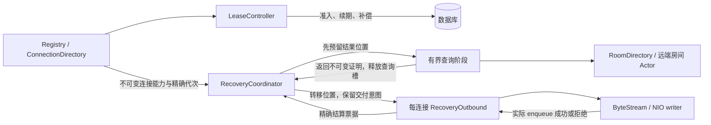

# 连接 Registry 与恢复管线的改造设计

## 当前机制范围（2026-10-05）

本文中的资源所有权、精确代次、真实 enqueue 和真实排空要求继续适用。后续产品语义改变了房间接收机制：认证后账户成员覆盖建立 Owner 投递引用，客户端详情兴趣独立。Room Owner 的授权与水位状态由其订阅 Authority/连接写入 worker 管理，不再进入通用恢复协调器的房间 SQL 查询阶段。

已删除通用房间兴趣安装器、SQL 授权执行器、批次回调、prepared-room 证明/调度、重复 socket 索引以及旧批次诊断字段。通用协调器只接受账户、presence、typing scope；房间 scope 的 request/begin 明确拒绝。本文旧房间准备批次、30 秒 viewer SQL 证明及 work/queued-prepared-expired 指标描述属于被替代机制，不能据此重新添加它们。presence 原始观察证明、1024 位置总账、独立查询/兴趣/控制名额与写入排空仍保留。

详情关闭在首次 await 前捕获分片路由表中的原 stream；订阅状态只拥有连接到房间的身份索引，不再复制房间到 socket 的字典。原容量验收未通过，本轮不启动大档测试；最新正确性证据见 [增量审计](account-membership-incremental-audit.md)。


本设计针对 `IMV2ServerGateway` 的连接与恢复管线。不改变持久消息、幂等发送、回执与 Wake Relay 的语义，不把 Registry 的每个字典机械包装成一个 Actor。实现和验收记录见同目录 `connection-recovery-refactor.md`；结构测试通过不等于容量测试通过。

## 1. 为什么可重入仍会卡住

Swift 的 Actor 保证隔离访问，`await` 后允许其他任务进入，但不会自动释放业务代码预留的名额。若四个任务都在等 socket，Actor 仍可接收第五个请求，第五个请求却没有调度名额。这里首先是资源等待耦合，并非证明 Swift 执行器死锁。

另一个危险是关闭等待链：注销等待认证 SQL，测试或上层又等待注销后才允许认证完成；或者 SQL 续期回调等待关闭，关闭再等待同一个续期批次结束。这些依赖环不会被可重入自动消除。

官方依据：

- [SE-0306 Actors](https://github.com/swiftlang/swift-evolution/blob/main/proposals/0306-actors.md)：隔离函数跨暂停点可能交错执行；Actor 调度不提供严格 FIFO。因此先调用 begin、后调用 end，不足以保证跨 Actor 消息应用顺序。
- [SE-0304 Structured Concurrency](https://github.com/swiftlang/swift-evolution/blob/main/proposals/0304-structured-concurrency.md)：结构化并发约束子任务的生存期；取消是合作式的，发出取消不代表实际操作已经结束。
- [Swift 6 数据竞争安全指南](https://www.swift.org/migration/documentation/swift-6-concurrency-migration-guide/dataracesafety/)：跨异步调用后隔离状态可能变化；同步临界区不能依赖未来工作的完成。
- [SwiftNIO 官方项目](https://github.com/apple/swift-nio)：传输由事件循环和 Channel 管理。业务恢复排队与 Channel 可写性是两种不同的资源约束，应各自计量。

由这些机制推导出的项目设计要求是：每个阶段有唯一状态所有者、明确容量和结束条件；每次实际提交都验证权限；关闭先撤销提交能力，再等待真实操作结束。

## 2. 所有权与模块边界

| 所有者 | 拥有的状态 | 不应拥有的状态或等待 |
|---|---|---|
| `V2DeviceConnectionRegistry` + `V2ConnectionDirectory` | 连接身份、生命周期、用户/设备索引、注册/注销入口、订阅入口编排 | 恢复轮转、授权证明、socket 等待占用查询名额 |
| `V2ConnectionLeaseController` | 准入与续期实际操作、已确认租约截止时间、过期、迟到补偿、清理任务 | 房间水位与 Ready；SQL 回调不能等待依赖同一 SQL 的连接关闭 |
| `V2RealtimeRecoveryCoordinator` | scope 代次、恢复需求、H、证明、覆盖确认、尝试身份、队列与位置账本 | 连接身份的镜像字典、数据库驱动、物理 Channel |
| Coordinator 内部的有界查询执行阶段 | 房间/Presence 恢复查询根任务、实际尝试、实际完成与排空 | Ready/socket 写入；不要求新增 Actor 类型 |
| `V2PresenceObservationExecutor` | presence 查询批次、结果完整性、实际任务 | socket 等待；它也必须分离查询和交付 |
| `V2GatewayRecoveryOutbound` | 每连接有界交付意图、单 worker、实际结束回调、撤销与排空 | 用户全局路由、权限查询、无限 payload 缓冲 |
| `V2GatewayByteStream` / NIO writer | 编码、已有覆盖槽、字节/帧预算、可写性、实际 enqueue | 再次建立全局恢复调度器 |

Directory 是由 Registry 隔离的结构体，不需要额外 Actor。恢复和租约具有不同的等待和关闭生命周期，使用独立 Actor。物理 socket 继续留在所属进程；跨节点入口继续使用现有分布式 Gateway 引用。此次拆分不要求把 Channel 变为分布式 Actor。

Presence 刷新不能只迁移存储调用：查询队列、活动键、等待者、批次、原始证明、结果交接与真实排空一起归 `V2PresenceRefreshCoordinator`。Registry 只从当前订阅索引选取不可变目标并提供精确有效性检查。结果按批次、请求、连接 lifecycle 与 scopeGeneration 的精确目标票据结算，不能仅扣减剩余数量；重复回调不能替另一设备归还位置。

Coordinator 获取不可变的连接执行能力：`connectionID + lifecycle + identity + stream`。这不是第二个可修改的在线连接 Registry。安装和撤销由连接所有者控制；不得依据旧执行能力重新查询一个同 ID 的新连接。



## 3. 恢复状态与阶段协议

逻辑状态：`Recovering → 等待授权 → 已准备结果 → 出站保留 → H 已实际提交 → Ready 已实际提交`。失败可以回到 Recovering；结束状态只能由精确代次撤销。执行阶段与协议状态分开，例如出站已保留不代表 Ready 已提交。

每次工作必须携带：

```
connectionID, connectionLifecycle
scopeKind, scopeID, scopeGeneration
attemptID, demandRevision
observedAt, originalAuthorizationDeadline
coverageConfirmation, requiredHighWatermark
```

`scopeGeneration` 解决同一连接退订/重订；`connectionLifecycle` 解决 UUID 复用；`attemptID` 解决迟到和重复结果；`demandRevision` 解决执行期间的新 H。不能拿其中一个字段替代其他字段。

订阅入口必须在第一个跨 Actor `await` 前同步生成 scope 意图；Coordinator 收到 begin 后核对当前意图。end 同步撤销精确代次，随后异步清理只作用于该代次。这样即使旧 begin 晚于新 end 执行，也不能复活已结束订阅。

## 4. 容量账本和交接

沿用有界配置，先不靠加大限制解决问题：

- 房间授权实际尝试最多 4 个；presence 实际查询单独最多 4 个，每批最多 128 个去重查询键。
- 兴趣取得独立最多 4 个实际根任务。冷兴趣先取得精确回执再转为 query-ready；已有精确取得回执的 scope 直接进入查询，不被其他冷兴趣等待占据查询名额。兴趣回执不能充当成员权限证明。
- 已准备结果及其他 scope 的短交接调度使用独立、最多 4 个工作名额；它们结束于有界出站 offer，不等待 socket。兴趣、查询、短交接的根任务分别最多 4 个，合计最多 12 个调度记录；这不是 12 个数据库查询。实际授权尝试另外计量，仍最多 4 个；下游 Directory 的物理 RPC 四槽仍全局共享。
- 恢复位置总账最多 1024，覆盖排队、授权结果预留、已准备结果、交接中的结果和出站票据。不能给每个阶段各加一个 1024 而扩大总容量。
- 每连接出站最多 5 个 kind 位置，包含执行中与排队中；同 kind 的重复交付拒绝保留，由 Coordinator 合并最新 H 并在位置释放后重试。
- 物理写入沿用原有帧/字节预算和覆盖槽，不再增加编码后 payload 队列。

一次授权的位置流转：

1. 从队列选取 scope 时，先预留该结果返回位置，再启动查询。
2. 查询返回后，根据原始连接/订阅/尝试身份应用结果；无效结果也要准确结算原位置。
3. 证明转为准备结果或交接票据，容量所有权只移动一次。
4. 出站 `offer` 成功只表示接管交付意图。它不等待 socket，所以查询执行名额可以结束。
5. 实际 enqueue 成功或明确失败后，出站回调归还票据，Coordinator 更新当前代次的状态。
6. 取消或退订只撤销执行能力；实际 SQL/写调用尚未结束时不能提前借出其执行名额或结果位置。

授权可以按 `(roomID, viewerUserID)` 去重，结果仍要分别检查每个设备的 lifecycle 与 scopeGeneration。一个设备退出只释放自己的订阅所有权，不取消另一个设备的需求。

公平调度只服务尚未派发的工作，按 prepared room、room interest、fresh room authorization、other interest、presence query、other scope 分类轮转。Presence 恢复等待查询所有者时属于统一 query-root 四槽，不占 control；底层 Presence SQL 的实际次数使用独立查询所有者指标，不能把读取准备证明计为 SQL。兴趣取得的返回位置原子转为 query-ready，不能先释放再重新借入。已派发 socket 等待不再占用该轮转的查询槽。队列满时保留有界 scope 需求，通过主表稳定游标继续轮转；每轮访问有界，不另建无限 ID 列表。空闲类别可交换尚未派发位置，被替换的 prepared 证明同步丢弃，禁止保留账本外结果。跨 scope 不承诺严格 FIFO。

Presence 的实际查询键与结果交付位置必须分开：query-active 只覆盖实际查询和短结果准备；返回后同步转移为 `(batchID, request)` 的结果位置。总容量是 queued request keys + query-active keys + retained result positions，仍不超过 1024。旧 socket 等待不能封锁同一查询键的新设备；旧结算只归还精确结果批次，不能删除后继查询的 active 键。查询已经派发后到达的同键请求可以要求新 SQL 快照，不能宣称所有时间重叠请求都会共用旧观察。

Presence 的周期刷新与恢复请求也要共享同一原始观察证明。周期刷新已经返回的结果应可被恢复使用；已经实际交付的 presence receipt 则不再重发 H。否则虽然查询和 socket 分离，两个入口仍会为同一 scope 重查权限并重复交付。准备证明与实际 receipt 必须分别记录，均携带原 lifecycle、scopeGeneration 和 deadline。

## 5. 写入时的安全和顺序

实际 socket enqueue 前，同步验证以下条件并与 enqueue 构成一个临界区：

- 全局仍允许写入、该连接仍有效、出站 worker 未撤销。
- scope 代次仍当前，交付 revision 与覆盖确认仍有效。
- 原始授权截止时间未到；禁止因为排队或重试重新起算 TTL。
- H 满足当前单调递增需求，Recovering 已实际提交。

同步检查不能包含网络或数据库等待；相关 Mutex 的锁顺序必须固定。保留意图的返回值和实际 enqueue 返回值必须使用不同的 API 语义。

Recovering、H、Ready 走原有物理 writer，保证 Recovering 不被 H/Ready 超越。只有 H 实际接受且达到最新需求，才能接受 Ready。客户端自己的消息应用游标不等于服务端 H 保留回执，不能互相替代。

新 H 到达时做 `requiredH = max(requiredH, newH)`。已经提交旧 H 后若需求增大，旧 Ready 必须拒绝，继续恢复。失败交付可以重试；权限失效必须重新授权，不允许仅靠 socket 重试延长证明。

暂时不可写不等于授权失效。出站票据应保留原不可变证明；失败结算时，只有原 deadline、连接/订阅代次和覆盖确认仍有效，才可恢复为 prepared 供重试使用。新 H 仍需满足最新需求；不得复活退订结果或把旧证明包装成新授权。否则慢 socket 会变成每次重试重新查库，反而放大原热点。

## 6. 租约、注销与关闭

心跳只记录本地活跃并安排有界续期，不凭本地心跳延长数据库权威。确认成功的数据库时间映射为单调时钟截止时间；失败、unknown 和超时保留旧截止时间。

注销分为两阶段：

1. 同步撤销连接及 scope 的写能力，移除用户/设备索引，阻止新工作。
2. 取消可取消任务，由拥有者等待实际 SQL/写入结束；迟到准入或续期由租约控制器执行补偿清理。

若准入 SQL 尚在执行，注销不能同步等待该 SQL 才返回。相同 UUID 的实际操作位置仍保留，直到 SQL 和补偿结束；因此返回注销不等于可以立即复用其旧操作身份。清理 worker 仅接收实际操作已结束的 eligible ID，避免一个被阻塞准入拖住所有清理。

整体 shutdown 在第一次 `await` 前永久撤销全局写能力。之后关闭恢复入口、撤销 scope、停止定时器、取消执行、排空授权/presence/出站/租约任务。`actualQuery == 0` 不代表 shutdown 完成，还要等 outbound 与实际 SQL 结束。

不要把取消后未结束的工作交给无所有者 `Task`。长期 worker 要保留句柄并在 shutdown join；有限批次使用结构化子任务。补偿和 expiry callback 不允许引入关闭依赖环。

### 兴趣订阅的精确释放

每次取得兴趣拥有唯一票据，携带连接 lifecycle 和 scopeGeneration；退订同步撤销票据。异步释放只能删除该 owner，多个设备仍共享物理 topic 的订阅。迟到激活先等待自己的真实操作结算，再进入有界释放阶段，不能直接绕过清理预算。

兴趣释放执行器只保留最多 1024 个已接管票据、实际最多 4 个操作。满载拒绝接管，不创建第二个票据等待队列；原生命周期所有者继续保留被拒绝票据，由一个有句柄的推进任务等待容量。旧票据未被接管前不能被新取得覆盖。注销在第一次等待前撤销写能力，连接退休操作位置持续计量至清理责任转移，避免新 UUID churn 绕过准入预算。

未结束激活的票据仍占保留位置，但不占实际释放名额。已有激活根任务在真实结束后精确通知释放所有者，随后才进入 eligible 清理队列；四个慢激活不能堵住第五个已可清理 owner。主所有者表用固定兴趣类别定位一个连接的票据，退休调度索引只索引已撤销的原票据，避免批量关闭全表扫描产生平方级成本。

兴趣依赖在启动前安装，运行中不替换 helper 实例；Broker 网络重连由同一管理器恢复。终止时先关闭准入和撤销票据，再等待旧 helper 与实际释放排空，不允许旧 helper 的 shutdown 撤销新实例的物理订阅。

## 7. Directory 与下游边界

已缓存远端引用仍由现有 Actor transport 调用；此次改造不能把房间查询热点藏进另一个串行队列。冷位置解析先启动，随后处理已知 host。各 host 独立返回准备结果，不等待整个批次最慢 host。

物理 recovery RPC 的四槽限制必须是 Directory 全局限制；不能每个外层 worker 又启动四个 RPC，形成 4×4。取消等待者可以移除未开始请求，已提交 RPC 必须实际完成才释放槽。回调按查询键匹配，保留原 deadline 与位置失效分类。

## 8. 观测和判定原因

按阶段报告数量、最老等待时长、开始/结束计数、拒绝及超时：queued、authorization execution、authorization returns、prepared、outbound retention、inline retention。不要把同一 scope 在不同阶段的状态相加当作连接数。

根任务与查询尝试由独立 `recovery_attempts` family 计量：interest_activation、query_root、control 的单位是 root_tasks，authorization_query 的单位是 query_attempts。query_root 包括房间与 Presence 的准备请求，不等于 SQL；Presence 实际批次由独立所有者计量。旧 actual / actual_scopes 是同一组根任务持有的 scope 别名，不能相加；出站接管后由 outbound_retention 继续计量至真实结算。

退休连接写入由 Registry 保留精确清理责任，继续占 Directory 操作位置；最多 16 个不继承关闭回调 TaskLocal 的独立 worker 执行实际排空。retired_recovery_writer 的 retained_streams 与 actual_drains 分别报告流和 worker 及原始年龄，不能相加。永久撤销也必须阻止新的 retry worker，不能只拒绝 enqueue。

关键判定：

- query 低、outbound 高：写入/背压热点，检查可写性、帧/字节预算、证明等待过期。
- query 高且结果很慢：授权查询、Directory、远端或数据库热点，检查 host 窗口与事务等待。
- queued 长期增长但各执行阶段很低：调度唤醒或容量归还错误。
- actual 归零但关闭不结束：找实际出站、补偿 SQL 或 worker join，而非增加查询并发。
- Ready 拒绝增多：区分权限过期、代次失效、H 不满足和覆盖确认变化。

r6已为这些实际Ready检查增加固定原因计数，并另区分权限证明缺失、
关闭、仍在Recovering和enqueue拒绝。计数表示失败检查或被抑制的转换，
不是独立失败操作数；一次交付或保留重试可能产生多次检查，不能把
enqueue拒绝直接当成socket容量耗尽。八个固定Atomic计数器不获取原写入
围栏或耗时指标Mutex，覆盖ByteStream保留后的重试；跨原因快照不承诺原子。
受影响测试已通过，r6容量尚未验收。

标签仅使用阶段、scope kind、失败原因等低基数值；连接/用户/房间 ID 只能进入受控诊断，不作为全量 metrics 标签。

## 9. 实施与验收

按五个可审查阶段推进：连接 Directory 与租约所有权；出站保留/实际写入分离；恢复状态迁移及位置账本；presence 与 Directory 下游分离；最后整体验证及容量比较。每阶段保持可编译，完成最后一次边界审查后运行相关测试，不重复全套编译或逐次跑 5000 档。

必要的确定性测试包括：五条慢写连接不影响新授权；过期证明不能 Ready；先撤销后晚 enqueue 仍失败；退订/重订不能接受旧结果；取消保留实际查询名额；返回位置总账不超过 1024；同用户多端去重查询但分别校验；迟到 SQL 补偿；慢准入不阻塞其他连接清理；冷解析不等 warm host；跨批次实际 host RPC 最大为 4；shutdown 真实排空。

容量验收保留原本 10k/1000 → 50k/1000 → 5000 的逐级门槛。前一级质量不通过不进入后一级，不调整 TTL、观察窗口、质量分母或等待条件来制造 PASS。记录源码与二进制身份，并避免把未完成 Relay 方案的变动混入 Registry 改造的因果结论。单元测试仅证明所覆盖的不变量，最终是否解决真实容量热点仍由对应负载证据决定。

Presence 查询队列的唯一所有者合并周期刷新与冷恢复入口的相同查询键；设备目标和等待者仍分别有界、分别结算。跨设备共用一次查询不能省略每个目标的 lifecycle、scopeGeneration 与权限结果验证。是否实际合并同一批冷请求由针对性 gate 测试证明，不能由类型拆分推断。

## 9. Registry 剩余职责收拢

新增 Registry 隔离的同步 V2ConnectionSubscriptionState，拥有 Foreground、Presence 和 Typing 的正反索引与 mutation token。身份与注册 lifecycle 仍仅由 Directory 管理；物理 interest ticket 与授权证明仍由原所有者管理。detach 在第一次 await 前成对移除索引并返回精确旧 stream，异步清理不再重新查询后继连接。

退休 Writer 的 stream、队列、实际 worker、年龄和真实 join 由 V2GatewayLifecycleSupervisor 管理。Registry 注销先同步撤销身份、scope 和写入能力，保留 Directory 的真实退休操作责任，再同步转交。worker 最多16，实际 stream drain 与精确生命周期回调结束后才归还位置；shutdown 不能在异步转交间隙遗漏 stream。

完整位置指标来自 Coordinator 同一隔离点：queued + authorization returns + selected handoff + outbound = occupied，capacity1024。prepared 属于 queued 时不另加；scope/root gauges 不加入总量。固定 stage 导出计数与原始最老年龄，空账本输出零。

## 10. 有界调度执行与独立耗时采样

通知、授权返回与出站结算只合并一个调度请求，不在调用者续体中遍历全部需求。V2RecoveryOrderedStore 的单一节点拥有值与前后链接，稳定游标在插入和删除后仍可推进；它是 primary 状态，不复制第二份需求。唯一1024队列也使用同一类有序节点操作，替代数组搬移及 membership Set。

一个持有句柄的 scheduler 根每次最多扫描128个 primary 需求和128个 queued 项；两个量分别计数。整轮中通过 yield 允许其他 Actor 任务推进，不对每个 quantum 加固定 sleep。每个新增队列节点延续完整游标轮，避免空闲 lane 的尾部工作被已满 lane 遮挡。Prepared cohort 使用同节点表的独立指针，整个 root 合计最多128次队列访问。原serviceclass轮转、4/4/4根名额、128查询批次和原始重试时间仍适用；跨scope不承诺严格FIFO。

账本满时，缺失且空闲的类别可以交换一个尚未执行的 queued 位置。若受害者是prepared，则同步丢弃其证明，不保留账本外结果；primary需求、水位和物理兴趣仍保留，下次重新准备权限。这可能增加极端拥塞下的查询次数，需要实测观察，不能通过扩容掩盖。

Scheduler和最多一个timer都有实际句柄。取消timer后先join实际value再安装后继；关闭入口后join scheduler、timer和实际业务根。

独立 /metrics/recovery-scheduling 从同步固定规模快照渲染，不等待完整采集中的其他Actor。Pump同步耗时、短offer Actor往返、逻辑interest调用、room provider调用和control整个cohort分别累计次数、总时长及进程生命周期最大值；provider时长包含callee自己的排队和结果回调，不等于纯RPC/SQL执行时间。扫描指标累计真实访问次数而非唯一scope数。可选benchmark --recovery-scheduling-metrics使用独立采样线程，保留原负载、窗口与质量门槛。

## 11. r2-driven stage corrections (verification pending)

Short offers and outbound positions did not wait long for sockets, but ordinary
pump requests still restarted complete primary rounds. Separate queued work
from primary admission/refill. Refill follows its stable cursor and pauses when
the ledger fills; new scopes, unrepresented hint downgrade and original retry
retain fairness. Actual position release must revive unrepresented tails even
without new input or failed-output retry.

Send-owner quota ownership similarly included connection acquisition. With
about63 commands per batch and0.42s acquisition plus full transaction, observed
six-node supply was885/s below1000 input. A single standby acquisition within
existing budgets may separate that wait; BEGIN still requires the exact quota
turn and preserves all transactional authority checks.

Standby introduces a resource cycle if current isolation/fallback borrows anew
while next holds a connection awaiting current quota. Pinning one physical
connection for the entire batch, while keeping original per-attempt transaction
semantics, is the candidate correction. Start standby only after current's real
borrow witness. Cancellation/deadline/shutdown must independently wake and
actually release/join standby. Cancellation or awaiting predecessor Task.value
alone does not prove release.

All changes retain original execution budgets and quality gates. r2 failed
50k/1000; its10k pass cannot validate later source edits.

## 12. 调度发现的限制与当前修正边界

第10节的128项 quantum限制一次隔离片段的访问量，不限制整轮总量；
不能据此宣称正常推进已消除 O(D) 的需求遍历。r3仍保留primary补位与
缺失类别公平搜索，50k/1000质量未通过。r4受影响检查通过、10k通过，
但50k/1000最终仍有1654个端落后，恢复质量未通过；具体证据见英文实施记录。

局部事件必须精确完成对应状态交接：旧actual任务结束后，仍存在的需求
不能依赖后续全量搜索救活。授权返回位置只在精确票据消费后同步转移；
旧taskID不能重队或结算后继任务。队列类别统计必须反映已移出、已转阶段
的节点，不能把旧统计结果当作当前可执行工作。

进一步的索引方案已在r5落地并通过受影响的确定性检查：在唯一需求节点上维护类别链接和位置链接，
避免普通水位更新、任务完成反复搜全部需求。已占位置但尚未到期的节点
仍需参与可淘汰位置索引，实际任务不得被当作交换受害者。定时索引若采用
每类最早时间标量，真实到期时仍可能遍历该类别，必须明确这一限制；
若采用精确heap，则每节点最多一个稳定句柄、offset属于原节点、不得累积
历史失效项。分类转换与证明过期应先同步处理，再维护索引，不能调用
带状态修改的分类函数后假定索引仍然有效。

索引实现、构建及10k/1000检查已完成；50k/1000和正式5000容量验收尚未完成。

新调度索引使用唯一需求节点的类别、placement和ready链接。每类分别保存
primary与queued的全部项/可执行项链；owned不进入可选链。队列总数由精确
计数维护，普通水位合并不旋转FIFO。重试/证明到期使用可更新heap，每key
最多一个条目，删除节点同步删除heap条目，避免历史失效项积累。
到期处理每轮最多128个精确key，随后由状态所有者转换状态并重新分类；
索引不能授予权限，实际交付前仍校验原始deadline、coverage和generation。
该接入在冻结r5上通过19个受影响测试、边界检查和10k/1000质量检查。
10k严格窗口队列节点访问率下降98.5%，调度平均耗时下降76.3%；provider
平均耗时略升，不能称整体等待都已改善。r5的50k/1000最终有1994个端
落后，恢复质量失败；r6的50k运行在启动阶段中止，未形成完整容量窗口。
正式5000仍待前一级质量通过；不得用10k结果代替大规模恢复质量证据。

## 13. 分区变更流替换方案（实施中）

当前用户授权的是改变工作量模型，不是继续仅优化索引。持久消息与用户
同步仍保留业务权威：标准房间/私聊以用户同步ACK为准，hybrid大群按房间
游标补齐。正常新H只推进Gateway共享房间状态并触发本地有界输出；授权
按room/user版本共享，安装Ready表示固定baseline，设备持久cursor达到
baseline才表示CaughtUp。最终静默后的设备游标仍须达到最终提交位置。

源数据库事务写outbox，源数据库自己的publisher租约围栏授权批次journal
追加。路由partition租约只给出候选，不能跨数据库代替SQL事务围栏。业务
nextval的max不能作消费位置；发布时才在分区counter锁下给已提交源事件
连续编号。接收端实际应用后的typed receipt推进checkpoint；RPC接管、
socket写入或仅发送失效提示都不证明控制snapshot已经安装。

第一批已写出Contracts、Postgres存储、SQL扩展、有实际join的有界publisher、
Account共享投影接口、客户端固定baseline与持久补齐状态。Ingress已把
现有已授权正文分发放在恢复控制等待之前。Registry当前控制交接仍走原
权限围栏；可靠跨节点control流、共享投影权威snapshot及生产装配尚未接通，
因此周期权限查询暂未删除，不能宣称正常H已完全脱离恢复流程。

已有定向证据：客户端3测试、服务端4测试以及真实Postgres源数据库租约
测试通过；完整schema与扩展可安装。Journal实际append/replay/trim、权限
撤销屏障、过滤流连续位置、最后提示丢失反熵及端到端容量仍待验证。根
代理统一执行构建和测试，子代理只编辑其文件；不重复全套测试，不提前
运行5000，不扩大资源或观察窗口取得通过。


### 共享控制与合并水位的实现修正（2026-10-03）

普通消息不再复制到第二套逐消息 Journal：业务事务只更新每房间 dirty H，
以 revision/H/owner/controlVersion 精确 CAS 确认，旧 ACK 无法清掉新变化。
权限控制仍保留连续日志，去重下界按 topic 存储，不能按消息数永久增长。
普通 head 仅更新命中房间，容量使用增量计数；共享授权只覆盖本节点实际请求的
用户。可信快照原子安装独立控制版本下界，已发布 cut 之后的旧控制不能复活授权。
headsApplied 与控制 checkpoint 回执明确分离，水位和 dirty revision 不能冒充
控制进度。

可信接收入口校验本地安装的发布服务、精确 ownership/session/interest 与本地
单调时钟期限。远端 wire Date 不能续期；冷快照必须等于本地预授权的权威结果。
真实 enqueue 与撤销使用相同同步围栏。租约断档后的续期不能复用旧快照能力。

集中验证包含真实 PostgreSQL：合并 H、并发旧 ACK、控制版本连续性、迟提交、
快照下界和签名 Actor RPC 路径。测试发现并修复了新 publisher 的恢复责任丢失：
append 已提交且 outbox 清空后，过期清理不能删除尚未成功应用的 replay 责任。
修复后受影响 publisher/receiver 两组 11 个测试通过；此前通过的数据库和共享
投影检查无代码变动，未重复执行。生产 Runtime、订阅基线屏障、各端实际写入、
逐成员控制和最后通知丢失修复尚未完成，因此不能称容量方案已经落地或验收。
