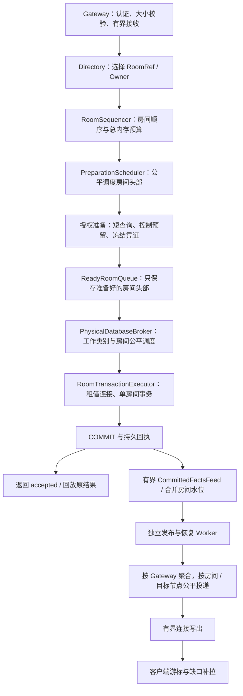

# 消息发送执行与房间隔离重设计

- 状态：实施中；各阶段实际实现与本地验证见 message-execution-redesign-implementation.zh-CN.md，尚未通过容量验收。
- 日期：2026-10-05。
- 范围：普通消息的房间调度、授权准备、Owner 数据库执行、提交后投递，以及这些阶段的资源边界。
- 首个验收负载：10,000 个在线 TCP 客户端、配对私聊、合计 1,000 条新消息/秒；不是每连接 1,000 条/秒，也不代表万人群广播的投递容量。
- 授权部分的后续范围调整：用户要求先落实状态归属与内存更新、不考虑真实环境闭环。账号、关系、陌生人设置改为“策略提交并更新内存后，新授权使用新状态；已授权消息允许完成”，具体边界及尚未替换的旧路径见 [授权内存状态重设计](policy-memory-state-redesign.zh-CN.md)。本文其余消息顺序、结果确定性、资源隔离及容量验收要求仍保留；下文要求保留原持久 grant 合同的段落描述原方案，不能据此恢复跨房间策略撤销等待。

## 1. 结论与约束

采用“房间顺序队列 + 物理数据库公平资源代理 + 单房间短事务 + 独立投递”。

同一房间的有顺序依赖写操作只有一个执行入口。不同房间不共享消息事务、不等待另一个房间的准备结果、不通过全局批次完成屏障相互等待。它们仍共享有限的 CPU、数据库和网络容量，因此目标是限制资源干扰，而不是承诺物理资源完全隔离。

保留固定 operation 身份、fingerprint、首次截止、永久接受/关闭回执、Owner epoch 和 activation 围栏。accepted 仍仅表示持久接受，不表示在线送达。任何移除永久回执或改变权限合同的方案，都属于另一个协议变更，不混入此次性能重构。

当前实现已经支持不同房间的独立事务和并行执行。本提案改变的是多层调度与资源占用，不把现状描述成全局单线程。OwnerBatcher 的槽从 acquiringConnection 就开始占用；释放等待中的这类“事务执行槽”不能创造数据库连接，也不能消除慢 SQL。

## 2. 新链路

每个命令携带稳定 operation 身份、不可变负载与已计算字节数、原始 deadline、不可变 route/activation 身份，以及全程资源票据。全程票据从接收入队到实际结束只记一次；阶段迁移不重置 deadline，不产生第二份可用内存额度。

## 3. 房间顺序与公平性

RoomSequencer 是房间写操作的唯一顺序责任人，替代 RoomTurnLane 与 OwnerBatcher 同时维护发送顺序的职责重叠。保留一个房间内顺序队列，只有头部可以进入有副作用的准备阶段。发送、修改、撤回，以及当前依赖同一房间 lane 的成员/权限写操作必须通过相同顺序接口；不能给发送增加旁路。

入队顺序是本次 activation 的处理顺序，不对跨客户端的真实发送时间或跨重连到达顺序作承诺。消息 roomSequence 只在事务中为真正接受的消息分配。重放、拒绝、取消的请求不能凭进程内排队位置消耗持久序号。房间迁移后的权威仍由数据库围栏与日志决定，内存队列不是权威。

PreparationScheduler 和 ReadyRoomQueue 都按房间轮转，使用有上限的 deficit round robin：每个房间每轮取一个 turn，按命令数和字节数扣除成本。SQL 实际耗时单独观测，不假装字节数能准确预测执行时间。单房间只有一个正在准备或执行的 turn；准备很慢的 A 仅阻挡 A 的后续写，不阻挡 B 的准备。

全局和单房间同时限制保留命令数与字节数。一个热房间不能吃满全局内存预算；多个房间用尽总预算时仍会发生全局拒绝。队列采用 deque / 侵入式索引，避免在繁忙路径反复 Array.removeFirst 和全队列扫描。计时使用调度器统一的最近截止唤醒机制，不为每条等待消息创建常驻轮询任务。

空闲房间的首条消息立即准备，不为跨房间合批等待。只合并同房间已经排队、身份兼容、连续且未越过状态变化屏障的发送。批量上限取已有协议上限、字节上限与配置上限的最小值；第一版不增加现有上限。不同房间永不共用消息事务。已具有业务原子性的 turn 不能拆开；普通独立命令遇到已证明的提交前错误，可沿用确定性隔离逻辑，但不能盲目整体重试。

## 4. 授权准备不占 Owner 写执行资源

准备阶段保留现有合同所需的回执预读、路由读取、预算快照和控制授权预留；预读只是执行优化，最终回执与围栏仍在 Owner 事务中验证。

分步执行短 owner 查询与短 control 查询，释放前一步连接后再请求下一步资源。禁止持有 Owner 连接等待控制 RPC，禁止持有控制连接再申请 Owner 连接。若现行控制合同依赖跨步骤锁持有，须先将它明确转换为可持久恢复的冻结 grant，不能直接删除锁或降低权限校验。

准备产物是 store 签发的不可变 PreparedRoomTurn，绑定 operation、fingerprint、Owner、epoch、activation、权限版本/现行 grant、有效期和原始 deadline。不同阶段不能 retarget。失效凭证不能在执行器中悄悄刷新成另一份授权；在开始事务前返回准备状态时必须保持原身份、原截止和队列顺序。开始事务后的错误按事务确定性处理。

权限变化与消息的线性化点继续遵循现行持久 grant 合同；仅检查一个缓存版本不能替代该合同。永久回执重放也继续遵循原权限/正文访问规则。取消与关闭后的 grant 由现有持久协调器核对并终结，不能通过释放内存票据宣称授权已退还。

PreparationScheduler 有独立有界等待与工作数，但短 SQL 必须经过相应数据库资源代理。这些工作数只限制任务数量，不额外增加数据库额度。

## 5. 一个物理数据库资源代理，消除串联资源队列

PhysicalDatabaseBroker 按进程内规范化的物理数据库配置身份管理资源；同一个数据库被多个逻辑 owner 使用时必须共享预算。凭据和数据库 URL 不进入日志。跨进程仍需在部署配置中核算总连接，进程内代理不提供集群全局额度。

代理统一管理 foreground write、control、interactive read、sync 和必要维护的公平等待；保护当前 renewal/恢复所需的额度。可借用闲置预留，但不能抢占已开始的工作，不能让写入把读恢复与续租全部挤出。不同物理数据库独立代理，不设全局串行许可。

OwnerBatcher 不再先创建 N 个任务占满 batch 槽，再分别排队申请 admission 和连接。ReadyRoomQueue 仅注册一个有界可撤销需求；资源可用后，代理从 ready 房间中选一个 turn，直接交给执行器。等待条目不持有连接或“实际事务执行”许可。

要实现上述语义，必须将连接的租借/归还与调度放到同一资源适配器内，或让底层池提供可用性回调。现有 Fluent 的 withConnection 不能被假定为即时成功：适配器允许最多与连接上限相等的有界租借任务，并单独计为 borrowing；不能移除显式准入后让无界任务在 Fluent 内部排队。若短期不能统一全部使用者，就保留现有总额准入，先统一 owner 路径，再逐项接入其余使用者，不能让两套代理同时对同一连接容量签发额度。

连接建立、失效重连仍可能等待，这必须有独立指标和受原 deadline 限制的超时。执行容量与可租借物理容量关联，初始沿用当前总连接预算；不把“移除固定 5 槽”替换成无限并发。borrow 完成后立即核对取消、token 与 deadline，再 BEGIN。资源释放前必须确认事务已结束或连接已隔离，不把调用方取消当作 SQL 已停止。

## 6. Owner 短事务

RoomTransactionExecutor 接受一个房间的 turn 和一条专属连接，不再次排队申请连接。事务内只执行必须原子的本地数据库工作：

1. 按现行统一顺序取得 operation 锁及 Owner / activation 围栏，校验不可变身份。
2. 读取并回放永久 receipt / completion / closure；冲突走原合同。
3. 对新操作验证冻结授权及其现行持久约束，执行消息领域规则。
4. 以集合 SQL 写消息、房间日志/序号、接受结果、执行回执及原合同要求的证明。
5. 执行必须同事务的容量扣减，随后立即 COMMIT。

具体锁顺序以全量 writer 审计后形成的一份规范为准；这里只规定结构，不凭此文调整某一个入口的锁顺序。先落地各类 writer 的锁顺序表和并发回归，再改变 SQL。

事务内不做远端 RPC、订阅发现、客户端连接写出、接收者遍历，也不等待另一个房间。身份、正文不可变信息在入队时完成编码与验证；数据库权限和状态不能据此省略。必须留在事务内的成本由 stage trace 衡量，而不是为了减少 SQL 条数破坏合同。

共享 shard quota 行仍然可能产生跨房间锁等待。首版保留其精确事务语义，将它放在满足原锁顺序的最晚合法位置，锁后不再执行远程/准备工作。不给它归因全部性能问题。若测得它成为主要限制，再单独设计持久 credit 租约：先原子预留总额度、消息事务消费不可伪造 credit、失败回收需证明未消费且原执行已终结；不能简单把计数器拆成多行并放大总额度。

## 7. 结果确定性、取消与迁移

| 状态 | 允许的行为 |
| --- | --- |
| queued / preparing / ready，确定未启动 Owner 写事务 | 取消注册，释放对应内存；已产生的控制 grant 交持久协调器收尾 |
| borrowing，尚未 BEGIN | 等租借任务真正结束或撤销确认，再归还资源；不得重复归还 |
| executing，SQL 已启动 | 尝试取消并等待真实 rollback / commit；保留房间所有权与连接责任 |
| committed | 返回稳定 receipt，投递异步推进；后续客户端取消不撤销接受结果 |
| outcome unknown | 保持原 operation，用原恢复路径核对；不换 ID 重发，不返回明确未接受 |
| token 失效 / retiring | 拒绝旧 token 新派发；等待实际执行终结；新 activation 仍须受数据库围栏约束 |

已证明 rollback 与“不知道 COMMIT 是否成功”必须有不同类型。连接无法确认终结时必须隔离/关闭并依靠数据库围栏和原恢复机制处理，不能只释放房间内存标记然后让旧后台任务继续写。未知结果期间不得承诺后续同房间写操作可以绕过现行隔离/恢复规则。

关闭进程依次停止入口、撤销 queued/ready 需求、等待 borrow/SQL 实际结束、排空可完成的发布工作。超出停机预算的任务留下可持久恢复的责任；不能丢弃 grant、receipt 或 durable publish 责任。

## 8. 提交后投递与读取隔离

保留现有 CommittedFactsFeed：提交后同步写入有界内存 mailbox，容量不足合并 dirty head，由持久房间日志恢复。进程在 COMMIT 后、写 mailbox 前崩溃的窗口必须依靠现有持久责任/日志扫描恢复；不能把内存水位当作 outbox。迁移时确认现有扫描覆盖所有已提交但未发布的房间，否则必须在原消息事务内补持久发布责任。

ACK 不等待接收者列表解析或发布 RPC。独立 worker 公平选择房间，按目标 Gateway 聚合并设每个目标的并发与字节上限，避免一个慢节点耗尽全部发布工作数。聚合只是网络批次，不能绑定不同房间的数据库提交结果或产生整批完成屏障。

慢客户端只影响自己的有界写出队列；溢出后按既有协议降级到补拉/断开恢复，不能悄悄丢消息却继续推进客户端确认游标。推送可以合并，持久日志及恢复责任不能丢。大群的扇出数与字节数单独计量，发送输入速率不等于投递速率。

纯读取使用已验证的 lifecycle read pin 和独立读取准入，不申请房间写 reservation；读取返回持久快照及 H，客户端用 C 补缺口。成员变化、正文访问权限仍在读取边界校验。订阅修复/重连浪涌有独立有界预算，不能与普通互动读取互相吃尽容量。

## 9. 过载与指标

队列容量由原连接预算、实测完成率和可接受等待时间决定，不能以“多缓存几秒”掩盖吞吐不足。初始不增加现有内存/连接总上限；每房间上限从总预算中切分，并保留其他房间可用份额。禁止 Gateway 为每个 retry 创建新的后台队列。

使用原始单调 deadline，并限制每阶段等待为剩余总预算与该阶段上限的较小值。排队估算不满足剩余预算时尽早返回临时 SERVER_BUSY；不生成永久负向 receipt。retryAfter 来自受限的压力估计，客户端沿用原 operation、总尝试上限和抖动退避。对提交结果未知只能恢复，不能按忙重投新身份。

每条 operation 的内部 trace 区分 gateway queue、room queue、prepare owner read、control authorization、ready wait、connection borrow、fence/lock wait、SQL body、COMMIT、ACK，以及独立的 publish/delivery；嵌套阶段不能直接相加。指标使用低基数标签，room/user/operation 只进入受控 trace，不进入 metrics label，也不记录正文。

独立导出 queued、preparing、ready、borrowing、executing、unknown；报告阶段 retained bytes、命令/事务、热房间服务份额、连接利用率、锁等待、拒绝原因和客户端恢复结果。排队中的房间数不能计作执行并发。

## 10. 代码迁移映射

| 现有组件 | 迁移目标 |
| --- | --- |
| V2RoomTurnLane / V2RoomCommandBudget | 保留生命周期与全程预算合同，收敛为唯一 RoomSequencer；覆盖所有有顺序依赖的写操作 |
| V2DurableSendOperationPreparationCollector | PreparationScheduler；公平选择房间头部，无全 cohort 完成屏障 |
| V2DurableSendOperationOwnerBatcher | ReadyRoomQueue + RoomTransactionExecutor；移除 acquiringConnection 与执行槽混用及重复房间顺序队列 |
| V2DatabaseWorkAdmissionController / 连接租借适配 | 分阶段统一为 PhysicalDatabaseBroker；保留读/写/控制/续租预算，不双重签发容量 |
| PostgresV2MessageSendOperationStore | 拆成准备、连接已租借执行、结果恢复边界；保留 receipt/fence 与原子写逻辑 |
| V2RoomCommittedFactsFeed / SubscriptionDeliveryPump | 保留持久恢复与有界 mailbox，验证 ACK 不等待投递，并补房间/目标公平性指标 |
| GatewayRoomOwnerAssembly | 只按物理配置身份创建共享 broker、scheduler、executor；显式注册 shutdown 顺序 |

阶段一：增加 operation 关联的分阶段计时与资源计账，建立取消、未知提交和迁移的基线；运行旧链路取得同负载证据。

阶段二：替换 Owner 调度与连接资源接口，保留现有授权准备及 SQL；首先证明一间房准备/等待不会卡住另一间房可用资源上的执行。

阶段三：合并重复房间队列，接入准备公平调度与同房间机会批处理；逐个迁移有顺序依赖的 writer，禁止旧/新执行器同时服务同一个 activation。切换需停止接入、排空或隔离旧执行、再启用新执行；回滚采用同样流程，不进行双写。

阶段四：依据 trace 优化必要 SQL 与投递；共享 quota 优化只在锁等待证据支持时进入。各阶段用开关切换与相同负载对照，避免同时改调度、权限语义和数据库 schema 后无法归因。

## 11. 验收

正确性先于吞吐：跨房间独立推进；同房间无重入；消息与 receipt 原子；ACK 丢失后恢复原结果；不同正文同身份冲突；grant 与权限变化竞赛；旧 token 写拒绝；排队/租借/BEGIN/COMMIT 各阶段取消；连接中断和 COMMIT unknown；关闭后无遗留可写任务。慢房间测试用可控屏障和至少两个可用资源槽，不能用 sleep 的时间差作为唯一证据；同时覆盖共享资源全部耗尽时仍按公平规则恢复。

容量验收沿用本次实际配对私聊拓扑与总物理预算：10,000 在线，开放式计划输入 1,000 新消息/秒。统一消息窗口至少 60 秒，单独记录正常 drain；报告计划/实际提交、首试 ACK、重试 ACK、unknown 恢复与拒绝，不能只报重试后的吞吐。首版暂定目标：稳定窗口首试临时拒绝率低于 1%，新消息 accepted p95 不高于 250 ms、p99 不高于 1 s，无正常客户端终端失败；这些是待实测的工程目标，不是已证明容量。最终每条 operation 有权威结果，最终游标无缺失，队列及内存无持续增长，关闭资源全部归还。

增加均匀多房间、单热房间、多个热房间、慢目标 Gateway、慢客户端、重连浪涌测试。均匀负载与热房间负载分别报告；被注入延迟的房间允许超时，但其他房间在保留资源可用时不能等待其完成。万人群另设发送数、接收人数和投递字节目标，不以此配对私聊验收外推。

本文件描述目标设计。生产调度修改、SQL 优化、实际测试和压测结果见 [落地记录](message-execution-redesign-implementation.zh-CN.md)；其中明确区分已完成项目与尚未统一的数据库资源边界，容量结论以实际验收为准。
