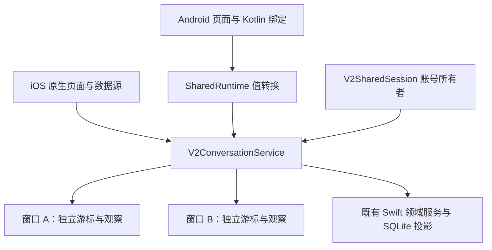

# 第十四阶段：统一会话门面与独立窗口

本阶段完成会话列表和消息时间线的首批业务门面迁移。iOS 原生 Swift 与 Android 绑定现在调用同一 `V2ConversationService`；授权、摘要恢复、未读和待发送快照逻辑集中在共享层。没有新增 Kotlin 业务实现。

## 变更范围

- `V2SharedSession.conversations` 为账号已打开的数据库注册唯一门面；退出先关闭服务与观察，再排空读取并关闭数据库。
- `V2ConversationService` 提供列表、完整列表、时间线及消息定位。iOS 保留完整列表 diff、待发送消息合并、权限检查和本地优先行为；Android 原有快照与页面调用保持兼容。
- `V2ConversationChangeNotifier` 从 App 移入共享层；保留原来的普通变更 150ms 合并、列表及安全变更立即通知、房间范围过滤。
- `V2ConversationWindow` 独立持有查询与游标，支持 `read`、`nextPage`、`reset`、`updates` 和 `close`。关闭窗口不关闭账号连接；流消费时同时检查账号所有权和查询代次，阻止缓冲中的旧页重新覆盖新页。
- Kotlin `SharedConversationWindow` 只转换请求、快照和取消。每窗口一个 Flow 收集者；多个窗口独立观察。新窗口等待由 Swift 事件驱动，原有全局前台快照轮询本阶段保留。
- 取消尚未返回的新窗口请求会清理其句柄；Kotlin 也收养并关闭被 dispatcher 取消交接丢弃的成功结果。每账号最多 128 个窗口，关闭页面时应显式关闭；事件缓冲有界。

## 实际验收

| 范围 | 最终结果 |
| --- | --- |
| iOS 行为回归 | 192 项通过，0 失败；含会话列表、时间线、投影通知、账号所有权、离线启动和恢复 |
| 共享 Swift 单元测试 | 12 项通过；含独立分页/观察、关闭兄弟窗口、权限撤销、旧缓冲拒绝、关闭等待读取及会话生命周期 |
| iOS 真实后端页面 | 2 个功能用例通过，另 2 个隔离范围清理用例通过；注册、登录、同步、消息发送、前后台、退出、A→B→A 与冷启动 |
| macOS 原生 Swift 真实后端 | 1 项通过；双端消息/回复/回应、原生独立窗口、搜索、断线与恢复、关闭后旧窗口失效、账号隔离 |
| Android 真实后端 | 最终原生库通过 App 登录/同步/收发、独立窗口分页和观察、关闭兄弟窗口、退出后旧句柄失效、140 次取消窗口打开、断线队列重开及账号切换；客户端/操作句柄泄漏均为 0 |
| 构建与绑定 | Android 普通 Debug、Release、App/sharedsdk/swiftplatform lint 及相关单元测试通过；实际 dylib C ABI 加载/关闭通过 |
| 兼容性 | 旧五模块 6,079 条公开符号记录逐字一致；共享原生模块由 32 条增至 94 条，原有条目无删除或修改 |

公开符号记录包含类型、属性、枚举项和协议实现，不等于业务方法数量。本阶段没有直接删除低层 API；旧值类型及组合层初始化入口作为迁移兼容边界保留。

普通未签名 Release 为 **39,081,174 字节（37.27 MiB）**。原生库解压合计 96,770,528 字节，在 APK 内为 35,976,592 字节。验收使用独立验证 Debug 包，不能据此宣称正式 Release 分发已验收。

## 证据与边界

- [总览](summary.json)、[iOS 单元测试](ios-unit-summary.json)、[iOS 后端](ios-backend-summary.json)、[原生 Swift 测试](native-tests.json)。
- [Android 后端](android-backend.json)、[打包](android-packaging.json)、[C ABI](c-abi.json)、[接口兼容](api-compatibility.json)、[源码指纹](source-sha256.json)。
- [保留的初次失败](retained-failures.json)：首次隔离服务启动发生 IO 错误；原生后端首轮目录等待超时，网关同时记录 journal sourceNotReady。保留日志位置，最终重跑全部通过，不将未定位原因写成已修复的业务缺陷。
- [清理](cleanup.json)：已停止本次隔离后端、移除两个专用 iOS 模拟器与专用 Android AVD；保留用户已有模拟器，未修改系统信任库。

真实后端为本机隔离 PostgreSQL、HTTPS edge 和 TLS 网关，使用模拟器/模拟设备，并非生产或真机验收。多窗口能力验收在 SDK 与绑定层；没有新增 macOS/Windows 多窗口 App UI。联系人、资源等其他领域尚未全部迁移到新门面。Windows 适配、原生验证和签名分发缺口保持原有状态。旧综合 iOS 无障碍测试的 Dynamic Type 限制未在本阶段宣称解决。

## 复现入口

1. `xcrun swift test --package-path IMV2ClientKit --filter 'ConversationFacadeTests|SharedSessionOwnershipTests|SharedPlatformTests'`。
2. 通过仓库 `verify_v2_isolated_native_account.py --hold-seconds 900 --resource-part-uploads` 启动隔离后端；macOS 测试使用输出的 `IM_SHARED_BACKEND_ENDPOINTS` 运行 `SharedDesktopBackendTests`。
3. `python3 experiments/swift-android/build_probe.py --shared-sdk --reuse-capabilities` 重建原生库；指定设备与后端运行 `IMAndroid/scripts/verify_shared_sdk.py --phase 5`，新增窗口断言随该用例执行。
4. iOS 使用 `IMAPP_LOCAL_TWO_INSTALL_SHARED_SESSION_ONLY=true` 和显式指定的两个模拟器运行隔离后端脚本 `--account-switch-ui`；普通 App 单元回归选择本报告列出的六个测试套件。
5. `python3 IMAndroid/scripts/export_sdk_api_inventory.py --check` 检查已导出清单与当前源码匹配；源码变更后需重新构建、提取 symbol graph 并导出。
