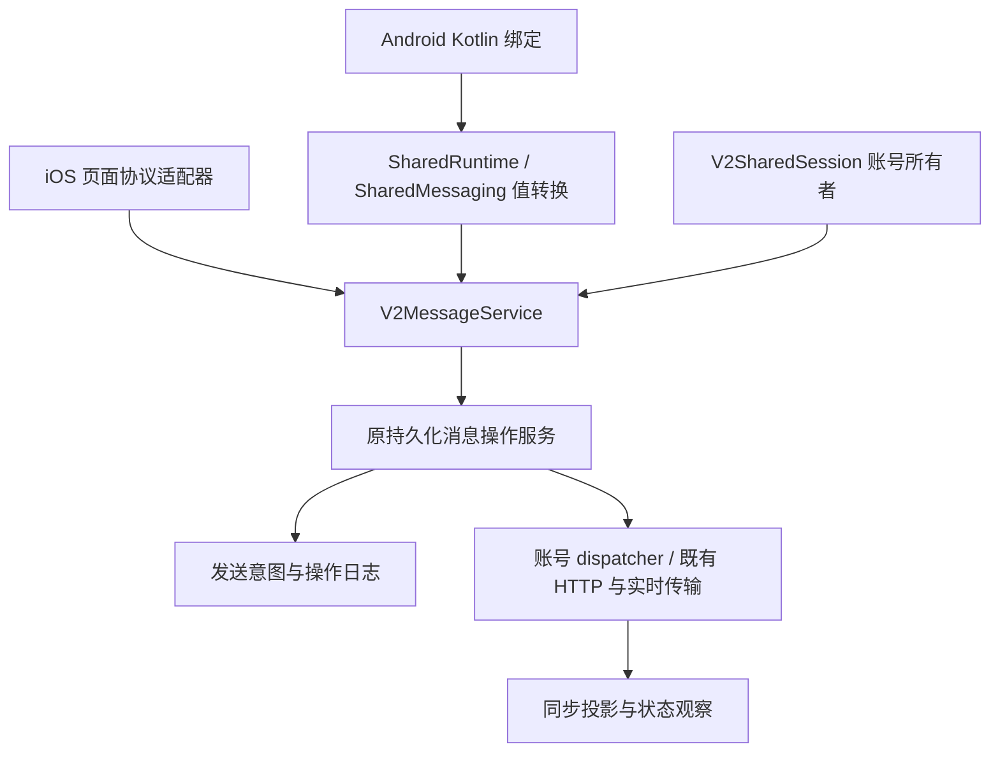

# 第十五阶段：统一消息业务门面

新增账号级 `V2MessageService`，iOS 原生 Swift 与 Android 绑定共用发送、编辑、撤回、回复、转发和表情回应入口。没有新增 Kotlin 业务实现，也未修改网络协议、数据库 schema 或平台 HTTP/TLS/凭据适配。

## 实现

- 文本及回复使用 `send`。先冻结稳定身份，再交给既有持久化执行器；取消调用不会删除已冻结的消息。离线恢复继续使用原身份。
- `edit`、`withdraw`、`react`、`forward` 统一消息引用、读取权限及修订校验，并复用原服务的身份去重、未知结果确认、回应目标状态合并与转发计划。最终显示以服务端同步投影为准。
- 附件仍由原资源适配器准备；`sendPreparedAttachments` 使用既有资源引擎原子保存消息消费者和上传依赖，不新增上传实现。
- 重试、转发取消、发送确认和操作状态流进入同一门面；观察者独立，缓冲有界。`close` 拒绝新工作、取消订阅并排空物理操作；`V2SharedSession` 在数据库关闭前完成门面清理。
- iOS 保留页面协议、草稿、去空白规则、排队反馈、资源恢复和页面路由；生产组合注入共享门面。旧内部构造入口保留为兼容入口，既有测试/宿主可继续使用。
- Android 的 C/JNI/JSON/Kotlin 方法和 UI 未改变。`SharedMessaging` 与 `SharedInteractions` 保留快照展示适配，消息执行器和回应准备由门面提供。

## 已完成验证

| 范围 | 结果 |
| --- | --- |
| iOS 单元回归 | 174 项通过，0 失败，含发送、编辑、撤回、回应、转发、取消、会话页面、账号与恢复 |
| 共享层 | 16 项通过；新增门面覆盖离线持久化、重复编辑身份、错误引用、转发取消、独立观察、关闭排空及旧服务拒绝 |
| 底层消息领域 | 34 项通过；保留发送、修订、回应和转发的原有合同 |
| iOS 真实后端页面 | 3 个功能用例与 2 个清理用例通过：注册登录、发送/回复/编辑/回应/跨群转发/撤回、A→B→A、前后台及冷启动恢复 |
| macOS 原生 Swift 真实后端 | 双客户端确认发送、编辑、回复、转发、回应添加/移除、撤回；继续通过窗口独立性、搜索、断线、重开、无重复发送与账号隔离 |
| Android 真实后端 | 第 5、9、10、11 阶段的四组场景通过：文本/图片/文件、回复转发、回应、编辑撤回、搜索已读、断线恢复、多窗口、取消、账号切换；客户端与操作句柄泄漏均为 0 |
| 构建与绑定 | 普通 Android Debug/Release、App/sharedsdk/swiftplatform lint 及相关单元测试通过；实际 dylib C ABI 生命周期通过 |
| API 兼容 | 旧五模块的 6,079 条符号记录逐字一致；共享原生模块由 94 条增至 120 条，旧条目无删除或修改 |

公开符号记录包含类型、属性、枚举项和函数，并非业务 API 数量。本阶段仍保留组合层参数和旧领域状态类型，未执行底层 API 删除。

普通未签名 Release：**39,109,042 字节（37.30 MiB）**；原生库解压共 96,857,264 字节，在 APK 内压缩为 36,004,461 字节。普通包不含隔离后端 CA。设备验收使用专用验证 Debug 包，不代表正式 Release 分发验收。

## 证据

- [总览](summary.json)、[iOS 后端](ios-backend-summary.json)、[iOS 单元测试](ios-unit-summary.json)、[共享与领域测试](unit-tests.json)、[原生 Swift 后端](native-backend.json)。
- Android：[会话与账号](android-phase5.json)、[图片文件](android-phase9.json)、[编辑撤回](android-phase10.json)、[回复转发回应](android-phase11.json)。
- [打包](android-packaging.json)、[C ABI](c-abi.json)、[接口对照](api-compatibility.json)、[源码指纹](source-sha256.json)、[保留的开发与初次验收失败](retained-failures.json)。

原生测试宿主初次连接后曾进入 offline 并等待超时；测试宿主现在在初始化目录阶段最多重连三次，生产连接策略未修改。最终验收记录保留实际重连次数，不把它描述成已定位并修复的服务端问题。

本次专用 iOS 模拟器、Android AVD 和全部隔离后端已清理，用户原有模拟器保留；见 [清理记录](cleanup.json)。

## 验证边界

真实后端是本机隔离 PostgreSQL、HTTPS edge 与 TLS 网关；未使用生产账号。iOS/Android 使用模拟器，macOS 验证共享 SDK，没有验证桌面 App UI、真机或签名分发。原有广泛无障碍审计的 Dynamic Type 限制未宣称解决。搜索、已读、资源上传下载等其他领域未在本阶段整体迁移到新门面；Windows 适配与原生执行缺口仍然存在。

复现入口：共享测试选择 `MessageFacadeTests|ConversationFacadeTests|SharedSessionOwnershipTests|SharedPlatformTests`；领域测试选择四个 `V2*WorkTests` 消息套件；macOS 使用 `IM_SHARED_BACKEND_ENDPOINTS` 运行 `SharedDesktopBackendTests`。Android 重建共享原生库后，用明确设备和隔离端点运行 `verify_shared_sdk.py --phase 5/9/10/11`。iOS 的隔离后端脚本使用 `--account-switch-ui`，同时设置 `IMAPP_LOCAL_TWO_INSTALL_SHARED_SESSION_ONLY=true` 与 `IMAPP_LOCAL_TWO_INSTALL_MESSAGE_FACADE_ONLY=true`，显式提供两个测试模拟器。
